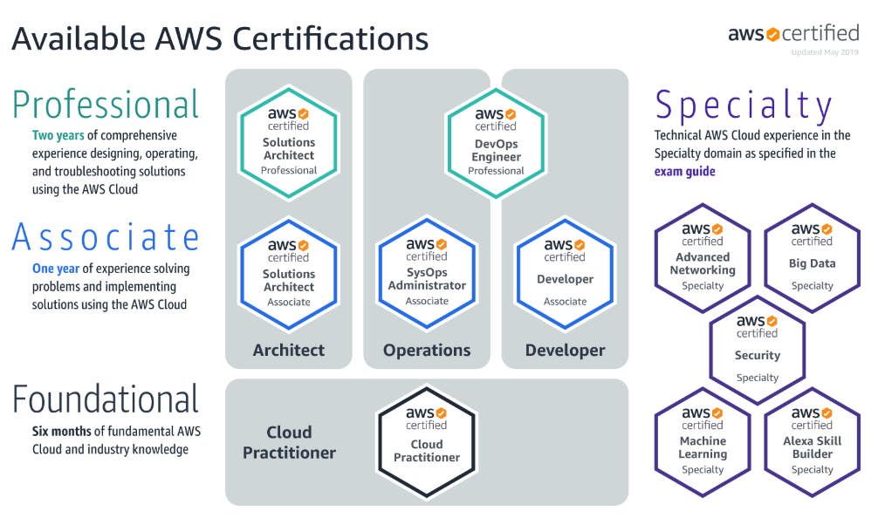

## Слайд 1: Course Introduction

AWS Academy Cloud Foundations

> **Нотатки:**
>
> Welcome to AWS Academy Cloud Foundations!

---

## Слайд 2: Module overview

**Topics**

- Course objectives and overview
- AWS certification exam information
- AWS Documentation

**Activities**

- AWS Documentation scavenger hunt

> **Нотатки:**
>
> This course introduction module will address the following topics:  
>
> Course objectives and overview  
> AWS certification exam information  
> AWS Documentation  
> The module concludes with a scavenger hunt activity that challenges you to locate information in the AWS Documentation.

---

## Слайд 3: Module objectives

After completing this module, you should be able to:

- Recognize the purpose of the AWS Academy Cloud Foundations course
- Recognize the course structure
- Recognize the AWS certification process
- Navigate the AWS Documentation website

> **Нотатки:**
>
> After completing this module, you should be able to:  
> Recognize the purpose of the AWS Academy Cloud Foundations course  
> Recognize the course structure  
> Recognize the AWS certification process  
> Navigate the AWS Documentation website

---

## Слайд 4: Section 1: Course objectives and overview

Course Introduction

> **Нотатки:**
>
> Introducing Section 1: Course objectives and overview.

---

## Слайд 5: Course prerequisites

- General Required Knowledge
  - IT technical knowledge
  - IT business knowledge
- Preferred Knowledge
  - Familiarity with cloud computing concepts
  - Working knowledge of distributed systems
  - Familiarity with general networking concepts
  - Working knowledge of multi-tier architectures

> **Нотатки:**
>
> To begin, it is important to have an understanding of the prerequisites for this course.  
>
> First, you should have general IT technical knowledge. The foundational computer literacy skills you will need to be successful in this course include a knowledge of basic computer concepts, file management, and a good understanding of the internet.  
>
> Second, you should have general IT business knowledge. This includes insight into how information technology is used by businesses and other organizations.  
>
> Additionally, to ensure success in this course, it is preferred that you have:  
> A general familiarity with cloud computing concepts  
> A working knowledge of distributed systems  
> Familiarity with general networking concepts  
> A working knowledge of multi-tier architectures

---

## Слайд 6: Course objectives

After completing this course, you should be able to:

- Define the AWS Cloud.
- Explain the AWS pricing philosophy.
- Identify the global infrastructure components of AWS.
- Describe security and compliance measures of the AWS Cloud including AWS Identity and Access Management (IAM).
- Create an AWS Virtual Private Cloud (Amazon VPC).
- Demonstrate when to use Amazon Elastic Compute Cloud (EC2), AWS Lambda and AWS Elastic Beanstalk.
- Differentiate between Amazon S3, Amazon EBS, Amazon EFS and Amazon S3 Glacier.
- Demonstrate when to use AWS Database services including Amazon Relational Database Service (RDS), Amazon DynamoDB, Amazon Redshift, and Amazon Aurora.
- Explain AWS Cloud architectural principles.
- Explore key concepts related to Elastic Load Balancing (ELB), Amazon CloudWatch, and Auto Scaling.

> **Нотатки:**
>
> After completing this course, you should be able to:  
> Define the AWS Cloud.  
> Explain the AWS pricing philosophy.  
> Identify the global infrastructure components of AWS.  
> Describe security and compliance measures of the AWS Cloud including AWS Identity and Access Management (IAM).  
> Create an AWS Virtual Private Cloud (Amazon VPC).  
> Demonstrate when to use Amazon Elastic Compute Cloud (EC2), AWS Lambda and AWS Elastic Beanstalk.  
> Differentiate between Amazon S3, Amazon EBS, Amazon EFS and Amazon S3 Glacier.  
> Demonstrate when to use AWS Database services including Amazon Relational Database Service (RDS), Amazon DynamoDB, Amazon Redshift, and Amazon Aurora.  
> Explain AWS Cloud architectural principles.  
> Explore key concepts related to Elastic Load Balancing (ELB), Amazon CloudWatch, and Auto Scaling.

---

## Слайд 7: Course outline

- Module 1: Cloud Concepts Overview
- Module 2: Cloud Economics and Billing
- Module 3: AWS Global Infrastructure Overview
- Module 4: AWS Cloud Security
- Module 5: Networking and Content Delivery

- Module 6: Compute
- Module 7: Storage
- Module 8: Databases
- Module 9: Cloud Architecture
- Module 10: Automatic Scaling and Monitoring

> **Нотатки:**
>
> To achieve the course objectives, the course explores the following topics:  
> Cloud concepts  
> Cloud economics and billing  
> AWS Global Infrastructure  
> AWS Cloud security  
> Networking and content delivery  
> Compute  
> Storage  
> Databases  
> Cloud architecture  
> Automatic scaling and monitoring  
>
> The next ten slides provide more detail on what subtopics are covered in each module.

---

## Слайд 8: Module 1: Cloud Concepts Overview

Module sections:

- Introduction to cloud computing
- Advantages of cloud computing
- Introduction to Amazon Web Services (AWS)
- Moving to the AWS Cloud – The AWS Cloud Adoption Framework (AWS CAF)

> **Нотатки:**
>
> In this module, Section 1 introduces cloud computing.  
>
> In Section 2, you learn about the advantages that cloud computing provides over a traditional, on-premises computing model.  
>
> In Section 3, you learn about what AWS is and the broad range of AWS products and services. You become familiar with the idea that AWS services are designed to work together to build solutions that meet business goals and technology requirements.  
>
> The module concludes with Section 4, which is about the AWS Cloud Adoption Framework (AWS CAF). It covers the fundamental changes that must be supported for an organization to successfully migrate its IT portfolio to the cloud.

---

## Слайд 9: Module 2: Cloud Economics and Billing

Module sections:

- Fundamentals of pricing
- Total Cost of Ownership
- AWS Organizations
- AWS Billing and Cost Management
- Technical support

> **Нотатки:**
>
> The purpose of this module is to introduce you to the business advantages of moving to the cloud.  
>
> Section 1 describes the principles for how AWS sets prices for the various services. This includes the AWS pricing model and a description of the AWS Free Tier: https://aws.amazon.com/free/.  
>
> Section 2 describes the Total Cost of Ownership and how customers can reduce their overall costs by moving IT services to the cloud. The section outlines four types of costs that are reduced by using cloud computing, and provides examples that illustrate each of these types.  
>
> Section 3 describes how customers can use AWS Organizations to manage their costs.  
>
> Section 4 describes billing and the components of the AWS Billing dashboard. This section includes a demonstration of how customers can use the dashboard to understand and manage their costs.  
>
> Finally, Section 5 describes the four different options for AWS Technical Support: Basic Support, Developer Support, Business Support, and Enterprise Support. The section also includes an activity that will help you understand the benefits of each support option.

---

## Слайд 10: Module 3: AWS Global Infrastructure Overview

Module sections:

- AWS Global Infrastructure
- AWS services and service category overview

> **Нотатки:**
>
> Module 3 provides an overview of the AWS global infrastructure.  
>
> In Section 1, you are introduced to the major parts of the AWS Global Infrastructure, including Regions, Availability Zones, the network infrastructure, and Points of Presence.  
>
> In Section 2, you are shown a listing of all the AWS service categories, and then you are provided with a listing of each of the services that this course will discuss. The module ends with an AWS Management Console clickthrough activity.

---

## Слайд 11: Module 4: AWS Cloud Security

Module sections:

- AWS shared responsibility model

- AWS Identity and Access Management (IAM)

- Securing a new AWS account

- Securing accounts

- Securing data on AWS

- Working to ensure compliance

> **Нотатки:**
>
> This module provides an introduction to the AWS approach to security.  
>
> In Section 1, you are introduced to the AWS shared responsibility model, which specifies which responsibilities belong to the customer and which responsibilities belong to AWS.  
>
> Section 2 introduces you to the key concepts of AWS Identity and Access Management (IAM), including users, groups, policies, and roles.  
>
> Section 3 provides guidance on how to secure a new AWS account. It discusses how you should avoid using the AWS account root user for day-to-day activities. It also discusses best practices, such as creating IAM users that have multi-factor authentication (MFA) enabled.  
>
> Section 3 highlights other ways to secure accounts. It discusses the security-related features of AWS Organizations, which include service control policies. This section also discusses AWS Shield, Amazon Cognito, and AWS Key Management Service (AWS KMS).  
>
> Section 5 discusses how to secure data on AWS. Topics include encryption of data at rest and data in transit, and discusses options for securing data that is stored on Amazon Simple Storage Service (Amazon S3).  
>
> Finally, Section 6 discusses how AWS supports customer efforts to deploy solutions that are in compliance with laws and regulations. It also discusses the certifications that AWS maintains and AWS services—such as AWS Config and AWS Artifact—that support compliance.

---

## Слайд 12: Module 5: Networking and Content Delivery

Module sections:

- Networking basics
- Amazon VPC
- VPC networking
- VPC security
- Amazon Route 53
- Amazon CloudFront

> **Нотатки:**
>
> The purpose of this module is to introduce you to the fundamental of AWS networking and content delivery services: Amazon Virtual Private Cloud (Amazon VPC), Amazon Route 53, and Amazon CloudFront. You will have the opportunity to label a virtual private cloud (VPC) network architecture diagram, design a VPC, watch how a VPC is built, and finally build a VPC yourself.  
>
> Section 1 discusses networking concepts that will be referenced throughout the rest of the module: network, subnet, IPv4 and IPv6 addresses, and Classless Inter-Domain Routing (CIDR) notation.  
>
> Section 2 provides an overview of the key terminology and features of Amazon VPC, which you must be familiar with when you design and build your own virtual private clouds (VPCs).  
>
> In Section 3, you learn about several important VPC networking options: internet gateway, network address translation (NAT) gateway, VPC endpoints, VPC sharing, VPC peering, AWS Site-to-Site VPN, AWS Direct Connect, and AWS Transit Gateway.  
>
> In Section 4, you learn how to secure VPCs with network access control lists (network ACLs) and security groups.  
>
> Section 5 covers Domain Name System (DNS) resolution and Amazon Route 53. It also covers the topic of DNS failover, which introduces the topic of high availability that you will learn about in more detail in module 10.  
>
> Finally, section 6 covers the features and benefits of Amazon CloudFront.

---

## Слайд 13: Module 6: Compute

Module sections:

- Compute services overview
- Amazon EC2
- Amazon EC2 cost optimization
- Container services
- Introduction to AWS Lambda
- Introduction to AWS Elastic Beanstalk

> **Нотатки:**
>
> This module provides an introduction to many of the compute services offered by AWS.  
>
> Section 1 provides a high-level, compute services overview.  
>
> Section 2 introduces you to the key concepts of Amazon Elastic Compute Cloud (Amazon EC2), including Amazon Machine Images (AMIs), instance types, network settings, user data scripts, storage options, security groups, key pairs, instance lifecycle phases, Elastic IP addresses, instance metadata, and the benefits of using Amazon CloudWatch for monitoring.  
>
> Section 3 focuses on the four pillars of cost optimization, with an emphasis on cost optimization as it relates to Amazon EC2.  
>
> Section 4 covers container services. It introduces Docker and the differences between virtual machines and containers. It then discusses Amazon Elastic Container Service (Amazon ECS), AWS Fargate, Kubernetes, Amazon Elastic Kubernetes Service (Amazon EKS), and Amazon Elastic Container Registry (Amazon ECR).  
>
> Section 5 introduces serverless computing with AWS Lambda. Event sources and Lambda function configuration basics are introduced, and the section ends with examples of a schedule-based Lambda function and an event-based Lambda function.  
>
> Finally, Section 6 describes the advantages of using AWS Elastic Beanstalk for web application deployments. It concludes with a hands-on activity where you deploy a simple web application to Elastic Beanstalk.

---

## Слайд 14: Module 7: Storage

Module sections:

- Amazon Elastic Block Store (Amazon EBS)
- Amazon Simple Storage Service (Amazon S3)
- Amazon Elastic File System (Amazon EFS)
- Amazon Simple Storage Service Glacier

> **Нотатки:**
>
> Module 7 introduces you to the various options for storing data with AWS. The module provides an overview of storages services—which are based on four different storage technologies—so that you can choose a storage service for various use cases.  
>
> Section 1 provides you with an overview of the functionality of Amazon Elastic Block Store (Amazon EBS) and a summary of common use cases. It also introduces the concept of block versus object storage, and how to interact with Amazon EBS through the AWS Management Console.  
>
> Section 2 provides an overview of the functionality of Amazon Simple Storage Service (Amazon S3) and a summary of common use cases. It also describes how Amazon S3 scales as demand grows and discusses the concept of data redundancy.  The section also contains a general overview of Amazon S3 pricing.  
>
> Section 3 starts with an overview of the functionality of Amazon Elastic File Store (Amazon EFS) and a summary of common use cases. It also provides an overview of the Amazon EFS architecture and a list of common Amazon EFS resources.  
>
> Finally, in Section 4, you are provided an overview of the functionality of Amazon Simple Storage Service Glacier and a summary of common use cases. This last section also describes the lifecycle of migrating data from Amazon S3 to Amazon S3 Glacier.

---

## Слайд 15: Module 8: Databases

Module sections:

- Amazon Relational Database Service (Amazon RDS)
- Amazon DynamoDB
- Amazon Redshift
- Amazon Aurora

> **Нотатки:**
>
> This module introduces you to four of the most commonly used AWS database services, with an emphasis on differentiating which database service to select for various use cases.  
>
> Section 1 provides an overview of the Amazon Relational Database Service (Amazon RDS). It describes the difference between a managed and unmanaged service, and provides an overview of how to provide a highly available Amazon RDS implementation.  
>
> In Section 2, an overview of the Amazon DynamoDB services is provided. The section also describes how DynamoDB uses data partitioning to address scenarios that call for high data volumes and the ability to scale out on demand.  
>
> Section 3 provides an overview of Amazon Redshift. The section describes the parallel processing architecture of Amazon Redshift, and how this architecture supports processing very large datasets. It also reviews some of the more common use cases for Amazon Redshift.  
>
> Finally, Section 4 provides an overview of Amazon Aurora. The module describes the use cases where Amazon Aurora is a better solution than Amazon RDS. It also discusses how Amazon Aurora provides a more resilient database solution through the use of multiple Availability Zones.

---

## Слайд 16: Module 9: Cloud Architecture

Module sections:

- AWS Well-Architected Framework
- Reliability and availability
- AWS Trusted Advisor

> **Нотатки:**
>
> The purpose of this module is to introduce you to designing and building cloud architectures according to best practices.  
>
> In Section 1, you learn about the AWS Well-Architected Framework and its purpose, how the framework is organized, and its design principles and best practices. You will also learn how to use it to design a cloud architecture solution that is secure, performant, resilient, and efficient. Finally, this section also introduces the AWS Well-Architected Tool, which can be used to evaluate your architectural designs against AWS Well-Architected Framework best practices.  
>
> In Section 2, you learn about reliability and high availability, which are two factors to consider when you design an architecture that can withstand failure.  
>
> In Section 3, you learn about AWS Trusted Advisor. You can use this tool to evaluate and improve your AWS environment when you implement your architectural designs.

---

## Слайд 17: Module 10: Automatic Scaling and Monitoring

Module sections:

- Elastic Load Balancing
- Amazon CloudWatch
- Amazon EC2 Auto Scaling

> **Нотатки:**
>
> The purpose of this module is to introduce you to three fundamental AWS services that can be used together to build dynamic, scalable architectures.  
>
> Section 1 introduces you to Elastic Load Balancing, which is a service that automatically distributes incoming application traffic across multiple targets, such as Amazon EC2 instances, containers, IP addresses, and Lambda functions.  
>
> Section 2 introduces you to Amazon CloudWatch, which is a service that provides you with data and actionable insights to monitor your applications, respond to system-wide performance changes, optimize resource utilization, and get a unified view of operational health.  
>
> Finally, Section 3 introduces you to the Amazon EC2 Auto Scaling features that help you maintain application availability and enable you to automatically add or remove EC2 instances according to conditions that you define.

---

## Слайд 18: Section 2: AWS certification exam information

Course Introduction

> **Нотатки:**
>
> Introducing Section 2: AWS certification exam information.

---

## Слайд 19: AWS certification exams

*This course helps prepare you for the AWS* ***Cloud Practitioner*** *certification exam*

> **Нотатки:**
>
> AWS Certification helps learners build credibility and confidence by validating their cloud expertise with an industry-recognized credential, and it helps organizations identify skilled professionals who can lead cloud initiatives by using AWS.  
>
> You must earn a passing score via a proctored exam to earn an AWS Certification. After receiving a passing score, you will receive your certification credentials.  
>
> AWS Certification does not publish a list of all services or features that are covered in a certification exam. However, the exam guide for each exam lists the current topic areas and objectives covered in the exam. Exam guides can be found at https://aws.amazon.com/certification/certification-prep/?src=certification-faqs.  
>
> You will be required to update your certification (or recertify) every 3 years. View the AWS Certification Recertification page at https://aws.amazon.com/certification/recertification/ for more details.  
>
> The information on this slide is current as of November 2019. However, exams are frequently updated and the details regarding which exams are available—and what is tested by each exam—are subject to change.  
>
> For the latest AWS certification exam information, go to https://aws.amazon.com/certification/.

---

## Слайд 20: AWS Certified Cloud Practitioner exam

- Details about the exam—including how to register for it—are at  
[https://aws.amazon.com/certification/certified-cloud-practitioner/](https://aws.amazon.com/certification/certified-cloud-practitioner/)
  - Download and carefully read the AWS Certified Cloud Practitioner Exam Guide at [https://d1.awsstatic.com/training-and-certification/Docs - Cloud Practitioner/AWS_Certified_Cloud_Practitioner-Exam_Guide_EN_v1.6.pdf](https://d1.awsstatic.com/training-and-certification/Docs%20-%20Cloud%20Practitioner/AWS_Certified_Cloud_Practitioner-Exam_Guide_EN_v1.6.pdf)
  - Download the sample exam questions at [https://d1.awsstatic.com/training-and-certification/Docs - Cloud Practitioner/AWS Certified Cloud Practioner_Sample Questions_v1.1_FINAL.PDF](https://d1.awsstatic.com/training-and-certification/Docs%20-%20Cloud%20Practitioner/AWS%20Certified%20Cloud%20Practioner_Sample%20Questions_v1.1_FINAL.PDF)
- See the recommended path to attain the certification at [https://aws.amazon.com/training/path-cloudpractitioner/](https://aws.amazon.com/training/path-cloudpractitioner/)
  - AWS Academy Cloud Foundations covers much of the same material found in the Cloud Practitioner Essentials course, but in greater depth.
  - There is additional free digital training available at [https://www.aws.training/](https://www.aws.training/).

> **Нотатки:**
>
> The AWS Certified Cloud Practitioner certification provides individuals in various cloud and technology roles with a way to validate their AWS Cloud knowledge and enhance their professional credibility. This exam covers four domains, including cloud concepts, security, technology, and billing and pricing.  
>
> The AWS Certified Cloud Practitioner exam is the only AWS certification exam that is classified as foundational (as shown on the previous slide). It is often the first AWS exam that IT professionals attempt to obtain.  
>
> Though this AWS Academy Cloud Foundations course is not listed in the AWS Certified Cloud Practitioner Exam Guide as one of the AWS training options recommended to prepare for the exam, this course does cover many of the same topics that are covered by AWS commercial courses, such as AWS Technical Essentials, AWS Business Essentials, and AWS Cloud Practitioner Essentials. Therefore, the AWS Academy Cloud Foundations course you are taking now is a good way to help prepare yourself to take this exam.  
>
> The services included in the AWS Certified Cloud Practitioner exam change as new services are added. At a minimum, you should be able to describe the overall functionality of a broad range of AWS services before taking the exam. For an overview of the AWS services see the Amazon Web Services Cloud Platform section of the Overview of Amazon Web Services whitepaper at https://docs.aws.amazon.com/whitepapers/latest/aws-overview/amazon-web-services-cloud-platform.html.

---

## Слайд 21: Section 3: AWS Documentation

Course Introduction

> **Нотатки:**
>
> Introducing Section 3: AWS Documentation.

---

## Слайд 22: AWS Documentation

- Find user guides, developer guides, API references, tutorials, and more at [https://docs.aws.amazon.com/](https://docs.aws.amazon.com/)
- ***Whitepapers*** are also available at [https://aws.amazon.com/whitepapers/](https://aws.amazon.com/whitepapers/), including these which are recommended reading for the AWS Cloud Practitioner exam:
  - Overview of Amazon Web Services: [https://d0.awsstatic.com/whitepapers/aws-overview.pdf](https://d0.awsstatic.com/whitepapers/aws-overview.pdf)
  - Architecting for the Cloud: AWS Best Practices: [https://d1.awsstatic.com/whitepapers/AWS_Cloud_Best_Practices.pdf](https://d1.awsstatic.com/whitepapers/AWS_Cloud_Best_Practices.pdf)
  - How AWS Pricing Works: [https://d0.awsstatic.com/whitepapers/aws_pricing_overview.pdf](https://d0.awsstatic.com/whitepapers/aws_pricing_overview.pdf)
  - The Total Cost of (Non) Ownership of Web Applications in the Cloud: [https://media.amazonwebservices.com/AWS_TCO_Web_Applications.pdf](https://media.amazonwebservices.com/AWS_TCO_Web_Applications.pdf)

> **Нотатки:**
>
> AWS provides extensive and detailed documentation for each AWS service. Guides and application programming interface (API) references are organized by service category.  There are also many general resources and tutorials that can be accessed from the AWS Documentation pages.  General resources include case studies, an A-to-Z glossary of AWS terms, whitepapers, FAQs, information about AWS Training and Certification, and more.  
>
> Also, each SDK and toolkit has documentation—for example, the AWS Command Line Interface (AWS CLI), the boto3 libraries for AWS SDK for Python, and many others.  
>
> AWS whitepapers and guides can be filtered by product, category, or industry, so that you can find the information that is most relevant to your needs.

---

## Слайд 23: Activity - AWS Documentation Scavenger Hunt

- Navigate the AWS Documentation website
- Start from the main page at  
[https://docs.aws.amazon.com](https://docs.aws.amazon.com/)
- Five challenge questions for the class appear in the following slides

> **Нотатки:**
>
> In this educator-led activity, you will be challenged to access the AWS Documentation pages and practice locating specific information.

---

## Слайд 24: AWS Documentation Scavenger Hunt – Question 1

- Question #1: What guides and references exist for the Amazon EC2 service?

> **Нотатки:**
>
> What guides and references exist for the Amazon EC2 service?  
>
> Browse to https://docs.aws.amazon.com and see if you can identify at least six guides or references.

---

## Слайд 25: AWS Documentation Scavenger Hunt – Question 1 Answer

- Question #1: What guides and references exist for the Amazon EC2 service?
- Answer [https://docs.aws.amazon.com/ec2/?id=docs_gateway](https://docs.aws.amazon.com/ec2/?id=docs_gateway):
  - User Guides for Linux and Windows
  - API Reference
  - AWS CLI Reference
  - EC2 Instance Connect Reference
  - User Guide for Auto Scaling
  - VM Import/Export User Guide

> **Нотатки:**
>
> What guides and references exist for the Amazon EC2 service?  
>
> Browse to https://docs.aws.amazon.com and see if you can identify at least six guides or references.

---

## Слайд 26: AWS Documentation Scavenger Hunt – Question 2

- Question #2: Can you find the documentation that describes how to create an Amazon S3 bucket?

> **Нотатки:**
>
> Can you find the documentation that describes how to create an Amazon S3 bucket?  
>
> Browse to https://docs.aws.amazon.com and figure out how to navigate to documentation that provides this information. Be prepared to discuss your findings with the class.

---

## Слайд 27: AWS Documentation Scavenger Hunt – Question 2 Answer

- Question #2: Can you find the documentation that describes how to create an Amazon S3 bucket?
- Answer [https://docs.aws.amazon.com/AmazonS3/latest/gsg/CreatingABucket.html](https://docs.aws.amazon.com/AmazonS3/latest/gsg/CreatingABucket.html):
  - From [https://docs.aws.amazon.com/](https://docs.aws.amazon.com/) click **S3**
  - Click the **Getting Started Guide**
  - Click **Create a Bucket**

> **Нотатки:**
>
> Can you find the documentation that describes how to create an Amazon S3 bucket?  
>
> Browse to https://docs.aws.amazon.com and figure out how to navigate to documentation that provides this information. Be prepared to discuss your findings with the class.

---

## Слайд 28: AWS Documentation Scavenger Hunt – Question 3

- Question #3: Can you find a one-sentence summary of the AWS Cloud9 service?

> **Нотатки:**
>
> Can you find a one sentence summary of the AWS Cloud9 service?  
>
> Starting at https://docs.aws.amazon.com, see if you can find a page that provides the summary. Be prepared to share your findings.

---

## Слайд 29: AWS Documentation Scavenger Hunt – Question 3 Answer

- Question #3: Can you find a one-sentence summary of the AWS Cloud9 service?
- Answer [https://docs.aws.amazon.com/cloud9/?id=docs_gateway](https://docs.aws.amazon.com/cloud9/?id=docs_gateway):
  - AWS Cloud9 is a cloud-based integrated development environment (IDE) that you use to write, run, and debug code.

> **Нотатки:**
>
> Can you find a one sentence summary of the AWS Cloud9 service?  
>
> Starting at https://docs.aws.amazon.com, see if you can find a page that provides the summary. Be prepared to share your findings.

---

## Слайд 30: AWS Documentation Scavenger Hunt – Question 4

- Question #4: Which programming languages does the AWS Lambda service API support?

> **Нотатки:**
>
> Which programming languages does the AWS Lambda service API support?  
>
> Browse to https://docs.aws.amazon.com and figure out how to navigate to documentation that provides this information. Be prepared to discuss your findings with the class.

---

## Слайд 31: AWS Documentation Scavenger Hunt – Question 4 Answer

- Question #4: Which programming languages does the AWS Lambda service API support?
- Answer [https://docs.aws.amazon.com/lambda/latest/dg/gettingstarted-tools.html](https://docs.aws.amazon.com/lambda/latest/dg/gettingstarted-tools.html):
  - From the main AWS Documentation page, click the **AWS Lambda** link
  - Click the **API Reference** link
  - Click **Getting Started** > **Tools** to find a table that lists the following languages: **Node.js**, **Java**, **C#**, **Python**, **Ruby**, **Go**, and **PowerShell**

> **Нотатки:**
>
> Which programming languages does the AWS Lambda service API support?  
>
> Browse to https://docs.aws.amazon.com and figure out how to navigate to documentation that provides this information. Be prepared to discuss your findings with the class.

---

## Слайд 32: AWS Documentation Scavenger Hunt – Question 5

- Question #5: Find the tutorial that describes how to run a serverless Hello World application, then scroll through the documented steps. What two AWS services does the tutorial have you use?

> **Нотатки:**
>
> Find the tutorial that describes how to run a serverless Hello World application, then scroll through the documented steps. What two AWS services does the tutorial have you use?  
>
> Browse to https://docs.aws.amazon.com and figure out how to navigate to documentation that provides this information. Be prepared to discuss your findings with the class.

---

## Слайд 33: AWS Documentation Scavenger Hunt – Question 5 Answer

- Question #5: Find the tutorial that describes how to run a serverless Hello World application, then scroll through the documented steps. What two AWS services does the tutorial have you use?
- Answer [https://aws.amazon.com/getting-started/tutorials/run-serverless-code/](https://aws.amazon.com/getting-started/tutorials/run-serverless-code/):
  - From the main AWS Documentation page, click **Tutorials and Projects**
  - In the **Websites & Web Apps** area, click the tutorial.
  - The tutorial has you use **AWS Lambda** and **Amazon CloudWatch**.

> **Нотатки:**
>
> Find the tutorial that describes how to run a serverless Hello World application, then scroll through the documented steps. What two AWS services does the tutorial have you use?  
>
> Browse to https://docs.aws.amazon.com and figure out how to navigate to documentation that provides this information. Be prepared to discuss your findings with the class.

---

## Слайд 34: Module wrap-up

Course Introduction

> **Нотатки:**
>
> It’s now time to review the module, and wrap up with a module summary and a listing of additional resources.

---

## Слайд 35: Module summary

In summary, in this module, you learned how to:

- Recognize the purpose of the AWS Academy Cloud Foundations course
- Recognize the course structure
- Recognize the AWS certification process
- Navigate the AWS Documentation website

> **Нотатки:**
>
> In summary, in this module, you learned how to:  
> Recognize the purpose of the AWS Academy Cloud Foundations course  
> Recognize the course structure  
> Recognize the AWS certification process  
> Navigate the AWS Documentation website

---

## Слайд 36: Additional resources

- AWS Certification: [https://aws.amazon.com/certification/](https://aws.amazon.com/certification/)
- AWS Certified Cloud Practitioner: [https://aws.amazon.com/certification/certified-cloud-practitioner/](https://aws.amazon.com/certification/certified-cloud-practitioner/)
- AWS Documentation: [https://docs.aws.amazon.com/](https://docs.aws.amazon.com/)

> **Нотатки:**
>
> The following resources provide more detail on the topics that are discussed in this module:  
> AWS Certification: https://aws.amazon.com/certification/  
> AWS Certified Cloud Practitioner:  https://aws.amazon.com/certification/certified-cloud-practitioner/  
> AWS Documentation: https://docs.aws.amazon.com/

---

## Слайд 37: Thank you

All trademarks are the property of their owners.

> **Нотатки:**
>
> Thank you for completing this module.
