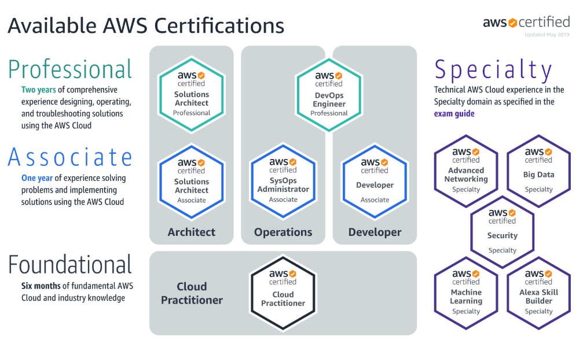

## Слайд 1: Вступ до курсу (Course Introduction)

AWS Academy Cloud Foundations

> **Нотатки:**
>
> Вітаємо на курсі AWS Academy Cloud Foundations!

---

## Слайд 2: Огляд модуля

**Теми**

- Цілі та огляд курсу
- Інформація про сертифікаційний іспит AWS
- Документація AWS (AWS Documentation)

**Практичні вправи**

- Квест із документації AWS (AWS Documentation scavenger hunt)

> **Нотатки:**
>
> У цьому вступному модулі курсу розглядаються такі теми:  
>
> Цілі та огляд курсу  
> Інформація про сертифікаційний іспит AWS  
> Документація AWS  
> Модуль завершується практичною вправою-квестом, у якій потрібно знайти інформацію в документації AWS.

---

## Слайд 3: Цілі модуля

Після завершення цього модуля ви повинні вміти:

- Розпізнавати мету курсу AWS Academy Cloud Foundations
- Розпізнавати структуру курсу
- Розпізнавати процес сертифікації AWS
- Орієнтуватися на вебсайті документації AWS

> **Нотатки:**
>
> Після завершення цього модуля ви повинні вміти:  
> Розпізнавати мету курсу AWS Academy Cloud Foundations  
> Розпізнавати структуру курсу  
> Розпізнавати процес сертифікації AWS  
> Орієнтуватися на вебсайті документації AWS

---

## Слайд 4: Розділ 1: Цілі та огляд курсу

Вступ до курсу

> **Нотатки:**
>
> Представляємо Розділ 1: Цілі та огляд курсу.

---

## Слайд 5: Передумови курсу (course prerequisites)

- Загальні необхідні знання
  - Технічні знання з ІТ
  - Бізнес-знання з ІТ
- Бажані знання
  - Знайомство з концепціями хмарних обчислень
  - Практичні знання розподілених систем
  - Знайомство із загальними концепціями мереж
  - Практичні знання багаторівневих архітектур

> **Нотатки:**
>
> Для початку важливо розуміти передумови цього курсу.  
>
> По-перше, ви повинні мати загальні технічні знання з ІТ. Базові навички комп’ютерної грамотності, потрібні для успішного проходження цього курсу, включають знання основних комп’ютерних концепцій, керування файлами та добре розуміння інтернету.  
>
> По-друге, ви повинні мати загальні бізнес-знання з ІТ. Це включає розуміння того, як інформаційні технології використовуються підприємствами та іншими організаціями.  
>
> Крім того, щоб забезпечити успіх на цьому курсі, бажано, щоб ви мали:  
> Загальне знайомство з концепціями хмарних обчислень  
> Практичні знання розподілених систем  
> Знайомство із загальними концепціями мереж  
> Практичні знання багаторівневих архітектур

---

## Слайд 6: Цілі курсу

Після завершення цього курсу ви повинні вміти:

- Визначати хмару AWS.
- Пояснювати філософію ціноутворення AWS.
- Визначати компоненти глобальної інфраструктури AWS.
- Описувати заходи безпеки та відповідності вимогам хмари AWS, зокрема AWS Identity and Access Management (IAM).
- Створювати віртуальну приватну хмару AWS (Amazon VPC).
- Демонструвати, коли використовувати Amazon Elastic Compute Cloud (EC2), AWS Lambda і AWS Elastic Beanstalk.
- Розрізняти Amazon S3, Amazon EBS, Amazon EFS і Amazon S3 Glacier.
- Демонструвати, коли використовувати сервіси баз даних AWS, зокрема Amazon Relational Database Service (RDS), Amazon DynamoDB, Amazon Redshift і Amazon Aurora.
- Пояснювати архітектурні принципи хмари AWS.
- Досліджувати ключові концепції, пов’язані з Elastic Load Balancing (ELB), Amazon CloudWatch та Auto Scaling.

> **Нотатки:**
>
> Після завершення цього курсу ви повинні вміти:  
> Визначати хмару AWS.  
> Пояснювати філософію ціноутворення AWS.  
> Визначати компоненти глобальної інфраструктури AWS.  
> Описувати заходи безпеки та відповідності вимогам хмари AWS, зокрема AWS Identity and Access Management (IAM).  
> Створювати віртуальну приватну хмару AWS (Amazon VPC).  
> Демонструвати, коли використовувати Amazon Elastic Compute Cloud (EC2), AWS Lambda і AWS Elastic Beanstalk.  
> Розрізняти Amazon S3, Amazon EBS, Amazon EFS і Amazon S3 Glacier.  
> Демонструвати, коли використовувати сервіси баз даних AWS, зокрема Amazon Relational Database Service (RDS), Amazon DynamoDB, Amazon Redshift і Amazon Aurora.  
> Пояснювати архітектурні принципи хмари AWS.  
> Досліджувати ключові концепції, пов’язані з Elastic Load Balancing (ELB), Amazon CloudWatch та Auto Scaling.

---

## Слайд 7: План курсу (course outline)

- Модуль 1: Огляд концепцій хмари (Cloud Concepts Overview)
- Модуль 2: Економіка хмари та виставлення рахунків (Cloud Economics and Billing)
- Модуль 3: Огляд глобальної інфраструктури AWS (AWS Global Infrastructure Overview)
- Модуль 4: Безпека хмари AWS (AWS Cloud Security)
- Модуль 5: Мережі та доставка контенту (Networking and Content Delivery)

- Модуль 6: Обчислення (Compute)
- Модуль 7: Сховище даних (Storage)
- Модуль 8: Бази даних (Databases)
- Модуль 9: Хмарна архітектура (Cloud Architecture)
- Модуль 10: Автоматичне масштабування та моніторинг (Automatic Scaling and Monitoring)

> **Нотатки:**
>
> Щоб досягти цілей курсу, у ньому розглядаються такі теми:  
> Концепції хмари  
> Економіка хмари та виставлення рахунків  
> Глобальна інфраструктура AWS  
> Безпека хмари AWS  
> Мережі та доставка контенту  
> Обчислення  
> Сховище даних  
> Бази даних  
> Хмарна архітектура  
> Автоматичне масштабування та моніторинг  
>
> Наступні десять слайдів докладніше описують, які підтеми розглядаються в кожному модулі.

---

## Слайд 8: Модуль 1: Огляд концепцій хмари

Розділи модуля:

- Вступ до хмарних обчислень
- Переваги хмарних обчислень
- Вступ до Amazon Web Services (AWS)
- Перехід у хмару AWS — Фреймворк впровадження хмари AWS (AWS Cloud Adoption Framework, AWS CAF)

> **Нотатки:**
>
> У цьому модулі Розділ 1 знайомить із хмарними обчисленнями.  
>
> У Розділі 2 ви дізнаєтеся про переваги, які хмарні обчислення надають порівняно з традиційною локальною (on-premises) моделлю обчислень.  
>
> У Розділі 3 ви дізнаєтеся, що таке AWS і який широкий спектр продуктів і сервісів AWS існує. Ви ознайомитеся з ідеєю, що сервіси AWS розроблено для спільної роботи з метою побудови рішень, що відповідають бізнес-цілям і технологічним вимогам.  
>
> Модуль завершується Розділом 4, присвяченим Фреймворку впровадження хмари AWS (AWS Cloud Adoption Framework, AWS CAF). Він охоплює фундаментальні зміни, які необхідно підтримати, щоб організація могла успішно перенести свій ІТ-портфель у хмару.

---

## Слайд 9: Модуль 2: Економіка хмари та виставлення рахунків

Розділи модуля:

- Основи ціноутворення
- Загальна вартість володіння (Total Cost of Ownership)
- AWS Organizations
- AWS Billing and Cost Management
- Технічна підтримка

> **Нотатки:**
>
> Мета цього модуля — ознайомити вас із бізнес-перевагами переходу в хмару.  
>
> Розділ 1 описує принципи, за якими AWS встановлює ціни на різні сервіси. Це включає модель ціноутворення AWS і опис AWS Free Tier: https://aws.amazon.com/free/.  
>
> Розділ 2 описує загальну вартість володіння та те, як клієнти можуть зменшити свої загальні витрати, перенісши ІТ-сервіси в хмару. У розділі окреслено чотири типи витрат, що зменшуються завдяки використанню хмарних обчислень, і наведено приклади, що ілюструють кожен із цих типів.  
>
> Розділ 3 описує, як клієнти можуть використовувати AWS Organizations для керування своїми витратами.  
>
> Розділ 4 описує виставлення рахунків і компоненти панелі AWS Billing. Цей розділ включає демонстрацію того, як клієнти можуть використовувати панель, щоб розуміти свої витрати та керувати ними.  
>
> Нарешті, Розділ 5 описує чотири різні варіанти технічної підтримки AWS: Basic Support, Developer Support, Business Support і Enterprise Support. Розділ також містить вправу, що допоможе зрозуміти переваги кожного варіанта підтримки.

---

## Слайд 10: Модуль 3: Огляд глобальної інфраструктури AWS

Розділи модуля:

- Глобальна інфраструктура AWS
- Огляд сервісів AWS і категорій сервісів

> **Нотатки:**
>
> Модуль 3 надає огляд глобальної інфраструктури AWS.  
>
> У Розділі 1 вас знайомлять з основними частинами глобальної інфраструктури AWS, зокрема з регіонами, зонами доступності, мережевою інфраструктурою та точками присутності (Points of Presence).  
>
> У Розділі 2 вам показують перелік усіх категорій сервісів AWS, а потім надають перелік кожного із сервісів, які розглядатиме цей курс. Модуль завершується вправою з огляду AWS Management Console (clickthrough).

---

## Слайд 11: Модуль 4: Безпека хмари AWS

Розділи модуля:

- Модель спільної відповідальності AWS (shared responsibility model)

- AWS Identity and Access Management (IAM)

- Захист нового акаунта AWS

- Захист акаунтів

- Захист даних в AWS

- Забезпечення відповідності вимогам

> **Нотатки:**
>
> Цей модуль надає вступ до підходу AWS до безпеки.  
>
> У Розділі 1 вас знайомлять із моделлю спільної відповідальності AWS, що визначає, які обов’язки належать клієнтові, а які — AWS.  
>
> Розділ 2 знайомить із ключовими концепціями AWS Identity and Access Management (IAM), зокрема з користувачами, групами, політиками та ролями.  
>
> Розділ 3 дає рекомендації щодо захисту нового акаунта AWS. У ньому розглядається, чому слід уникати використання кореневого акаунта AWS (root user) для щоденних дій. Також розглядаються найкращі практики, як-от створення користувачів IAM із увімкненою багатофакторною автентифікацією (MFA).  
>
> Розділ 3 підкреслює інші способи захисту акаунтів. У ньому розглядаються функції безпеки AWS Organizations, що включають політики контролю служб (service control policies). Цей розділ також розглядає AWS Shield, Amazon Cognito і AWS Key Management Service (AWS KMS).  
>
> Розділ 5 розглядає захист даних в AWS. Теми включають шифрування даних у стані спокою та даних під час передавання й варіанти захисту даних, що зберігаються в Amazon Simple Storage Service (Amazon S3).  
>
> Нарешті, Розділ 6 розглядає, як AWS підтримує зусилля клієнтів із розгортання рішень, що відповідають законам і нормативним актам. Також розглядаються сертифікації, які підтримує AWS, і сервіси AWS — як-от AWS Config та AWS Artifact, — що підтримують відповідність вимогам.

---

## Слайд 12: Модуль 5: Мережі та доставка контенту

Розділи модуля:

- Основи мереж
- Amazon VPC
- Мережі VPC
- Безпека VPC
- Amazon Route 53
- Amazon CloudFront

> **Нотатки:**
>
> Мета цього модуля — ознайомити вас з основами мережевих сервісів і сервісів доставки контенту AWS: Amazon Virtual Private Cloud (Amazon VPC), Amazon Route 53 і Amazon CloudFront. У вас буде нагода підписати схему архітектури мережі віртуальної приватної хмари (VPC), спроєктувати VPC, подивитися, як будується VPC, і, нарешті, самостійно побудувати VPC.  
>
> Розділ 1 розглядає мережеві концепції, на які посилатимуться в решті модуля: мережа, підмережа, адреси IPv4 та IPv6 і нотація безкласової міждоменної маршрутизації (Classless Inter-Domain Routing, CIDR).  
>
> Розділ 2 надає огляд ключової термінології та функцій Amazon VPC, з якими потрібно бути знайомим, коли ви проєктуєте й будуєте власні віртуальні приватні хмари (VPC).  
>
> У Розділі 3 ви дізнаєтеся про кілька важливих мережевих варіантів VPC: інтернет-шлюз, NAT-шлюз (network address translation), кінцеві точки VPC (VPC endpoints), спільне використання VPC (VPC sharing), піринг VPC (VPC peering), AWS Site-to-Site VPN, AWS Direct Connect і AWS Transit Gateway.  
>
> У Розділі 4 ви дізнаєтеся, як захищати VPC за допомогою списків контролю доступу до мережі (network ACLs) і груп безпеки.  
>
> Розділ 5 охоплює розв’язання імен системи доменних імен (DNS) та Amazon Route 53. Він також охоплює тему відмовостійкого перемикання DNS (DNS failover), що вводить тему високої доступності, про яку ви дізнаєтеся докладніше в модулі 10.  
>
> Нарешті, розділ 6 охоплює функції та переваги Amazon CloudFront.

---

## Слайд 13: Модуль 6: Обчислення

Розділи модуля:

- Огляд обчислювальних сервісів
- Amazon EC2
- Оптимізація витрат Amazon EC2
- Контейнерні сервіси
- Вступ до AWS Lambda
- Вступ до AWS Elastic Beanstalk

> **Нотатки:**
>
> Цей модуль надає вступ до багатьох обчислювальних сервісів, що пропонує AWS.  
>
> Розділ 1 надає високорівневий огляд обчислювальних сервісів.  
>
> Розділ 2 знайомить із ключовими концепціями Amazon Elastic Compute Cloud (Amazon EC2), зокрема з образами Amazon Machine Images (AMI), типами екземплярів, мережевими налаштуваннями, скриптами даних користувача (user data), варіантами сховищ, групами безпеки, парами ключів, фазами життєвого циклу екземпляра, еластичними IP-адресами, метаданими екземпляра та перевагами використання Amazon CloudWatch для моніторингу.  
>
> Розділ 3 зосереджений на чотирьох опорах оптимізації витрат, з акцентом на оптимізації витрат у зв’язку з Amazon EC2.  
>
> Розділ 4 охоплює контейнерні сервіси. Він знайомить із Docker і відмінностями між віртуальними машинами та контейнерами. Потім розглядаються Amazon Elastic Container Service (Amazon ECS), AWS Fargate, Kubernetes, Amazon Elastic Kubernetes Service (Amazon EKS) і Amazon Elastic Container Registry (Amazon ECR).  
>
> Розділ 5 знайомить із безсерверними обчисленнями (serverless computing) за допомогою AWS Lambda. Розглядаються джерела подій і основи конфігурації функції Lambda, а розділ завершується прикладами функції Lambda за розкладом і функції Lambda на основі подій.  
>
> Нарешті, Розділ 6 описує переваги використання AWS Elastic Beanstalk для розгортання вебзастосунків. Він завершується практичною вправою, у якій ви розгортаєте простий вебзастосунок в Elastic Beanstalk.

---

## Слайд 14: Модуль 7: Сховище даних

Розділи модуля:

- Amazon Elastic Block Store (Amazon EBS)
- Amazon Simple Storage Service (Amazon S3)
- Amazon Elastic File System (Amazon EFS)
- Amazon Simple Storage Service Glacier

> **Нотатки:**
>
> Модуль 7 знайомить вас із різними варіантами зберігання даних в AWS. Модуль надає огляд сервісів зберігання — що ґрунтуються на чотирьох різних технологіях зберігання, — щоб ви могли обирати сервіс зберігання для різних сценаріїв використання.  
>
> Розділ 1 надає огляд функціональності Amazon Elastic Block Store (Amazon EBS) та підсумок поширених сценаріїв використання. Він також знайомить із концепцією блочного та об’єктного сховища й тим, як взаємодіяти з Amazon EBS через AWS Management Console.  
>
> Розділ 2 надає огляд функціональності Amazon Simple Storage Service (Amazon S3) та підсумок поширених сценаріїв використання. Він також описує, як Amazon S3 масштабується зі зростанням попиту, і розглядає концепцію надлишковості даних.  Розділ також містить загальний огляд ціноутворення Amazon S3.  
>
> Розділ 3 починається з огляду функціональності Amazon Elastic File Store (Amazon EFS) та підсумку поширених сценаріїв використання. Він також надає огляд архітектури Amazon EFS і перелік поширених ресурсів Amazon EFS.  
>
> Нарешті, у Розділі 4 ви отримуєте огляд функціональності Amazon Simple Storage Service Glacier та підсумок поширених сценаріїв використання. Цей останній розділ також описує життєвий цикл міграції даних з Amazon S3 в Amazon S3 Glacier.

---

## Слайд 15: Модуль 8: Бази даних

Розділи модуля:

- Amazon Relational Database Service (Amazon RDS)
- Amazon DynamoDB
- Amazon Redshift
- Amazon Aurora

> **Нотатки:**
>
> Цей модуль знайомить вас із чотирма найпоширенішими сервісами баз даних AWS з акцентом на розрізненні того, який сервіс баз даних обирати для різних сценаріїв використання.  
>
> Розділ 1 надає огляд Amazon Relational Database Service (Amazon RDS). Він описує різницю між керованим і некерованим сервісом та надає огляд того, як забезпечити високодоступну реалізацію Amazon RDS.  
>
> У Розділі 2 надається огляд сервісів Amazon DynamoDB. Розділ також описує, як DynamoDB використовує партиціонування даних для сценаріїв, що потребують великих обсягів даних і можливості масштабування назовні за запитом.  
>
> Розділ 3 надає огляд Amazon Redshift. Розділ описує архітектуру паралельної обробки Amazon Redshift і те, як ця архітектура підтримує обробку дуже великих наборів даних. Також розглядаються деякі з найпоширеніших сценаріїв використання Amazon Redshift.  
>
> Нарешті, Розділ 4 надає огляд Amazon Aurora. Модуль описує сценарії використання, де Amazon Aurora є кращим рішенням, ніж Amazon RDS. Також розглядається, як Amazon Aurora забезпечує стійкіше рішення для баз даних завдяки використанню кількох зон доступності.

---

## Слайд 16: Модуль 9: Хмарна архітектура

Розділи модуля:

- AWS Well-Architected Framework
- Надійність і висока доступність
- AWS Trusted Advisor

> **Нотатки:**
>
> Мета цього модуля — ознайомити вас із проєктуванням і побудовою хмарних архітектур відповідно до найкращих практик.  
>
> У Розділі 1 ви дізнаєтеся про AWS Well-Architected Framework та його призначення, як його організовано, а також його принципи проєктування й найкращі практики. Ви також дізнаєтеся, як використовувати його для проєктування рішення хмарної архітектури, що є безпечним, продуктивним, стійким та ефективним. Нарешті, цей розділ також знайомить з AWS Well-Architected Tool, який можна використовувати для оцінювання ваших архітектурних проєктів за найкращими практиками AWS Well-Architected Framework.  
>
> У Розділі 2 ви дізнаєтеся про надійність і високу доступність — два чинники, які слід враховувати під час проєктування архітектури, що витримує збої.  
>
> У Розділі 3 ви дізнаєтеся про AWS Trusted Advisor. Цей інструмент можна використовувати для оцінювання та покращення вашого середовища AWS під час впровадження ваших архітектурних проєктів.

---

## Слайд 17: Модуль 10: Автоматичне масштабування та моніторинг

Розділи модуля:

- Elastic Load Balancing
- Amazon CloudWatch
- Amazon EC2 Auto Scaling

> **Нотатки:**
>
> Мета цього модуля — ознайомити вас із трьома фундаментальними сервісами AWS, які можна використовувати разом для побудови динамічних, масштабованих архітектур.  
>
> Розділ 1 знайомить вас з Elastic Load Balancing — сервісом, що автоматично розподіляє вхідний трафік застосунків між кількома цілями, як-от екземпляри Amazon EC2, контейнери, IP-адреси та функції Lambda.  
>
> Розділ 2 знайомить вас з Amazon CloudWatch — сервісом, що надає вам дані та практичні висновки для моніторингу ваших застосунків, реагування на загальносистемні зміни продуктивності, оптимізації використання ресурсів і отримання єдиного вигляду операційного стану.  
>
> Нарешті, Розділ 3 знайомить вас з функціями Amazon EC2 Auto Scaling, що допомагають підтримувати доступність застосунку та дають змогу автоматично додавати або видаляти екземпляри EC2 відповідно до умов, які ви визначаєте.

---

## Слайд 18: Розділ 2: Інформація про сертифікаційний іспит AWS

Вступ до курсу

> **Нотатки:**
>
> Представляємо Розділ 2: Інформація про сертифікаційний іспит AWS.

---

## Слайд 19: Сертифікаційні іспити AWS

*Цей курс допомагає підготуватися до сертифікаційного іспиту AWS* ***Cloud Practitioner***

> **Нотатки:**
>
> Сертифікація AWS допомагає слухачам формувати довіру та впевненість, підтверджуючи свою хмарну експертизу визнаним у галузі документом, а також допомагає організаціям знаходити кваліфікованих фахівців, які можуть очолювати хмарні ініціативи за допомогою AWS.  
>
> Щоб отримати сертифікацію AWS, потрібно здобути прохідний бал на іспиті під наглядом (proctored exam). Після отримання прохідного балу ви отримаєте свої сертифікаційні облікові дані.  
>
> AWS Certification не публікує перелік усіх сервісів чи функцій, що охоплюються сертифікаційним іспитом. Однак посібник до кожного іспиту (exam guide) перелічує поточні тематичні області та цілі, охоплені іспитом. Посібники до іспитів можна знайти за адресою https://aws.amazon.com/certification/certification-prep/?src=certification-faqs.  
>
> Вам потрібно буде оновлювати свою сертифікацію (або повторно сертифікуватися) кожні 3 роки. Докладніше див. сторінку AWS Certification Recertification за адресою https://aws.amazon.com/certification/recertification/ для додаткових подробиць.  
>
> Інформація на цьому слайді актуальна станом на листопад 2019 року. Однак іспити часто оновлюються, а подробиці щодо того, які іспити доступні та що перевіряє кожен іспит, можуть змінюватися.  
>
> Найновішу інформацію про сертифікаційні іспити AWS див. за адресою https://aws.amazon.com/certification/.

---

## Слайд 20: Іспит AWS Certified Cloud Practitioner

- Подробиці про іспит — зокрема як на нього зареєструватися — наведено за адресою  
[https://aws.amazon.com/certification/certified-cloud-practitioner/](https://aws.amazon.com/certification/certified-cloud-practitioner/)
  - Завантажте та уважно прочитайте посібник до іспиту AWS Certified Cloud Practitioner (Exam Guide) за адресою [https://d1.awsstatic.com/training-and-certification/Docs - Cloud Practitioner/AWS_Certified_Cloud_Practitioner-Exam_Guide_EN_v1.6.pdf](https://d1.awsstatic.com/training-and-certification/Docs%20-%20Cloud%20Practitioner/AWS_Certified_Cloud_Practitioner-Exam_Guide_EN_v1.6.pdf)
  - Завантажте приклади запитань іспиту за адресою [https://d1.awsstatic.com/training-and-certification/Docs - Cloud Practitioner/AWS Certified Cloud Practioner_Sample Questions_v1.1_FINAL.PDF](https://d1.awsstatic.com/training-and-certification/Docs%20-%20Cloud%20Practitioner/AWS%20Certified%20Cloud%20Practioner_Sample%20Questions_v1.1_FINAL.PDF)
- Рекомендований шлях до отримання сертифікації див. за адресою [https://aws.amazon.com/training/path-cloudpractitioner/](https://aws.amazon.com/training/path-cloudpractitioner/)
  - AWS Academy Cloud Foundations охоплює значну частину матеріалу з курсу Cloud Practitioner Essentials, але докладніше.
  - Додаткове безкоштовне цифрове навчання доступне за адресою [https://www.aws.training/](https://www.aws.training/).

> **Нотатки:**
>
> Сертифікація AWS Certified Cloud Practitioner дає людям на різних хмарних і технологічних посадах спосіб підтвердити свої знання хмари AWS і підвищити професійну довіру. Цей іспит охоплює чотири домени, зокрема концепції хмари, безпеку, технології, а також виставлення рахунків і ціноутворення.  
>
> Іспит AWS Certified Cloud Practitioner — єдиний сертифікаційний іспит AWS, що класифікується як базовий (foundational; як показано на попередньому слайді). Це часто перший іспит AWS, який ІТ-фахівці намагаються здати.  
>
> Хоча цей курс AWS Academy Cloud Foundations не зазначено в посібнику до іспиту AWS Certified Cloud Practitioner як один з варіантів навчання AWS, рекомендованих для підготовки до іспиту, він охоплює багато тих самих тем, що й комерційні курси AWS, як-от AWS Technical Essentials, AWS Business Essentials та AWS Cloud Practitioner Essentials. Тому курс AWS Academy Cloud Foundations, який ви проходите зараз, — це хороший спосіб підготуватися до складання цього іспиту.  
>
> Сервіси, включені до іспиту AWS Certified Cloud Practitioner, змінюються в міру додавання нових сервісів. Щонайменше ви повинні вміти описувати загальну функціональність широкого спектра сервісів AWS, перш ніж складати іспит. Огляд сервісів AWS див. у розділі Amazon Web Services Cloud Platform технічного документа Overview of Amazon Web Services за адресою https://docs.aws.amazon.com/whitepapers/latest/aws-overview/amazon-web-services-cloud-platform.html.

---

## Слайд 21: Розділ 3: Документація AWS (AWS Documentation)

Вступ до курсу

> **Нотатки:**
>
> Представляємо Розділ 3: Документація AWS.

---

## Слайд 22: Документація AWS

- Посібники користувача, посібники розробника, довідники API, навчальні посібники та інше можна знайти за адресою [https://docs.aws.amazon.com/](https://docs.aws.amazon.com/)
- ***Технічні документи (Whitepapers)*** також доступні за адресою [https://aws.amazon.com/whitepapers/](https://aws.amazon.com/whitepapers/), зокрема ці, що рекомендовані до прочитання для іспиту AWS Cloud Practitioner:
  - Огляд Amazon Web Services (Overview of Amazon Web Services): [https://d0.awsstatic.com/whitepapers/aws-overview.pdf](https://d0.awsstatic.com/whitepapers/aws-overview.pdf)
  - Проєктування для хмари: найкращі практики AWS (Architecting for the Cloud: AWS Best Practices): [https://d1.awsstatic.com/whitepapers/AWS_Cloud_Best_Practices.pdf](https://d1.awsstatic.com/whitepapers/AWS_Cloud_Best_Practices.pdf)
  - Як працює ціноутворення AWS (How AWS Pricing Works): [https://d0.awsstatic.com/whitepapers/aws_pricing_overview.pdf](https://d0.awsstatic.com/whitepapers/aws_pricing_overview.pdf)
  - Загальна вартість (не)володіння вебзастосунками в хмарі (The Total Cost of (Non) Ownership of Web Applications in the Cloud): [https://media.amazonwebservices.com/AWS_TCO_Web_Applications.pdf](https://media.amazonwebservices.com/AWS_TCO_Web_Applications.pdf)

> **Нотатки:**
>
> AWS надає розлогу та детальну документацію для кожного сервісу AWS. Посібники та довідники прикладного програмного інтерфейсу (API) організовано за категоріями сервісів.  Також є багато загальних ресурсів і навчальних посібників, до яких можна отримати доступ зі сторінок документації AWS.  Загальні ресурси включають практичні приклади (case studies), глосарій термінів AWS від A до Z, технічні документи (whitepapers), поширені запитання (FAQ), інформацію про AWS Training and Certification та інше.  
>
> Також кожен SDK і набір інструментів має документацію — наприклад, AWS Command Line Interface (AWS CLI), бібліотеки boto3 для AWS SDK для Python та багато інших.  
>
> Технічні документи й посібники AWS можна фільтрувати за продуктом, категорією чи галуззю, щоб знайти інформацію, найактуальнішу для ваших потреб.

---

## Слайд 23: Практична вправа: квест із документації AWS (Activity - AWS Documentation Scavenger Hunt)

- Орієнтуйтеся на вебсайті документації AWS
- Починайте з головної сторінки за адресою  
[https://docs.aws.amazon.com](https://docs.aws.amazon.com/)
- П’ять запитань-викликів для класу з’являються на наступних слайдах

> **Нотатки:**
>
> У цій вправі під керівництвом викладача вам буде запропоновано отримати доступ до сторінок документації AWS і потренуватися знаходити конкретну інформацію.

---

## Слайд 24: Квест із документації AWS — Запитання 1

- Запитання №1: які посібники та довідники існують для сервісу Amazon EC2?

> **Нотатки:**
>
> Які посібники та довідники існують для сервісу Amazon EC2?  
>
> Перейдіть за адресою https://docs.aws.amazon.com і подивіться, чи зможете ви визначити принаймні шість посібників або довідників.

---

## Слайд 25: Квест із документації AWS — Запитання 1, відповідь

- Запитання №1: які посібники та довідники існують для сервісу Amazon EC2?
- Відповідь [https://docs.aws.amazon.com/ec2/?id=docs_gateway](https://docs.aws.amazon.com/ec2/?id=docs_gateway):
  - Посібники користувача для Linux і Windows (User Guides for Linux and Windows)
  - Довідник API (API Reference)
  - Довідник AWS CLI (AWS CLI Reference)
  - Довідник EC2 Instance Connect (EC2 Instance Connect Reference)
  - Посібник користувача Auto Scaling (User Guide for Auto Scaling)
  - Посібник користувача VM Import/Export (VM Import/Export User Guide)

> **Нотатки:**
>
> Які посібники та довідники існують для сервісу Amazon EC2?  
>
> Перейдіть за адресою https://docs.aws.amazon.com і подивіться, чи зможете ви визначити принаймні шість посібників або довідників.

---

## Слайд 26: Квест із документації AWS — Запитання 2

- Запитання №2: чи можете ви знайти документацію, що описує, як створити бакет Amazon S3?

> **Нотатки:**
>
> Чи можете ви знайти документацію, що описує, як створити бакет Amazon S3?  
>
> Перейдіть за адресою https://docs.aws.amazon.com і з’ясуйте, як дістатися до документації, що містить цю інформацію. Будьте готові обговорити свої знахідки з класом.

---

## Слайд 27: Квест із документації AWS — Запитання 2, відповідь

- Запитання №2: чи можете ви знайти документацію, що описує, як створити бакет Amazon S3?
- Відповідь [https://docs.aws.amazon.com/AmazonS3/latest/gsg/CreatingABucket.html](https://docs.aws.amazon.com/AmazonS3/latest/gsg/CreatingABucket.html):
  - На сторінці [https://docs.aws.amazon.com/](https://docs.aws.amazon.com/) натисніть **S3**
  - Натисніть **Getting Started Guide**
  - Натисніть **Create a Bucket**

> **Нотатки:**
>
> Чи можете ви знайти документацію, що описує, як створити бакет Amazon S3?  
>
> Перейдіть за адресою https://docs.aws.amazon.com і з’ясуйте, як дістатися до документації, що містить цю інформацію. Будьте готові обговорити свої знахідки з класом.

---

## Слайд 28: Квест із документації AWS — Запитання 3

- Запитання №3: чи можете ви знайти однореченнєвий опис сервісу AWS Cloud9?

> **Нотатки:**
>
> Чи можете ви знайти однореченнєвий опис сервісу AWS Cloud9?  
>
> Почніть із https://docs.aws.amazon.com, і подивіться, чи зможете ви знайти сторінку з цим описом. Будьте готові поділитися своїми знахідками.

---

## Слайд 29: Квест із документації AWS — Запитання 3, відповідь

- Запитання №3: чи можете ви знайти однореченнєвий опис сервісу AWS Cloud9?
- Відповідь [https://docs.aws.amazon.com/cloud9/?id=docs_gateway](https://docs.aws.amazon.com/cloud9/?id=docs_gateway):
  - AWS Cloud9 — це хмарне інтегроване середовище розробки (IDE), яке ви використовуєте для написання, запуску та налагодження коду.

> **Нотатки:**
>
> Чи можете ви знайти однореченнєвий опис сервісу AWS Cloud9?  
>
> Почніть із https://docs.aws.amazon.com, і подивіться, чи зможете ви знайти сторінку з цим описом. Будьте готові поділитися своїми знахідками.

---

## Слайд 30: Квест із документації AWS — Запитання 4

- Запитання №4: які мови програмування підтримує API сервісу AWS Lambda?

> **Нотатки:**
>
> Які мови програмування підтримує API сервісу AWS Lambda?  
>
> Перейдіть за адресою https://docs.aws.amazon.com і з’ясуйте, як дістатися до документації, що містить цю інформацію. Будьте готові обговорити свої знахідки з класом.

---

## Слайд 31: Квест із документації AWS — Запитання 4, відповідь

- Запитання №4: які мови програмування підтримує API сервісу AWS Lambda?
- Відповідь [https://docs.aws.amazon.com/lambda/latest/dg/gettingstarted-tools.html](https://docs.aws.amazon.com/lambda/latest/dg/gettingstarted-tools.html):
  - На головній сторінці документації AWS натисніть посилання **AWS Lambda**
  - Натисніть посилання **API Reference**
  - Натисніть **Getting Started** > **Tools**, щоб знайти таблицю, що перелічує такі мови: **Node.js**, **Java**, **C#**, **Python**, **Ruby**, **Go** і **PowerShell**

> **Нотатки:**
>
> Які мови програмування підтримує API сервісу AWS Lambda?  
>
> Перейдіть за адресою https://docs.aws.amazon.com і з’ясуйте, як дістатися до документації, що містить цю інформацію. Будьте готові обговорити свої знахідки з класом.

---

## Слайд 32: Квест із документації AWS — Запитання 5

- Запитання №5: знайдіть навчальний посібник, що описує, як запустити безсерверний застосунок Hello World, а потім прокрутіть задокументовані кроки. Які два сервіси AWS ви використовуєте за цим посібником?

> **Нотатки:**
>
> Знайдіть навчальний посібник, що описує, як запустити безсерверний застосунок Hello World, а потім прокрутіть задокументовані кроки. Які два сервіси AWS ви використовуєте за цим посібником?  
>
> Перейдіть за адресою https://docs.aws.amazon.com і з’ясуйте, як дістатися до документації, що містить цю інформацію. Будьте готові обговорити свої знахідки з класом.

---

## Слайд 33: Квест із документації AWS — Запитання 5, відповідь

- Запитання №5: знайдіть навчальний посібник, що описує, як запустити безсерверний застосунок Hello World, а потім прокрутіть задокументовані кроки. Які два сервіси AWS ви використовуєте за цим посібником?
- Відповідь [https://aws.amazon.com/getting-started/tutorials/run-serverless-code/](https://aws.amazon.com/getting-started/tutorials/run-serverless-code/):
  - На головній сторінці документації AWS натисніть **Tutorials and Projects**
  - В області **Websites & Web Apps** натисніть навчальний посібник.
  - Посібник пропонує використовувати **AWS Lambda** та **Amazon CloudWatch**.

> **Нотатки:**
>
> Знайдіть навчальний посібник, що описує, як запустити безсерверний застосунок Hello World, а потім прокрутіть задокументовані кроки. Які два сервіси AWS ви використовуєте за цим посібником?  
>
> Перейдіть за адресою https://docs.aws.amazon.com і з’ясуйте, як дістатися до документації, що містить цю інформацію. Будьте готові обговорити свої знахідки з класом.

---

## Слайд 34: Підсумки модуля

Вступ до курсу

> **Нотатки:**
>
> Настав час повторити матеріал модуля й завершити його резюме та переліком додаткових ресурсів.

---

## Слайд 35: Резюме модуля

Підсумовуючи, у цьому модулі ви навчилися:

- Розпізнавати мету курсу AWS Academy Cloud Foundations
- Розпізнавати структуру курсу
- Розпізнавати процес сертифікації AWS
- Орієнтуватися на вебсайті документації AWS

> **Нотатки:**
>
> Підсумовуючи, у цьому модулі ви навчилися:  
> Розпізнавати мету курсу AWS Academy Cloud Foundations  
> Розпізнавати структуру курсу  
> Розпізнавати процес сертифікації AWS  
> Орієнтуватися на вебсайті документації AWS

---

## Слайд 36: Додаткові ресурси

- AWS Certification: [https://aws.amazon.com/certification/](https://aws.amazon.com/certification/)
- AWS Certified Cloud Practitioner: [https://aws.amazon.com/certification/certified-cloud-practitioner/](https://aws.amazon.com/certification/certified-cloud-practitioner/)
- Документація AWS (AWS Documentation): [https://docs.aws.amazon.com/](https://docs.aws.amazon.com/)

> **Нотатки:**
>
> Наведені нижче ресурси надають більше подробиць про теми, що обговорюються в цьому модулі:  
> AWS Certification: https://aws.amazon.com/certification/  
> AWS Certified Cloud Practitioner:  https://aws.amazon.com/certification/certified-cloud-practitioner/  
> Документація AWS: https://docs.aws.amazon.com/

---

## Слайд 37: Дякуємо

Усі торговельні марки є власністю їхніх власників.

> **Нотатки:**
>
> Дякуємо, що пройшли цей модуль.
