## Слайд 1: Module 1: Cloud Concepts Overview

AWS Academy Cloud Foundations

> **Нотатки:**
>
> Welcome to Module 1: Cloud Concepts Overview.

---

## Слайд 2: Module overview

**Topics**

- Introduction to cloud computing
- Advantages of cloud computing
- Introduction to Amazon Web Services (AWS)
- AWS Cloud Adoption Framework (AWS CAF)

**Knowledge check**

> **Нотатки:**
>
> This module addresses the following topics:  
> Introduction to cloud computing  
> Advantages of cloud computing  
> Introduction to Amazon Web Services (AWS)  
> AWS Cloud Adoption Framework (AWS CAF)  
>
> Finally, you will be asked to complete a knowledge check that will be used to test your understanding of the key concepts that are covered in this module.

---

## Слайд 3: Module objectives

After completing this module, you should be able to:

- Define different types of cloud computing models
- Describe six advantages of cloud computing
- Recognize the main AWS service categories and core services
- Review the AWS Cloud Adoption Framework (AWS CAF)

> **Нотатки:**
>
> After completing this module, you should be able to:  
> Define different types of cloud computing  
> Describe six advantages of cloud computing  
> Recognize the main AWS service categories and core services  
> Review the AWS Cloud Adoption Framework (AWS CAF)

---

## Слайд 4: Section 1: Introduction to cloud computing

Module 1: Cloud Concepts Overview

> **Нотатки:**
>
> Section 1: Introduction to cloud computing

---

## Слайд 5: What is cloud computing?

> **Нотатки:**
>
> What does cloud computing mean to you?  
>
> Take a moment to think of what cloud computing means to you and write a short sentence.

---

## Слайд 6: Cloud computing defined

**Cloud computing** is the **on-demand** delivery of compute power, database, storage, applications, and other IT resources **via the internet** with **pay-as-you-go** pricing.

> **Нотатки:**
>
> Cloud computing is the on-demand delivery of compute power, database, storage, applications, and other IT resources via the internet with pay-as-you-go pricing. These resources run on server computers that are located in large data centers in different locations around the world. When you use a cloud service provider like AWS, that service provider owns the computers that you are using. These resources can be used together like building blocks to build solutions that help meet business goals and satisfy technology requirements.  
>
> To learn more about cloud computing and how it works, see https://aws.amazon.com/what-is-cloud-computing/.

---

## Слайд 7: Infrastructure as software

Cloud computing enables you to **stop thinking of your infrastructure as hardware**, and instead **think of (and use) it as software.**

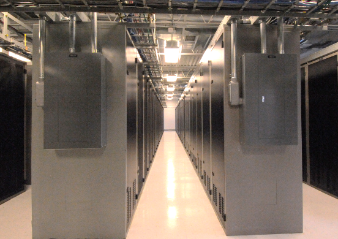

> **Нотатки:**
>
> Cloud computing enables you to stop thinking of your infrastructure as hardware, and instead think of (and use) it as software. But what does this mean?

---

## Слайд 8: Traditional computing model

- Infrastructure as hardware
- Hardware solutions:
  - Require space, staff, physical security, planning, capital expenditure
  - Have a long hardware procurement cycle
  - Require you to provision capacity by guessing theoretical maximum peaks

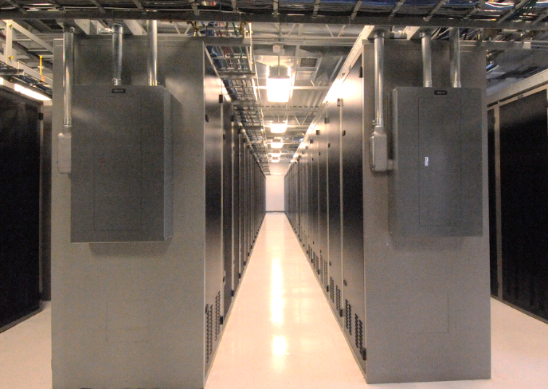

> **Нотатки:**
>
> In the traditional computing model, infrastructure is thought of as hardware. Hardware solutions are physical, which means they require space, staff, physical security, planning, and capital expenditure.  
>
> In addition to significant upfront investment, another prohibitive aspect of traditional computing is the long hardware procurement cycle that involves acquiring, provisioning, and maintaining on-premises infrastructure.  
>
> With a hardware solution, you must ask if there is enough resource capacity or sufficient storage to meet your needs, and you provision capacity by guessing theoretical maximum peaks. If you don’t meet your projected maximum peak, then you pay for expensive resources that stay idle. If you exceed your projected maximum peak, then you don’t have sufficient capacity to meet your needs. And if your needs change, then you must spend the time, effort, and money required to implement a new solution.  
>
> For example, if you wanted to provision a new website, you would need to buy the hardware, rack and stack it, put it in a data center, and then manage it or have someone else manage it. This approach is expensive and time-consuming.

---

## Слайд 9: Cloud computing model

- Infrastructure as software
- Software solutions:
  - Are flexible
  - Can change more quickly, easily, and cost-effectively than hardware solutions
  - Eliminate the undifferentiated heavy-lifting tasks

> **Нотатки:**
>
> By contrast, cloud computing enables you to think of your infrastructure as software. Software solutions are flexible. You can select the cloud services that best match your needs, provision and terminate those resources on-demand, and pay for what you use. You can elastically scale resources up and down in an automated fashion. With the cloud computing model, you can treat resources as temporary and disposable. The flexibility that cloud computing offers enables businesses to implement new solutions quickly and with low upfront costs.  
>
> Compared to hardware solutions, software solutions can change much more quickly, easily, and cost-effectively.  
>
> Cloud computing helps developers and IT departments avoid undifferentiated work like procurement, maintenance, and capacity planning, thus enabling them to focus on what matters most.  
>
> As cloud computing has grown in popularity, several different service models and deployment strategies have emerged to help meet the specific needs of different users. Each type of cloud service model and deployment strategy provides you with a different level of control, flexibility, and management. Understanding the differences between these cloud service models and deployment strategies can help you decide what set of services is right for your needs.

---

## Слайд 10: Cloud service models

IaaS

(infrastructure as a service)

PaaS

(platform as a service)

SaaS

(software as a service)

More control  
over IT resources

Less control  
over IT resources

> **Нотатки:**
>
> There are three main cloud service models. Each model represents a different part of the cloud computing stack and gives you a different level of control over your IT resources:  
> Infrastructure as a service (IaaS): Services in this category are the basic building blocks for cloud IT and typically provide you with access to networking features, computers (virtual or on dedicated hardware), and data storage space. IaaS provides you with the highest level of flexibility and management control over your IT resources. It is the most similar to existing IT resources that many IT departments and developers are familiar with today.  
> Platform as a service (PaaS): Services in this category reduce the need for you to manage the underlying infrastructure (usually hardware and operating systems) and enable you to focus on the deployment and management of your applications.  
> Software as a service (SaaS): Services in this category provide you with a completed product that the service provider runs and manages. In most cases, software as a service refers to end-user applications. With a SaaS offering, you do not have to think about how the service is maintained or how the underlying infrastructure is managed. You need to think only about how you plan to use that particular piece of software. A common example of a SaaS application is web-based email, where you can send and receive email without managing feature additions to the email product or maintaining the servers and operating systems that the email program runs on.

---

## Слайд 11: Cloud computing deployment models

Cloud

Hybrid

On-premises  
(private cloud)

> **Нотатки:**
>
> There are three main cloud computing deployment models, which represent the cloud environments that your applications can be deployed in:  
> Cloud: A cloud-based application is fully deployed in the cloud, and all parts of the application run in the cloud. Applications in the cloud have either been created in the cloud or have been migrated from an existing infrastructure to take advantage of the benefits of cloud computing (see https://aws.amazon.com/what-is-cloud-computing/). Cloud-based applications can be built on low-level infrastructure pieces or they can use higher-level services that provide abstraction from the management, architecting, and scaling requirements of core infrastructure.  
> Hybrid: A hybrid deployment is a way to connect infrastructure and applications between cloud-based resources and existing resources that are not located in the cloud. The most common method of hybrid deployment is between the cloud and existing on-premises infrastructure. This model enables an organization to extend and grow their infrastructure into the cloud while connecting cloud resources to internal systems.  
> On-premises: Deploying resources on-premises, using virtualization and resource management tools, is sometimes called private cloud. While on-premises deployment does not provide many of the benefits of cloud computing, it is sometimes sought for its ability to provide dedicated resources. In most cases, this deployment model is the same as legacy IT infrastructure, but it might also use application management and virtualization technologies to increase resource utilization.

---

## Слайд 12: Similarities between AWS and traditional IT

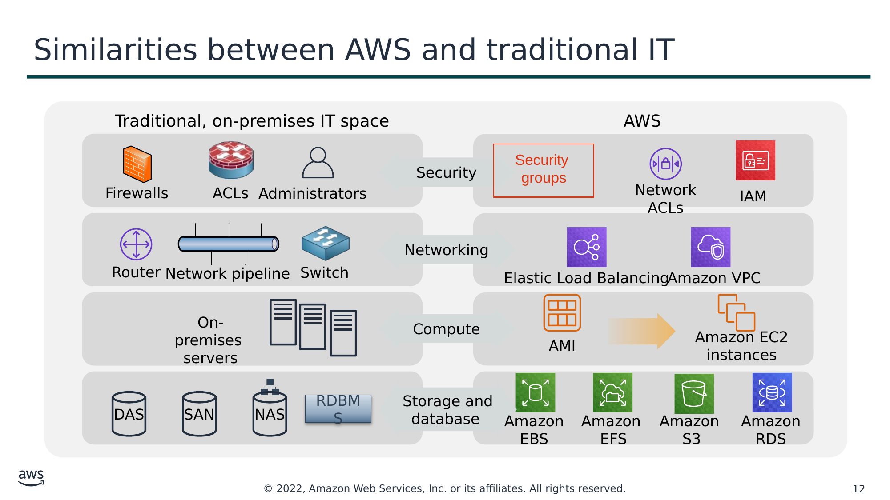

Текст зі схеми

Traditional, on-premises IT space

AWS

Security

Security  
groups

Firewalls

ACLs

Administrators

Network ACLs

IAM

Networking

Router

Network pipeline

Switch

Elastic Load Balancing

Amazon VPC

On-premises  
servers

Compute

AMI

Amazon EC2 instances

Storage and  
database

DAS

SAN

NAS

RDBMS

Amazon EBS

Amazon  
EFS

Amazon  
S3

Amazon RDS

> **Нотатки:**
>
> There are many similarities between AWS and the traditional, on-premises IT space:  
> AWS security groups, network access control lists (network ACLs), and AWS Identity and Access Management (IAM) are similar to firewalls, access control lists (ACLs), and administrators.  
> Elastic Load Balancing and Amazon Virtual Private Cloud (Amazon VPC) are similar to routers, network pipelines, and switches.  
> Amazon Machine Images (AMIs) and Amazon Elastic Compute Cloud (Amazon EC2) instances are similar to on-premises servers.  
> Amazon Elastic Block Store (Amazon EBS), Amazon Elastic File System (Amazon EFS), Amazon Simple Storage Service (Amazon S3), and Amazon Relational Database Service (Amazon RDS) are similar to direct attached storage (DAS), storage area networks (SAN), network attached storage (NAS), and a relational database management service (RDBMS).  
>
> With AWS services and features, you can do almost everything that you would want to do with a traditional data center.

---

## Слайд 13: Section 1 key takeaways

- Cloud computing is the on-demand delivery of IT resources via the internet with pay-as-you-go pricing.
- Cloud computing enables you to think of (and use) your infrastructure as software.
- There are three cloud service models: IaaS, PaaS, and SaaS.
- There are three cloud deployment models: cloud, hybrid, and on-premises or private cloud.
- Almost anything you can implement with traditional IT can also be implemented as an AWS cloud computing service.

> **Нотатки:**
>
> Some key takeaways from this section of the module include:  
> Cloud computing is the on-demand delivery of IT resources via the internet with pay-as-you-go pricing.  
> Cloud computing enables you to think of (and use) your infrastructure as software.  
> There are three cloud service models: IaaS, PaaS, and SaaS.  
> There are three cloud deployment models: cloud, hybrid, and on-premises or private cloud.  
> There are many AWS service analogs for the traditional, on-premises IT space.

---

## Слайд 14: Section 2: Advantages of cloud computing

Module 1: Cloud Concepts Overview

> **Нотатки:**
>
> Section 2: Advantages of cloud computing  
>
> Why are so many companies interested in moving to the cloud? This section presents six advantages of cloud computing.

---

## Слайд 15: Trade capital expense for variable expense

Capital

Data center investment  
based on forecast

Pay only for the amount  
you consume

> **Нотатки:**
>
> Advantage #1—Trade capital expense for variable expense: Capital expenses (capex) are funds that a company uses to acquire, upgrade, and maintain physical assets such as property, industrial buildings, or equipment. Do you remember the data center example in the traditional computing model where you needed to rack and stack the hardware, and then manage it all? You must pay for everything in the data center whether you use it or not.  
>
> By contrast, a variable expense is an expense that the person who bears the cost can easily alter or avoid. Instead of investing heavily in data centers and servers before you know how you will use them, you can pay only when you consume resources and pay only for the amount you consume. Thus, you save money on technology. It also enables you to adapt to new applications with as much space as you need in minutes, instead of weeks or days. Maintenance is reduced, so you can spend focus more on the core goals of your business.

---

## Слайд 16: Massive economies of scale

Because of aggregate usage from all customers, AWS can achieve  
higher economies of scale and pass savings on to customers.

AWS Cloud

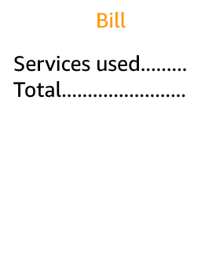

**Economies of scale**

Savings

> **Нотатки:**
>
> Advantage #2—Benefit from massive economies of scale: By using cloud computing, you can achieve a lower variable cost than you can get on your own. Because usage from hundreds of thousands of customers is aggregated in the cloud, providers such as AWS can achieve higher economies of scale, which translates into lower pay-as-you-go prices.

---

## Слайд 17: Stop guessing capacity

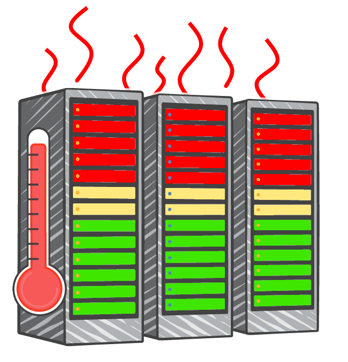

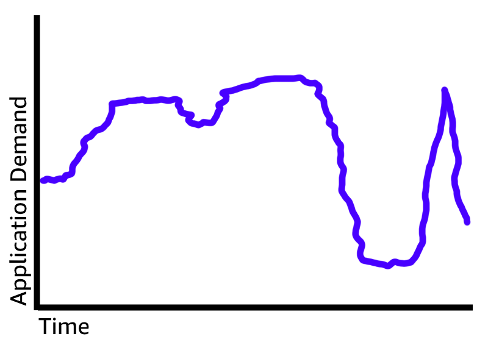

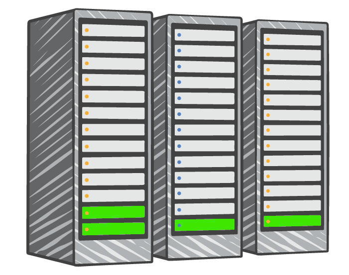

Overestimated  
server capacity

Underestimated  
server capacity

Scaling on demand

> **Нотатки:**
>
> Advantage #3—Stop guessing capacity: Eliminate guessing about your infrastructure capacity needs. When you make a capacity decision before you deploy an application, you often either have expensive idle resources or deal with limited capacity. With cloud computing, these problems go away. You can access as much or as little as you need, and scale up and down as required with only a few minutes’ notice.

---

## Слайд 18: Increase speed and agility

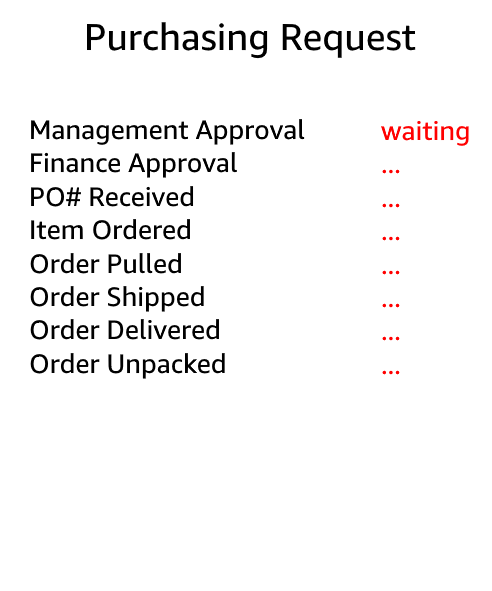

**Launch**

*Weeks* between wanting resources and having resources

*Minutes* between wanting resources and having resources

> **Нотатки:**
>
> Advantage #4—Increase speed and agility: In a cloud computing environment, new IT resources are only a click away, which means that you reduce the time it takes to make those resources available to your developers from weeks to just minutes. The result is a dramatic increase in agility for the organization because the cost and time that it takes to experiment and develop are significantly lower.

---

## Слайд 19: Stop spending money on running and maintaining data centers

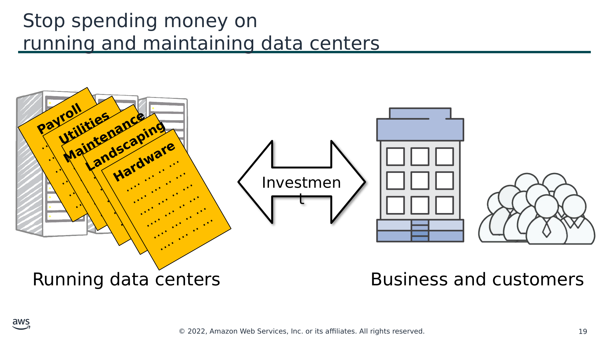

Текст зі схеми

**Payroll**  
…. … .. …  
…. … .. …  
…. … .. …  
…. … .. …  
…. … .. …  
…. … .. …

**Utilities**  
…. … .. …  
…. … .. …  
…. … .. …  
…. … .. …  
…. … .. …  
…. … .. …

**Maintenance**  
…. … .. …  
…. … .. …  
…. … .. …  
…. … .. …  
…. … .. …  
…. … .. …

**Landscaping**  
…. … .. …  
…. … .. …  
…. … .. …  
…. … .. …  
…. … .. …  
…. … .. …

**Hardware**  
…. … .. …  
…. … .. …  
…. … .. …  
…. … .. …  
…. … .. …  
…. … .. …

Investment

Running data centers

Business and customers

> **Нотатки:**
>
> Advantage #5—Stop spending money on running and maintaining data centers: Focus on projects that differentiate your business instead of focusing on the infrastructure. Cloud computing enables you to focus on your own customers instead of the heavy lifting of racking, stacking, and powering servers.

---

## Слайд 20: Go global in minutes

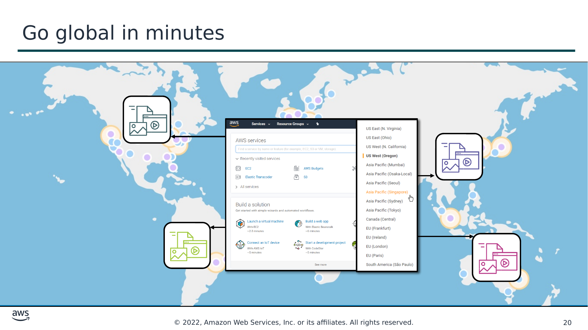

> **Нотатки:**
>
> Advantage #6—Go global in minutes: You can deploy your application in multiple AWS Regions around the world with just a few clicks. As a result, you can provide a lower latency and better experience for your customers simply and at minimal cost.

---

## Слайд 21: Section 2 key takeaways

- Trade capital expense for variable expense
- Benefit from massive economies of scale
- Stop guessing capacity
- Increase speed and agility
- Stop spending money on running and maintaining data centers
- Go global in minutes

> **Нотатки:**
>
> The key takeaways from this section of the module include the six advantages of cloud computing:  
> Trade capital expense for variable expense  
> Massive economies of scale  
> Stop guessing capacity  
> Increase speed and agility  
> Stop spending money on running and maintaining data centers  
> Go global in minutes

---

## Слайд 22: Section 3: Introduction to Amazon Web Services (AWS)

Module 1: Cloud Concepts Overview

> **Нотатки:**
>
> Section 3: Introduction to Amazon Web Services (AWS)

---

## Слайд 23: What are web services?

A **web service** is any piece of software that makes itself available over the internet and uses a **standardized format**—such as Extensible Markup Language (XML) or JavaScript Object Notation (JSON)—for the request and the response of an **application programming interface (API) interaction**.

**Request message**

**Internet**

**Response message**

**Client**

**Web service**

> **Нотатки:**
>
> In general, a web service is any piece of software that makes itself available over the internet or on private (intranet) networks. A web service uses a standardized format—such as Extensible Markup Language (XML) or JavaScript Object Notation (JSON)—for the request and the response of an application programming interface (API) interaction. It is not tied to any one operating system or programming language. It’s self-describing via an interface definition file and it is discoverable.

---

## Слайд 24: What is AWS?

- AWS is a **secure cloud platform** that offers a **broad set of global cloud-based products**.
- AWS provides you with **on-demand access** to compute, storage, network, database, and other IT resources and management tools.
- AWS offers **flexibility**.
- You **pay only for the individual services you need**, for **as long as you use them**.
- AWS services **work together** like building blocks.

> **Нотатки:**
>
> Amazon Web Services (AWS) is a secure cloud platform that offers a broad set of global cloud-based products. Because these products are delivered over the internet, you have on-demand access to the compute, storage, network, database, and other IT resources that you might need for your projects—and the tools to manage them. You can immediately provision and launch AWS resources. The resources are ready for you to use in minutes.  
>
> AWS offers flexibility. Your AWS environment can be reconfigured and updated on demand, scaled up or down automatically to meet usage patterns and optimize spending, or shut down temporarily or permanently. The billing for AWS services becomes an operational expense instead of a capital expense.  
>
> AWS services are designed to work together to support virtually any type of application or workload. Think of these services like building blocks, which you can assemble quickly to build sophisticated, scalable solutions, and then adjust them as your needs change.

---

## Слайд 25: Categories of AWS services

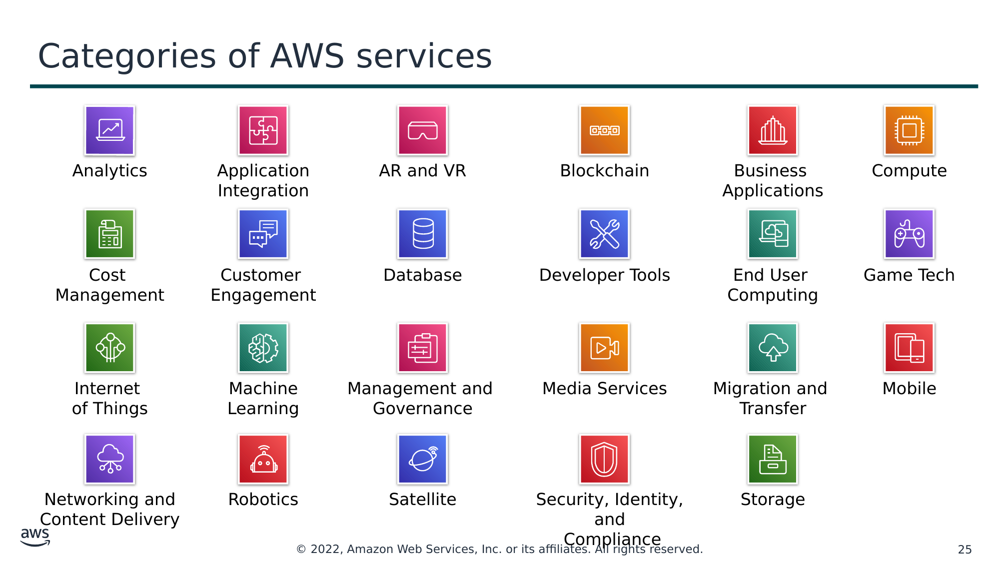

Текст зі схеми

Analytics

Application

Integration

AR and VR

Blockchain

Business  
Applications

Compute

Cost  
Management

Customer  
Engagement

Database

Developer Tools

End User

Computing

Game Tech

Internet  
of Things

Machine Learning

Management and  
Governance

Media Services

Migration and

Transfer

Mobile

Networking and

Content Delivery

Robotics

Satellite

Security, Identity, and

Compliance

Storage

> **Нотатки:**
>
> AWS services fall under different categories, and each category contains one or more services. You can select the services that you want from these different categories to build your solutions.

---

## Слайд 26: Simple solution example

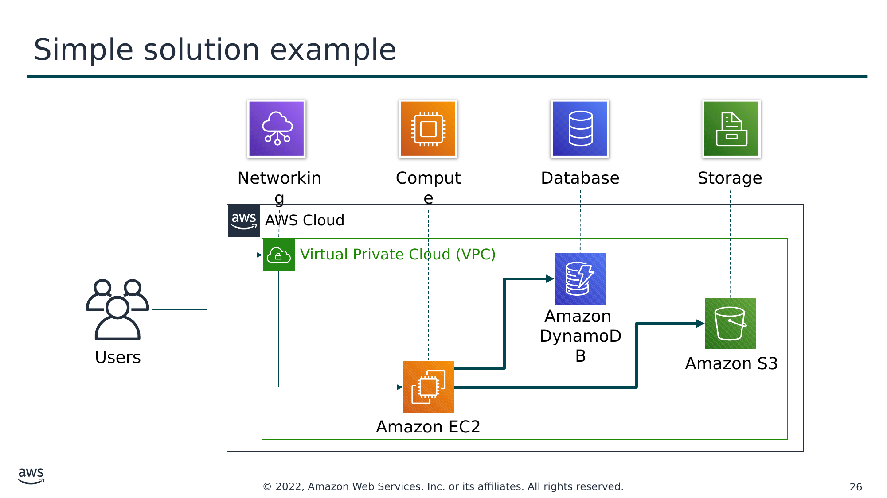

Текст зі схеми

Networking

Compute

Database

Storage

AWS Cloud

Virtual Private Cloud (VPC)

Amazon  
DynamoDB

Users

Amazon S3

Amazon EC2

> **Нотатки:**
>
> For example, say you’re building a database application. Your customers might be sending data to your Amazon Elastic Compute Cloud (Amazon EC2) instances, which is a service in the compute category. These EC2 servers batch the data in one-minute increments and add an object per customer to Amazon Simple Storage Service (Amazon S3), the AWS storage service you’ve chosen to use. You can then use a nonrelational database like Amazon DynamoDB to power your application, for example, to build an index so that you can find all the objects for a given customer that were collected over a certain period. You might decide to run these services inside an Amazon Virtual Private Cloud (Amazon VPC), which is a service in the networking category.  
>
> The purpose of this simple example is to illustrate that you can select web services from different categories and use them together to build a solution (in this case, a database application). Of course, the solutions you build can be quite complex.

---

## Слайд 27: Choosing a service

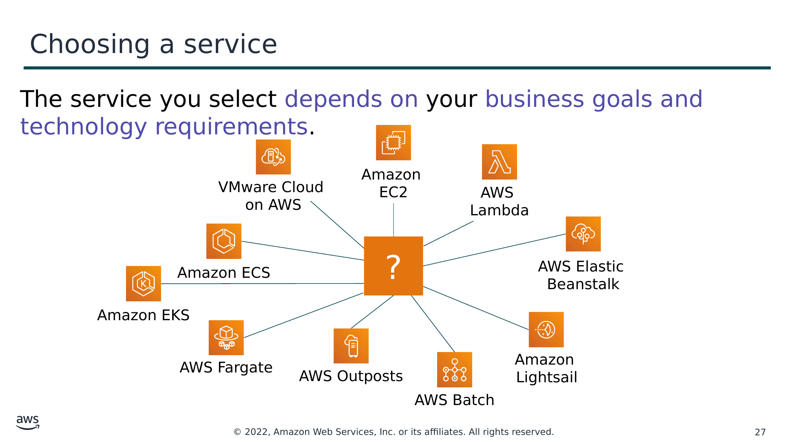

Текст зі схеми

The service you select depends on your business goals and technology requirements.

?

AWS Elastic  
Beanstalk

VMware Cloud  
on AWS

Amazon  
EC2

Amazon  
Lightsail

Amazon ECS

Amazon EKS

AWS  
Lambda

AWS Fargate

AWS Outposts

AWS Batch

> **Нотатки:**
>
> Which service you choose to use will depend on your business goals and technology requirements. In the example you just looked at, the solution made use of Amazon EC2 as the compute service. However, that is only one of many compute services that AWS offers. Here are some other AWS compute offerings that you might choose to use for the following example use cases:  
> Amazon EC2 (https://aws.amazon.com/ec2/): You want complete control over your AWS computing resources.  
> AWS Lambda (https://aws.amazon.com/lambda/): You want to run your code and not manage or provision servers.  
> AWS Elastic Beanstalk (https://aws.amazon.com/elasticbeanstalk/): You want a service that deploys, manages, and scales your web applications for you.  
> Amazon Lightsail (https://aws.amazon.com/lightsail/): You need a lightweight cloud platform for a simple web application.  
> AWS Batch (https://aws.amazon.com/batch/): You need to run hundreds of thousands of batch workloads.  
> AWS Outposts (https://aws.amazon.com/outposts/): You want to run AWS infrastructure in your on-premises data center.  
> Amazon Elastic Container Service (Amazon ECS) (https://aws.amazon.com/ecs/)  
> Amazon Elastic Kubernetes Service (Amazon EKS) (https://aws.amazon.com/eks/)  
> AWS Fargate (https://aws.amazon.com/fargate/): You want to implement a containers or microservices architecture.  
> VMware Cloud on AWS (https://aws.amazon.com/vmware/): You have an on-premises server virtualization platform that you want to migrate to AWS.  
>
> Similarly, there are a variety of services for you to choose from in the other categories, and the number of offerings keeps growing.

---

## Слайд 28: Services covered in this course

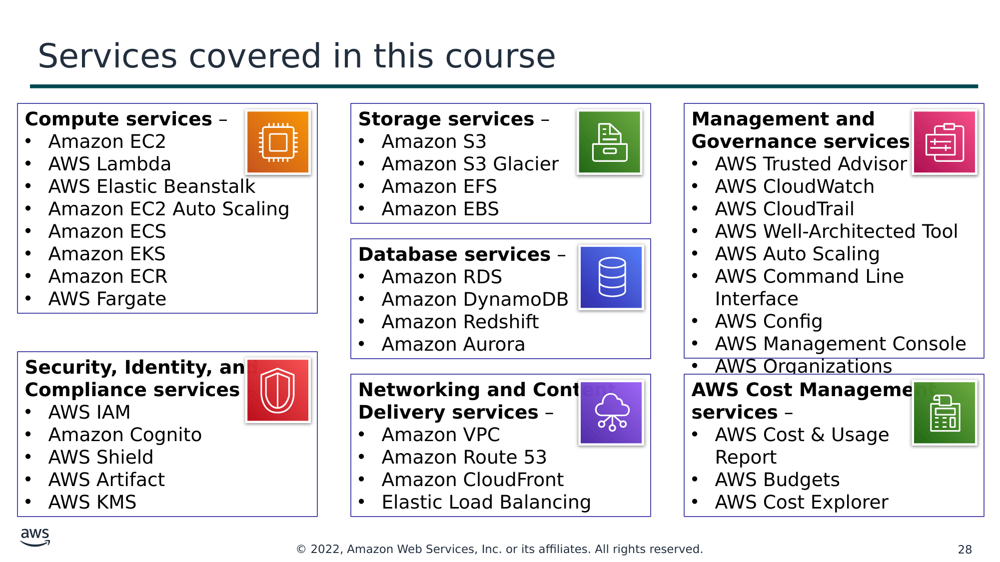

Текст зі схеми

**Compute services** –

- Amazon EC2
- AWS Lambda
- AWS Elastic Beanstalk
- Amazon EC2 Auto Scaling
- Amazon ECS
- Amazon EKS
- Amazon ECR
- AWS Fargate

**Storage services** –

- Amazon S3
- Amazon S3 Glacier
- Amazon EFS
- Amazon EBS

**Management and**  
**Governance services** –

- AWS Trusted Advisor
- AWS CloudWatch
- AWS CloudTrail
- AWS Well-Architected Tool
- AWS Auto Scaling
- AWS Command Line Interface
- AWS Config
- AWS Management Console
- AWS Organizations

**Database services** –

- Amazon RDS
- Amazon DynamoDB
- Amazon Redshift
- Amazon Aurora

**Security, Identity, and**  
**Compliance services** –

- AWS IAM
- Amazon Cognito
- AWS Shield
- AWS Artifact
- AWS KMS

**Networking and Content**  
**Delivery services** –

- Amazon VPC
- Amazon Route 53
- Amazon CloudFront
- Elastic Load Balancing

**AWS Cost Management**  
**services** –

- AWS Cost & Usage  
Report
- AWS Budgets
- AWS Cost Explorer

> **Нотатки:**
>
> The array of AWS services can be intimidating as you start your journey into the cloud. This course focuses on some of the more common services in the following service categories: compute, storage, database, networking and content delivery, security, identity, and compliance, management and governance, and AWS cost management.  
>
> Legend:  
> Amazon Elastic Block Store (Amazon EBS)  
> Amazon Elastic Compute Cloud (Amazon EC2)  
> Amazon Elastic Container Registry (Amazon ECR)  
> Amazon Elastic Container Service (Amazon ECS)  
> Amazon Elastic File System (Amazon EFS)  
> Amazon Elastic Kubernetes Service (Amazon EKS)  
> Amazon Relational Database Service (Amazon RDS)  
> Amazon Simple Storage Service (Amazon S3)  
> Amazon Virtual Private Cloud (Amazon VPC)  
> AWS Identity and Access Management (IAM)  
> AWS Key Management Service (AWS KMS)

---

## Слайд 29: Three ways to interact with AWS

**AWS Management Console**

Easy-to-use graphical interface

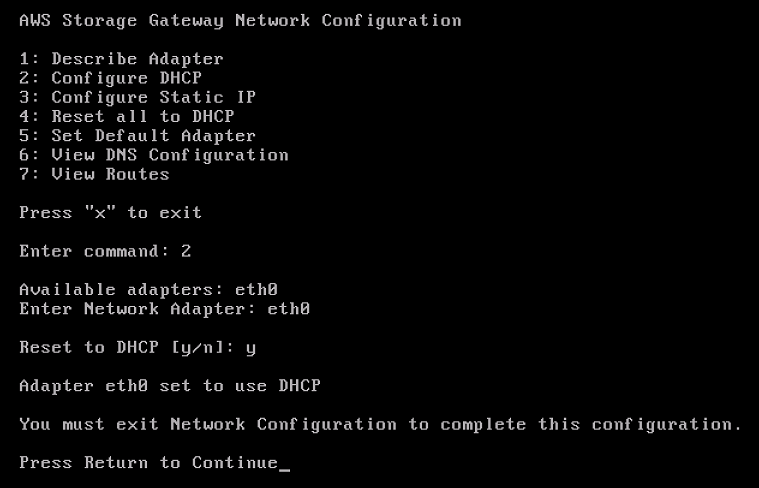

Command Line Interface (AWS CLI)

Access to services by discrete commands or scripts

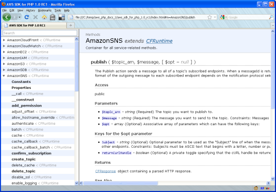

Software Development Kits (SDKs)

Access services directly from your code (such as Java, Python, and others)

> **Нотатки:**
>
> You might wonder how to access the broad array of services that are offered by AWS. There are three ways to create and manage resources on the AWS Cloud:  
> AWS Management Console: The console provides a rich graphical interface to a majority of the features offered by AWS. (Note: From time to time, new features might not have all of their capabilities included in the console when the feature initially launches.)  
> AWS Command Line Interface (AWS CLI): The AWS CLI provides a suite of utilities that can be launched from a command script in Linux, macOS, or Microsoft Windows.  
> Software development kits (SDKs): AWS provides packages that enable accessing AWS in a variety of popular programming languages. This makes it easy to use AWS in your existing applications and it also enables you to create applications that deploy and monitor complex systems entirely through code.  
>
> All three options are built on a common REST-like API that serves as the foundation of AWS.  
>
> To learn more about tools you can use to develop and manage applications on AWS, see https://aws.amazon.com/tools/.

---

## Слайд 30: Section 3 key takeaways

- AWS is a secure cloud platform that offers a broad set of global cloud-based products called services that are designed to work together.
- There are many categories of AWS services, and each category has many services to choose from.
- Choose a service based on your business goals and technology requirements.
- There are three ways to interact with AWS services.

> **Нотатки:**
>
> The key takeaways from this section of the module include:  
> AWS is a secure cloud platform that offers a broad set of global cloud-based products called services that are designed to work together.  
> There are many categories of AWS services, and each category has many services to choose from.  
> Choose a service based on your business goals and technology requirements.  
> There are three ways to interact with AWS services.

---

## Слайд 31: Section 4: Moving to the AWS Cloud – The AWS Cloud Adoption Framework (AWS CAF)

Module 1: Cloud Concepts Overview

> **Нотатки:**
>
> Section 4: Moving to the AWS Cloud – The AWS Cloud Adoption Framework (AWS CAF)  
>
> As you learned so far in this module, cloud computing offers many advantages over the traditional model. However, for most organizations, cloud adoption does not happen instantly. Technology is one thing, but an organization also consists of people and processes, and these three elements must all be in alignment for successful cloud adoption. Cloud computing introduces a significant shift in how technology is obtained, used, and managed. It also shifts how organizations budget and pay for technology services. Cloud adoption requires that fundamental changes are discussed and considered across an entire organization. It also requires that stakeholders across all organizational units—both within and outside IT—support these new changes. In this last section, you learn about the AWS CAF, which was created to help organizations design and travel an accelerated path to successful cloud adoption.

---

## Слайд 32: AWS Cloud Adoption Framework (AWS CAF)

- **AWS CAF provides guidance and best practices to help organizations** build a comprehensive approach to cloud computing across the organization and throughout the IT lifecycle to **accelerate successful cloud adoption**.
- AWS CAF is organized into **six *perspectives***.
- Perspectives consist of sets of ***capabilities***.

AWS CAF perspectives

> **Нотатки:**
>
> Each organization’s cloud adoption journey is unique. However, in order for any organization to successfully migrate its IT portfolio to the cloud, three elements (that is, people, process, and technology) must be in alignment. Business and technology leaders in an organization must understand the organization’s current state, target state, and the transition that is needed to achieve the target state so they can set goals and create processes for staff.  
>
> The AWS Cloud Adoption Framework (AWS CAF) provides guidance and best practices to help organizations identify gaps in skills and processes. It also helps organizations build a comprehensive approach to cloud computing—both across the organization and throughout the IT lifecycle—to accelerate successful cloud adoption.  
>
> At the highest level, the AWS CAF organizes guidance into six areas of focus, called perspectives. Perspectives span people, processes, and technology. Each perspective consists of a set of capabilities, which covers distinct responsibilities that are owned or managed by functionally related stakeholders.  
>
> Capabilities within each perspective are used to identify which areas of an organization require attention. By identifying gaps, prescriptive work streams can be created that support a successful cloud journey.

---

## Слайд 33: Six core perspectives

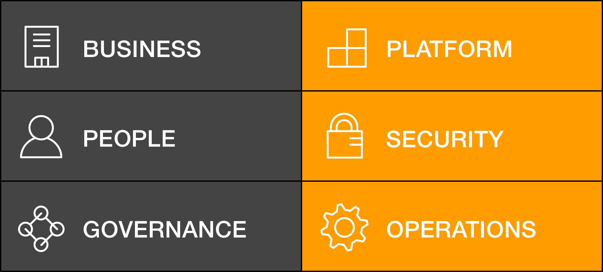

Focus on **business**  
capabilities

Focus on **technical**  
capabilities

> **Нотатки:**
>
> In general, the Business, People, and Governance perspectives focus on business capabilities, while the Platform, Security, and Operations perspectives focus on technical capabilities.

---

## Слайд 34: Business perspective

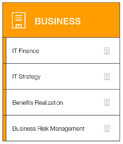

We must ensure that **IT is aligned with business needs**, and that IT investments can be traced to demonstrable business results.

IT finance

IT strategy

Benefits realization

Business risk management

Business managers, finance  
managers, budget owners,  
and strategy stakeholders

**Business perspective capabilities**

> **Нотатки:**
>
> Stakeholders from the Business perspective (for example, business managers, finance managers, budget owners, and strategy stakeholders) can use the AWS CAF to create a strong business case for cloud adoption and prioritize cloud adoption initiatives. Stakeholders should ensure that an organization’s business strategies and goals align with its IT strategies and goals.

---

## Слайд 35: People perspective

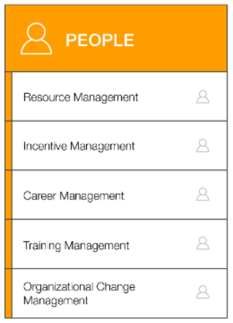

We must prioritize **training, staffing, and organizational changes** to build an agile organization.

Resource management

Incentive management

Career management

Training management

Organizational change  
 management

Human resources, staffing,  
and people managers

**People perspective capabilities**

> **Нотатки:**
>
> Stakeholders from the People perspective (for example, human resources, staffing, and people managers) can use the AWS CAF to evaluate organizational structures and roles, new skill and process requirements, and identify gaps. Performing an analysis of needs and gaps can help prioritize training, staffing, and organizational changes to build an agile organization.

---

## Слайд 36: Governance perspective

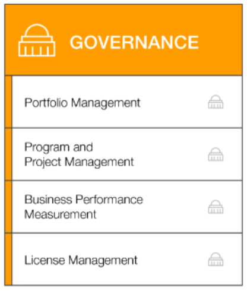

We must ensure that **skills and processes align IT strategy and goals with business strategy and goals** so the organization can maximize the business value of its IT investment and minimize business risks.

Portfolio management

Program and  
project management

Business performance  
measurement

License management

**Governance perspective capabilities**

CIO, program managers, enterprise  
architects, business analysts, and  
portfolio managers

> **Нотатки:**
>
> Stakeholders from the Governance perspective (for example, the Chief Information Officer or CIO, program managers, enterprise architects, business analysts, and portfolio managers) can use the AWS CAF to focus on the skills and processes that are needed to align IT strategy and goals with business strategy and goals. This focus helps the organization maximize the business value of its IT investment and minimize the business risks.

---

## Слайд 37: Platform perspective

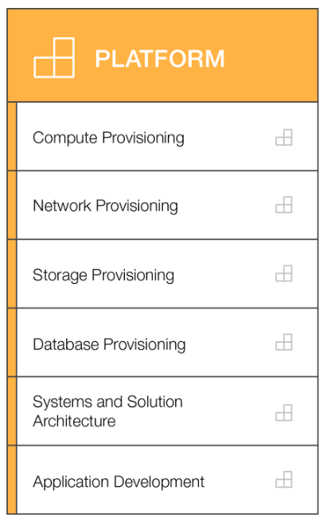

We must **understand and communicate the nature of IT systems and their relationships**. We must be able to **describe the architecture of the target state environment** in detail.

Compute provisioning

Network provisioning

Storage provisioning

Database provisioning

Systems and solution  
architecture

CTO, IT managers, and  
solutions architects

Application development

**Platform perspective capabilities**

> **Нотатки:**
>
> Stakeholders from the Platform perspective (for example, Chief Technology Officer or CTO, IT managers, and solutions architects) use a variety of architectural dimensions and models to understand and communicate the nature of IT systems and their relationships. They must be able to describe the architecture of the target state environment in detail. The AWS CAF includes principles and patterns for implementing new solutions on the cloud, and for migrating on-premises workloads to the cloud.

---

## Слайд 38: Security perspective

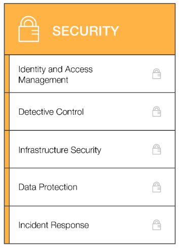

We must ensure that the organization **meets its security objectives**.

Identity and access  
management

Detective control

Infrastructure security

Data protection

CISO, IT security managers,  
and IT security analysts

Incident response

**Security perspective capabilities**

> **Нотатки:**
>
> Stakeholders from the Security perspective (for example, Chief Information Security Officer or CISO, IT security managers, and IT security analysts) must ensure that the organization meets security objectives for visibility, auditability, control, and agility. Security perspective stakeholders can use the AWS CAF to structure the selection and implementation of security controls that meet the organization’s needs.

---

## Слайд 39: Operations perspective

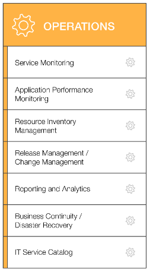

We align with and support the operations of the business, and **define how day-to-day, quarter-to-quarter, and year-to-year business will be conducted**.

Service monitoring

Application performance  
monitoring

Resource inventory  
management

Release management/  
change management

Reporting and analytics

IT operations managers and  
IT support managers

Business continuity/  
Disaster recovery

IT service catalog

**Operations perspective capabilities**

> **Нотатки:**
>
> Stakeholders from the Operations perspective (for example, IT operations managers and IT support managers) define how day-to-day, quarter-to-quarter, and year-to-year business is conducted. Stakeholders from the Operations perspective align with and support the operations of the business. The AWS CAF helps these stakeholders define current operating procedures. It also helps them identify the process changes and training that are needed to implement successful cloud adoption.

---

## Слайд 40: Section 4 key takeaways

- Cloud adoption is not instantaneous for most organizations and requires a thoughtful, deliberate strategy and alignment across the whole organization.
- The AWS CAF was created to help organizations develop efficient and effective plans for their cloud adoption journey.
- The AWS CAF organizes guidance into six areas of focus, called perspectives.
- Perspectives consist of sets of business or technology capabilities that are the responsibility of key stakeholders.

> **Нотатки:**
>
> The key takeaways from this section of the module include:  
> Cloud adoption is not instantaneous for most organizations and requires a thoughtful, deliberate strategy and alignment across the whole organization.  
> The AWS CAF was created to help organizations develop efficient and effective plans for their cloud adoption journey.  
> The AWS CAF organizes guidance into six areas of focus, called perspectives.  
> Perspectives consist of sets of business or technology capabilities that are the responsibility of key stakeholders.

---

## Слайд 41: Module wrap-up

Module 1: Cloud Concepts Overview

> **Нотатки:**
>
> It’s now time to review the module, and wrap up with a knowledge check and discussion of a practice certification exam question.

---

## Слайд 42: Module summary

In summary, in this module you learned how to:

- Define different types of cloud computing models
- Describe six advantages of cloud computing
- Recognize the main AWS service categories and core services
- Review the AWS Cloud Adoption Framework

> **Нотатки:**
>
> In summary, in this module you learned how to:  
> Define different types of cloud computing  
> Describe six advantages of cloud computing  
> Recognize the main AWS service categories and core services  
> Reviewed the AWS Cloud Adoption Framework  
>
> To finish this module, complete the knowledge check.

---

## Слайд 43: Complete the knowledge check

> **Нотатки:**
>
> Now, complete the knowledge check.

---

## Слайд 44: Sample exam question

Why is AWS more economical than traditional data centers for applications with varying compute workloads?

Choice

Response

A

Amazon Elastic Compute Cloud (Amazon EC2) costs are billed on a monthly basis.

B

Customers retain full administrative access to their Amazon EC2 instances.

C

Amazon EC2 instances can be launched on-demand when needed.

D

Customers can permanently run enough instances to handle peak workloads.

> **Нотатки:**
>
> Look at the answer choices and rule them out based on the keywords.

---

## Слайд 45: Sample exam question answer

Why is AWS more economical than traditional data centers for applications with varying compute workloads?

The correct answer is C.

The keywords in the question are AWS is more economical than traditional data centers for applications with varying.

> **Нотатки:**
>
> The following are the keywords to recognize: AWS is more economical than traditional data centers for applications with varying.  
>
> The correct answer is C. Amazon EC2 instances can be launched on-demand when needed.  
>
> Incorrect answers:  
> Answer A: Amazon Elastic Compute Cloud (Amazon EC2) costs are billed on a monthly basis.  
> Answer B: Customers retain full administrative access to their Amazon EC2 instances.  
> Answer D: Customers can permanently run enough instances to handle peak workloads.

---

## Слайд 46: Additional resources

- What is AWS? video: [https://aws.amazon.com/awstv/watch/3059da9f36d/](https://aws.amazon.com/awstv/watch/3059da9f36d/)
- Cloud computing with AWS website: [https://aws.amazon.com/what-is-aws/](https://aws.amazon.com/what-is-aws/)
- Overview of Amazon Web Services whitepaper: [https://d1.awsstatic.com/whitepapers/aws-overview.pdf](https://d1.awsstatic.com/whitepapers/aws-overview.pdf)
- An Overview of the AWS Cloud Adoption Framework whitepaper: [https://d1.awsstatic.com/whitepapers/aws_cloud_adoption_framework.pdf](https://d1.awsstatic.com/whitepapers/aws_cloud_adoption_framework.pdf)
- 6 Strategies for Migrating Applications to the Cloud AWS Cloud Enterprise Strategy blog post: [https://aws.amazon.com/blogs/enterprise-strategy/6-strategies-for-migrating-applications-to-the-cloud/](https://aws.amazon.com/blogs/enterprise-strategy/6-strategies-for-migrating-applications-to-the-cloud/)

> **Нотатки:**
>
> If you want to learn more about the topics covered in this module, you might find the following additional resources helpful:  
> What is AWS? video: https://aws.amazon.com/awstv/watch/3059da9f36d/  
> Cloud computing with AWS website: https://aws.amazon.com/what-is-aws/  
> Overview of Web Services whitepaper: https://d1.awsstatic.com/whitepapers/aws-overview.pdf  
> An Overview of the AWS Cloud Adoption Framework whitepaper: https://d1.awsstatic.com/whitepapers/aws_cloud_adoption_framework.pdf  
> 6 Strategies for Migrating Applications to the Cloud AWS Cloud Enterprise Strategy blog post: https://aws.amazon.com/blogs/enterprise-strategy/6-strategies-for-migrating-applications-to-the-cloud/

---

## Слайд 47: Thank you

All trademarks are the property of their owners.

> **Нотатки:**
>
> Thank you for completing this module.
