## Слайд 1: Модуль 1: Огляд концепцій хмарних обчислень

AWS Academy Cloud Foundations

> **Нотатки:**
>
> Вітаємо в Модулі 1: Огляд концепцій хмарних обчислень.

---

## Слайд 2: Огляд модуля

**Теми**

- Вступ до хмарних обчислень (cloud computing)
- Переваги хмарних обчислень
- Вступ до Amazon Web Services (AWS)
- AWS Cloud Adoption Framework (AWS CAF)

**Перевірка знань**

> **Нотатки:**
>
> У цьому модулі розглядаються такі теми:  
> Вступ до хмарних обчислень  
> Переваги хмарних обчислень  
> Вступ до Amazon Web Services (AWS)  
> AWS Cloud Adoption Framework (AWS CAF)  
>
> Наприкінці вам буде запропоновано пройти перевірку знань, яка допоможе оцінити, наскільки добре ви засвоїли ключові концепції цього модуля.

---

## Слайд 3: Цілі модуля

Після завершення цього модуля ви зможете:

- Визначати різні типи моделей хмарних обчислень
- Описувати шість переваг хмарних обчислень
- Розпізнавати основні категорії та базові сервіси AWS
- Ознайомитися з AWS Cloud Adoption Framework (AWS CAF)

> **Нотатки:**
>
> Після завершення цього модуля ви зможете:  
> Визначати різні типи хмарних обчислень  
> Описувати шість переваг хмарних обчислень  
> Розпізнавати основні категорії та базові сервіси AWS  
> Ознайомитися з AWS Cloud Adoption Framework (AWS CAF)

---

## Слайд 4: Розділ 1: Вступ до хмарних обчислень

Модуль 1: Огляд концепцій хмарних обчислень

> **Нотатки:**
>
> Розділ 1: Вступ до хмарних обчислень

---

## Слайд 5: Що таке хмарні обчислення?

> **Нотатки:**
>
> Що для вас означають хмарні обчислення?  
>
> Знайдіть хвилинку, щоб подумати, що для вас означають хмарні обчислення, і запишіть коротке речення.

---

## Слайд 6: Визначення хмарних обчислень

**Хмарні обчислення (cloud computing)** — це доставка обчислювальної потужності, баз даних, сховищ, застосунків та інших ІТ-ресурсів **за запитом (on-demand)** **через інтернет** із **оплатою за фактом використання (pay-as-you-go)**.

> **Нотатки:**
>
> Хмарні обчислення — це доставка за запитом обчислювальної потужності, баз даних, сховищ, застосунків та інших ІТ-ресурсів через інтернет з оплатою за фактом використання (pay-as-you-go). Ці ресурси працюють на серверних комп’ютерах, розташованих у великих центрах обробки даних (data centers) у різних куточках світу. Коли ви користуєтеся послугами хмарного провайдера, як-от AWS, комп’ютерами, які ви використовуєте, володіє цей провайдер. Ці ресурси можна поєднувати, як будівельні блоки, для створення рішень, що допомагають досягати бізнес-цілей і задовольняти технологічні вимоги.  
>
> Щоб дізнатися більше про хмарні обчислення та принципи їхньої роботи, перейдіть за посиланням https://aws.amazon.com/what-is-cloud-computing/.

---

## Слайд 7: Інфраструктура як програмне забезпечення

Хмарні обчислення дають змогу **перестати сприймати інфраструктуру як апаратне забезпечення** і натомість **сприймати (та використовувати) її як програмне забезпечення.**

> **Нотатки:**
>
> Хмарні обчислення дають змогу перестати сприймати інфраструктуру як апаратне забезпечення і натомість сприймати (та використовувати) її як програмне забезпечення. Але що це означає?

---

## Слайд 8: Традиційна обчислювальна модель

- Інфраструктура як апаратне забезпечення
- Апаратні рішення:
  - Потребують приміщення, персоналу, фізичної безпеки, планування, капітальних витрат
  - Мають тривалий цикл закупівлі обладнання
  - Вимагають розгортати потужності (provision capacity), вгадуючи теоретичні максимальні піки навантаження

> **Нотатки:**
>
> У традиційній обчислювальній моделі інфраструктуру сприймають як апаратне забезпечення. Апаратні рішення є фізичними, а отже, потребують приміщення, персоналу, фізичної безпеки, планування та капітальних витрат.  
>
> Окрім значних початкових інвестицій, ще один стримувальний чинник традиційних обчислень — тривалий цикл закупівлі обладнання, що охоплює придбання, розгортання та обслуговування локальної (on-premises) інфраструктури.  
>
> Працюючи з апаратним рішенням, ви повинні з’ясувати, чи достатньо ресурсів і сховища для ваших потреб, а потужності розгортаєте, вгадуючи теоретичні максимальні піки навантаження. Якщо ви не досягаєте прогнозованого максимального піку, то платите за дорогі ресурси, які простоюють. Якщо ж перевищуєте прогнозований максимальний пік, то потужностей для ваших потреб бракує. А якщо ваші потреби змінюються, ви мусите витрачати час, зусилля та гроші на впровадження нового рішення.  
>
> Наприклад, щоб розгорнути новий вебсайт, вам довелося б купити обладнання, змонтувати його в стійку (rack and stack), розмістити в центрі обробки даних, а потім керувати ним самостійно або доручити це комусь іншому. Такий підхід є дорогим і потребує багато часу.

---

## Слайд 9: Модель хмарних обчислень

- Інфраструктура як програмне забезпечення
- Програмні рішення:
  - Гнучкі
  - Можуть змінюватися швидше, легше та економічніше, ніж апаратні рішення
  - Усувають недиференційовану рутинну роботу (undifferentiated heavy lifting)

> **Нотатки:**
>
> Натомість хмарні обчислення дають змогу сприймати інфраструктуру як програмне забезпечення. Програмні рішення гнучкі. Ви можете обрати хмарні сервіси, які найкраще відповідають вашим потребам, створювати й видаляти ці ресурси за запитом і платити лише за те, що використовуєте. Ресурси можна автоматично й еластично масштабувати вгору та вниз. У моделі хмарних обчислень ресурси можна розглядати як тимчасові й одноразові. Гнучкість хмарних обчислень дозволяє компаніям швидко впроваджувати нові рішення з низькими початковими витратами.  
>
> Порівняно з апаратними рішеннями програмні рішення можуть змінюватися значно швидше, легше та економічніше.  
>
> Хмарні обчислення допомагають розробникам та ІТ-відділам уникати недиференційованої роботи, як-от закупівлі, обслуговування та планування потужностей, і зосередитися на найважливішому.  
>
> Із зростанням популярності хмарних обчислень з’явилося кілька різних моделей надання послуг і стратегій розгортання, які задовольняють специфічні потреби різних користувачів. Кожен тип моделі хмарних послуг і стратегії розгортання забезпечує різний рівень контролю, гнучкості та керування. Розуміння відмінностей між цими моделями надання послуг і стратегіями розгортання допоможе вам визначити, який набір сервісів відповідає вашим потребам.

---

## Слайд 10: Моделі хмарних послуг

IaaS

(інфраструктура як послуга, infrastructure as a service)

PaaS

(платформа як послуга, platform as a service)

SaaS

(програмне забезпечення як послуга, software as a service)

Більше контролю  
над ІТ-ресурсами

Менше контролю  
над ІТ-ресурсами

> **Нотатки:**
>
> Існують три основні моделі хмарних послуг. Кожна модель відповідає різній частині стека хмарних обчислень і надає різний рівень контролю над вашими ІТ-ресурсами:  
> Інфраструктура як послуга (IaaS): сервіси цієї категорії — це базові будівельні блоки хмарної ІТ-інфраструктури; зазвичай вони надають доступ до мережевих функцій, комп’ютерів (віртуальних або на виділеному обладнанні) та сховища даних. IaaS забезпечує найвищий рівень гнучкості та контролю над ІТ-ресурсами. Вона найбільше нагадує наявні ІТ-ресурси, з якими сьогодні знайомі багато ІТ-відділів і розробників.  
> Платформа як послуга (PaaS): сервіси цієї категорії зменшують потребу керувати базовою інфраструктурою (зазвичай апаратним забезпеченням і операційними системами) і дозволяють зосередитися на розгортанні та керуванні застосунками.  
> Програмне забезпечення як послуга (SaaS): сервіси цієї категорії надають готовий продукт, який запускає й обслуговує постачальник послуг. Здебільшого SaaS стосується застосунків для кінцевих користувачів. Користуючись SaaS, вам не потрібно думати про те, як підтримується сервіс або як керується базова інфраструктура. Вам треба продумати лише те, як ви збираєтеся використовувати саме це програмне забезпечення. Поширений приклад SaaS-застосунку — вебпошта, де ви можете надсилати й отримувати листи, не піклуючись про додавання функцій до поштового продукту чи про обслуговування серверів і операційних систем, на яких він працює.

---

## Слайд 11: Моделі розгортання хмарних обчислень

Хмара (cloud)

Гібридна (hybrid)

Локальна, on-premises  
(приватна хмара)

> **Нотатки:**
>
> Існують три основні моделі розгортання хмарних обчислень, які визначають середовища, де можна розгортати ваші застосунки:  
> Хмара (Cloud): хмарний застосунок повністю розгортається в хмарі, і всі його частини працюють у хмарі. Такі застосунки або одразу створені в хмарі, або перенесені з наявної інфраструктури, щоб скористатися перевагами хмарних обчислень (див. https://aws.amazon.com/what-is-cloud-computing/). Хмарні застосунки можуть будуватися на низькорівневих компонентах інфраструктури або використовувати сервіси вищого рівня, які абстрагують вимоги до керування, проєктування архітектури та масштабування базової інфраструктури.  
> Гібридна (Hybrid): гібридне розгортання — це спосіб з’єднання інфраструктури й застосунків між хмарними ресурсами та наявними ресурсами, які розташовані не в хмарі. Найпоширеніший метод гібридного розгортання — з’єднання хмари з наявною локальною (on-premises) інфраструктурою. Ця модель дає організації змогу розширювати та нарощувати свою інфраструктуру в хмарі, одночасно з’єднуючи хмарні ресурси з внутрішніми системами.  
> Локальна (On-premises): розгортання ресурсів у власній інфраструктурі з використанням засобів віртуалізації та керування ресурсами іноді називають приватною хмарою (private cloud). Хоча локальне розгортання не забезпечує багатьох переваг хмарних обчислень, його іноді обирають заради можливості мати виділені ресурси. Здебільшого ця модель розгортання збігається зі застарілою (legacy) ІТ-інфраструктурою, проте вона може також використовувати технології керування застосунками та віртуалізації для підвищення ефективності використання ресурсів.

---

## Слайд 12: Спільні риси AWS і традиційної ІТ-інфраструктури

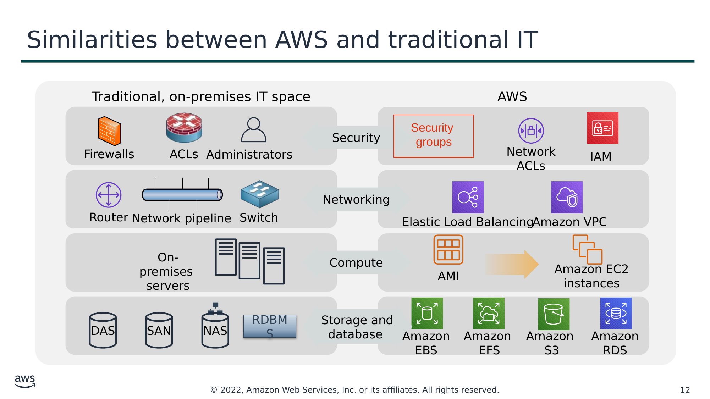

Текст зі схеми

Traditional, on-premises IT space (Традиційна локальна ІТ-інфраструктура)

AWS

Security (Безпека)

Security  
groups

Firewalls

ACLs

Administrators

Network ACLs

IAM

Networking (Мережі)

Router

Network pipeline

Switch

Elastic Load Balancing

Amazon VPC

On-premises  
servers

Compute (Обчислення)

AMI

Amazon EC2 instances

Storage and  
database (Сховище та бази даних)

DAS

SAN

NAS

RDBMS

Amazon EBS

Amazon  
EFS

Amazon  
S3

Amazon RDS

> **Нотатки:**
>
> Між AWS і традиційною локальною ІТ-інфраструктурою багато спільного:  
> Групи безпеки AWS (security groups), мережеві списки контролю доступу (network ACLs) та AWS Identity and Access Management (IAM) подібні до брандмауерів (firewalls), списків контролю доступу (ACLs) та адміністраторів.  
> Elastic Load Balancing і Amazon Virtual Private Cloud (Amazon VPC) подібні до маршрутизаторів, мережевих каналів (network pipelines) і комутаторів.  
> Amazon Machine Images (AMIs) та екземпляри Amazon Elastic Compute Cloud (Amazon EC2) подібні до локальних серверів.  
> Amazon Elastic Block Store (Amazon EBS), Amazon Elastic File System (Amazon EFS), Amazon Simple Storage Service (Amazon S3) і Amazon Relational Database Service (Amazon RDS) подібні до сховищ із безпосереднім підключенням (direct attached storage, DAS), мереж зберігання даних (SAN), мережевих сховищ (NAS) та системи керування реляційними базами даних (RDBMS).  
>
> За допомогою сервісів і функцій AWS ви можете зробити майже все, що хотіли б робити в традиційному центрі обробки даних.

---

## Слайд 13: Ключові висновки розділу 1

- Хмарні обчислення — це доставка ІТ-ресурсів за запитом через інтернет з оплатою за фактом використання (pay-as-you-go).
- Хмарні обчислення дають змогу сприймати (та використовувати) вашу інфраструктуру як програмне забезпечення.
- Існують три моделі хмарних послуг: IaaS, PaaS і SaaS.
- Існують три моделі розгортання хмарних обчислень: хмарна (cloud), гібридна (hybrid) та локальна (on-premises), або приватна хмара.
- Майже все, що можна реалізувати за допомогою традиційної ІТ, можна також реалізувати як хмарний обчислювальний сервіс AWS.

> **Нотатки:**
>
> Основні висновки цього розділу модуля:  
> Хмарні обчислення — це доставка ІТ-ресурсів за запитом через інтернет з оплатою за фактом використання (pay-as-you-go).  
> Хмарні обчислення дають змогу сприймати (та використовувати) вашу інфраструктуру як програмне забезпечення.  
> Існують три моделі хмарних послуг: IaaS, PaaS і SaaS.  
> Існують три моделі розгортання хмарних обчислень: хмарна (cloud), гібридна (hybrid) та локальна (on-premises), або приватна хмара.  
> Для традиційної локальної ІТ-інфраструктури існує багато аналогів серед сервісів AWS.

---

## Слайд 14: Розділ 2: Переваги хмарних обчислень

Модуль 1: Огляд концепцій хмарних обчислень

> **Нотатки:**
>
> Розділ 2: Переваги хмарних обчислень  
>
> Чому так багато компаній зацікавлені в переході до хмари? У цьому розділі представлено шість переваг хмарних обчислень.

---

## Слайд 15: Заміна капітальних витрат змінними

Capital

Інвестиції в центр обробки даних  
на основі прогнозу

Платіть лише за обсяг,  
який споживаєте

> **Нотатки:**
>
> Перевага №1 — заміна капітальних витрат змінними: капітальні витрати (capital expenses, capex) — це кошти, які компанія використовує для придбання, модернізації та утримання фізичних активів, як-от нерухомість, промислові будівлі чи обладнання. Пам’ятаєте приклад центру обробки даних у традиційній обчислювальній моделі, де потрібно було монтувати обладнання в стійки (rack and stack), а потім керувати всім цим? За все в центрі обробки даних доводиться платити незалежно від того, користуєтеся ви цим чи ні.  
>
> Натомість змінні витрати — це витрати, які особа, що їх несе, може легко змінити або уникнути. Замість того щоб робити великі інвестиції в центри обробки даних і сервери ще до того, як ви знаєте, як їх використовуватимете, ви можете платити лише тоді, коли споживаєте ресурси, і лише за той обсяг, який споживаєте. Таким чином ви заощаджуєте кошти на технологіях. Це також дає змогу за лічені хвилини, а не за тижні чи дні, адаптуватися до нових застосунків, отримуючи стільки місця, скільки потрібно. Обслуговування зменшується, тож ви можете більше зосередитися на основних цілях свого бізнесу.

---

## Слайд 16: Значна економія за рахунок масштабу

Завдяки сукупному використанню всіма клієнтами AWS може досягати  
вищої економії за рахунок масштабу (economies of scale) і передавати заощадження клієнтам.

AWS Cloud

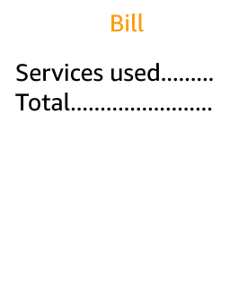

**Економія за рахунок масштабу (Economies of scale)**

Заощадження

> **Нотатки:**
>
> Перевага №2 — використання значної економії за рахунок масштабу: використовуючи хмарні обчислення, ви можете отримати нижчу змінну вартість, ніж могли б досягти самостійно. Оскільки в хмарі агрегується використання сотень тисяч клієнтів, провайдери на кшталт AWS можуть досягати вищої економії за рахунок масштабу, що виливається в нижчі ціни з оплатою за фактом використання (pay-as-you-go).

---

## Слайд 17: Не вгадуйте потрібні потужності

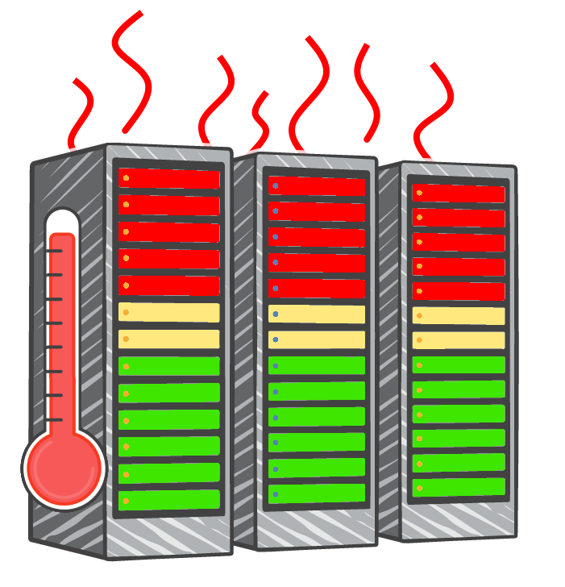

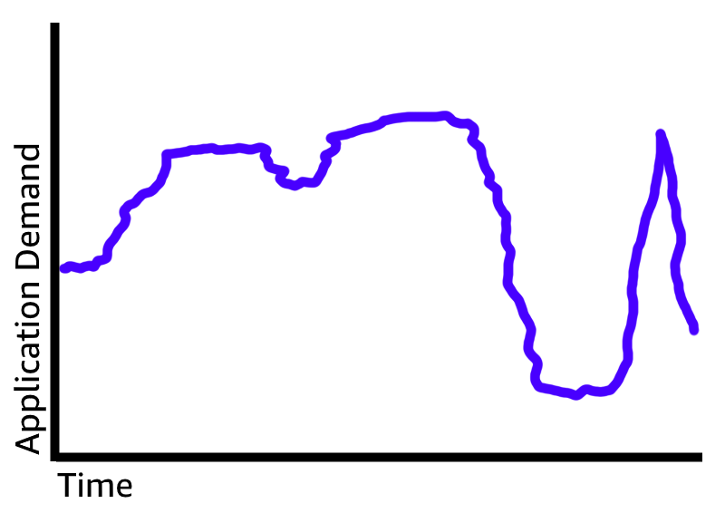

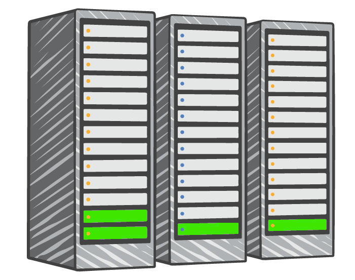

Завищена оцінка  
потужності серверів

Занижена оцінка  
потужності серверів

Масштабування за запитом (scaling on demand)

> **Нотатки:**
>
> Перевага №3 — не вгадуйте потрібні потужності: припиніть вгадувати потреби вашої інфраструктури в потужностях. Коли ви ухвалюєте рішення щодо потужностей до розгортання застосунку, то часто або отримуєте дорогі ресурси, що простоюють, або стикаєтеся з обмеженими потужностями. У хмарних обчисленнях цих проблем немає. Ви можете отримати стільки ресурсів, скільки потрібно, — багато чи мало — і масштабувати їх вгору та вниз за потреби, маючи лише кілька хвилин на попередження.

---

## Слайд 18: Підвищення швидкості та гнучкості (agility)

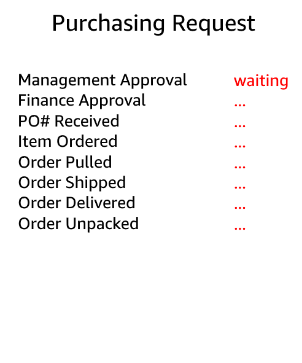

**Launch**

*Тижні* між бажанням отримати ресурси та їх отриманням

*Хвилини* між бажанням отримати ресурси та їх отриманням

> **Нотатки:**
>
> Перевага №4 — підвищення швидкості та гнучкості (agility): у середовищі хмарних обчислень нові ІТ-ресурси доступні за один клік, а це означає, що час, потрібний для того, щоб надати ці ресурси розробникам, скорочується з тижнів до кількох хвилин. Результатом є різке підвищення гнучкості організації, оскільки вартість і час на експерименти та розробку суттєво зменшуються.

---

## Слайд 19: Припиніть витрачати гроші на експлуатацію та обслуговування центрів обробки даних

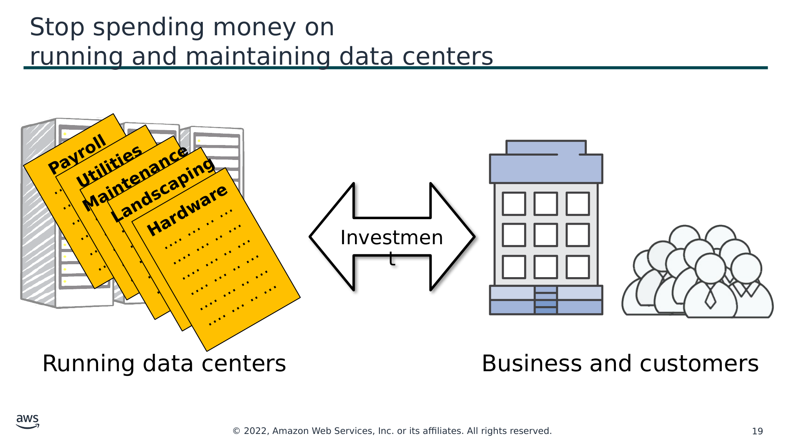

Текст зі схеми

**Payroll** (Заробітна плата)  
…. … .. …  
…. … .. …  
…. … .. …  
…. … .. …  
…. … .. …  
…. … .. …

**Utilities** (Комунальні послуги)  
…. … .. …  
…. … .. …  
…. … .. …  
…. … .. …  
…. … .. …  
…. … .. …

**Maintenance** (Обслуговування)  
…. … .. …  
…. … .. …  
…. … .. …  
…. … .. …  
…. … .. …  
…. … .. …

**Landscaping** (Озеленення)  
…. … .. …  
…. … .. …  
…. … .. …  
…. … .. …  
…. … .. …  
…. … .. …

**Hardware** (Обладнання)  
…. … .. …  
…. … .. …  
…. … .. …  
…. … .. …  
…. … .. …  
…. … .. …

Investment (Інвестиції)

Експлуатація центрів обробки даних

Бізнес і клієнти

> **Нотатки:**
>
> Перевага №5 — припиніть витрачати гроші на експлуатацію та обслуговування центрів обробки даних: зосередьтеся на проєктах, які вирізняють ваш бізнес, а не на інфраструктурі. Хмарні обчислення дають змогу зосередитися на власних клієнтах, а не на важкій рутинній роботі з монтажу серверів у стійки, їх укладання та живлення.

---

## Слайд 20: Вихід на глобальний рівень за лічені хвилини

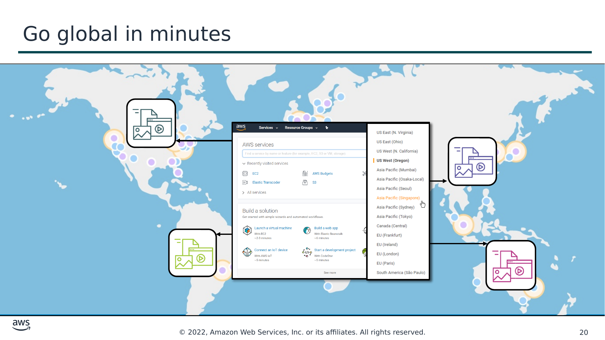

> **Нотатки:**
>
> Перевага №6 — вихід на глобальний рівень за лічені хвилини: ви можете розгорнути свій застосунок у кількох регіонах AWS (AWS Regions) по всьому світу за кілька кліків. У результаті ви можете просто й за мінімальних витрат забезпечити клієнтам меншу затримку (latency) та кращий досвід користування.

---

## Слайд 21: Ключові висновки розділу 2

- Заміна капітальних витрат змінними
- Використання значної економії за рахунок масштабу
- Не вгадуйте потрібні потужності
- Підвищення швидкості та гнучкості (agility)
- Припиніть витрачати гроші на експлуатацію та обслуговування центрів обробки даних
- Вихід на глобальний рівень за лічені хвилини

> **Нотатки:**
>
> Основні висновки цього розділу модуля охоплюють шість переваг хмарних обчислень:  
> Заміна капітальних витрат змінними  
> Значна економія за рахунок масштабу  
> Не вгадуйте потрібні потужності  
> Підвищення швидкості та гнучкості (agility)  
> Припиніть витрачати гроші на експлуатацію та обслуговування центрів обробки даних  
> Вихід на глобальний рівень за лічені хвилини

---

## Слайд 22: Розділ 3: Вступ до Amazon Web Services (AWS)

Модуль 1: Огляд концепцій хмарних обчислень

> **Нотатки:**
>
> Розділ 3: Вступ до Amazon Web Services (AWS)

---

## Слайд 23: Що таке вебсервіси?

**Вебсервіс (web service)** — це будь-яке програмне забезпечення, яке стає доступним через інтернет і використовує **стандартизований формат**, як-от Extensible Markup Language (XML) або JavaScript Object Notation (JSON), для запиту та відповіді під час **взаємодії через прикладний програмний інтерфейс (API)**.

**Повідомлення із запитом (Request message)**

**Інтернет (Internet)**

**Повідомлення з відповіддю (Response message)**

**Клієнт (Client)**

**Вебсервіс (Web service)**

> **Нотатки:**
>
> Загалом вебсервіс — це будь-яке програмне забезпечення, яке стає доступним через інтернет або приватні (інтранет) мережі. Вебсервіс використовує стандартизований формат, як-от Extensible Markup Language (XML) або JavaScript Object Notation (JSON), для запиту та відповіді під час взаємодії через прикладний програмний інтерфейс (API). Він не прив’язаний до жодної конкретної операційної системи чи мови програмування. Він самоописовий — завдяки файлу визначення інтерфейсу — і придатний для виявлення (discoverable).

---

## Слайд 24: Що таке AWS?

- AWS — це **безпечна хмарна платформа**, що пропонує **широкий набір глобальних хмарних продуктів**.
- AWS надає вам **доступ за запитом** до обчислювальних ресурсів, сховищ, мереж, баз даних та інших ІТ-ресурсів і засобів керування.
- AWS пропонує **гнучкість**.
- Ви **платите лише за окремі сервіси, які вам потрібні**, і **лише доти, доки ними користуєтеся**.
- Сервіси AWS **працюють разом**, як будівельні блоки.

> **Нотатки:**
>
> Amazon Web Services (AWS) — це безпечна хмарна платформа, що пропонує широкий набір глобальних хмарних продуктів. Оскільки ці продукти надаються через інтернет, ви маєте доступ за запитом до обчислювальних ресурсів, сховищ, мереж, баз даних та інших ІТ-ресурсів, які можуть знадобитися для ваших проєктів, а також до засобів керування ними. Ви можете негайно створювати та запускати ресурси AWS. Ресурси готові до використання за лічені хвилини.  
>
> AWS пропонує гнучкість. Ваше середовище AWS можна переналаштовувати й оновлювати за запитом, автоматично масштабувати вгору чи вниз відповідно до характеру використання та оптимізації витрат, а також тимчасово або назавжди вимикати. Оплата сервісів AWS стає операційними витратами, а не капітальними.  
>
> Сервіси AWS розроблено так, щоб вони працювали разом для підтримки практично будь-якого типу застосунків чи робочих навантажень (workloads). Уявіть ці сервіси як будівельні блоки, з яких можна швидко збирати складні масштабовані рішення, а потім коригувати їх у міру зміни ваших потреб.

---

## Слайд 25: Категорії сервісів AWS

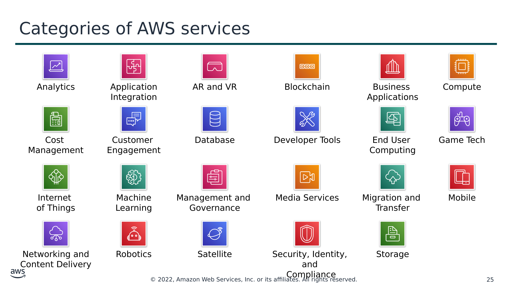

Текст зі схеми

Analytics (Аналітика)

Application Integration (Інтеграція застосунків)

AR and VR (Доповнена та віртуальна реальність)

Blockchain (Блокчейн)

Business  
Applications (Бізнес-застосунки)

Compute (Обчислення)

Cost  
Management (Управління витратами)

Customer  
Engagement (Взаємодія з клієнтами)

Database (Бази даних)

Developer Tools (Інструменти розробника)

End User Computing (Обчислення для кінцевих користувачів)

Game Tech (Ігрові технології)

Internet  
of Things (Інтернет речей)

Machine Learning (Машинне навчання)

Management and  
Governance (Управління та контроль)

Media Services (Медіасервіси)

Migration and Transfer (Міграція та передавання даних)

Mobile (Мобільні технології)

Networking and Content Delivery (Мережі та доставка контенту)

Robotics (Робототехніка)

Satellite (Супутникові технології)

Security, Identity, and Compliance (Безпека, ідентифікація та відповідність вимогам)

Storage (Сховища)

> **Нотатки:**
>
> Сервіси AWS поділяються на різні категорії, і кожна категорія містить один або кілька сервісів. Із цих категорій можна обирати потрібні сервіси для створення своїх рішень.

---

## Слайд 26: Приклад простого рішення

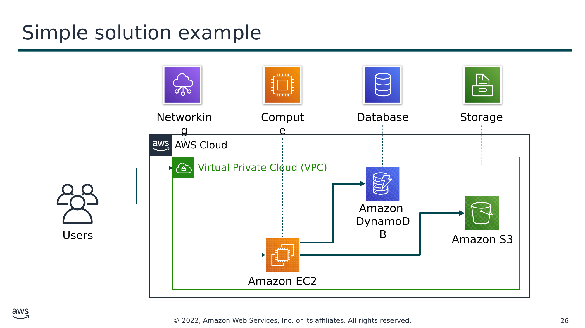

Текст зі схеми

Networking (Мережі)

Compute (Обчислення)

Database (Бази даних)

Storage (Сховище)

AWS Cloud

Virtual Private Cloud (VPC)

Amazon  
DynamoDB

Users (Користувачі)

Amazon S3

Amazon EC2

> **Нотатки:**
>
> Припустімо, ви створюєте застосунок із базою даних. Ваші клієнти можуть надсилати дані до ваших екземплярів Amazon Elastic Compute Cloud (Amazon EC2) — це сервіс із категорії обчислень. Ці EC2-сервери групують дані з інтервалом в одну хвилину і додають по одному об’єкту на клієнта до Amazon Simple Storage Service (Amazon S3) — сервісу зберігання AWS, який ви обрали. Потім ви можете використати нереляційну базу даних, як-от Amazon DynamoDB, для роботи вашого застосунку, наприклад для побудови індексу, щоб знаходити всі об’єкти певного клієнта, зібрані протягом певного періоду. Ви можете вирішити запускати ці сервіси всередині Amazon Virtual Private Cloud (Amazon VPC) — сервісу з категорії мереж.  
>
> Мета цього простого прикладу — показати, що ви можете обирати вебсервіси з різних категорій і використовувати їх разом для створення рішення (у цьому випадку — застосунку з базою даних). Звісно, рішення, які ви створюєте, можуть бути досить складними.

---

## Слайд 27: Вибір сервісу

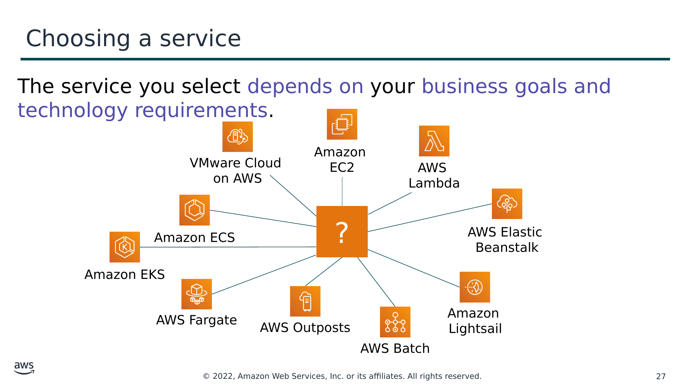

Текст зі схеми

Сервіс, який ви оберете, залежить від ваших бізнес-цілей і технологічних вимог.

?

AWS Elastic  
Beanstalk

VMware Cloud  
on AWS

Amazon  
EC2

Amazon  
Lightsail

Amazon ECS

Amazon EKS

AWS  
Lambda

AWS Fargate

AWS Outposts

AWS Batch

> **Нотатки:**
>
> Який сервіс ви оберете, залежить від ваших бізнес-цілей і технологічних вимог. У щойно розглянутому прикладі в рішенні використовувався Amazon EC2 як сервіс обчислень. Проте це лише один із багатьох обчислювальних сервісів, які пропонує AWS. Ось інші обчислювальні пропозиції AWS, які ви можете обрати для таких прикладів використання:  
> Amazon EC2 (https://aws.amazon.com/ec2/): вам потрібен повний контроль над вашими обчислювальними ресурсами AWS.  
> AWS Lambda (https://aws.amazon.com/lambda/): ви хочете запускати свій код, не керуючи серверами та не розгортаючи їх.  
> AWS Elastic Beanstalk (https://aws.amazon.com/elasticbeanstalk/): вам потрібен сервіс, який розгортає ваші вебзастосунки, керує ними та масштабує їх замість вас.  
> Amazon Lightsail (https://aws.amazon.com/lightsail/): вам потрібна полегшена хмарна платформа для простого вебзастосунку.  
> AWS Batch (https://aws.amazon.com/batch/): вам потрібно виконувати сотні тисяч пакетних робочих навантажень (batch workloads).  
> AWS Outposts (https://aws.amazon.com/outposts/): ви хочете запускати інфраструктуру AWS у власному локальному центрі обробки даних.  
> Amazon Elastic Container Service (Amazon ECS) (https://aws.amazon.com/ecs/)  
> Amazon Elastic Kubernetes Service (Amazon EKS) (https://aws.amazon.com/eks/)  
> AWS Fargate (https://aws.amazon.com/fargate/): ви хочете реалізувати архітектуру на основі контейнерів або мікросервісів.  
> VMware Cloud on AWS (https://aws.amazon.com/vmware/): у вас є локальна платформа віртуалізації серверів, яку ви хочете мігрувати до AWS.  
>
> Аналогічно, в інших категоріях також є різноманітні сервіси на вибір, і кількість пропозицій постійно зростає.

---

## Слайд 28: Сервіси, що розглядаються в цьому курсі

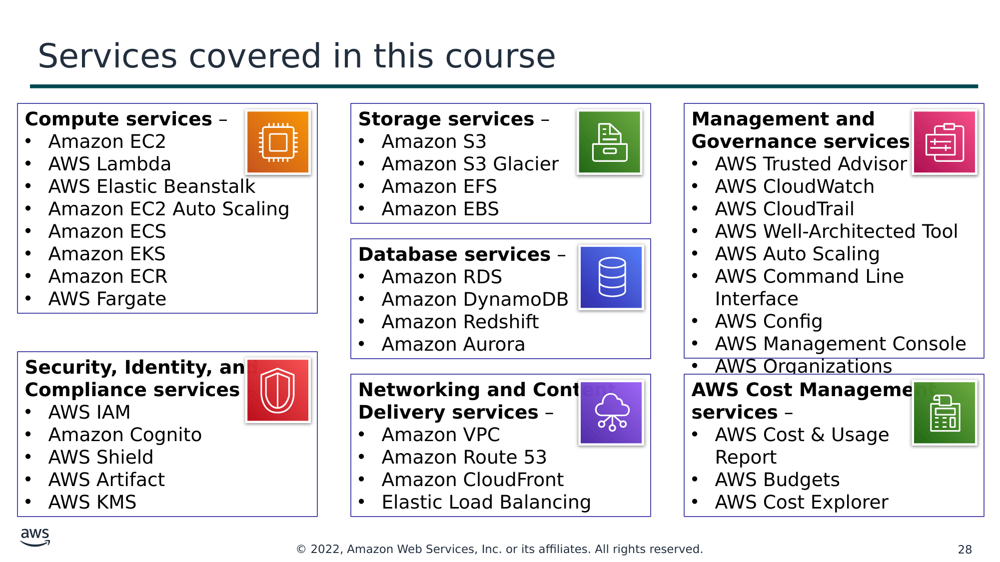

Текст зі схеми

**Сервіси обчислень (Compute services)** –

- Amazon EC2
- AWS Lambda
- AWS Elastic Beanstalk
- Amazon EC2 Auto Scaling
- Amazon ECS
- Amazon EKS
- Amazon ECR
- AWS Fargate

**Сервіси зберігання (Storage services)** –

- Amazon S3
- Amazon S3 Glacier
- Amazon EFS
- Amazon EBS

**Сервіси управління та контролю**  
**(Management and Governance services)** –

- AWS Trusted Advisor
- AWS CloudWatch
- AWS CloudTrail
- AWS Well-Architected Tool
- AWS Auto Scaling
- AWS Command Line Interface
- AWS Config
- AWS Management Console
- AWS Organizations

**Сервіси баз даних (Database services)** –

- Amazon RDS
- Amazon DynamoDB
- Amazon Redshift
- Amazon Aurora

**Сервіси безпеки, ідентифікації та відповідності вимогам**  
**(Security, Identity, and Compliance services)** –

- AWS IAM
- Amazon Cognito
- AWS Shield
- AWS Artifact
- AWS KMS

**Сервіси мереж і доставки контенту**  
**(Networking and Content Delivery services)** –

- Amazon VPC
- Amazon Route 53
- Amazon CloudFront
- Elastic Load Balancing

**Сервіси управління витратами AWS**  
**(AWS Cost Management services)** –

- AWS Cost & Usage  
Report
- AWS Budgets
- AWS Cost Explorer

> **Нотатки:**
>
> Безліч сервісів AWS може лякати на початку вашого шляху в хмару. Цей курс зосереджується на деяких найпоширеніших сервісах у таких категоріях: обчислення (compute), зберігання (storage), бази даних (database), мережі та доставка контенту (networking and content delivery), безпека, ідентифікація та відповідність вимогам (security, identity, and compliance), управління та контроль (management and governance) і управління витратами AWS (AWS cost management).  
>
> Умовні позначення:  
> Amazon Elastic Block Store (Amazon EBS)  
> Amazon Elastic Compute Cloud (Amazon EC2)  
> Amazon Elastic Container Registry (Amazon ECR)  
> Amazon Elastic Container Service (Amazon ECS)  
> Amazon Elastic File System (Amazon EFS)  
> Amazon Elastic Kubernetes Service (Amazon EKS)  
> Amazon Relational Database Service (Amazon RDS)  
> Amazon Simple Storage Service (Amazon S3)  
> Amazon Virtual Private Cloud (Amazon VPC)  
> AWS Identity and Access Management (IAM)  
> AWS Key Management Service (AWS KMS)

---

## Слайд 29: Три способи взаємодії з AWS

**AWS Management Console**

Простий у використанні графічний інтерфейс

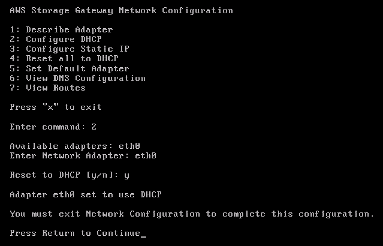

Command Line Interface (AWS CLI)

Доступ до сервісів за допомогою окремих команд або скриптів

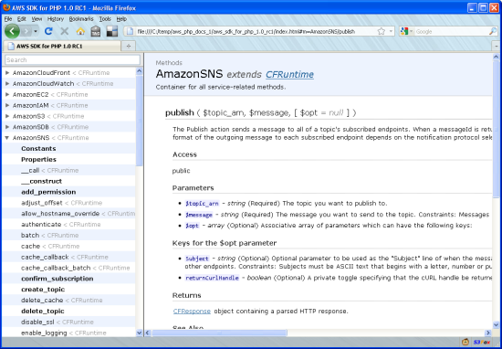

Software Development Kits (SDKs)

Доступ до сервісів безпосередньо з вашого коду (наприклад, Java, Python та інших мов)

> **Нотатки:**
>
> Ви можете поцікавитися, як отримати доступ до широкого спектра сервісів, які пропонує AWS. Існують три способи створювати ресурси в хмарі AWS і керувати ними:  
> AWS Management Console: консоль надає багатий графічний інтерфейс до більшості функцій, які пропонує AWS. (Примітка: час від часу під час початкового запуску нової функції не всі її можливості можуть бути доступні в консолі.)  
> AWS Command Line Interface (AWS CLI): AWS CLI надає набір утиліт, які можна запускати зі скрипта командного рядка в Linux, macOS або Microsoft Windows.  
> Software development kits (SDKs): AWS надає пакети, що дають змогу отримувати доступ до AWS у різних популярних мовах програмування. Це спрощує використання AWS у ваших наявних застосунках, а також дозволяє створювати застосунки, які розгортають складні системи та відстежують їх повністю за допомогою коду.  
>
> Усі три варіанти побудовані на спільному REST-подібному API, який є основою AWS.  
>
> Щоб дізнатися більше про інструменти, які можна використовувати для розробки застосунків в AWS і керування ними, перейдіть за посиланням https://aws.amazon.com/tools/.

---

## Слайд 30: Ключові висновки розділу 3

- AWS — це безпечна хмарна платформа, що пропонує широкий набір глобальних хмарних продуктів, які називаються сервісами та розроблені для спільної роботи.
- Існує багато категорій сервісів AWS, і в кожній категорії є з чого обирати.
- Обирайте сервіс на основі ваших бізнес-цілей і технологічних вимог.
- Існують три способи взаємодії із сервісами AWS.

> **Нотатки:**
>
> Основні висновки цього розділу модуля:  
> AWS — це безпечна хмарна платформа, що пропонує широкий набір глобальних хмарних продуктів, які називаються сервісами та розроблені для спільної роботи.  
> Існує багато категорій сервісів AWS, і в кожній категорії є з чого обирати.  
> Обирайте сервіс на основі ваших бізнес-цілей і технологічних вимог.  
> Існують три способи взаємодії із сервісами AWS.

---

## Слайд 31: Розділ 4: Перехід до хмари AWS — AWS Cloud Adoption Framework (AWS CAF)

Модуль 1: Огляд концепцій хмарних обчислень

> **Нотатки:**
>
> Розділ 4: Перехід до хмари AWS — AWS Cloud Adoption Framework (AWS CAF)  
>
> Як ви вже дізналися з цього модуля, хмарні обчислення пропонують багато переваг порівняно з традиційною моделлю. Проте для більшості організацій перехід до хмари не відбувається миттєво. Технології — це лише одна складова, адже організація також складається з людей і процесів, і ці три елементи мають бути узгоджені для успішного впровадження хмари. Хмарні обчислення докорінно змінюють те, як технології отримують, використовують і як ними керують. Вони також змінюють те, як організації планують бюджет і сплачують за технологічні послуги. Впровадження хмари вимагає, щоб фундаментальні зміни обговорювалися й розглядалися в усій організації. Воно також вимагає, щоб зацікавлені сторони (stakeholders) з усіх підрозділів організації — як у межах ІТ, так і поза ними — підтримували ці нові зміни. В останньому розділі ви дізнаєтеся про AWS CAF, створений для того, щоб допомогти організаціям спроєктувати й пройти прискорений шлях до успішного впровадження хмари.

---

## Слайд 32: AWS Cloud Adoption Framework (AWS CAF)

- **AWS CAF надає рекомендації та найкращі практики, які допомагають організаціям** розробити комплексний підхід до хмарних обчислень у всій організації та протягом усього життєвого циклу ІТ, щоб **прискорити успішне впровадження хмари**.
- AWS CAF організовано навколо **шести *перспектив (perspectives)***.
- Перспективи складаються з наборів ***можливостей (capabilities)***.

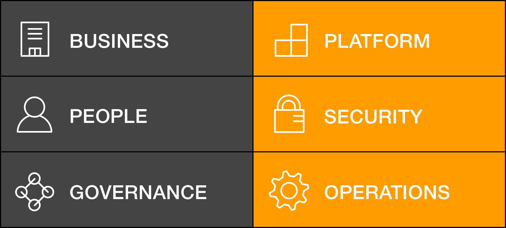

Перспективи AWS CAF

> **Нотатки:**
>
> Шлях кожної організації до хмари унікальний. Проте для успішної міграції ІТ-портфеля організації в хмару три елементи (тобто люди, процеси й технології) мають бути узгоджені. Бізнес-лідери та технологічні лідери організації мають розуміти її поточний стан, цільовий стан і перехід, потрібний для досягнення цільового стану, щоб ставити цілі та створювати процеси для персоналу.  
>
> AWS Cloud Adoption Framework (AWS CAF) надає рекомендації та найкращі практики, які допомагають організаціям виявляти прогалини в навичках і процесах. Він також допомагає організаціям розробити комплексний підхід до хмарних обчислень — як у межах організації, так і протягом усього життєвого циклу ІТ, — щоб прискорити успішне впровадження хмари.  
>
> На найвищому рівні AWS CAF впорядковує рекомендації за шістьма напрямами, які називаються перспективами (perspectives). Перспективи охоплюють людей, процеси та технології. Кожна перспектива складається з набору можливостей (capabilities), які охоплюють окремі зони відповідальності, що належать функційно пов’язаним зацікавленим сторонам або керуються ними.  
>
> Можливості в межах кожної перспективи використовуються для визначення тих напрямів організації, які потребують уваги. Виявивши прогалини, можна створити прескриптивні потоки робіт (work streams), що підтримують успішний шлях у хмару.

---

## Слайд 33: Шість основних перспектив

Зосередження на **бізнес**-  
можливостях

Зосередження на **технічних**  
можливостях

> **Нотатки:**
>
> Загалом перспективи Business (бізнес), People (люди) і Governance (управління) зосереджені на бізнес-можливостях, тоді як перспективи Platform (платформа), Security (безпека) і Operations (операції) — на технічних можливостях.

---

## Слайд 34: Перспектива Business (бізнес)

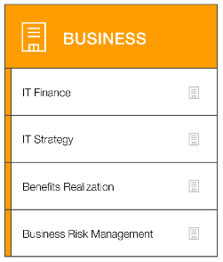

Ми повинні гарантувати, що **ІТ узгоджені з потребами бізнесу**, а ІТ-інвестиції можна простежити до відчутних бізнес-результатів.

ІТ-фінанси (IT finance)

ІТ-стратегія (IT strategy)

Реалізація вигод (Benefits realization)

Управління бізнес-ризиками (Business risk management)

Бізнес-менеджери, фінансові  
менеджери, власники бюджетів  
і зацікавлені сторони зі стратегії

**Можливості перспективи Business**

> **Нотатки:**
>
> Зацікавлені сторони з перспективи Business (наприклад, бізнес-менеджери, фінансові менеджери, власники бюджетів і зацікавлені сторони зі стратегії) можуть використовувати AWS CAF, щоб створити переконливе бізнес-обґрунтування впровадження хмари та визначити пріоритети ініціатив із впровадження хмари. Зацікавлені сторони мають гарантувати, що бізнес-стратегії та цілі організації узгоджені з її ІТ-стратегіями та цілями.

---

## Слайд 35: Перспектива People (люди)

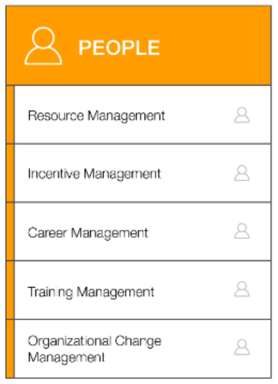

Ми повинні надати пріоритет **навчанню, підбору персоналу та організаційним змінам**, щоб побудувати гнучку (agile) організацію.

Управління ресурсами (Resource management)

Управління стимулами (Incentive management)

Управління кар’єрою (Career management)

Управління навчанням (Training management)

Управління організаційними  
змінами (Organizational change management)

Відділ кадрів, підбір персоналу  
та керівники команд

**Можливості перспективи People**

> **Нотатки:**
>
> Зацікавлені сторони з перспективи People (наприклад, відділ кадрів, підбір персоналу та керівники команд) можуть використовувати AWS CAF, щоб оцінити організаційні структури й ролі, нові вимоги до навичок і процесів та виявити прогалини. Аналіз потреб і прогалин допомагає визначити пріоритети навчання, підбору персоналу та організаційних змін для побудови гнучкої (agile) організації.

---

## Слайд 36: Перспектива Governance (управління)

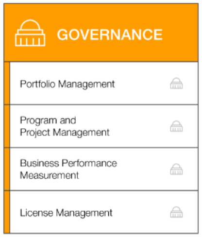

Ми повинні гарантувати, що **навички та процеси узгоджують ІТ-стратегію й цілі зі стратегією та цілями бізнесу**, щоб організація могла максимізувати бізнес-цінність своїх ІТ-інвестицій і мінімізувати бізнес-ризики.

Управління портфелем (Portfolio management)

Управління програмами  
та проєктами (Program and project management)

Вимірювання  
бізнес-показників (Business performance measurement)

Управління ліцензіями (License management)

**Можливості перспективи Governance**

Директор з інформаційних технологій (CIO), керівники програм, архітектори підприємства,  
бізнес-аналітики та  
керівники портфелів

> **Нотатки:**
>
> Зацікавлені сторони з перспективи Governance (наприклад, директор з інформаційних технологій, або CIO, керівники програм, архітектори підприємства, бізнес-аналітики та керівники портфелів) можуть використовувати AWS CAF, щоб зосередитися на навичках і процесах, потрібних для узгодження ІТ-стратегії та цілей зі стратегією та цілями бізнесу. Такий фокус допомагає організації максимізувати бізнес-цінність своїх ІТ-інвестицій і мінімізувати бізнес-ризики.

---

## Слайд 37: Перспектива Platform (платформа)

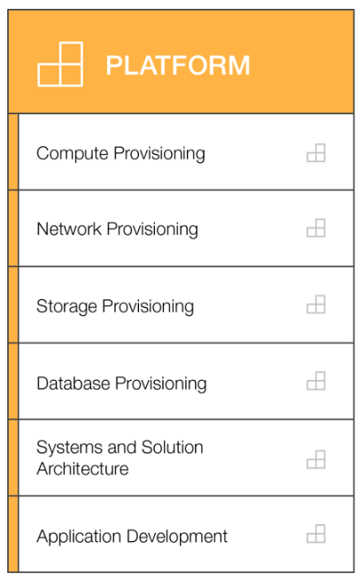

Ми повинні **розуміти й доносити природу ІТ-систем та їхні взаємозв’язки**. Ми повинні вміти **детально описати архітектуру цільового середовища (target state environment)**.

Розгортання обчислювальних ресурсів (Compute provisioning)

Розгортання мережі (Network provisioning)

Розгортання сховищ (Storage provisioning)

Розгортання баз даних (Database provisioning)

Архітектура систем  
і рішень (Systems and solution architecture)

Технічний директор (CTO), ІТ-менеджери  
та архітектори рішень

Розробка застосунків (Application development)

**Можливості перспективи Platform**

> **Нотатки:**
>
> Зацікавлені сторони з перспективи Platform (наприклад, технічний директор, або CTO, ІТ-менеджери та архітектори рішень) використовують різні архітектурні виміри й моделі, щоб розуміти та доносити природу ІТ-систем і їхні взаємозв’язки. Вони повинні вміти детально описати архітектуру цільового середовища. AWS CAF містить принципи та шаблони (patterns) для впровадження нових рішень у хмарі та для міграції локальних (on-premises) робочих навантажень у хмару.

---

## Слайд 38: Перспектива Security (безпека)

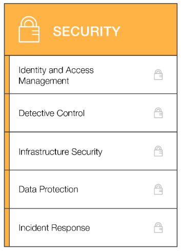

Ми повинні гарантувати, що організація **досягає своїх цілей у сфері безпеки**.

Управління ідентифікацією  
та доступом (Identity and access management)

Детективний контроль (Detective control)

Безпека інфраструктури (Infrastructure security)

Захист даних (Data protection)

Директор з інформаційної безпеки (CISO), менеджери  
та аналітики з ІТ-безпеки

Реагування на інциденти (Incident response)

**Можливості перспективи Security**

> **Нотатки:**
>
> Зацікавлені сторони з перспективи Security (наприклад, директор з інформаційної безпеки, або CISO, менеджери з ІТ-безпеки та аналітики з ІТ-безпеки) повинні гарантувати, що організація досягає цілей безпеки щодо прозорості (visibility), можливості аудиту (auditability), контролю та гнучкості (agility). Зацікавлені сторони з перспективи Security можуть використовувати AWS CAF, щоб структурувати вибір і впровадження засобів безпеки, які відповідають потребам організації.

---

## Слайд 39: Перспектива Operations (операції)

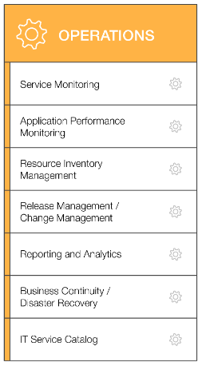

Ми узгоджуємося з операціями бізнесу та підтримуємо їх, а також **визначаємо, як вестиметься бізнес щодня, щокварталу та щороку**.

Моніторинг сервісів (Service monitoring)

Моніторинг продуктивності  
застосунків (Application performance monitoring)

Управління інвентаризацією  
ресурсів (Resource inventory management)

Управління випусками/  
управління змінами (Release management/change management)

Звітність і аналітика (Reporting and analytics)

Керівники ІТ-операцій і  
керівники служби ІТ-підтримки

Безперервність бізнесу/  
Аварійне відновлення (Business continuity/Disaster recovery)

Каталог ІТ-сервісів (IT service catalog)

**Можливості перспективи Operations**

> **Нотатки:**
>
> Зацікавлені сторони з перспективи Operations (наприклад, керівники ІТ-операцій і керівники служби ІТ-підтримки) визначають, як бізнес ведеться щодня, щокварталу та щороку. Вони узгоджуються з операціями бізнесу та підтримують їх. AWS CAF допомагає їм визначити поточні операційні процедури. Він також допомагає виявити зміни процесів і навчання, потрібні для успішного впровадження хмари.

---

## Слайд 40: Ключові висновки розділу 4

- Для більшості організацій перехід до хмари не відбувається миттєво й потребує продуманої, свідомої стратегії та узгодженості в усій організації.
- AWS CAF створено, щоб допомогти організаціям розробити ефективні плани шляху до хмари.
- AWS CAF впорядковує рекомендації за шістьма напрямами, які називаються перспективами (perspectives).
- Перспективи складаються з наборів бізнес- або технологічних можливостей (capabilities), за які відповідають ключові зацікавлені сторони.

> **Нотатки:**
>
> Основні висновки цього розділу модуля:  
> Для більшості організацій перехід до хмари не відбувається миттєво й потребує продуманої, свідомої стратегії та узгодженості в усій організації.  
> AWS CAF створено, щоб допомогти організаціям розробити ефективні плани шляху до хмари.  
> AWS CAF впорядковує рекомендації за шістьма напрямами, які називаються перспективами (perspectives).  
> Перспективи складаються з наборів бізнес- або технологічних можливостей, за які відповідають ключові зацікавлені сторони.

---

## Слайд 41: Підсумки модуля

Модуль 1: Огляд концепцій хмарних обчислень

> **Нотатки:**
>
> Настав час повторити матеріал модуля та завершити його перевіркою знань і розбором запитання практичного сертифікаційного іспиту.

---

## Слайд 42: Резюме модуля

Підсумовуючи, у цьому модулі ви навчилися:

- Визначати різні типи моделей хмарних обчислень
- Описувати шість переваг хмарних обчислень
- Розпізнавати основні категорії та базові сервіси AWS
- Ознайомилися з AWS Cloud Adoption Framework

> **Нотатки:**
>
> Підсумовуючи, у цьому модулі ви навчилися:  
> Визначати різні типи хмарних обчислень  
> Описувати шість переваг хмарних обчислень  
> Розпізнавати основні категорії та базові сервіси AWS  
> Ознайомилися з AWS Cloud Adoption Framework  
>
> Щоб завершити цей модуль, пройдіть перевірку знань.

---

## Слайд 43: Пройдіть перевірку знань

> **Нотатки:**
>
> А тепер пройдіть перевірку знань.

---

## Слайд 44: Приклад запитання іспиту

Чому AWS економічніший за традиційні центри обробки даних для застосунків зі змінним обчислювальним навантаженням?

Варіант

Відповідь

A

Витрати на Amazon Elastic Compute Cloud (Amazon EC2) виставляються щомісяця.

B

Клієнти зберігають повний адміністративний доступ до своїх екземплярів Amazon EC2.

C

Екземпляри Amazon EC2 можна запускати за запитом, коли вони потрібні.

D

Клієнти можуть постійно запускати достатню кількість екземплярів для обробки пікових навантажень.

> **Нотатки:**
>
> Розгляньте варіанти відповідей і відсійте їх за ключовими словами.

---

## Слайд 45: Відповідь на приклад запитання іспиту

Чому AWS економічніший за традиційні центри обробки даних для застосунків зі змінним обчислювальним навантаженням?

Правильна відповідь — C.

Ключові слова в запитанні: AWS економічніший за традиційні центри обробки даних для застосунків зі змінним.

> **Нотатки:**
>
> Ключові слова, які потрібно розпізнати: AWS економічніший за традиційні центри обробки даних для застосунків зі змінним.  
>
> Правильна відповідь — C. Екземпляри Amazon EC2 можна запускати за запитом, коли вони потрібні.  
>
> Неправильні відповіді:  
> Відповідь A: витрати на Amazon Elastic Compute Cloud (Amazon EC2) виставляються щомісяця.  
> Відповідь B: клієнти зберігають повний адміністративний доступ до своїх екземплярів Amazon EC2.  
> Відповідь D: клієнти можуть постійно запускати достатню кількість екземплярів для обробки пікових навантажень.

---

## Слайд 46: Додаткові ресурси

- Відео What is AWS?: [https://aws.amazon.com/awstv/watch/3059da9f36d/](https://aws.amazon.com/awstv/watch/3059da9f36d/)
- Вебсайт Cloud computing with AWS: [https://aws.amazon.com/what-is-aws/](https://aws.amazon.com/what-is-aws/)
- Технічний документ (whitepaper) Overview of Amazon Web Services: [https://d1.awsstatic.com/whitepapers/aws-overview.pdf](https://d1.awsstatic.com/whitepapers/aws-overview.pdf)
- Технічний документ (whitepaper) An Overview of the AWS Cloud Adoption Framework: [https://d1.awsstatic.com/whitepapers/aws_cloud_adoption_framework.pdf](https://d1.awsstatic.com/whitepapers/aws_cloud_adoption_framework.pdf)
- Допис у блозі 6 Strategies for Migrating Applications to the Cloud від AWS Cloud Enterprise Strategy: [https://aws.amazon.com/blogs/enterprise-strategy/6-strategies-for-migrating-applications-to-the-cloud/](https://aws.amazon.com/blogs/enterprise-strategy/6-strategies-for-migrating-applications-to-the-cloud/)

> **Нотатки:**
>
> Якщо ви хочете дізнатися більше про теми, розглянуті в цьому модулі, вам можуть бути корисними такі додаткові ресурси:  
> Відео What is AWS?: https://aws.amazon.com/awstv/watch/3059da9f36d/  
> Вебсайт Cloud computing with AWS: https://aws.amazon.com/what-is-aws/  
> Технічний документ Overview of Web Services: https://d1.awsstatic.com/whitepapers/aws-overview.pdf  
> Технічний документ An Overview of the AWS Cloud Adoption Framework: https://d1.awsstatic.com/whitepapers/aws_cloud_adoption_framework.pdf  
> Допис у блозі 6 Strategies for Migrating Applications to the Cloud від AWS Cloud Enterprise Strategy: https://aws.amazon.com/blogs/enterprise-strategy/6-strategies-for-migrating-applications-to-the-cloud/

---

## Слайд 47: Дякуємо

Усі торговельні марки є власністю їхніх власників.

> **Нотатки:**
>
> Дякуємо, що пройшли цей модуль.
