## Слайд 1: Module 2: Cloud Economics and Billing

AWS Academy Cloud Foundations

> **Нотатки:**
>
> Welcome Module 2: Cloud Economics and Billing

---

## Слайд 2: Module overview

**Topics**

- Fundamentals of pricing
- Total Cost of Ownership
- AWS Organizations
- AWS Billing and Cost Management
- Technical Support

**Demo**

- Overview of the Billing Dashboard

**Activities**

- AWS Pricing Calculator
- Support plans scavenger hunt

**Knowledge check**

> **Нотатки:**
>
> This module will address the following topics:  
> Fundamentals of Pricing  
> Total Cost of Ownership  
> AWS Organizations  
> AWS Billing and Cost Management  
> Technical Support  
>
> The module also includes an instructor-led demonstration that will show you how to interact with the billing dashboard.  
>
> The module also includes an activity that challenges you to estimate the costs for a company by using the AWS Pricing Calculator.  
>
> Finally, you will be asked to complete a knowledge check that will be used to test your understanding of the key concepts that are covered in this module.

---

## Слайд 3: Module objectives

After completing this module, you should be able to:

- Explain the AWS pricing philosophy
- Recognize fundamental pricing characteristics
- Indicate the elements of total cost of ownership
- Discuss the results of the AWS Pricing Calculator
- Identify how to set up an organizational structure that simplifies billing and account visibility to review cost data.
- Identify the functionality in the AWS Billing Dashboard
- Describe how to use AWS Bills, AWS Cost Explorer, AWS Budgets, and AWS Cost and Usage Reports
- Identify the various AWS technical support plans and features

> **Нотатки:**
>
> After completing this module, you should be able to:  
> Explain the AWS pricing philosophy  
> Recognize fundamental pricing characteristics  
> Indicate the elements of total cost of ownership  
> Discuss the results of the AWS Pricing Calculator  
> Identify how to set up an organizational structure that simplifies billing and account visibility to review cost data.  
> Identify the functionality in the AWS Billing Dashboard  
> Describe how to use AWS Bills, AWS Cost Explorer, AWS Budgets, and AWS Cost and Usage Reports  
> Identify the various AWS technical support plans and features

---

## Слайд 4: Section 1: Fundamentals of pricing

Module 2: Cloud Economics and Billing

> **Нотатки:**
>
> Introducing Section 1: Fundamentals of pricing.

---

## Слайд 5: AWS pricing model

Three fundamental drivers of cost with AWS

**Compute**

**Storage**

**Data transfer**

- Charged per hour/second*
- Varies by instance type  
  
  
  
*Linux only

- Charged typically per GB

- Outbound is aggregated and charged
- Inbound has no charge (with some exceptions)
- Charged typically per GB

> **Нотатки:**
>
> There are three fundamental drivers of cost with AWS: compute, storage, and outbound data transfer. These characteristics vary somewhat, depending on the AWS product and pricing model you choose.  
>
> In most cases, there is no charge for inbound data transfer or for data transfer between other AWS services within the same AWS Region. There are some exceptions, so be sure to verify data transfer rates before you begin to use the AWS service.  
>
> Outbound data transfer is aggregated across services and then charged at the outbound data transfer rate. This charge appears on the monthly statement as AWS Data Transfer Out.

---

## Слайд 6: How do you pay for AWS?

Pay for what you use

Pay less when you reserve

Pay less when you use more and as AWS grows

> **Нотатки:**
>
> This philosophy is what underlies AWS pricing. While the number and types of services offered by AWS have increased dramatically, our philosophy on pricing has not changed. At the end of each month, you pay for what you use. You can start or stop using a product at any time. No long-term contracts are required.  
>
> AWS offers a range of cloud computing services. For each service, you pay for exactly the amount of resources that you actually need. This utility-style pricing model includes:  
> Pay for what you use  
> Pay less when you reserve  
> Pay less when you use more  
> Pay even less as AWS grows  
>
> You will now take a closer look at these core concepts of pricing.  
>
> To learn more about AWS pricing, see the AWS pricing overview at https://d0.awsstatic.com/whitepapers/aws_pricing_overview.pdf.

---

## Слайд 7: Pay for what you use

Pay only for the services that you consume, with no large upfront expenses.

**On premises**

**AWS**

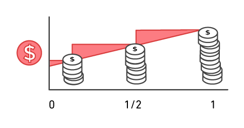

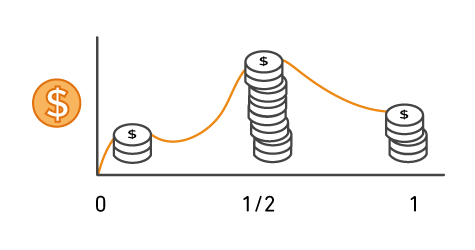

> **Нотатки:**
>
> Unless you build data centers for a living, you might have spent too much time and money building them. With AWS, you pay only for the services that you consume with no large upfront expenses. You can lower variable costs, so you no longer need to dedicate valuable resources to building costly infrastructure, including purchasing servers, software licenses, or leasing facilities.  
>
> Quickly adapt to changing business needs and redirect your focus on innovation and invention by paying only for what you use and for as long as you need it. All AWS services are available on demand, require no long-term contracts, and have no complex licensing dependencies.

---

## Слайд 8: Pay less when you reserve

Invest in Reserved Instances (RIs):

- Save up to 75 percent
- Options:
    - All Upfront Reserved Instance **(AURI)  largest discount**
    - Partial Upfront Reserved Instance **(PURI)  lower discounts**
    - No Upfront Payments Reserved Instance **(NURI)  smaller discount**

EC2

instance

**On**  
**Demand**

**NURI**

**PURI**

**AURI**

> **Нотатки:**
>
> For certain services like Amazon Elastic Compute Cloud (Amazon EC2) and Amazon Relational Database Service (Amazon RDS), you can invest in reserved capacity. With Reserved Instances, you can save up to 75 percent over equivalent on-demand capacity. Reserved Instances are available in three options:  
> All Upfront Reserved Instance (or AURI)  
> Partial Upfront Reserved Instance (or PURI)  
> No Upfront Payments Reserved Instance (or NURI)  
>
> When you buy Reserved Instances, you receive a greater discount when you make a larger upfront payment. To maximize your savings, you can pay all upfront and receive the largest discount. Partial Upfront RIs offer lower discounts, but they give you the option to spend less upfront. Lastly, you can choose to spend nothing upfront and receive a smaller discount, which enables you to free capital to spend on other projects.  
>
> By using reserved capacity, your organization can minimize risks, more predictably manage budgets, and comply with policies that require longer-term commitments.

---

## Слайд 9: Pay less by using more

Realize volume-based discounts:

- **Savings** as usage increases.
- **Tiered pricing** for services like Amazon Simple Storage Service (Amazon S3), Amazon Elastic Block Store (Amazon EBS), or Amazon Elastic File System (Amazon EFS)  the more you use, the less you pay per GB.
- Multiple storage services deliver **lower** storage costs based on needs.

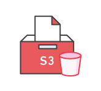

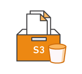

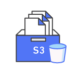

> **Нотатки:**
>
> With AWS, you can get volume-based discounts and realize important savings as your usage increases. For services like Amazon Simple Storage Service (Amazon S3), pricing is tiered, which means that you pay less per GB when you use more. In addition, data transfer in is always free. Multiple storage services deliver lower storage costs based on your needs. As a result, as your AWS usage needs increase, you benefit from the economies of scale that enable you to increase adoption and keep costs under control.  
>
> As your organization evolves, AWS also gives you options to acquire services that help you address your business needs. For example, the AWS storage services portfolio offers options to help you lower pricing based on how frequently you access data and the performance that you need to retrieve it. To optimize your savings, you can choose the right combination of storage solutions that help you reduce costs while preserving performance, security, and durability.

---

## Слайд 10: Pay even less as AWS grows

As AWS grows:

- AWS focuses on lowering cost of doing business.
- This practice results in AWS passing savings from economies of scale to you.
- Since 2006, AWS has **lowered pricing 75** times (as of September 2019).
- Future higher-performing resources replace current resources for no extra charge.

> **Нотатки:**
>
> AWS constantly focuses on reducing data center hardware costs, improving operational efficiencies, lowering power consumption, and generally lowering the cost of doing business.  
>
> These optimizations and the substantial and growing economies of scale of AWS result in passing savings back to you as lower pricing. Since 2006, AWS has lowered pricing 75 times (as of September 2019).  
>
> Another benefit of AWS growth is that future, higher-performing resources replace current ones for no extra charge.

---

## Слайд 11: Custom pricing

- Meet varying needs through custom pricing.
- Available for high-volume projects with unique  
requirements.

> **Нотатки:**
>
> AWS realizes that every customer has different needs. If none of the AWS pricing models work for your project, custom pricing is available for high-volume projects with unique requirements.

---

## Слайд 12: AWS Free Tier

Enables you to gain free hands-on experience with the AWS platform, products, and services. Free for 1 year for new customers.

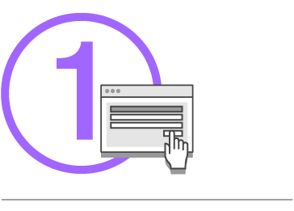

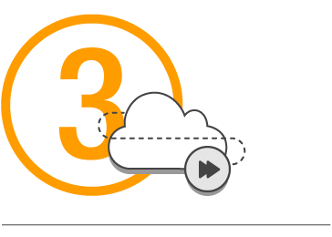

**Sign up for an**  
**AWS account**

**Learn with 10-**  
**minute tutorials**

**Start building**  
**with AWS**

> **Нотатки:**
>
> To help new AWS customers get started in the cloud, AWS offers a free usage tier (the AWS Free Tier) for new customers for up to 1 year. The AWS Free Tier applies to certain services and options. If you are a new AWS customer, you can run a free Amazon Elastic Compute Cloud (Amazon EC2) T2 micro instance for a year, while also using a free usage tier for Amazon S3, Amazon Elastic Block Store (Amazon EBS), Elastic Load Balancing, AWS data transfer, and other AWS services.  
>
> To learn more, see AWS Free Tier at https://aws.amazon.com/free/?all-free-tier.sort-by=item.additionalFields.SortRank&all-free-tier.sort-order=asc&awsf.Free%20Tier%20Types=*all&awsf.Free%20Tier%20Categories=*all.

---

## Слайд 13: Services with no charge

Amazon VPC

Elastic Beanstalk**

Auto Scaling**

AWS CloudFormation**

AWS Identity and Access Management (IAM)

Note**: There might be charges associated with other AWS services that are used with these services.

> **Нотатки:**
>
> AWS also offers a variety of services for no additional charge.  
>
> Amazon Virtual Private Cloud (Amazon VPC) enables you to provision a logically isolated section of the AWS Cloud where you can launch AWS resources in a virtual network that you define.  
> AWS Identity and Access Management (IAM) controls your users’ access to AWS services and resources.  
> Consolidated Billing is a billing feature in AWS Organizations to consolidate payment for multiple AWS accounts or multiple Amazon Internet Services Private Limited (AISPL) accounts*. Consolidated billing provides:  
> One bill for multiple accounts.  
> The ability to easily track each account’s charges.  
> The opportunity to decrease charges as a result of volume pricing discounts from combined usage.  
> And you can consolidate all of your accounts using Consolidated Billing and get tiered benefits.  
> AWS Elastic Beanstalk is an even easier way for you to quickly deploy and manage applications in the AWS Cloud.  
> AWS CloudFormation gives developers and systems administrators an easy way to create a collection of related AWS resources and provision them in an orderly and predictable fashion.  
> Automatic Scaling automatically adds or removes resources according to conditions you define. The resources you are using increase seamlessly during demand spikes to maintain performance and decrease automatically during demand lulls to minimize costs.  
> AWS OpsWorks is an application management service that makes it easy to deploy and operate applications of all shapes and sizes.  
>
> Though there is no charge for these services, there might be charges associated with other AWS services used with these services. For example, when you automatically scale additional EC2 instances, there will be charges for those instances.  
>
> * Note: The main difference between AWS accounts and AISPL accounts is the seller of record. AWS accounts are administered by Amazon Web Services, Inc., but AISPL accounts are administered by Amazon Internet Services Private Limited. If you used an Indian address when you created your account, your account's default seller of record is AISPL. By default, AISPL accounts are billed in Indian Rupees (INR). See more on the seller of record here https://docs.aws.amazon.com/awsaccountbilling/latest/aboutv2/manage-account-payment-aispl.html#determine-seller.

---

## Слайд 14: Key takeaways

- There is no charge (with some exceptions) for:
  - Inbound data transfer.
  - Data transfer between services within the same AWS Region.
- Pay for what you use.
- Start and stop anytime.
- No long-term contracts are required.
- Some services are free, but the other AWS services that they provision might not be free.

> **Нотатки:**
>
> In summary, while the number and types of services offered by AWS have increased dramatically, our philosophy on pricing has not changed. At the end of each month, you pay only for what you use, and you can start or stop using a product at any time. No long-term contracts are required.  
>
> The best way to estimate costs is to examine the fundamental characteristics for each AWS service, estimate your usage for each characteristic, and then map that usage to the prices that are posted on the AWS website. The service pricing strategy gives you the flexibility to choose the services that you need for each project and to pay only for what you use.  
>
> There are several free AWS services, including:  
> Amazon VPC  
> Elastic Beanstalk  
> AWS CloudFormation  
> IAM  
> Automatic scaling services  
> AWS OpsWorks  
> Consolidated Billing  
>
> While the services themselves are free, the resources that they provision might not be free. In most cases, there is no charge for inbound data transfer or for data transfer between other AWS services within the same AWS Region. There are some exceptions, so be sure to verify data transfer rates before you begin to use the AWS service.  
> Outbound data transfer costs are tiered.  
>
> To learn more about pricing, see AWS pricing at https://aws.amazon.com/pricing/ and AWS pricing overview at https://d0.awsstatic.com/whitepapers/aws_pricing_overview.pdf.

---

## Слайд 15: Section 2: Total Cost of Ownership

Module 2: Cloud Economics and Billing

> **Нотатки:**
>
> Introducing Section 2: Total Cost of Ownership.

---

## Слайд 16: On-premises versus cloud

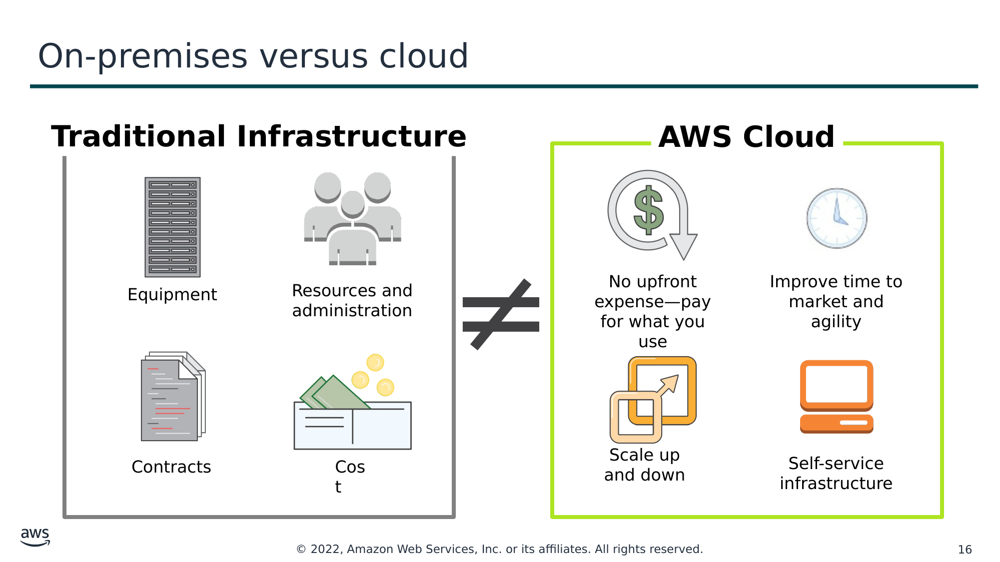

Текст зі схеми

**Traditional Infrastructure**

**AWS Cloud**

≠

No upfront expense—pay for what you use

Improve time to market and agility

Equipment

Resources and administration

Contracts

Cost

Scale up and down

Self-service infrastructure

> **Нотатки:**
>
> On-premises versus cloud is a question that many businesses ask. The difference between these two options is how they are deployed.  
>
> An on-premises infrastructure is installed locally on a company’s own computers and servers. There are several fixed costs, also known as capital expenses, that are associated with the traditional infrastructure. Capital expenses include facilities, hardware, licenses, and maintenance staff. Scaling up can be expensive and time-consuming. Scaling down does not reduce fixed costs.  
>
> A cloud infrastructure is purchased from a service provider who builds and maintains the facilities, hardware, and maintenance staff. A customer pays for what is used. Scaling up or down is simple. Costs are easy to estimate because they depend on service use.  
>
> It is difficult to compare an on-premises IT delivery model with the AWS Cloud. The two are different because they use different concepts and terms.  
>
> Using on-premises IT involves a discussion that is based on capital expenditure, long planning cycles, and multiple components to buy, build, manage, and refresh resources over time.  
> Using the AWS Cloud involves a discussion about flexibility, agility, and consumption-based costs.  
>
> So, how can you identify the best option?

---

## Слайд 17: What is Total Cost of Ownership (TCO)?

**Total Cost of Ownership (TCO)** is the financial estimate to help identify direct and indirect costs of a system.

Why use TCO?

- To compare the costs of running an **entire infrastructure environment or specific workload** on-premises versus on AWS
- To budget and **build the business case** for moving to the cloud

> **Нотатки:**
>
> You can identify the best option by comparing the on-premises solution to a cloud solution. Total Cost of Ownership (or TCO) is a financial estimate that is intended to help buyers and owners determine the direct and indirect costs of a product or system. TCO includes the cost of a service, plus all the costs that are associated with owning the service.  
>
> You might want to compare the costs of running an entire infrastructure environment for a specific workload in an on-premises or collocation facility to the same workload running on a cloud-based infrastructure. This comparison is done for budgeting purposes or to build a business case for business decisions about the optimal deployment solution.

---

## Слайд 18: TCO considerations

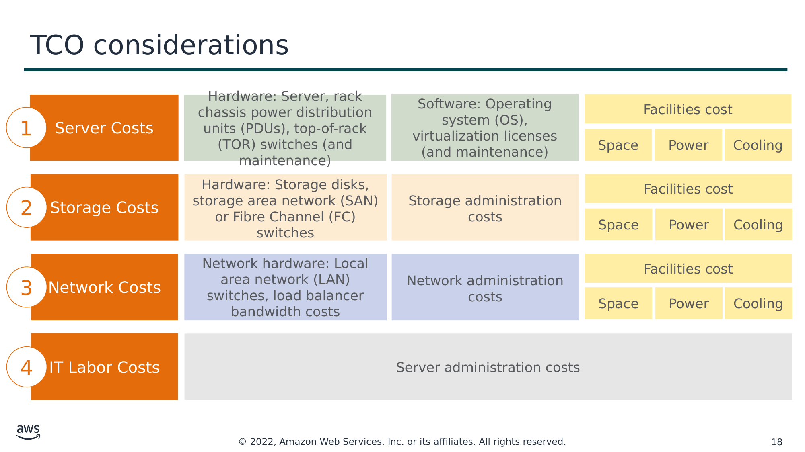

Текст зі схеми

1

Hardware: Server, rack chassis power distribution units (PDUs), top-of-rack (TOR) switches (and maintenance)

Software: Operating system (OS), virtualization licenses

(and maintenance)

Facilities cost

Server Costs

Space

Power

Cooling

2

Hardware: Storage disks, storage area network (SAN) or Fibre Channel (FC) switches

Storage administration costs

Facilities cost

Storage Costs

Space

Power

Cooling

3

Network hardware: Local area network (LAN) switches, load balancer bandwidth costs

Network administration costs

Facilities cost

Network Costs

Space

Power

Cooling

4

Server administration costs

IT Labor Costs

> **Нотатки:**
>
> Some of the costs that are associated with data center management include:  
> Server costs for both hardware and software, and facilities costs to house the equipment.  
> Storage costs for the hardware, administration, and facilities.  
> Network costs for hardware, administration, and facilities.  
> And IT labor costs that are required to administer the entire solution.  
>
> When you compare an on-premises to cloud solution, it is important to accurately assess the true costs of both options. With the cloud, most costs are upfront and readily calculated. For example, cloud providers give transparent pricing based on different usage metrics, such as RAM, storage, and bandwidth, among others. Pricing is frequently fixed per unit of time.  
>
> Customers gain certainty over pricing and are then able to readily calculate costs based on several different usage estimates.  
>
> Compare this process to on-premises technology. Though they are sometimes difficult to determine, calculations of in-house costs must take into account all:  
> Direct costs that accompany running a server—like power, floor space, storage, and IT operations to manage those resources.  
> Indirect costs of running a server, like network and storage infrastructure.  
>
> This diagram is conceptual, and it does not include every cost item. For example, depending on the solution you are implementing, software costs can include database, management, and middle-tier costs. Facilities costs can include upgrades, maintenance, building security, taxes, and so on. IT labor costs can include security administration and application administration costs.  This diagram includes an abbreviated list to demonstrate the type of costs that are involved in data center maintenance.

---

## Слайд 19: On-premises versus all-in-cloud

You could save up to **96 percent** a year by moving your infrastructure to AWS.

Your 3-year total savings would be **$159,913**.

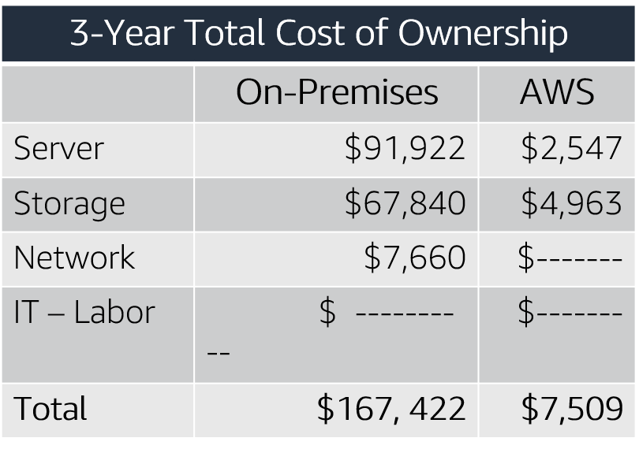

| | Server | Storage | Network | IT-Labor | Total |
|---|---|---|---|---|---|
| On-Premises | 91 922 | 67 840 | 7 660 | 0 | 167 422 |
| AWS | 2 547 | 4 963 | 0 | 0 | 7 510 |

AWS cost includes business-level support and  
a 3-year PURI EC2 instance

> **Нотатки:**
>
> Here is a sample cost comparison. This example shows a cost comparison for an on-premises solution and a cloud solution over 3 years. For this comparison, two similar environments were constructed to represent the on-premises and AWS environments. Additional direct and indirect costs that are associated with the on-premises solution were not included. The components of the on-premises solution include:  
> 1 virtual machine with 4 CPUs, 16 GB of RAM, and a Linux operating system  
> Average utilization is 100 percent  
> Optimized by RAM  
>
> The components of a comparable AWS environment include:  
> 1 m4.xlarge instance with 4 CPUs, 16 GB of RAM  
> The instance type is a 3-year Partial Upfront Reserved Instance  
>
> The on-premises 3-year total cost is $167,422. The AWS Cloud 3-year total cost is $7,509, which is a 96 percent savings over the on-premises solution. Thus, the 3-year total savings on cloud infrastructure would be $159,913. This comparison helps a business clearly understand the differences between the alternatives.  
>
> What is the difference in the costs?  
> Remember, the on-premises solution is predicted. It continues to incur costs whether the capacity is used.  
>
> In contrast, the AWS solution is commissioned when needed and decommissioned when the resources are no longer in use, which results in lower overall costs.  
>
> For accessibility: Chart comparing three-year total cost of ownership for on-premises and AWS. On-Premises comes out to $167,422 and AWS comes to $7,509. End of accessibility description.

---

## Слайд 20: AWS Pricing Calculator

Use the AWS Pricing Calculator to:

- Estimate monthly costs
- Identify opportunities to reduce monthly costs
- Model your solutions before building them
- Explore price points and calculations behind your estimate
- Find the available instance types and contract terms that meet your needs
- Name your estimate and create and name groups of services

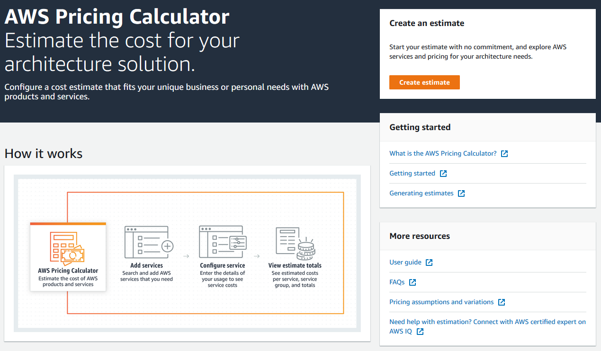

Access the [AWS Pricing Calculator](https://calculator.aws/#/)

> **Нотатки:**
>
> AWS offers the AWS Pricing Calculator to help you estimate a monthly AWS bill. You can use this tool to explore AWS services and create an estimate for the cost of your use cases on AWS. You can model your solutions before building them, explore the price points and calculations behind your estimate, and find the available instance types and contract terms that meet your needs. This enables you to make informed decisions about using AWS. You can plan your AWS costs and usage or price out setting up a new set of instances and services.  
>
> The AWS Pricing Calculator helps you:  
> Estimate monthly costs of AWS services  
> Identify opportunities for cost reduction  
> Model your solutions before building them  
> Explore price points and calculations behind your estimate  
> Find the available instance types and contract terms that meet your needs  
>
> The AWS Pricing Calculator enables you to name your estimate and create and name groups of services. Groups are containers that you add services to in order to organize and build your estimate. You can organize your groups and services by cost-center, department, product architecture, etc.  
>
> For more information, see the AWS Pricing Calculator website at https://calculator.aws/#/.

---

## Слайд 21: Reading an estimate

Your estimate is broken into: first 12 months total, total upfront, and total monthly.

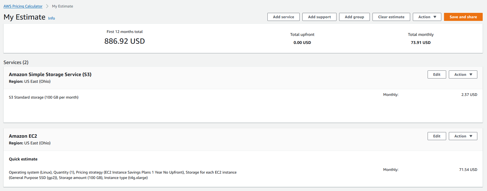

First 12 months total

Total upfront

Total monthly

> **Нотатки:**
>
> AWS Pricing Calculator estimates are broken into:  
> The total for your first 12 months – The total estimate for your current group and all of the services and groups in your current group. It combines the upfront and monthly estimates.  
> Your total upfront – How much you are estimated to pay upfront as you set up your AWS stack.  
> Your total monthly – How much you're estimated to spend every month while you run your AWS stack.  
>
> Within a group, you can see how much each service is estimated to cost. If you want to price out different ways to build your AWS setup, you can use different groups for each variation of your setup and compare the estimates for the different setups.  
>
> For more information, see Reading an estimate at https://docs.aws.amazon.com/pricing-calculator/latest/userguide/what-is-pricing-calculator.html.  
>
> For accessibility: Example AWS Pricing Calculator estimate. The first 12 month total is $886.92, the total upfront cost is $0, and the total monthly cost is $73.91. End of accessibility description.

---

## Слайд 22: Activity: AWS Pricing Calculator activity

- Break up into groups of four or five and use the [AWS Pricing Calculator](https://calculator.aws/#/) and specifications provided to develop a cost estimate.
- Be prepared to report your findings back to the class.

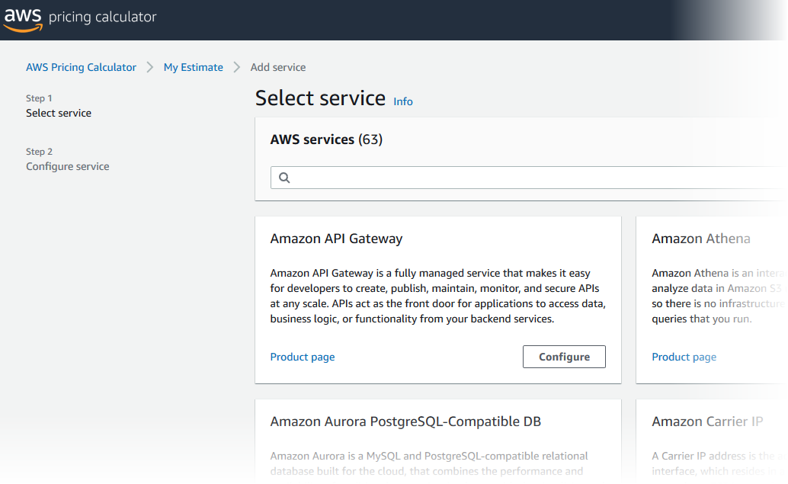

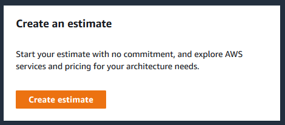

[AWS Pricing calculator website](https://calculator.aws/#/)

> **Нотатки:**
>
> Break up into groups of four or five and use the AWS Pricing Calculator and the specifications provided to develop a cost estimate.  
>
> Be prepared to report your findings back to the class.

---

## Слайд 23: Additional benefit considerations

**Hard benefits**

- Reduced spending on compute, storage, networking, security
- Reductions in hardware and software purchases (capex)
- Reductions in operational costs, backup, and disaster recovery
- Reduction in operations personnel

**Soft Benefits**

- Reuse of service and applications that enable you to define (and redefine solutions) by using the same cloud service
- Increased developer productivity
- Improved customer satisfaction
- Agile business processes that can quickly respond to new and emerging opportunities
- Increase in global reach

> **Нотатки:**
>
> Hard benefits include reduced spending on compute, storage, networking, and security. They also include reductions in hardware and software purchases; reductions in operational costs, backup, and disaster recovery; and a reduction in operations personnel.  
>
> Cloud Total Cost of Ownership defines what will be spent on the technology after adoption—or what it costs to run the solution. Typically, a TCO analysis looks at the as-is on-premises infrastructure and compares it with the cost of the to-be infrastructure state in the cloud. While this difference might be easy to calculate, it might only provide a narrow view of the total financial impact of moving to the cloud.  
>
> A return on investment (ROI) analysis can be used to determine the value that is generated while considering spending and saving. This analysis starts by identifying the hard benefits in terms of direct and visible cost reductions and efficiency improvements.  
>
> Next, soft savings are identified. Soft savings are value points that are challenging to accurately quantify, but they can be more valuable than the hard savings. It is important for you to understand both hard and soft benefits to understand the full value of the cloud. Soft benefits include:  
> Reusing service and applications that enable you to define (and redefine solutions) by using the same cloud service  
> Increased developer productivity  
> Improved customer satisfaction  
> Agile business processes that can quickly respond to new and emerging opportunities  
> Increased global reach  
>
> Now, you will review a case study from Delaware North to see an actual TCO example.

---

## Слайд 24: Case study: Total Cost Of Ownership (1 of 6)

**Background:**

- Growing global company with over 200 locations
- 500 million customers, $3 billion annual revenue

> **Нотатки:**
>
> Background:  
> Delaware North originated in 1915 as a peanut and popcorn concessions vendor; today, it’s a major food and hospitality company. Although the company deliberately keeps a low profile, it is a leader in the food-service and hospitality industry.  
>
> Delaware North serves more than 500 million customers annually at more than 200 locations around the world, including venues the Kennedy Space Center in Florida, London Heathrow Airport, Kings Canyon Resort in Australia, and the Green Bay Packers’ Lambeau Field in Wisconsin. This global presence has turned Delaware North into a $3 billion enterprise.

---

## Слайд 25: Case study: Total Cost of Ownership (2 of 6)

**Background:**

- Growing global company with over 200 locations
- 500 million customers, $3 billion annual revenue

**Challenge:**

- Meet demand to rapidly deploy new solutions
- Constantly upgrade aging equipment

> **Нотатки:**
>
> The company’s on-premises data center was becoming too expensive and inefficient to support its global business operations.  
>
> Kevin Quinlivan, Delaware North’s Chief Information Officer, said, “As the company continued to grow, the demand to rapidly deploy new solutions to meet customer requirements increased as well. This fact, combined with the need to constantly upgrade aging equipment, required an even greater commitment of resources on our part. We had to find a better strategy.”  
>
> Delaware North turned to AWS for a solution.

---

## Слайд 26: Case study: Total Cost of Ownership (3 of 6)

**Background:**

- Growing global company with over 200 locations
- 500 million customers, $3 billion annual revenue

**Challenge:**

- Meet demand to rapidly deploy new solutions
- Constantly upgrade aging equipment

**Criteria:**

- Broad solution to handle all workloads
- Ability to modify processes to improve efficiency and lower costs
- Eliminate busy work (such as patching software)
- Achieve a positive return on investment (ROI)

> **Нотатки:**
>
> After a successful migration of about 50 websites to AWS in 2013, Delaware North evaluated the cost benefit and Total Cost of Ownership to move their IT infrastructure to AWS. Their focus was to answer executive-level business demands for measurable benefits that could convince an executive committee that the AWS Cloud was the right approach.  
>
> The evaluation process centered on three criteria:  
> First, a cloud solution needed a broad set of technologies that could handle all of Delaware North’s enterprise workloads while delivering support for critical functions.  
> From an operational perspective, Delaware North wanted the features and flexibility to modify core IT processes to improve efficiencies and lower costs. This included eliminating redundant or time-consuming tasks like patching software or pushing test and development tasks through outdated systems that, in the past, added months to the deployment of new services.  
> Finally, financial requirements needed to demonstrate a return on investment with a solid cost-benefit justification for moving away from their existing data center environment.

---

## Слайд 27: Case study: Total Cost of Ownership (4 of 6)

**Background:**

- Is a growing global company with over 200 locations
- Have 500 million customers, $3 billion (USD) annual revenue

- Meet demand to rapidly deploy new solutions
- Constantly upgrade aging equipment

**Challenge:**

**Criteria:**

- Have a broad solution to handle all workloads
- Be able to modify processes to improve efficiency and lower costs
- Eliminate busy work (such as patching software)
- Achieve a positive return on investment (ROI)

**Solution:**

- Moved their on-premises data center to AWS
  - Eliminated 205 servers (90 percent)
  - Moved nearly all applications to AWS
- Used 3-year Amazon EC2 Reserved Instances

> **Нотатки:**
>
> A cost comparison completed by Delaware North demonstrated that it could save $3.5 million US dollars based on a 5-year run rate by moving its on-premises data center to AWS and using 3-year Amazon EC2 Reserved Instances and Reserved Instance renewals.  
>
> Quinlivan noted that the deep technology stack available on AWS was more than sufficient to meet the company’s technical and operational requirements. The pricing structure of the AWS offerings—which includes paying only for what is used—provided total cost of ownership benefits that were presented to senior leaders.  
>
> Quinlivan stated, “We compared the costs of keeping our on-premises data center versus moving to the AWS Cloud, measuring basic infrastructure items such as hardware cost and maintenance.” He also says “We estimate that moving to AWS will save us at least $3.5 million over five years by reducing our server hardware by more than 90 percent. But the cost savings will likely be greater due to additional benefits, like the increased compute capacity we can get using AWS. That lets us continually add more and larger workloads than we could using a traditional data center infrastructure, and achieve savings by only paying for what we use.”  
>
> Delaware North moved almost all of its applications to AWS, including enterprise software such as its Fiorano middleware, Crystal Reports and QLIK business intelligence solutions, its Citrix virtual desktop system, and Microsoft System Center Configuration Manager, which is used to manage workstations.  
>
> The most dramatic physical change was the elimination of 205 servers. Everything that ran on that hardware was migrated to AWS. The IT department decided to keep about 20 servers on-premises at the new headquarters building to run communications and file-and-print tasks.  
>
> “We erred on the side of caution to ensure there is no latency with these tasks, but once we reach a certain comfort level, we may move these to the cloud as well,” said Scott Mercer, head of the IT department’s service-oriented architecture team.

---

## Слайд 28: Case study: Total Cost of Ownership (5 of 6)

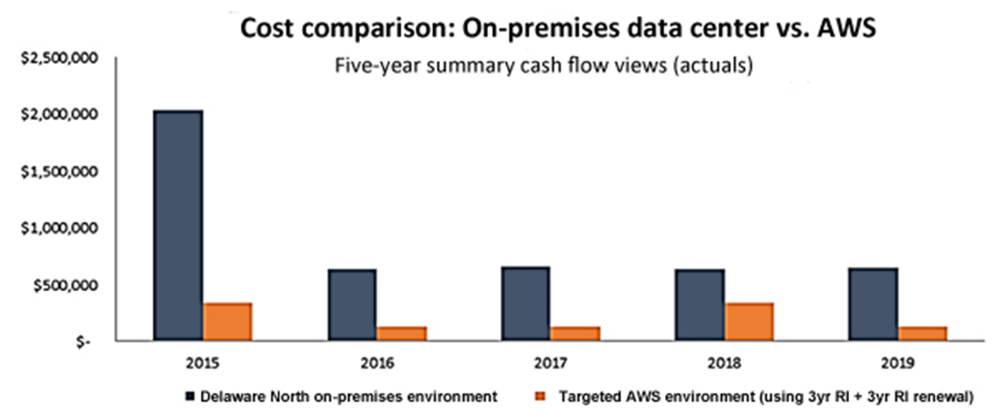

> **Нотатки:**
>
> This chart displays the cost comparison done by Delaware North showing the costs of their on-premises environment and the proposed AWS environment. The estimates showed a $3.5 million savings based on a five-year run rate by moving from an on-premises data center to AWS.

---

## Слайд 29: Case study: Total Cost of Ownership (6 of 6)

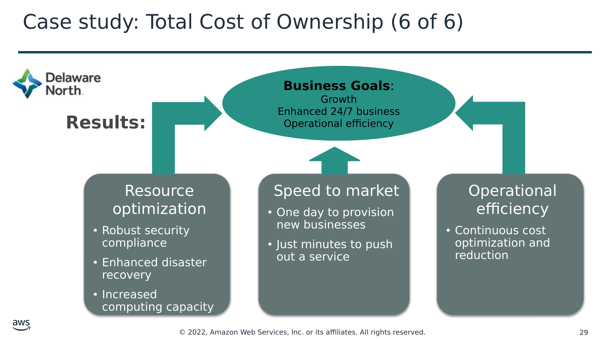

**Business Goals**:  
Growth

Enhanced 24/7 business

Operational efficiency

**Results:**

Resource  
optimization

- Robust security compliance
- Enhanced disaster recovery
- Increased computing capacity

Speed to market

- One day to provision new businesses
- Just minutes to push out a service

Operational efficiency

- Continuous cost optimization and reduction

> **Нотатки:**
>
> About 6 months into its cloud migration, Delaware North realized benefits in addition to its data center consolidation, including cost-effective security compliance, enhanced disaster recovery, and faster deployment times for new services.  
>
> “Robust security in a retail environment is critical for us because of our many retail operations, and AWS is enormously helpful for that,” said Brian Mercer, the senior software architect for the project. “By leveraging the security best practices of AWS, we’ve been able to eliminate a lot of compliance tasks that in the past took up valuable time and money.”  
>
> Brian Mercer added that the company also increased its disaster recovery capabilities at a lower cost than what was available in its previous data center deployment. “It significantly improved our business continuity capabilities, including seamless failovers,” he said.  
>
> The solution is also helping Delaware North operate with greater speed and agility. For example, it can bring in new businesses—either through contracts or acquisitions—and get them online more quickly than in the past by eliminating the need for traditional IT procurement and provisioning. It used to take between 2 and 3 weeks to provision new business units; now it takes 1 day. The Delaware North IT team is also using AWS to overhaul its operations by eliminating outdated and cumbersome processes, cleaning up documentation, and using the benefits of running test and development tasks in combination with rapid deployment of services through the cloud.  
>
> “Our DevOps team can now spin up the resources to push out a service in just minutes, compared to the weeks it used to take,” said Brian Mercer. “With AWS, we can respond much faster to business needs. And we can start repurposing time and resources to deliver more value and services to our internal teams and to our customers.”

---

## Слайд 30: Section 3: AWS Organizations

Module 2: Cloud Economics and Billing

> **Нотатки:**
>
> Introducing Section 3: AWS Organizations.

---

## Слайд 31: Introduction to AWS Organizations

AWS Organizations

> **Нотатки:**
>
> AWS Organizations is a free account management service that enables you to consolidate multiple AWS accounts into an organization that you create and centrally manage. AWS Organizations include consolidated billing and account management capabilities that help you to better meet the budgetary, security, and compliance needs of your business.  
>
> The main benefits of AWS Organizations are:  
> Centrally managed access policies across multiple AWS accounts.  
> Controlled access to AWS services.  
> Automated AWS account creation and management.  
> Consolidated billing across multiple AWS accounts.

---

## Слайд 32: AWS Organizations terminology

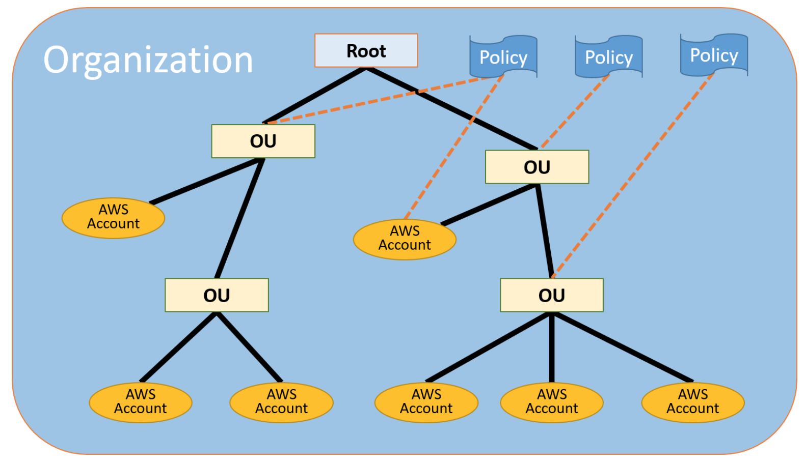

*Organizational Units (OUs)

> **Нотатки:**
>
> Here is some terminology to understand the structure of AWS Organizations.  
>
> The diagram shows a basic organization, or root, that consists of seven accounts that are organized into four organizational units (or OUs). An OU is a container for accounts within a root. An OU can also contain other OUs. This structure enables you to create a hierarchy that looks like an upside-down tree with the root at the top. The branches consist of child OUs and they move downward until they end in accounts, which are like the leaves of the tree.  
>
> When you attach a policy to one of the nodes in the hierarchy, it flows down and it affects all the branches and leaves. This example organization has several policies that are attached to some of the OUs or are attached directly to accounts.  
>
> An OU can have only one parent and, currently, each account can be a member of exactly one OU. An account is a standard AWS account that contains your AWS resources. You can attach a policy to an account to apply controls to only that one account.

---

## Слайд 33: Key features and benefits

Policy-based account management

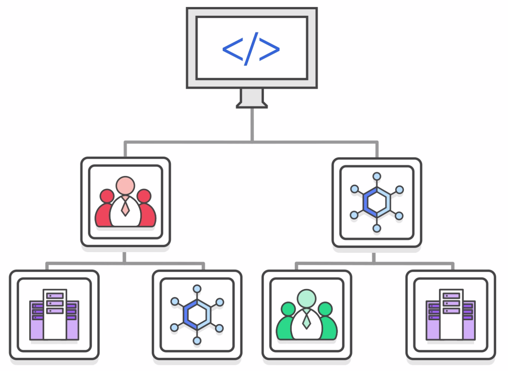

Group based account management

Application programming interfaces (APIs) that automate account management

AWS  
Organizations

Consolidated billing

> **Нотатки:**
>
> AWS Organizations enables you to:  
> Create service control policies (SCPs) that centrally control AWS services across multiple AWS accounts.  
> Create groups of accounts and then attach policies to a group to ensure that the correct policies are applied across the accounts.  
> Simplify account management by using application programming interfaces (APIs) to automate the creation and management of new AWS accounts.  
> Simplify the billing process by setting up a single payment method for all the AWS accounts in your organization. With consolidated billing, you can see a combined view of charges that are incurred by all your accounts, and you can take advantage of pricing benefits from aggregated usage. Consolidated billing provides a central location to manage billing across all of your AWS accounts, and the ability to benefit from volume discounts.

---

## Слайд 34: Security with AWS Organizations

Service control policies (SCPs) enable you to allow or deny access to AWS services for individuals or group accounts in an organizational unit (OU).

Control access with  
AWS Identity and  
Access Management  
(IAM).

IAM policies enable you to allow or deny access to AWS services for users, groups, and roles.

> **Нотатки:**
>
> AWS Organizations does not replace associating AWS Identity and Access Management (IAM) policies with users, groups, and roles within an AWS account.  
>
> With IAM policies, you can allow or deny access to AWS services (such as Amazon S3), individual AWS resources (such as a specific S3 bucket), or individual API actions (such as s3:CreateBucket). An IAM policy can be applied only to IAM users, groups, or roles, and it can never restrict the AWS account root user.  
>
> In contrast, with Organizations, you use service control policies (SCPs) to allow or deny access to particular AWS services for individual AWS accounts or for groups of accounts in an OU. The specified actions from an attached SCP affect all IAM users, groups, and roles for an account, including the AWS account root user.

---

## Слайд 35: Organizations setup

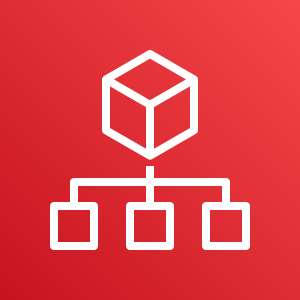

Step 1

Step 2

Step 3

Step 4

Create  
Organization

Create  
organizational

units

Create

service

control

policies

Test

restrictions

> **Нотатки:**
>
> Keep in mind that this process assumes that you have access to two existing AWS accounts, and that you can sign in to each account as an administrator.  
>
> Review these steps for setting up AWS Organizations:  
> Step 1 is to create your organization with your current AWS account as the primary account. You also invite one AWS account to join your organization and create another account as a member account.  
> Step 2 is to create two organizational units in your new organization and place the member accounts in those OUs.  
> Step 3 is to create service control policies, which enable you to apply restrictions to what actions can be delegated to users and roles in the member accounts. A service control policy is a type of organization control policy.  
> Step 4 is to test your organization’s policies. Sign in as a user for each of the roles (such as OU1 or OU2) and see how the service control policies impact account access. Alternatively, you can use the IAM policy simulator to test and troubleshoot IAM and resource-based policies that are attached to IAM users, groups, or roles in your AWS account.  
>
> To learn more about the IAM policy simulator, see the IAM policy simulator at https://docs.aws.amazon.com/IAM/latest/UserGuide/access_policies_testing-policies.html.

---

## Слайд 36: Limits of AWS Organizations

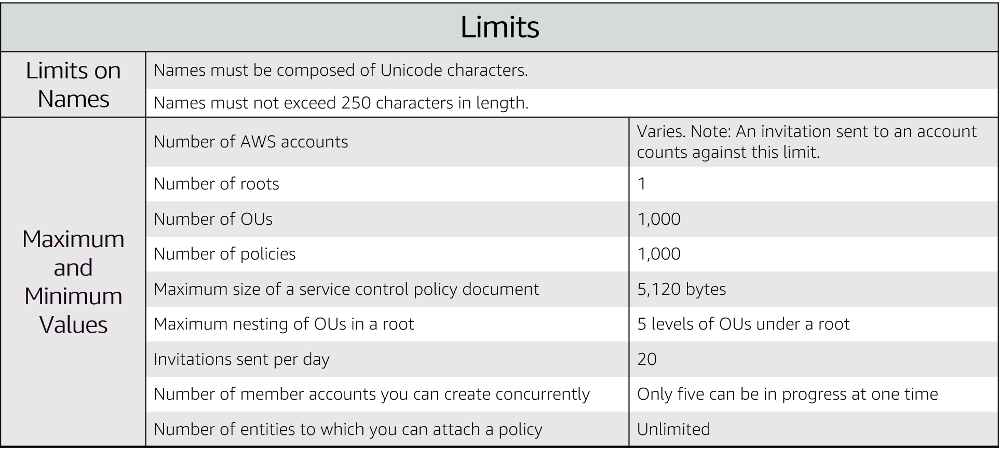

> **Нотатки:**
>
> There are restrictions on names that you can create in AWS Organizations, which includes names of accounts, OUs, roots, and policies.  
>
> Names must be composed of Unicode characters and not exceed 250 characters in length.  
>
> AWS Organizations has several maximum and minimum values for entities.  
>
> For accessibility: List of the AWS Organizations limits, including names, number of accounts (varies), number of roots (1), number of OUs (1,000), number of policies (1,000), max size of control policy document (5,120 bytes), max nesting of BUs (5 levels of BUs under a root), invitations sent per day (20), member accounts created concurrently (5), and entities to which you can attach a policy (unlimited).End of accessibility description.

---

## Слайд 37: Accessing AWS Organizations

AWS Management Console

AWS Command Line Interface (AWS CLI) tools

Software development kits (SDKs)

AWS  
Organizations

HTTPS Query application programming interfaces (API)

> **Нотатки:**
>
> AWS Organizations can be managed through different interfaces.  
>
> The AWS Management Console is a browser-based interface that you can use to manage your organization and your AWS resources. You can perform any task in your organization by using the console.  
>
> AWS Command Line Interface (AWS CLI) tools enable you to issue commands at your system's command line to perform AWS Organizations tasks and AWS tasks. This method can be faster and more convenient than using the console.  
>
> You can use also AWS software development kits (SDKs) to handle tasks such as cryptographically signing requests, managing errors, and retrying requests automatically. AWS SDKs consist of libraries and sample code for various programming languages and platforms, such as Java, Python, Ruby, .NET, iOS, and Android.  
>
> The AWS Organizations HTTPS Query API gives you programmatic access to AWS Organizations and AWS. You can use the API to issue HTTPS requests directly to the service. When you use the HTTPS API, you must include code to digitally sign requests by using your credentials.

---

## Слайд 38: Section 4: AWS Billing and Cost Management

Module 2: Cloud Economics and Billing

> **Нотатки:**
>
> Introducing Section 4: AWS Billing and Cost Management.

---

## Слайд 39: Introducing AWS Billing and Cost Management

> **Нотатки:**
>
> AWS Billing and Cost Management is the service that you use to pay your AWS bill, monitor your usage, and budget your costs. Billing and Cost Management enables you to forecast and obtain a better idea of what your costs and usage might be in the future so that you can plan ahead.  
>
> You can set a custom time period and determine whether you would like to view your data at a monthly or daily level of granularity.  
>
> With the filtering and grouping functionality, you can further analyze your data using a variety of available dimensions. The AWS Cost and Usage Report Tool enables you to identify opportunities for optimization by understanding your cost and usage data trends and how you are using your AWS implementation.

---

## Слайд 40: AWS Billing Dashboard

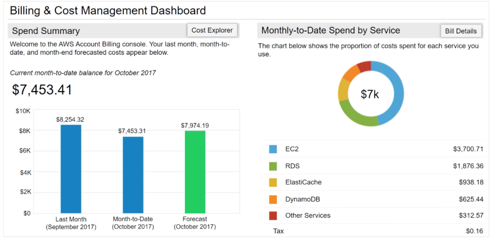

> **Нотатки:**
>
> The AWS Billing Dashboard lets you view the status of your month-to-date AWS expenditure, identify the services that account for the majority of your overall expenditure, and understand at a high level how costs are trending.  
>
> One of the graphs that is located on the dashboard is the Spend Summary. The Spend Summary shows you how much you spent last month, the estimated costs of your AWS usage for the month to date, and a forecast for how much you are likely to spend this month.  
>
> Another graph is Month-to-Date Spend by Service, which shows the top services that you use most and the proportion of costs that are attributed to that service.

---

## Слайд 41: Tools

AWS Budgets

AWS Cost and Usage Report

AWS Cost Explorer

> **Нотатки:**
>
> From the billing dashboard, you can access several other cost management tools that you can use to estimate and plan your AWS costs. These tools include AWS Bills, AWS Cost Explorer, AWS Budgets, and AWS Cost and Usage Reports.

---

## Слайд 42: Monthly bills

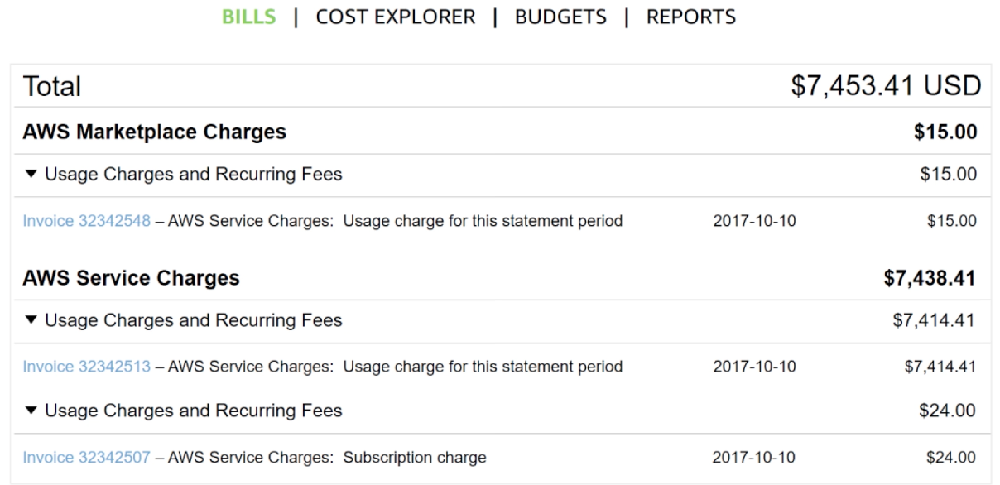

> **Нотатки:**
>
> The AWS Bills page lists the costs that you incurred over the past month for each AWS service, with a further breakdown by AWS Region and linked account.  
>
> This tool gives you access to the most up-to-date information on your costs and usage, including your monthly bill and the detailed breakdown of the AWS services that you use.

---

## Слайд 43: Cost Explorer

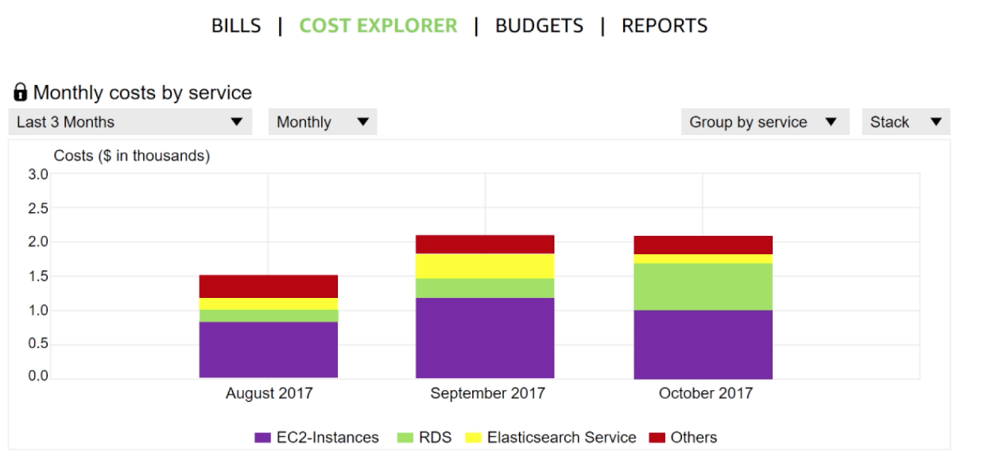

> **Нотатки:**
>
> The AWS Billing and Cost Management console includes the Cost Explorer page for viewing your AWS cost data as a graph.  
>
> With Cost Explorer, you can visualize, understand, and manage your AWS costs and usage over time.  
>
> The Cost Explorer includes a default report that visualizes your costs and usage for your top cost-incurring AWS services. The monthly running costs report gives you an overview of all your costs for the past 3 months. It also provides forecasted numbers for the coming month, with a corresponding confidence interval.  
>
> The Cost Explorer is a free tool that enables you to:  
> View charts of your costs.  
> View cost data for the past 13 months.  
> Forecast how much you are likely to spend over the next 3 months.  
> Discover patterns in how much you spend on AWS resources over time and identify cost problem areas.  
> Identify the services that you use the most  
> View metrics, like which Availability Zones have the most traffic or which linked AWS account is used the most.

---

## Слайд 44: Forecast and track costs

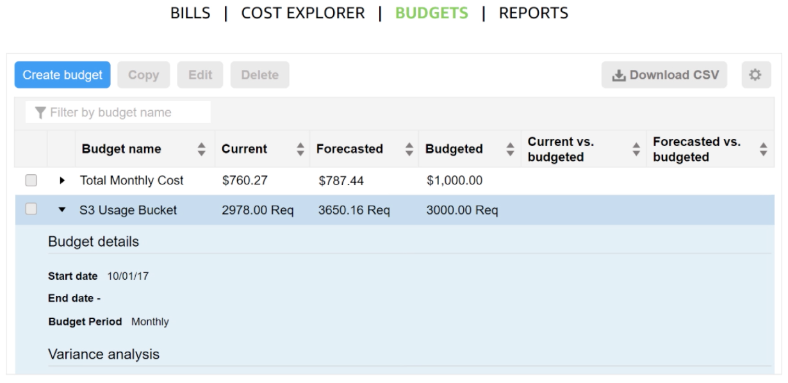

> **Нотатки:**
>
> AWS Budgets uses the cost visualization that is provided by Cost Explorer to show you the status of your budgets and to provide forecasts of your estimated costs.  
>
> You can also use AWS Budgets to create notifications for when you go over your budget for the month, or when your estimated costs exceed your budget. Budgets can be tracked at the monthly, quarterly, or yearly level, and you can customize the start and end dates. Budget alerts can be sent via email or via Amazon Simple Notification Service (Amazon SNS).  
>
> For accessibility: The AWS Billing budgets panel showing budget names, current and future costs and usages, and headings for current and forecasted versus budgets. End of accessibility description.

---

## Слайд 45: Cost and usage reporting

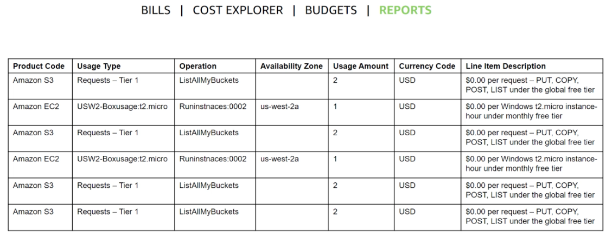

> **Нотатки:**
>
> The AWS Cost and Usage Report is a single location for accessing comprehensive information about your AWS costs and usage. This tool lists the usage for each service category that is used by an account (and its users) in hourly or daily line items, and any tax that you activated for tax allocation purposes.  
>
> You can choose to have AWS to publish billing reports to an S3 bucket. These reports can be updated once a day.

---

## Слайд 46: Recorded demo: Amazon Billing dashboard

Amazon Billing dashboard demo

> **Нотатки:**
>
> Show the Billing dashboard demo at https://aws-tc-largeobjects.s3-us-west-2.amazonaws.com/ILT-TF-100-ACFNDS-20-EN/Module_2_Billing+Dashboard+v1.0.mp4.

---

## Слайд 47: Billing dashboard demonstration

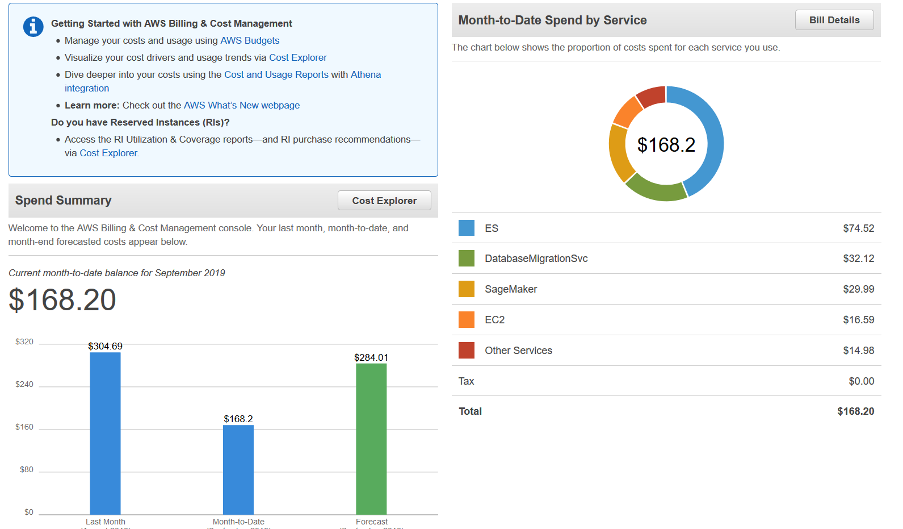

> **Нотатки:**
>
> Show the Amazon Billing dashboard demo.

---

## Слайд 48: Section 5: Technical support

Module 2: Cloud Economics and Billing

> **Нотатки:**
>
> Introducing Section 5: Technical support.

---

## Слайд 49: AWS support (1 of 2)

- Provide unique combination of tools and expertise:
  - AWS Support
  - AWS Support Plans
- Support is provided for:
  - Experimenting with AWS
  - Production use of AWS
  - Business-critical use of AWS

> **Нотатки:**
>
> Whether you are new or continuing to adopt AWS services and applications as your business solutions, AWS want help you do amazing things with AWS. AWS Support can provide you with a unique combination of tools and expertise based on your current or future planned use cases.  
>
> AWS Support was developed to provide complete support and the right resources to aid your success. We want to support all our customers, including customers that might be experimenting with AWS, those that are looking for production uses of AWS, and also customers that use AWS as a business-critical resource. AWS Support can vary the type of support that is provided, depending on the customer’s needs and goals.

---

## Слайд 50: AWS support (2 of 2)

- Proactive guidance :
  - Technical Account Manager (TAM)
- Best practices :
  - AWS Trusted Advisor
- Account assistance :
  - AWS Support Concierge

> **Нотатки:**
>
> With AWS, customers can plan, deploy, and optimize with confidence.  
>
> If you would like proactive guidance, AWS Support has Technical Account Managers (TAMs) who are designated as that user’s primary point of contact. The TAM can provide guidance, architectural review, and continuous ongoing communication to keep you informed and prepared as you plan, deploy, and optimize your solutions.  
>
> If you want to ensure that you follow best practices to increase performance and fault tolerance in the AWS environment, AWS Support has AWS Trusted Advisor. AWS Trusted Advisor is like a customized cloud expert. It is an online resource that checks for opportunities to reduce monthly expenditures and increase productivity.  
>
> For account assistance, the Support Concierge is a billing and account expert who will provide quick and efficient analysis on billing and account issues. The concierge addresses all non-technical billing and account-level inquiries.

---

## Слайд 51: Support plans

AWS Support offers four support plans:

- **Basic Support** – Resource Center access, Service Health Dashboard, product FAQs, discussion forums, and support for health checks
- **Developer Support**: Support for early development on AWS
- **Business Support**: Customers that run production workloads
- **Enterprise Support**: Customers that run business and mission-critical workloads

> **Нотатки:**
>
> AWS wants you to be able to plan, deploy, and optimize with confidence. We have developed specific plans to support you, including Basic, Developer, Business, and Enterprise support plans.  
>
> The Basic Support Plan offers:  
> 24/7 access to customer service, documentation, whitepapers and support forums.  
> Access to six core Trusted Advisor checks.  
> Access to Personal Health Dashboard.  
>
> The Developer Support Plan offers resources for customers that are testing or doing early development on AWS, and any customers who:  
> Want access to guidance and technical support.  
> Are exploring how to quickly put AWS to work.  
> Use AWS for non-production workloads or applications.  
>
> The Business Support Plan offers resources for customers that are running production workloads on AWS, and any customers who:  
> Run one or more applications in production environments.  
> Have multiple services activated, or use key services extensively.  
> Depend on their business solutions to be available, scalable, and secure.  
>
> The Enterprise Support Plan offers resources for customers that are running business and mission-critical workloads on AWS, and any customers who want to:  
> Focus on proactive management to increase efficiency and availability.  
> Build and operate workloads that follow AWS best practices.  
> Use AWS expertise to support launches and migrations.  
> Use a Technical Account Manager (TAM), who provides technical expertise for the full range of AWS services and obtains a detailed understanding of your use case and technology architecture. The Technical Account Manager is the primary point of contact for ongoing support needs.

---

## Слайд 52: Case severity and response times

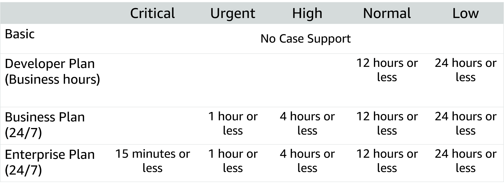

> **Нотатки:**
>
> It addition to understanding the costs that are associated with different support plans, it is critical that you understand the service levels that are associated with each plan. In addition to the support plan you select, the case severity will drive the type of response that you receive. There are five different severity levels:  
> Critical – Your business is at risk. Critical functions of your application are unavailable.  
> Urgent – Your business is significantly impacted. Important functions of your application are unavailable.  
> High – Important functions of your application are impaired or degraded.  
> Normal – Non-critical functions of your application are behaving abnormally, or you have a time-sensitive development question.  
> Low – You have a general development question, or you want to request a feature.  
>
> Note that there is no case support with the Basic Support Plan. These response times should be considered when you determine which support plan is best for your organization.  
>
> To learn more about AWS Support plans, see Compare AWS Support Plans at https://aws.amazon.com/premiumsupport/plans/.  
>
> For accessibility: Case severity response times for the four different support levels (basic, developer plan, business plan, and enterprise plan, each with more support respectively. End of accessibility description.

---

## Слайд 53: Activity: Support plan scavenger hunt

- Break up into groups of four or five and develop a recommendation for the best support plan for one of the business cases that are provided.
- Be prepared to report your findings back to the class.

> **Нотатки:**
>
> In this activity, your group will read the description of a business and develop a recommendation for the appropriate support plan. When you report back to the class, describe the support plan that you selected, and the decision-making criteria that you used to develop your recommendation.

---

## Слайд 54: Module wrap-up

Module 2: Cloud Economics and Billing

> **Нотатки:**
>
> It’s now time to review the module and wrap up with a knowledge check and discussion of a practice certification exam question.

---

## Слайд 55: Module summary

- Explored the fundamental of AWS pricing
- Reviewed TCO concepts
- Reviewed an AWS Pricing Calculator estimate
- Reviewed the Billing dashboard
- Reviewed Technical Support options and costs

> **Нотатки:**
>
> In summary you:  
> Explored the fundamentals of AWS pricing  
> Reviewed Total Cost of Ownership concepts  
> Reviewed an AWS Pricing Calculator estimate.  
>
> Total Cost of Ownership is a concept to help you understand and compare the costs that are associated with different deployments. AWS provides the AWS Pricing Calculator to assist you with the calculations that are needed to estimate cost savings.  
>
> Use the AWS Pricing Calculator to:  
> Estimate monthly costs  
> Identify opportunities to reduce monthly costs  
> Model your solutions before building them  
> Explore price points and calculations behind your estimate  
> Find the available instance types and contracts that meet your needs  
>
> AWS Billing and Cost Management provides you with tools to help you access, understand, allocate, control, and optimize your AWS costs and usage. These tools include AWS Bills, AWS Cost Explorer, AWS Budgets, and AWS Cost and Usage Reports.  
>
> These tools give you access to the most comprehensive information about your AWS costs and usage including which AWS services are the main cost drivers. Knowing and understanding your usage and costs will enable you to plan ahead and improve your AWS implementation.

---

## Слайд 56: Complete the knowledge check

> **Нотатки:**
>
> Now, complete the knowledge check.

---

## Слайд 57: Sample exam question

Which AWS service provides infrastructure security optimization recommendations?

Choice

Response

A

AWS Price List Application Programming Interface (API)

B

Reserved Instances

C

AWS Trusted Advisor

D

Amazon Elastic Compute Cloud (Amazon EC2) Spot Fleet

> **Нотатки:**
>
> Look at the answer choices and rule them out based on the keywords.

---

## Слайд 58: Sample exam question answer

Which AWS service provides infrastructure security optimization recommendations?

The correct answer is C.

The keyword in the question is “recommendations”.

> **Нотатки:**
>
> The following are the keywords to recognize: “recommendations”.  
>
> The correct answer is C.

---

## Слайд 59: Additional resources

- AWS Economics Center: [http://aws.amazon.com/economics/](http://aws.amazon.com/economics/)
- AWS Pricing Calculator: [https://calculator.aws/#/](https://calculator.aws/#/)
- Case studies and research: [http://aws.amazon.com/economics/](http://aws.amazon.com/economics/)
- Additional pricing exercises: [https://dx1572sre29wk.cloudfront.net/cost/](https://dx1572sre29wk.cloudfront.net/cost/)

> **Нотатки:**
>
> If you want to learn more about the topics covered in this module, you might find the following additional resources helpful:  
> AWS Economics Center: http://aws.amazon.com/economics/  
> AWS Pricing Calculator: https://calculator.aws/#/  
> Case studies and research: http://aws.amazon.com/economics/  
> Additional pricing exercises: https://dx1572sre29wk.cloudfront.net/cost/

---

## Слайд 60: Thank you

All trademarks are the property of their owners.

> **Нотатки:**
>
> Thank you for completing this module.
