## Слайд 1: Модуль 2: Економіка хмари та виставлення рахунків

AWS Academy Cloud Foundations

> **Нотатки:**
>
> Вітаємо в Модулі 2: Економіка хмари та виставлення рахунків (Cloud Economics and Billing)

---

## Слайд 2: Огляд модуля

**Теми**

- Основи ціноутворення
- Загальна вартість володіння (Total Cost of Ownership, TCO)
- AWS Organizations
- AWS Billing and Cost Management
- Технічна підтримка

**Демонстрація**

- Огляд панелі виставлення рахунків (Billing Dashboard)

**Практичні вправи**

- AWS Pricing Calculator
- Квест із планів підтримки (Support plans scavenger hunt)

**Перевірка знань**

> **Нотатки:**
>
> У цьому модулі розглядаються такі теми:  
> Основи ціноутворення  
> Загальна вартість володіння  
> AWS Organizations  
> AWS Billing and Cost Management  
> Технічна підтримка  
>
> Також модуль містить демонстрацію під керівництвом викладача, що покаже, як працювати з панеллю виставлення рахунків.  
>
> Також модуль містить практичну вправу, у якій потрібно оцінити витрати компанії за допомогою AWS Pricing Calculator.  
>
> Наприкінці вам буде запропоновано пройти перевірку знань, яка перевіряє ваше розуміння ключових концепцій, розглянутих у цьому модулі.

---

## Слайд 3: Цілі модуля

Після завершення цього модуля ви повинні вміти:

- Пояснювати філософію ціноутворення AWS
- Розпізнавати фундаментальні характеристики ціноутворення
- Вказувати елементи загальної вартості володіння
- Обговорювати результати AWS Pricing Calculator
- Визначати, як налаштувати організаційну структуру, що спрощує виставлення рахунків і видимість акаунтів для перегляду даних про витрати.
- Визначати функціональність панелі AWS Billing Dashboard
- Описувати, як використовувати рахунки AWS (AWS Bills), AWS Cost Explorer, AWS Budgets і звіти AWS Cost and Usage Reports
- Визначати різні плани технічної підтримки AWS і їхні функції

> **Нотатки:**
>
> Після завершення цього модуля ви повинні вміти:  
> Пояснювати філософію ціноутворення AWS  
> Розпізнавати фундаментальні характеристики ціноутворення  
> Вказувати елементи загальної вартості володіння  
> Обговорювати результати AWS Pricing Calculator  
> Визначати, як налаштувати організаційну структуру, що спрощує виставлення рахунків і видимість акаунтів для перегляду даних про витрати.  
> Визначати функціональність панелі AWS Billing Dashboard  
> Описувати, як використовувати рахунки AWS (AWS Bills), AWS Cost Explorer, AWS Budgets і звіти AWS Cost and Usage Reports  
> Визначати різні плани технічної підтримки AWS і їхні функції

---

## Слайд 4: Розділ 1: Основи ціноутворення

Модуль 2: Економіка хмари та виставлення рахунків

> **Нотатки:**
>
> Представляємо Розділ 1: Основи ціноутворення.

---

## Слайд 5: Модель ціноутворення AWS

Три основні чинники вартості в AWS

**Обчислення (Compute)**

**Сховище (Storage)**

**Передавання даних (Data transfer)**

- Тарифікується за годину/секунду*
- Залежить від типу екземпляра  
  
  
  
*Лише для Linux

- Зазвичай тарифікується за ГБ

- Вихідний трафік агрегується й тарифікується
- Вхідний трафік безкоштовний (з деякими винятками)
- Зазвичай тарифікується за ГБ

> **Нотатки:**
>
> Існують три основні чинники вартості в AWS: обчислення, сховище та вихідне передавання даних. Ці характеристики дещо відрізняються залежно від продукту AWS і моделі ціноутворення, яку ви обираєте.  
>
> У більшості випадків вхідне передавання даних або передавання даних між іншими сервісами AWS у межах того самого регіону AWS безкоштовне. Є деякі винятки, тож обов’язково перевіряйте тарифи на передавання даних, перш ніж почати користуватися сервісом AWS.  
>
> Вихідне передавання даних агрегується між сервісами, а потім тарифікується за тарифом вихідного передавання даних. Ця плата відображається в щомісячній виписці як AWS Data Transfer Out.

---

## Слайд 6: Як ви платите за AWS?

Платіть за те, що використовуєте

Платіть менше, коли резервуєте

Платіть менше, коли використовуєте більше, і в міру зростання AWS

> **Нотатки:**
>
> Ця філософія лежить в основі ціноутворення AWS. Хоча кількість і типи сервісів, що пропонує AWS, значно зросли, наша філософія щодо цін не змінилася. Наприкінці кожного місяця ви платите за те, що використовували. Ви можете почати або припинити використання продукту в будь-який час. Довгострокові контракти не потрібні.  
>
> AWS пропонує низку хмарних обчислювальних сервісів. За кожен сервіс ви платите рівно за той обсяг ресурсів, який вам справді потрібен. Ця модель ціноутворення в стилі комунальних послуг включає:  
> Платіть за те, що використовуєте  
> Платіть менше, коли резервуєте  
> Платіть менше, коли використовуєте більше  
> Платіть ще менше в міру зростання AWS  
>
> Тепер ви докладніше розглянете ці основні концепції ціноутворення.  
>
> Щоб дізнатися більше про ціноутворення AWS, див. огляд цін AWS (AWS pricing overview) за адресою https://d0.awsstatic.com/whitepapers/aws_pricing_overview.pdf.

---

## Слайд 7: Платіть за те, що використовуєте

Платіть лише за сервіси, які споживаєте, без великих авансових витрат.

**Локально (On premises)**

**AWS**

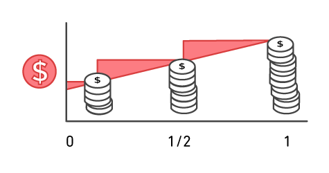

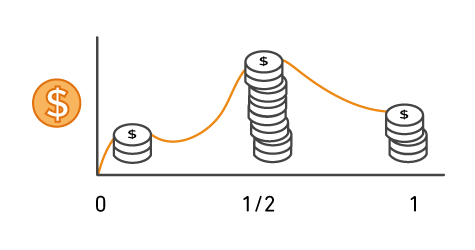

> **Нотатки:**
>
> Якщо ви не будуєте центри обробки даних на професійній основі, ви могли витратити надто багато часу та грошей на їх побудову. З AWS ви платите лише за сервіси, які споживаєте, без великих авансових витрат. Ви можете знизити змінні витрати, тож вам більше не потрібно спрямовувати цінні ресурси на побудову дорогої інфраструктури, зокрема на закупівлю серверів, ліцензій на програмне забезпечення чи оренду приміщень.  
>
> Швидко пристосовуйтеся до змін потреб бізнесу та перенаправте свою увагу на інновації та винаходи, платячи лише за те, що використовуєте, і лише так довго, як потрібно. Усі сервіси AWS доступні за запитом, не потребують довгострокових контрактів і не мають складних ліцензійних залежностей.

---

## Слайд 8: Платіть менше, коли резервуєте

Інвестуйте в зарезервовані екземпляри (Reserved Instances, RI):

- Заощаджуйте до 75 відсотків
- Варіанти:
    - Зарезервований екземпляр із повною авансовою оплатою (All Upfront Reserved Instance) **(AURI) — найбільша знижка**
    - Зарезервований екземпляр із частковою авансовою оплатою (Partial Upfront Reserved Instance) **(PURI) — менші знижки**
    - Зарезервований екземпляр без авансової оплати (No Upfront Payments Reserved Instance) **(NURI) — найменша знижка**

EC2

instance (екземпляр)

**On**  
**Demand (за запитом)**

**NURI**

**PURI**

**AURI**

> **Нотатки:**
>
> Для певних сервісів, як-от Amazon Elastic Compute Cloud (Amazon EC2) і Amazon Relational Database Service (Amazon RDS), можна інвестувати в зарезервовані потужності. Зі зарезервованими екземплярами можна заощадити до 75 відсотків порівняно з еквівалентними потужностями за запитом. Зарезервовані екземпляри доступні в трьох варіантах:  
> Зарезервований екземпляр із повною авансовою оплатою (All Upfront Reserved Instance, AURI)  
> Зарезервований екземпляр із частковою авансовою оплатою (Partial Upfront Reserved Instance, PURI)  
> Зарезервований екземпляр без авансової оплати (No Upfront Payments Reserved Instance, NURI)  
>
> Коли ви купуєте зарезервовані екземпляри, ви отримуєте більшу знижку, якщо робите більший авансовий платіж. Щоб максимізувати заощадження, можна заплатити все наперед і отримати найбільшу знижку. RI з частковою авансовою оплатою пропонують менші знижки, але дають змогу витратити менше наперед. Нарешті, можна вибрати нічого не платити наперед і отримати меншу знижку, що дає змогу вивільнити капітал для витрат на інші проєкти.  
>
> Використовуючи зарезервовані потужності, ваша організація може мінімізувати ризики, передбачуваніше керувати бюджетами та дотримуватися політик, що вимагають довгострокових зобов’язань.

---

## Слайд 9: Платіть менше, використовуючи більше

Користуйтеся знижками за обсяг:

- **Заощадження** зі зростанням використання.
- **Ступінчасте ціноутворення (tiered pricing)** для сервісів, як-от Amazon Simple Storage Service (Amazon S3), Amazon Elastic Block Store (Amazon EBS) чи Amazon Elastic File System (Amazon EFS): чим більше ви використовуєте, тим менше платите за ГБ.
- Кілька сервісів сховищ забезпечують **нижчу** вартість зберігання залежно від потреб.

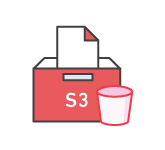

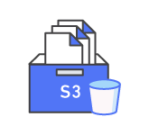

> **Нотатки:**
>
> З AWS ви можете отримувати знижки за обсяг і відчутно заощаджувати зі зростанням використання. Для сервісів, як-от Amazon Simple Storage Service (Amazon S3), ціноутворення ступінчасте, що означає, що ви платите менше за ГБ, коли використовуєте більше. Крім того, вхідне передавання даних завжди безкоштовне. Кілька сервісів сховищ забезпечують нижчу вартість зберігання залежно від ваших потреб. У результаті, коли ваші потреби у використанні AWS зростають, ви користуєтеся економією від масштабу, що дає змогу розширювати впровадження й тримати витрати під контролем.  
>
> У міру розвитку вашої організації AWS також надає вам варіанти придбання сервісів, що допомагають задовольнити ваші бізнес-потреби. Наприклад, портфель сервісів зберігання AWS пропонує варіанти, що допомагають знизити ціни залежно від того, як часто ви звертаєтеся до даних і яка продуктивність потрібна для їх отримання. Щоб оптимізувати заощадження, можна обрати правильну комбінацію рішень зберігання, що допомагають знизити витрати, зберігаючи продуктивність, безпеку та довговічність.

---

## Слайд 10: Платіть ще менше в міру зростання AWS

У міру зростання AWS:

- AWS зосереджується на зниженні вартості ведення бізнесу.
- Ця практика призводить до того, що AWS передає вам заощадження від економії масштабу.
- З 2006 року AWS **знизила ціни 75** разів (станом на вересень 2019 року).
- Майбутні продуктивніші ресурси замінюють поточні без додаткової плати.

> **Нотатки:**
>
> AWS постійно зосереджується на зниженні вартості апаратного забезпечення центрів обробки даних, підвищенні операційної ефективності, зменшенні споживання енергії та загалом на зниженні вартості ведення бізнесу.  
>
> Ці оптимізації та значна й зростаюча економія від масштабу AWS призводять до того, що заощадження передаються вам у вигляді нижчих цін. З 2006 року AWS знизила ціни 75 разів (станом на вересень 2019 року).  
>
> Ще одна перевага зростання AWS полягає в тому, що майбутні, продуктивніші ресурси замінюють поточні без додаткової плати.

---

## Слайд 11: Користувацьке ціноутворення (custom pricing)

- Задовольняйте різні потреби за допомогою користувацького ціноутворення.
- Доступне для проєктів великого обсягу з унікальними  
вимогами.

> **Нотатки:**
>
> AWS розуміє, що в кожного клієнта різні потреби. Якщо жодна з моделей ціноутворення AWS не підходить для вашого проєкту, для проєктів великого обсягу з унікальними вимогами доступне користувацьке ціноутворення.

---

## Слайд 12: AWS Free Tier

Дає змогу отримати безкоштовний практичний досвід роботи з платформою, продуктами та сервісами AWS. Безкоштовно протягом 1 року для нових клієнтів.

**Зареєструйте**  
**акаунт AWS**

**Навчайтеся за допомогою 10-**  
**хвилинних посібників**

**Почніть створювати**  
**з AWS**

> **Нотатки:**
>
> Щоб допомогти новим клієнтам AWS почати роботу в хмарі, AWS пропонує безкоштовний рівень використання (AWS Free Tier) для нових клієнтів на строк до 1 року. AWS Free Tier застосовується до певних сервісів і варіантів. Якщо ви новий клієнт AWS, ви можете протягом року безкоштовно запускати екземпляр Amazon Elastic Compute Cloud (Amazon EC2) T2 micro, а також користуватися безкоштовним рівнем використання для Amazon S3, Amazon Elastic Block Store (Amazon EBS), Elastic Load Balancing, передавання даних AWS та інших сервісів AWS.  
>
> Щоб дізнатися більше, див. AWS Free Tier за адресою https://aws.amazon.com/free/?all-free-tier.sort-by=item.additionalFields.SortRank&all-free-tier.sort-order=asc&awsf.Free%20Tier%20Types=*all&awsf.Free%20Tier%20Categories=*all.

---

## Слайд 13: Сервіси без плати

Amazon VPC

Elastic Beanstalk**

Auto Scaling**

AWS CloudFormation**

AWS Identity and Access Management (IAM)

Примітка**: за інші сервіси AWS, які використовуються з цими сервісами, може стягуватися плата.

> **Нотатки:**
>
> AWS також пропонує низку сервісів без додаткової плати.  
>
> Amazon Virtual Private Cloud (Amazon VPC) дає змогу розгорнути логічно ізольовану ділянку хмари AWS, де можна запускати ресурси AWS у віртуальній мережі, яку ви визначаєте.  
> AWS Identity and Access Management (IAM) контролює доступ ваших користувачів до сервісів і ресурсів AWS.  
> Консолідоване виставлення рахунків (Consolidated Billing) — це функція виставлення рахунків в AWS Organizations для консолідації оплати кількох акаунтів AWS або кількох акаунтів Amazon Internet Services Private Limited (AISPL)*. Консолідоване виставлення рахунків забезпечує:  
> Один рахунок для кількох акаунтів.  
> Можливість легко відстежувати нарахування кожного акаунта.  
> Можливість зменшити витрати завдяки знижкам за обсяг від сукупного використання.  
> І ви можете консолідувати всі свої акаунти за допомогою консолідованого виставлення рахунків і отримати ступінчасті переваги.  
> AWS Elastic Beanstalk — це ще простіший спосіб швидко розгортати застосунки в хмарі AWS і керувати ними.  
> AWS CloudFormation надає розробникам і системним адміністраторам простий спосіб створити набір пов’язаних ресурсів AWS і розгортати їх упорядковано та передбачувано.  
> Автоматичне масштабування (Automatic Scaling) автоматично додає або видаляє ресурси відповідно до умов, які ви визначаєте. Ресурси, що ви використовуєте, плавно збільшуються під час сплесків попиту для підтримки продуктивності й автоматично зменшуються під час спадів попиту для мінімізації витрат.  
> AWS OpsWorks — це сервіс керування застосунками, що полегшує розгортання та експлуатацію застосунків будь-яких форм і розмірів.  
>
> Хоча за ці сервіси плата не стягується, за інші сервіси AWS, що використовуються з ними, може стягуватися плата. Наприклад, коли ви автоматично масштабуєте додаткові екземпляри EC2, за ці екземпляри стягуватиметься плата.  
>
> * Примітка: основна різниця між акаунтами AWS та акаунтами AISPL — це продавець за записом (seller of record). Акаунтами AWS керує Amazon Web Services, Inc., а акаунтами AISPL керує Amazon Internet Services Private Limited. Якщо ви використали індійську адресу під час створення акаунта, продавцем за записом за замовчуванням для вашого акаунта є AISPL. За замовчуванням акаунти AISPL тарифікуються в індійських рупіях (INR). Докладніше про продавця за записом див. тут https://docs.aws.amazon.com/awsaccountbilling/latest/aboutv2/manage-account-payment-aispl.html#determine-seller.

---

## Слайд 14: Ключові висновки

- Плата не стягується (за деякими винятками) за:
  - Вхідне передавання даних.
  - Передавання даних між сервісами в межах того самого регіону AWS.
- Платіть за те, що використовуєте.
- Починайте й припиняйте в будь-який час.
- Довгострокові контракти не потрібні.
- Деякі сервіси безкоштовні, але інші сервіси AWS, які вони розгортають, можуть бути платними.

> **Нотатки:**
>
> Підсумовуючи, хоча кількість і типи сервісів, що пропонує AWS, значно зросли, наша філософія щодо цін не змінилася. Наприкінці кожного місяця ви платите лише за те, що використовували, і можете почати або припинити використання продукту в будь-який час. Довгострокові контракти не потрібні.  
>
> Найкращий спосіб оцінити витрати — вивчити фундаментальні характеристики кожного сервісу AWS, оцінити своє використання за кожною характеристикою, а потім зіставити це використання з цінами, опублікованими на вебсайті AWS. Стратегія ціноутворення сервісів дає вам гнучкість обирати сервіси, потрібні для кожного проєкту, і платити лише за те, що ви використовуєте.  
>
> Є кілька безкоштовних сервісів AWS, зокрема:  
> Amazon VPC  
> Elastic Beanstalk  
> AWS CloudFormation  
> IAM  
> Сервіси автоматичного масштабування  
> AWS OpsWorks  
> Консолідоване виставлення рахунків  
>
> Хоча самі сервіси безкоштовні, ресурси, які вони розгортають, можуть бути платними. У більшості випадків вхідне передавання даних або передавання даних між іншими сервісами AWS у межах того самого регіону AWS безкоштовне. Є деякі винятки, тож обов’язково перевіряйте тарифи на передавання даних, перш ніж почати користуватися сервісом AWS.  
> Вартість вихідного передавання даних ступінчаста.  
>
> Щоб дізнатися більше про ціноутворення, див. ціноутворення AWS (AWS pricing) за адресою https://aws.amazon.com/pricing/ та огляд цін AWS (AWS pricing overview) за адресою https://d0.awsstatic.com/whitepapers/aws_pricing_overview.pdf.

---

## Слайд 15: Розділ 2: Загальна вартість володіння (Total Cost of Ownership)

Модуль 2: Економіка хмари та виставлення рахунків

> **Нотатки:**
>
> Представляємо Розділ 2: Загальна вартість володіння.

---

## Слайд 16: Локальна інфраструктура та хмара

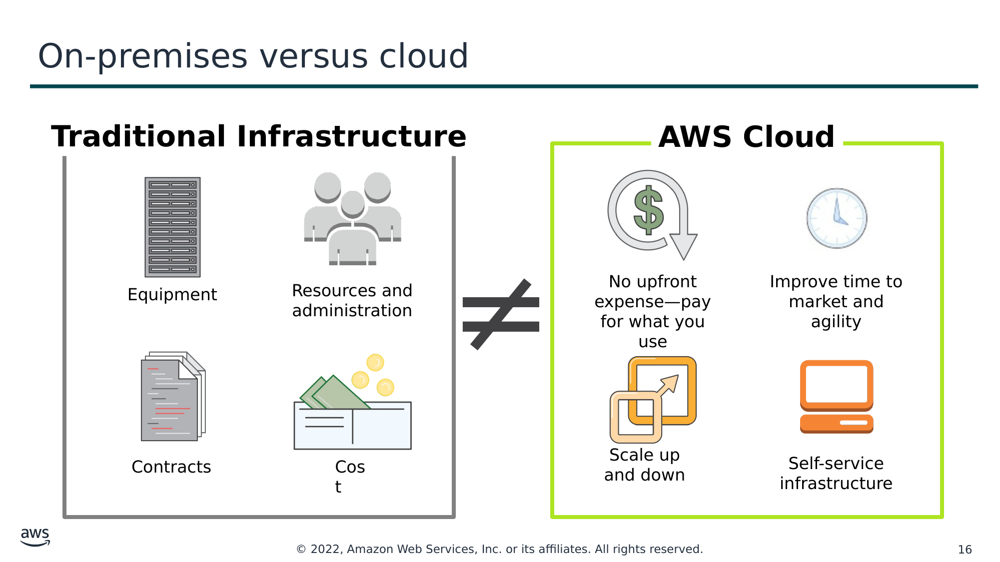

Текст зі схеми

**Traditional Infrastructure (Традиційна інфраструктура)**

**AWS Cloud (Хмара AWS)**

≠

No upfront expense—pay for what you use (Без авансових витрат — платіть за те, що використовуєте)

Improve time to market and agility (Скорочення часу виходу на ринок і підвищення гнучкості)

Equipment (Обладнання)

Resources and administration (Ресурси та адміністрування)

Contracts (Контракти)

Cost (Вартість)

Scale up and down (Масштабування вгору та вниз)

Self-service infrastructure (Інфраструктура самообслуговування)

> **Нотатки:**
>
> Локальна інфраструктура чи хмара — запитання, яке ставлять багато компаній. Різниця між цими двома варіантами — у способі їх розгортання.  
>
> Локальна інфраструктура (on-premises) встановлюється локально на власних комп’ютерах і серверах компанії. Із традиційною інфраструктурою пов’язано кілька фіксованих витрат, також відомих як капітальні витрати (capital expenses). Капітальні витрати включають приміщення, апаратне забезпечення, ліцензії та обслуговуючий персонал. Масштабування вгору може бути дорогим і тривалим. Масштабування вниз не зменшує фіксованих витрат.  
>
> Хмарну інфраструктуру купують у постачальника послуг, який будує й підтримує приміщення, апаратне забезпечення та обслуговуючий персонал. Клієнт платить за те, що використовується. Масштабування вгору чи вниз просте. Витрати легко оцінити, оскільки вони залежать від використання сервісу.  
>
> Порівняти локальну модель доставки ІТ із хмарою AWS складно. Вони відрізняються, оскільки використовують різні концепції та терміни.  
>
> Використання локальної ІТ передбачає обговорення, що ґрунтується на капітальних витратах, довгих циклах планування та багатьох компонентах, які потрібно купувати, будувати, обслуговувати та з часом оновлювати.  
> Використання хмари AWS передбачає обговорення гнучкості, спритності (agility) та витрат на основі споживання.  
>
> То як визначити найкращий варіант?

---

## Слайд 17: Що таке загальна вартість володіння (Total Cost of Ownership, TCO)?

**Загальна вартість володіння (Total Cost of Ownership, TCO)** — це фінансова оцінка, що допомагає визначити прямі та непрямі витрати системи.

Навіщо використовувати TCO?

- Щоб порівняти витрати на запуск **усього інфраструктурного середовища чи конкретного робочого навантаження** локально та в AWS
- Щоб скласти бюджет і **побудувати бізнес-обґрунтування** переходу в хмару

> **Нотатки:**
>
> Визначити найкращий варіант можна, порівнявши локальне рішення з хмарним рішенням. Загальна вартість володіння (Total Cost of Ownership, TCO) — це фінансова оцінка, призначена допомогти покупцям і власникам визначити прямі та непрямі витрати продукту чи системи. TCO включає вартість сервісу плюс усі витрати, пов’язані з володінням сервісом.  
>
> Ви можете захотіти порівняти витрати на запуск усього інфраструктурного середовища для конкретного робочого навантаження в локальному об’єкті чи об’єкті колокації (collocation) з тим самим робочим навантаженням, що працює на хмарній інфраструктурі. Це порівняння виконується для цілей бюджетування або для побудови бізнес-обґрунтування бізнес-рішень щодо оптимального рішення для розгортання.

---

## Слайд 18: Чинники, що враховуються в TCO

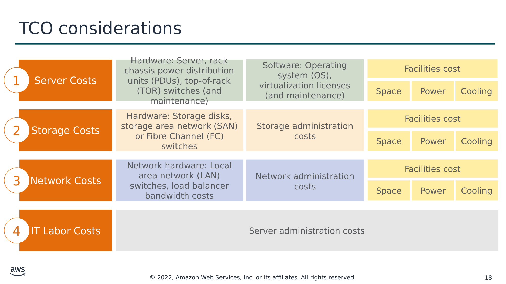

Текст зі схеми

1

Hardware: Server, rack chassis power distribution units (PDUs), top-of-rack (TOR) switches (and maintenance) (Апаратне забезпечення: сервер, блоки розподілу живлення (PDU) шасі стійки, комутатори верхньої частини стійки (TOR) (та обслуговування))

Software: Operating system (OS), virtualization licenses  
(and maintenance) (Програмне забезпечення: операційна система (ОС), ліцензії віртуалізації (та обслуговування))

Facilities cost (Вартість приміщень)

Server Costs (Витрати на сервери)

Space (Площа)

Power (Живлення)

Cooling (Охолодження)

2

Hardware: Storage disks, storage area network (SAN) or Fibre Channel (FC) switches (Апаратне забезпечення: диски сховищ, мережа зберігання даних (SAN) або комутатори Fibre Channel (FC))

Storage administration costs (Витрати на адміністрування сховищ)

Facilities cost

Storage Costs (Витрати на сховища)

Space

Power

Cooling

3

Network hardware: Local area network (LAN) switches, load balancer bandwidth costs (Мережеве обладнання: комутатори локальної мережі (LAN), вартість пропускної здатності балансувальників навантаження)

Network administration costs (Витрати на адміністрування мережі)

Facilities cost

Network Costs (Витрати на мережу)

Space

Power

Cooling

4

Server administration costs (Витрати на адміністрування серверів)

IT Labor Costs (Витрати на ІТ-персонал)

> **Нотатки:**
>
> Деякі витрати, пов’язані з керуванням центром обробки даних, включають:  
> Витрати на сервери — як на апаратне, так і на програмне забезпечення — та витрати на приміщення для розміщення обладнання.  
> Витрати на сховища — на апаратне забезпечення, адміністрування та приміщення.  
> Витрати на мережу — на апаратне забезпечення, адміністрування та приміщення.  
> А також витрати на ІТ-персонал, потрібний для адміністрування всього рішення.  
>
> Коли ви порівнюєте локальне рішення з хмарним, важливо точно оцінити справжні витрати обох варіантів. У хмарі більшість витрат відомі наперед і їх легко розрахувати. Наприклад, хмарні постачальники надають прозоре ціноутворення на основі різних метрик використання, як-от RAM, сховище та пропускна здатність, серед інших. Ціноутворення часто фіксоване за одиницю часу.  
>
> Клієнти отримують визначеність щодо цін і можуть легко розраховувати витрати на основі кількох різних оцінок використання.  
>
> Порівняйте цей процес із локальними технологіями. Хоча їх іноді важко визначити, розрахунки внутрішніх витрат мають враховувати всі:  
> Прямі витрати, що супроводжують роботу сервера, — як-от живлення, площа підлоги, сховище та ІТ-операції для керування цими ресурсами.  
> Непрямі витрати на роботу сервера, як-от мережева інфраструктура та інфраструктура сховищ.  
>
> Ця схема концептуальна й не включає кожну статтю витрат. Наприклад, залежно від рішення, яке ви впроваджуєте, витрати на програмне забезпечення можуть включати витрати на бази даних, керування та проміжний рівень (middle-tier). Витрати на приміщення можуть включати модернізацію, обслуговування, охорону будівлі, податки тощо. Витрати на ІТ-персонал можуть включати витрати на адміністрування безпеки та адміністрування застосунків.  Ця схема містить скорочений перелік, щоб продемонструвати тип витрат, пов’язаних з обслуговуванням центру обробки даних.

---

## Слайд 19: Локальна інфраструктура та повний перехід у хмару (all-in-cloud)

Ви могли б заощаджувати до **96 відсотків** на рік, перенісши свою інфраструктуру в AWS.

Ваші загальні заощадження за 3 роки становили б **159 913 доларів**.

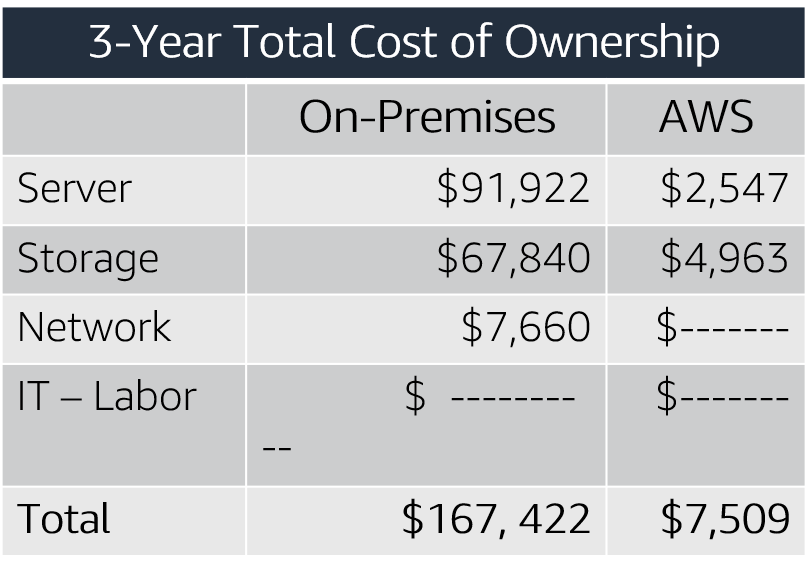

| | Сервер (Server) | Сховище (Storage) | Мережа (Network) | ІТ-персонал (IT-Labor) | Разом (Total) |
|---|---|---|---|---|---|
| Локально (On-Premises) | 91 922 | 67 840 | 7 660 | 0 | 167 422 |
| AWS | 2 547 | 4 963 | 0 | 0 | 7 510 |

Вартість AWS включає підтримку бізнес-рівня та  
3-річний екземпляр EC2 PURI

> **Нотатки:**
>
> Ось зразок порівняння витрат. Цей приклад показує порівняння витрат локального рішення та хмарного рішення протягом 3 років. Для цього порівняння було створено два подібні середовища, що представляють локальне середовище та середовище AWS. Додаткові прямі та непрямі витрати, пов’язані з локальним рішенням, не включено. Компоненти локального рішення включають:  
> 1 віртуальну машину з 4 ЦП, 16 ГБ RAM і операційною системою Linux  
> Середнє використання — 100 відсотків  
> Оптимізовано за RAM  
>
> Компоненти порівнюваного середовища AWS включають:  
> 1 екземпляр m4.xlarge з 4 ЦП, 16 ГБ RAM  
> Тип екземпляра — 3-річний зарезервований екземпляр із частковою авансовою оплатою (Partial Upfront Reserved Instance)  
>
> Загальна вартість локального рішення за 3 роки становить 167 422 долари. Загальна вартість хмари AWS за 3 роки становить 7 509 доларів, що становить 96 відсотків заощаджень порівняно з локальним рішенням. Таким чином, загальні заощадження на хмарній інфраструктурі за 3 роки становили б 159 913 доларів. Це порівняння допомагає бізнесу чітко зрозуміти різницю між альтернативами.  
>
> У чому різниця у витратах?  
> Пам’ятайте, що локальне рішення розраховується наперед (прогнозується). Воно продовжує нести витрати незалежно від того, чи використовуються потужності.  
>
> Натомість рішення AWS вводиться в експлуатацію, коли потрібно, і виводиться з експлуатації, коли ресурси більше не використовуються, що призводить до нижчих загальних витрат.  
>
> Для доступності: діаграма порівняння загальної вартості володіння за три роки для локальної інфраструктури та AWS. Локальна інфраструктура коштує 167 422 долари, а AWS — 7 509 доларів. Кінець опису для доступності.

---

## Слайд 20: AWS Pricing Calculator

Використовуйте AWS Pricing Calculator, щоб:

- Оцінювати щомісячні витрати
- Визначати можливості зниження щомісячних витрат
- Моделювати свої рішення перед їх побудовою
- Досліджувати цінові точки та розрахунки, що стоять за вашою оцінкою
- Знаходити доступні типи екземплярів і умови контрактів, що відповідають вашим потребам
- Називати свою оцінку, а також створювати й називати групи сервісів

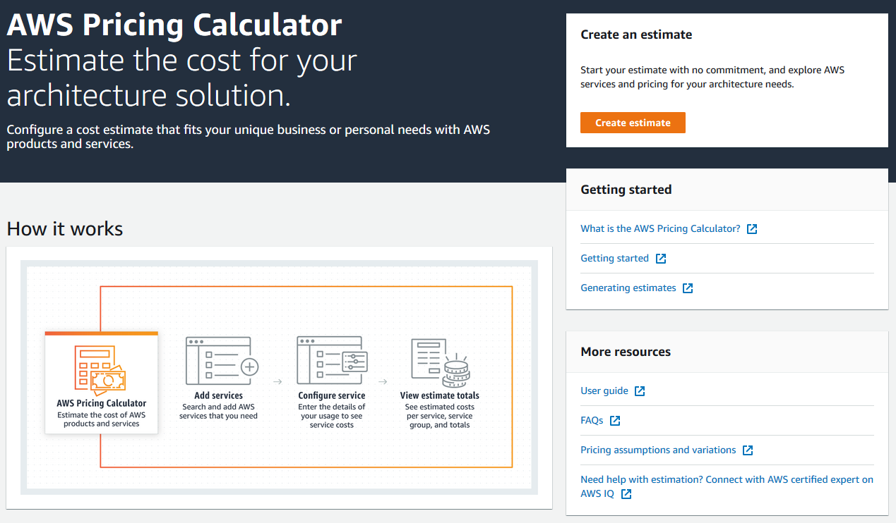

Перейти до [AWS Pricing Calculator](https://calculator.aws/#/)

> **Нотатки:**
>
> AWS пропонує AWS Pricing Calculator, щоб допомогти вам оцінити щомісячний рахунок AWS. Цей інструмент можна використовувати для дослідження сервісів AWS і створення оцінки вартості ваших сценаріїв використання в AWS. Ви можете моделювати свої рішення перед їх побудовою, досліджувати цінові точки та розрахунки, що стоять за вашою оцінкою, і знаходити доступні типи екземплярів та умови контрактів, що відповідають вашим потребам. Це дає змогу ухвалювати обґрунтовані рішення щодо використання AWS. Ви можете планувати свої витрати та використання AWS або розраховувати вартість налаштування нового набору екземплярів і сервісів.  
>
> AWS Pricing Calculator допомагає:  
> Оцінювати щомісячні витрати на сервіси AWS  
> Визначати можливості зниження витрат  
> Моделювати ваші рішення перед їх побудовою  
> Досліджувати цінові точки та розрахунки, що стоять за вашою оцінкою  
> Знаходити доступні типи екземплярів і умови контрактів, що відповідають вашим потребам  
>
> AWS Pricing Calculator дає змогу називати вашу оцінку, а також створювати й називати групи сервісів. Групи — це контейнери, до яких ви додаєте сервіси, щоб упорядкувати й побудувати вашу оцінку. Ви можете впорядковувати свої групи та сервіси за центром витрат, відділом, архітектурою продукту тощо.  
>
> Докладніше див. вебсайт AWS Pricing Calculator за адресою https://calculator.aws/#/.

---

## Слайд 21: Як читати оцінку (reading an estimate)

Ваша оцінка поділяється на: загалом за перші 12 місяців, загалом авансом і загалом щомісяця.

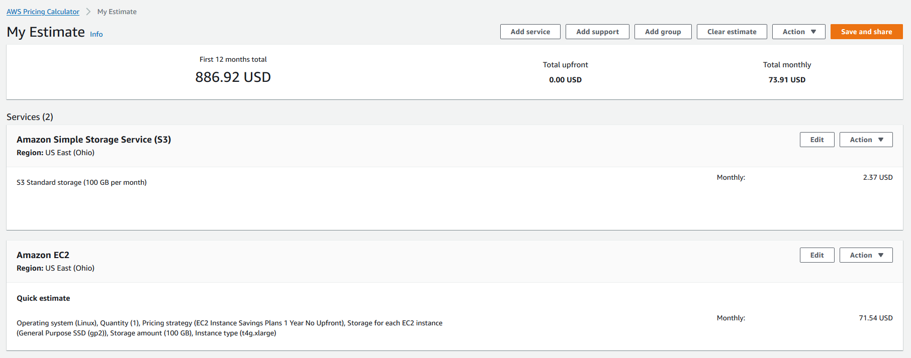

First 12 months total (Загалом за перші 12 місяців)

Total upfront (Загалом авансом)

Total monthly (Загалом щомісяця)

> **Нотатки:**
>
> Оцінки AWS Pricing Calculator поділяються на:  
> Загальна сума за перші 12 місяців (The total for your first 12 months) — загальна оцінка для вашої поточної групи та всіх сервісів і груп у вашій поточній групі. Вона поєднує авансові та щомісячні оцінки.  
> Загалом авансом (Your total upfront) — скільки, за оцінкою, ви заплатите наперед під час налаштування вашого стеку AWS.  
> Загалом щомісяця (Your total monthly) — скільки, за оцінкою, ви витрачатимете щомісяця, поки працює ваш стек AWS.  
>
> У межах групи ви можете побачити, скільки, за оцінкою, коштує кожен сервіс. Якщо ви хочете розрахувати вартість різних способів побудови вашої конфігурації AWS, можна використати різні групи для кожного варіанта вашої конфігурації та порівняти оцінки для різних конфігурацій.  
>
> Докладніше див. «Як читати оцінку» (Reading an estimate) за адресою https://docs.aws.amazon.com/pricing-calculator/latest/userguide/what-is-pricing-calculator.html.  
>
> Для доступності: приклад оцінки AWS Pricing Calculator. Загальна сума за перші 12 місяців становить 886,92 долара, загальна сума авансом — 0 доларів, а загальна щомісячна сума — 73,91 долара. Кінець опису для доступності.

---

## Слайд 22: Практична вправа: AWS Pricing Calculator

- Розбийтеся на групи по чотири-п’ять осіб і використайте [AWS Pricing Calculator](https://calculator.aws/#/) та надані специфікації, щоб скласти оцінку витрат.
- Будьте готові доповісти про свої висновки класу.

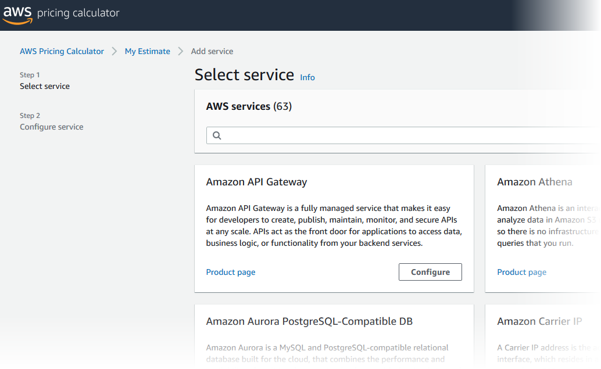

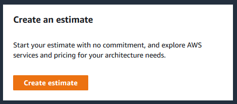

[Вебсайт AWS Pricing Calculator](https://calculator.aws/#/)

> **Нотатки:**
>
> Розбийтеся на групи по чотири-п’ять осіб і використайте AWS Pricing Calculator та надані специфікації, щоб скласти оцінку витрат.  
>
> Будьте готові доповісти про свої висновки класу.

---

## Слайд 23: Додаткові переваги

**Тверді переваги (Hard benefits)**

- Зменшення витрат на обчислення, сховище, мережі, безпеку
- Зменшення закупівель апаратного та програмного забезпечення (капітальні витрати, capex)
- Зменшення операційних витрат, резервного копіювання та аварійного відновлення
- Скорочення операційного персоналу

**М’які переваги (Soft Benefits)**

- Повторне використання сервісу та застосунків, що дає змогу визначати (та перевизначати) рішення за допомогою того самого хмарного сервісу
- Підвищена продуктивність розробників
- Покращена задоволеність клієнтів
- Гнучкі бізнес-процеси, що можуть швидко реагувати на нові та виникаючі можливості
- Збільшення глобального охоплення

> **Нотатки:**
>
> Тверді переваги включають зменшення витрат на обчислення, сховище, мережі та безпеку. Вони також включають зменшення закупівель апаратного та програмного забезпечення; зменшення операційних витрат, резервного копіювання та аварійного відновлення; і скорочення операційного персоналу.  
>
> Загальна вартість володіння хмарою визначає, що буде витрачено на технологію після впровадження, або скільки коштує експлуатація рішення. Зазвичай аналіз TCO розглядає наявну локальну інфраструктуру «як є» (as-is) і порівнює її з вартістю майбутнього стану інфраструктури (to-be) у хмарі. Хоча цю різницю може бути легко розрахувати, вона може надати лише вузьке уявлення про загальний фінансовий вплив переходу в хмару.  
>
> Аналіз рентабельності інвестицій (return on investment, ROI) можна використати, щоб визначити цінність, що створюється, з урахуванням витрат і заощаджень. Цей аналіз починається з визначення твердих переваг у вигляді прямого й помітного зниження витрат та покращення ефективності.  
>
> Далі визначаються м’які заощадження. М’які заощадження — це точки цінності, які складно точно виміряти кількісно, але вони можуть бути ціннішими за тверді заощадження. Важливо розуміти і тверді, і м’які переваги, щоб зрозуміти повну цінність хмари. М’які переваги включають:  
> Повторне використання сервісу та застосунків, що дає змогу визначати (та перевизначати) рішення за допомогою того самого хмарного сервісу  
> Підвищену продуктивність розробників  
> Покращену задоволеність клієнтів  
> Гнучкі бізнес-процеси, що можуть швидко реагувати на нові та виникаючі можливості  
> Збільшене глобальне охоплення  
>
> Тепер ви розглянете практичний приклад (case study) від Delaware North, щоб побачити фактичний приклад TCO.

---

## Слайд 24: Практичний приклад: загальна вартість володіння (1 із 6)

**Передумови (Background):**

- Зростаюча глобальна компанія з понад 200 локаціями
- 500 мільйонів клієнтів, річний дохід 3 мільярди доларів

> **Нотатки:**
>
> Передумови:  
> Delaware North започаткована в 1915 році як продавець арахісу та попкорну; сьогодні це велика компанія у сфері харчування та гостинності. Хоча компанія свідомо тримається в тіні, вона є лідером у галузі громадського харчування та гостинності.  
>
> Delaware North щороку обслуговує понад 500 мільйонів клієнтів у понад 200 локаціях по всьому світу, зокрема на таких об’єктах, як Космічний центр Кеннеді у Флориді, лондонський аеропорт Гітроу, Kings Canyon Resort в Австралії та стадіон Lambeau Field команди Green Bay Packers у Вісконсині. Ця глобальна присутність перетворила Delaware North на підприємство з доходом 3 мільярди доларів.

---

## Слайд 25: Практичний приклад: загальна вартість володіння (2 із 6)

**Передумови (Background):**

- Зростаюча глобальна компанія з понад 200 локаціями
- 500 мільйонів клієнтів, річний дохід 3 мільярди доларів

**Виклик (Challenge):**

- Задовольнити потребу швидко розгортати нові рішення
- Постійно оновлювати застаріле обладнання

> **Нотатки:**
>
> Локальний центр обробки даних компанії ставав надто дорогим і неефективним для підтримки її глобальних бізнес-операцій.  
>
> Кевін Квінлівен (Kevin Quinlivan), головний інформаційний директор (CIO) Delaware North, сказав: «У міру того як компанія продовжувала зростати, зростала й потреба швидко розгортати нові рішення для задоволення вимог клієнтів. Цей факт у поєднанні з потребою постійно оновлювати застаріле обладнання вимагав від нас ще більшої віддачі ресурсів. Нам потрібно було знайти кращу стратегію».  
>
> Delaware North звернулася до AWS за рішенням.

---

## Слайд 26: Практичний приклад: загальна вартість володіння (3 із 6)

**Передумови (Background):**

- Зростаюча глобальна компанія з понад 200 локаціями
- 500 мільйонів клієнтів, річний дохід 3 мільярди доларів

**Виклик (Challenge):**

- Задовольнити потребу швидко розгортати нові рішення
- Постійно оновлювати застаріле обладнання

**Критерії (Criteria):**

- Комплексне рішення для обробки всіх робочих навантажень
- Можливість змінювати процеси для підвищення ефективності та зниження витрат
- Усунення зайвої роботи (як-от встановлення виправлень програмного забезпечення)
- Досягнення позитивної рентабельності інвестицій (ROI)

> **Нотатки:**
>
> Після успішної міграції приблизно 50 вебсайтів в AWS у 2013 році Delaware North оцінила вигоду від витрат і загальну вартість володіння під час переходу своєї ІТ-інфраструктури в AWS. Їхня увага була зосереджена на відповіді на вимоги бізнесу на рівні керівництва щодо вимірюваних вигод, які могли б переконати керівний комітет, що хмара AWS — правильний підхід.  
>
> Процес оцінювання був зосереджений навколо трьох критеріїв:  
> По-перше, хмарне рішення мало мати широкий набір технологій, що могли б обробляти всі корпоративні робочі навантаження Delaware North, водночас підтримуючи критично важливі функції.  
> З операційного погляду Delaware North хотіла отримати функції та гнучкість, щоб змінювати основні ІТ-процеси для підвищення ефективності та зниження витрат. Це включало усунення надлишкових чи трудомістких завдань, як-от встановлення виправлень програмного забезпечення або пропускання завдань тестування й розробки через застарілі системи, що раніше додавало місяці до розгортання нових сервісів.  
> Нарешті, фінансові вимоги мали продемонструвати рентабельність інвестицій із надійним обґрунтуванням співвідношення витрат і вигод для відмови від існуючого середовища центру обробки даних.

---

## Слайд 27: Практичний приклад: загальна вартість володіння (4 із 6)

**Передумови (Background):**

- Є зростаючою глобальною компанією з понад 200 локаціями
- Має 500 мільйонів клієнтів, річний дохід 3 мільярди доларів США

- Задовольнити потребу швидко розгортати нові рішення
- Постійно оновлювати застаріле обладнання

**Виклик (Challenge):**

**Критерії (Criteria):**

- Мати комплексне рішення для обробки всіх робочих навантажень
- Мати змогу змінювати процеси для підвищення ефективності та зниження витрат
- Усунути зайву роботу (як-от встановлення виправлень програмного забезпечення)
- Досягти позитивної рентабельності інвестицій (ROI)

**Рішення (Solution):**

- Перенесли свій локальний центр обробки даних в AWS
  - Усунули 205 серверів (90 відсотків)
  - Перенесли майже всі застосунки в AWS
- Використали 3-річні зарезервовані екземпляри Amazon EC2

> **Нотатки:**
>
> Порівняння витрат, виконане Delaware North, показало, що компанія могла б заощадити 3,5 мільйона доларів США на основі 5-річного темпу витрат (run rate), перенісши свій локальний центр обробки даних в AWS і використавши 3-річні зарезервовані екземпляри Amazon EC2 та поновлення зарезервованих екземплярів.  
>
> Квінлівен зазначив, що глибокий технологічний стек, доступний в AWS, був більш ніж достатнім для задоволення технічних і операційних вимог компанії. Структура цін пропозицій AWS — що включає оплату лише за те, що використовується, — забезпечила переваги загальної вартості володіння, які було представлено вищому керівництву.  
>
> Квінлівен заявив: «Ми порівняли витрати на збереження нашого локального центру обробки даних з переходом у хмару AWS, вимірюючи базові інфраструктурні статті, як-от вартість апаратного забезпечення та обслуговування». Він також каже: «За нашою оцінкою, перехід в AWS заощадить нам щонайменше 3,5 мільйона доларів за п’ять років завдяки скороченню серверного апаратного забезпечення більш ніж на 90 відсотків. Але економія коштів, імовірно, буде більшою завдяки додатковим перевагам, як-от збільшення обчислювальних потужностей, які ми можемо отримати за допомогою AWS. Це дає змогу нам безперервно додавати більше й більші робочі навантаження, ніж ми могли б із традиційною інфраструктурою центру обробки даних, і заощаджувати, платячи лише за те, що ми використовуємо».  
>
> Delaware North перенесла майже всі свої застосунки в AWS, зокрема корпоративне програмне забезпечення, як-от проміжне ПЗ Fiorano, рішення бізнес-аналітики Crystal Reports і QLIK, систему віртуальних робочих столів Citrix та Microsoft System Center Configuration Manager, що використовується для керування робочими станціями.  
>
> Найдраматичнішою фізичною зміною було усунення 205 серверів. Усе, що працювало на цьому апаратному забезпеченні, було перенесено в AWS. ІТ-відділ вирішив залишити близько 20 серверів локально в новій будівлі штаб-квартири для виконання завдань зв’язку та файлового друку.  
>
> «Ми схилилися до обережності, щоб гарантувати відсутність затримки в цих завданнях, але щойно ми досягнемо певного рівня комфорту, ми можемо перенести їх у хмару також», — сказав Скотт Мерсер (Scott Mercer), керівник команди сервісно-орієнтованої архітектури ІТ-відділу.

---

## Слайд 28: Практичний приклад: загальна вартість володіння (5 із 6)

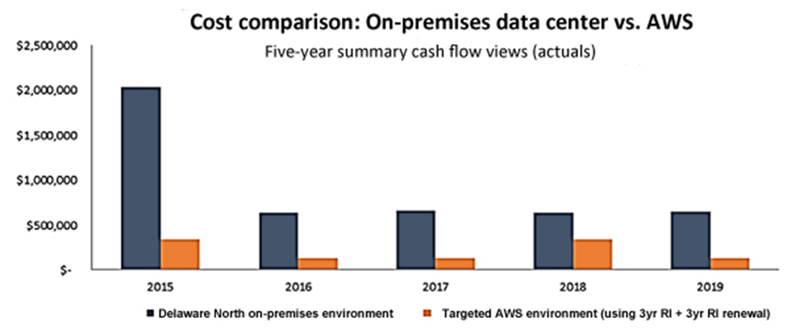

> **Нотатки:**
>
> Ця діаграма показує порівняння витрат, виконане Delaware North, із витратами їхнього локального середовища та запропонованого середовища AWS. Оцінки показали 3,5 мільйона доларів заощаджень на основі п’ятирічного темпу витрат (run rate) під час переходу з локального центру обробки даних в AWS.

---

## Слайд 29: Практичний приклад: загальна вартість володіння (6 із 6)

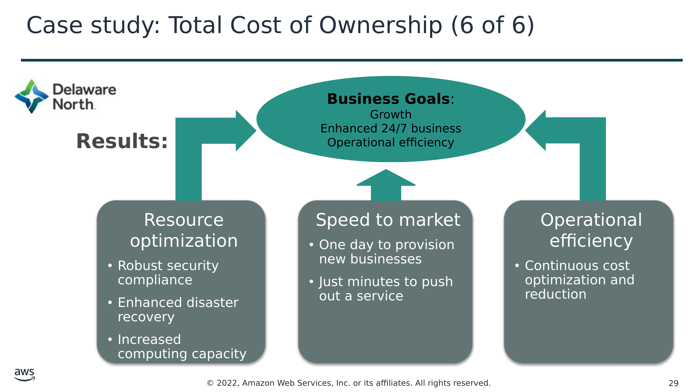

**Бізнес-цілі (Business Goals)**:  
Зростання (Growth)  
Покращений цілодобовий бізнес (Enhanced 24/7 business)  
Операційна ефективність (Operational efficiency)

**Результати (Results):**

Resource  
optimization (Оптимізація ресурсів)

- Надійна відповідність вимогам безпеки
- Покращене аварійне відновлення
- Збільшені обчислювальні потужності

Speed to market (Швидкість виходу на ринок)

- Один день для підготовки нових підрозділів бізнесу
- Лише хвилини для випуску сервісу

Operational efficiency (Операційна ефективність)

- Безперервна оптимізація та зниження витрат

> **Нотатки:**
>
> Приблизно через 6 місяців після початку міграції в хмару Delaware North відчула переваги на додачу до консолідації центрів обробки даних, зокрема економічно ефективну відповідність вимогам безпеки, покращене аварійне відновлення та швидше розгортання нових сервісів.  
>
> «Надійна безпека в роздрібному середовищі критично важлива для нас через наші численні роздрібні операції, і AWS надзвичайно допомагає в цьому», — сказав Браян Мерсер (Brian Mercer), старший архітектор програмного забезпечення проєкту. «Використовуючи найкращі практики безпеки AWS, ми змогли усунути багато завдань відповідності, що раніше забирали цінний час і гроші».  
>
> Браян Мерсер додав, що компанія також збільшила свої можливості аварійного відновлення за нижчою вартістю, ніж була доступна в її попередньому розгортанні центру обробки даних. «Це значно покращило наші можливості безперервності бізнесу, зокрема безшовне перемикання на резервні ресурси (failover)», — сказав він.  
>
> Рішення також допомагає Delaware North працювати з більшою швидкістю та гнучкістю. Наприклад, вона може залучати нові підрозділи бізнесу — через контракти чи придбання — і запускати їх онлайн швидше, ніж раніше, усуваючи потребу в традиційній ІТ-закупівлі та розгортанні. Раніше на підготовку нових бізнес-підрозділів йшло від 2 до 3 тижнів; тепер — 1 день. ІТ-команда Delaware North також використовує AWS для перегляду своїх операцій, усуваючи застарілі й громіздкі процеси, наводячи лад у документації та користуючись перевагами виконання завдань тестування й розробки в поєднанні зі швидким розгортанням сервісів через хмару.  
>
> «Наша команда DevOps тепер може розгорнути ресурси для випуску сервісу лише за кілька хвилин порівняно з тижнями, які це забирало раніше», — сказав Браян Мерсер. «З AWS ми можемо набагато швидше реагувати на потреби бізнесу. І ми можемо почати перепрофілювати час і ресурси, щоб надавати більше цінності й сервісів нашим внутрішнім командам і нашим клієнтам».

---

## Слайд 30: Розділ 3: AWS Organizations

Модуль 2: Економіка хмари та виставлення рахунків

> **Нотатки:**
>
> Представляємо Розділ 3: AWS Organizations.

---

## Слайд 31: Вступ до AWS Organizations

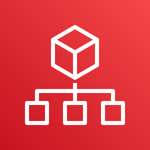

AWS Organizations

> **Нотатки:**
>
> AWS Organizations — це безкоштовний сервіс керування акаунтами, що дає змогу об’єднувати кілька акаунтів AWS в організацію, яку ви створюєте й централізовано керуєте. AWS Organizations включає можливості консолідованого виставлення рахунків і керування акаунтами, що допомагають краще задовольняти бюджетні потреби, потреби безпеки та відповідності вимогам вашого бізнесу.  
>
> Основні переваги AWS Organizations:  
> Централізоване керування політиками доступу для кількох акаунтів AWS.  
> Контрольований доступ до сервісів AWS.  
> Автоматизоване створення та керування акаунтами AWS.  
> Консолідоване виставлення рахунків для кількох акаунтів AWS.

---

## Слайд 32: Термінологія AWS Organizations

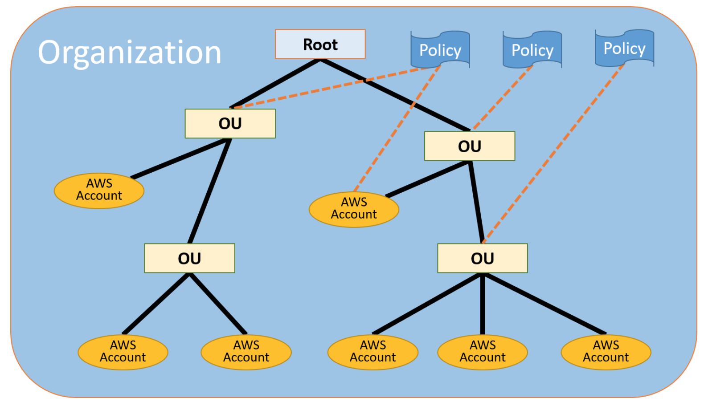

*Організаційні одиниці (Organizational Units, OU)

> **Нотатки:**
>
> Ось деяка термінологія для розуміння структури AWS Organizations.  
>
> Схема показує базову організацію, або корінь (root), що складається із семи акаунтів, упорядкованих у чотири організаційні одиниці (organizational units, OU). OU — це контейнер для акаунтів у корені. OU також може містити інші OU. Ця структура дає змогу створити ієрархію, що виглядає як перевернуте дерево з коренем угорі. Гілки складаються з дочірніх OU і рухаються вниз, поки не закінчуються акаунтами, які подібні до листя дерева.  
>
> Коли ви прикріплюєте політику до одного з вузлів ієрархії, вона поширюється вниз і впливає на всі гілки та листя. Цей приклад організації має кілька політик, прикріплених до деяких OU або прикріплених безпосередньо до акаунтів.  
>
> OU може мати лише одного батьківського елемента, і наразі кожен акаунт може бути членом рівно однієї OU. Акаунт — це стандартний акаунт AWS, що містить ваші ресурси AWS. Ви можете прикріпити політику до акаунта, щоб застосувати засоби контролю лише до цього одного акаунта.

---

## Слайд 33: Ключові функції та переваги

Керування акаунтами на основі політик

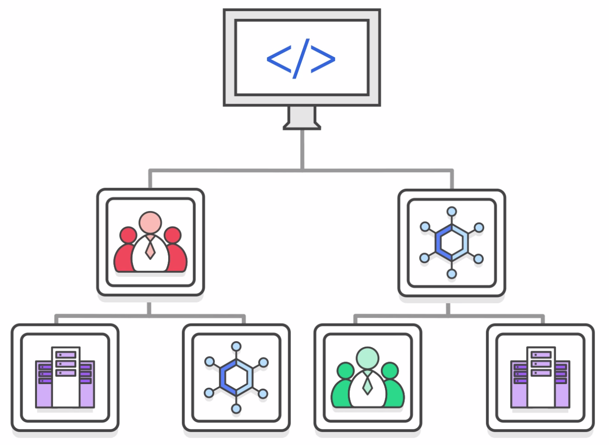

Керування акаунтами на основі груп

Прикладні програмні інтерфейси (API), що автоматизують керування акаунтами

AWS  
Organizations

Консолідоване виставлення рахунків

> **Нотатки:**
>
> AWS Organizations дає змогу:  
> Створювати політики контролю служб (service control policies, SCP), що централізовано контролюють сервіси AWS у кількох акаунтах AWS.  
> Створювати групи акаунтів, а потім прикріплювати політики до групи, щоб гарантувати застосування правильних політик у всіх акаунтах.  
> Спрощувати керування акаунтами, використовуючи прикладні програмні інтерфейси (API) для автоматизації створення та керування новими акаунтами AWS.  
> Спрощувати процес виставлення рахунків, налаштувавши єдиний спосіб оплати для всіх акаунтів AWS у вашій організації. З консолідованим виставленням рахунків ви можете бачити зведений вигляд нарахувань, що виникають у всіх ваших акаунтах, і можете скористатися перевагами ціноутворення від сукупного використання. Консолідоване виставлення рахунків надає центральне місце для керування виставленням рахунків у всіх ваших акаунтах AWS та можливість користуватися знижками за обсяг.

---

## Слайд 34: Безпека з AWS Organizations

Політики контролю служб (SCP) дають змогу дозволяти або забороняти доступ до сервісів AWS для окремих акаунтів чи груп акаунтів в організаційній одиниці (OU).

Контролюйте доступ за допомогою  
AWS Identity and  
Access Management  
(IAM).

Політики IAM дають змогу дозволяти або забороняти доступ до сервісів AWS для користувачів, груп і ролей.

> **Нотатки:**
>
> AWS Organizations не замінює прив’язування політик AWS Identity and Access Management (IAM) до користувачів, груп і ролей у межах акаунта AWS.  
>
> З політиками IAM ви можете дозволяти або забороняти доступ до сервісів AWS (як-от Amazon S3), окремих ресурсів AWS (як-от конкретний бакет S3) або окремих дій API (як-от s3:CreateBucket). Політику IAM можна застосувати лише до користувачів, груп чи ролей IAM, і вона ніколи не може обмежити кореневий акаунт AWS (root user).  
>
> Натомість з Organizations ви використовуєте політики контролю служб (SCP), щоб дозволяти або забороняти доступ до певних сервісів AWS для окремих акаунтів AWS чи груп акаунтів в OU. Указані дії з прикріпленої SCP впливають на всіх користувачів, групи та ролі IAM для акаунта, включно з кореневим акаунтом AWS.

---

## Слайд 35: Налаштування Organizations

Step 1 (Крок 1)

Step 2 (Крок 2)

Step 3 (Крок 3)

Step 4 (Крок 4)

Create  
Organization (Створіть організацію)

Create  
organizational

units (Створіть організаційні одиниці)

Create

service

control

policies (Створіть політики контролю служб)

Test

restrictions (Протестуйте обмеження)

> **Нотатки:**
>
> Пам’ятайте, що цей процес передбачає, що у вас є доступ до двох наявних акаунтів AWS і ви можете входити в кожен акаунт як адміністратор.  
>
> Перегляньте ці кроки з налаштування AWS Organizations:  
> Крок 1 — створити вашу організацію з вашим поточним акаунтом AWS як основним акаунтом. Також ви запрошуєте один акаунт AWS приєднатися до вашої організації та створюєте ще один акаунт як акаунт-член (member account).  
> Крок 2 — створити дві організаційні одиниці у вашій новій організації та помістити акаунти-члени в ці OU.  
> Крок 3 — створити політики контролю служб, що дають змогу застосовувати обмеження до того, які дії можна делегувати користувачам і ролям в акаунтах-членах. Політика контролю служб — це тип політики контролю організації.  
> Крок 4 — протестувати політики вашої організації. Увійдіть як користувач для кожної з ролей (як-от OU1 чи OU2) і подивіться, як політики контролю служб впливають на доступ до акаунта. Як варіант, можна використовувати IAM policy simulator для тестування та усунення проблем із політиками IAM і політиками на основі ресурсів, прикріпленими до користувачів, груп чи ролей IAM у вашому акаунті AWS.  
>
> Щоб дізнатися більше про IAM policy simulator, див. IAM policy simulator за адресою https://docs.aws.amazon.com/IAM/latest/UserGuide/access_policies_testing-policies.html.

---

## Слайд 36: Обмеження AWS Organizations

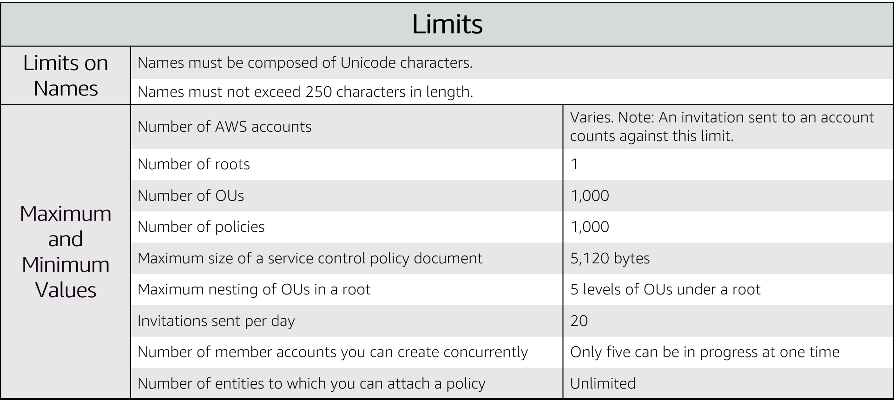

> **Нотатки:**
>
> Існують обмеження щодо імен, які можна створювати в AWS Organizations, зокрема імен акаунтів, OU, коренів і політик.  
>
> Імена мають складатися із символів Unicode й не перевищувати 250 символів у довжину.  
>
> AWS Organizations має кілька максимальних і мінімальних значень для сутностей.  
>
> Для доступності: перелік обмежень AWS Organizations, зокрема імена, кількість акаунтів (варіюється), кількість коренів (1), кількість OU (1000), кількість політик (1000), максимальний розмір документа політики контролю (5120 байтів), максимальна вкладеність OU (5 рівнів OU під коренем), кількість запрошень на день (20), кількість акаунтів-членів, що створюються одночасно (5), та сутності, до яких можна прикріпити політику (необмежено). Кінець опису для доступності.

---

## Слайд 37: Доступ до AWS Organizations

AWS Management Console

Інструменти AWS Command Line Interface (AWS CLI)

Набори для розробки програмного забезпечення (SDK)

AWS  
Organizations

Прикладні програмні інтерфейси (API) HTTPS Query

> **Нотатки:**
>
> AWS Organizations можна обслуговувати через різні інтерфейси.  
>
> AWS Management Console — це інтерфейс у браузері, який можна використовувати для керування вашою організацією та ресурсами AWS. У консолі можна виконати будь-яке завдання у вашій організації.  
>
> Інструменти AWS Command Line Interface (AWS CLI) дають змогу вводити команди в командному рядку вашої системи для виконання завдань AWS Organizations і завдань AWS. Цей метод може бути швидшим і зручнішим за використання консолі.  
>
> Також можна використовувати набори для розробки програмного забезпечення AWS (SDK) для виконання таких завдань, як криптографічний підпис запитів, обробка помилок і автоматичні повторні спроби запитів. AWS SDK складаються з бібліотек і прикладів коду для різних мов програмування та платформ, як-от Java, Python, Ruby, .NET, iOS і Android.  
>
> HTTPS Query API AWS Organizations надає програмний доступ до AWS Organizations і AWS. API можна використовувати для надсилання запитів HTTPS безпосередньо до сервісу. Коли ви використовуєте HTTPS API, потрібно включити код для цифрового підпису запитів за допомогою ваших облікових даних.

---

## Слайд 38: Розділ 4: AWS Billing and Cost Management

Модуль 2: Економіка хмари та виставлення рахунків

> **Нотатки:**
>
> Представляємо Розділ 4: AWS Billing and Cost Management.

---

## Слайд 39: Вступ до AWS Billing and Cost Management

> **Нотатки:**
>
> AWS Billing and Cost Management — це сервіс, що ви використовуєте для оплати рахунку AWS, відстеження використання та бюджетування витрат. Billing and Cost Management дає змогу прогнозувати та краще уявляти, якими можуть бути ваші витрати й використання в майбутньому, щоб ви могли планувати наперед.  
>
> Ви можете встановити довільний період часу та визначити, чи хочете переглядати дані на місячному чи денному рівні деталізації.  
>
> За допомогою функціональності фільтрації та групування ви можете далі аналізувати свої дані за різними доступними вимірами. Інструмент AWS Cost and Usage Report дає змогу виявляти можливості для оптимізації, розуміючи тренди ваших даних про витрати та використання й те, як ви використовуєте своє впровадження AWS.

---

## Слайд 40: AWS Billing Dashboard

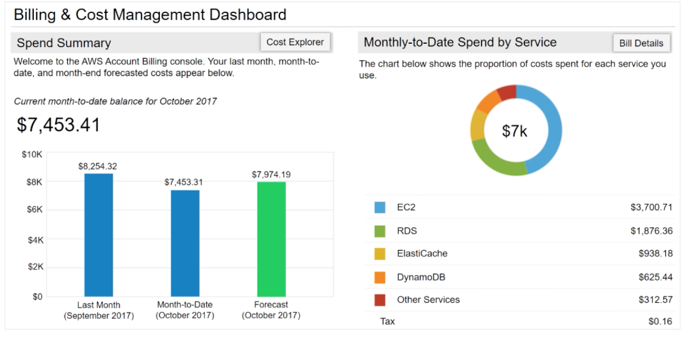

> **Нотатки:**
>
> AWS Billing Dashboard дає змогу переглядати стан ваших витрат на AWS з початку місяця (month-to-date), визначати сервіси, на які припадає більшість ваших загальних витрат, і розуміти на високому рівні, як змінюються витрати.  
>
> Один із графіків, що розташовані на панелі, — Spend Summary. Spend Summary показує, скільки ви витратили минулого місяця, орієнтовні витрати на ваше використання AWS з початку місяця та прогноз того, скільки ви, імовірно, витратите цього місяця.  
>
> Ще один графік — Month-to-Date Spend by Service, що показує сервіси, якими ви користуєтеся найбільше, і частку витрат, що припадає на цей сервіс.

---

## Слайд 41: Інструменти

AWS Budgets

AWS Cost and Usage Report

AWS Cost Explorer

> **Нотатки:**
>
> З панелі виставлення рахунків ви можете отримати доступ до кількох інших інструментів керування витратами, що їх можна використовувати для оцінки та планування ваших витрат на AWS. Ці інструменти включають AWS Bills, AWS Cost Explorer, AWS Budgets і AWS Cost and Usage Reports.

---

## Слайд 42: Щомісячні рахунки (monthly bills)

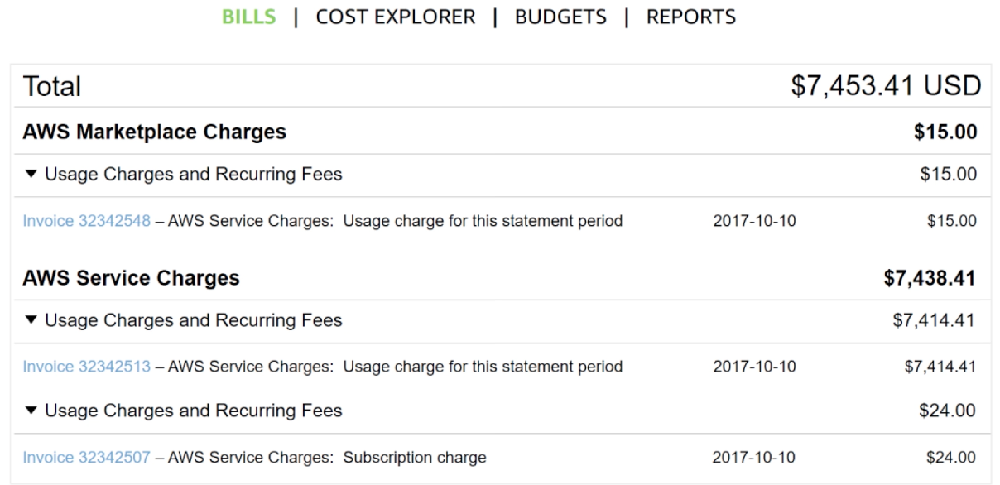

> **Нотатки:**
>
> Сторінка AWS Bills перелічує витрати, які ви понесли за минулий місяць за кожним сервісом AWS, із подальшою розбивкою за регіоном AWS і пов’язаним акаунтом.  
>
> Цей інструмент надає вам доступ до найактуальнішої інформації про ваші витрати й використання, зокрема вашого щомісячного рахунку та детальної розбивки сервісів AWS, які ви використовуєте.

---

## Слайд 43: Cost Explorer

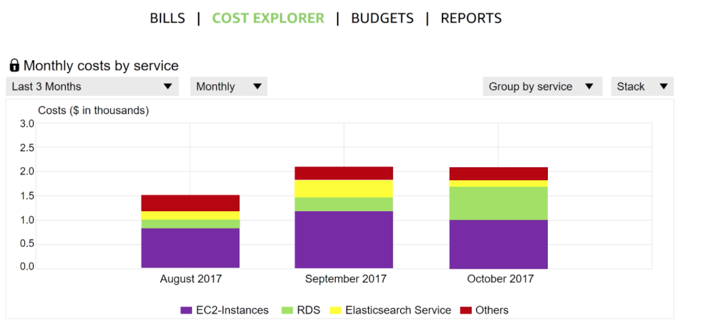

> **Нотатки:**
>
> Консоль AWS Billing and Cost Management включає сторінку Cost Explorer для перегляду даних про ваші витрати на AWS у вигляді графіка.  
>
> З Cost Explorer ви можете візуалізувати, розуміти й контролювати свої витрати та використання AWS у часі.  
>
> Cost Explorer включає типовий звіт, що візуалізує ваші витрати та використання для сервісів AWS із найбільшими витратами. Звіт про поточні щомісячні витрати дає вам огляд усіх ваших витрат за останні 3 місяці. Він також надає прогнозовані числа на наступний місяць із відповідним довірчим інтервалом.  
>
> Cost Explorer — це безкоштовний інструмент, що дає змогу:  
> Переглядати діаграми ваших витрат.  
> Переглядати дані про витрати за останні 13 місяців.  
> Прогнозувати, скільки ви, імовірно, витратите протягом наступних 3 місяців.  
> Виявляти закономірності у витратах на ресурси AWS у часі та визначати проблемні області витрат.  
> Визначати сервіси, якими ви користуєтеся найбільше  
> Переглядати метрики, як-от які зони доступності мають найбільше трафіку чи який пов’язаний акаунт AWS використовується найбільше.

---

## Слайд 44: Прогнозування та відстеження витрат (forecast and track costs)

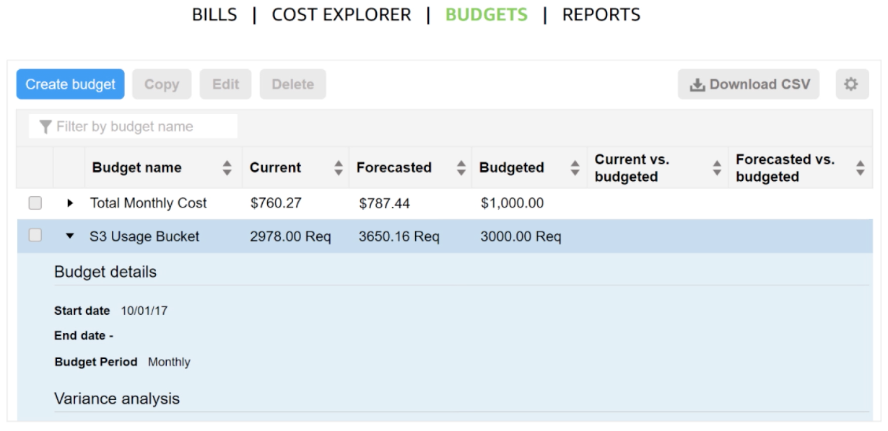

> **Нотатки:**
>
> AWS Budgets використовує візуалізацію витрат, що надається Cost Explorer, щоб показувати вам стан ваших бюджетів і надавати прогнози ваших орієнтовних витрат.  
>
> Також AWS Budgets можна використовувати для створення сповіщень, коли ви перевищуєте свій бюджет на місяць або коли ваші орієнтовні витрати перевищують ваш бюджет. Бюджети можна відстежувати на місячному, квартальному чи річному рівні, і ви можете налаштувати дати початку й завершення. Сповіщення про бюджет можна надсилати електронною поштою або через Amazon Simple Notification Service (Amazon SNS).  
>
> Для доступності: панель бюджетів AWS Billing, що показує назви бюджетів, поточні та майбутні витрати й використання та заголовки для поточних і прогнозованих значень порівняно з бюджетами. Кінець опису для доступності.

---

## Слайд 45: Звіти про витрати та використання (cost and usage reporting)

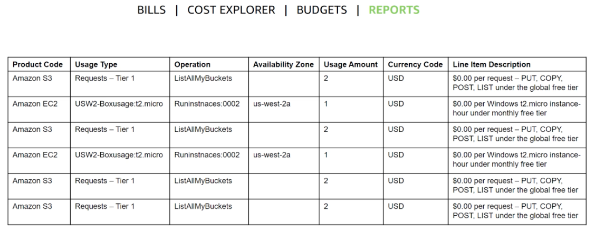

> **Нотатки:**
>
> AWS Cost and Usage Report — це єдине місце для доступу до комплексної інформації про ваші витрати та використання AWS. Цей інструмент перелічує використання для кожної категорії сервісів, що використовується акаунтом (та його користувачами), у почасових чи щоденних рядках статей і будь-який податок, який ви активували для цілей розподілу податків.  
>
> Ви можете вибрати, щоб AWS публікувала звіти про оплату в бакет S3. Ці звіти можуть оновлюватися раз на день.

---

## Слайд 46: Записана демонстрація: панель Amazon Billing

Демонстрація панелі Amazon Billing

> **Нотатки:**
>
> Покажіть демонстрацію панелі Billing за адресою https://aws-tc-largeobjects.s3-us-west-2.amazonaws.com/ILT-TF-100-ACFNDS-20-EN/Module_2_Billing+Dashboard+v1.0.mp4.

---

## Слайд 47: Демонстрація панелі виставлення рахунків (billing dashboard)

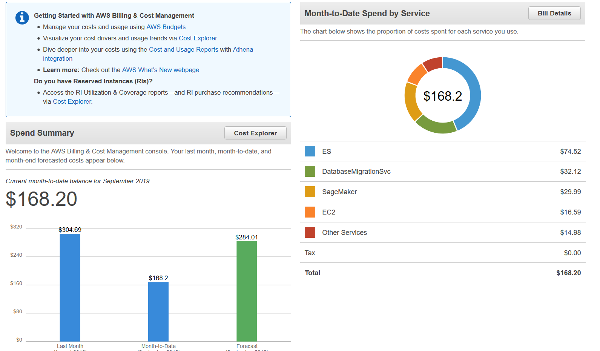

> **Нотатки:**
>
> Покажіть демонстрацію панелі Amazon Billing.

---

## Слайд 48: Розділ 5: Технічна підтримка

Модуль 2: Економіка хмари та виставлення рахунків

> **Нотатки:**
>
> Представляємо Розділ 5: Технічна підтримка.

---

## Слайд 49: Підтримка AWS (1 із 2)

- Надає унікальне поєднання інструментів і експертизи:
  - AWS Support
  - Плани підтримки AWS (AWS Support Plans)
- Підтримка надається для:
  - Експериментів з AWS
  - Продуктивного використання AWS
  - Критично важливого для бізнесу використання AWS

> **Нотатки:**
>
> Незалежно від того, чи ви лише починаєте, чи вже продовжуєте впроваджувати сервіси й застосунки AWS як свої бізнес-рішення, AWS хоче допомогти вам робити дивовижні речі з AWS. AWS Support може надати вам унікальне поєднання інструментів і експертизи на основі ваших поточних чи майбутніх запланованих сценаріїв використання.  
>
> AWS Support розроблено, щоб надавати повну підтримку та потрібні ресурси, що сприяють вашому успіху. Ми хочемо підтримувати всіх наших клієнтів, зокрема тих, що можуть експериментувати з AWS, тих, хто шукає продуктивного використання AWS, а також клієнтів, що використовують AWS як критично важливий для бізнесу ресурс. AWS Support може змінювати тип підтримки залежно від потреб і цілей клієнта.

---

## Слайд 50: Підтримка AWS (2 із 2)

- Проактивні рекомендації:
  - Технічний менеджер акаунта (Technical Account Manager, TAM)
- Найкращі практики:
  - AWS Trusted Advisor
- Допомога з акаунтом:
  - AWS Support Concierge

> **Нотатки:**
>
> З AWS клієнти можуть планувати, розгортати й оптимізувати з упевненістю.  
>
> Якщо ви хочете проактивних рекомендацій, AWS Support має технічних менеджерів акаунтів (TAM), які призначаються основною контактною особою користувача. TAM може надавати рекомендації, архітектурний огляд і постійну безперервну комунікацію, щоб тримати вас в курсі та підготовленими, поки ви плануєте, розгортаєте й оптимізуєте свої рішення.  
>
> Якщо ви хочете переконатися, що дотримуєтеся найкращих практик для підвищення продуктивності та відмовостійкості в середовищі AWS, AWS Support має AWS Trusted Advisor. AWS Trusted Advisor подібний до персоналізованого хмарного експерта. Це онлайн-ресурс, що перевіряє можливості зменшення щомісячних витрат і підвищення продуктивності.  
>
> Для допомоги з акаунтом Support Concierge — це експерт із виставлення рахунків і акаунтів, який надасть швидкий і ефективний аналіз питань виставлення рахунків і акаунтів. Concierge відповідає на всі нетехнічні запити щодо виставлення рахунків і рівня акаунта.

---

## Слайд 51: Плани підтримки (support plans)

AWS Support пропонує чотири плани підтримки:

- **Basic Support (базова підтримка)** – доступ до Resource Center, Service Health Dashboard, поширені запитання про продукти, форуми обговорень і підтримка перевірок стану
- **Developer Support (підтримка для розробників)**: підтримка раннього етапу розробки в AWS
- **Business Support (бізнес-підтримка)**: клієнти, що запускають продуктивні робочі навантаження
- **Enterprise Support (корпоративна підтримка)**: клієнти, що запускають бізнес-критичні та критично важливі робочі навантаження

> **Нотатки:**
>
> AWS хоче, щоб ви могли планувати, розгортати й оптимізувати з упевненістю. Ми розробили спеціальні плани, щоб підтримувати вас, зокрема плани підтримки Basic, Developer, Business і Enterprise.  
>
> План Basic Support пропонує:  
> Цілодобовий доступ до служби підтримки клієнтів, документації, технічних документів (whitepapers) і форумів підтримки.  
> Доступ до шести основних перевірок Trusted Advisor.  
> Доступ до Personal Health Dashboard.  
>
> План Developer Support пропонує ресурси для клієнтів, що тестують або виконують ранню розробку в AWS, і будь-яких клієнтів, які:  
> Хочуть отримати доступ до рекомендацій і технічної підтримки.  
> Досліджують, як швидко запровадити AWS у роботу.  
> Використовують AWS для непродуктивних робочих навантажень чи застосунків.  
>
> План Business Support пропонує ресурси для клієнтів, що запускають продуктивні робочі навантаження в AWS, і будь-яких клієнтів, які:  
> Запускають один чи кілька застосунків у продуктивних середовищах.  
> Мають активовано кілька сервісів або інтенсивно використовують ключові сервіси.  
> Залежать від доступності, масштабованості та безпеки своїх бізнес-рішень.  
>
> План Enterprise Support пропонує ресурси для клієнтів, що запускають бізнес-критичні та критично важливі робочі навантаження в AWS, і будь-яких клієнтів, які хочуть:  
> Зосередитися на проактивному керуванні для підвищення ефективності та доступності.  
> Будувати й експлуатувати робочі навантаження, що відповідають найкращим практикам AWS.  
> Використовувати експертизу AWS для підтримки запусків і міграцій.  
> Використовувати технічного менеджера акаунта (TAM), який надає технічну експертизу щодо повного спектра сервісів AWS і отримує детальне розуміння вашого сценарію використання та технологічної архітектури. Технічний менеджер акаунта — основна контактна особа з питань постійної підтримки.

---

## Слайд 52: Серйозність звернень і часи відповіді (case severity and response times)

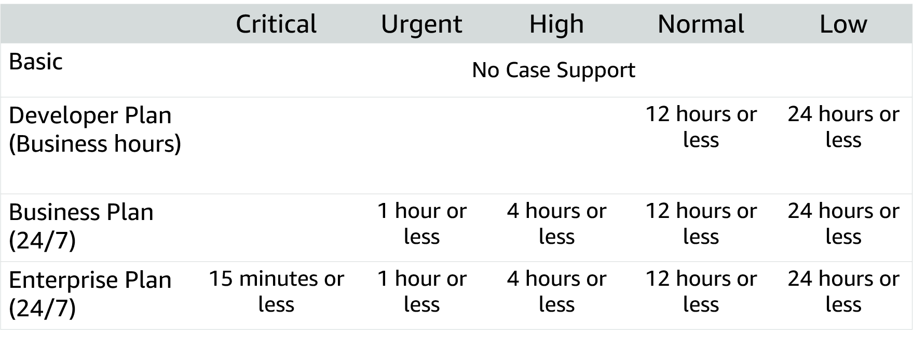

> **Нотатки:**
>
> Окрім розуміння витрат, пов’язаних з різними планами підтримки, критично важливо розуміти рівні обслуговування, пов’язані з кожним планом. Окрім обраного вами плану підтримки, серйозність звернення (case severity) визначатиме тип відповіді, яку ви отримуватимете. Існує п’ять різних рівнів серйозності:  
> Критичний (Critical) — ваш бізнес під загрозою. Критичні функції вашого застосунку недоступні.  
> Терміновий (Urgent) — ваш бізнес зазнає значного впливу. Важливі функції вашого застосунку недоступні.  
> Високий (High) — важливі функції вашого застосунку порушені або погіршені.  
> Звичайний (Normal) — некритичні функції вашого застосунку поводяться аномально, або у вас є термінове запитання щодо розробки.  
> Низький (Low) — у вас є загальне запитання щодо розробки або ви хочете запросити функцію.  
>
> Зверніть увагу, що план Basic Support не передбачає підтримки за зверненнями. Ці часи відповіді слід враховувати, коли ви визначаєте, який план підтримки найкраще підходить для вашої організації.  
>
> Щоб дізнатися більше про плани AWS Support, див. «Порівняння планів AWS Support» (Compare AWS Support Plans) за адресою https://aws.amazon.com/premiumsupport/plans/.  
>
> Для доступності: часи відповіді залежно від серйозності звернення для чотирьох різних рівнів підтримки (базовий, план для розробників, бізнес-план і корпоративний план, кожен із дедалі більшою підтримкою. Кінець опису для доступності.

---

## Слайд 53: Практична вправа: квест із планів підтримки (support plan scavenger hunt)

- Розбийтеся на групи по чотири-п’ять осіб і розробіть рекомендацію щодо найкращого плану підтримки для одного з наведених бізнес-випадків.
- Будьте готові доповісти про свої висновки класу.

> **Нотатки:**
>
> У цій вправі ваша група прочитає опис бізнесу та розробить рекомендацію щодо відповідного плану підтримки. Коли ви доповідатимете класу, опишіть план підтримки, який ви обрали, та критерії ухвалення рішення, які ви використали для розробки вашої рекомендації.

---

## Слайд 54: Підсумки модуля

Модуль 2: Економіка хмари та виставлення рахунків

> **Нотатки:**
>
> Настав час повторити матеріал модуля та завершити його перевіркою знань і розбором запитання практичного сертифікаційного іспиту.

---

## Слайд 55: Резюме модуля

- Дослідили основи ціноутворення AWS
- Переглянули концепції TCO
- Переглянули оцінку AWS Pricing Calculator
- Переглянули панель Billing
- Переглянули варіанти технічної підтримки та їхню вартість

> **Нотатки:**
>
> Підсумовуючи, ви:  
> Дослідили основи ціноутворення AWS  
> Переглянули концепції загальної вартості володіння  
> Переглянули оцінку AWS Pricing Calculator.  
>
> Загальна вартість володіння — це концепція, що допомагає зрозуміти й порівняти витрати, пов’язані з різними розгортаннями. AWS надає AWS Pricing Calculator, щоб допомогти з розрахунками, потрібними для оцінки економії коштів.  
>
> Використовуйте AWS Pricing Calculator, щоб:  
> Оцінювати щомісячні витрати  
> Визначати можливості зниження щомісячних витрат  
> Моделювати ваші рішення перед їх побудовою  
> Досліджувати цінові точки та розрахунки, що стоять за вашою оцінкою  
> Знаходити доступні типи екземплярів і контракти, що відповідають вашим потребам  
>
> AWS Billing and Cost Management надає вам інструменти, що допомагають отримувати доступ, розуміти, розподіляти, контролювати й оптимізувати ваші витрати та використання AWS. Ці інструменти включають AWS Bills, AWS Cost Explorer, AWS Budgets і AWS Cost and Usage Reports.  
>
> Ці інструменти надають вам доступ до найповнішої інформації про ваші витрати та використання AWS, зокрема про те, які сервіси AWS є основними чинниками витрат. Знання та розуміння вашого використання й витрат дасть вам змогу планувати наперед і покращувати ваше впровадження AWS.

---

## Слайд 56: Пройдіть перевірку знань

> **Нотатки:**
>
> Тепер пройдіть перевірку знань.

---

## Слайд 57: Приклад запитання іспиту

Який сервіс AWS надає рекомендації з оптимізації безпеки інфраструктури?

Варіант

Відповідь

A

AWS Price List Application Programming Interface (API)

B

Зарезервовані екземпляри (Reserved Instances)

C

AWS Trusted Advisor

D

Amazon Elastic Compute Cloud (Amazon EC2) Spot Fleet

> **Нотатки:**
>
> Розгляньте варіанти відповідей і відсійте їх за ключовими словами.

---

## Слайд 58: Відповідь на приклад запитання іспиту

Який сервіс AWS надає рекомендації з оптимізації безпеки інфраструктури?

Правильна відповідь — C.

Ключове слово в запитанні — «рекомендації».

> **Нотатки:**
>
> Ключові слова, які потрібно розпізнати: «рекомендації».  
>
> Правильна відповідь — C.

---

## Слайд 59: Додаткові ресурси

- Центр економіки AWS (AWS Economics Center): [http://aws.amazon.com/economics/](http://aws.amazon.com/economics/)
- AWS Pricing Calculator: [https://calculator.aws/#/](https://calculator.aws/#/)
- Практичні приклади та дослідження: [http://aws.amazon.com/economics/](http://aws.amazon.com/economics/)
- Додаткові вправи з ціноутворення: [https://dx1572sre29wk.cloudfront.net/cost/](https://dx1572sre29wk.cloudfront.net/cost/)

> **Нотатки:**
>
> Якщо ви хочете дізнатися більше про теми, розглянуті в цьому модулі, вам можуть бути корисними такі додаткові ресурси:  
> Центр економіки AWS: http://aws.amazon.com/economics/  
> AWS Pricing Calculator: https://calculator.aws/#/  
> Практичні приклади та дослідження: http://aws.amazon.com/economics/  
> Додаткові вправи з ціноутворення: https://dx1572sre29wk.cloudfront.net/cost/

---

## Слайд 60: Дякуємо

Усі торговельні марки є власністю їхніх власників.

> **Нотатки:**
>
> Дякуємо, що пройшли цей модуль.
