## Слайд 1: Module 3: AWS Global Infrastructure Overview

AWS Academy Cloud Foundations

> **Нотатки:**
>
> Welcome to Module 3: AWS Global Infrastructure Overview.

---

## Слайд 2: Module overview

**Topics**

- AWS Global Infrastructure
- AWS service and service category overview

**Demo**

- AWS Global Infrastructure

**Activities**

- AWS Management Console clickthrough

**Knowledge check**

> **Нотатки:**
>
> This module will address the following topics:  
> AWS Global Infrastructure  
> AWS service and service category overview  
>
> The module includes an educator-led demonstration that focuses on the details of the AWS Global Infrastructure. The module also includes a hands-on activity where you will explore the AWS Management Console.  
>
> Finally, you will be asked to complete a knowledge check that will test your understanding of the key concepts that are covered in this module.

---

## Слайд 3: Module objectives

After completing this module, you should be able to:

- Identify the difference between AWS Regions, Availability Zones, and edge locations
- Identify AWS service and service categories

> **Нотатки:**
>
> After completing this module, you should be able to:  
> Identify the difference between AWS Regions, Availability Zones, and edge locations  
> Identify AWS service and service categories

---

## Слайд 4: Section 1: AWS Global Infrastructure

Module 3: AWS Global Infrastructure Overview

> **Нотатки:**
>
> Introducing Section 1: AWS Global Infrastructure.

---

## Слайд 5: AWS Global Infrastructure

- The **AWS Global Infrastructure** is designed and built to deliver a **flexible**, **reliable**, **scalable**, and **secure** cloud computing environment with high-quality **global network performance**.
- AWS continually updates its global infrastructure footprint. Visit one of the following web pages for current infrastructure information:

- AWS Global Infrastructure Map: [https://aws.amazon.com/about-aws/global-infrastructure/#AWS_Global_Infrastructure_Map](https://aws.amazon.com/about-aws/global-infrastructure/#AWS_Global_Infrastructure_Map)  
Choose a circle on the map to view summary information about the Region represented by the circle.
- Regions and Availability Zones: [https://aws.amazon.com/about-aws/global-infrastructure/regions_az/](https://aws.amazon.com/about-aws/global-infrastructure/regions_az/)  
Choose a tab to view a map of the selected geography and a list of Regions, Edge locations, Local zones, and Regional Caches.

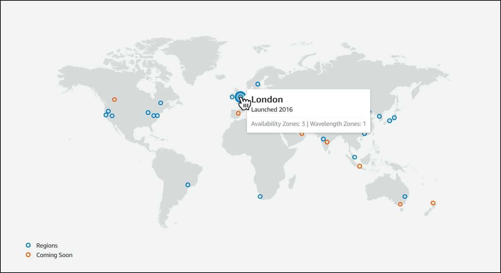

> **Нотатки:**
>
> To learn more about the AWS Regions that are currently available, use one of the following links:  
> https://aws.amazon.com/about-aws/global-infrastructure/#AWS_Global_Infrastructure_Map  
> https://aws.amazon.com/about-aws/global-infrastructure/regions_az/  
>
> These resources are updated frequently to show current and planned AWS infrastructure.

---

## Слайд 6: Educator-Led Demo: AWS Global Infrastructure Details

> **Нотатки:**
>
> The educator might now choose to conduct a live demonstration of the AWS Global Infrastructure map introduced on the previous slide. This resource provides an interactive way to learn about the AWS Global Infrastructure. The remaining slides in this section cover many of the same topics and go into greater detail on some topics.

---

## Слайд 7: AWS Regions

- An **AWS Region** is a geographical area.
  - Data replication across Regions is controlled by you.
  - Communication between Regions uses AWS backbone network infrastructure.
- Each Region provides full redundancy and connectivity to the network.
- A Region typically consists of two or more **Availability Zones**.

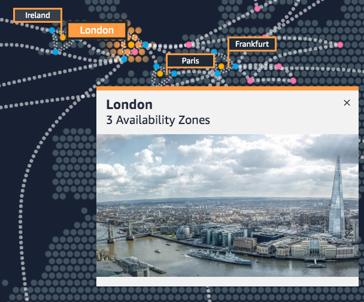

Example: London Region

> **Нотатки:**
>
> The AWS Cloud infrastructure is built around Regions. AWS has 22 Regions worldwide. An AWS Region is a physical geographical location with one or more Availability Zones. Availability Zones in turn consist of one or more data centers.  
>
> To achieve fault tolerance and stability, Regions are isolated from one another. Resources in one Region are not automatically replicated to other Regions. When you store data in a specific Region, it is not replicated outside that Region.  
>
> It is your responsibility to replicate data across Regions, if your business needs require it.  
>
> AWS Regions that were introduced before March 20, 2019 are enabled by default. Regions that were introduced after March 20, 2019—such as Asia Pacific (Hong Kong) and Middle East (Bahrain)—are disabled by default. You must enable these Regions before you can use them. You can use the AWS Management Console to enable or disable a Region.  
>
> Some Regions have restricted access. An Amazon AWS (China) account provides access to the Beijing and Ningxia Regions only. To learn more about AWS in China, see: https://www.amazonaws.cn/en/about-aws/china/. The isolated AWS GovCloud (US) Region is designed to allow US government agencies and customers to move sensitive workloads into the cloud by addressing their specific regulatory and compliance requirements.  
>
> For accessibility: Snapshot from the infrastructure.aws website that shows a picture of downtown London including the Tower Bridge and the Shard. It notes that there are three Availability Zones in the London region. End of accessibility description.

---

## Слайд 8: Selecting a Region

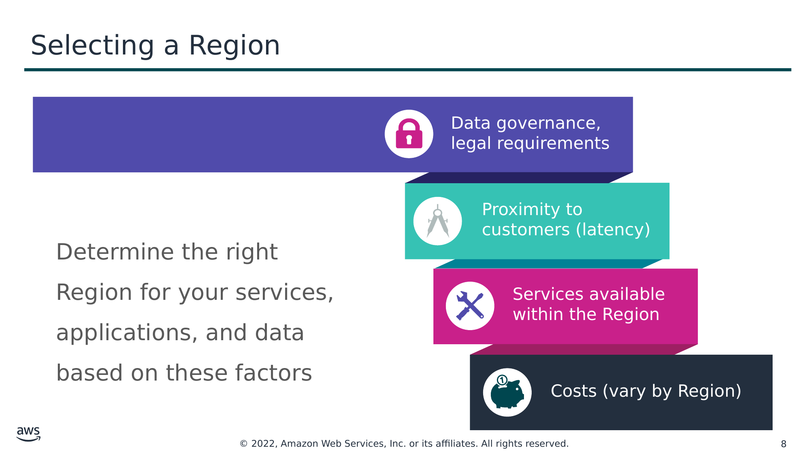

Data governance, legal requirements

Proximity to customers (latency)

Determine the right Region for your services, applications, and data based on these factors

Services available within the Region

Costs (vary by Region)

> **Нотатки:**
>
> There are a few factors that you should consider when you select the optimal Region or Regions where you store data and use AWS services.  
>
> One essential consideration is data governance and legal requirements. Local laws might require that certain information be kept within geographical boundaries. Such laws might restrict the Regions where you can offer content or services. For example, consider the European Union (EU) Data Protection Directive.  
>
> All else being equal, it is generally desirable to run your applications and store your data in a Region that is as close as possible to the user and systems that will access them. This will help you reduce latency. CloudPing is one website that you can use to test latency between your location and all AWS Regions. To learn more about CloudPing, see: http://www.cloudping.info/  
>
> Keep in mind that not all services are available in all Regions. To learn more, see: https://aws.amazon.com/about-aws/global-infrastructure/regional-product-services/?p=tgi&loc=4.  
>
> Finally, there is some variation in the cost of running services, which can depend on which Region you choose. For example, as of this writing, running an On-Demand t3.medium size Amazon Elastic Compute Cloud (Amazon EC2) Linux instance in the US East (Ohio) Region costs $0.0416 per hour, but running the same instance in the Asia Pacific (Tokyo) Region costs $0.0544 per hour.

---

## Слайд 9: Availability Zones

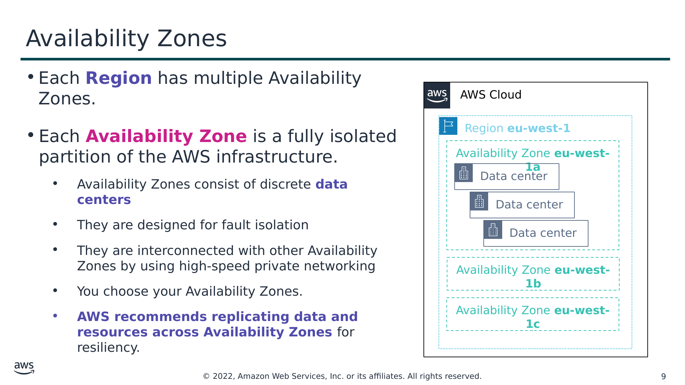

- Each **Region** has multiple Availability Zones.
- Each **Availability Zone** is a fully isolated partition of the AWS infrastructure.
  - Availability Zones consist of discrete **data centers**
  - They are designed for fault isolation
  - They are interconnected with other Availability Zones by using high-speed private networking
  - You choose your Availability Zones.
  - **AWS recommends replicating data and resources across Availability Zones** for resiliency.

Текст зі схеми

AWS Cloud

Region **eu-west-1**

Availability Zone **eu-west-1a**

Data center

Data center

Data center

Availability Zone **eu-west-1b**

Availability Zone **eu-west-1c**

> **Нотатки:**
>
> Each AWS Region has multiple, isolated locations that are known as Availability Zones.  
>
> Each Availability Zone provides the ability to operate applications and databases that are more highly available, fault-tolerant, and scalable than would be possible with a single data center. Each Availability Zone can include multiple data centers (typically three), and at full-scale, they can include hundreds of thousands of servers. They are fully isolated partitions of the AWS Global Infrastructure. Availability Zones have their own power infrastructure, and they are physically separated by many kilometers from other Availability Zones—though all Availability Zones are within 100 km of each other.  
>
> All Availability Zones are interconnected with high-bandwidth, low-latency networking over fully redundant, dedicated fiber that provides high-throughput between Availability Zones. The network accomplishes synchronous replication between Availability Zones.  
>
> Availability Zones help build highly available applications. When an application is partitioned across Availability Zones, companies are better isolated and protected from issues such as lightning, tornadoes, earthquakes, and more.  
>
> You are responsible for selecting the Availability Zones where your systems will reside. Systems can span multiple Availability Zones. AWS recommends replicating across Availability Zones for resiliency. You should design your systems to survive the temporary or prolonged failure of an Availability Zone if a disaster occurs.

---

## Слайд 10: AWS data centers

- AWS data centers are designed for security.
- Data centers are where the data resides and data processing occurs.
- Each data center has redundant power, networking, and connectivity, and is housed in a separate facility.
- A data center typically has 50,000 to 80,000 physical servers.

> **Нотатки:**
>
> The foundation for the AWS infrastructure is the data centers. Customers do not specify a data center for the deployment of resources. Instead, an Availability Zone is the most granular level of specification that a customer can make. However, a data center is the location where the actual data resides. Amazon operates state-of-the-art, highly available data centers. Although rare, failures can occur that affect the availability of instances in the same location. If you host all your instances in a single location that is affected by such a failure, none of your instances will be available.  
>
> Data centers are securely designed with several factors in mind:  
>
> Each location is carefully evaluated to mitigate environmental risk.  
> Data centers have a redundant design that anticipates and tolerates failure while maintaining service levels.  
> To ensure availability, critical system components are backed up across multiple Availability Zones.  
> To ensure capacity, AWS continuously monitors service usage to deploy infrastructure to support availability commitments and requirements.  
> Data center locations are not disclosed and all access to them is restricted.  
> In case of failure, automated processes move data traffic away from the affected area.  
>
> AWS uses custom network equipment sourced from multiple original device manufacturers (ODMs). ODMs design and manufacture products based on specifications from a second company. The second company then rebrands the products for sale.

---

## Слайд 11: Points of Presence

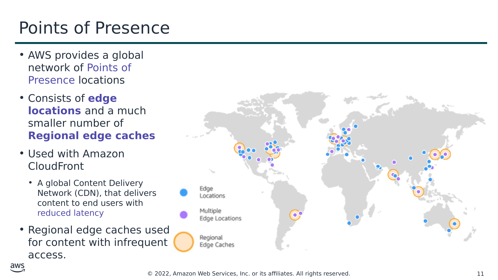

- AWS provides a global network of Points of Presence locations
- Consists of **edge locations** and a much smaller number of **Regional edge caches**
- Used with Amazon CloudFront
  - A global Content Delivery Network (CDN), that delivers content to end users with reduced latency
- Regional edge caches used for content with infrequent access.

> **Нотатки:**
>
> Amazon CloudFront is a content delivery network (CDN) used to distribute content to end users to reduce latency. Amazon Route 53 is a Domain Name System (DNS) service. Requests going to either one of these services will be routed to the nearest edge location automatically in order to lower latency.  
>
> AWS Points of Presence are located in most of the major cities around the world. By continuously measuring internet connectivity, performance and computing to find the best way to route requests, the Points of Presence deliver a better near real-time user experience. They are used by many AWS services, including Amazon CloudFront, Amazon Route 53, AWS Shield, and AWS Web Application Firewall (AWS WAF) services.  
>
> Regional edge caches are used by default with Amazon CloudFront. Regional edge caches are used when you have content that is not accessed frequently enough to remain in an edge location. Regional edge caches absorb this content and provide an alternative to that content having to be fetched from the origin server.

---

## Слайд 12: AWS infrastructure features

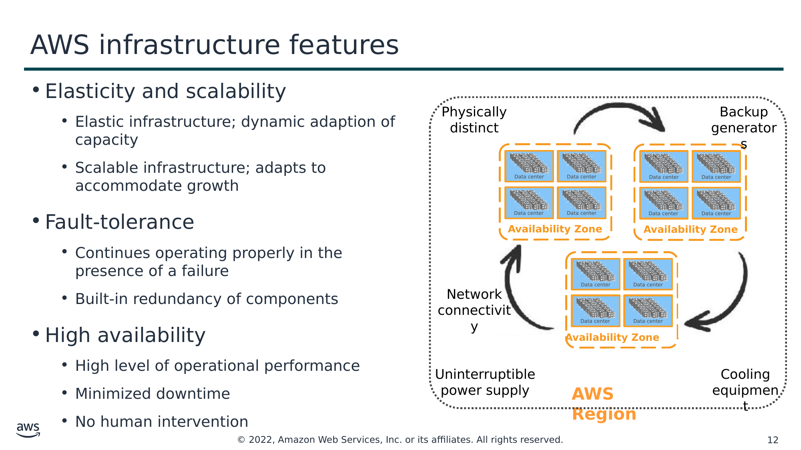

- Elasticity and scalability
    - Elastic infrastructure; dynamic adaption of capacity
    - Scalable infrastructure; adapts to accommodate growth
- Fault-tolerance
    - Continues operating properly in the presence of a failure
    - Built-in redundancy of components
- High availability
    - High level of operational performance
    - Minimized downtime
    - No human intervention

Текст зі схеми

Data center

Physically distinct

Data center

Data center

Data center

Backup generators

**Availability Zone**

Data center

Data center

Data center

Data center

Data center

Data center

Data center

Data center

**Availability Zone**

Network connectivity

**Availability Zone**

Uninterruptible power supply

Cooling equipment

**AWS Region**

> **Нотатки:**
>
> Now that you have a good understanding of the major components that comprise the AWS Global Infrastructure, let's consider the benefits provided by this infrastructure.  
>
> The AWS Global Infrastructure has several valuable features:  
> First, it is elastic and scalable. This means resources can dynamically adjust to increases or decreases in capacity requirements. It can also rapidly adjust to accommodate growth.  
> Second, this infrastructure is fault tolerant, which means it has built-in component redundancy which enables it to continue operations despite a failed component.  
> Finally, it requires minimal to no human intervention, while providing high availability with minimal down time.

---

## Слайд 13: Key takeaways

- The **AWS Global Infrastructure** consists of Regions and Availability Zones.
- Your choice of a **Region** is typically based on compliance requirements or to reduce latency.
- Each **Availability Zone** is physically separate from other Availability Zones and has redundant power, networking, and connectivity.
- **Edge locations**, and **Regional edge caches** improve performance by caching content closer to users.

> **Нотатки:**
>
> Some key takeaways from this section of the module include:  
> The AWS Global Infrastructure consists of Regions and Availability Zones.  
> Your choice of a Region is typically based on compliance requirements or to reduce latency.  
> Each Availability Zone is physically separate from other Availability Zones and has redundant power, networking, and connectivity.  
> Edge locations, and Regional edge caches improve performance by caching content closer to users.

---

## Слайд 14: Section 2: AWS services and service category overview

Module 3: AWS Global Infrastructure Overview

> **Нотатки:**
>
> Introducing Part 2: AWS Service and Service Category Overview.  
>
> AWS offers a broad set of global cloud-based products that can be used as building blocks for common cloud architectures. Here is a look at how these cloud based products are organized.

---

## Слайд 15: AWS foundational services

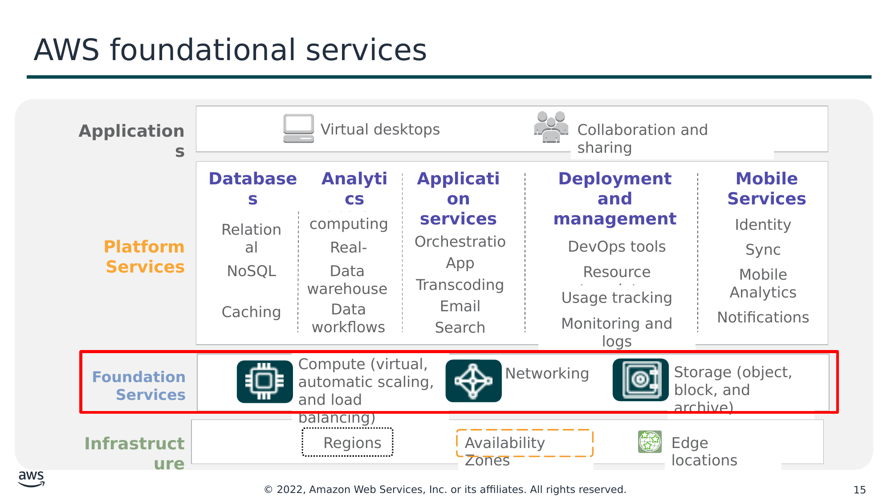

Текст зі схеми

Virtual desktops

Collaboration and sharing

**Applications**

Relational

Cluster computing

Queuing

Containers

Identity

Real-time

Orchestration

DevOps tools

Sync

NoSQL

Data warehouse

**Databases**

App Streaming

Transcoding

**Analytics**

Resource templates

**Application services**

Mobile Analytics

**Deployment and management**

**Mobile Services**

Caching

Data workflows

Email

Usage tracking

Notifications

Search

Monitoring and logs

**Platform**  
**Services**

Compute (virtual, automatic scaling, and load balancing)

Networking

Regions

Edge locations

Storage (object, block, and archive)

**Foundation**

**Services**

**Infrastructure**

Availability Zones

> **Нотатки:**
>
> As discussed previously, the AWS Global Infrastructure can be broken down into three elements: Regions, Availability Zones, and Points of Presence, which include edge locations. This infrastructure provides the platform for a broad set of services, such as networking, storage, compute services, and databases—and these services are delivered as an on-demand utility that is available in seconds, with pay-as-you-go pricing.  
>
> For accessibility: Marketing diagram showing infrastructure at the bottom, consisting of Regions, Availability Zones, and edge locations. The next level up is labeled Foundational Services and includes graphics for compute, networking, and storage. That level is highlighted. Next level up is platform services that includes databases, analytics, app services, deployment and management, and mobile services. Top layer is labeled applications and includes virtual desktops and collaboration and sharing. End of accessibility description.

---

## Слайд 16: AWS categories of services

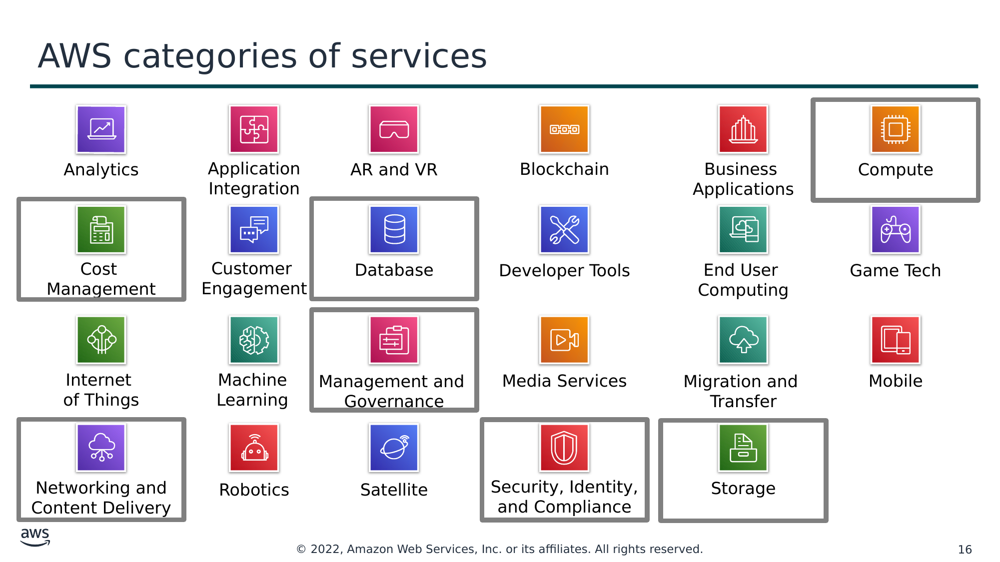

Текст зі схеми

Analytics

Application

Integration

AR and VR

Blockchain

Business  
Applications

Compute

Cost  
Management

Customer  
Engagement

Database

Developer Tools

End User

Computing

Game Tech

Internet  
of Things

Machine Learning

Management and  
Governance

Media Services

Migration and

Transfer

Mobile

Networking and

Content Delivery

Robotics

Satellite

Security, Identity, and Compliance

Storage

> **Нотатки:**
>
> AWS offers a broad set of cloud-based services. There are 23 different product or service categories, and each category consists of one or more services. This course will not attempt to introduce you to each service. Rather, the focus of this course is on the services that are most widely used and offer the best introduction to the AWS Cloud. This course also focuses on services that are more likely to be covered in the AWS Certified Cloud Practitioner exam.  
>
> The categories that this course will discuss are highlighted on the slide: Compute, Cost Management, Database, Management and Governance, Networking and Content Delivery, Security, Identity, and Compliance, and Storage.  
>
> To learn more about AWS products, see Cloud Products at https://aws.amazon.com/products/. All AWS products are organized into the service categories that are shown here. For example, if you click Compute, you will see that Amazon Elastic Compute Cloud (Amazon EC2) is first on the list. The compute category also lists many other products and services.  
>
> If you click Amazon EC2, it takes you to the Amazon EC2 page. Each product page provides a detailed description of the product and lists some of its benefits.  
>
> Explore the different service groups to understand the categories and services within them. Now that you know how to locate information about different services, this module will discuss the highlighted service categories. The next seven slides list the individual services —within each of the categories highlighted above—that this course will discuss.

---

## Слайд 17: Storage service category

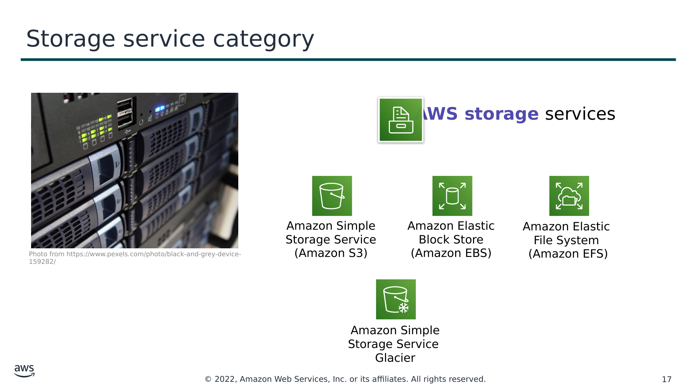

**AWS storage** services

Amazon Simple Storage Service (Amazon S3)

Amazon Elastic Block Store (Amazon EBS)

Amazon Elastic  
File System  
(Amazon EFS)

Photo from https://www.pexels.com/photo/black-and-grey-device-159282/

Amazon Simple Storage Service  
Glacier

> **Нотатки:**
>
> AWS storage services include the services listed here, and many others.  
>
> Amazon Simple Storage Service (Amazon S3) is an object storage service that offers scalability, data availability, security, and performance. Use it to store and protect any amount of data for websites, mobile apps, backup and restore, archive, enterprise applications, Internet of Things (IoT) devices, and big data analytics.  
>
> Amazon Elastic Block Store (Amazon EBS) is high-performance block storage that is designed for use with Amazon EC2 for both throughput and transaction intensive workloads. It is used for a broad range of workloads, such as relational and non-relational databases, enterprise applications, containerized applications, big data analytics engines, file systems, and media workflows.  
>
> Amazon Elastic File System (Amazon EFS) provides a scalable, fully managed elastic Network File System (NFS) file system for use with AWS Cloud services and on-premises resources. It is built to scale on demand to petabytes, growing and shrinking automatically as you add and remove files. It reduces the need to provision and manage capacity to accommodate growth.  
>
> Amazon Simple Storage Service Glacier is a secure, durable, and extremely low-cost Amazon S3 cloud storage class for data archiving and long-term backup. It is designed to deliver 11 9s of durability, and to provide comprehensive security and compliance capabilities to meet stringent regulatory requirements.

---

## Слайд 18: Compute service category

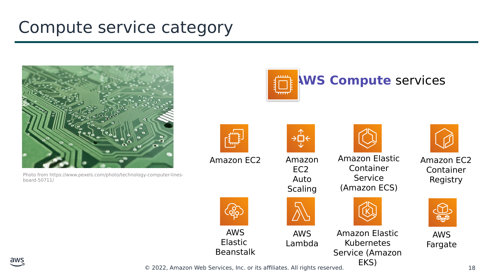

**AWS Compute** services

Amazon EC2

Amazon EC2  
Auto Scaling

Amazon Elastic Container Service (Amazon ECS)

Amazon EC2 Container Registry

Photo from https://www.pexels.com/photo/technology-computer-lines-board-50711/

AWS Elastic  
Beanstalk

AWS Lambda

Amazon Elastic Kubernetes Service (Amazon EKS)

AWS Fargate

> **Нотатки:**
>
> AWS compute services include the services listed here, and many others.  
>
> Amazon Elastic Compute Cloud (Amazon EC2) provides resizable compute capacity as virtual machines in the cloud.  
>
> Amazon EC2 Auto Scaling enables you to automatically add or remove EC2 instances according to conditions that you define.  
>
> Amazon Elastic Container Service (Amazon ECS) is a highly scalable, high-performance container orchestration service that supports Docker containers.  
>
> Amazon Elastic Container Registry (Amazon ECR) is a fully-managed Docker container registry that makes it easy for developers to store, manage, and deploy Docker container images.  
>
> AWS Elastic Beanstalk is a service for deploying and scaling web applications and services on familiar servers such as Apache and Microsoft Internet Information Services (IIS).  
>
> AWS Lambda enables you to run code without provisioning or managing servers. You pay only for the compute time that you consume. There is no charge when your code is not running.  
>
> Amazon Elastic Kubernetes Service (Amazon EKS) makes it easy to deploy, manage, and scale containerized applications that use Kubernetes on AWS.  
>
> AWS Fargate is a compute engine for Amazon ECS that allows you to run containers without having to manage servers or clusters.

---

## Слайд 19: Database service category

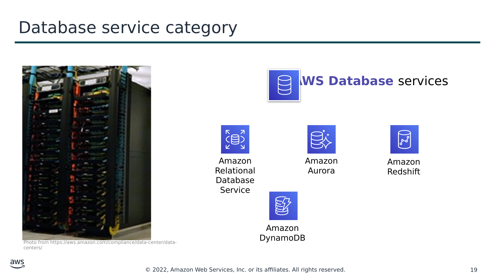

**AWS Database** services

Amazon Relational Database Service

Amazon Aurora

Amazon Redshift

Amazon DynamoDB

Photo from https://aws.amazon.com/compliance/data-center/data-centers/

> **Нотатки:**
>
> AWS database services include the services listed here, and many others.  
>
> Amazon Relational Database Service (Amazon RDS) makes it easy to set up, operate, and scale a relational database in the cloud. It provides resizable capacity while automating time-consuming administration tasks such as hardware provisioning, database setup, patching, and backups.  
>
> Amazon Aurora is a MySQL and PostgreSQL-compatible relational database. It is up to five times faster than standard MySQL databases and three times faster than standard PostgreSQL databases.  
>
> Amazon Redshift enables you to run analytic queries against petabytes of data that is stored locally in Amazon Redshift, and directly against exabytes of data that are stored in Amazon S3. It delivers fast performance at any scale.  
>
> Amazon DynamoDB is a key-value and document database that delivers single-digit millisecond performance at any scale, with built-in security, backup and restore, and in-memory caching.

---

## Слайд 20: Networking and content delivery service category

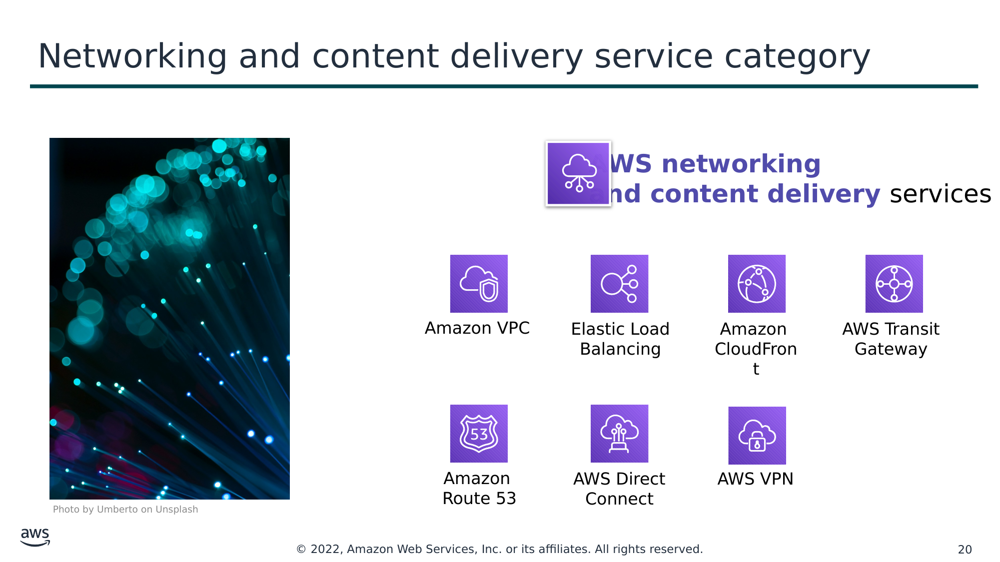

**AWS networking**  
**and content delivery** services

Amazon VPC

Elastic Load Balancing

Amazon  
CloudFront

AWS Transit

Gateway

Amazon  
Route 53

AWS Direct Connect

AWS VPN

Photo by Umberto on Unsplash

> **Нотатки:**
>
> AWS networking and content delivery services include the services listed here, and many others.  
>
> Amazon Virtual Private Cloud (Amazon VPC) enables you to provision logically isolated sections of the AWS Cloud.  
>
> Elastic Load Balancing automatically distributes incoming application traffic across multiple targets, such as Amazon EC2 instances, containers, IP addresses, and Lambda functions.  
>
> Amazon CloudFront is a fast content delivery network (CDN) service that securely delivers data, videos, applications, and application programming interfaces (APIs) to customers globally, with low latency and high transfer speeds.  
>
> AWS Transit Gateway is a service that enables customers to connect their Amazon Virtual Private Clouds (VPCs) and their on-premises networks to a single gateway.  
>
> Amazon Route 53 is a scalable cloud Domain Name System (DNS) web service designed to give you a reliable way to route end users to internet applications. It translates names (like www.example.com) into the numeric IP addresses (like 192.0.2.1) that computers use to connect to each other.  
>
> AWS Direct Connect provides a way to establish a dedicated private network connection from your data center or office to AWS, which can reduce network costs and increase bandwidth throughput.  
>
> AWS VPN provides a secure private tunnel from your network or device to the AWS global network.

---

## Слайд 21: Security, identity, and compliance service category

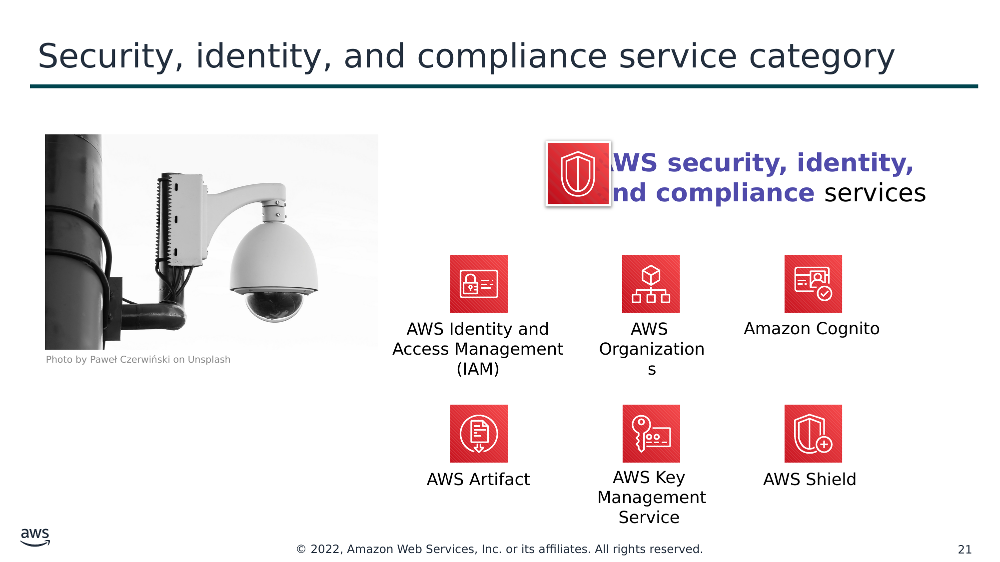

**AWS security, identity,**  
**and compliance** services

AWS Identity and Access Management (IAM)

AWS  
Organizations

Amazon Cognito

Photo by Paweł Czerwiński on Unsplash

AWS Artifact

AWS Key

Management Service

AWS Shield

> **Нотатки:**
>
> AWS security, identity, and compliance services include the services listed here, and many others.  
>
> AWS Identity and Access Management (IAM) enables you to manage access to AWS services and resources securely. By using IAM, you can create and manage AWS users and groups. You can use IAM permissions to allow and deny user and group access to AWS resources.  
>
> AWS Organizations allows you to restrict what services and actions are allowed in your accounts.  
>
> Amazon Cognito lets you add user sign-up, sign-in, and access control to your web and mobile apps.  
>
> AWS Artifact provides on-demand access to AWS security and compliance reports and select online agreements.  
>
> AWS Key Management Service (AWS KMS) enables you to create and manage keys. You can use AWS KMS to control the use of encryption across a wide range of AWS services and in your applications.  
>
> AWS Shield is a managed Distributed Denial of Service (DDoS) protection service that safeguards applications running on AWS.

---

## Слайд 22: AWS cost management service category

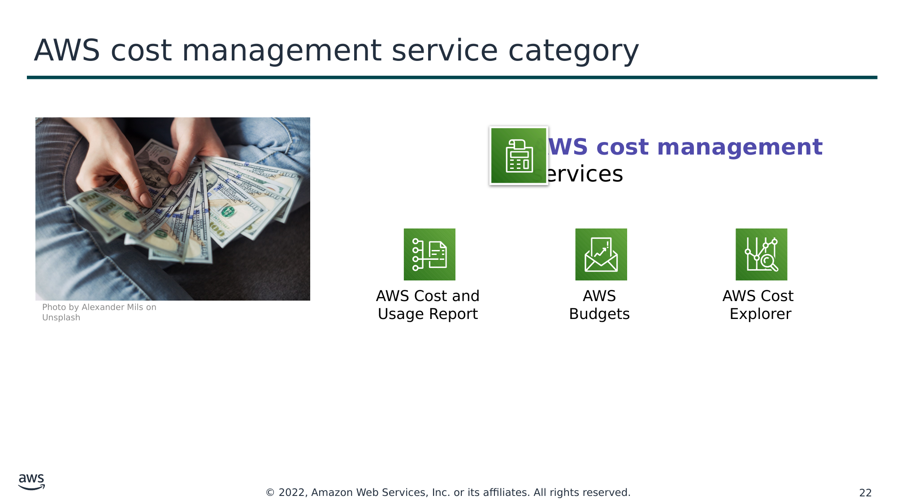

**AWS cost management**  
services

AWS Cost and

Usage Report

AWS Budgets

AWS Cost

Explorer

Photo by Alexander Mils on Unsplash

> **Нотатки:**
>
> AWS cost management services include the services listed here, and others.  
>
> The AWS Cost and Usage Report contains the most comprehensive set of AWS cost and usage data available, including additional metadata about AWS services, pricing, and reservations.  
>
> AWS Budgets enables you to set custom budgets that alert you when your costs or usage exceed (or are forecasted to exceed) your budgeted amount.  
>
> AWS Cost Explorer has an easy-to-use interface that enables you to visualize, understand, and manage your AWS costs and usage over time.

---

## Слайд 23: Management and governance service category

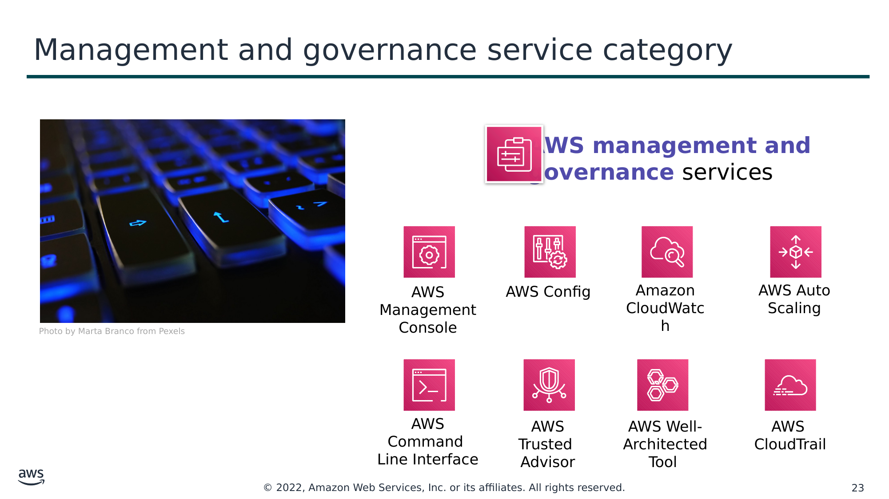

**AWS management and**

**governance** services

AWS Management Console

AWS Config

Amazon CloudWatch

AWS Auto Scaling

Photo by Marta Branco from Pexels

AWS Command

Line Interface

AWS Trusted

Advisor

AWS Well-  
Architected Tool

AWS

CloudTrail

> **Нотатки:**
>
> AWS management and governance services include the services listed here, and others.  
>
> The AWS Management Console provides a web-based user interface for accessing your AWS account.  
>
> AWS Config provides a service that helps you track resource inventory and changes.  
>
> Amazon CloudWatch allows you to monitor resources and applications.  
>
> AWS Auto Scaling provides features that allow you to scale multiple resources to meet demand.  
>
> AWS Command Line Interface provides a unified tool to manage AWS services.  
>
> AWS Trusted Advisor helps you optimize performance and security.  
>
> AWS Well-Architected Tool provides help in reviewing and improving your workloads.  
>
> AWS CloudTrail tracks user activity and API usage.

---

## Слайд 24: Activity: AWS Management Console clickthrough

Photo by Pixabay from Pexels.

> **Нотатки:**
>
> In this educator-led activity, you will be asked to log in to the AWS Management Console. The activity instructions are on the next slide. You will be challenged to answer five questions. The educator will lead the class in a discussion of each question, and reveal the correct answers.

---

## Слайд 25: Hands-on activity: AWS Management Console clickthrough

1. Launch the Sandbox hands-on environment and connect to the AWS Management Console**.**
2. Explore the AWS Management Console.
   1. Click the **Services** menu.
   2. Notice how services are grouped into service categories. For example, the **EC2** service appears in the **Compute** service category.

Question #1: Under which service category does the **IAM** service appear?

Question #2: Under which service category does the **Amazon VPC** service appear?

   3. Click the **Amazon VPC** service. Notice that the dropdown menu in the top-right corner displays an AWS Region (for example, it might display *N. Virginia*).
   4. Click the Region menu and switch to a different Region. For example, choose **EU (London)**.
   5. Click **Subnets** (on the left side of the screen). The Region has three subnets in it. Click the box next to one of the subnets. Notice that the bottom half of the screen now displays details about this subnet.

Question #3: Does the subnet you selected exist at the level of the Region or at the level of the Availability Zone?

   6. Click **Your VPCs**. An existing VPC is already selected.

Question #4: Does the VPC exist at the level of the Region or the level of the Availability Zone?

Question #5: Which services are global instead of Regional? Check Amazon EC2, IAM, Lambda, and Route 53.

> **Нотатки:**
>
> The purpose of this activity is to expose you to the AWS Management Console. You will gain experience navigating between AWS service consoles (such as the Amazon VPC console). You will also practice navigating to services in different service categories. Finally, the console will help you distinguish whether a given service or service resource is global or Regional.  
>
> Follow the instructions on the slide. After most or all students have completed the steps document above, the educator will review the questions and answers with the whole class.

---

## Слайд 26: Activity answer key

- Question #1: Under which service category does the **IAM** service appear?
  - **Answer**: **Security, Identity, & Compliance**.
- Question #2: Under which service category does the **Amazon VPC** service appear?
  - **Answer**: **Networking & Content Delivery**
- Question #3: Does the subnet that you selected exist at the level of the Region or the level of the Availability Zone?
  - **Answer**: Subnets exist at the **level of the Availability Zone.**
- Question #4: Does the VPC exist at the level of the Region or the level of the Availability Zone?
  - **Answer**: VPCs exist at the **Region level.**
- Question #5: Which of the following services are global instead of Regional? Check Amazon EC2, IAM, Lambda, and Route 53.
  - **Answer: IAM and Route 53 are global**. Amazon EC2 and Lambda are Regional.

> **Нотатки:**
>
> This slide provides an answer key to the questions that were asked in the activity on the previous slide. The educator will use this slide to lead a discussion and debrief the hands-on activity.

---

## Слайд 27: Module wrap-up

Module 3: AWS Global Infrastructure Overview

> **Нотатки:**
>
> It’s now time to review the module and wrap up with a knowledge check and discussion of a practice certification exam question.

---

## Слайд 28: Module summary

In summary, in this module you learned how to:

- Identify the difference between AWS Regions, Availability Zones, and edge locations
- Identify AWS service and service categories

> **Нотатки:**
>
> In summary, in this module you learned how to:  
> Identify the difference between AWS Regions, Availability Zones, and edge locations  
> Identify AWS service and service categories

---

## Слайд 29: Complete the knowledge check

> **Нотатки:**
>
> It is now time to complete the knowledge check for this module.

---

## Слайд 30: Sample exam question

Which component of AWS global infrastructure does Amazon CloudFront use to ensure low-latency delivery?

Choice

Response

A

AWS Regions

B

AWS edge locations

C

AWS Availability Zones

D

Amazon Virtual Private Cloud (Amazon VPC)

> **Нотатки:**
>
> Look at the answer choices and rule them out based on the keywords.

---

## Слайд 31: Sample exam question answer

Which component of AWS global infrastructure does Amazon CloudFront use to ensure low-latency delivery?

The correct answer is B.

The keywords in the question are component of AWS global infrastructure, CloudFront, low-latency.

> **Нотатки:**
>
> The following are the keywords to recognize: component of AWS global infrastructure, CloudFront, low-latency.  
>
> The correct answer is B  
>
> Incorrect answers:  
> Answer A:  
> Answer C  
> Answer D

---

## Слайд 32: Additional resources

- AWS Global Infrastructure: [https://aws.amazon.com/about-aws/global-infrastructure/](https://aws.amazon.com/about-aws/global-infrastructure/)
- AWS Regional Services List: [https://aws.amazon.com/about-aws/global-infrastructure/regional-product-services/](https://aws.amazon.com/about-aws/global-infrastructure/regional-product-services/)
- AWS Cloud Products: [https://aws.amazon.com/products/](https://aws.amazon.com/products/)

> **Нотатки:**
>
> The following resources provide more detail on the topics discussed in this module:  
> AWS Global Infrastructure: https://aws.amazon.com/about-aws/global-infrastructure/  
> AWS Regional Services List: https://aws.amazon.com/about-aws/global-infrastructure/regional-product-services/  
> AWS Cloud Products: https://aws.amazon.com/products/

---

## Слайд 33: Thank you

All trademarks are the property of their owners.

> **Нотатки:**
>
> Thank you for completing this module.
