## Слайд 1: Модуль 3: Огляд глобальної інфраструктури AWS

AWS Academy Cloud Foundations

> **Нотатки:**
>
> Вітаємо в Модулі 3: Огляд глобальної інфраструктури AWS (AWS Global Infrastructure Overview).

---

## Слайд 2: Огляд модуля

**Теми**

- Глобальна інфраструктура AWS (AWS Global Infrastructure)
- Огляд сервісів AWS і категорій сервісів

**Демонстрація**

- Глобальна інфраструктура AWS

**Практичні вправи**

- Огляд AWS Management Console (AWS Management Console clickthrough)

**Перевірка знань**

> **Нотатки:**
>
> У цьому модулі розглядаються такі теми:  
> Глобальна інфраструктура AWS  
> Огляд сервісів AWS і категорій сервісів  
>
> Модуль містить демонстрацію під керівництвом викладача, що зосереджена на деталях глобальної інфраструктури AWS. Також модуль містить практичну вправу, де ви дослідите AWS Management Console.  
>
> Наприкінці вам буде запропоновано пройти перевірку знань, яка перевірить ваше розуміння ключових концепцій, розглянутих у цьому модулі.

---

## Слайд 3: Цілі модуля

Після завершення цього модуля ви повинні вміти:

- Визначати різницю між регіонами AWS, зонами доступності та периферійними локаціями (edge locations)
- Визначати сервіси AWS і категорії сервісів

> **Нотатки:**
>
> Після завершення цього модуля ви повинні вміти:  
> Визначати різницю між регіонами AWS, зонами доступності та периферійними локаціями  
> Визначати сервіси AWS і категорії сервісів

---

## Слайд 4: Розділ 1: Глобальна інфраструктура AWS

Модуль 3: Огляд глобальної інфраструктури AWS

> **Нотатки:**
>
> Представляємо Розділ 1: Глобальна інфраструктура AWS.

---

## Слайд 5: Глобальна інфраструктура AWS

- **Глобальну інфраструктуру AWS (AWS Global Infrastructure)** спроєктовано та побудовано для забезпечення **гнучкого**, **надійного**, **масштабованого** та **безпечного** середовища хмарних обчислень із високою якістю **глобальної мережевої продуктивності**.
- AWS постійно оновлює свою глобальну інфраструктуру. Актуальну інформацію про інфраструктуру можна знайти на одній із таких вебсторінок:

- Мапа глобальної інфраструктури AWS (AWS Global Infrastructure Map): [https://aws.amazon.com/about-aws/global-infrastructure/#AWS_Global_Infrastructure_Map](https://aws.amazon.com/about-aws/global-infrastructure/#AWS_Global_Infrastructure_Map)  
Оберіть коло на мапі, щоб переглянути зведену інформацію про регіон, який представляє це коло.
- Регіони та зони доступності (Regions and Availability Zones): [https://aws.amazon.com/about-aws/global-infrastructure/regions_az/](https://aws.amazon.com/about-aws/global-infrastructure/regions_az/)  
Оберіть вкладку, щоб переглянути мапу вибраної географії та список регіонів, периферійних локацій, локальних зон (Local zones) і регіональних кешів (Regional Caches).

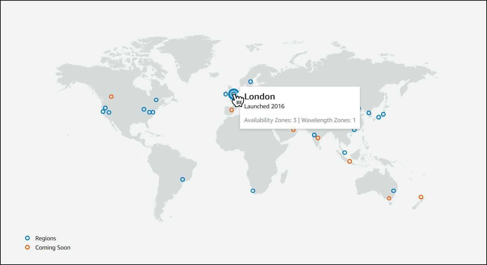

> **Нотатки:**
>
> Щоб дізнатися більше про регіони AWS, доступні наразі, скористайтеся одним із таких посилань:  
> https://aws.amazon.com/about-aws/global-infrastructure/#AWS_Global_Infrastructure_Map  
> https://aws.amazon.com/about-aws/global-infrastructure/regions_az/  
>
> Ці ресурси часто оновлюються, щоб відображати поточну та заплановану інфраструктуру AWS.

---

## Слайд 6: Демонстрація під керівництвом викладача: деталі глобальної інфраструктури AWS

> **Нотатки:**
>
> Тепер викладач може вирішити провести живу демонстрацію мапи глобальної інфраструктури AWS, представленої на попередньому слайді. Цей ресурс надає інтерактивний спосіб дізнатися про глобальну інфраструктуру AWS. Решта слайдів цього розділу охоплюють багато з тих самих тем і докладніше розглядають деякі з них.

---

## Слайд 7: Регіони AWS

- **Регіон AWS (AWS Region)** — це географічна територія.
  - Реплікацією даних між регіонами керуєте ви.
  - Зв’язок між регіонами використовує магістральну мережеву інфраструктуру AWS (AWS backbone network).
- Кожен регіон забезпечує повну надлишковість і підключення до мережі.
- Регіон зазвичай складається з двох або більше **зон доступності (Availability Zones)**.

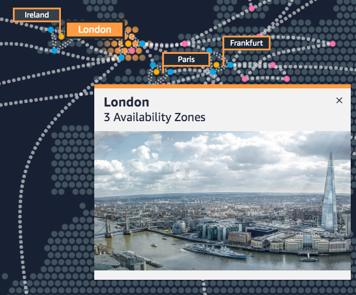

Приклад: регіон Лондон (London Region)

> **Нотатки:**
>
> Хмарну інфраструктуру AWS побудовано навколо регіонів. AWS має 22 регіони по всьому світу. Регіон AWS — це фізичне географічне розташування з однією чи кількома зонами доступності. Зони доступності, своєю чергою, складаються з одного чи кількох центрів обробки даних.  
>
> Щоб досягти відмовостійкості та стабільності, регіони ізольовані один від одного. Ресурси в одному регіоні не реплікуються автоматично в інші регіони. Коли ви зберігаєте дані в конкретному регіоні, вони не реплікуються за межі цього регіону.  
>
> Ви самі відповідаєте за реплікацію даних між регіонами, якщо цього потребують ваші бізнес-потреби.  
>
> Регіони AWS, запроваджені до 20 березня 2019 року, увімкнено за замовчуванням. Регіони, запроваджені після 20 березня 2019 року — як-от Азійсько-Тихоокеанський (Гонконг) і Близький Схід (Бахрейн), — вимкнено за замовчуванням. Ці регіони потрібно ввімкнути, перш ніж ними можна користуватися. Для ввімкнення чи вимкнення регіону можна використовувати AWS Management Console.  
>
> Деякі регіони мають обмежений доступ. Акаунт Amazon AWS (China) надає доступ лише до регіонів Пекін і Нінся. Щоб дізнатися більше про AWS у Китаї, див.: https://www.amazonaws.cn/en/about-aws/china/. Ізольований регіон AWS GovCloud (US) розроблено, щоб дозволити урядовим установам і клієнтам США переносити чутливі робочі навантаження в хмару, враховуючи їхні специфічні регуляторні вимоги та вимоги відповідності.  
>
> Для доступності: знімок із вебсайту infrastructure.aws, що показує фото центру Лондона, зокрема Тауерського мосту та хмарочоса Shard. У ньому зазначено, що в регіоні Лондон є три зони доступності. Кінець опису для доступності.

---

## Слайд 8: Вибір регіону

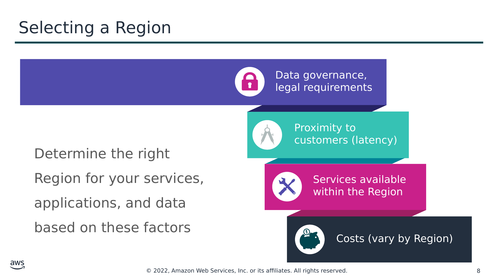

Data governance, legal requirements (Управління даними, правові вимоги)

Proximity to customers (latency) (Близькість до клієнтів (затримка))

Determine the right Region for your services, applications, and data based on these factors (Визначте відповідний регіон для ваших сервісів, застосунків і даних на основі цих чинників)

Services available within the Region (Сервіси, доступні в регіоні)

Costs (vary by Region) (Витрати (залежать від регіону))

> **Нотатки:**
>
> Є кілька чинників, які слід враховувати, обираючи оптимальний регіон чи регіони, де ви зберігаєте дані та використовуєте сервіси AWS.  
>
> Один із важливих чинників — управління даними (data governance) та правові вимоги. Місцеві закони можуть вимагати, щоб певна інформація зберігалась у межах географічних кордонів. Такі закони можуть обмежувати регіони, де ви можете пропонувати контент чи сервіси. Наприклад, розгляньте Директиву ЄС із захисту даних (European Union Data Protection Directive).  
>
> За інших рівних умов, як правило, бажано запускати ваші застосунки та зберігати ваші дані в регіоні, що розташований якомога ближче до користувачів і систем, які до них звертатимуться. Це допоможе зменшити затримку (latency). CloudPing — це один із вебсайтів, який можна використовувати для тестування затримки між вашим розташуванням і всіма регіонами AWS. Щоб дізнатися більше про CloudPing, див.: http://www.cloudping.info/  
>
> Пам’ятайте, що не всі сервіси доступні в усіх регіонах. Щоб дізнатися більше, див.: https://aws.amazon.com/about-aws/global-infrastructure/regional-product-services/?p=tgi&loc=4.  
>
> Нарешті, існує певна варіація вартості роботи сервісів, що може залежати від обраного вами регіону. Наприклад, на момент написання запуск екземпляра Amazon Elastic Compute Cloud (Amazon EC2) з Linux розміру t3.medium за запитом (On-Demand) у регіоні US East (Ohio) коштує 0,0416 долара за годину, а запуск того самого екземпляра в регіоні Asia Pacific (Tokyo) коштує 0,0544 долара за годину.

---

## Слайд 9: Зони доступності (Availability Zones)

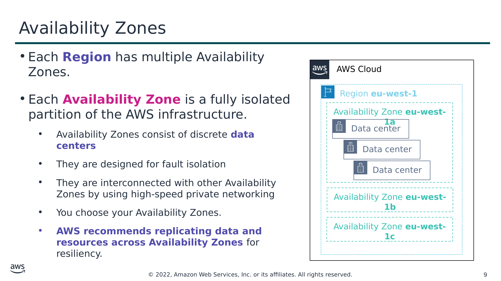

- Кожен **регіон** має кілька зон доступності.
- Кожна **зона доступності** — це повністю ізольований розділ інфраструктури AWS.
  - Зони доступності складаються з окремих **центрів обробки даних (data centers)**
  - Вони розроблені для ізоляції збоїв
  - Вони з’єднані з іншими зонами доступності за допомогою високошвидкісної приватної мережі
  - Зони доступності обираєте ви.
  - **AWS рекомендує реплікувати дані та ресурси між зонами доступності** для забезпечення стійкості.

Текст зі схеми

AWS Cloud

Region **eu-west-1** (Регіон **eu-west-1**)

Availability Zone **eu-west-1a** (Зона доступності **eu-west-1a**)

Data center (Центр обробки даних)

Data center

Data center

Availability Zone **eu-west-1b** (Зона доступності **eu-west-1b**)

Availability Zone **eu-west-1c** (Зона доступності **eu-west-1c**)

> **Нотатки:**
>
> Кожен регіон AWS має кілька ізольованих розташувань, відомих як зони доступності.  
>
> Кожна зона доступності надає можливість експлуатувати застосунки та бази даних, які є більш високодоступними, відмовостійкими та масштабованими, ніж це було б можливо з одним центром обробки даних. Кожна зона доступності може включати кілька центрів обробки даних (зазвичай три), а в повному масштабі — сотні тисяч серверів. Вони є повністю ізольованими розділами глобальної інфраструктури AWS. Зони доступності мають власну інфраструктуру живлення й фізично розділені багатьма кілометрами від інших зон доступності — хоча всі зони доступності розташовані в межах 100 км одна від одної.  
>
> Усі зони доступності з’єднані мережею з високою пропускною здатністю та низькою затримкою через повністю надлишкове виділене оптоволокно, що забезпечує високу пропускну здатність між зонами доступності. Мережа здійснює синхронну реплікацію між зонами доступності.  
>
> Зони доступності допомагають будувати високодоступні застосунки. Коли застосунок розділено між зонами доступності, компанії краще ізольовані та захищені від таких проблем, як блискавки, торнадо, землетруси тощо.  
>
> Ви відповідаєте за вибір зон доступності, де розміщуватимуться ваші системи. Системи можуть охоплювати кілька зон доступності. AWS рекомендує реплікацію між зонами доступності для забезпечення стійкості. Слід проєктувати свої системи так, щоб вони витримували тимчасову чи тривалу відмову зони доступності в разі катастрофи.

---

## Слайд 10: Центри обробки даних AWS (AWS data centers)

- Центри обробки даних AWS розроблені з урахуванням безпеки.
- Центри обробки даних — це місце, де розташовані дані та відбувається їх обробка.
- Кожен центр обробки даних має резервне живлення, мережу та підключення й розміщений в окремому приміщенні.
- Центр обробки даних зазвичай має від 50 000 до 80 000 фізичних серверів.

> **Нотатки:**
>
> Основою інфраструктури AWS є центри обробки даних. Клієнти не вказують центр обробки даних для розгортання ресурсів. Натомість зона доступності — це найдетальніший рівень специфікації, який може зробити клієнт. Однак центр обробки даних — це місце, де фактично розташовані дані. Amazon експлуатує найсучасніші, високодоступні центри обробки даних. Хоча це трапляється рідко, можуть виникати збої, що впливають на доступність екземплярів в одному розташуванні. Якщо ви розміщуєте всі свої екземпляри в одному розташуванні, на яке впливає такий збій, жоден із ваших екземплярів не буде доступним.  
>
> Центри обробки даних безпечно спроєктовано з урахуванням кількох чинників:  
>
> Кожне розташування ретельно оцінюється, щоб пом’якшити екологічні ризики.  
> Центри обробки даних мають надлишкову архітектуру, що передбачає збій і витримує його, зберігаючи рівні обслуговування.  
> Щоб забезпечити доступність, критично важливі компоненти системи резервуються в кількох зонах доступності.  
> Щоб забезпечити потужності, AWS безперервно відстежує використання сервісів, щоб розгортати інфраструктуру для підтримки зобов’язань і вимог щодо доступності.  
> Розташування центрів обробки даних не розголошуються, а увесь доступ до них обмежено.  
> У разі збою автоматизовані процеси переміщують трафік даних подалі від постраждалої області.  
>
> AWS використовує спеціальне мережеве обладнання, закуплене в кількох виробників оригінальних пристроїв за контрактом (original device manufacturers, ODM). ODM проєктують і виготовляють продукти на основі специфікацій другої компанії. Друга компанія потім змінює бренд продуктів для продажу.

---

## Слайд 11: Точки присутності (Points of Presence)

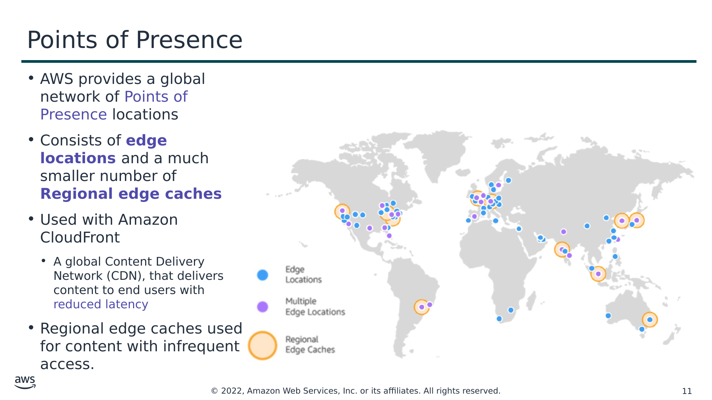

- AWS надає глобальну мережу розташувань точок присутності (Points of Presence)
- Складається з **периферійних локацій (edge locations)** і значно меншої кількості **регіональних периферійних кешів (Regional edge caches)**
- Використовується з Amazon CloudFront
  - Глобальна мережа доставки контенту (Content Delivery Network, CDN), що доставляє контент кінцевим користувачам зі зменшеною затримкою
- Регіональні периферійні кеші використовуються для контенту з нечастим доступом.

> **Нотатки:**
>
> Amazon CloudFront — це мережа доставки контенту (CDN), що використовується для розповсюдження контенту кінцевим користувачам для зменшення затримки. Amazon Route 53 — це сервіс системи доменних імен (DNS). Запити до будь-якого з цих сервісів автоматично маршрутизуватимуться до найближчої периферійної локації, щоб зменшити затримку.  
>
> Точки присутності AWS розташовані в більшості великих міст світу. Безперервно вимірюючи підключення до інтернету, продуктивність і обчислення, щоб знайти найкращий спосіб маршрутизації запитів, точки присутності забезпечують кращий досвід користувача майже в реальному часі. Їх використовують багато сервісів AWS, зокрема Amazon CloudFront, Amazon Route 53, AWS Shield і AWS Web Application Firewall (AWS WAF).  
>
> Регіональні периферійні кеші використовуються за замовчуванням з Amazon CloudFront. Регіональні периферійні кеші використовуються, коли у вас є контент, до якого звертаються недостатньо часто, щоб він залишався в периферійній локації. Регіональні периферійні кеші приймають цей контент і надають альтернативу тому, щоб цей контент доводилось отримувати з початкового сервера (origin server).

---

## Слайд 12: Функції інфраструктури AWS

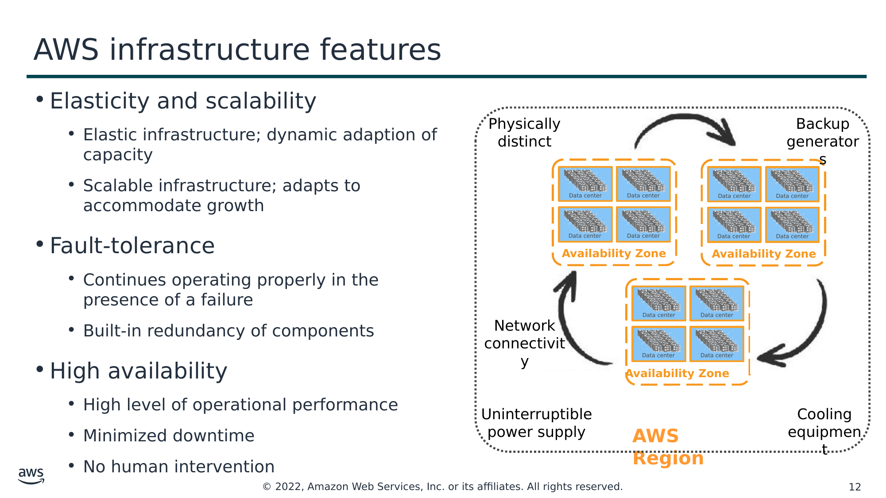

- Еластичність і масштабованість (Elasticity and scalability)
    - Еластична інфраструктура; динамічна адаптація потужностей
    - Масштабована інфраструктура; пристосовується до зростання
- Відмовостійкість (Fault-tolerance)
    - Продовжує належно працювати за наявності збою
    - Вбудована надлишковість компонентів
- Висока доступність (High availability)
    - Високий рівень операційної продуктивності
    - Мінімізований простій
    - Без втручання людини

Текст зі схеми

Data center (Центр обробки даних)

Physically distinct (Фізично відокремлені)

Data center

Data center

Data center

Backup generators (Резервні генератори)

**Availability Zone (Зона доступності)**

Data center

Data center

Data center

Data center

Data center

Data center

Data center

Data center

**Availability Zone (Зона доступності)**

Network connectivity (Мережеве підключення)

**Availability Zone (Зона доступності)**

Uninterruptible power supply (Джерело безперебійного живлення)

Cooling equipment (Обладнання охолодження)

**AWS Region (Регіон AWS)**

> **Нотатки:**
>
> Тепер, коли ви добре розумієте основні компоненти, що складають глобальну інфраструктуру AWS, розгляньмо переваги, які надає ця інфраструктура.  
>
> Глобальна інфраструктура AWS має кілька цінних функцій:  
> По-перше, вона еластична та масштабована. Це означає, що ресурси можуть динамічно пристосовуватися до збільшення чи зменшення вимог до потужностей. Вона також може швидко пристосовуватися до зростання.  
> По-друге, ця інфраструктура відмовостійка, що означає, що вона має вбудовану надлишковість компонентів, яка дає змогу їй продовжувати роботу попри відмову компонента.  
> Нарешті, вона потребує мінімального втручання людини або й узагалі його не потребує, водночас забезпечуючи високу доступність із мінімальним простоєм.

---

## Слайд 13: Ключові висновки

- **Глобальна інфраструктура AWS (AWS Global Infrastructure)** складається з регіонів і зон доступності.
- Ваш вибір **регіону** зазвичай ґрунтується на вимогах відповідності або на потребі зменшити затримку.
- Кожна **зона доступності** фізично відокремлена від інших зон доступності та має резервне живлення, мережу й підключення.
- **Периферійні локації (Edge locations)** та **регіональні периферійні кеші (Regional edge caches)** покращують продуктивність, кешуючи контент ближче до користувачів.

> **Нотатки:**
>
> Основні висновки цього розділу модуля:  
> Глобальна інфраструктура AWS складається з регіонів і зон доступності.  
> Ваш вибір регіону зазвичай ґрунтується на вимогах відповідності або на потребі зменшити затримку.  
> Кожна зона доступності фізично відокремлена від інших зон доступності та має резервне живлення, мережу й підключення.  
> Периферійні локації та регіональні периферійні кеші покращують продуктивність, кешуючи контент ближче до користувачів.

---

## Слайд 14: Розділ 2: Огляд сервісів AWS і категорій сервісів

Модуль 3: Огляд глобальної інфраструктури AWS

> **Нотатки:**
>
> Представляємо Частину 2: Огляд сервісів AWS і категорій сервісів.  
>
> AWS пропонує широкий набір глобальних хмарних продуктів, які можна використовувати як будівельні блоки для типових хмарних архітектур. Ось погляд на те, як організовано ці хмарні продукти.

---

## Слайд 15: Базові сервіси AWS (AWS foundational services)

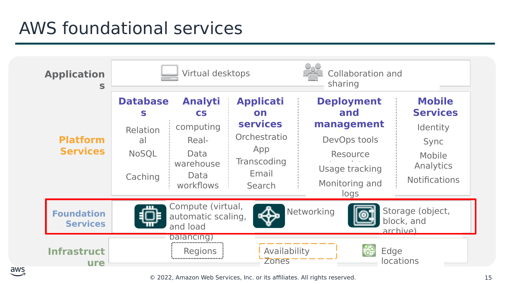

Текст зі схеми

Virtual desktops (Віртуальні робочі столи)

Collaboration and sharing (Співпраця та спільний доступ)

**Applications (Застосунки)**

Relational (Реляційні)

Cluster computing (Кластерні обчислення)

Queuing (Черги)

Containers (Контейнери)

Identity (Ідентичність)

Real-time (У реальному часі)

Orchestration (Оркестрація)

DevOps tools (Інструменти DevOps)

Sync (Синхронізація)

NoSQL

Data warehouse (Сховище даних)

**Databases (Бази даних)**

App Streaming (Потокова передача застосунків)

Transcoding (Транскодування)

**Analytics (Аналітика)**

Resource templates (Шаблони ресурсів)

**Application services (Сервіси застосунків)**

Mobile Analytics (Мобільна аналітика)

**Deployment and management (Розгортання та керування)**

**Mobile Services (Мобільні сервіси)**

Caching (Кешування)

Data workflows (Робочі процеси даних)

Email (Електронна пошта)

Usage tracking (Відстеження використання)

Notifications (Сповіщення)

Search (Пошук)

Monitoring and logs (Моніторинг і журнали)

**Platform**  
**Services (Платформні сервіси)**

Compute (virtual, automatic scaling, and load balancing) (Обчислення (віртуальні, автоматичне масштабування та балансування навантаження))

Networking (Мережі)

Regions (Регіони)

Edge locations (Периферійні локації)

Storage (object, block, and archive) (Сховище (об’єктне, блочне й архівне))

**Foundation**  
**Services (Базові сервіси)**

**Infrastructure (Інфраструктура)**

Availability Zones (Зони доступності)

> **Нотатки:**
>
> Як обговорювалося раніше, глобальну інфраструктуру AWS можна розділити на три елементи: регіони, зони доступності та точки присутності (Points of Presence), що включають периферійні локації. Ця інфраструктура надає платформу для широкого набору сервісів, як-от мережі, сховища, обчислювальні сервіси та бази даних — і ці сервіси надаються як комунальна послуга за запитом, доступна за лічені секунди, з оплатою за фактом використання (pay-as-you-go).  
>
> Для доступності: маркетингова схема, що показує внизу інфраструктуру, яка складається з регіонів, зон доступності та периферійних локацій. Наступний рівень угорі має підпис «Базові сервіси» (Foundational Services) і включає графіку обчислень, мереж і сховищ. Цей рівень виділено. Наступний рівень угорі — платформні сервіси, що включають бази даних, аналітику, сервіси застосунків, розгортання та керування й мобільні сервіси. Верхній рівень має підпис «застосунки» і включає віртуальні робочі столи та співпрацю й спільний доступ. Кінець опису для доступності.

---

## Слайд 16: Категорії сервісів AWS

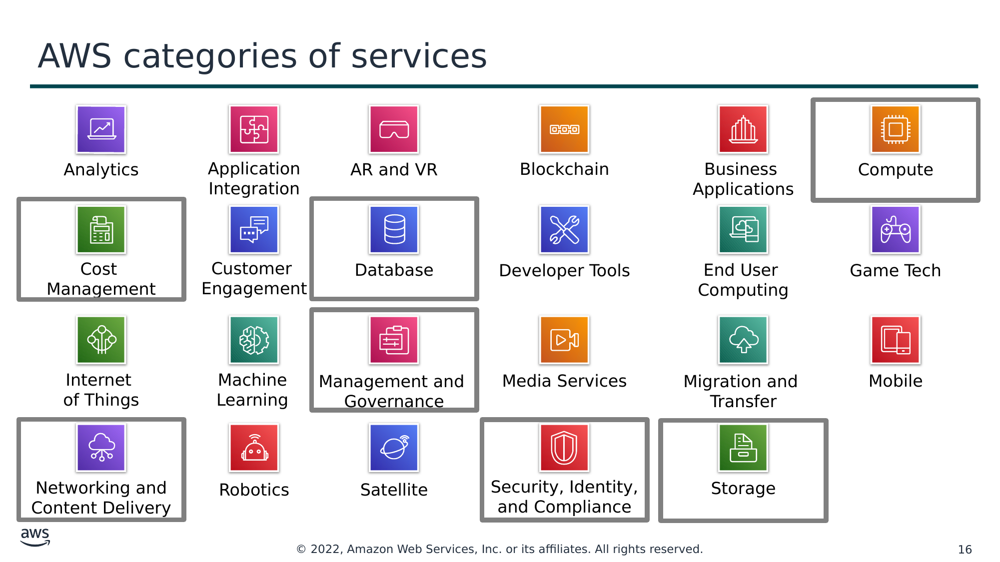

Текст зі схеми

Analytics (Аналітика)

Application  
Integration (Інтеграція застосунків)

AR and VR (Доповнена та віртуальна реальність)

Blockchain (Блокчейн)

Business  
Applications (Бізнес-застосунки)

Compute (Обчислення)

Cost  
Management (Керування витратами)

Customer  
Engagement (Взаємодія з клієнтами)

Database (Бази даних)

Developer Tools (Інструменти розробника)

End User  
Computing (Обчислення для кінцевих користувачів)

Game Tech (Ігрові технології)

Internet  
of Things (Інтернет речей)

Machine Learning (Машинне навчання)

Management and  
Governance (Керування та управління)

Media Services (Медіасервіси)

Migration and  
Transfer (Міграція та передавання)

Mobile (Мобільні)

Networking and  
Content Delivery (Мережі та доставка контенту)

Robotics (Робототехніка)

Satellite (Супутникові)

Security, Identity, and Compliance (Безпека, ідентичність і відповідність вимогам)

Storage (Сховище)

> **Нотатки:**
>
> AWS пропонує широкий набір хмарних сервісів. Існує 23 різні категорії продуктів чи сервісів, і кожна категорія складається з одного чи кількох сервісів. Цей курс не намагатиметься ознайомити вас із кожним сервісом. Натомість фокус цього курсу — на сервісах, що найширше використовуються та пропонують найкраще знайомство з хмарою AWS. Цей курс також зосереджується на сервісах, які з більшою ймовірністю будуть охоплені іспитом AWS Certified Cloud Practitioner.  
>
> Категорії, які розглядатиме цей курс, виділено на слайді: Compute, Cost Management, Database, Management and Governance, Networking and Content Delivery, Security, Identity, and Compliance та Storage.  
>
> Щоб дізнатися більше про продукти AWS, див. «Хмарні продукти» (Cloud Products) за адресою https://aws.amazon.com/products/. Усі продукти AWS організовано в категорії сервісів, показані тут. Наприклад, якщо натиснути Compute, ви побачите, що Amazon Elastic Compute Cloud (Amazon EC2) стоїть першим у списку. Категорія обчислень також перелічує багато інших продуктів і сервісів.  
>
> Якщо натиснути Amazon EC2, ви перейдете на сторінку Amazon EC2. Кожна сторінка продукту надає докладний опис продукту та перелічує деякі його переваги.  
>
> Дослідіть різні групи сервісів, щоб зрозуміти категорії та сервіси в них. Тепер, коли ви знаєте, як знаходити інформацію про різні сервіси, цей модуль розгляне виділені категорії сервісів. Наступні сім слайдів перелічують окремі сервіси — в кожній із виділених вище категорій, — які розглядатиме цей курс.

---

## Слайд 17: Категорія сервісів зберігання даних (storage)

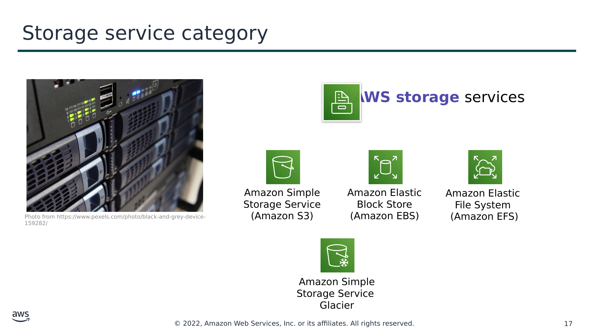

**AWS storage** services (Сервіси зберігання даних **AWS**)

Amazon Simple Storage Service (Amazon S3)

Amazon Elastic Block Store (Amazon EBS)

Amazon Elastic  
File System  
(Amazon EFS)

Photo from https://www.pexels.com/photo/black-and-grey-device-159282/

Amazon Simple Storage Service  
Glacier

> **Нотатки:**
>
> Сервіси зберігання даних AWS включають перелічені тут сервіси та багато інших.  
>
> Amazon Simple Storage Service (Amazon S3) — це сервіс об’єктного сховища (object storage), що пропонує масштабованість, доступність даних, безпеку та продуктивність. Використовуйте його для зберігання та захисту будь-якого обсягу даних для вебсайтів, мобільних застосунків, резервного копіювання та відновлення, архівування, корпоративних застосунків, пристроїв Інтернету речей (IoT) і аналітики великих даних.  
>
> Amazon Elastic Block Store (Amazon EBS) — це високопродуктивне блочне сховище, розроблене для використання з Amazon EC2 як для робочих навантажень з інтенсивною пропускною здатністю, так і для навантажень з інтенсивними транзакціями. Воно використовується для широкого спектра робочих навантажень, як-от реляційні та нереляційні бази даних, корпоративні застосунки, контейнеризовані застосунки, рушії аналітики великих даних, файлові системи та медійні робочі процеси.  
>
> Amazon Elastic File System (Amazon EFS) надає масштабовану, повністю кероване еластичну файлову систему Network File System (NFS) для використання з хмарними сервісами AWS і локальними (on-premises) ресурсами. Її створено для масштабування за запитом до петабайтів, автоматично зростаючи та зменшуючись, коли ви додаєте й видаляєте файли. Вона зменшує потребу розгортати та контролювати потужності для задоволення зростання.  
>
> Amazon Simple Storage Service Glacier — це захищений, довговічний і надзвичайно недорогий клас хмарного сховища Amazon S3 для архівування даних і довгострокового резервного копіювання. Його розроблено для забезпечення довговічності в 11 дев’яток (11 9s) і для надання комплексних можливостей безпеки та відповідності, щоб задовольняти суворі регуляторні вимоги.

---

## Слайд 18: Категорія обчислювальних сервісів (compute)

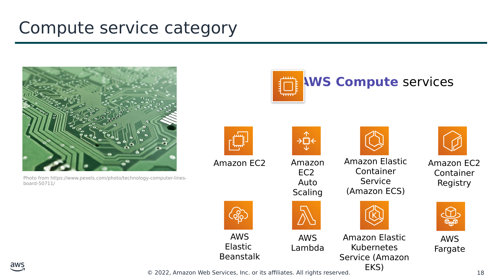

**AWS Compute** services (Обчислювальні сервіси **AWS**)

Amazon EC2

Amazon EC2  
Auto Scaling

Amazon Elastic Container Service (Amazon ECS)

Amazon EC2 Container Registry

Photo from https://www.pexels.com/photo/technology-computer-lines-board-50711/

AWS Elastic  
Beanstalk

AWS Lambda

Amazon Elastic Kubernetes Service (Amazon EKS)

AWS Fargate

> **Нотатки:**
>
> Обчислювальні сервіси AWS включають перелічені тут сервіси та багато інших.  
>
> Amazon Elastic Compute Cloud (Amazon EC2) надає обчислювальні потужності зі змінним розміром у вигляді віртуальних машин у хмарі.  
>
> Amazon EC2 Auto Scaling дає змогу автоматично додавати або видаляти екземпляри EC2 відповідно до умов, які ви визначаєте.  
>
> Amazon Elastic Container Service (Amazon ECS) — це високомасштабований, високопродуктивний сервіс оркестрації контейнерів, що підтримує контейнери Docker.  
>
> Amazon Elastic Container Registry (Amazon ECR) — це повністю кероване сховище (реєстр) контейнерів Docker, що полегшує розробникам зберігання, керування та розгортання образів контейнерів Docker.  
>
> AWS Elastic Beanstalk — це сервіс для розгортання та масштабування вебзастосунків і сервісів на знайомих серверах, як-от Apache і Microsoft Internet Information Services (IIS).  
>
> AWS Lambda дає змогу запускати код без розгортання чи керування серверами. Ви платите лише за спожитий обчислювальний час. Плата не стягується, коли ваш код не виконується.  
>
> Amazon Elastic Kubernetes Service (Amazon EKS) полегшує розгортання, керування та масштабування контейнеризованих застосунків, що використовують Kubernetes в AWS.  
>
> AWS Fargate — це обчислювальний рушій для Amazon ECS, що дає змогу запускати контейнери без потреби керувати серверами чи кластерами.

---

## Слайд 19: Категорія сервісів баз даних (database)

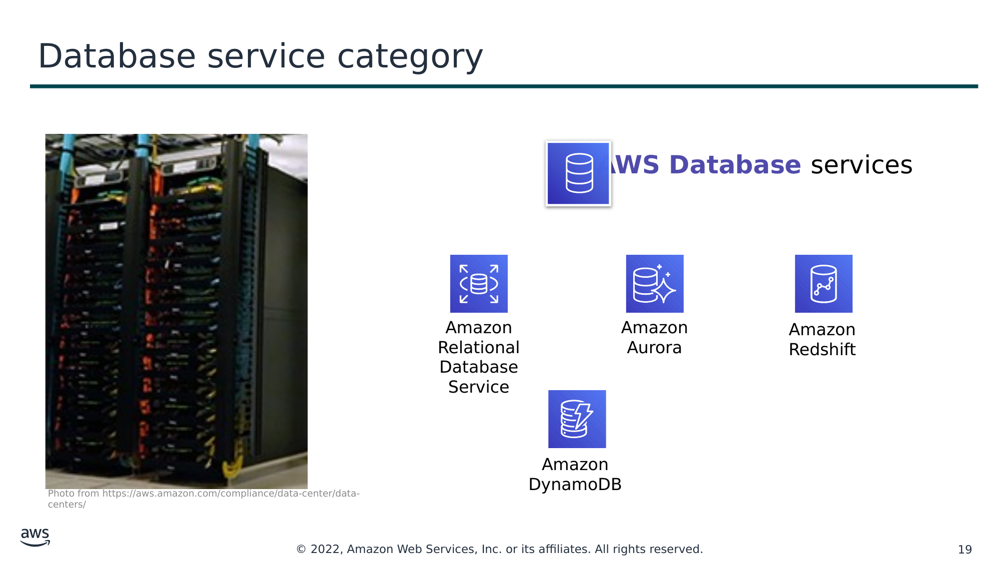

**AWS Database** services (Сервіси баз даних **AWS**)

Amazon Relational Database Service

Amazon Aurora

Amazon Redshift

Amazon DynamoDB

Photo from https://aws.amazon.com/compliance/data-center/data-centers/

> **Нотатки:**
>
> Сервіси баз даних AWS включають перелічені тут сервіси та багато інших.  
>
> Amazon Relational Database Service (Amazon RDS) полегшує налаштування, експлуатацію та масштабування реляційної бази даних у хмарі. Він надає потужності зі змінним розміром, водночас автоматизуючи трудомісткі завдання адміністрування, як-от розгортання апаратного забезпечення, налаштування бази даних, встановлення виправлень і резервне копіювання.  
>
> Amazon Aurora — це реляційна база даних, сумісна з MySQL і PostgreSQL. Вона до п’яти разів швидша за стандартні бази даних MySQL і до трьох разів швидша за стандартні бази даних PostgreSQL.  
>
> Amazon Redshift дає змогу виконувати аналітичні запити до петабайтів даних, що зберігаються локально в Amazon Redshift, і безпосередньо до ексабайтів даних, що зберігаються в Amazon S3. Він забезпечує швидку продуктивність у будь-якому масштабі.  
>
> Amazon DynamoDB — це база даних «ключ-значення» та документів, що забезпечує продуктивність у межах одиниць мілісекунд у будь-якому масштабі, зі вбудованою безпекою, резервним копіюванням і відновленням та кешуванням в оперативній пам’яті (in-memory caching).

---

## Слайд 20: Категорія сервісів мереж і доставки контенту (networking and content delivery)

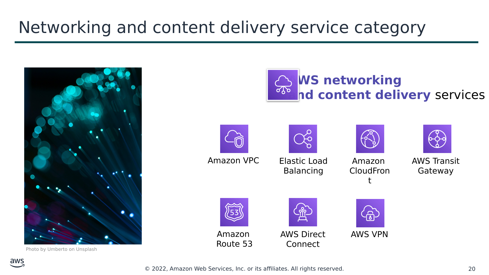

**AWS networking**  
**and content delivery** services (Сервіси мереж і доставки контенту **AWS**)

Amazon VPC

Elastic Load Balancing

Amazon  
CloudFront

AWS Transit  
Gateway

Amazon  
Route 53

AWS Direct Connect

AWS VPN

Photo by Umberto on Unsplash

> **Нотатки:**
>
> Сервіси мереж і доставки контенту AWS включають перелічені тут сервіси та багато інших.  
>
> Amazon Virtual Private Cloud (Amazon VPC) дає змогу розгортати логічно ізольовані ділянки хмари AWS.  
>
> Elastic Load Balancing автоматично розподіляє вхідний трафік застосунків між кількома цілями, як-от екземпляри Amazon EC2, контейнери, IP-адреси та функції Lambda.  
>
> Amazon CloudFront — це швидкий сервіс мережі доставки контенту (CDN), що безпечно доставляє дані, відео, застосунки та прикладні програмні інтерфейси (API) клієнтам у всьому світі з низькою затримкою та високою швидкістю передавання.  
>
> AWS Transit Gateway — це сервіс, що дає клієнтам змогу підключити свої віртуальні приватні хмари Amazon (VPC) і свої локальні мережі до єдиного шлюзу.  
>
> Amazon Route 53 — це масштабований хмарний вебсервіс системи доменних імен (DNS), розроблений, щоб надати вам надійний спосіб маршрутизації кінцевих користувачів до інтернет-застосунків. Він перетворює імена (як-от www.example.com) на числові IP-адреси (як-от 192.0.2.1), що їх комп’ютери використовують для з’єднання один з одним.  
>
> AWS Direct Connect надає спосіб встановити виділене приватне мережеве з’єднання з вашого центру обробки даних чи офісу до AWS, що може знизити мережеві витрати та збільшити пропускну здатність.  
>
> AWS VPN надає захищений приватний тунель від вашої мережі чи пристрою до глобальної мережі AWS.

---

## Слайд 21: Категорія сервісів безпеки, ідентичності та відповідності вимогам (security, identity, and compliance)

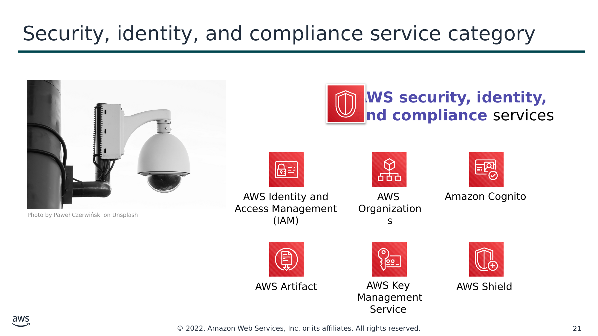

**AWS security, identity,**  
**and compliance** services (Сервіси безпеки, ідентичності та відповідності вимогам **AWS**)

AWS Identity and Access Management (IAM)

AWS  
Organizations

Amazon Cognito

Photo by Paweł Czerwiński on Unsplash

AWS Artifact

AWS Key  
Management Service

AWS Shield

> **Нотатки:**
>
> Сервіси безпеки, ідентичності та відповідності вимогам AWS включають перелічені тут сервіси та багато інших.  
>
> AWS Identity and Access Management (IAM) дає змогу безпечно керувати доступом до сервісів і ресурсів AWS. За допомогою IAM можна створювати користувачів і групи AWS та керувати ними. Дозволи IAM можна використовувати, щоб дозволяти й забороняти доступ користувачів і груп до ресурсів AWS.  
>
> AWS Organizations дає змогу обмежувати, які сервіси та дії дозволені у ваших акаунтах.  
>
> Amazon Cognito дає змогу додавати реєстрацію користувачів, вхід і контроль доступу до ваших вебзастосунків і мобільних застосунків.  
>
> AWS Artifact надає доступ за запитом до звітів AWS про безпеку та відповідність і вибраних онлайн-угод.  
>
> AWS Key Management Service (AWS KMS) дає змогу створювати ключі й керувати ними. AWS KMS можна використовувати для контролю використання шифрування в широкому спектрі сервісів AWS і у ваших застосунках.  
>
> AWS Shield — це кероване обслуговування захисту від розподілених атак «відмова в обслуговуванні» (Distributed Denial of Service, DDoS), що захищає застосунки, які працюють в AWS.

---

## Слайд 22: Категорія сервісів керування витратами (cost management)

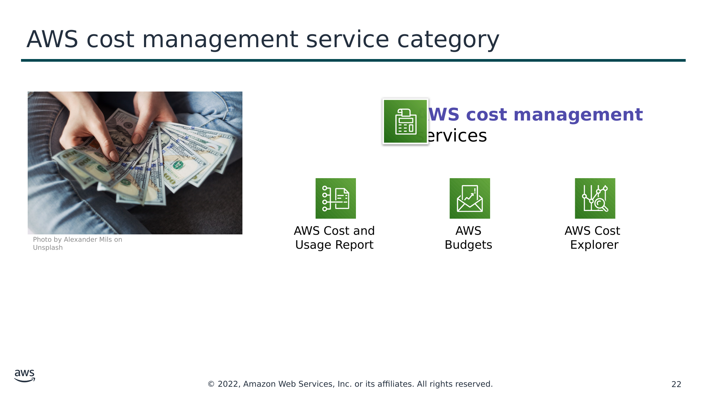

**AWS cost management**  
services (Сервіси керування витратами **AWS**)

AWS Cost and  
Usage Report

AWS Budgets

AWS Cost  
Explorer

Photo by Alexander Mils on Unsplash

> **Нотатки:**
>
> Сервіси керування витратами AWS включають перелічені тут сервіси та інші.  
>
> AWS Cost and Usage Report містить найповніший набір доступних даних про витрати та використання AWS, зокрема додаткові метадані про сервіси AWS, ціноутворення та резервування.  
>
> AWS Budgets дає змогу встановлювати власні бюджети, що сповіщають вас, коли ваші витрати чи використання перевищують (або, за прогнозом, перевищать) заплановану суму.  
>
> AWS Cost Explorer має простий у використанні інтерфейс, що дає змогу візуалізувати, розуміти та контролювати ваші витрати й використання AWS у часі.

---

## Слайд 23: Категорія сервісів керування та управління (management and governance)

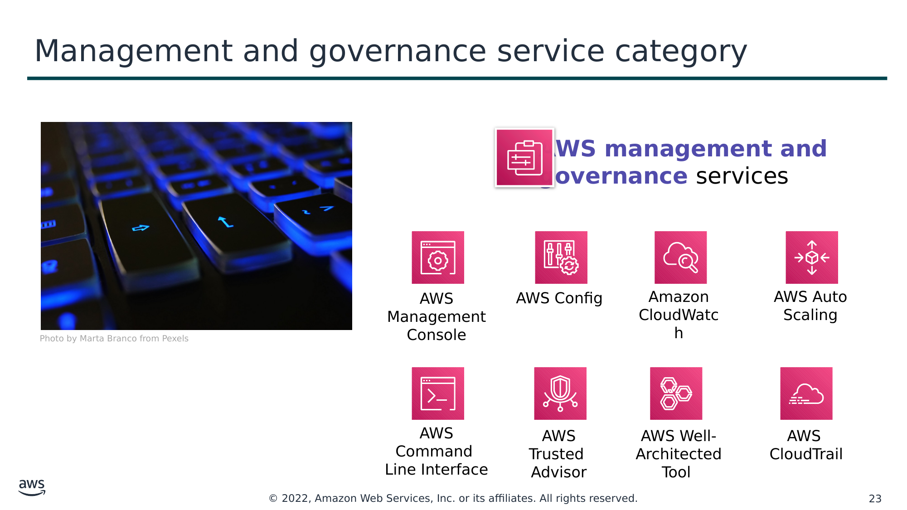

**AWS management and**  
**governance** services (Сервіси керування та управління **AWS**)

AWS Management Console

AWS Config

Amazon CloudWatch

AWS Auto Scaling

Photo by Marta Branco from Pexels

AWS Command  
Line Interface

AWS Trusted  
Advisor

AWS Well-  
Architected Tool

AWS  
CloudTrail

> **Нотатки:**
>
> Сервіси керування та управління AWS включають перелічені тут сервіси та інші.  
>
> AWS Management Console надає вебінтерфейс користувача для доступу до вашого акаунта AWS.  
>
> AWS Config надає сервіс, що допомагає відстежувати інвентар ресурсів і зміни.  
>
> Amazon CloudWatch дає змогу відстежувати ресурси та застосунки.  
>
> AWS Auto Scaling надає функції, що дають змогу масштабувати кілька ресурсів відповідно до попиту.  
>
> AWS Command Line Interface надає уніфікований інструмент для керування сервісами AWS.  
>
> AWS Trusted Advisor допомагає оптимізувати продуктивність і безпеку.  
>
> AWS Well-Architected Tool допомагає переглядати та покращувати ваші робочі навантаження.  
>
> AWS CloudTrail відстежує активність користувачів і використання API.

---

## Слайд 24: Практична вправа: огляд AWS Management Console (AWS Management Console clickthrough)

Фото: Pixabay (Pexels).

> **Нотатки:**
>
> У цій вправі під керівництвом викладача вас попросять увійти в AWS Management Console. Інструкції до вправи наведено на наступному слайді. Вам буде запропоновано відповісти на п’ять запитань. Викладач проведе обговорення кожного запитання з класом і розкриє правильні відповіді.

---

## Слайд 25: Практична вправа: огляд AWS Management Console

1. Запустіть практичне середовище Sandbox і підключіться до AWS Management Console**.**
2. Дослідіть AWS Management Console.
   1. Натисніть меню **Services**.
   2. Зверніть увагу, як сервіси згруповано в категорії сервісів. Наприклад, сервіс **EC2** відображається в категорії сервісів **Compute**.

Запитання №1: у якій категорії сервісів відображається сервіс **IAM**?

Запитання №2: у якій категорії сервісів відображається сервіс **Amazon VPC**?

   3. Натисніть сервіс **Amazon VPC**. Зверніть увагу, що спадне меню у верхньому правому куті відображає регіон AWS (наприклад, може відображатися *N. Virginia*).
   4. Натисніть меню регіону та перемкніться на інший регіон. Наприклад, оберіть **EU (London)**.
   5. Натисніть **Subnets** (ліворуч на екрані). У регіоні є три підмережі. Натисніть поле поруч з однією з підмереж. Зверніть увагу, що нижня половина екрана тепер відображає відомості про цю підмережу.

Запитання №3: чи існує обрана вами підмережа на рівні регіону чи на рівні зони доступності?

   6. Натисніть **Your VPCs**. Наявну VPC уже вибрано.

Запитання №4: чи існує VPC на рівні регіону чи на рівні зони доступності?

Запитання №5: які сервіси є глобальними, а не регіональними? Перевірте Amazon EC2, IAM, Lambda та Route 53.

> **Нотатки:**
>
> Мета цієї вправи — познайомити вас з AWS Management Console. Ви отримаєте досвід навігації між консолями сервісів AWS (як-от консоль Amazon VPC). Також ви потренуєтеся переходити до сервісів у різних категоріях сервісів. Нарешті, консоль допоможе вам розрізняти, чи є заданий сервіс або ресурс сервісу глобальним, чи регіональним.  
>
> Дотримуйтеся інструкцій на слайді. Після того як більшість або всі студенти виконають наведені вище кроки, викладач розбере запитання та відповіді з усім класом.

---

## Слайд 26: Ключ відповідей до вправи

- Запитання №1: у якій категорії сервісів відображається сервіс **IAM**?
  - **Відповідь**: **Security, Identity, & Compliance** (безпека, ідентичність і відповідність вимогам).
- Запитання №2: у якій категорії сервісів відображається сервіс **Amazon VPC**?
  - **Відповідь**: **Networking & Content Delivery** (мережі та доставка контенту)
- Запитання №3: чи існує обрана вами підмережа на рівні регіону чи на рівні зони доступності?
  - **Відповідь**: підмережі існують **на рівні зони доступності.**
- Запитання №4: чи існує VPC на рівні регіону чи на рівні зони доступності?
  - **Відповідь**: VPC існують **на рівні регіону.**
- Запитання №5: які з наведених сервісів є глобальними, а не регіональними? Перевірте Amazon EC2, IAM, Lambda та Route 53.
  - **Відповідь: IAM і Route 53 є глобальними**. Amazon EC2 і Lambda є регіональними.

> **Нотатки:**
>
> Цей слайд надає ключ відповідей на запитання, поставлені у вправі на попередньому слайді. Викладач використає цей слайд, щоб провести обговорення та підбити підсумки практичної вправи.

---

## Слайд 27: Підсумки модуля

Модуль 3: Огляд глобальної інфраструктури AWS

> **Нотатки:**
>
> Настав час повторити матеріал модуля та завершити його перевіркою знань і розбором запитання практичного сертифікаційного іспиту.

---

## Слайд 28: Резюме модуля

Підсумовуючи, у цьому модулі ви навчилися:

- Визначати різницю між регіонами AWS, зонами доступності та периферійними локаціями
- Визначати сервіси AWS і категорії сервісів

> **Нотатки:**
>
> Підсумовуючи, у цьому модулі ви навчилися:  
> Визначати різницю між регіонами AWS, зонами доступності та периферійними локаціями  
> Визначати сервіси AWS і категорії сервісів

---

## Слайд 29: Пройдіть перевірку знань

> **Нотатки:**
>
> Настав час пройти перевірку знань для цього модуля.

---

## Слайд 30: Приклад запитання іспиту

Який компонент глобальної інфраструктури AWS використовує Amazon CloudFront, щоб забезпечити доставку з низькою затримкою?

Варіант

Відповідь

A

Регіони AWS

B

Периферійні локації AWS (AWS edge locations)

C

Зони доступності AWS

D

Amazon Virtual Private Cloud (Amazon VPC)

> **Нотатки:**
>
> Розгляньте варіанти відповідей і відсійте їх за ключовими словами.

---

## Слайд 31: Відповідь на приклад запитання іспиту

Який компонент глобальної інфраструктури AWS використовує Amazon CloudFront, щоб забезпечити доставку з низькою затримкою?

Правильна відповідь — B.

Ключові слова в запитанні: компонент глобальної інфраструктури AWS, CloudFront, низька затримка.

> **Нотатки:**
>
> Ключові слова, які потрібно розпізнати: компонент глобальної інфраструктури AWS, CloudFront, низька затримка.  
>
> Правильна відповідь — B  
>
> Неправильні відповіді:  
> Відповідь A:  
> Відповідь C  
> Відповідь D

---

## Слайд 32: Додаткові ресурси

- Глобальна інфраструктура AWS (AWS Global Infrastructure): [https://aws.amazon.com/about-aws/global-infrastructure/](https://aws.amazon.com/about-aws/global-infrastructure/)
- Список регіональних сервісів AWS (AWS Regional Services List): [https://aws.amazon.com/about-aws/global-infrastructure/regional-product-services/](https://aws.amazon.com/about-aws/global-infrastructure/regional-product-services/)
- Хмарні продукти AWS (AWS Cloud Products): [https://aws.amazon.com/products/](https://aws.amazon.com/products/)

> **Нотатки:**
>
> Наведені нижче ресурси надають більше подробиць про теми, розглянуті в цьому модулі:  
> Глобальна інфраструктура AWS: https://aws.amazon.com/about-aws/global-infrastructure/  
> Список регіональних сервісів AWS: https://aws.amazon.com/about-aws/global-infrastructure/regional-product-services/  
> Хмарні продукти AWS: https://aws.amazon.com/products/

---

## Слайд 33: Дякуємо

Усі торговельні марки є власністю їхніх власників.

> **Нотатки:**
>
> Дякуємо, що пройшли цей модуль.
