## Слайд 1: Модуль 4: Безпека хмари AWS

AWS Academy Cloud Foundations

> **Нотатки:**
>
> Вітаємо в Модулі 4: Безпека хмари AWS (AWS Cloud Security).  
>
> Безпека — найвищий пріоритет в Amazon Web Services (AWS). AWS надає масштабоване середовище хмарних обчислень, розроблене для високої доступності та надійності, і водночас пропонує інструменти, що дають змогу запускати широкий спектр застосунків. Допомога у захисті конфіденційності, цілісності та доступності ваших систем і даних критично важлива для AWS, як і збереження довіри та впевненості клієнтів. Цей модуль надає вступ до підходу AWS до безпеки, що охоплює як засоби контролю в середовищі AWS, так і деякі продукти та функції AWS, які клієнти можуть використовувати для досягнення своїх цілей безпеки.

---

## Слайд 2: Огляд модуля

**Теми**

- Модель спільної відповідальності AWS (shared responsibility model)
- AWS Identity and Access Management (IAM)
- Захист нового акаунта AWS
- Захист акаунтів
- Захист даних в AWS
- Забезпечення відповідності вимогам

**Практичні вправи**

- Вправа з моделі спільної відповідальності AWS

**Демонстрація**

- Записана демонстрація IAM

**Лабораторна робота**

- Вступ до AWS IAM (Introduction to AWS IAM)

**Перевірка знань**

> **Нотатки:**
>
> У цьому модулі розглядаються такі теми:  
> Модель спільної відповідальності AWS  
> AWS Identity and Access Management (IAM)  
> Захист нового акаунта AWS  
> Захист акаунтів  
> Захист даних в AWS  
> Забезпечення відповідності вимогам  
> Додаткові сервіси безпеки та ресурси  
>
> Розділ перший містить вправу під керівництвом викладача щодо моделі спільної відповідальності AWS.  
>
> Розділ другий містить записану демонстрацію IAM, а наприкінці цього самого розділу є практична лабораторна робота, що дає вам практику налаштування IAM за допомогою AWS Management Console.  
>
> Наприкінці вам буде запропоновано пройти перевірку знань, щоб перевірити ваше розуміння ключових концепцій, розглянутих у цьому модулі.

---

## Слайд 3: Цілі модуля

Після завершення цього модуля ви повинні вміти:

- Розпізнавати модель спільної відповідальності
- Визначати відповідальність клієнта й AWS
- Розпізнавати користувачів, групи та ролі IAM
- Описувати різні типи облікових даних безпеки в IAM
- Визначати кроки захисту нового акаунта AWS
- Досліджувати користувачів і групи IAM
- Розпізнавати, як захистити дані AWS
- Розпізнавати програми відповідності вимогам AWS (AWS compliance programs)

> **Нотатки:**
>
> Після завершення цього модуля ви повинні вміти:  
> Розпізнавати модель спільної відповідальності  
> Визначати відповідальність клієнта й AWS  
> Розпізнавати користувачів, групи та ролі IAM  
> Описувати різні типи облікових даних безпеки в IAM  
> Визначати кроки захисту нового акаунта AWS  
> Досліджувати користувачів і групи IAM  
> Розпізнавати, як захистити дані AWS  
> Розпізнавати програми відповідності вимогам AWS

---

## Слайд 4: Розділ 1: Модель спільної відповідальності AWS

Модуль 4: Безпека хмари AWS

> **Нотатки:**
>
> Представляємо Розділ 1: Модель спільної відповідальності AWS.

---

## Слайд 5: Модель спільної відповідальності AWS

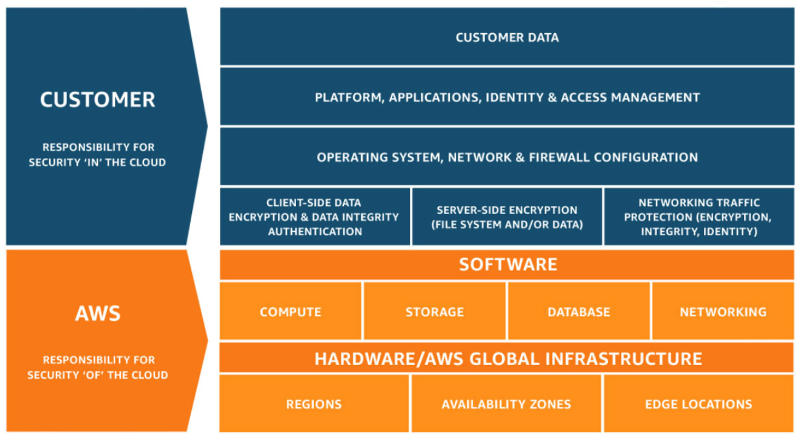

> **Нотатки:**
>
> Безпека та відповідність вимогам — це спільна відповідальність AWS і клієнта. Ця модель спільної відповідальності (shared responsibility model) розроблена, щоб допомогти зменшити операційне навантаження клієнта. Водночас, щоб забезпечити гнучкість і контроль клієнта, що дають змогу розгортати рішення клієнтів в AWS, клієнт залишається відповідальним за деякі аспекти загальної безпеки. Розмежування того, хто за що відповідає, зазвичай називають безпекою самої хмари (security «of» the cloud) порівняно з безпекою в хмарі (security «in» the cloud).  
>
> AWS експлуатує, обслуговує та контролює компоненти — від рівня програмної віртуалізації до фізичної безпеки приміщень, у яких працюють сервіси AWS. AWS відповідає за захист інфраструктури, на якій працюють усі сервіси, що пропонуються в хмарі AWS. Ця інфраструктура складається з апаратного забезпечення, програмного забезпечення, мереж і приміщень, на яких працюють хмарні сервіси AWS.  
>
> Клієнт відповідає за шифрування даних у стані спокою та даних під час передавання. Клієнт також має переконатися, що мережу налаштовано безпечно, а облікові дані безпеки та логіни керуються безпечно. Крім того, клієнт відповідає за конфігурацію груп безпеки та конфігурацію операційної системи, що працює на обчислювальних екземплярах, які він запускає (зокрема оновлення та виправлення безпеки).

---

## Слайд 6: Відповідальність AWS: безпека самої хмари (security of the cloud)

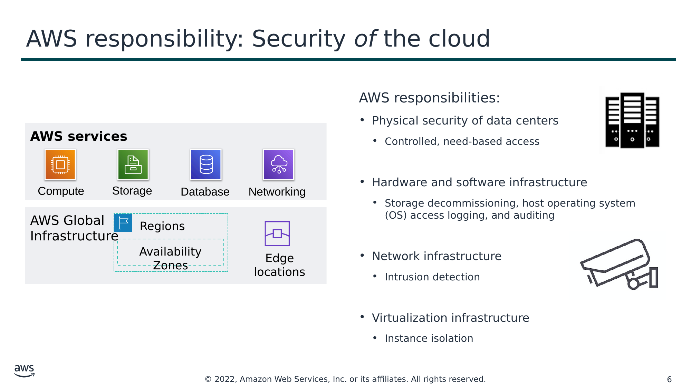

Відповідальність AWS:

- Фізична безпека центрів обробки даних
  - Контрольований доступ за потребою (need-based access)
- Апаратна та програмна інфраструктура
  - Виведення сховищ з експлуатації (decommissioning), журналювання доступу до хостової операційної системи (ОС) і аудит
- Мережева інфраструктура
  - Виявлення вторгнень (intrusion detection)
- Інфраструктура віртуалізації
  - Ізоляція екземплярів

<details>
<summary>Текст зі схеми</summary>

**AWS services (Сервіси AWS)**

Compute (Обчислення)

Storage (Сховище)

Database (Бази даних)

Networking (Мережі)

AWS Global  
Infrastructure (Глобальна інфраструктура AWS)

Regions (Регіони)

Availability Zones (Зони доступності)

Edge locations (Периферійні локації)

</details>

> **Нотатки:**
>
> AWS відповідає за безпеку самої хмари. Але що це означає?  
>
> У межах моделі спільної відповідальності AWS AWS експлуатує, обслуговує та контролює компоненти — від хостової операційної системи на фізичному сервері (bare metal) та рівня віртуалізації гіпервізора до фізичної безпеки приміщень, у яких працюють сервіси. Це означає, що AWS відповідає за захист глобальної інфраструктури, на якій працюють усі сервіси, що пропонуються в хмарі AWS. Глобальна інфраструктура включає регіони AWS, зони доступності та периферійні локації (edge locations).  
>
> AWS відповідає за фізичну інфраструктуру, що розміщує ваші ресурси, зокрема:  
> Фізичну безпеку центрів обробки даних із контрольованим доступом за потребою; вони розташовані в непримітних будівлях, із цілодобовою охороною, двофакторною автентифікацією, журналюванням і перевіркою доступу, відеоспостереженням, розмагнічуванням і знищенням дисків.  
> Апаратну інфраструктуру, як-от сервери, пристрої зберігання та інше обладнання, на яке спирається AWS.  
> Програмну інфраструктуру, що розміщує операційні системи, сервісні застосунки та програмне забезпечення віртуалізації.  
> Мережеву інфраструктуру, як-от маршрутизатори, комутатори, балансувальники навантаження, брандмауери та кабельні системи. AWS також безперервно відстежує мережу на зовнішніх межах, захищає точки доступу та надає надлишкову інфраструктуру з виявленням вторгнень.  
>
> Захист цієї інфраструктури — найвищий пріоритет для AWS. Хоча ви не можете відвідати центри обробки даних чи офіси AWS, щоб на власні очі побачити цей захист, Amazon надає кілька звітів від сторонніх аудиторів, які підтвердили нашу відповідність різним стандартам і нормам комп’ютерної безпеки.

---

## Слайд 7: Відповідальність клієнта: безпека в хмарі (security in the cloud)

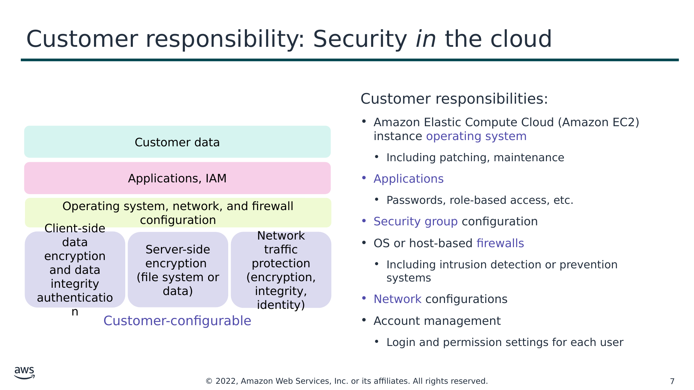

Відповідальність клієнта:

- Операційна система екземпляра Amazon Elastic Compute Cloud (Amazon EC2)
  - Зокрема встановлення виправлень, обслуговування
- Застосунки
  - Паролі, рольовий доступ тощо
- Конфігурація груп безпеки
- Брандмауери рівня ОС або хоста
  - Зокрема системи виявлення чи запобігання вторгнень
- Мережеві конфігурації
- Керування акаунтами
  - Налаштування входу та дозволів для кожного користувача

Customer data (Дані клієнта)

Applications, IAM (Застосунки, IAM)

Operating system, network, and firewall configuration (Конфігурація операційної системи, мережі та брандмауера)

Client-side data  
encryption and data integrity authentication (Шифрування даних на стороні клієнта та автентифікація цілісності даних)

Server-side encryption  
(file system or data) (Серверне шифрування (файлова система чи дані))

Network traffic protection  
(encryption, integrity, identity) (Захист мережевого трафіку (шифрування, цілісність, ідентичність))

Customer-configurable (Настроюється клієнтом)

> **Нотатки:**
>
> Хоча хмарну інфраструктуру захищає та підтримує AWS, клієнти відповідають за безпеку всього, що вони розміщують у хмарі.  
> Клієнт відповідає за те, що впроваджується за допомогою сервісів AWS, і за застосунки, підключені до AWS. Кроки безпеки, які потрібно виконати, залежать від сервісів, що ви використовуєте, і складності вашої системи.  
> Обов’язки клієнта включають вибір і захист будь-яких операційних систем екземплярів, захист застосунків, запущених на ресурсах AWS, конфігурації груп безпеки, конфігурації брандмауерів, мережеві конфігурації та безпечне керування акаунтами.  
> Коли клієнти використовують сервіси AWS, вони зберігають повний контроль над своїм контентом. Клієнти відповідають за керування критичними вимогами безпеки контенту, зокрема:  
> Який контент вони обирають зберігати в AWS  
> Які сервіси AWS використовуються з цим контентом  
> У якій країні зберігається цей контент  
> Формат і структура цього контенту та те, чи його маскують, анонімізують або шифрують  
> Хто має доступ до цього контенту й як ці права доступу надаються, керуються та скасовуються  
>
> Клієнти зберігають контроль над тим, які засоби безпеки вони обирають впроваджувати для захисту власних даних, середовища, застосунків, конфігурацій IAM та операційних систем.

---

## Слайд 8: Характеристики сервісів і відповідальність за безпеку (1 із 2)

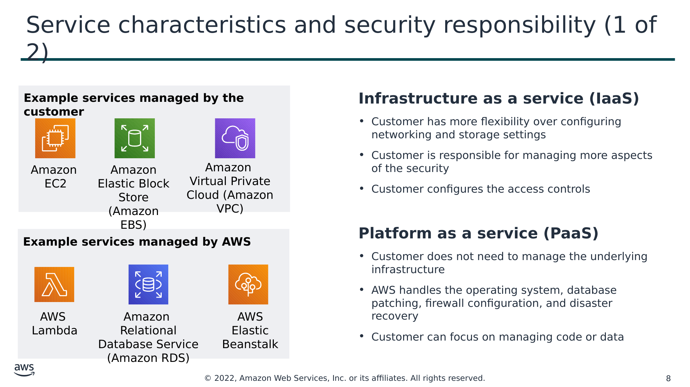

**Інфраструктура як послуга (IaaS)**

- Клієнт має більше гнучкості щодо налаштування мережі та сховищ
- Клієнт відповідає за керування більшою кількістю аспектів безпеки
- Клієнт налаштовує засоби контролю доступу

**Платформа як послуга (PaaS)**

- Клієнту не потрібно керувати базовою інфраструктурою
- AWS виконує операційну систему, виправлення баз даних, конфігурацію брандмауера й аварійне відновлення
- Клієнт може зосередитися на керуванні кодом чи даними

<details>
<summary>Текст зі схеми</summary>

**Example services managed by the customer (Приклади сервісів, якими керує клієнт)**

Amazon  
EC2

Amazon Elastic Block Store (Amazon EBS)

Amazon  
Virtual Private Cloud (Amazon VPC)

**Example services managed by AWS (Приклади сервісів, якими керує AWS)**

AWS  
Lambda

Amazon  
Relational Database Service (Amazon RDS)

AWS Elastic Beanstalk

</details>

> **Нотатки:**
>
> Інфраструктура як послуга (IaaS) означає сервіси, що надають базові будівельні блоки для хмарної ІТ, зазвичай включно з доступом до налаштування мереж, комп’ютерів (віртуальних або на виділеному обладнанні) і простору для зберігання даних. Хмарні сервіси, які можна охарактеризувати як IaaS, надають клієнту найвищий рівень гнучкості та контролю керування над ІТ-ресурсами. Сервіси IaaS найбільше схожі на наявні локальні (on-premises) обчислювальні ресурси, з якими сьогодні знайомі багато ІТ-відділів.  
>
> Сервіси AWS — як-от Amazon EC2 — можна віднести до IaaS, і тому вони вимагають, щоб клієнт виконував усі необхідні завдання налаштування та керування безпекою. Клієнти, які розгортають екземпляри EC2, відповідають за керування гостьовою операційною системою (зокрема оновленнями та виправленнями безпеки), будь-яким прикладним програмним забезпеченням, встановленим на екземплярах, і конфігурацією груп безпеки, наданих AWS.  
>
> Платформа як послуга (PaaS) означає сервіси, що усувають потребу клієнта керувати базовою інфраструктурою (апаратне забезпечення, операційні системи тощо). Сервіси PaaS дають клієнту змогу повністю зосередитися на розгортанні застосунків і керуванні ними. Клієнтам не потрібно турбуватися про закупівлю ресурсів, планування потужностей, обслуговування чи виправлення програмного забезпечення.  
>
> Сервіси AWS, як-от AWS Lambda та Amazon RDS, можна віднести до PaaS, оскільки AWS експлуатує рівень інфраструктури, операційну систему та платформи. Клієнтам потрібно лише звертатися до кінцевих точок, щоб зберігати й отримувати дані. З сервісами PaaS клієнти відповідають за керування своїми даними, класифікацію своїх активів і застосування відповідних дозволів. Однак ці сервіси діють більше як керовані сервіси, де AWS виконує більшу частину вимог безпеки. Для цих сервісів AWS виконує базові завдання безпеки — як-от встановлення виправлень операційної системи й бази даних, конфігурацію брандмауера та аварійне відновлення.

---

## Слайд 9: Характеристики сервісів і відповідальність за безпеку (2 із 2)

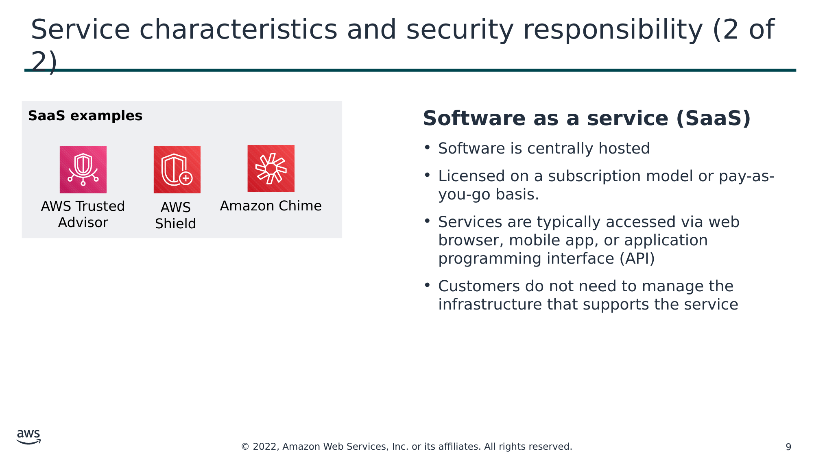

**Приклади SaaS**

**Програмне забезпечення як послуга (SaaS)**

- Програмне забезпечення централізовано розміщене
- Ліцензується за моделлю підписки або з оплатою за фактом використання (pay-as-you-go).
- Доступ до сервісів зазвичай здійснюється через вебпереглядач, мобільний застосунок або прикладний програмний інтерфейс (API)
- Клієнтам не потрібно керувати інфраструктурою, що підтримує сервіс

AWS Trusted  
Advisor

AWS Shield

Amazon Chime

> **Нотатки:**
>
> Програмне забезпечення як послуга (SaaS) означає сервіси, що надають централізовано розміщене програмне забезпечення, яке зазвичай доступне через вебпереглядач, мобільний застосунок або прикладний програмний інтерфейс (API). Модель ліцензування пропозицій SaaS зазвичай — підписка або оплата за фактом використання. З пропозиціями SaaS клієнтам не потрібно керувати інфраструктурою, що підтримує сервіс. Деякі сервіси AWS — як-от AWS Trusted Advisor, AWS Shield та Amazon Chime — з огляду на їхні характеристики можна віднести до пропозицій SaaS.  
>
> AWS Trusted Advisor — це онлайн-інструмент, що аналізує ваше середовище AWS і надає рекомендації в реальному часі, щоб допомогти вам розгортати ресурси відповідно до найкращих практик AWS. Сервіс Trusted Advisor пропонується як частина вашого плану підтримки AWS (AWS Support plan). Деякі функції Trusted Advisor безкоштовні для всіх акаунтів, але клієнти з планами Business Support і Enterprise Support мають доступ до повного набору перевірок і рекомендацій Trusted Advisor.  
>
> AWS Shield — це кероване обслуговування захисту від розподілених атак «відмова в обслуговуванні» (DDoS), що захищає застосунки, які працюють в AWS. Воно забезпечує постійне виявлення та автоматичне вбудоване пом’якшення, що мінімізують простій і затримку застосунків, тож для користування захистом від DDoS не потрібно звертатися до служби підтримки AWS. AWS Shield Advanced доступний усім клієнтам. Однак щоб зв’язатися з командою реагування на DDoS (DDoS Response Team), клієнти повинні мати план Enterprise Support або Business Support від AWS Support.  
>
> Amazon Chime — це сервіс зв’язку, що дає змогу проводити зустрічі, спілкуватися в чаті та здійснювати бізнес-дзвінки всередині та поза вашою організацією за допомогою єдиного застосунку. Це сервіс зв’язку з оплатою за фактом використання без авансових платежів, зобов’язань чи довгострокових контрактів.

---

## Слайд 10: Практична вправа: модель спільної відповідальності AWS


Фото: Pixabay (Pexels).

> **Нотатки:**
>
> У цій вправі під керівництвом викладача вам буде запропоновано два сценарії. Для кожного сценарію вам поставлять кілька запитань про те, чия відповідальність (AWS чи клієнта) — забезпечувати безпеку відповідного елемента. Викладач проведе обговорення кожного запитання з класом і розкриватиме правильні відповіді по одній.

---

## Слайд 11: Практична вправа: сценарій 1 із 2

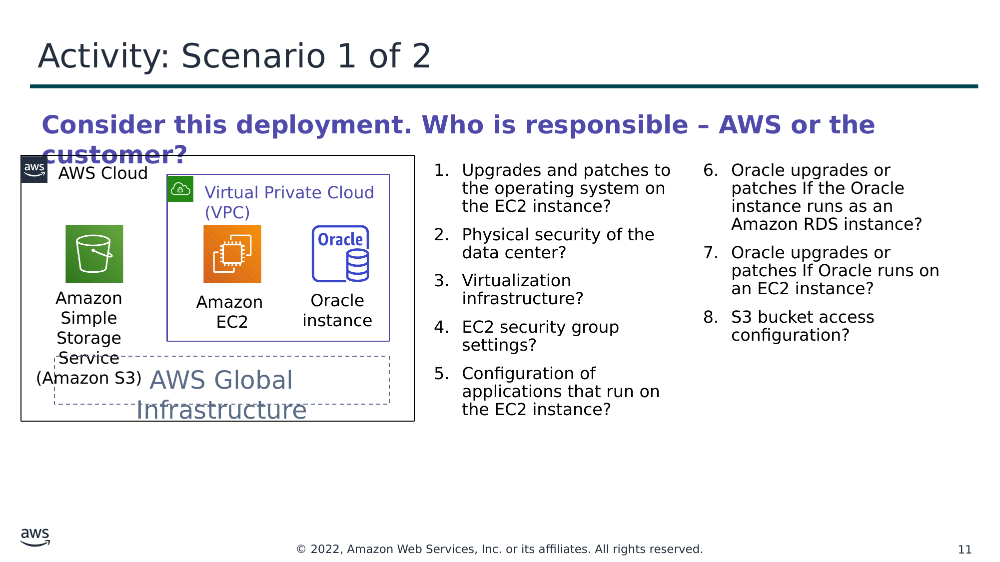

**Розгляньте це розгортання. Хто відповідає — AWS чи клієнт?**

1. Оновлення та виправлення операційної системи на екземплярі EC2?
2. Фізична безпека центру обробки даних?
3. Інфраструктура віртуалізації?
4. Налаштування групи безпеки EC2?
5. Конфігурація застосунків, що працюють на екземплярі EC2?
6. Оновлення чи виправлення Oracle, якщо екземпляр Oracle працює як екземпляр Amazon RDS?
7. Оновлення чи виправлення Oracle, якщо Oracle працює на екземплярі EC2?
8. Конфігурація доступу до бакета S3?

<details>
<summary>Текст зі схеми</summary>

AWS Cloud

Virtual Private Cloud (VPC)

Amazon Simple Storage Service (Amazon S3)

Amazon  
EC2

Oracle instance (Екземпляр Oracle)

AWS Global Infrastructure

</details>

> **Нотатки:**
>
> Розгляньте випадок, коли клієнт використовує сервіси та ресурси AWS, показані тут. Хто відповідає за підтримку безпеки? AWS чи клієнт?

---

## Слайд 12: Практична вправа: сценарій 1 із 2 — відповіді

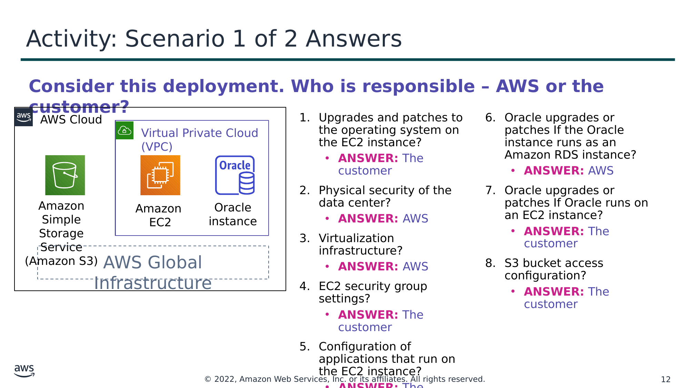

**Розгляньте це розгортання. Хто відповідає — AWS чи клієнт?**

1. Оновлення та виправлення операційної системи на екземплярі EC2?
   - **ВІДПОВІДЬ:** клієнт
2. Фізична безпека центру обробки даних?
   - **ВІДПОВІДЬ:** AWS
3. Інфраструктура віртуалізації?
   - **ВІДПОВІДЬ:** AWS
4. Налаштування групи безпеки EC2?
   - **ВІДПОВІДЬ:** клієнт
5. Конфігурація застосунків, що працюють на екземплярі EC2?
   - **ВІДПОВІДЬ:** клієнт
6. Оновлення чи виправлення Oracle, якщо екземпляр Oracle працює як екземпляр Amazon RDS?
   - **ВІДПОВІДЬ:** AWS
7. Оновлення чи виправлення Oracle, якщо Oracle працює на екземплярі EC2?
   - **ВІДПОВІДЬ:** клієнт
8. Конфігурація доступу до бакета S3?
   - **ВІДПОВІДЬ:** клієнт

<details>
<summary>Текст зі схеми</summary>

AWS Cloud

Virtual Private Cloud (VPC)

Amazon Simple Storage Service (Amazon S3)

Amazon  
EC2

Oracle instance (Екземпляр Oracle)

AWS Global Infrastructure

</details>

> **Нотатки:**
>
> Клієнт використовує Amazon Simple Storage Service (Amazon S3) для зберігання даних. Клієнт налаштував віртуальну приватну хмару (VPC) за допомогою Amazon Virtual Private Cloud (Amazon VPC). Екземпляр EC2 та екземпляр бази даних Oracle, які він створив, обидва працюють у VPC.  
>
> У цьому прикладі клієнт має керувати гостьовою операційною системою (ОС), що працює на екземплярі EC2. З часом гостьову ОС потрібно буде оновлювати й встановлювати на неї виправлення безпеки. Крім того, необхідно підтримувати будь-яке прикладне програмне забезпечення чи утиліти, які клієнт встановив на екземпляр Amazon EC2. Клієнт відповідає за налаштування брандмауера AWS (або групи безпеки), що застосовується до екземпляра Amazon EC2. Клієнт також відповідає за конфігурації VPC, що визначають мережеві умови, у яких працює екземпляр Amazon EC2. Ці завдання — ті самі завдання безпеки, що їх виконував би ІТ-персонал незалежно від того, де розташовані їхні сервери.  
>
> Екземпляр Oracle в цьому прикладі — цікавий кейс з погляду відповідальності AWS чи клієнта. Якщо база даних працює на екземплярі EC2, то встановлення оновлень і виправлень програмного забезпечення Oracle — відповідальність клієнта. Однак якщо база даних працює як екземпляр Amazon RDS, то встановлення оновлень і виправлень програмного забезпечення Oracle — відповідальність AWS. Оскільки Amazon RDS — це керована пропозиція баз даних, трудомісткі завдання адміністрування баз даних — зокрема розгортання, резервне копіювання, встановлення виправлень програмного забезпечення, моніторинг і масштабування апаратного забезпечення — виконує AWS. Щоб дізнатися більше, див. «Найкращі практики запуску Oracle Database в AWS» (Best Practices for Running Oracle Database on AWS) за адресою https://docs.aws.amazon.com/whitepapers/latest/oracle-database-aws-best-practices/oracle-database-aws-best-practices.html для отримання подробиць.

---

## Слайд 13: Практична вправа: сценарій 2 із 2

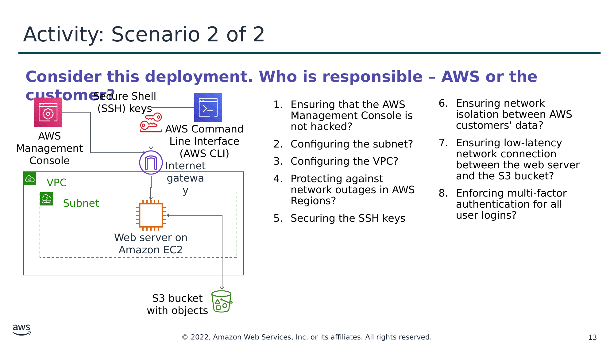

**Розгляньте це розгортання. Хто відповідає — AWS чи клієнт?**

1. Гарантування того, що AWS Management Console не зламано?
2. Конфігурація підмережі (subnet)?
3. Конфігурація VPC?
4. Захист від мережевих збоїв у регіонах AWS?
5. Захист ключів SSH
6. Забезпечення мережевої ізоляції даних клієнтів AWS?
7. Забезпечення мережевого з’єднання з низькою затримкою між вебсервером і бакетом S3?
8. Примусове використання багатофакторної автентифікації для всіх входів користувачів?

<details>
<summary>Текст зі схеми</summary>

Secure Shell (SSH) keys (Ключі SSH)

AWS Command Line Interface (AWS CLI)

AWS Management Console

Internet gateway (Інтернет-шлюз)

VPC

Subnet (Підмережа)

Web server on Amazon EC2 (Вебсервер на Amazon EC2)

S3 bucket with objects (Бакет S3 з об’єктами)

</details>

> **Нотатки:**
>
> Тепер розгляньте цей додатковий випадок, коли клієнт використовує сервіси та ресурси AWS, показані тут. Хто відповідає за підтримку безпеки? AWS чи клієнт?

---

## Слайд 14: Практична вправа: сценарій 2 із 2 — відповіді

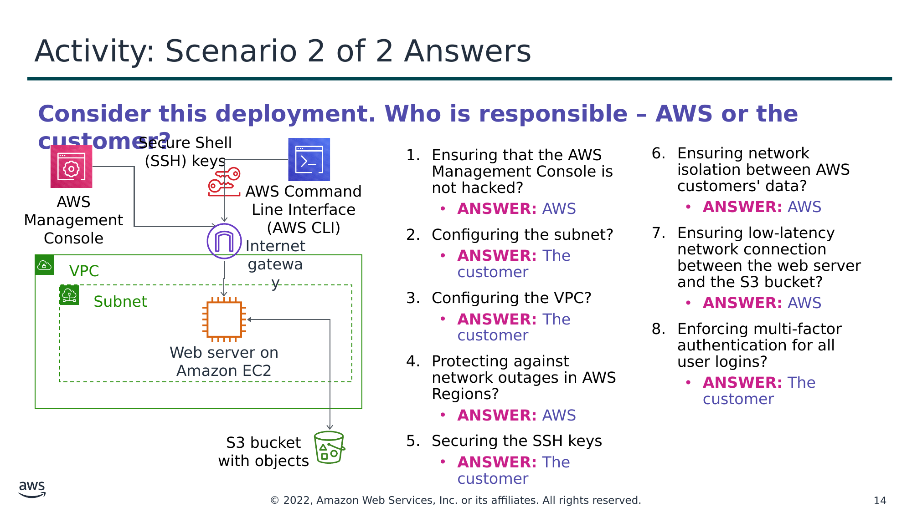

**Розгляньте це розгортання. Хто відповідає — AWS чи клієнт?**

1. Гарантування того, що AWS Management Console не зламано?
   - **ВІДПОВІДЬ:** AWS
2. Конфігурація підмережі (subnet)?
   - **ВІДПОВІДЬ:** клієнт
3. Конфігурація VPC?
   - **ВІДПОВІДЬ:** клієнт
4. Захист від мережевих збоїв у регіонах AWS?
   - **ВІДПОВІДЬ:** AWS
5. Захист ключів SSH
   - **ВІДПОВІДЬ:** клієнт
6. Забезпечення мережевої ізоляції даних клієнтів AWS?
   - **ВІДПОВІДЬ:** AWS
7. Забезпечення мережевого з’єднання з низькою затримкою між вебсервером і бакетом S3?
   - **ВІДПОВІДЬ:** AWS
8. Примусове використання багатофакторної автентифікації для всіх входів користувачів?
   - **ВІДПОВІДЬ:** клієнт

<details>
<summary>Текст зі схеми</summary>

Secure Shell (SSH) keys (Ключі SSH)

AWS Command Line Interface (AWS CLI)

AWS Management Console

Internet gateway (Інтернет-шлюз)

VPC

Subnet (Підмережа)

Web server on Amazon EC2 (Вебсервер на Amazon EC2)

S3 bucket with objects (Бакет S3 з об’єктами)

</details>

> **Нотатки:**
>
> Клієнт використовує Amazon S3 для зберігання даних. Клієнт налаштував віртуальну приватну хмару (VPC) за допомогою Amazon VPC і запускає вебсервер на екземплярі EC2 у VPC. Клієнт налаштував інтернет-шлюз як частину VPC, щоб до вебсервера можна було отримати доступ за допомогою AWS Management Console або AWS Command Line Interface (AWS CLI). Коли клієнт використовує AWS CLI, з’єднання вимагає використання ключів Secure Shell (SSH).

---

## Слайд 15: Ключові висновки розділу 1

- AWS і клієнт розділяють відповідальність за безпеку:
  - AWS відповідає за безпеку самої хмари (security of the cloud)
  - Клієнт відповідає за безпеку в хмарі (security in the cloud)
- **AWS відповідає за захист інфраструктури**, зокрема апаратного забезпечення, програмного забезпечення, мереж і приміщень, на яких працюють хмарні сервіси AWS
- Для сервісів, віднесених до інфраструктури як послуги (IaaS), **клієнт відповідає за виконання необхідних завдань налаштування та керування безпекою**
  - Наприклад, оновлення гостьової ОС і виправлення безпеки, брандмауер, конфігурації груп безпеки

> **Нотатки:**
>
> Основні висновки цього розділу модуля:  
> AWS і клієнт розділяють відповідальність за безпеку –  
> AWS відповідає за безпеку самої хмари  
> Клієнт відповідає за безпеку в хмарі  
> AWS відповідає за захист інфраструктури, зокрема апаратного забезпечення, програмного забезпечення, мереж і приміщень, на яких працюють хмарні сервіси AWS  
> Для сервісів, віднесених до інфраструктури як послуги (IaaS), клієнт відповідає за виконання необхідних завдань налаштування та керування безпекою  
> Наприклад, оновлення гостьової ОС і виправлення безпеки, брандмауер, конфігурації груп безпеки

---

## Слайд 16: Розділ 2: AWS Identity and Access Management (IAM)

Модуль 4: Безпека хмари AWS

> **Нотатки:**
>
> Представляємо Розділ 2: AWS Identity and Access Management (або IAM).

---

## Слайд 17: AWS Identity and Access Management (IAM)

- Використовуйте **IAM** для керування доступом до **ресурсів AWS** –
  - Ресурс — це сутність в акаунті AWS, з якою можна працювати
  - Приклади ресурсів: екземпляр Amazon EC2 або бакет Amazon S3
- *Приклад* – контролюйте, хто може завершувати роботу екземплярів Amazon EC2
- Визначайте деталізовані права доступу –
  - **Хто** може отримати доступ до ресурсу
  - **Які** ресурси доступні та що користувач може з ними робити
  - **Як** можна отримати доступ до ресурсів
- IAM — це безкоштовна функція акаунта AWS

AWS Identity and Access Management

(IAM)

> **Нотатки:**
>
> AWS Identity and Access Management (IAM) дає змогу контролювати доступ до обчислювальних сервісів, сервісів сховищ, баз даних і застосунків у хмарі AWS. IAM можна використовувати для автентифікації, а також для визначення та забезпечення виконання політик авторизації, щоб указувати, які користувачі можуть отримувати доступ до яких сервісів.  
>
> IAM — це інструмент, що централізовано керує доступом до запуску, налаштування, керування та завершення роботи ресурсів у вашому акаунті AWS. Він забезпечує детальний контроль доступу до ресурсів, зокрема можливість указати, які саме виклики API користувач має право робити до кожного сервісу. Незалежно від того, використовуєте ви AWS Management Console, AWS CLI чи набори для розробки програмного забезпечення AWS (SDK), кожен виклик сервісу AWS — це виклик API.  
>
> З IAM ви можете керувати тим, до яких ресурсів хто може отримувати доступ і як можна отримувати доступ до цих ресурсів. Ви можете надавати різні дозволи різним людям для різних ресурсів. Наприклад, деяким користувачам можна дозволити повний доступ до Amazon EC2, Amazon S3, Amazon DynamoDB, Amazon Redshift та інших сервісів AWS. Для інших користувачів можна дозволити доступ лише на читання до кількох бакетів S3. Так само можна надати іншим користувачам дозвіл адмініструвати лише певні екземпляри EC2. Також кільком користувачам можна дозволити доступ лише до інформації про оплату акаунта, але нічого більше.  
>
> IAM — це функція вашого акаунта AWS, і вона пропонується без додаткової плати.

---

## Слайд 18: IAM: основні компоненти

Людина *або* застосунок, що може автентифікуватися в акаунті AWS.

**Користувач IAM (IAM user)**

Набір користувачів IAM, яким надано однакову авторизацію.

**Група IAM (IAM group)**

Документ, що визначає, **до яких ресурсів можна отримати доступ** і **рівень доступу** до кожного ресурсу.

**Політика IAM (IAM policy)**

Зручний механізм для надання набору дозволів на виконання запитів до сервісів AWS.

**Роль IAM (IAM role)**

> **Нотатки:**
>
> Щоб зрозуміти, як використовувати IAM для захисту вашого акаунта AWS, важливо розуміти роль і функцію кожного з чотирьох компонентів IAM.  
>
> Користувач IAM — це людина або застосунок, визначені в акаунті AWS, що мають виконувати виклики API до продуктів AWS. Кожен користувач має мати унікальне ім’я (без пробілів) в акаунті AWS і набір облікових даних безпеки, що не передаються іншим користувачам. Ці облікові дані відрізняються від облікових даних безпеки кореневого акаунта AWS (root user). Кожен користувач визначається лише в одному акаунті AWS.  
>
> Група IAM — це набір користувачів IAM. Групи IAM можна використовувати для спрощення визначення та керування дозволами для кількох користувачів.  
>
> Політика IAM — це документ, що визначає дозволи, щоб визначити, що користувачі можуть робити в акаунті AWS. Політика зазвичай надає доступ до конкретних ресурсів і вказує, що користувач може робити з цими ресурсами. Політики також можуть явно забороняти доступ.  
>
> Роль IAM — це інструмент для надання тимчасового доступу до конкретних ресурсів AWS в акаунті AWS.

---

## Слайд 19: Автентифікація як користувач IAM для отримання доступу

Коли ви визначаєте **користувача IAM**, ви обираєте, які ***типи доступу*** користувачеві дозволено використовувати.

***Програмний (Programmatic)* доступ**

- Автентифікація за допомогою:
  - Ідентифікатора ключа доступу (Access key ID)
  - Секретного ключа доступу (Secret access key)
- Забезпечує доступ AWS CLI та AWS SDK

**Доступ до *AWS Management Console***

- Автентифікація за допомогою:
  - 12-значного ідентифікатора акаунта (Account ID) *або* псевдоніма
  - Імені користувача IAM
  - Пароля IAM
- Якщо ввімкнено, **багатофакторна автентифікація (MFA)** запитує код автентифікації.

AWS CLI

AWS Tools and SDKs

AWS Management Console

> **Нотатки:**
>
> Автентифікація — базова концепція комп’ютерної безпеки: користувач або система спершу мають довести свою особу. Згадайте, як ви автентифікуєте себе в аеропорту, коли хочете пройти контроль безпеки, щоб потрапити на свій рейс. У цій ситуації ви маєте пред’явити працівнику безпеки певну форму посвідчення, щоб довести, хто ви, перш ніж зможете увійти в зону з обмеженим доступом. Подібна концепція застосовується для отримання доступу до ресурсів AWS у хмарі.  
>
> Коли ви визначаєте користувача IAM, ви обираєте, який тип доступу користувачеві дозволено використовувати для доступу до ресурсів AWS. Користувачам можна призначити два різні типи доступу: програмний доступ (programmatic access) і доступ до AWS Management Console. Можна призначити лише програмний доступ, лише доступ до консолі, або обидва типи доступу.  
>
> Якщо ви надаєте програмний доступ, користувач IAM має пред’явити ідентифікатор ключа доступу та секретний ключ доступу, коли виконує виклик API AWS за допомогою AWS CLI, AWS SDK чи іншого інструмента розробки.  
>
> Якщо ви надаєте доступ до AWS Management Console, користувач IAM має заповнити поля, що з’являються у вікні входу в браузері. Користувача просять надати або 12-значний ідентифікатор акаунта, або відповідний псевдонім акаунта. Користувач також має ввести своє ім’я користувача IAM та пароль. Якщо для користувача ввімкнено багатофакторну автентифікацію (MFA), його також попросять ввести код автентифікації.

---

## Слайд 20: MFA в IAM

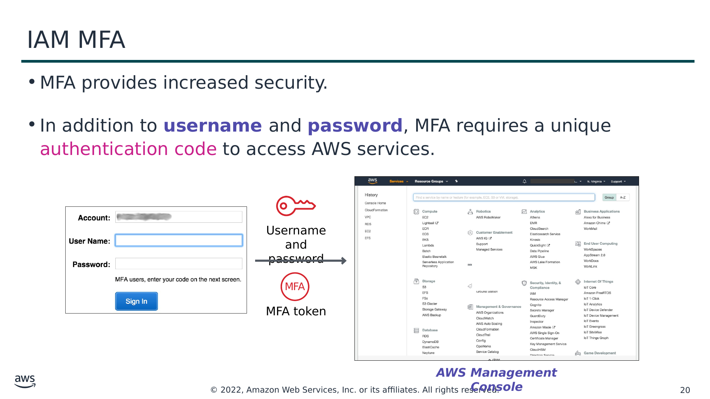

- MFA забезпечує підвищену безпеку.
- Окрім **імені користувача (username)** та **пароля (password)**, MFA вимагає унікальний код автентифікації для доступу до сервісів AWS.

<details>
<summary>Текст зі схеми</summary>

Username and password (Ім’я користувача та пароль)

MFA token (Токен MFA)

***AWS Management Console***

</details>

> **Нотатки:**
>
> Доступ до сервісів і ресурсів AWS можна отримати за допомогою AWS Management Console, AWS CLI або через SDK та API. Для підвищення безпеки ми рекомендуємо ввімкнути MFA.  
> З MFA користувачі й системи мають надати токен MFA — на додачу до звичайних облікових даних для входу — перш ніж вони зможуть отримати доступ до сервісів і ресурсів AWS.  
> Варіанти генерації токена автентифікації MFA включають віртуальні застосунки, сумісні з MFA (як-от Google Authenticator чи Authy 2-Factor Authentication), пристрої з ключами безпеки U2F і апаратні пристрої MFA.

---

## Слайд 21: Авторизація: які дії дозволені

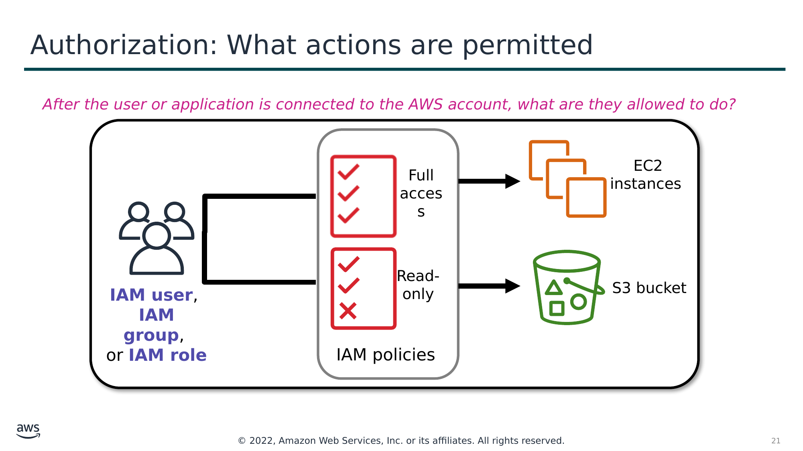

*Після того як користувача чи застосунок підключено до акаунта AWS, що їм дозволено робити?*

<details>
<summary>Текст зі схеми</summary>

EC2 instances (Екземпляри EC2)

Full  
access (Повний доступ)

Read-only (Лише читання)

S3 bucket (Бакет S3)

**IAM user (користувач IAM)**,  
**IAM group (група IAM)**,  
or **IAM role (або роль IAM)**

IAM policies (Політики IAM)

</details>

> **Нотатки:**
>
> Авторизація (authorization) — це процес визначення того, які дозволи слід надати користувачеві, сервісу чи застосунку. Після автентифікації користувача він має бути авторизований для доступу до сервісів AWS.  
> За замовчуванням користувачі IAM не мають дозволів на доступ до жодних ресурсів чи даних в акаунті AWS. Натомість потрібно явно надати дозволи користувачеві, групі чи ролі, створивши політику (policy) — документ у форматі JavaScript Object Notation (JSON). Політика перелічує дозволи, що дозволяють або забороняють доступ до ресурсів в акаунті AWS.

---

## Слайд 22: IAM: авторизація

- Призначайте дозволи, створюючи політику IAM.
- Дозволи визначають, **які ресурси та операції** дозволено:
- Усі дозволи за замовчуванням неявно заборонені.
- Якщо щось явно заборонено, це ніколи не дозволяється.

Найкраща практика**:** дотримуйтеся **принципу найменших привілеїв (principle of least privilege)**.

Примітка: область дії конфігурацій сервісу IAM — **глобальна**. Налаштування застосовуються в усіх регіонах AWS.


**Дозволи IAM (IAM permissions)**

> **Нотатки:**
>
> Щоб призначити дозвіл користувачеві, групі чи ролі, потрібно створити політику IAM (або знайти наявну політику в акаунті). Дозволів за замовчуванням немає. Усі дії в акаунті за замовчуванням заборонені користувачеві (неявна заборона, implicit deny), якщо ці дії не дозволені явно. Будь-які дії, які ви явно не дозволяєте, заборонені. Будь-які дії, які ви явно забороняєте, завжди заборонені.  
>
> Принцип найменших привілеїв — важлива концепція комп’ютерної безпеки. Він передбачає, що ви надаєте користувачеві лише мінімальні потрібні привілеї на основі потреб ваших користувачів. Коли ви створюєте політики IAM, найкраща практика — дотримуватися цієї поради з безпеки щодо надання найменших привілеїв. Визначте, що користувачі повинні мати змогу робити, а потім складіть для них політики, що дозволяють користувачам виконувати лише ці завдання. Почніть з мінімального набору дозволів і надавайте додаткові дозволи за потреби. Це безпечніше, ніж починати з надто широких дозволів, а потім намагатися обмежити надані дозволи.  
>
> Зверніть увагу, що область дії конфігурацій сервісу IAM — глобальна. Налаштування не визначаються на рівні регіону AWS. Налаштування IAM застосовуються в усіх регіонах AWS.

---

## Слайд 23: Політики IAM

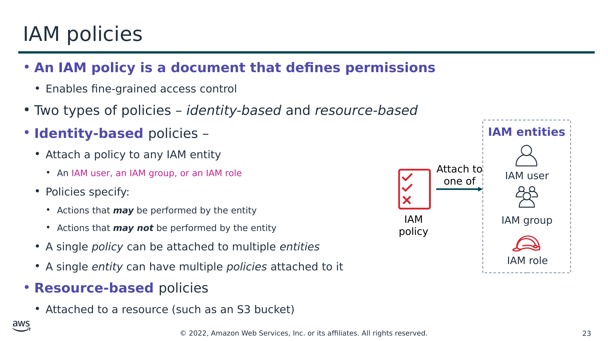

- **Політика IAM — це документ, що визначає дозволи**
  - Забезпечує детальний контроль доступу
- Два типи політик – *на основі ідентичності (identity-based)* та *на основі ресурсів (resource-based)*
- Політики **на основі ідентичності** –
  - Прикріплюйте політику до будь-якої сутності IAM
    - Користувача IAM, групи IAM або ролі IAM
  - Політики визначають:
    - Дії, які ***може*** виконувати сутність
    - Дії, які ***не може*** виконувати сутність
  - Одну *політику* можна прикріпити до кількох *сутностей*
  - До однієї *сутності* можна прикріпити кілька *політик*
- Політики **на основі ресурсів**
  - Прикріплюються до ресурсу (як-от бакет S3)

<details>
<summary>Текст зі схеми</summary>

**IAM entities (Сутності IAM)**

Attach to one of (Прикріпити до однієї з)

IAM user (Користувач IAM)

IAM policy (Політика IAM)

IAM group (Група IAM)

IAM role (Роль IAM)

</details>

> **Нотатки:**
>
> Політика IAM — це формальна інструкція щодо дозволів, які буде надано сутності. Політики можна прикріплювати до будь-якої сутності IAM. Сутності включають користувачів, групи, ролі або ресурси. Наприклад, можна прикріпити політику до ресурсів AWS, що блокуватиме всі запити, які не надходять із затвердженого діапазону адрес Internet Protocol (IP). Політики визначають, які дії дозволено, до яких ресурсів дозволено ці дії та який буде ефект, коли користувач запитує доступ до ресурсів.  
>
> Порядок, у якому оцінюються політики, не впливає на результат оцінювання. Оцінюються всі політики, і результатом завжди є те, що запит або дозволено, або відхилено. Коли виникає конфлікт, застосовується найсуворіша політика.  
>
> Існує два типи політик IAM. Політики на основі ідентичності — це політики дозволів, які можна прикріпити до принципала (або ідентичності), як-от користувача, ролі чи групи IAM. Ці політики контролюють, які дії ця ідентичність може виконувати, до яких ресурсів і за яких умов. Політики на основі ідентичності можна далі поділити на:  
> Керовані політики (Managed policies) — самостійні політики на основі ідентичності, які можна прикріпити до кількох користувачів, груп і ролей у вашому акаунті AWS  
> Вбудовані політики (Inline policies) — політики, які ви створюєте й підтримуєте та які вбудовано безпосередньо в одну групу користувачів чи роль.  
>
> Політики на основі ресурсів — це документи політик JSON, які ви прикріплюєте до ресурсу, як-от бакет S3. Ці політики контролюють, які дії вказаний принципал може виконувати над цим ресурсом і за яких умов.

---

## Слайд 24: Приклад політики IAM

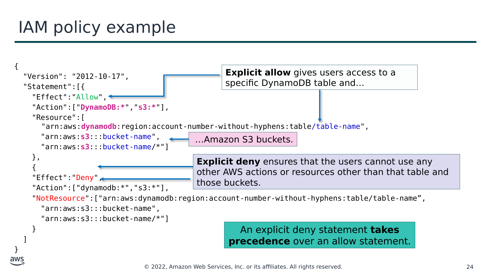

Явна інструкція deny **має пріоритет** над інструкцією allow.

<details>
<summary>Текст зі схеми</summary>

```
{
  "Version": "2012-10-17",
  "Statement":[{
    "Effect":"Allow",
    "Action":["DynamoDB:*","s3:*"],
    "Resource":[
    "arn:aws:dynamodb:region:account-number-without-hyphens:table/table-name",
      "arn:aws:s3:::bucket-name",
      "arn:aws:s3:::bucket-name/*"]
    },
    {
    "Effect":"Deny",
    "Action":["dynamodb:*","s3:*"],
    "NotResource":["arn:aws:dynamodb:region:account-number-without-hyphens:table/table-name”,
      "arn:aws:s3:::bucket-name",
      "arn:aws:s3:::bucket-name/*"]
    }
  ]
}
```

**Explicit allow (Явний дозвіл)** надає користувачам доступ до конкретної таблиці DynamoDB і…

…бакетів Amazon S3.

**Explicit deny (Явна заборона)** гарантує, що користувачі не можуть використовувати жодні інші дії чи ресурси AWS, окрім цієї таблиці та цих бакетів.

</details>

> **Нотатки:**
>
> Як зазначалося раніше, документи політик IAM пишуться у форматі JSON.  
>
> Приклад політики IAM надає користувачам доступ лише до таких ресурсів:  
> Таблиця DynamoDB, ім’я якої представлено як table-name.  
> Бакет S3 акаунта AWS, ім’я якого представлено як bucket-name, і всі об’єкти, які він містить.  
>
> Політика IAM також містить елемент явної заборони ("Effect":"Deny"). Елемент NotResource допомагає гарантувати, що користувачі не можуть використовувати жодних інших дій чи ресурсів DynamoDB або S3, окрім дій і ресурсів, указаних у політиці, — навіть якщо дозволи надано в іншій політиці. Явна інструкція deny має пріоритет над інструкцією allow.

---

## Слайд 25: Політики на основі ресурсів (resource-based policies)

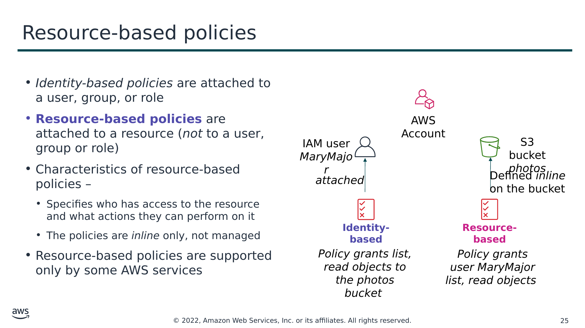

- *Політики на основі ідентичності (Identity-based policies)* прикріплюються до користувача, групи чи ролі
- **Політики на основі ресурсів (Resource-based policies)** прикріплюються до ресурсу (*а не* до користувача, групи чи ролі)
- Характеристики політик на основі ресурсів –
  - Визначають, хто має доступ до ресурсу та які дії може над ним виконувати
  - Політики лише *вбудовані (inline)*, не керовані
- Політики на основі ресурсів підтримують лише деякі сервіси AWS

<details>
<summary>Текст зі схеми</summary>

AWS Account (Акаунт AWS)

IAM user *MaryMajor* (Користувач IAM *MaryMajor*)

S3 bucket *photos* (Бакет S3 *photos*)

*attached (прикріплено)*

Defined *inline* (Визначено *вбудовано*)  
on the bucket (в бакеті)

**Identity-based policy (Політика на основі ідентичності)**

**Resource-based policy (Політика на основі ресурсу)**

*Policy grants list, read objects to the photos bucket (Політика надає права перегляду списку та читання об’єктів у бакеті photos)*

*Policy grants user MaryMajor list, read objects (Політика надає користувачеві MaryMajor права перегляду списку та читання об’єктів)*

</details>

> **Нотатки:**
>
> Тоді як політики на основі ідентичності прикріплюються до користувача, групи чи ролі, політики на основі ресурсів прикріплюються до ресурсу, як-от бакет S3. Ці політики визначають, хто може отримувати доступ до ресурсу та які дії може над ним виконувати.  
>
> Політики на основі ресурсів визначаються лише вбудовано, що означає, що ви визначаєте політику на самому ресурсі, а не створюєте окремий документ політики IAM, який потім прикріплюєте. Наприклад, щоб створити політику бакета S3 (тип політики на основі ресурсів) для бакета S3, перейдіть до бакета, натисніть вкладку Permissions, натисніть кнопку Bucket Policy і визначте там документ політики у форматі JSON. Список контролю доступу (ACL) Amazon S3 — це ще один приклад політики на основі ресурсів.  
>
> Схема показує два різні способи, якими користувачеві MaryMajor можна надати доступ до об’єктів у бакеті S3 з назвою photos. Ліворуч ви бачите приклад політики на основі ідентичності. До користувача MaryMajor прикріплено політику IAM, що надає доступ до бакета S3. Праворуч ви бачите приклад політики на основі ресурсу. Політика бакета S3 для бакета photos указує, що користувачеві MaryMajor дозволено переглядати список і читати об’єкти в бакеті.  
>
> Зверніть увагу, що в політиці бакета можна визначити інструкцію deny, щоб обмежити доступ конкретним користувачам IAM, навіть якщо користувачам надано доступ в окремій політиці на основі ідентичності. Явна інструкція deny завжди матиме пріоритет над будь-якою інструкцією allow.

---

## Слайд 26: Дозволи IAM (IAM permissions)

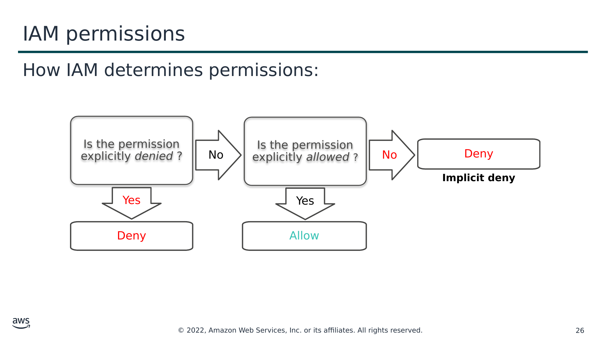

Як IAM визначає дозволи:

<details>
<summary>Текст зі схеми</summary>

Is the permission explicitly *denied* ? (Чи дозвіл явно *заборонено*?)

Is the permission explicitly *allowed* ? (Чи дозвіл явно *дозволено*?)

No (Ні)

No (Ні)

Deny (Заборона)

**Implicit deny (Неявна заборона)**

Yes (Так)

Yes (Так)

Deny (Заборона)

Allow (Дозвіл)

</details>

> **Нотатки:**
>
> Політики IAM дають змогу точно налаштувати привілеї, надані користувачам, групам і ролям IAM.  
>
> Коли IAM визначає, чи дозволено дозвіл, IAM спершу перевіряє наявність будь-якої застосовної політики явної заборони. Якщо явної заборони немає, він потім перевіряє наявність будь-якої застосовної політики явного дозволу. Якщо немає ні політики явної заборони, ні політики явного дозволу, IAM повертається до типового значення — заборонити доступ. Цей процес називається неявною забороною (implicit deny). Користувачеві буде дозволено виконати дію, лише якщо запитану дію явно не заборонено й явно дозволено.  
>
> Під час розробки політик IAM може бути складно з’ясувати, чи буде надано сутності IAM доступ до ресурсу. Інструмент IAM Policy Simulator за адресою https://docs.aws.amazon.com/IAM/latest/UserGuide/access_policies_testing-policies.html — корисний інструмент для тестування та усунення проблем із політиками IAM.

---

## Слайд 27: Групи IAM (IAM groups)

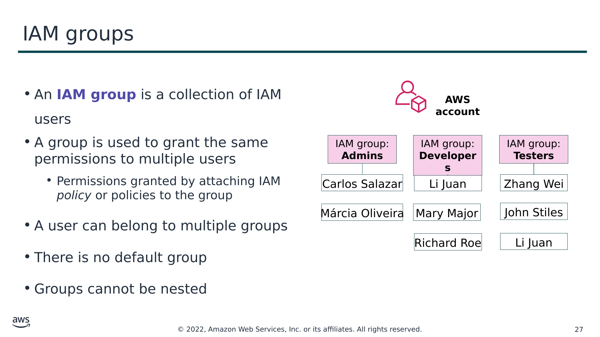

- **Група IAM (IAM group)** — це набір користувачів IAM
- Групу використовують, щоб надати однакові дозволи кільком користувачам
  - Дозволи надаються шляхом прикріплення до групи *політики* чи *політик* IAM
- Користувач може належати до кількох груп
- Групи за замовчуванням немає
- Групи не можна вкладати одна в одну

<details>
<summary>Текст зі схеми</summary>

**AWS account (Акаунт AWS)**

IAM group (Група IAM):  
**Admins**

IAM group (Група IAM):  
**Developers**

IAM group (Група IAM):  
**Testers**

Carlos Salazar

Li Juan

Zhang Wei

Márcia Oliveira

Mary Major

John Stiles

Richard Roe

Li Juan

</details>

> **Нотатки:**
>
> Група IAM — це набір користувачів IAM. Групи IAM пропонують зручний спосіб визначити дозволи для набору користувачів, що може полегшити керування дозволами цих користувачів.  
>
> Наприклад, можна створити групу IAM під назвою Developers і прикріпити до групи Developers політику IAM або кілька політик IAM, що надають дозволи на доступ до ресурсів AWS, які зазвичай потрібні розробникам. Будь-який користувач, якого ви потім додасте до групи Developers, автоматично матиме дозволи, призначені групі. У такому випадку не потрібно прикріплювати політику чи політики IAM безпосередньо до користувача. Якщо до вашої організації приєднується новий користувач, якому слід надати привілеї розробника, ви можете просто додати цього користувача до групи Developers. Так само, якщо людина змінює посаду у вашій організації, замість редагування дозволів цього користувача просто видаліть користувача з групи.  
>
> Важливі характеристики груп IAM:  
> Група може містити багато користувачів, а користувач може належати до кількох груп.  
> Групи не можна вкладати одна в одну. Група може містити лише користувачів, а група не може містити інших груп.  
> Немає групи за замовчуванням, що автоматично включає всіх користувачів акаунта AWS. Якщо ви хочете мати групу з усіма користувачами акаунта, потрібно створити групу й додавати до неї кожного нового користувача.

---

## Слайд 28: Ролі IAM (IAM roles)

- **Роль IAM (IAM role)** — це ідентичність IAM із конкретними дозволами
- Подібна до користувача IAM
  - До неї прикріплюють політики дозволів
- Відрізняється від користувача IAM
  - Не прив’язана виключно до однієї людини
  - Призначена для того, щоб її міг *прийняти (assume)* **людина**, **застосунок** або **сервіс**
- Роль надає *тимчасові* облікові дані безпеки
- Приклади того, як ролі IAM використовуються для **делегування (delegate)** доступу –
  - Використовується користувачем IAM в тому самому акаунті AWS, що й роль
  - Використовується сервісом AWS — як-от Amazon EC2 — в тому самому акаунті, що й роль
  - Використовується користувачем IAM в іншому акаунті AWS, ніж роль

**Роль IAM (IAM role)**

> **Нотатки:**
>
> Роль IAM — це ідентичність IAM, яку можна створити у вашому акаунті й яка має конкретні дозволи. Роль IAM подібна до користувача IAM, оскільки це також ідентичність AWS, до якої можна прикріплювати політики дозволів, і ці дозволи визначають, що ідентичність може й не може робити в AWS. Однак замість того щоб бути виключно прив’язаною до однієї людини, роль призначена для того, щоб її міг прийняти будь-хто, кому вона потрібна. Також роль не має стандартних довгострокових облікових даних, як-от пароль чи ключі доступу. Натомість, коли ви приймаєте роль, вона надає вам тимчасові облікові дані безпеки для вашого сеансу ролі.  
>
> Ролі можна використовувати для делегування доступу користувачам, застосункам чи сервісам, які зазвичай не мають доступу до ваших ресурсів AWS. Наприклад, ви можете захотіти надати користувачам у вашому акаунті AWS доступ до ресурсів, яких вони зазвичай не мають, або надати користувачам в одному акаунті AWS доступ до ресурсів в іншому акаунті. Або ви можете захотіти дозволити мобільному застосунку використовувати ресурси AWS, але не хочете вбудовувати ключі AWS у застосунок (де ключі складно змінювати, а користувачі потенційно можуть їх витягти й зловживати ними). Також іноді ви можете захотіти надати доступ до AWS користувачам, які вже мають ідентичності, визначені поза AWS, наприклад у вашому корпоративному каталозі. Або ви можете захотіти надати доступ до вашого акаунта третім сторонам, щоб вони могли провести аудит ваших ресурсів.  
>
> Для всіх цих прикладів сценаріїв використання ролі IAM є основним компонентом реалізації хмарного розгортання.

---

## Слайд 29: Приклад використання ролі IAM

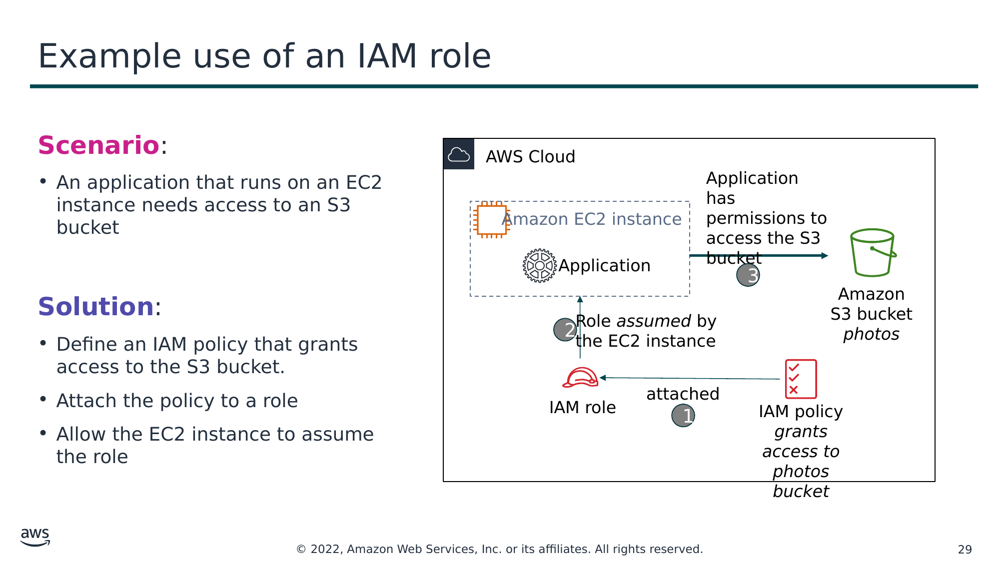

**Сценарій (Scenario)**:

- Застосунок, що працює на екземплярі EC2, потребує доступу до бакета S3

**Рішення (Solution)**:

- Визначте політику IAM, що надає доступ до бакета S3.
- Прикріпіть політику до ролі
- Дозвольте екземпляру EC2 прийняти роль

<details>
<summary>Текст зі схеми</summary>

AWS Cloud

Application has permissions to access the S3 bucket (Застосунок має дозволи на доступ до бакета S3)

Amazon EC2 instance (Екземпляр Amazon EC2)

Application (Застосунок)

3

Amazon S3 bucket *photos* (Бакет Amazon S3 *photos*)

2

Role *assumed* by  
the EC2 instance (Роль, яку *приймає* екземпляр EC2)

attached (прикріплено)

IAM role (Роль IAM)

1

IAM policy *grants access to photos bucket* (Політика IAM *надає доступ до бакета photos*)

</details>

> **Нотатки:**
>
> На схемі розробник запускає застосунок на екземплярі EC2, якому потрібен доступ до бакета S3 з назвою photos. Адміністратор створює роль IAM і прикріплює роль до екземпляра EC2. Роль включає політику дозволів, що надає доступ лише на читання до вказаного бакета S3. Вона також включає політику довіри (trust policy), що дозволяє екземпляру EC2 прийняти роль і отримати тимчасові облікові дані. Коли застосунок працює на екземплярі, він може використовувати тимчасові облікові дані ролі для доступу до бакета photos. Адміністратору не потрібно надавати розробнику застосунку дозвіл на доступ до бакета photos, а розробнику ніколи не потрібно передавати чи керувати обліковими даними.  
>
> Щоб дізнатися більше подробиць про цей приклад, див. «Використання ролі IAM для надання дозволів застосункам, що працюють на екземплярах Amazon EC2» (Using an IAM Role to Grant Permissions to Applications Running on Amazon EC2 Instances) за адресою https://docs.aws.amazon.com/IAM/latest/UserGuide/id_roles_use_switch-role-ec2.html.

---

## Слайд 30: Ключові висновки розділу 2

- **Політики IAM** створюються за допомогою JavaScript Object Notation (JSON) і визначають дозволи.
  - Політики IAM можна прикріплювати до будь-якої **сутності IAM**.
  - Сутності — це користувачі IAM, групи IAM і ролі IAM.
- **Користувач IAM** надає людині, застосунку чи сервісу спосіб автентифікуватися в AWS.
- **Група IAM** — це простий спосіб прикріпити однакові політики до кількох користувачів.
- До **ролі IAM** можна прикріпити політики дозволів, і її можна використовувати для делегування тимчасового доступу користувачам чи застосункам.

> **Нотатки:**
>
> Основні висновки цього розділу модуля:  
> Політики IAM створюються за допомогою JavaScript Object Notation (JSON) і визначають дозволи.  
> Політики IAM можна прикріплювати до будь-якої сутності IAM.  
> Сутності — це користувачі IAM, групи IAM і ролі IAM.  
> Користувач IAM надає людині, застосунку чи сервісу спосіб автентифікуватися в AWS.  
> Група IAM — це простий спосіб прикріпити однакові політики до кількох користувачів.  
> До ролі IAM можна прикріпити політики дозволів, і її можна використовувати для делегування тимчасового доступу користувачам чи застосункам.

---

## Слайд 31: Записана демонстрація: IAM

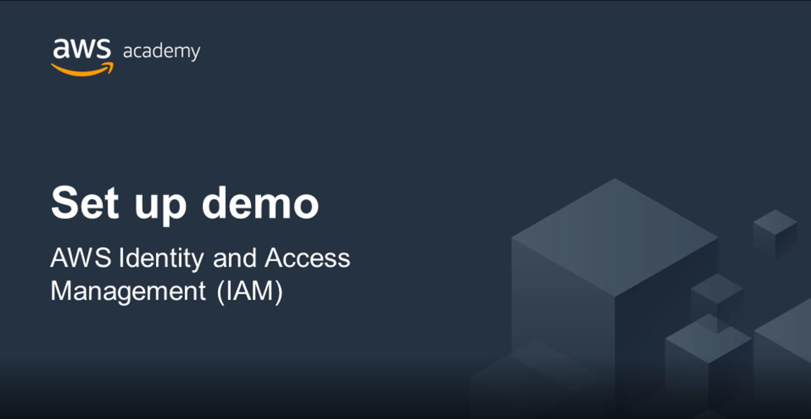

> **Нотатки:**
>
> Тепер знайдіть хвилинку, щоб переглянути демонстрацію IAM за адресою https://aws-tc-largeobjects.s3-us-west-2.amazonaws.com/ILT-TF-100-ACFNDS-20-EN/Module_4_IAM+v2.0.mp4. Запис триває трохи більше 4 хвилин і закріплює багато концепцій, обговорених у цьому розділі модуля.  
>
> Демонстрація показує, як налаштувати такі ресурси за допомогою AWS Management Console:  
> Роль IAM, що використовуватиметься екземпляром EC2  
> Групу IAM  
> Користувача IAM

---

## Слайд 32: Розділ 3: Захист нового акаунта AWS

Модуль 4: Безпека хмари AWS

> **Нотатки:**
>
> Представляємо Розділ 3: Захист нового акаунта AWS.

---

## Слайд 33: Доступ кореневого акаунта AWS та доступ IAM: порівняння

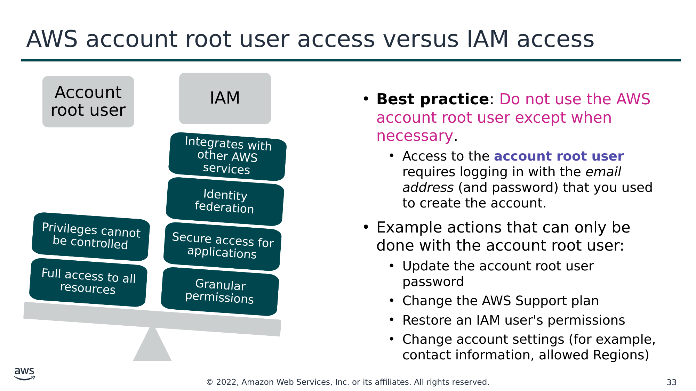

- **Найкраща практика**: не використовуйте кореневий акаунт AWS (root user), крім випадків, коли це необхідно.
  - Доступ до **кореневого акаунта** вимагає входу з *адресою електронної пошти* (і паролем), які ви використали для створення акаунта.
- Приклади дій, які можна виконати лише з кореневого акаунта:
  - Оновити пароль кореневого акаунта
  - Змінити план AWS Support
  - Відновити дозволи користувача IAM
  - Змінити налаштування акаунта (наприклад, контактну інформацію, дозволені регіони)

<details>
<summary>Текст зі схеми</summary>

Account root user (Кореневий акаунт)

IAM

Integrates with other AWS services (Інтегрується з іншими сервісами AWS)

Identity federation (Федерація ідентичностей)

Privileges cannot be controlled (Привілеями не можна керувати)

Secure access for applications (Безпечний доступ для застосунків)

Full access to all resources (Повний доступ до всіх ресурсів)

Granular permissions (Деталізовані дозволи)

</details>

> **Нотатки:**
>
> Коли ви вперше створюєте акаунт AWS, ви починаєте з єдиної ідентичності для входу, що має повний доступ до всіх сервісів і ресурсів AWS в акаунті. Ця ідентичність називається кореневим акаунтом AWS (AWS account root user), і доступ до неї отримують, входячи в AWS Management Console з адресою електронної пошти та паролем, які ви використали для створення акаунта. Кореневі акаунти AWS мають (і зберігають) повний доступ до всіх ресурсів в акаунті. Тому AWS наполегливо рекомендує не використовувати облікові дані кореневого акаунта для щоденної взаємодії з акаунтом.  
>
> Натомість AWS рекомендує використовувати IAM для створення додаткових користувачів і призначення цим користувачам дозволів за принципом найменших привілеїв. Наприклад, якщо вам потрібні дозволи рівня адміністратора, ви можете створити користувача IAM, надати цьому користувачеві повний доступ, а потім використовувати ці облікові дані для взаємодії з акаунтом. Пізніше, якщо потрібно відкликати чи змінити ваші дозволи, ви можете видалити чи змінити будь-які політики, пов’язані з цим користувачем IAM.  
>
> Крім того, якщо у вас є кілька користувачів, яким потрібен доступ до акаунта, ви можете створити унікальні облікові дані для кожного користувача та визначити, який користувач матиме доступ до яких ресурсів. Наприклад, можна створити користувачів IAM з доступом лише на читання до ресурсів у вашому акаунті AWS і розповсюдити ці облікові дані користувачам, яким потрібен доступ на читання. Слід уникати спільного використання тих самих облікових даних кількома користувачами.  
>
> Хоча кореневий акаунт не слід використовувати для рутинних завдань, є кілька завдань, які можна виконати лише з входом як кореневий акаунт. Повний список цих завдань наведено на сторінці документації AWS «Завдання, що потребують облікових даних кореневого акаунта» (Tasks that require root user credentials) за адресою https://docs.aws.amazon.com/general/latest/gr/root-vs-iam.html#aws_tasks-that-require-root.

---

## Слайд 34: Захист нового акаунта AWS: кореневий акаунт (root user)

**Крок 1: припиніть використовувати кореневий акаунт якомога швидше.**

   - Кореневий акаунт має необмежений доступ до всіх ваших ресурсів.
- Щоб припинити використовувати кореневий акаунт:
   1. Поки ви ввійшли як кореневий акаунт, створіть для себе користувача IAM. За потреби збережіть ключі доступу.
   2. Створіть групу IAM, надайте їй повні адміністративні дозволи та додайте до групи користувача IAM.
   3. Вимкніть і видаліть ключі доступу кореневого акаунта, якщо вони існують.
   4. Увімкніть політику паролів для користувачів.
   5. Увійдіть за допомогою нових облікових даних користувача IAM.
   6. Зберігайте облікові дані кореневого акаунта в безпечному місці.

> **Нотатки:**
>
> Щоб припинити використовувати кореневий акаунт, виконайте такі кроки:  
> Поки ви ввійшли як кореневий акаунт, створіть для себе користувача IAM з увімкненим доступом до AWS Management Console (але поки що не прикріплюйте до користувача жодних дозволів). За потреби збережіть ключі доступу користувача IAM.  
> Далі створіть групу IAM, дайте їй назву (наприклад, FullAccess) і прикріпіть до групи політики IAM, що надають повний доступ принаймні до кількох сервісів, якими ви користуватиметеся. Потім додайте користувача IAM до групи.  
> Вимкніть і видаліть ключі доступу кореневого акаунта, якщо вони існують.  
> Увімкніть політику паролів для всіх користувачів. Скопіюйте посилання для входу користувачів IAM зі сторінки IAM Dashboard. Потім вийдіть із кореневого акаунта.  
> Перейдіть за скопійованим посиланням для входу користувачів IAM і увійдіть в акаунт за допомогою нових облікових даних користувача IAM.  
> Зберігайте облікові дані кореневого акаунта в безпечному місці.  
>
> Докладні інструкції щодо налаштування вашого першого користувача IAM і групи IAM див. «Створення вашого першого адміністративного користувача та групи IAM» (Creating Your First IAM Admin User and Group) за адресою https://docs.aws.amazon.com/IAM/latest/UserGuide/getting-started_create-admin-group.html.

---

## Слайд 35: Захист нового акаунта AWS: MFA

**Крок 2: увімкніть багатофакторну автентифікацію (MFA).**

  - Вимагайте MFA для вашого кореневого акаунта та для всіх користувачів IAM.
  - Ви також можете використовувати MFA для контролю доступу до API сервісів AWS.
- Варіанти отримання токена MFA –
  - Віртуальні застосунки, сумісні з MFA:
    - Google Authenticator.
    - Authy Authenticator (застосунок для Windows Phone).
  - Пристрої з ключами безпеки U2F:
    - Наприклад, YubiKey.
  - Апаратні варіанти MFA:
    - Брелок або дисплейна картка, що пропонує [Gemalto](https://safenet.gemalto.com/multi-factor-authentication/).

MFA token (Токен MFA)

> **Нотатки:**
>
> Ще один рекомендований крок для захисту нового акаунта AWS — вимагати багатофакторну автентифікацію (MFA) для входу в кореневий акаунт і для входу всіх інших користувачів IAM. MFA також можна використовувати для контролю програмного доступу. Докладніше див. «Налаштування доступу до API, захищеного MFA» (Configuring MFA-Protected API Access) за адресою https://docs.aws.amazon.com/IAM/latest/UserGuide/id_credentials_mfa_configure-api-require.html.  
>
> Є кілька варіантів отримання токена MFA, потрібного для входу, коли MFA ввімкнено. Варіанти включають віртуальні застосунки, сумісні з MFA (як-от Google Authenticator і Authy Authenticator), пристрої з ключами безпеки U2F і апаратні варіанти MFA, що надають брелок чи дисплейну картку.

---

## Слайд 36: Захист нового акаунта AWS: AWS CloudTrail

**Крок 3: використовуйте AWS CloudTrail.**

   - CloudTrail відстежує активність користувачів у вашому акаунті.
      - Журналює всі запити API до ресурсів у всіх підтримуваних сервісах вашого акаунта.
   - Базова історія подій AWS CloudTrail увімкнена за замовчуванням і безкоштовна.
      - Вона містить усі дані подій керування за останні 90 днів активності акаунта.
- Щоб отримати доступ до CloudTrail –
   1. Увійдіть в **AWS Management Console** і оберіть сервіс **CloudTrail**.
   2. Натисніть **Event history**, щоб переглядати, фільтрувати й шукати події за останні 90 днів.
- **Щоб увімкнути журнали за межами 90 днів і сповіщення про вказані події, створіть трейл (trail).**
   3. На сторінці трейлів консолі CloudTrail натисніть **Create trail**.
   4. Дайте йому назву, застосуйте до всіх регіонів і створіть новий бакет Amazon S3 для зберігання журналів.
   5. Налаштуйте обмеження доступу до бакета S3 (наприклад, доступ мають мати лише адміністратори).

> **Нотатки:**
>
> AWS CloudTrail — це сервіс, що журналює всі запити API до ресурсів у вашому акаунті. Таким чином він забезпечує операційний аудит вашого акаунта.  
>
> AWS CloudTrail увімкнено під час створення акаунта за замовчуванням для всіх акаунтів AWS, і він зберігає запис активності подій керування акаунтом за останні 90 днів. Ви можете переглядати й завантажувати активність вашого акаунта за останні 90 днів щодо операцій створення, зміни та видалення сервісів, що підтримуються CloudTrail, без потреби вручну створювати інший трейл. Докладніше про підтримувані сервіси див. https://docs.aws.amazon.com/awscloudtrail/latest/userguide/cloudtrail-aws-service-specific-topics.html.  
>
> Щоб увімкнути зберігання журналів CloudTrail за межами останніх 90 днів і ввімкнути сповіщення щоразу, коли відбуваються вказані події, створіть новий трейл (що описано на слайді на високому рівні). Докладні покрокові інструкції зі створення трейла в AWS CloudTrail див. «створення трейла» в документації AWS за адресою https://docs.aws.amazon.com/awscloudtrail/latest/userguide/cloudtrail-create-a-trail-using-the-console-first-time.html.

---

## Слайд 37: Захист нового акаунта AWS: звіти про оплату (billing reports)

**Крок 4: увімкніть** звіт про оплату, **як-от AWS Cost and Usage Report.**

- Звіти про оплату надають інформацію про використання вами ресурсів AWS та орієнтовні витрати на це використання.
- AWS доставляє звіти до бакета Amazon S3, який ви вкажете.
  - Звіт оновлюється принаймні раз на день.
- **AWS Cost and Usage Report** відстежує використання вами AWS і надає орієнтовні нарахування, пов’язані з вашим акаунтом AWS, щогодини чи щодня.

> **Нотатки:**
>
> Ще один рекомендований крок для захисту нового акаунта AWS — увімкнути звіти про оплату, як-от AWS Cost and Usage Report. Звіти про оплату надають інформацію про використання вами ресурсів AWS та орієнтовні витрати на це використання. AWS доставляє звіти до бакета Amazon S3, який ви вкажете, і AWS оновлює звіти принаймні раз на день.  
>
> AWS Cost and Usage Report відстежує використання в акаунті AWS і надає орієнтовні нарахування — щогодини чи щодня.  
>
> Докладніше про створення AWS Cost and Usage Report див. документацію AWS за адресою https://docs.aws.amazon.com/cur/latest/userguide/cur-create.html.

---

## Слайд 38: Необов’язково: захист нового акаунта AWS — повне покрокове проходження

<!-- hidden slide -->

Модуль 4: Безпека хмари AWS

> **Нотатки:**
>
> Викладач може за бажанням показати повне покрокове проходження перших двох основних кроків, які потрібно виконати для захисту нового акаунта AWS. (Ці кроки було описано на попередніх слайдах.) Слайди в цьому розділі надають знімки екрана того, як виглядає проходження цього процесу докладно.

---

## Слайд 39: Огляд стану безпеки IAM (IAM security status review)

<!-- hidden slide -->

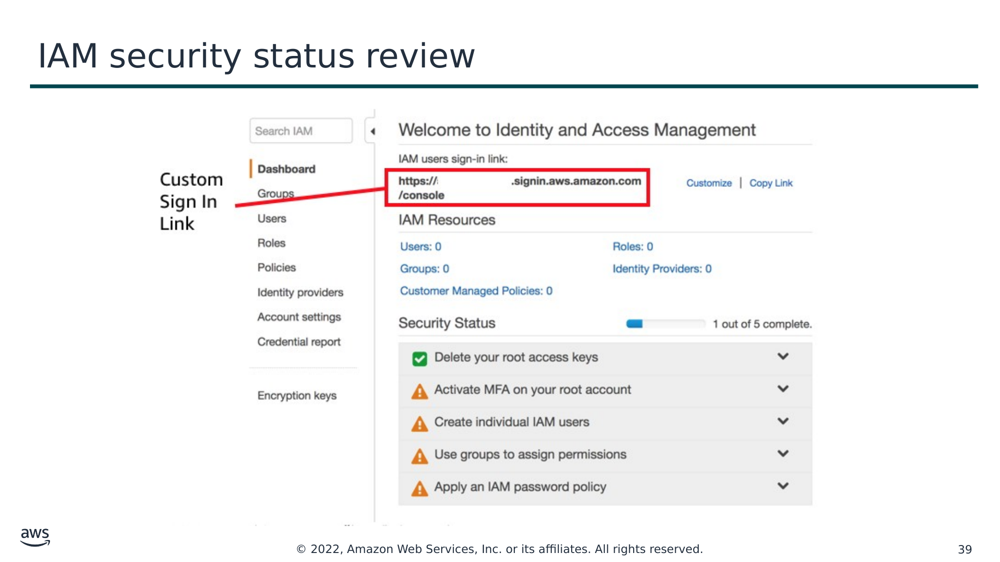

> **Нотатки:**
>
> Знімок екрана показує приклад того, як виглядає IAM Console Dashboard, коли ви ввійшли як кореневий акаунт AWS. Щоб отримати доступ до цього екрана в акаунті:  
> Увійдіть в AWS Management Console як кореневий акаунт AWS.  
> Перейдіть на сторінку сервісу IAM і натисніть посилання Dashboard.  
> Перегляньте інформацію на панелі Security Status.  
>
> На знімку екрана виконано лише одну з п’яти перевірок стану безпеки (Delete your root access keys — видалити ключі доступу кореневого акаунта). Мета людини, що виконує кроки із захисту акаунта, — отримати зелені галочки біля кожного пункту стану безпеки.  
>
> Огляд поточного списку Security Status вказує, що:  
> MFA не активовано для кореневого акаунта AWS.  
> Жодних окремих користувачів IAM не створено.  
> Групам не призначено жодних дозволів.  
> Політику паролів IAM не застосовано.  
>
> Для акаунта є власне посилання для входу користувачів IAM. Зверніть увагу, що номер акаунта на цьому знімку екрана приховано. За бажанням можна скористатися посиланням Customize праворуч від посилання для входу користувачів IAM, щоб змінити назву акаунта, щоб він не відображав номер акаунта. Це посилання використовується для входу в акаунт, і його можна надіслати користувачам після створення їхніх акаунтів.

---

## Слайд 40: Активуйте MFA для кореневого акаунта

<!-- hidden slide -->

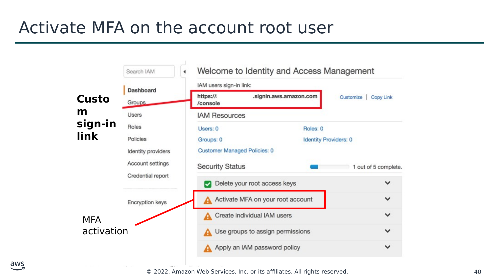

Активація MFA

<details>
<summary>Текст зі схеми</summary>

**Custom sign-in link (Власне посилання для входу)**

</details>

> **Нотатки:**
>
> Перш ніж створювати користувачів IAM в акаунті, активуйте MFA для кореневого акаунта. Щоб увійти як кореневий акаунт, використайте адресу електронної пошти, яку ви використали для створення акаунта. Кореневий акаунт має доступ до всього, тому важливо захистити цей акаунт обмеженнями.  
> Щоб налаштувати MFA:  
> Натисніть посилання Activate MFA on your root account.  
> Натисніть Manage MFA.  
> Натисніть Assign MFA device. У вас є три варіанти: віртуальний пристрій MFA (Virtual MFA device), ключ безпеки U2F (U2F security key) та інший апаратний пристрій MFA (Other hardware MFA device). Апаратний пристрій — це реальний апаратний пристрій.  
> Для цілей цієї демонстрації оберіть Virtual MFA device і натисніть Continue.  
> З’явиться нове діалогове вікно з пропозицією налаштувати віртуальний пристрій MFA. Для цього завдання потрібно завантажити застосунок (як-от Google Authenticator). Після завершення завантаження натисніть Show QR code.

---

## Слайд 41: Активація MFA для кореневого акаунта

<!-- hidden slide -->

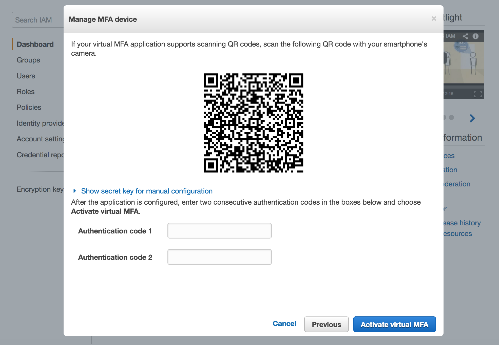

> **Нотатки:**
>
> У застосунку-автентифікаторі оберіть знак «плюс» (+).  
> Скануйте штрихкод і введіть перший код автентифікації.  
> Зачекайте мить, поки відобразиться другий код, і введіть другий код.  
> Натисніть кнопку Assign MFA.

---

## Слайд 42: MFA для кореневого акаунта активовано

<!-- hidden slide -->

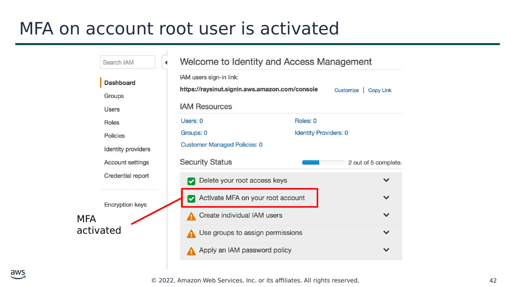

<details>
<summary>Текст зі схеми</summary>

MFA activated (MFA активовано)

MFA Setup (Налаштування MFA)

</details>

> **Нотатки:**
>
> Натисніть Finish і оновіть браузер.  
> На панелі Security Status тепер має відображатися зелена галочка, що вказує, що MFA тепер активовано для кореневого акаунта.

---

## Слайд 43: Створіть окремого користувача IAM (1 із 5)

<!-- hidden slide -->

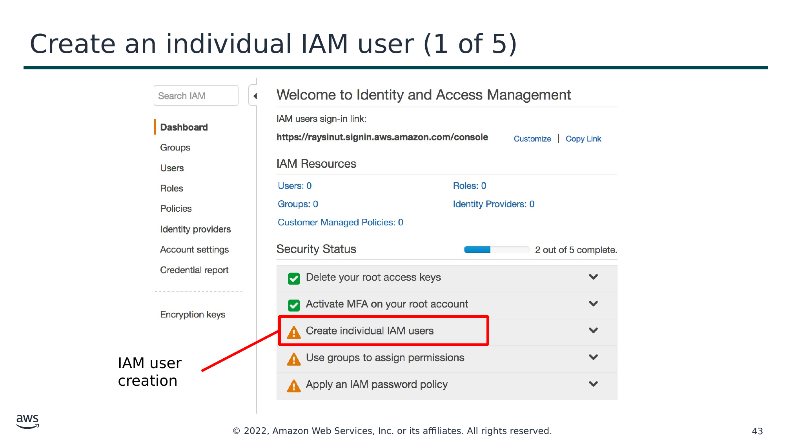

<details>
<summary>Текст зі схеми</summary>

IAM user  creation (Створення користувача IAM)

</details>

> **Нотатки:**
>
> Більшість акаунтів AWS спільно використовують кілька користувачів в організації. Щоб підтримати цю практику, ви можете налаштувати кожному користувачеві індивідуально призначені дозволи або додати користувачів до відповідної групи IAM, що надає їм конкретні дозволи.  
> Найкраща практика AWS — надати кожному користувачеві власний вхід користувача IAM, щоб вони не входили як кореневий акаунт із глобальними привілеями чи не використовували ті самі облікові дані, що й хтось інший, для входу в акаунт.  
> Щоб налаштувати це:  
> Натисніть Create individual IAM users, а потім оберіть Manage Users.

---

## Слайд 44: Створіть окремого користувача IAM (2 із 5)

<!-- hidden slide -->

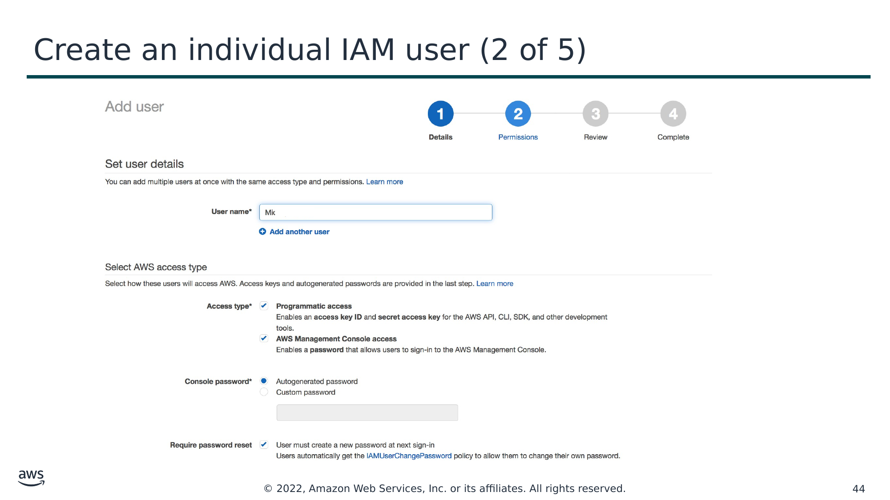

> **Нотатки:**
>
> Оберіть Add user і вкажіть нове ім’я користувача. Зверніть увагу, що імена користувачів не можуть містити пробілів.  
> Оберіть тип доступу (Access type). Є два типи доступу (ви можете надати користувачеві будь-який тип або обидва типи, але для цілей цієї демонстрації надайте обидва типи):  
> Програмний доступ (Programmatic access) дає користувачеві доступ AWS CLI для розгортання ресурсів. Цей варіант згенерує ключ доступу один раз. Цей ключ доступу потрібно зберегти, оскільки він використовуватиметься для всього майбутнього доступу.  
> Доступ до AWS Management Console (AWS Management Console access) дає користувачеві змогу входити в консоль.  
> Якщо ви вирішили надати доступ до консолі, оберіть Autogenerate password або виберіть Custom password і введіть пароль.  
> Натисніть Next: Permissions.

---

## Слайд 45: Створіть окремого користувача IAM (3 із 5)

<!-- hidden slide -->

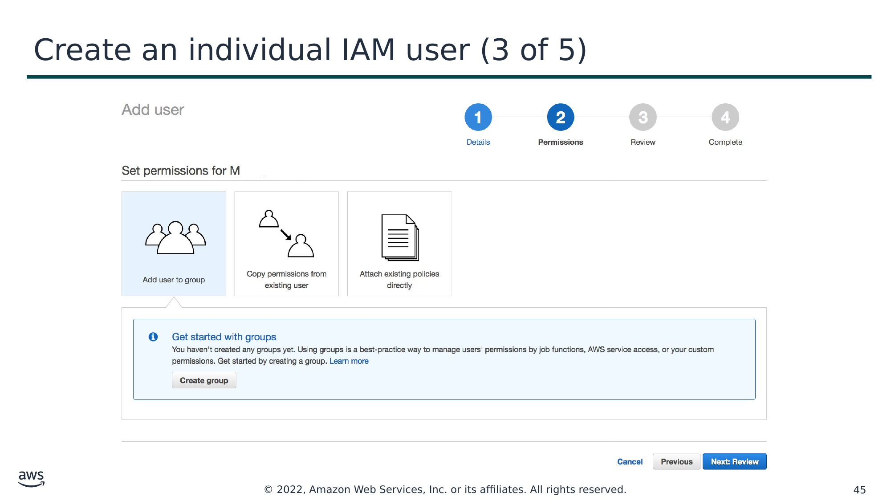

> **Нотатки:**
>
> Далі ви призначите дозволи. У вас є три варіанти призначення дозволів:  
> Add user to group (додати користувача до групи)  
> Copy permissions from an existing user (скопіювати дозволи від наявного користувача)  
> Attach existing policies directly (прикріпити наявні політики безпосередньо)  
>
> Ви хочете додати користувача до групи, тож оберіть Add user to group, а потім оберіть Create group.  
>
> Примітка: група — це місце, куди ви поміщаєте користувачів, щоб вони успадкували політики, призначені групі.

---

## Слайд 46: Створіть окремого користувача IAM (4 із 5)

<!-- hidden slide -->

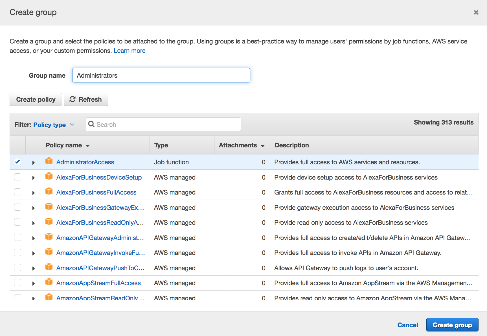

> **Нотатки:**
>
> Дайте групі назву. У цьому прикладі надайте провідному розробнику адміністративний доступ, а потім оберіть Create group.  
>
> Для доступності: користувача запрошують створити групу. Введено назву групи «Administrators», і з довгого списку доступних політик обрано політику «AdministratorAccess». Кінець опису для доступності.

---

## Слайд 47: Створіть окремого користувача IAM (5 із 5)

<!-- hidden slide -->

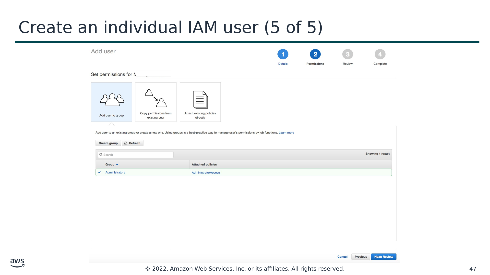

> **Нотатки:**
>
> Оберіть Next Review, щоб переглянути те, що буде створено, а потім оберіть Create user.

---

## Слайд 48: Користувача IAM успішно створено

<!-- hidden slide -->

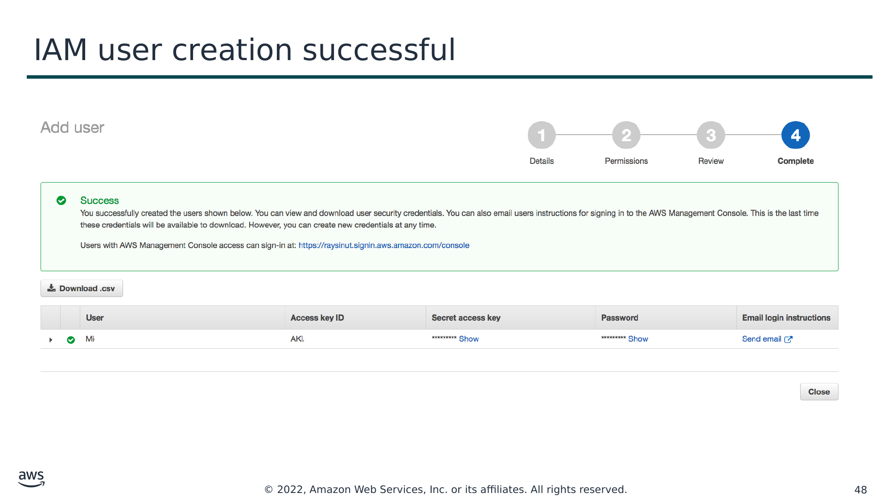

> **Нотатки:**
>
> Коли користувача створено — і за умови, що під час визначення параметра Access type і створення користувача ви ввімкнули і програмний доступ, і доступ до консолі, — буде згенеровано кілька артефактів:  
> Ідентифікатор ключа доступу (access key ID), який можна використовувати для підпису викликів API AWS, коли користувач використовує AWS CLI чи AWS SDK.  
> Секретний ключ доступу (secret access key), який також використовується для підпису викликів API AWS, коли користувач використовує AWS CLI чи AWS SDK.  
> Пароль, який можна використовувати для входу в AWS Management Console.  
>
> Оберіть Show, щоб відобразити значення в кожному полі. Облікові дані також можна завантажити, обравши Download .csv. Цей момент — єдиний, коли у вас є можливість завантажити ці облікові дані. Після цього екрана у вас не буде можливості отримати секретний ключ доступу. Тому слід або завантажити облікові дані, або — щонайменше — скопіювати секретний ключ доступу та вставити його в безпечне місце.  
> Важливо: ніколи не зберігайте ці облікові дані в публічному місці (наприклад, ніколи не вбудовуйте їх у код, який завантажуєте на GitHub чи деінде). Ця інформація може бути використана для доступу до вашого акаунта. Якщо у вас виникають побоювання, що ваші облікові дані скомпрометовано, увійдіть як користувач із дозволами адміністратора IAM і видаліть наявний ключ доступу. Потім за бажанням можна створити новий ключ доступу.

---

## Слайд 49: Стан безпеки на IAM Dashboard

<!-- hidden slide -->

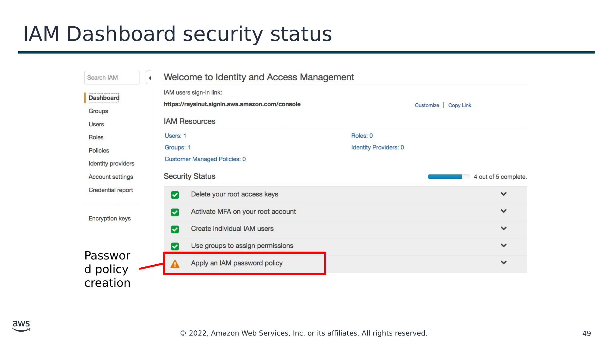

<details>
<summary>Текст зі схеми</summary>

Password policy creation (Створення політики паролів)

</details>

> **Нотатки:**
>
> Коли ви повернетеся на IAM Dashboard, пункти стану безпеки Create individual IAM users та Use groups to assign permissions мають показувати, що їх виконано.  
> Решта пункт безпеки, який потрібно виконати, — застосувати політику паролів IAM.

---

## Слайд 50: Установіть політику паролів IAM (IAM password policy)

<!-- hidden slide -->

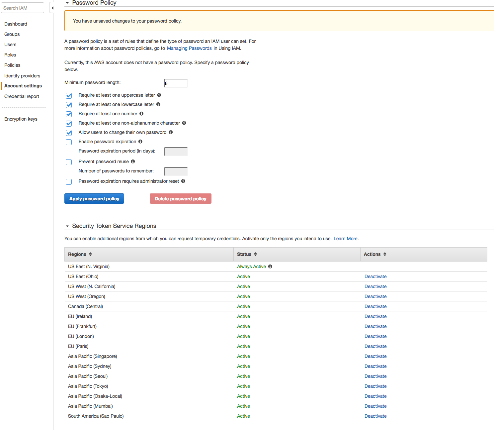

> **Нотатки:**
>
> Політика паролів IAM — це набір правил, що визначає тип пароля, який може встановити користувач IAM.  
> Оберіть правила, яких мають дотримуватися паролі, а потім оберіть Apply password policy.  
>
> Для доступності: екран у консолі, де можна встановити деталі політики паролів. Доступно кілька прапорців для вимоги суворіших вимог до паролів. Кінець опису для доступності.

---

## Слайд 51: Перевірки стану безпеки завершено

<!-- hidden slide -->

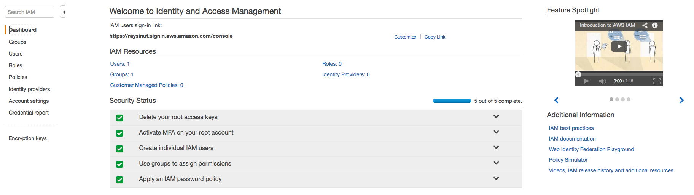

> **Нотатки:**
>
> Усі галочки стану безпеки тепер мають бути зеленими. Ваш акаунт тепер відповідає наведеним перевіркам стану безпеки IAM. Вітаємо!

---

## Слайд 52: Ключові висновки розділу 3

Найкращі практики захисту акаунта AWS:

- **Захищайте** входи за допомогою багатофакторної автентифікації (MFA).
- **Видаліть** ключі доступу кореневого акаунта.
- **Створіть** окремих користувачів IAM і надавайте дозволи за принципом найменших привілеїв.
- **Використовуйте групи** для призначення дозволів користувачам IAM.
- **Налаштуйте** сувору політику паролів.
- **Делегуйте** за допомогою ролей замість спільного використання облікових даних.
- **Відстежуйте** активність акаунта за допомогою AWS CloudTrail.

> **Нотатки:**
>
> Основні висновки цього розділу модуля стосуються найкращих практик захисту акаунта AWS. Ці рекомендовані найкращі практики включають:  
> Захищайте входи за допомогою багатофакторної автентифікації (MFA).  
> Видаліть ключі доступу кореневого акаунта.  
> Створіть окремих користувачів IAM і надавайте дозволи за принципом найменших привілеїв.  
> Використовуйте групи для призначення дозволів користувачам IAM.  
> Налаштуйте сувору політику паролів.  
> Делегуйте за допомогою ролей замість спільного використання облікових даних.  
> Відстежуйте активність акаунта за допомогою AWS CloudTrail.

---

## Слайд 53: Лабораторна робота 1: Introduction to IAM (вступ до IAM)


> **Нотатки:**
>
> Представляємо Лабораторну роботу 1: Introduction to AWS IAM.

---

## Слайд 54: Лабораторна робота 1: завдання

- Завдання 1: дослідіть користувачів і групи (Explore the Users and Groups).
- Завдання 2: додайте користувачів до груп (Add Users to Groups).
- Завдання 3: увійдіть і протестуйте користувачів (Sign-In and Test Users).

AWS Identity and Access Management (IAM)

> **Нотатки:**
>
> У цій практичній лабораторній роботі ви:  
> Дослідите попередньо створених користувачів і групи IAM.  
> Перевірите політики IAM у тому вигляді, як вони застосовані до попередньо створених груп.  
> Виконаєте реальний сценарій і додасте користувачів до груп із увімкненими певними можливостями.  
> Знайдете й використаєте URL для входу IAM.  
> Поекспериментуєте з наслідками політик IAM для доступу до ресурсів AWS.

---

## Слайд 55: Лабораторна робота 1: підсумковий результат

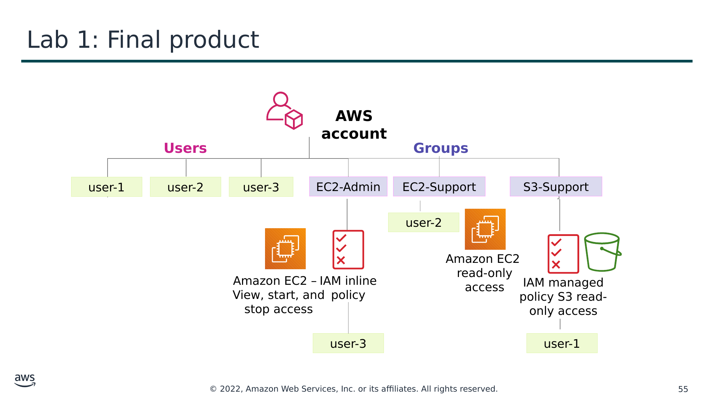

<details>
<summary>Текст зі схеми</summary>

**Account (Акаунт)**

**AWS account (Акаунт AWS)**

**Users (Користувачі)**

**Groups (Групи)**

user-1

user-2

user-3

EC2-Admin

EC2-Support

S3-Support

user-2

Amazon EC2  
read-only access (доступ лише на читання до Amazon EC2)

Amazon EC2 –  
View, start, and stop access (Amazon EC2: доступ на перегляд, запуск і зупинку)

IAM inline policy (Вбудована політика IAM)

IAM managed policy S3 read-only access (Керована політика IAM: доступ лише на читання до S3)

user-3

user-1

</details>

> **Нотатки:**
>
> Схема показує ресурси, які матиме ваш акаунт AWS після виконання кроків лабораторної роботи. Вона також описує, як ресурси буде налаштовано.

---

## Слайд 56: Початок лабораторної роботи 1: Introduction to AWS IAM

~ 40 хвилин

> **Нотатки:**
>
> Настав час розпочати лабораторну роботу.

---

## Слайд 57: Підсумки лабораторної роботи: ключові висновки


> **Нотатки:**
>
> Тепер викладач проведе обговорення ключових висновків із лабораторної роботи після її завершення.

---

## Слайд 58: Розділ 4: Захист акаунтів

Модуль 4: Безпека хмари AWS

> **Нотатки:**
>
> Представляємо Розділ 4: Захист акаунтів

---

## Слайд 59: AWS Organizations

- **AWS Organizations** дає змогу об’єднати кілька акаунтів AWS, щоб керувати ними централізовано.
- Функції безпеки AWS Organizations:
  - **Групування акаунтів AWS в організаційні одиниці (organizational units, OU)** і прикріплення різних політик доступу до кожної OU.
  - **Інтеграція та підтримка IAM**
    - Дозволи користувача — це перетин того, що дозволяє AWS Organizations, і того, що надає IAM у цьому акаунті.
  - **Використання політик контролю служб (service control policies)** для встановлення контролю над сервісами AWS і діями API, до яких може отримати доступ кожен акаунт AWS

**AWS Organizations**

> **Нотатки:**
>
> AWS Organizations — це сервіс керування акаунтами, що дає змогу об’єднувати кілька акаунтів AWS в організацію, яку ви створюєте й централізовано керуєте. Тут увага зосереджена на функціях безпеки, які надає AWS Organizations.  
>
> Одна корисна функція безпеки полягає в тому, що акаунти можна групувати в організаційні одиниці (OU) і прикріплювати різні політики доступу до кожної OU. Наприклад, якщо у вас є акаунти, яким слід дозволити доступ лише до сервісів AWS, що відповідають певним регуляторним вимогам, ці акаунти можна помістити в одну OU. Потім можна визначити політику, що блокує доступ OU до сервісів, які не відповідають цим регуляторним вимогам, і прикріпити політику до OU.  
>
> Ще одна функція безпеки: AWS Organizations інтегрується з IAM і підтримує його. AWS Organizations розширює цей контроль до рівня акаунта, надаючи вам контроль над тим, що користувачі й ролі в акаунті чи групі акаунтів можуть робити. Отримані дозволи — це логічний перетин того, що дозволено налаштуваннями політик AWS Organizations, і того, які дозволи явно надано IAM в акаунті для цього користувача чи ролі. Користувач може отримати доступ лише до того, що дозволено і політиками AWS Organizations, і політиками IAM.  
>
> Нарешті, AWS Organizations надає політики контролю служб (service control policies, SCP), що дають змогу вказати максимальні дозволи, які можуть мати акаунти-члени організації. У SCP можна обмежити, до яких сервісів AWS, ресурсів і окремих дій можуть отримати доступ користувачі та ролі в кожному акаунті-члені. Ці обмеження перевизначають навіть адміністраторів акаунтів-членів. Коли AWS Organizations блокує доступ до сервісу, ресурсу чи дії API, користувач або роль у цьому акаунті не можуть отримати до нього доступ, навіть якщо адміністратор акаунта-члена явно надає такі дозволи.

---

## Слайд 60: AWS Organizations: політики контролю служб (service control policies)

- **Політики контролю служб (SCP)** пропонують централізований контроль над акаунтами.
  - Обмежують дозволи, доступні в акаунті, що входить до організації.
- Гарантують, що акаунти відповідають настановам щодо контролю доступу.
- SCP *подібні* до політик дозволів IAM –
  - Вони використовують подібний синтаксис.
  - Однак SCP ніколи не надає дозволів.
  - Натомість SCP визначають максимальні дозволи для організації.

> **Нотатки:**
>
> Ось докладніший погляд на функцію політик контролю служб (SCP) в AWS Organizations.  
>
> SCP пропонують центральний контроль над максимально доступними дозволами для всіх акаунтів вашої організації, що дає змогу гарантувати, що ваші акаунти залишаються в межах настанов щодо контролю доступу вашої організації. SCP доступні лише в організації з увімкненими всіма функціями (all features), зокрема консолідованим виставленням рахунків. Докладніше про ввімкнення функцій див. https://docs.aws.amazon.com/organizations/latest/userguide/orgs_manage_org_support-all-features.html. SCP недоступні, якщо у вашій організації ввімкнено лише функції консолідованого виставлення рахунків. Інструкції щодо ввімкнення SCP див. «Ввімкнення та вимкнення типу політики в корені» (Enabling and Disabling a Policy Type on a Root) за адресою https://docs.aws.amazon.com/organizations/latest/userguide/orgs_manage_policies.html#enable_policies_on_root.  
>
> SCP подібні до політик дозволів IAM і використовують майже такий самий синтаксис. Однак SCP ніколи не надає дозволів. Натомість SCP — це політики JSON, що визначають максимальні дозволи для організації чи OU. Прикріплення SCP до кореня організації (organization root) або організаційної одиниці (OU) визначає запобіжний захід щодо дій, які можуть виконувати акаунти в корені організації чи OU. Однак це не заміна добре керованих конфігурацій IAM у кожному акаунті. Вам усе одно потрібно прикріплювати політики IAM до користувачів і ролей в акаунтах вашої організації, щоб фактично надати їм дозволи. Докладніше про політики IAM див. https://docs.aws.amazon.com/IAM/latest/UserGuide/access_policies.html.

---

## Слайд 61: AWS Key Management Service (AWS KMS)

Функції **AWS Key Management Service (AWS KMS)**:

- Дає змогу **створювати ключі шифрування й керувати ними**
- Дає змогу контролювати використання шифрування в сервісах AWS і у ваших застосунках.
- Інтегрується з AWS CloudTrail для журналювання всього використання ключів.
- Використовує апаратні модулі безпеки (hardware security modules, HSM), перевірені за стандартами Federal Information Processing Standards (FIPS) 140-2, для захисту ключів

AWS Key Management Service (AWS KMS)

> **Нотатки:**
>
> AWS Key Management Service (AWS KMS) — це сервіс, що дає змогу створювати ключі шифрування й керувати ними, а також контролювати використання шифрування в широкому спектрі сервісів AWS і ваших застосунків. AWS KMS — це безпечний і стійкий сервіс, що використовує апаратні модулі безпеки (HSM), перевірені за стандартами Federal Information Processing Standards (FIPS) 140-2 (або такі, що проходять перевірку), для захисту ваших ключів. AWS KMS також інтегрується з AWS CloudTrail, щоб надавати вам журнали всього використання ключів для виконання ваших регуляторних вимог і вимог відповідності.  
>
> Головні ключі клієнта (customer master keys, CMK) використовуються для контролю доступу до ключів шифрування даних, що шифрують і розшифровують ваші дані. Ви можете створювати нові ключі, коли хочете, і керувати тим, хто має доступ до цих ключів і хто може їх використовувати. Також можна імпортувати ключі з вашої власної інфраструктури керування ключами в AWS KMS.  
>
> AWS KMS інтегрується з більшістю сервісів AWS, що означає, що ви можете використовувати CMK AWS KMS для контролю шифрування даних, які зберігаєте в цих сервісах. Щоб дізнатися більше, див. «Функції AWS Key Management Service» (AWS Key Management Service features) за адресою https://aws.amazon.com/kms/features/.

---

## Слайд 62: Amazon Cognito

Функції **Amazon Cognito**:

- **Додає реєстрацію користувачів, вхід і контроль доступу до ваших вебзастосунків і мобільних застосунків**.
- Масштабується до мільйонів користувачів.
- Підтримує вхід через соціальних постачальників ідентичності, як-от Facebook, Google та Amazon, і корпоративних постачальників ідентичності, як-от Microsoft Active Directory через Security Assertion Markup Language (SAML) 2.0.

Amazon Cognito

> **Нотатки:**
>
> Amazon Cognito надає рішення для контролю доступу до ресурсів AWS із вашого застосунку. Ви можете визначати ролі й зіставляти користувачів з різними ролями, щоб ваш застосунок мав доступ лише до ресурсів, авторизованих для кожного користувача.  
>
> Amazon Cognito використовує поширені стандарти керування ідентичністю, як-от Security Assertion Markup Language (SAML) 2.0. SAML — це відкритий стандарт обміну інформацією про ідентичність і безпеку із застосунками та постачальниками послуг. Застосунки та постачальники послуг, що підтримують SAML, дають змогу входити за допомогою облікових даних вашого корпоративного каталогу, як-от ім’я користувача та пароль з Microsoft Active Directory. З SAML ви можете використовувати єдиний вхід (single sign-on, SSO) для входу у всі ваші застосунки з підтримкою SAML за допомогою єдиного набору облікових даних.  
>
> Amazon Cognito допомагає виконувати кілька вимог безпеки та відповідності, зокрема вимоги для високорегульованих організацій, як-от компанії охорони здоров’я та торговці. Amazon Cognito придатний для використання відповідно до закону США про переносимість і підзвітність медичного страхування (Health Insurance Portability and Accountability Act, HIPAA — докладніше про HIPAA див. https://aws.amazon.com/compliance/hipaa-compliance/). Його також можна використовувати для робочих навантажень, що відповідають стандарту безпеки даних індустрії платіжних карток (Payment Card Industry Data Security Standard, PCI DSS — докладніше про PCI DSS див. https://aws.amazon.com/compliance/pci-dss-level-1-faqs/); стандартам контролю організацій послуг (Service Organization Control, SOC) Американського інституту присяжних бухгалтерів (AICPA — докладніше про SOC див. https://aws.amazon.com/compliance/soc-faqs/); стандартам Міжнародної організації зі стандартизації (ISO) і Міжнародної електротехнічної комісії (IEC). Докладніше про ISO/IEC 27001 див. https://aws.amazon.com/compliance/iso-27001-faqs/, про ISO/IEC 27017 — https://aws.amazon.com/compliance/iso-27017-faqs/, і про ISO/IEC 27018 — https://aws.amazon.com/compliance/iso-27018-faqs/; а про ISO 9001 — https://aws.amazon.com/compliance/iso-9001-faqs/.

---

## Слайд 63: AWS Shield

- Функції **AWS Shield**:
  - Це кероване обслуговування захисту від розподілених атак «відмова в обслуговуванні» (DDoS)
  - Захищає застосунки, що працюють в AWS
  - Забезпечує постійне виявлення та автоматичне вбудоване пом’якшення
  - *AWS Shield Standard* увімкнено без додаткової плати. *AWS Shield Advanced* — необов’язковий платний сервіс.
- Використовуйте його, щоб **мінімізувати простій і затримку застосунків.**

AWS Shield

> **Нотатки:**
>
> AWS Shield — це кероване обслуговування захисту від розподілених атак «відмова в обслуговуванні» (DDoS), що захищає застосунки, які працюють в AWS. Воно забезпечує постійне виявлення та автоматичне вбудоване пом’якшення, що мінімізують простій і затримку застосунків, тож для користування захистом від DDoS не потрібно звертатися до служби підтримки AWS.  
>
> AWS Shield допомагає захистити ваш вебсайт від усіх типів DDoS-атак, зокрема атак на рівні інфраструктури (як-от флуд User Datagram Protocol, або UDP), атак виснаження стану (як-от TCP SYN-флуд) і атак на рівні застосунків (як-от флуд HTTP GET чи POST). Приклади див. в AWS WAF Developer Guide за адресою https://docs.aws.amazon.com/waf/latest/developerguide/waf-chapter.html.  
>
> AWS Shield Standard автоматично ввімкнено для всіх клієнтів AWS без додаткової плати.  
>
> AWS Shield Advanced — необов’язковий платний сервіс. AWS Shield Advanced забезпечує додатковий захист від складніших і масштабніших атак для ваших застосунків, що працюють на Amazon EC2, Elastic Load Balancing, Amazon CloudFront, AWS Global Accelerator і Amazon Route 53. AWS Shield Advanced доступний усім клієнтам. Однак щоб зв’язатися з командою реагування на DDoS (DDoS Response Team), клієнти повинні мати план Enterprise Support або Business Support від AWS Support.

---

## Слайд 64: Розділ 5: Захист даних в AWS

Модуль 4: Безпека хмари AWS

> **Нотатки:**
>
> Представляємо Розділ 5: Захист даних в AWS

---

## Слайд 65: Шифрування даних у стані спокою (encryption of data at rest)

- **Шифрування (Encryption)** кодує дані секретним ключем, що робить їх нечитабельними
  - Лише ті, хто має секретний ключ, можуть розкодувати дані
  - AWS KMS може керувати вашими секретними ключами
- AWS підтримує шифрування **даних у стані спокою (data at rest)**
  - Дані в стані спокою = дані, що зберігаються фізично (на диску або стрічці)
  - Ви можете шифрувати дані, що зберігаються в будь-якому сервісі, який підтримує AWS KMS, зокрема:
    - Amazon S3
    - Amazon EBS
    - Amazon Elastic File System (Amazon EFS)
    - Керовані бази даних Amazon RDS

> **Нотатки:**
>
> Шифрування даних — важливий інструмент, коли ваша мета — захистити цифрові дані. Шифрування даних бере дані, що читаються, і кодує їх так, щоб вони були нечитабельними для будь-кого, хто не має доступу до секретного ключа, яким їх можна розкодувати. Таким чином, навіть якщо зловмисник отримає доступ до ваших даних, він не зможе їх розібрати.  
>
> Дані в стані спокою — це дані, що фізично зберігаються на диску чи стрічці.  
>
> В AWS можна створювати зашифровані файлові системи, щоб усі ваші дані та метадані були зашифровані в стані спокою за допомогою алгоритму шифрування відкритого стандарту Advanced Encryption Standard (AES)-256. Коли ви використовуєте AWS KMS, шифрування та розшифрування виконуються автоматично й прозоро, тому вам не потрібно змінювати свої застосунки. Якщо ваша організація підпадає під корпоративні чи регуляторні політики, що вимагають шифрування даних і метаданих у стані спокою, AWS рекомендує ввімкнути шифрування в усіх сервісах, що зберігають ваші дані. Ви можете шифрувати дані, що зберігаються в будь-якому сервісі, який підтримує AWS KMS. Список підтримуваних сервісів див. «Як сервіси AWS використовують AWS KMS» (How AWS Services use AWS KMS) за адресою https://docs.aws.amazon.com/kms/latest/developerguide/service-integration.html.

---

## Слайд 66: Шифрування даних під час передавання (encryption of data in transit)

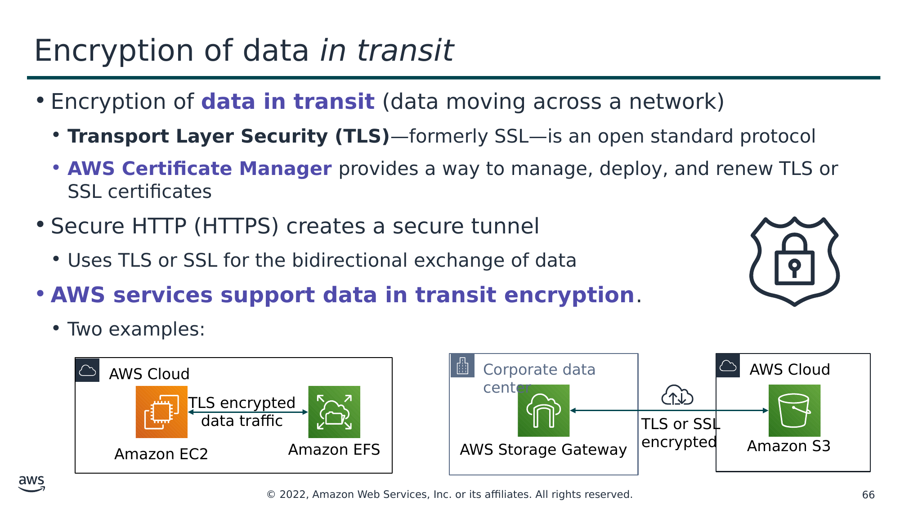

- Шифрування **даних під час передавання (data in transit)** (даних, що рухаються мережею)
  - **Transport Layer Security (TLS)** — раніше SSL — це протокол відкритого стандарту
  - **AWS Certificate Manager** надає спосіб керувати сертифікатами TLS чи SSL, розгортати та поновлювати їх
- Secure HTTP (HTTPS) створює захищений тунель
  - Використовує TLS або SSL для двостороннього обміну даними
- **Сервіси AWS підтримують шифрування даних під час передавання**.
  - Два приклади:

<details>
<summary>Текст зі схеми</summary>

AWS Cloud

Corporate data center (Корпоративний центр обробки даних)

AWS Cloud

TLS encrypted  
data traffic (Трафік даних, зашифрований TLS)

TLS or SSL  
encrypted (Зашифровано TLS або SSL)

Amazon EFS

AWS Storage Gateway

Amazon S3

Amazon EC2

</details>

> **Нотатки:**
>
> Дані під час передавання — це дані, що рухаються мережею. Шифрування даних під час передавання виконується за допомогою Transport Layer Security (TLS) 1.2 із шифром відкритого стандарту AES-256. TLS раніше називався Secure Sockets Layer (SSL).  
>
> AWS Certificate Manager — це сервіс, що дає змогу розгортати, адмініструвати та впроваджувати сертифікати SSL чи TLS для використання з сервісами AWS і вашими внутрішніми підключеними ресурсами. Сертифікати SSL чи TLS використовуються для захисту мережевого обміну даними та встановлення ідентичності вебсайтів в інтернеті, а також ресурсів у приватних мережах. З AWS Certificate Manager можна запросити сертифікат, а потім розгорнути його на ресурсах AWS (як-от балансувальники навантаження чи дистрибутиви CloudFront).  AWS Certificate Manager також виконує поновлення сертифікатів.  
>
> Вебтрафік, що працює через HTTP, не є захищеним. Однак трафік, що працює через Secure HTTP (HTTPS), шифрується за допомогою TLS чи SSL. Трафік HTTPS захищений від підслуховування та атак «людина посередині» (man-in-the-middle) завдяки двосторонньому шифруванню обміну даними.  
>
> Сервіси AWS підтримують шифрування для даних під час передавання. Показано два приклади шифрування даних під час передавання. Перший приклад показує екземпляр EC2, що змонтував спільну файлову систему Amazon EFS. Увесь трафік даних між екземпляром і Amazon EFS шифрується за допомогою TLS чи SSL. Докладніше про цю конфігурацію див. «Шифрування даних EFS під час передавання» (Encryption of EFS Data in Transit) за адресою https://docs.aws.amazon.com/whitepapers/latest/efs-encrypted-file-systems/encryption-of-data-in-transit.html.  
>
> Другий приклад показує використання AWS Storage Gateway — гібридного сервісу хмарного сховища, що надає локальний доступ до хмарного сховища AWS. У цьому прикладі шлюз сховища підключений через інтернет до Amazon S3, і з’єднання шифрує дані під час передавання.

---

## Слайд 67: Захист бакетів і об’єктів Amazon S3

- Новостворені бакети й об’єкти S3 за замовчуванням приватні та захищені.
- Коли сценарії використання вимагають спільного доступу до об’єктів даних в Amazon S3 –
  - Важливо керувати доступом до даних і контролювати його.
  - Дотримуйтеся **дозволів, що відповідають принципу найменших привілеїв**, і розгляньте використання шифрування Amazon S3.
- Інструменти та варіанти контролю доступу до даних S3 включають –
  - Функція [Amazon S3 Block Public Access](https://aws.amazon.com/blogs/aws/amazon-s3-block-public-access-another-layer-of-protection-for-your-accounts-and-buckets/): проста у використанні.
  - Політики IAM: гарний варіант, коли користувач може автентифікуватися за допомогою IAM.
  - [Політики бакетів (Bucket policies)](https://docs.aws.amazon.com/AmazonS3/latest/dev/using-iam-policies.html)
  - [Списки контролю доступу (Access control lists, ACL)](https://docs.aws.amazon.com/AmazonS3/latest/dev/acl-overview.html): застарілий (legacy) механізм контролю доступу.
  - Перевірка дозволів бакета в [AWS Trusted Advisor](https://aws.amazon.com/premiumsupport/trustedadvisor/): безкоштовна функція.

> **Нотатки:**
>
> За замовчуванням усі бакети Amazon S3 приватні й доступні лише користувачам, яким явно надано доступ.  Важливо керувати доступом до даних Amazon S3 і контролювати його. AWS надає багато інструментів і варіантів контролю доступу до ваших бакетів чи об’єктів S3, зокрема:  
> Використання Amazon S3 Block Public Access. Ці налаштування перевизначають будь-які інші політики чи дозволи об’єктів. Увімкніть Block Public Access для всіх бакетів, які ви не хочете робити публічно доступними. Ця функція надає простий спосіб уникнути ненавмисного розкриття даних Amazon S3.  
> Написання політик IAM, що вказують користувачів чи ролі, які можуть отримувати доступ до конкретних бакетів і об’єктів. Цей метод докладно розглядався раніше в цьому модулі.  
> Написання політик бакетів, що визначають доступ до конкретних бакетів чи об’єктів.  Цей варіант зазвичай використовується, коли користувач чи система не можуть автентифікуватися за допомогою IAM. Політики бакетів можна налаштувати для надання доступу між акаунтами AWS або публічного чи анонімного доступу до даних Amazon S3. Якщо використовуються політики бакетів, їх слід писати обережно й повністю тестувати. У політиці бакета можна вказати інструкцію deny, щоб обмежити доступ. Доступ буде обмежено, навіть якщо користувачі мають дозволи, надані в політиці на основі ідентичності, прикріпленій до користувачів.  
> Встановлення списків контролю доступу (ACL) для ваших бакетів і об’єктів. ACL використовуються рідше (ACL з’явилися раніше за IAM). Якщо ви використовуєте ACL, не встановлюйте надто відкритий чи надто дозвільний доступ.  
> AWS Trusted Advisor надає функцію перевірки дозволів бакетів — корисний інструмент для виявлення того, чи є в будь-яких бакетах вашого акаунта дозволи, що надають глобальний доступ.

---

## Слайд 68: Розділ 6: Забезпечення відповідності вимогам

Модуль 4: Безпека хмари AWS

> **Нотатки:**
>
> Представляємо Розділ 6: Забезпечення відповідності вимогам.

---

## Слайд 69: Програми відповідності вимогам AWS (AWS compliance programs)

- Клієнти підпадають під численні різні норми та вимоги безпеки й відповідності.
- **AWS взаємодіє з органами сертифікації та незалежними аудиторами, щоб надавати клієнтам докладну інформацію про політики, процеси та засоби контролю, встановлені та експлуатовані AWS.**
- Програми відповідності можна загалом розділити на категорії –
  - **Сертифікації та атестації (Certifications and attestations)**
    - Оцінюються сторонім незалежним аудитором
    - Приклади: ISO 27001, 27017, 27018 та ISO/IEC 9001
  - **Закони, нормативні акти та приватність (Laws, regulations, and privacy)**
    - AWS надає функції безпеки та юридичні угоди для підтримки відповідності
    - Приклади: Загальний регламент захисту даних ЄС (General Data Protection Regulation, GDPR), HIPAA
  - **Узгодження та фреймворки (Alignments and frameworks)**
    - Вимоги безпеки чи відповідності, специфічні для галузі чи функції
    - Приклади: Center for Internet Security (CIS), сертифікація EU-US Privacy Shield

> **Нотатки:**
>
> AWS взаємодіє із зовнішніми органами сертифікації та незалежними аудиторами, щоб надавати клієнтам інформацію про політики, процеси та засоби контролю, встановлені та експлуатовані AWS.  
>
> Повний перелік програм відповідності AWS доступний за адресою https://aws.amazon.com/compliance/programs/. Також докладніше про те, які сервіси AWS входять до сфери дії програм гарантування AWS, див. «Сервіси AWS у сфері дії за програмою відповідності» (AWS Services in Scope by Compliance Program) за адресою https://aws.amazon.com/compliance/services-in-scope/.  
>
> Як приклад сертифікації, для досягнення цілей відповідності якої можна використовувати сервіси AWS, розгляньте сертифікацію ISO/IEC 27001:2013. Вона визначає вимоги до створення, впровадження, підтримки та постійного вдосконалення системи керування інформаційною безпекою (Information Security Management System). Основою цієї сертифікації є розробка та впровадження суворої програми безпеки, що включає розробку та впровадження системи керування інформаційною безпекою. Система керування інформаційною безпекою визначає, як AWS постійно керує безпекою цілісним, комплексним способом.  
>
> AWS також надає функції безпеки та юридичні угоди, розроблені, щоб допомогти підтримувати клієнтів щодо поширених нормативних актів і законів. Один із прикладів — Закон про переносимість і підзвітність медичного страхування (Health Insurance Portability and Accountability Act, HIPAA). Інший приклад: Загальний регламент захисту даних (GDPR) Європейського Союзу (ЄС) захищає фундаментальне право суб’єктів даних ЄС на приватність і захист персональних даних. Він запроваджує надійні вимоги, що підвищать і гармонізують стандарти захисту даних, безпеки та відповідності. GDPR Center за адресою https://aws.amazon.com/compliance/gdpr-center/ містить багато ресурсів, що допомагають клієнтам виконувати вимоги відповідності цьому регламенту.

---

## Слайд 70: AWS Config

- **Оцінюйте, перевіряйте (audit) та аналізуйте конфігурації ресурсів AWS.**
- Використовуйте для безперервного моніторингу конфігурацій.
- Автоматично порівнюйте  
*записані* конфігурації з  
*бажаними* конфігураціями.
- Переглядайте зміни конфігурацій.
- Переглядайте докладні історії конфігурацій.
- **Спрощуйте аудит відповідності та аналіз безпеки.**

AWS Config

**Приклад вигляду AWS Config Dashboard**

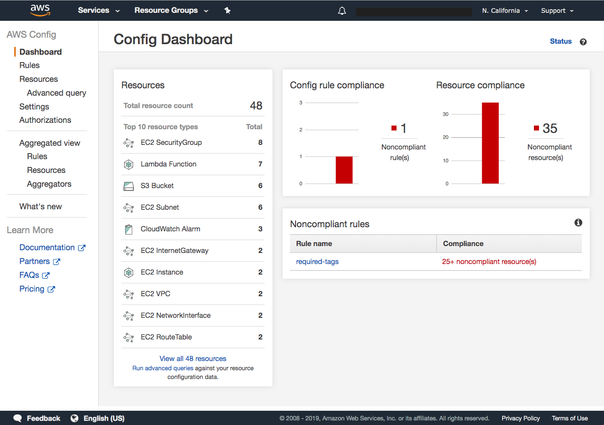

> **Нотатки:**
>
> AWS Config — це сервіс, що дає змогу оцінювати, перевіряти й аналізувати конфігурації ваших ресурсів AWS. AWS Config безперервно відстежує та записує конфігурації ваших ресурсів AWS і дає змогу автоматизувати порівняння записаних конфігурацій із бажаними. З AWS Config ви можете переглядати зміни конфігурацій і зв’язків між ресурсами AWS, переглядати докладні історії конфігурацій ресурсів і визначати вашу загальну відповідність конфігураціям, указаним у ваших внутрішніх настановах. Це дає змогу спростити аудит відповідності, аналіз безпеки, керування змінами та усунення операційних несправностей.  
>
> Як ви бачите на знімку екрана AWS Config Dashboard, наведеному тут, AWS Config веде перелік інвентаря всіх ресурсів, що існують в акаунті, а потім перевіряє відповідність правилам конфігурації та відповідність ресурсів. Ресурси, визнані невідповідними, позначаються, що сповіщає вас про проблеми конфігурації, які слід усунути в акаунті.  
>
> AWS Config — це регіональний сервіс. Щоб відстежувати ресурси між регіонами, увімкніть його в кожному регіоні, який ви використовуєте. AWS Config пропонує функцію агрегатора (aggregator), що може показувати зведений вигляд ресурсів у кількох регіонах і навіть кількох акаунтах.

---

## Слайд 71: AWS Artifact

- **Це ресурс для інформації, пов’язаної з відповідністю вимогам**
- Надає доступ до звітів про безпеку та відповідність, а також до вибраних онлайн-угод
- Можна отримати доступ до прикладів для завантаження:
  - Сертифікації AWS ISO
  - Звіти Payment Card Industry (PCI) та Service Organization Control (SOC)
- Отримуйте доступ до AWS Artifact безпосередньо з AWS Management Console
  - У розділі **Security, Identify & Compliance** натисніть **Artifact**.

AWS Artifact

> **Нотатки:**
>
> AWS Artifact надає завантаження за запитом документів AWS щодо безпеки та відповідності, як-от сертифікації AWS ISO, звіти Payment Card Industry (PCI) та Service Organization Control (SOC). Ви можете подавати документи щодо безпеки та відповідності (також відомі як артефакти аудиту, audit artifacts) вашим аудиторам чи регуляторам, щоб продемонструвати безпеку та відповідність інфраструктури й сервісів AWS, які ви використовуєте. Ці документи також можна використовувати як настанови для оцінювання вашої власної хмарної архітектури та оцінки ефективності внутрішніх засобів контролю вашої компанії. AWS Artifact надає документи лише про AWS. Клієнти AWS відповідають за розробку чи отримання документів, що демонструють безпеку та відповідність їхніх компаній.  
>
> Ви також можете використовувати AWS Artifact для перегляду, прийняття та відстеження статусу угод AWS, як-от Business Associate Agreement (BAA). BAA зазвичай потрібна для компаній, що підпадають під HIPAA, щоб гарантувати належний захист захищеної медичної інформації (protected health information, PHI). З AWS Artifact ви можете приймати угоди з AWS і призначати акаунти AWS, що можуть на законних підставах обробляти інформацію з обмеженим доступом. Ви можете прийняти угоду від імені кількох акаунтів. Щоб приймати угоди для кількох акаунтів, використовуйте AWS Organizations для створення організації. Щоб дізнатися більше, див. «Керування угодами в AWS Artifact» (Managing agreements in AWS Artifact) за адресою https://docs.aws.amazon.com/artifact/latest/ug/managing-agreements.html.

---

## Слайд 72: Ключові висновки розділу 6

- **Програми відповідності безпеки AWS** надають інформацію про політики, процеси та засоби контролю, встановлені та експлуатовані AWS.
- **AWS Config** використовується для оцінювання, перевірки та аналізу конфігурацій ресурсів AWS.
- **AWS Artifact** надає доступ до звітів про безпеку та відповідність.

> **Нотатки:**
>
> Основні висновки цього розділу модуля:  
> Програми відповідності безпеки AWS надають інформацію про політики, процеси та засоби контролю, встановлені та експлуатовані AWS.  
> AWS Config використовується для оцінювання, перевірки та аналізу конфігурацій ресурсів AWS.  
> AWS Artifact надає доступ до звітів про безпеку та відповідність.

---

## Слайд 73: Розділ 7: Додаткові сервіси безпеки та ресурси

<!-- hidden slide -->

Модуль 4: Безпека хмари AWS

> **Нотатки:**
>
> Представляємо Розділ 7: Додаткові сервіси безпеки та ресурси

---

## Слайд 74: AWS Service Catalog

<!-- hidden slide -->

- **Створюйте каталоги ІТ-сервісів, затверджених вашою організацією, і керуйте ними**
  - Допомагає співробітникам знаходити й розгортати *затверджені* ІТ-сервіси
  - ІТ-сервіс може включати один чи кілька ресурсів AWS
  - Приклад:
    - Екземпляри EC2, томи сховища, бази даних і мережеві компоненти
- Контролюйте використання сервісів AWS, указуючи обмеження (constraints) –
  - Приклади обмежень:
    - Регіон AWS, де можна запускати продукт
    - Дозволені діапазони IP-адрес
- Централізовано керуйте життєвим циклом ІТ-сервісів
- Допомагайте виконувати вимоги відповідності

AWS Service  
Catalog

> **Нотатки:**
>
> AWS Service Catalog дає організаціям змогу створювати каталоги ІТ-сервісів, затверджених для використання (наприклад, вашими співробітниками) в AWS, і керувати ними. Ці ІТ-сервіси можуть включати все — від образів віртуальних машин, серверів, програмного забезпечення та баз даних до повних багаторівневих архітектур застосунків.  
>
> З погляду AWS Service Catalog ІТ-сервіс можна розглядати як продукт (product). Продуктом може бути один обчислювальний екземпляр з Amazon Linux, повністю налаштований багаторівневий вебзастосунок, що працює у власному середовищі, або будь-який інший корисний ІТ-сервіс, який ви створюєте в AWS. Це дає вашим користувачам змогу швидко розгортати потрібні їм ІТ-сервіси й розроблено так, щоб користувачі розгортали лише затверджені конфігурації. AWS Service Catalog може підтримати ваші зусилля з централізованого керування розгорнутими ІТ-сервісами й допомогти досягти узгодженого управління (governance) та виконання вимог відповідності.  
>
> Докладніше див. AWS Service Catalog у документації AWS за адресою https://aws.amazon.com/servicecatalog/?aws-service-catalog.sort-by=item.additionalFields.createdDate&aws-service-catalog.sort-order=desc.

---

## Слайд 75: Вибрані додаткові сервіси безпеки

<!-- hidden slide -->

Проактивно **захищайте персональні ідентифікаційні дані (personally identifiable information, PII)** і знайте, коли вони переміщуються.

Amazon  
Macie

Визначайте стандарти та найкращі практики для ваших застосунків і **перевіряйте відповідність** цим **стандартам**.

Amazon  
Inspector

Інтелектуальне **виявлення загроз (threat detection)** і безперервний моніторинг для захисту ваших акаунтів і робочих навантажень AWS.

Amazon  
GuardDuty

> **Нотатки:**
>
> Amazon Macie — це сервіс безпеки, що використовує машинне навчання для автоматичного виявлення, класифікації та захисту чутливих даних в AWS. Amazon Macie розпізнає чутливі дані, як-от персональні ідентифікаційні дані (PII) чи інтелектуальна власність. Він надає вам панелі та сповіщення, що дають прозорість того, як до цих даних звертаються чи як їх переміщують. Amazon Macie — це повністю кероване обслуговування, що безперервно відстежує активність доступу до даних на предмет аномалій і генерує детальні сповіщення, коли виявляє ризик неавторизованого доступу чи ненавмисного витоку даних. Amazon Macie наразі доступний для захисту даних, що зберігаються в Amazon S3.  
>
> Amazon Inspector — це автоматизований сервіс оцінювання безпеки, що допомагає покращити безпеку та відповідність застосунків, розгорнутих в AWS. Amazon Inspector автоматично оцінює застосунки на предмет вразливості до впливу, вразливостей і відхилень від найкращих практик. Після виконання оцінювання Amazon Inspector створює докладний список результатів щодо безпеки, впорядкований за рівнем серйозності. Ці результати можна переглядати безпосередньо або в складі докладних звітів про оцінювання, доступних через консоль Amazon Inspector чи API.  
>
> Amazon GuardDuty — це сервіс виявлення загроз, що безперервно відстежує зловмисну активність і неавторизовану поведінку, щоб захищати ваші акаунти й робочі навантаження AWS. У хмарі збирання та агрегація активності акаунтів і мережі спрощені, але для команд безпеки може бути трудомістким безперервний аналіз даних журналів подій на предмет потенційних загроз. GuardDuty використовує машинне навчання, виявлення аномалій та інтегровану розвідку загроз (threat intelligence), щоб виявляти потенційні загрози та ранжувати їх. GuardDuty аналізує десятки мільярдів подій з кількох джерел даних AWS, як-от AWS CloudTrail, журнали потоків Amazon VPC (VPC Flow Logs) і журнали системи доменних імен (DNS).

---

## Слайд 76: Підсумки модуля

Модуль 4: Безпека хмари AWS

> **Нотатки:**
>
> Настав час повторити матеріал модуля та завершити його перевіркою знань і розбором запитання практичного сертифікаційного іспиту.

---

## Слайд 77: Резюме модуля

Підсумовуючи, у цьому модулі ви навчилися:

- Розпізнавати модель спільної відповідальності
- Визначати відповідальність клієнта й AWS
- Розпізнавати користувачів, групи та ролі IAM
- Описувати різні типи облікових даних безпеки в IAM
- Визначати кроки захисту нового акаунта AWS
- Досліджувати користувачів і групи IAM
- Розпізнавати, як захистити дані AWS
- Розпізнавати програми відповідності вимогам AWS

> **Нотатки:**
>
> Підсумовуючи, у цьому модулі ви навчилися:  
> Розпізнавати модель спільної відповідальності  
> Визначати відповідальність клієнта й AWS  
> Розпізнавати користувачів, групи та ролі IAM  
> Описувати різні типи облікових даних безпеки в IAM  
> Визначати кроки захисту нового акаунта AWS  
> Досліджувати користувачів і групи IAM  
> Розпізнавати, як захистити дані AWS  
> Розпізнавати програми відповідності вимогам AWS

---

## Слайд 78: Пройдіть перевірку знань


> **Нотатки:**
>
> Настав час пройти перевірку знань для цього модуля.

---

## Слайд 79: Приклад запитання іспиту

Що з наведеного є відповідальністю AWS за моделлю спільної відповідальності AWS?

Варіант

Відповідь

A

Налаштування сторонніх застосунків

B

Обслуговування фізичного апаратного забезпечення

C

Захист доступу до застосунків і даних

D

Керування власними образами Amazon Machine Images (AMI)

> **Нотатки:**
>
> Розгляньте варіанти відповідей і відсійте їх за ключовими словами.

---

## Слайд 80: Відповідь на приклад запитання іспиту

Що з наведеного є відповідальністю AWS за моделлю спільної відповідальності AWS?

Правильна відповідь — B.

Ключові слова в запитанні: «відповідальність AWS» та «модель спільної відповідальності AWS».

> **Нотатки:**
>
> Ключові слова, які потрібно розпізнати: «відповідальність AWS» та «модель спільної відповідальності AWS».  
>
> Правильна відповідь — B.  
>
> Це приклад запитання іспиту взято з документа із прикладами запитань іспиту AWS Certified Cloud Practitioner, на який є посилання на головній сторінці з інформацією про іспит AWS Certified Cloud Practitioner за адресою https://aws.amazon.com/certification/certified-cloud-practitioner/.

---

## Слайд 81: Додаткові ресурси

- Безпека хмари AWS (AWS Cloud Security): [https://aws.amazon.com/security/](https://aws.amazon.com/security/)
- Ресурси з безпеки AWS (AWS Security Resources): [https://aws.amazon.com/security/security-learning/?cards-top.sort-by=item.additionalFields.sortDate&cards-top.sort-order=desc&awsf.Types=*all](https://aws.amazon.com/security/security-learning/?cards-top.sort-by=item.additionalFields.sortDate&cards-top.sort-order=desc&awsf.Types=*all)
- Блог AWS із безпеки (AWS Security Blog): [https://aws.amazon.com/blogs/security/](https://aws.amazon.com/blogs/security/)
- Бюлетені безпеки (Security Bulletins): [https://aws.amazon.com/security/security-bulletins/?card-body.sort-by=item.additionalFields.bulletinId&card-body.sort-order=desc&awsf.bulletins-flag=*all&awsf.bulletins-year=*all](https://aws.amazon.com/security/security-bulletins/?card-body.sort-by=item.additionalFields.bulletinId&card-body.sort-order=desc&awsf.bulletins-flag=*all&awsf.bulletins-year=*all)
- Тестування на вразливості та проникнення (Vulnerability and Penetration testing): [https://aws.amazon.com/security/penetration-testing/](https://aws.amazon.com/security/penetration-testing/)
- AWS Well-Architected Framework — опора безпеки (Security pillar): [https://d1.awsstatic.com/whitepapers/architecture/AWS-Security-Pillar.pdf](https://d1.awsstatic.com/whitepapers/architecture/AWS-Security-Pillar.pdf)
- Документація AWS — найкращі практики IAM (IAM Best Practices): [https://docs.aws.amazon.com/IAM/latest/UserGuide/best-practices.html](https://docs.aws.amazon.com/IAM/latest/UserGuide/best-practices.html)

> **Нотатки:**
>
> Безпека — велика тема, і цей модуль надав лише вступ до неї. Наведені нижче ресурси надають більше подробиць:  
> Головна сторінка безпеки хмари AWS: https://aws.amazon.com/security/  
> Ресурси з безпеки AWS: https://aws.amazon.com/security/security-learning/?cards-top.sort-by=item.additionalFields.sortDate&cards-top.sort-order=desc&awsf.Types=*all  
> Блог AWS із безпеки: https://aws.amazon.com/blogs/security/  
> Бюлетені безпеки сповіщають клієнта про найновіші події безпеки й приватності із сервісами AWS: https://aws.amazon.com/security/security-bulletins/?card-body.sort-by=item.additionalFields.bulletinId&card-body.sort-order=desc&awsf.bulletins-flag=*all&awsf.bulletins-year=*all  
> Сторінка тестування на вразливості та проникнення: https://aws.amazon.com/security/penetration-testing/  
> AWS Well-Architected Framework — опора безпеки: https://d1.awsstatic.com/whitepapers/architecture/AWS-Security-Pillar.pdf  
> Документація AWS — найкращі практики IAM: https://docs.aws.amazon.com/IAM/latest/UserGuide/best-practices.html

---

## Слайд 82: Дякуємо

Усі торговельні марки є власністю їхніх власників.

> **Нотатки:**
>
> Дякуємо, що пройшли цей модуль.
