## Слайд 1: Module 5: Networking and Content Delivery

AWS Academy Cloud Foundations

> **Нотатки:**
>
> Welcome to Module 5: Networking and Content Delivery  
>
> This module covers three fundamental Amazon Web Services (AWS) for networking and content delivery: Amazon Virtual Private Cloud (Amazon VPC), Amazon Route 53, and Amazon CloudFront.

---

## Слайд 2: Module overview

**Topics**

- Networking basics
- Amazon VPC
- VPC networking
- VPC security
- Amazon Route 53
- Amazon CloudFront

**Activities**

- Label a network diagram
- Design a basic VPC architecture

**Demo**

- VPC demonstration

**Lab**

- Build your VPC and launch a web server

**Knowledge check**

> **Нотатки:**
>
> This module addresses the following topics:  
> Networking basics  
> Amazon Virtual Private Cloud (Amazon VPC)  
> VPC networking  
> VPC security  
> Amazon Route 53  
> Amazon CloudFront  
>
> This module includes some activities that challenge you to label a network diagram and design a basic VPC architecture.  
>
> You will watch a recorded demonstration to learn how to use the VPC Wizard to create a VPC with public and private subnets.  
>
> You then get a chance to apply what you have learned in a hands-on lab where you use the VPC Wizard to build a VPC and launch a web server.  
>
> Finally, you will be asked to complete a knowledge check that test your understanding of key concepts that are covered in this module.

---

## Слайд 3: Module objectives

After completing this module, you should be able to:

- Recognize the basics of networking
- Describe virtual networking in the cloud with Amazon VPC
- Label a network diagram
- Design a basic VPC architecture
- Indicate the steps to build a VPC
- Identify security groups
- Create your own VPC and add additional components to it to produce a customized network
- Identify the fundamentals of Amazon Route 53
- Recognize the benefits of Amazon CloudFront

> **Нотатки:**
>
> After completing this module, you should be able to:  
> Recognize the basics of networking  
> Describe virtual networking in the cloud with Amazon VPC  
> Label a network diagram  
> Design a basic VPC architecture  
> Indicate the steps to build a VPC  
> Identify security groups  
> Create your own VPC and add additional components to it to produce a customized network  
> Identify the fundamentals of Amazon Route 53  
> Recognize the benefits of Amazon CloudFront

---

## Слайд 4: Section 1: Networking basics

Module 5: Networking and Content Delivery

> **Нотатки:**
>
> Section 1: Networking basics  
>
> In this section, you will review a few basic networking concepts that provide the necessary foundation to your understanding of the AWS networking service, Amazon Virtual Private Cloud (Amazon VPC).

---

## Слайд 5: Networks

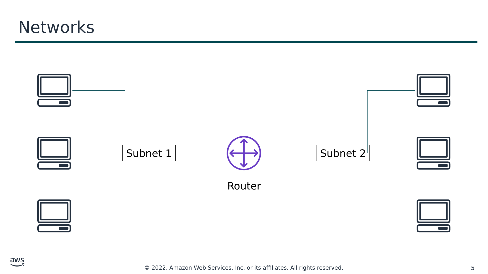

Текст зі схеми

Subnet 1

Subnet 2

Router

> **Нотатки:**
>
> A computer network is two or more client machines that are connected together to share resources. A network can be logically partitioned into subnets. Networking requires a networking device (such as a router or switch) to connect all the clients together and enable communication between them.

---

## Слайд 6: IP addresses

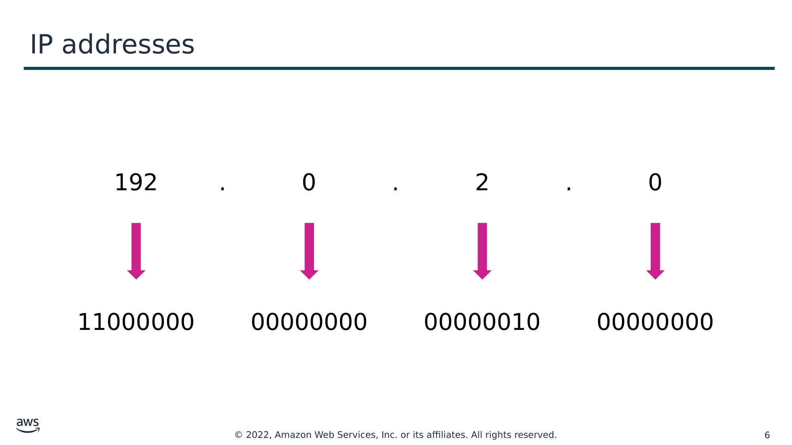

Текст зі схеми

192

0

2

0

11000000

00000000

00000010

00000000

> **Нотатки:**
>
> Each client machine in a network has a unique Internet Protocol (IP) address that identifies it. An IP address is a numerical label in decimal format. Machines convert that decimal number to a binary format.  
>
> In this example, the IP address is 192.0.2.0. Each of the four dot (.)-separated numbers of the IP address represents 8 bits in octal number format. That means each of the four numbers can be anything from 0 to 255. The combined total of the four numbers for an IP address is 32 bits in binary format.

---

## Слайд 7: IPv4 and IPv6 addresses

**IPv4 (32-bit) address**: 192.0.2.0

**IPv6 (128-bit) address**: 2600:1f18:22ba:8c00:ba86:a05e:a5ba:00FF

> **Нотатки:**
>
> A 32-bit IP address is called an IPv4 address.  
>
> IPv6 addresses, which are 128 bits, are also available. IPv6 addresses can accommodate more user devices.  
>
> An IPv6 address is composed of eight groups of four letters and numbers that are separated by colons (:). In this example, the IPv6 address is 2600:1f18:22ba:8c00:ba86:a05e:a5ba:00FF. Each of the eight colon-separated groups of the IPv6 address represents 16 bits in hexadecimal number format. That means each of the eight groups can be anything from 0 to FFFF. The combined total of the eight groups for an IPv6 address is 128 bits in binary format.

---

## Слайд 8: Classless Inter-Domain Routing (CIDR)

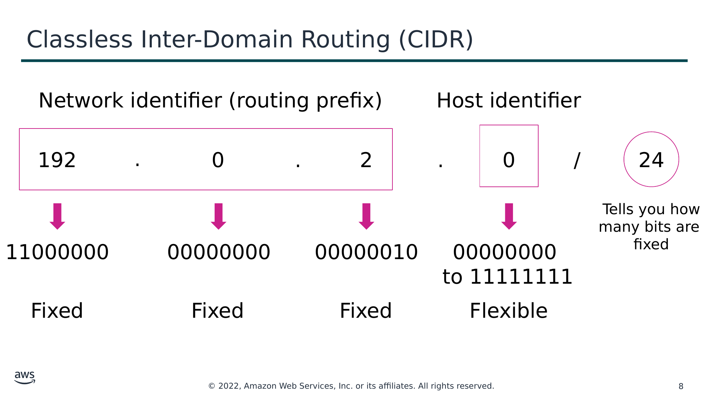

Текст зі схеми

Network identifier (routing prefix)

Host identifier

192

0

2

0

/

24

Tells you how  
many bits are  
fixed

11000000

00000000

00000010

00000000  
to 11111111

Fixed

Fixed

Fixed

Flexible

> **Нотатки:**
>
> A common method to describe networks is Classless Inter-Domain Routing (CIDR). The CIDR address is expressed as follows:  
> An IP address (which is the first address of the network)  
> Next, a slash character (/)  
> Finally, a number that tells you how many bits of the routing prefix must be fixed or allocated for the network identifier  
>
> The bits that are not fixed are allowed to change. CIDR is a way to express a group of IP addresses that are consecutive to each other.  
>
> In this example, the CIDR address is 192.0.2.0/24. The last number (24) tells you that the first 24 bits must be fixed. The last 8 bits are flexible, which means that 28 (or 256) IP addresses are available for the network, which range from 192.0.2.0 to 192.0.2.255. The fourth decimal digit is allowed to change from 0 to 255.  
>
> If the CIDR was 192.0.2.0/16, the last number (16) tells you that the first 16 bits must be fixed. The last 16 bits are flexible, which means that 216 (or 65,536) IP addresses are available for the network, ranging from 192.0.0.0 to 192.0.255.255. The third and fourth decimal digits can each change from 0 to 255.  
>
> There are two special cases:  
> Fixed IP addresses, in which every bit is fixed, represent a single IP address (for example, 192.0.2.0/32). This type of address is helpful when you want to set up a firewall rule and give access to a specific host.  
> The internet, in which every bit is flexible, is represented as 0.0.0.0/0

---

## Слайд 9: Open Systems Interconnection (OSI) model

| Layer | Number | Function | Protocol/Address |
|---|---|---|---|
| Application | 7 | Means for an application to access a computer network | HTTP(S), FTP, DHCP, LDAP |
| Presentation | 6 | • Ensures that the application layer can read the data • Encryption | ASCII, ICA |
| Session | 5 | Enables orderly exchange of data | NetBIOS, RPC |
| Transport | 4 | Provides protocols to support host-to-host communication | TCP, UDP |
| Network | 3 | Routing and packet forwarding (routers) | IP |
| Data link | 2 | Transfer data in the same LAN network (bridges and switches) | MAC |
| Physical | 1 | Transmission and reception of raw bitstreams over a physical medium (hubs) | Signals (1s and 0s) |

> **Нотатки:**
>
> The Open Systems Interconnection (OSI) model is a conceptual model that is used to explain how data travels over a network. It consists of seven layers and shows the common protocols and addresses that are used to send data at each layer. For example, hubs and switches work at layer 2 (the data link layer). Routers work at layer 3 (the network layer). The OSI model can also be used to understand how communication takes place in a virtual private cloud (VPC), which you will learn about in the next section.  
>
> ICA is Independent Computing Architecture, developed by Citrix Systems to facilitate efficient data transfer between a server and a client.

---

## Слайд 10: Section 2: Amazon VPC

Module 5: Networking and Content Delivery

> **Нотатки:**
>
> Section 2: Amazon VPC  
>
> Many of the concepts of an on-premises network apply to a cloud-based network, but much of the complexity of setting up a network has been abstracted without sacrificing control, security, and usability. In this section, you learn about Amazon VPC and the fundamental components of a VPC.

---

## Слайд 11: Amazon VPC

- Enables you to provision a logically isolated section of the AWS Cloud where you can launch AWS resources in a virtual network that you define
- Gives you control over your virtual networking resources, including:
  - Selection of IP address range
  - Creation of subnets
  - Configuration of route tables and network gateways
- Enables you to customize the network configuration for your VPC
- Enables you to use multiple layers of security

Amazon  
VPC

> **Нотатки:**
>
> Amazon Virtual Private Cloud (Amazon VPC) is a service that lets you provision a logically isolated section of the AWS Cloud (called a virtual private cloud, or VPC) where you can launch your AWS resources.  
>
> Amazon VPC gives you control over your virtual networking resources, including the selection of your own IP address range, the creation of subnets, and the configuration of route tables and network gateways. You can use both IPv4 and IPv6 in your VPC for secure access to resources and applications.  
>
> You can also customize the network configuration for your VPC. For example, you can create a public subnet for your web servers that can access the public internet. You can place your backend systems (such as databases or application servers) in a private subnet with no public internet access.  
>
> Finally, you can use multiple layers of security, including security groups and network access control lists (network ACLs), to help control access to Amazon Elastic Compute Cloud (Amazon EC2) instances in each subnet.

---

## Слайд 12: VPCs and subnets

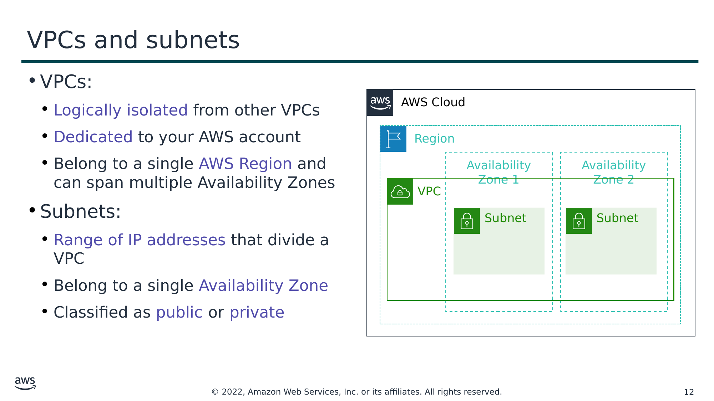

- VPCs:
  - Logically isolated from other VPCs
  - Dedicated to your AWS account
  - Belong to a single AWS Region and can span multiple Availability Zones
- Subnets:
  - Range of IP addresses that divide a VPC
  - Belong to a single Availability Zone
  - Classified as public or private

Текст зі схеми

AWS Cloud

Region

Availability Zone 1

Availability Zone 2

VPC

Subnet

Subnet

> **Нотатки:**
>
> Amazon VPC enables you to provision virtual private clouds (VPCs). A VPC is a virtual network that is logically isolated from other virtual networks in the AWS Cloud. A VPC is dedicated to your account. VPCs belong to a single AWS Region and can span multiple Availability Zones.  
>
> After you create a VPC, you can divide it into one or more subnets. A subnet is a range of IP addresses in a VPC. Subnets belong to a single Availability Zone. You can create subnets in different Availability Zones for high availability. Subnets are generally classified as public or private. Public subnets have direct access to the internet, but private subnets do not.

---

## Слайд 13: IP addressing

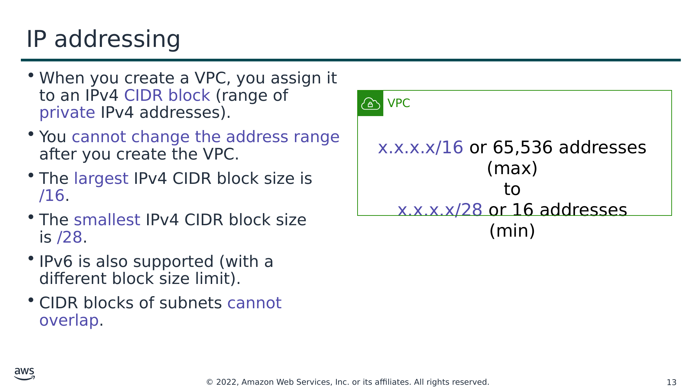

- When you create a VPC, you assign it to an IPv4 CIDR block (range of private IPv4 addresses).
- You cannot change the address range after you create the VPC.
- The largest IPv4 CIDR block size is /16.
- The smallest IPv4 CIDR block size is /28.
- IPv6 is also supported (with a different block size limit).
- CIDR blocks of subnets cannot overlap.

Текст зі схеми

VPC

x.x.x.x/16 or 65,536 addresses (max)

to  
x.x.x.x/28 or 16 addresses (min)

> **Нотатки:**
>
> IP addresses enable resources in your VPC to communicate with each other and with resources over the internet. When you create a VPC, you assign an IPv4 CIDR block (a range of private IPv4 addresses) to it. After you create a VPC, you cannot change the address range, so it is important that you choose it carefully. The IPv4 CIDR block might be as large as /16 (which is 216, or 65,536 addresses) or as small as /28 (which is 24, or 16 addresses).  
>
> You can optionally associate an IPv6 CIDR block with your VPC and subnets, and assign IPv6 addresses from that block to the resources in your VPC. IPv6 CIDR blocks have a different block size limit.  
>
> The CIDR block of a subnet can be the same as the CIDR block for a VPC. In this case, the VPC and the subnet are the same size (a single subnet in the VPC). Also, the CIDR block of a subnet can be a subset of the CIDR block for the VPC. This structure enables the definition of multiple subnets. If you create more than one subnet in a VPC, the CIDR blocks of the subnets cannot overlap. You cannot have duplicate IP addresses in the same VPC.  
>
> To learn more about IP addressing in a VPC, see the AWS Documentation at https://docs.aws.amazon.com/vpc/latest/userguide/what-is-amazon-vpc.html.

---

## Слайд 14: Reserved IP addresses

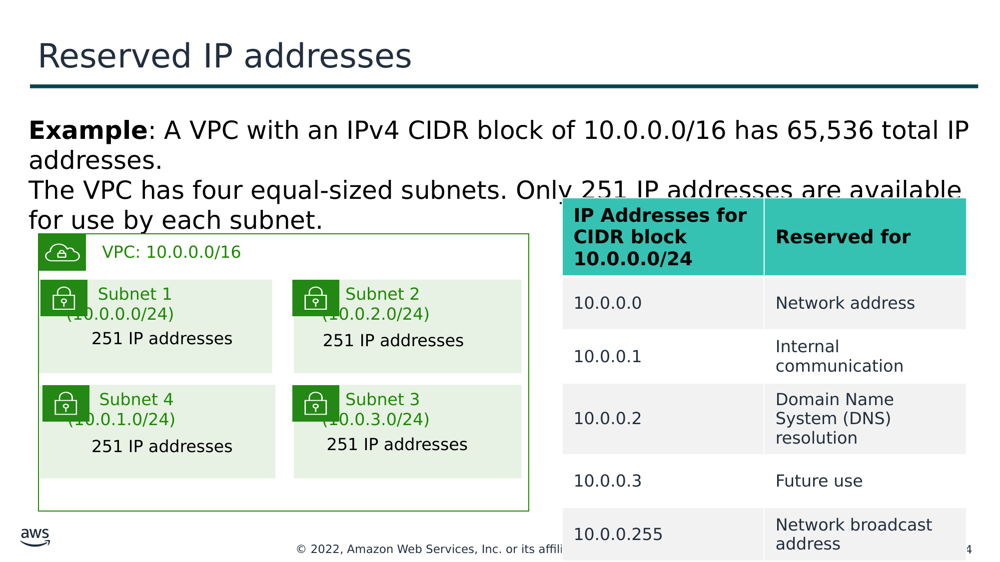

**Example**: A VPC with an IPv4 CIDR block of 10.0.0.0/16 has 65,536 total IP addresses.  
The VPC has four equal-sized subnets. Only 251 IP addresses are available for use by each subnet.

| IP Addresses for CIDR block 10.0.0.0/24 | Reserved for |
|---|---|
| 10.0.0.0 | Network address |
| 10.0.0.1 | Internal communication |
| 10.0.0.2 | Domain Name System (DNS) resolution |
| 10.0.0.3 | Future use |
| 10.0.0.255 | Network broadcast address |

Текст зі схеми

VPC: 10.0.0.0/16

Subnet 1 (10.0.0.0/24)

Subnet 4 (10.0.1.0/24)

Subnet 3 (10.0.3.0/24)

Subnet 2 (10.0.2.0/24)

251 IP addresses

251 IP addresses

251 IP addresses

251 IP addresses

> **Нотатки:**
>
> When you create a subnet, it requires its own CIDR block. For each CIDR block that you specify, AWS reserves five IP addresses within that block, and these addresses are not available for use. AWS reserves these IP addresses for:  
> Network address  
> VPC local router (internal communications)  
> Domain Name System (DNS) resolution  
> Future use  
> Network broadcast address  
>
> For example, suppose that you create a subnet with an IPv4 CIDR block of 10.0.0.0/24 (which has 256 total IP addresses). The subnet has 256 IP addresses, but only 251 are available because five are reserved.

---

## Слайд 15: Public IP address types

Public IPv4 address

- Manually assigned through an Elastic IP address
- Automatically assigned through the auto-assign public IP address settings at the subnet level

Elastic IP address

- Associated with an AWS account
- Can be allocated and remapped anytime
- Additional costs might apply

> **Нотатки:**
>
> When you create a VPC, every instance in that VPC gets a private IP address automatically. You can also request a public IP address to be assigned when you create the instance by modifying the subnet’s auto-assign public IP address properties.  
>
> An Elastic IP address is a static and public IPv4 address that is designed for dynamic cloud computing. You can associate an Elastic IP address with any instance or network interface for any VPC in your account. With an Elastic IP address, you can mask the failure of an instance by rapidly remapping the address to another instance in your VPC. Associating the Elastic IP address with the network interface has an advantage over associating it directly with the instance. You can move all of the attributes of the network interface from one instance to another in a single step.  
>
> Additional costs might apply when you use Elastic IP addresses, so it is important to release them when you no longer need them.  
>
> To learn more about Elastic IP addresses, see Elastic IP Addresses in the AWS Documentation at https://docs.aws.amazon.com/vpc/latest/userguide/vpc-eips.html.

---

## Слайд 16: Elastic network interface

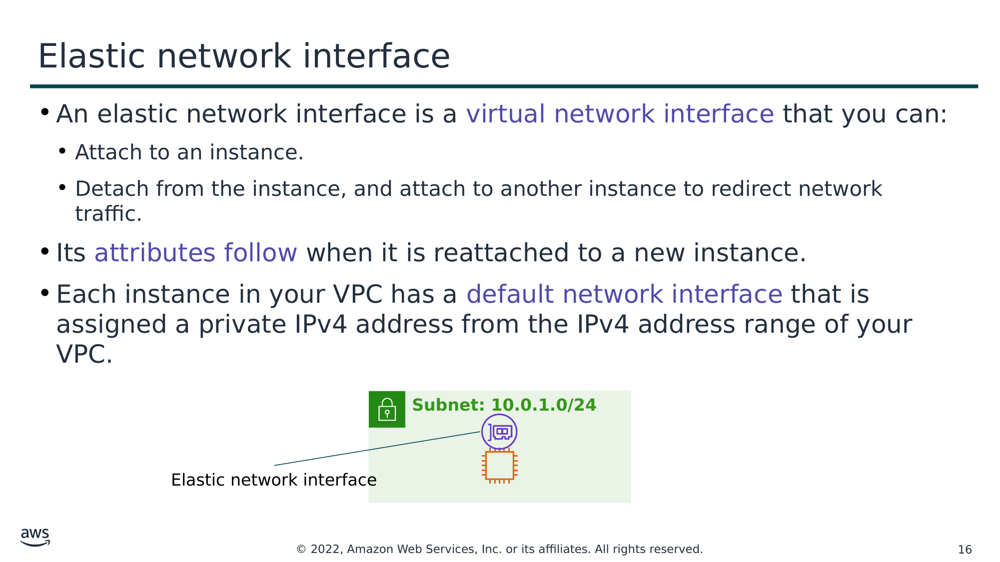

- An elastic network interface is a virtual network interface that you can:
  - Attach to an instance.
  - Detach from the instance, and attach to another instance to redirect network traffic.
- Its attributes follow when it is reattached to a new instance.
- Each instance in your VPC has a default network interface that is assigned a private IPv4 address from the IPv4 address range of your VPC.

Текст зі схеми

**Subnet: 10.0.1.0/24**

Elastic network interface

> **Нотатки:**
>
> An elastic network interface is a virtual network interface that you can attach or detach from an instance in a VPC. A network interface's attributes follow it when it is reattached to another instance. When you move a network interface from one instance to another, network traffic is redirected to the new instance.  
>
> Each instance in your VPC has a default network interface (the primary network interface) that is assigned a private IPv4 address from the IPv4 address range of your VPC. You cannot detach a primary network interface from an instance. You can create and attach an additional network interface to any instance in your VPC. The number of network interfaces you can attach varies by instance type.  
>
> For more information about Elastic Network Interfaces, see the AWS Documentation at https://docs.aws.amazon.com/AWSEC2/latest/UserGuide/using-eni.html.

---

## Слайд 17: Route tables and routes

- A route table contains a set of rules (or routes) that you can configure to direct network traffic from your subnet.
- Each route specifies a destination and a target.
- By default, every route table contains a local route for communication within the VPC.
- Each subnet must be associated with a route table (at most one).

Main (Default) Route Table

| Destination | Target |
|---|---|
| 10.0.0.0/16 | local |
|  |  |

VPC CIDR block

> **Нотатки:**
>
> A route table contains a set of rules (called routes) that directs network traffic from your subnet. Each route specifies a destination and a target. The destination is the destination CIDR block where you want traffic from your subnet to go. The target is the target that the destination traffic is sent through. By default, every route table that you create contains a local route for communication in the VPC. You can customize route tables by adding routes. You cannot delete the local route entry that is used for internal communications.  
>
> Each subnet in your VPC must be associated with a route table. The main route table is the route table is automatically assigned to your VPC. It controls the routing for all subnets that are not explicitly associated with any other route table. A subnet can be associated with only one route table at a time, but you can associate multiple subnets with the same route table.  
>
> To learn more about route tables, see the AWS Documentation at https://docs.aws.amazon.com/vpc/latest/userguide/VPC_Route_Tables.html.

---

## Слайд 18: Section 2 key takeaways

- A VPC is a logically isolated section of the AWS Cloud.
- A VPC belongs to one Region and requires a CIDR block.
- A VPC is subdivided into subnets.
- A subnet belongs to one Availability Zone and requires a CIDR block.
- Route tables control traffic for a subnet.
- Route tables have a built-in local route.
- You add additional routes to the table.
- The local route cannot be deleted.

> **Нотатки:**
>
> Some key takeaways from this section of the module include:  
> A VPC is a logically isolated section of the AWS Cloud.  
> A VPC belongs to one Region and requires a CIDR block.  
> A VPC is subdivided into subnets.  
> A subnet belongs to one Availability Zone and requires a CIDR block.  
> Route tables control traffic for a subnet.  
> Route tables have a built-in local route.  
> You add additional routes to the table.  
> The local route cannot be deleted.

---

## Слайд 19: Section 3: VPC networking

Module 5: Networking and Content Delivery

> **Нотатки:**
>
> Section 3: VPC networking  
>
> Now that you have learned about the basic components of a VPC, you can start routing traffic in interesting ways. In this section, you learn about different networking options.

---

## Слайд 20: Internet gateway

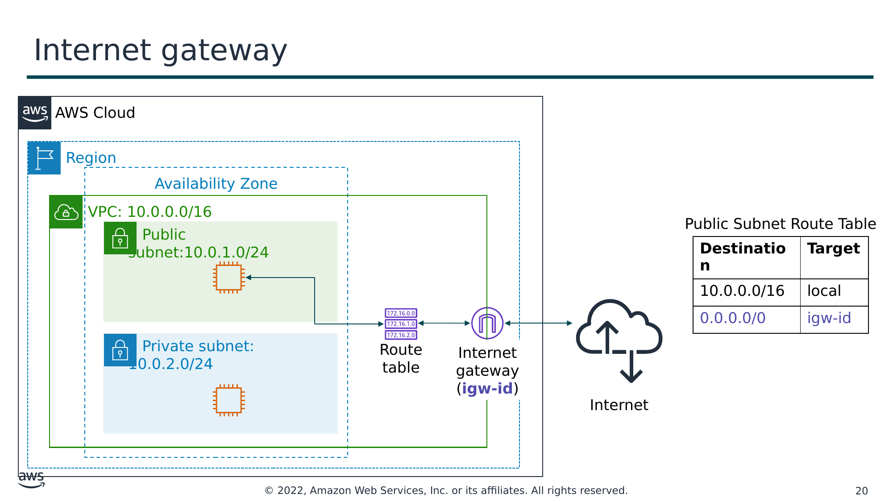

Public Subnet Route Table

| Destination | Target |
|---|---|
| 10.0.0.0/16 | local |
| 0.0.0.0/0 | igw-id |

Текст зі схеми

AWS Cloud

Region

Availability Zone

VPC: 10.0.0.0/16

Public subnet:10.0.1.0/24

Private subnet: 10.0.2.0/24

Route  
table

Internet  
gateway

(**igw-id**)

Internet

> **Нотатки:**
>
> An internet gateway is a scalable, redundant, and highly available VPC component that allows communication between instances in your VPC and the internet. An internet gateway serves two purposes: to provide a target in your VPC route tables for internet-routable traffic, and to perform network address translation for instances that were assigned public IPv4 addresses.  
>
> To make a subnet public, you attach an internet gateway to your VPC and add a route to the route table to send non-local traffic through the internet gateway to the internet (0.0.0.0/0).  
>
> For more information about internet gateways, see Internet Gateways in the AWS Documentation at https://docs.aws.amazon.com/vpc/latest/userguide/VPC_Internet_Gateway.html.

---

## Слайд 21: Network address translation (NAT) gateway

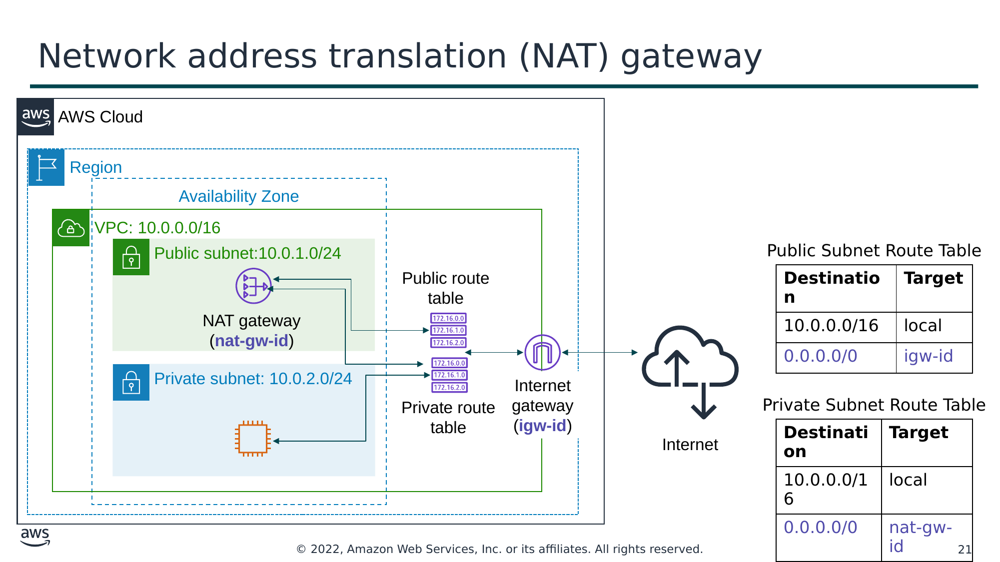

Public Subnet Route Table

| Destination | Target |
|---|---|
| 10.0.0.0/16 | local |
| 0.0.0.0/0 | igw-id |

Private Subnet Route Table

| Destination | Target |
|---|---|
| 10.0.0.0/16 | local |
| 0.0.0.0/0 | nat-gw-id |

Текст зі схеми

AWS Cloud

Region

Availability Zone

VPC: 10.0.0.0/16

Public subnet:10.0.1.0/24

Public route  
table

NAT gateway  
(**nat-gw-id**)

Private subnet: 10.0.2.0/24

Internet  
gateway

(**igw-id**)

Private route  
table

Internet

> **Нотатки:**
>
> A network address translation (NAT) gateway enables instances in a private subnet to connect to the internet or other AWS services, but prevents the internet from initiating a connection with those instances.  
>
> To create a NAT gateway, you must specify the public subnet in which the NAT gateway should reside. You must also specify an Elastic IP address to associate with the NAT gateway when you create it. After you create a NAT gateway, you must update the route table that is associated with one or more of your private subnets to point internet-bound traffic to the NAT gateway. Thus, instances in your private subnets can communicate with the internet.  
>
> You can also use a NAT instance in a public subnet in your VPC instead of a NAT gateway. However, a NAT gateway is a managed NAT service that provides better availability, higher bandwidth, and less administrative effort. For common use cases, AWS recommends that you use a NAT gateway instead of a NAT instance.  
>
> See the AWS Documentation for more information about  
> NAT gateways at https://docs.aws.amazon.com/vpc/latest/userguide/vpc-nat-gateway.html.  
> NAT instances at https://docs.aws.amazon.com/vpc/latest/userguide/VPC_NAT_Instance.html.  
> Differences between NAT gateways and NAT instances at https://docs.aws.amazon.com/vpc/latest/userguide/vpc-nat-comparison.html.

---

## Слайд 22: VPC sharing

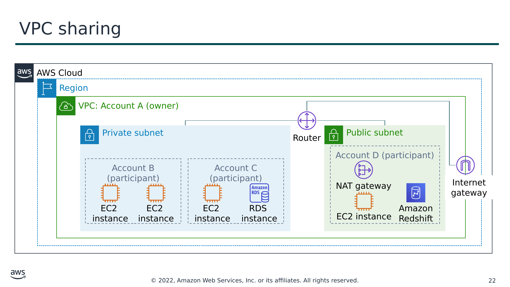

Текст зі схеми

AWS Cloud

Region

VPC: Account A (owner)

Private subnet

Public subnet

Router

Account D (participant)

Account B (participant)

Account C (participant)

NAT gateway

Internet gateway

EC2  
instance

EC2  
instance

EC2  
instance

RDS  
instance

Amazon  
Redshift

EC2 instance

> **Нотатки:**
>
> VPC sharing enables customers to share subnets with other AWS accounts in the same organization in AWS Organizations. VPC sharing enables multiple AWS accounts to create their application resources—such as Amazon EC2 instances, Amazon Relational Database Service (Amazon RDS) databases, Amazon Redshift clusters, and AWS Lambda functions—into shared, centrally managed VPCs. In this model, the account that owns the VPC (owner) shares one or more subnets with other accounts (participants) that belong to the same organization in AWS Organizations. After a subnet is shared, the participants can view, create, modify, and delete their application resources in the subnets that are shared with them. Participants cannot view, modify, or delete resources that belong to other participants or the VPC owner.  
>
> VPC sharing offers several benefits:  
> Separation of duties – Centrally controlled VPC structure, routing, IP address allocation  
> Ownership – Application owners continue to own resources, accounts, and security groups  
> Security groups – VPC sharing participants can reference the security group IDs of each other  
> Efficiencies – Higher density in subnets, efficient use of VPNs and AWS Direct Connect  
> No hard limits – Hard limits can be avoided—for example, 50 virtual interfaces per AWS Direct Connect connection through simplified network architecture  
> Optimized costs – Costs can be optimized through the reuse of NAT gateways, VPC interface endpoints, and intra-Availability Zone traffic  
>
> VPC sharing enables you to decouple accounts and networks. You have fewer, larger, centrally managed VPCs. Highly interconnected applications automatically benefit from this approach.

---

## Слайд 23: VPC peering

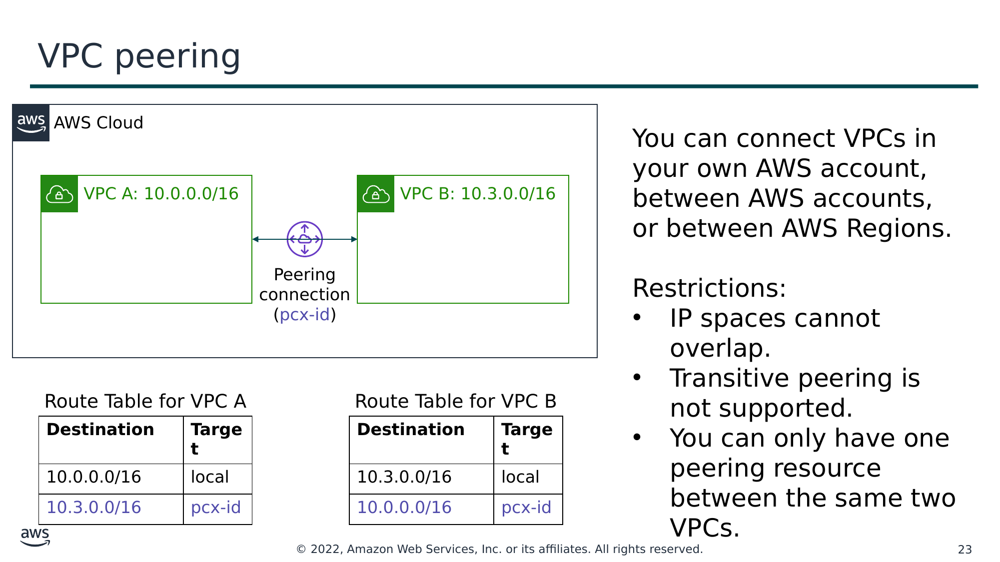

You can connect VPCs in your own AWS account, between AWS accounts, or between AWS Regions.

Restrictions:

- IP spaces cannot overlap.
- Transitive peering is not supported.
- You can only have one peering resource between the same two VPCs.

Route Table for VPC A

Route Table for VPC B

| Destination | Target |
|---|---|
| 10.0.0.0/16 | local |
| 10.3.0.0/16 | pcx-id |

| Destination | Target |
|---|---|
| 10.3.0.0/16 | local |
| 10.0.0.0/16 | pcx-id |

Текст зі схеми

AWS Cloud

VPC A: 10.0.0.0/16

VPC B: 10.3.0.0/16

Peering  
connection  
(pcx-id)

> **Нотатки:**
>
> A VPC peering connection is a networking connection between two VPCs that enables you to route traffic between them privately. Instances in either VPC can communicate with each other as if they are within the same network. You can create a VPC peering connection between your own VPCs, with a VPC in another AWS account, or with a VPC in a different AWS Region.  
>
> When you set up the peering connection, you create rules in your route table to allow the VPCs to communicate with each other through the peering resource. For example, suppose that you have two VPCs. In the route table for VPC A, you set the destination to be the IP address of VPC B and the target to be the peering resource ID. In the route table for VPC B, you set the destination to be the IP address of VPC A and the target to be the peering resource ID.  
>
> VPC peering has some restrictions:  
> IP address ranges cannot overlap.  
> Transitive peering is not supported. For example, suppose that you have three VPCs: A, B, and C. VPC A is connected to VPC B, and VPC A is connected to VPC C. However, VPC B is not connected to VPC C implicitly. To connect VPC B to VPC C, you must explicitly establish that connectivity.  
> You can only have one peering resource between the same two VPCs.  
>
> For more information about VPC peering, see VPC Peering in the AWS Documentation at https://docs.aws.amazon.com/vpc/latest/userguide/vpc-peering.html.

---

## Слайд 24: AWS Site-to-Site VPN

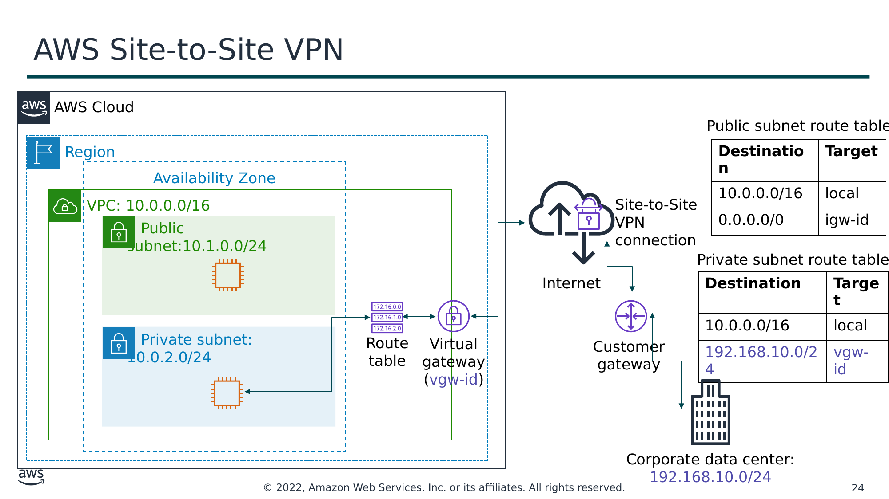

Public subnet route table

| Destination | Target |
|---|---|
| 10.0.0.0/16 | local |
| 0.0.0.0/0 | igw-id |

Private subnet route table

| Destination | Target |
|---|---|
| 10.0.0.0/16 | local |
| 192.168.10.0/24 | vgw-id |

Текст зі схеми

AWS Cloud

Region

Availability Zone

VPC: 10.0.0.0/16

Site-to-Site  
VPN  
connection

Public subnet:10.1.0.0/24

Internet

Private subnet: 10.0.2.0/24

Route  
table

Virtual  
gateway  
(vgw-id)

Customer gateway

Corporate data center:  
192.168.10.0/24

> **Нотатки:**
>
> By default, instances that you launch into a VPC cannot communicate with a remote network. To connect your VPC to your remote network (that is, create a virtual private network or VPN connection), you:  
> Create a new virtual gateway device (called a virtual private network (VPN) gateway) and attach it to your VPC.  
> Define the configuration of the VPN device or the customer gateway. The customer gateway is not a device but an AWS resource that provides information to AWS about your VPN device.  
> Create a custom route table to point corporate data center-bound traffic to the VPN gateway. You also must update security group rules. (You will learn about security groups in the next section.)  
> Establish an AWS Site-to-Site VPN (Site-to-Site VPN) connection to link the two systems together.  
> Configure routing to pass traffic through the connection.  
>
> For more information about AWS Site-to-Site VPN and other VPN connectivity options, see VPN Connections in the AWS Documentation at https://docs.aws.amazon.com/vpc/latest/userguide/vpn-connections.html.

---

## Слайд 25: AWS Direct Connect

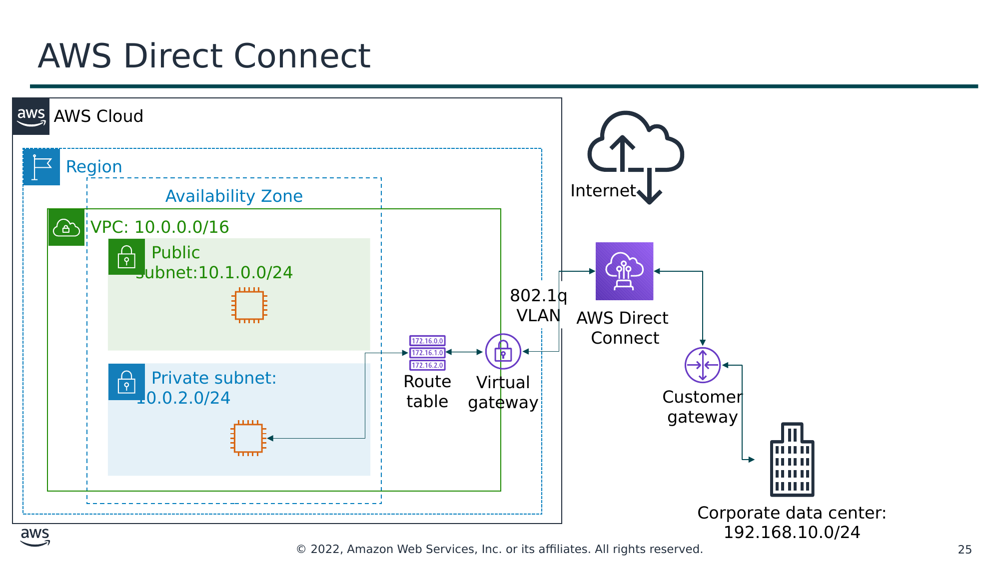

Текст зі схеми

AWS Cloud

Region

Availability Zone

Internet

VPC: 10.0.0.0/16

Public subnet:10.1.0.0/24

802.1q  
VLAN

AWS Direct  
Connect

Private subnet: 10.0.2.0/24

Route  
table

Virtual  
gateway

Customer gateway

Corporate data center:  
192.168.10.0/24

> **Нотатки:**
>
> One of the challenges of network communication is network performance. Performance can be negatively affected if your data center is located far away from your AWS Region. For such situations, AWS offers AWS Direct Connect, or DX. AWS Direct Connect enables you to establish a dedicated, private network connection between your network and one of the DX locations. This private connection can reduce your network costs, increase bandwidth throughput, and provide a more consistent network experience than internet-based connections. DX uses open standard 802.1q virtual local area networks (VLANs).  
>
> For more information about DX, see the AWS Direct Connect product page at https://aws.amazon.com/directconnect/.

---

## Слайд 26: VPC endpoints

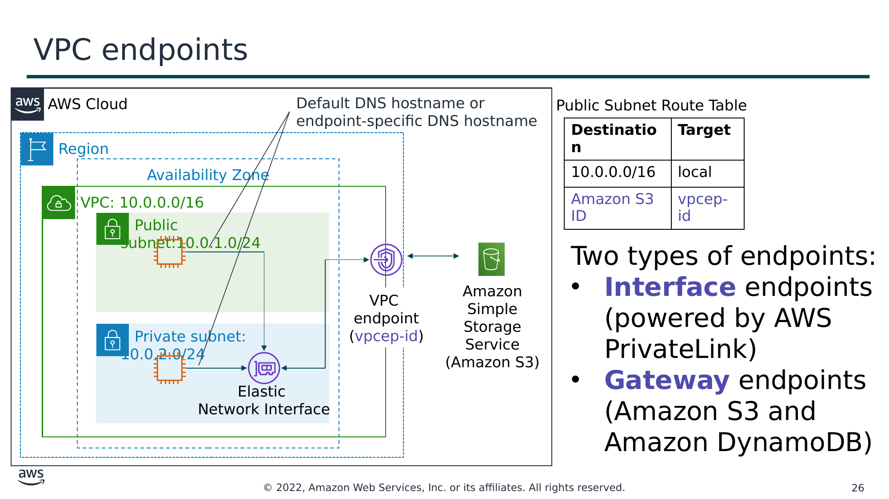

Public Subnet Route Table

| Destination | Target |
|---|---|
| 10.0.0.0/16 | local |
| Amazon S3 ID | vpcep-id |

Two types of endpoints:

- **Interface** endpoints (powered by AWS PrivateLink)
- **Gateway** endpoints (Amazon S3 and Amazon DynamoDB)

Текст зі схеми

AWS Cloud

Default DNS hostname or  
endpoint-specific DNS hostname

Region

Availability Zone

VPC: 10.0.0.0/16

Public subnet:10.0.1.0/24

VPC  
endpoint

(vpcep-id)

Amazon  
Simple Storage Service (Amazon S3)

Private subnet: 10.0.2.0/24

Elastic  
Network Interface

> **Нотатки:**
>
> A VPC endpoint is a virtual device that enables you to privately connect your VPC to supported AWS services and VPC endpoint services that are powered by AWS PrivateLink. Connection to these services does not require an internet gateway, NAT device, VPN connection, or AWS Direct Connect connection. Instances in your VPC do not require public IP addresses to communicate with resources in the service. Traffic between your VPC and the other service does not leave the Amazon network.  
>
> There are two types of VPC endpoints:  
> An interface VPC endpoint (interface endpoint) enables you to connect to services that are powered by AWS PrivateLink. These services include some AWS services, services that are hosted by other AWS customers and AWS Partner Network (APN) Partners in their own VPCs (referred to as endpoint services), and supported AWS Marketplace APN Partner services. The owner of the service is the service provider, and you—as the principal who creates the interface endpoint—are the service consumer. You are charged for creating and using an interface endpoint to a service. Hourly usage rates and data processing rates apply. See the AWS Documentation for a list of supported interface endpoints and for more information about the example shown here at https://docs.aws.amazon.com/vpc/latest/privatelink/create-interface-endpoint.html.  
> Gateway endpoints: The use of gateway endpoints incurs no additional charge. Standard charges for data transfer and resource usage apply.  
>
> For more information about VPC endpoints, see VPC Endpoints in the AWS Documentation at https://docs.aws.amazon.com/vpc/latest/privatelink/concepts.html.

---

## Слайд 27: AWS Transit Gateway

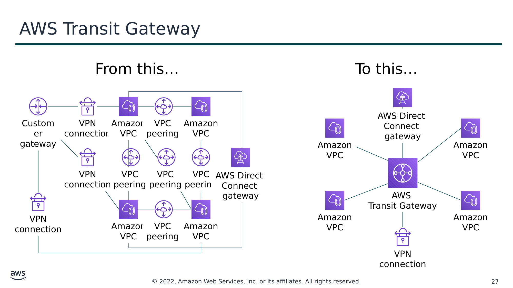

From this…

To this…

Текст зі схеми

AWS Direct  
Connect  
gateway

Customer gateway

Amazon  
VPC

AWS Direct  
Connect  
gateway

Amazon  
VPC

Amazon  
VPC

Amazon  
VPC

Amazon  
VPC

Amazon  
VPC

VPC  
peering

AWS  
Transit Gateway

VPN  
connection

VPN  
connection

VPN  
connection

Amazon  
VPC

Amazon  
VPC

VPN  
connection

VPC  
peering

VPC  
peering

VPC  
peering

VPC  
peering

> **Нотатки:**
>
> You can configure your VPCs in several ways, and take advantage of numerous connectivity options and gateways. These options and gateways include AWS Direct Connect (via DX gateways), NAT gateways, internet gateways, VPC peering, etc. It is not uncommon to find AWS customers with hundreds of VPCs distributed across AWS accounts and Regions to serve multiple lines of business, teams, projects, and so forth. Things get more complex when customers start to set up connectivity between their VPCs. All the connectivity options are strictly point-to-point, so the number of VPC-to-VPC connections can grow quickly. As you grow the number of workloads that run on AWS, you must be able to scale your networks across multiple accounts and VPCs to keep up with the growth.  
>
> Though you can use VPC peering to connect pairs of VPCs, managing point-to-point connectivity across many VPCs without the ability to centrally manage the connectivity policies can be operationally costly and difficult. For on-premises connectivity, you must attach your VPN to each individual VPC. This solution can be time-consuming to build and difficult to manage when the number of VPCs grows into the hundreds.  
>
> To solve this problem, you can use AWS Transit Gateway to simplify your networking model. With AWS Transit Gateway, you only need to create and manage a single connection from the central gateway into each VPC, on-premises data center, or remote office across your network. A transit gateway acts as a hub that controls how traffic is routed among all the connected networks, which act like spokes. This hub-and-spoke model significantly simplifies management and reduces operational costs because each network only needs to connect to the transit gateway and not to every other network. Any new VPC is connected to the transit gateway, and is then automatically available to every other network that is connected to the transit gateway. This ease of connectivity makes it easier to scale your network as you grow.

---

## Слайд 28: Activity: Label this network diagram

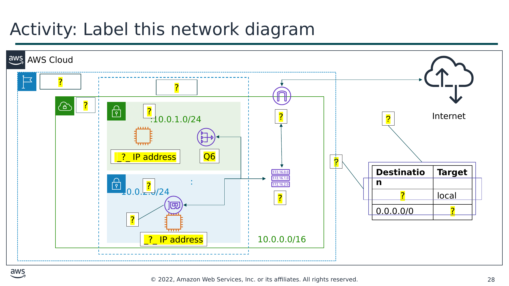

| Destination | Target |
|---|---|
| ? | local |
| 0.0.0.0/0 | ? |

Текст зі схеми

AWS Cloud

?

?

?

Public subnet:10.0.1.0/24

?

?

?

Internet

_?_ IP address

Q6

?

Private subnet: 10.0.2.0/24

?

?

?

_?_ IP address

10.0.0.0/16

> **Нотатки:**
>
> See if you can recognize the different VPC networking components that you learned about by labeling this network diagram.

---

## Слайд 29: Activity: Solution

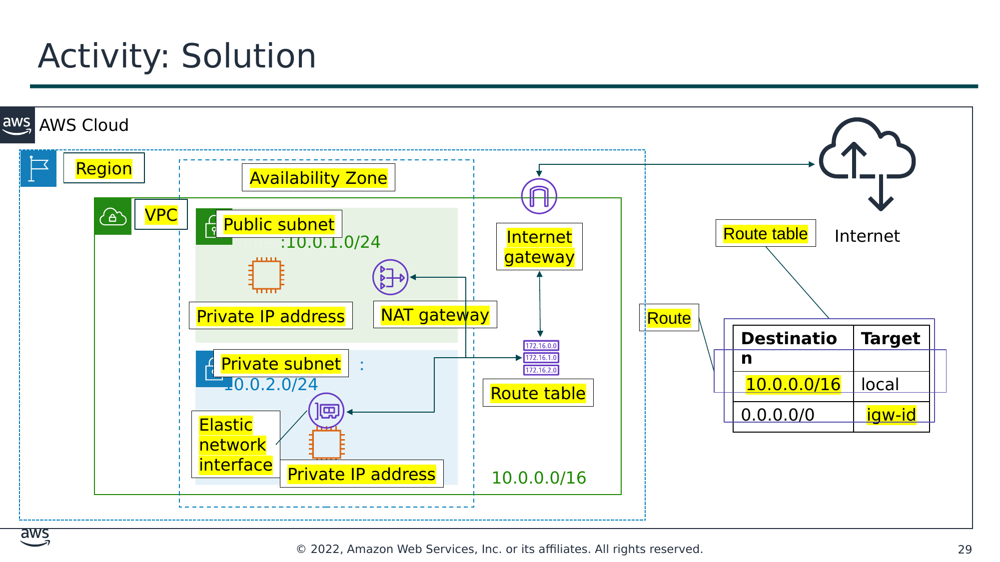

| Destination | Target |
|---|---|
| 10.0.0.0/16 | local |
| 0.0.0.0/0 | igw-id |

Текст зі схеми

AWS Cloud

Region

Availability Zone

VPC

Public subnet:10.0.1.0/24

Public subnet

Internet  
gateway

Route table

Internet

Private IP address

NAT gateway

Route

Private subnet: 10.0.2.0/24

Private subnet

Route table

Elastic  
network  
interface

Private IP address

10.0.0.0/16

> **Нотатки:**
>
> Now, see how well you did.

---

## Слайд 30: Recorded Amazon VPC demonstration

> **Нотатки:**
>
> Now that you know how to design a VPC, watch the demonstration at https://aws-tc-largeobjects.s3-us-west-2.amazonaws.com/ILT-TF-100-ACFNDS-20-EN/Module_5_VPC_Wizard+v2.0.mp4 to learn how to use the VPC Wizard to set up a VPC with public and private subnets.

---

## Слайд 31: Section 3 key takeaways

- There are several VPC networking options, which include:
  - Internet gateway
  - NAT gateway
  - VPC endpoint
  - VPC peering
  - VPC sharing
  - AWS Site-to-Site VPN
  - AWS Direct Connect
  - AWS Transit Gateway
- You can use the VPC Wizard to implement your design.

> **Нотатки:**
>
> Some key takeaways from this section of the module include:  
> There are several VPC networking options, which include:  
> Internet gateway: Connects your VPC to the internet  
> NAT gateway: Enables instances in a private subnet to connect to the internet  
> VPC endpoint: Connects your VPC to supported AWS services  
> VPC peering: Connects your VPC to other VPCs  
> VPC sharing: Allows multiple AWS accounts to create their application resources into shared, centrally-managed Amazon VPCs  
> AWS Site-to-Site VPN: Connects your VPC to remote networks  
> AWS Direct Connect: Connects your VPC to a remote network by using a dedicated network connection  
> AWS Transit Gateway: A hub-and-spoke connection alternative to VPC peering  
> You can use the VPC Wizard to implement your design.

---

## Слайд 32: Section 4: VPC security

Module 5: Networking and Content Delivery

> **Нотатки:**
>
> Section 4: VPC security  
>
> You can build security into your VPC architecture in several ways so that you have complete control over both incoming and outgoing traffic. In this section, you learn about two Amazon VPC firewall options that you can use to secure your VPC: security groups and network access control lists (network ACLs).

---

## Слайд 33: Security groups (1 of 2)

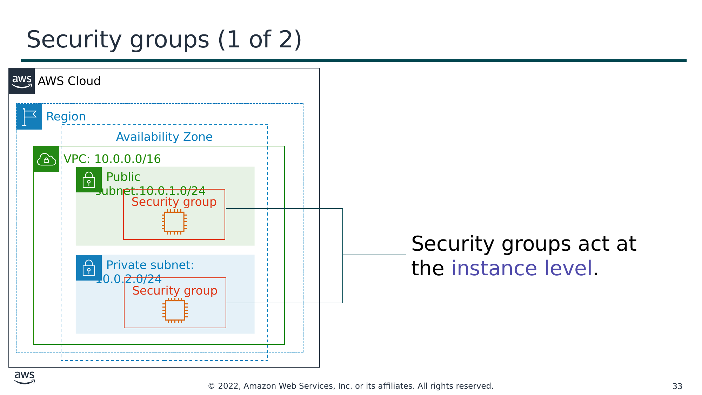

Security groups act at  
the instance level.

Текст зі схеми

AWS Cloud

Region

Availability Zone

VPC: 10.0.0.0/16

Public subnet:10.0.1.0/24

Security group

Private subnet: 10.0.2.0/24

Security group

> **Нотатки:**
>
> A security group acts as a virtual firewall for your instance, and it controls inbound and outbound traffic. Security groups act at the instance level, not the subnet level. Therefore, each instance in a subnet in your VPC can be assigned to a different set of security groups.  
>
> At the most basic level, a security group is a way for you to filter traffic to your instances.

---

## Слайд 34: Security groups (2 of 2)

- Security groups have rules that control inbound and outbound instance traffic.
- Default security groups deny all inbound traffic and allow all outbound traffic.
- Security groups are stateful.

Inbound

| Source | Protocol | Port Range | Description |
|---|---|---|---|
| sg-xxxxxxxx | All | All | Allow inbound traffic from network interfaces assigned to the same security group. |

Outbound

| Destination | Protocol | Port Range | Description |
|---|---|---|---|
| 0.0.0.0/0 | All | All | Allow all outbound IPv4 traffic. |
| ::/0 | All | All | Allow all outbound IPv6 traffic. |

> **Нотатки:**
>
> Security groups have rules that control the inbound and outbound traffic. When you create a security group, it has no inbound rules. Therefore, no inbound traffic that originates from another host to your instance is allowed until you add inbound rules to the security group. By default, a security group includes an outbound rule that allows all outbound traffic. You can remove the rule and add outbound rules that allow specific outbound traffic only. If your security group has no outbound rules, no outbound traffic that originates from your instance is allowed.  
>
> Security groups are stateful, which means that state information is kept even after a request is processed. Thus, if you send a request from your instance, the response traffic for that request is allowed to flow in regardless of inbound security group rules. Responses to allowed inbound traffic are allowed to flow out, regardless of outbound rules.

---

## Слайд 35: Custom security group examples

- You can **specify allow** rules, but not deny rules.
- **All rules are evaluated** before the decision to allow traffic.

Inbound

| Source | Protocol | Port Range | Description |
|---|---|---|---|
| 0.0.0.0/0 | TCP | 80 | Allow inbound HTTP access from all IPv4 addresses |
| 0.0.0.0/0 | TCP | 443 | Allow inbound HTTPS access from all IPv4 addresses |
| Your network's public IPv4 address range | TCP | 22 | Allow inbound SSH access to Linux instances from IPv4 IP addresses in your network (over the internet gateway) |

Outbound

| Destination | Protocol | Port Range | Description |
|---|---|---|---|
| The ID of the security group for your Microsoft SQL Server database servers | TCP | 1433 | Allow outbound Microsoft SQL Server access to instances in the specified security group |

> **Нотатки:**
>
> When you create a custom security group, you can specify allow rules, but not deny rules. All rules are evaluated before the decision to allow traffic.

---

## Слайд 36: Network access control lists (network ACLs 1 of 2)

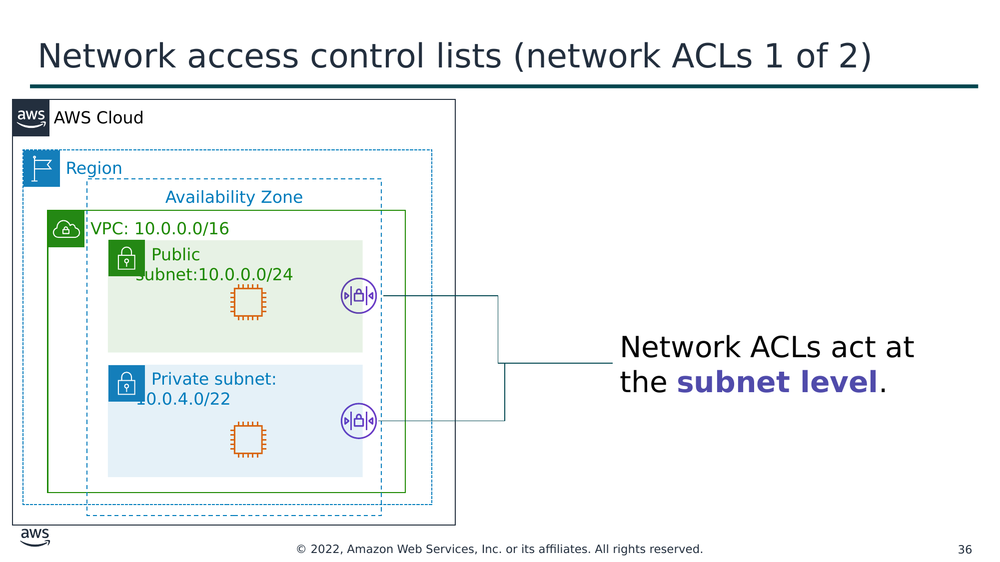

Network ACLs act at  
the **subnet level**.

Текст зі схеми

AWS Cloud

Region

Availability Zone

VPC: 10.0.0.0/16

Public subnet:10.0.0.0/24

Private subnet: 10.0.4.0/22

> **Нотатки:**
>
> A network access control list (network ACL) is an optional layer of security for your Amazon VPC. It acts as a firewall for controlling traffic in and out of one or more subnets. To add another layer of security to your VPC, you can set up network ACLs with rules that are similar to your security groups.  
>
> Each subnet in your VPC must be associated with a network ACL. If you don't explicitly associate a subnet with a network ACL, the subnet is automatically associated with the default network ACL. You can associate a network ACL with multiple subnets; however, a subnet can be associated with only one network ACL at a time. When you associate a network ACL with a subnet, the previous association is removed.

---

## Слайд 37: Network access control lists (network ACLs 2 of 2)

- A network ACL has separate inbound and outbound rules, and each rule can  
either allow or deny traffic.
- Default network ACLs allow all inbound and outbound IPv4 traffic.
- Network ACLs are stateless.

Inbound

| Rule | Type | Protocol | Port Range | Source | Allow/Deny |
|---|---|---|---|---|---|
| 100 | All IPv4 traffic | All | All | 0.0.0.0/0 | ALLOW |
| * | All IPv4 traffic | All | All | 0.0.0.0/0 | DENY |

Outbound

| Rule | Type | Protocol | Port Range | Destination | Allow/Deny |
|---|---|---|---|---|---|
| 100 | All IPv4 traffic | All | All | 0.0.0.0/0 | ALLOW |
| * | All IPv4 traffic | All | All | 0.0.0.0/0 | DENY |

> **Нотатки:**
>
> A network ACL has separate inbound and outbound rules, and each rule can either allow or deny traffic. Your VPC automatically comes with a modifiable default network ACL. By default, it allows all inbound and outbound IPv4 traffic and, if applicable, IPv6 traffic. The table shows a default network ACL.  
>
> Network ACLs are stateless, which means that no information about a request is maintained after a request is processed.

---

## Слайд 38: Custom network ACLs examples

- **Custom** network ACLs **deny** all inbound and outbound traffic until you add rules.
- You can specify **both allow and deny** rules.
- Rules are evaluated in number order, starting with the **lowest number**.

Inbound

| Rule | Type | Protocol | Port Range | Source | Allow/Deny |
|---|---|---|---|---|---|
| 100 | HTTPS | TCP | 443 | 0.0.0.0/0 | ALLOW |
| 120 | SSH | TCP | 22 | 192.0.2.0/24 | ALLOW |
| * | All IPv4 traffic | All | All | 0.0.0.0/0 | DENY |

Outbound

| Rule | Type | Protocol | Port Range | Destination | Allow/Deny |
|---|---|---|---|---|---|
| 100 | HTTPS | TCP | 443 | 0.0.0.0/0 | ALLOW |
| 120 | SSH | TCP | 22 | 192.0.2.0/24 | ALLOW |
| * | All IPv4 traffic | All | All | 0.0.0.0/0 | DENY |

> **Нотатки:**
>
> You can create a custom network ACL and associate it with a subnet. By default, each custom network ACL denies all inbound and outbound traffic until you add rules.  
>
> A network ACL contains a numbered list of rules that are evaluated in order, starting with the lowest numbered rule. The purpose is to determine whether traffic is allowed in or out of any subnet that is associated with the network ACL. The highest number that you can use for a rule is 32,766. AWS recommends that you create rules in increments (for example, increments of 10 or 100) so that you can insert new rules where you need them later.  
>
> For more information about network ACLs, see Network ACLs in the AWS Documentation at https://docs.aws.amazon.com/vpc/latest/userguide/vpc-network-acls.html.

---

## Слайд 39: Security groups versus network ACLs

| Attribute | Security Groups | Network ACLs |
|---|---|---|
| Scope | Instance level | Subnet level |
| Supported Rules | Allow rules only | Allow and deny rules |
| State | Stateful (return traffic is automatically allowed, regardless of rules) | Stateless (return traffic must be explicitly allowed by rules) |
| Order of Rules | All rules are evaluated before decision to allow traffic | Rules are evaluated in number order before decision to allow traffic |

> **Нотатки:**
>
> Here is a summary of the differences between security groups and network ACLs:  
> Security groups act at the instance level, but network ACLs act at the subnet level.  
> Security groups support allow rules only, but network ACLs support both allow and deny rules.  
> Security groups are stateful, but network ACLs are stateless.  
> For security groups, all rules are evaluated before the decision is made to allow traffic. For network ACLs, rules are evaluated in number order before the decision is made to allow traffic.

---

## Слайд 40: Activity: Design a VPC

Scenario: You have a small business with a website that is hosted on an Amazon Elastic Compute Cloud (Amazon EC2) instance. You have customer data that is stored on a backend database that you want to keep private. You want to use Amazon VPC to set up a VPC that meets the following requirements:

- Your web server and database server must be in separate subnets.
- The first address of your network must be 10.0.0.0. Each subnet must have 256 total IPv4 addresses.
- Your customers must always be able to access your web server.
- Your database server must be able to access the internet to make patch updates.
- Your architecture must be highly available and use at least one custom firewall layer.

> **Нотатки:**
>
> Now, it’s your turn! In this scenario, you are a small business owner with a website that is hosted on an Amazon Elastic Compute Cloud (Amazon EC2) instance. You have customer data that is stored on a backend database that you want to keep private.  
>
> See if you can design a VPC that meets the following requirements:  
> Your web server and database server must be in separate subnets.  
> The first address of your network must be 10.0.0.0. Each subnet must have 256 IPv4 addresses.  
> Your customers must always be able to access your web server.  
> Your database server must be able to access the internet to make patch updates.  
> Your architecture must be highly available and use at least one custom firewall layer.

---

## Слайд 41: Section 4 key takeaways

- Build security into your VPC architecture:
  - Isolate subnets if possible.
  - Choose the appropriate gateway device or VPN connection for your needs.
  - Use firewalls.
- Security groups and network ACLs are firewall options that you can use to secure your VPC.

> **Нотатки:**
>
> The key takeaways from this section of the module are:  
> Build security into your VPC architecture.  
> Security groups and network ACLs are firewall options that you can use to secure your VPC.

---

## Слайд 42: Lab 2: Build Your VPC and Launch a Web Server

> **Нотатки:**
>
> You will now work on Lab 2: Build Your VPC and Launch a Web Server.

---

## Слайд 43: Lab 2: Scenario

In this lab, you use Amazon VPC to create your own VPC and add some components to produce a customized network. You create a security group for your VPC. You also create an EC2 instance and configure it to run a web server and to use the security group. You then launch the EC2 instance into the VPC.

Amazon  
VPC

Amazon  
EC2

> **Нотатки:**
>
> In this lab, you use Amazon VPC to create your own VPC and add some components to produce a customized network. You also create a security group for your VPC, and then create an EC2 instance and configure it to run a web server and to use the security group. You then launch the EC2 instance into the VPC.

---

## Слайд 44: Lab 2: Tasks

- Create a VPC.
- Create additional subnets.
- Create a VPC security group.
- Launch a web server instance.

Security group

> **Нотатки:**
>
> In this lab, you complete these tasks:  
> Create a VPC.  
> Create additional subnets.  
> Create a VPC security group.  
> Launch a web server instance.

---

## Слайд 45: Lab 2: Final product

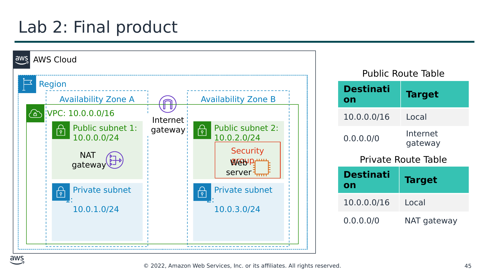

Public Route Table

| Destination | Target |
|---|---|
| 10.0.0.0/16 | Local |
| 0.0.0.0/0 | Internet gateway |

Private Route Table

| Destination | Target |
|---|---|
| 10.0.0.0/16 | Local |
| 0.0.0.0/0 | NAT gateway |

Текст зі схеми

AWS Cloud

Region

Availability Zone A

Availability Zone B

VPC: 10.0.0.0/16

Public subnet 1:  
   10.0.0.0/24

Internet  
gateway

Public subnet 2:  
   10.0.2.0/24

Security group

NAT  
gateway

Web  
server

Private subnet 1:  
   10.0.1.0/24

Private subnet 2:  
   10.0.3.0/24

> **Нотатки:**
>
> This architecture diagram depicts what you create in the lab.

---

## Слайд 46: Begin Lab 2: Build Your VPC and Launch a Web Server

~ 30 minutes

> **Нотатки:**
>
> It is now time to start the lab. It should take you approximately 30 minutes to complete the lab.

---

## Слайд 47: Lab debrief: Key takeaways

> **Нотатки:**
>
> In this lab, you:  
> Created an Amazon VPC.  
> Created additional subnets.  
> Created an Amazon VPC security group.  
> Launched a web server instance on Amazon EC2.

---

## Слайд 48: Section 5: Amazon Route 53

Module 5: Networking and Content Delivery

> **Нотатки:**
>
> Section 5: Amazon Route 53

---

## Слайд 49: Amazon Route 53

- Is a highly available and scalable Domain Name System (DNS) web service
- Is used to route end users to internet applications by translating names (like [*www.example.com*](http://www.example.com/)) into numeric IP addresses (like *192.0.2.1*) that computers use to connect to each other
- Is fully compliant with IPv4 and IPv6
- Connects user requests to infrastructure running in AWS and also outside of AWS
- Is used to check the health of your resources
- Features traffic flow
- Enables you to register domain names

Amazon  
Route 53

> **Нотатки:**
>
> Amazon Route 53 is a highly available and scalable cloud Domain Name System (DNS) web service. It is designed to give developers and businesses a reliable and cost-effective way to route users to internet applications by translating names (like www.example.com) into the numeric IP addresses (like 192.0.2.1) that computers use to connect to each other. In addition, Amazon Route 53 is fully compliant with IPv6. See more on Domain Name Systems at https://aws.amazon.com/route53/what-is-dns/.  
>
> Amazon Route 53 effectively connects user requests to infrastructure running in AWS—such as Amazon EC2 instances, Elastic Load Balancing load balancers, or Amazon S3 buckets—and can also be used to route users to infrastructure that is outside of AWS.  
>
> You can use Amazon Route 53 to configure DNS health checks so you that can route traffic to healthy endpoints or independently monitor the health of your application and its endpoints.  
>
> Amazon Route 53 traffic flow helps you manage traffic globally through several routing types, which can be combined with DNS failover to enable various low-latency, fault-tolerant architectures. You can use Amazon Route 53 traffic flow’s simple visual editor to manage how your users are routed to your application’s endpoints—whether in a single AWS Region or distributed around the globe.  
>
> Amazon Route 53 also offers Domain Name Registration—you can purchase and manage domain names (like example.com), and Amazon Route 53 will automatically configure DNS settings for your domains.

---

## Слайд 50: Amazon Route 53 DNS resolution

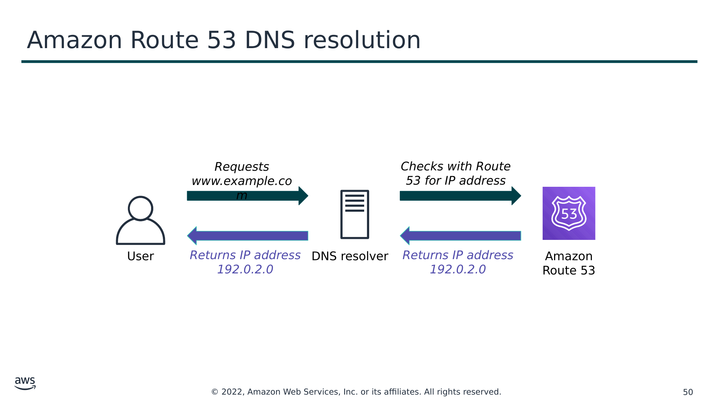

Текст зі схеми

*Requests www.example.com*

*Checks with Route 53 for IP address*

User

*Returns IP address 192.0.2.0*

DNS resolver

*Returns IP address 192.0.2.0*

Amazon Route 53

> **Нотатки:**
>
> Here is the basic pattern that Amazon Route 53 follows when a user initiates a DNS request. The DNS resolver checks with your domain in Route 53, gets the IP address, and returns it to the user.

---

## Слайд 51: Amazon Route 53 supported routing

- Simple routing – Use in single-server environments
- Weighted round robin routing – Assign weights to resource record sets to specify the frequency
- Latency routing – Help improve your global applications
- Geolocation routing – Route traffic based on location of your users
- Geoproximity routing – Route traffic based on location of your resources
- Failover routing – Fail over to a backup site if your primary site becomes unreachable
- Multivalue answer routing – Respond to DNS queries with up to eight healthy records selected at random

> **Нотатки:**
>
> Amazon Route 53 supports several types of routing policies, which determine how Amazon Route 53 responds to queries:  
> Simple routing (round robin) – Use for a single resource that performs a given function for your domain (such as a web server that serves content for the example.com website).  
> Weighted round robin routing – Use to route traffic to multiple resources in proportions that you specify. Enables you to assign weights to resource record sets to specify the frequency with which different responses are served. You might want to use this capability to do A/B testing, which is when you send a small portion of traffic to a server where you made a software change. For instance, suppose you have two record sets that are associated with one DNS name: one with weight 3 and one with weight 1. In this case, 75 percent of the time, Amazon Route 53 will return the record set with weight 3, and 25 percent of the time, Amazon Route 53 will return the record set with weight 1. Weights can be any number between 0 and 255.  
> Latency routing (LBR) – Use when you have resources in multiple AWS Regions and you want to route traffic to the Region that provides the best latency. Latency routing works by routing your customers to the AWS endpoint (for example, Amazon EC2 instances, Elastic IP addresses, or load balancers) that provides the fastest experience based on actual performance measurements of the different AWS Regions where your application runs.  
> Geolocation routing – Use when you want to route traffic based on the location of your users. When you use geolocation routing, you can localize your content and present some or all of your website in the language of your users. You can also use geolocation routing to restrict the distribution of content to only the locations where you have distribution rights. Another possible use is for balancing the load across endpoints in a predictable, easy-to-manage way, so that each user location is consistently routed to the same endpoint.  
> Geoproximity routing – Use when you want to route traffic based on the location of your resources and, optionally, shift traffic from resources in one location to resources in another.  
> Failover routing (DNS failover) – Use when you want to configure active-passive failover. Amazon Route 53 can help detect an outage of your website and redirect your users to alternate locations where your application is operating properly. When you enable this feature, Amazon Route 53 health-checking agents will monitor each location or endpoint of your application to determine its availability. You can take advantage of this feature to increase the availability of your customer-facing application.  
> Multivalue answer routing – Use when you want Route 53 to respond to DNS queries with up to eight healthy records that are selected at random. You can configure Amazon Route 53 to return multiple values—such as IP addresses for your web servers—in response to DNS queries. You can specify multiple values for almost any record, but multivalue answer routing also enables you to check the health of each resource so that Route 53 returns only values for healthy resources. It's not a substitute for a load balancer, but the ability to return multiple health-checkable IP addresses is a way to use DNS to improve availability and load balancing.

---

## Слайд 52: Use case: Multi-region deployment

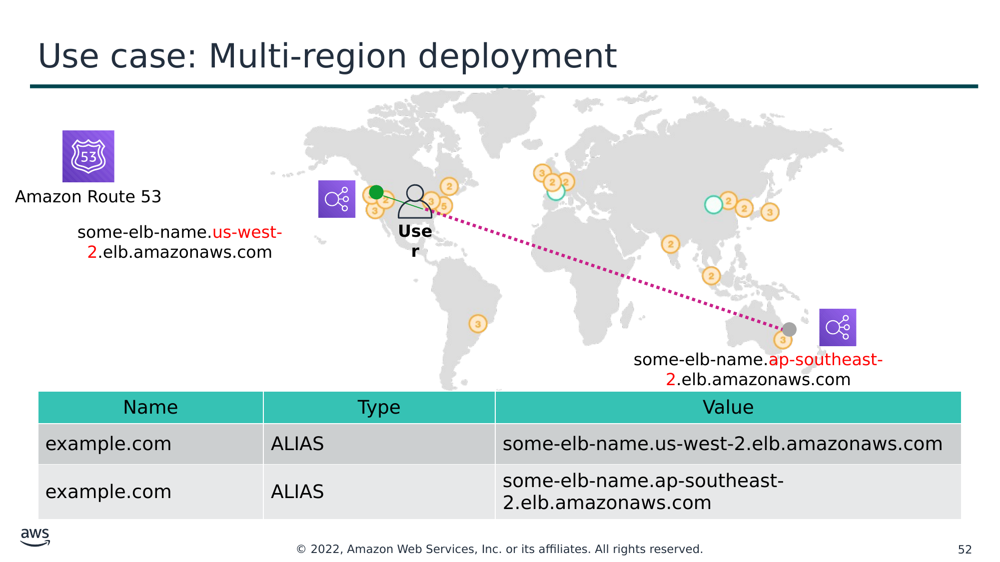

| Name | Type | Value |
|---|---|---|
| example.com | ALIAS | some-elb-name.us-west-2.elb.amazonaws.com |
| example.com | ALIAS | some-elb-name.ap-southeast-2.elb.amazonaws.com |

Текст зі схеми

Amazon Route 53

some-elb-name.us-west-2.elb.amazonaws.com

**User**

some-elb-name.ap-southeast-2.elb.amazonaws.com

> **Нотатки:**
>
> Multi-Region deployment is an example use case for Amazon Route 53. With Amazon Route 53, the user is automatically directed to the Elastic Load Balancing load balancer that’s closest to the user.  
>
> The benefits of multi-region deployment of Route 53 include:  
> Latency-based routing to the Region  
> Load balancing routing to the Availability Zone

---

## Слайд 53: Amazon Route 53 DNS failover

Improve the availability of your applications that run on AWS by:

- Configuring backup and failover scenarios for your own applications
- Enabling highly available multi-region architectures on AWS
- Creating health checks

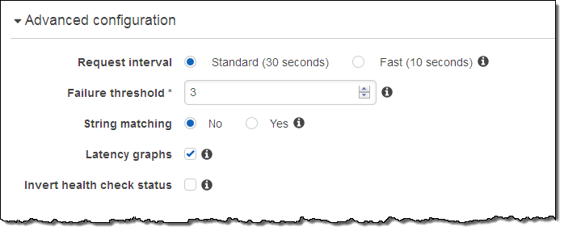

> **Нотатки:**
>
> Amazon Route 53 enables you to improve the availability of your applications that run on AWS by:  
> Configuring backup and failover scenarios for your own applications.  
> Enabling highly available multi-Region architectures on AWS.  
> Creating health checks to monitor the health and performance of your web applications, web servers, and other resources. Each health check that you create can monitor one of the following—the health of a specified resource, such as a web server; the status of other health checks; and the status of an Amazon CloudWatch alarm.

---

## Слайд 54: DNS failover for a multi-tiered web application

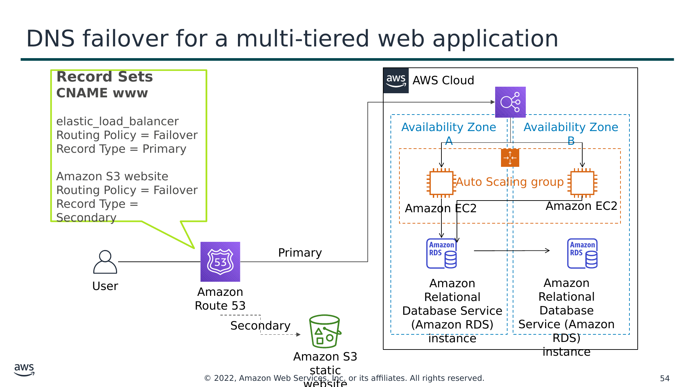

Текст зі схеми

**Record Sets**

**CNAME www**

elastic_load_balancer  
Routing Policy = Failover

Record Type = Primary

Amazon S3 website  
Routing Policy = Failover

Record Type = Secondary

AWS Cloud

Availability Zone A

Availability Zone B

Auto Scaling group

Amazon EC2

Amazon EC2

Primary

User

Amazon Relational Database Service (Amazon RDS)

instance

Amazon Relational Database Service (Amazon RDS)

instance

Amazon Route 53

Secondary

Amazon S3 static website

> **Нотатки:**
>
> This diagram indicates how DNS failover works in a typical architecture for a multi-tiered web application. Route 53 passes traffic to a load balancer, which then distributes traffic to a fleet of EC2 instances.  
>
> You can do the following tasks with Route 53 to ensure high availability:  
> Create two DNS records for the Canonical Name Record (CNAME) www with a routing policy of Failover Routing. The first record is the primary route policy, which points to the load balancer for your web application. The second record is the secondary route policy, which points to your static Amazon S3 website.  
> Use Route 53 health checks to make sure that the primary is running. If it is, all traffic defaults to your web application stack. Failover to the static backup site would be triggered if either the web server goes down (or stops responding), or the database instance goes down.

---

## Слайд 55: Section 5 key takeaways

- Amazon Route 53 is a highly available and scalable cloud DNS web service that translates domain names into numeric IP addresses.
- Amazon Route 53 supports several types of routing policies.
- Multi-Region deployment improves your application’s performance for a global audience.
- You can use Amazon Route 53 failover to improve the availability of your applications.

> **Нотатки:**
>
> Some key takeaways from this section of the module include:  
> Amazon Route 53 is a highly available and scalable cloud DNS web service that translates domain names into numeric IP addresses.  
> Amazon Route 53 supports several types of routing policies.  
> Multi-Region deployment improves your application’s performance for a global audience.  
> You can use Amazon Route 53 failover to improve the availability of your applications.

---

## Слайд 56: Section 6: Amazon CloudFront

Module 5: Networking and Content Delivery

> **Нотатки:**
>
> Section 6: Amazon CloudFront  
>
> The purpose of networking is to share information between connected resources. So far in this module, you learned about VPC networking with Amazon VPC. You learned about the different options for connecting your VPC to the internet, to remote networks, to other VPCs, and to AWS services.  
>
> Content delivery occurs over networks, too—for example, when you stream a movie from your favorite streaming service. In this final section, you learn about Amazon CloudFront, which is a content delivery network (CDN) service.

---

## Слайд 57: Content delivery and network latency

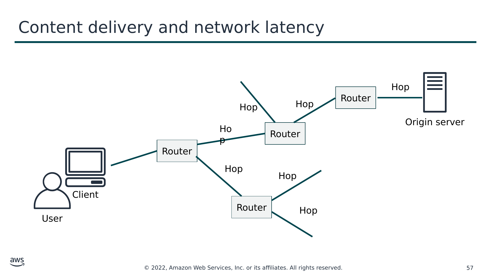

Текст зі схеми

Hop

Router

Hop

Hop

Hop

Origin server

Router

Router

Hop

Hop

Client

Router

User

Hop

> **Нотатки:**
>
> As explained earlier in this module when you were learning about AWS Direct Connect, one of the challenges of network communication is network performance. When you browse a website or stream a video, your request is routed through many different networks to reach an origin server. The origin server (or origin) stores the original, definitive versions of the objects (webpages, images, and media files). The number of network hops and the distance that the request must travel significantly affect the performance and responsiveness of the website. Further, network latency is different in various geographic locations. For these reasons, a content delivery network might be the solution.

---

## Слайд 58: Content delivery network (CDN)

- Is a globally distributed system of caching servers
- Caches copies of commonly requested files (static content)
- Delivers a local copy of the requested content from a nearby cache edge or Point of Presence
- Accelerates delivery of dynamic content
- Improves application performance and scaling

> **Нотатки:**
>
> A content delivery network (CDN) is a globally distributed system of caching servers. A CDN caches copies of commonly requested files (static content, such as Hypertext Markup Language, or HTML; Cascading Style Sheets, or CSS; JavaScript; and image files) that are hosted on the application origin server. The CDN delivers a local copy of the requested content from a cache edge or Point of Presence that provides the fastest delivery to the requester.  
>
> CDNs also deliver dynamic content that is unique to the requester and is not cacheable. Having a CDN deliver dynamic content improves application performance and scaling. The CDN establishes and maintains secure connections closer to the requester. If the CDN is on the same network as the origin, routing back to the origin to retrieve dynamic content is accelerated. In addition, content such as form data, images, and text can be ingested and sent back to the origin, thus taking advantage of the low-latency connections and proxy behavior of the PoP.

---

## Слайд 59: Amazon CloudFront

- Fast, global, and secure CDN service
- Global network of edge locations and Regional edge caches
- Self-service model
- Pay-as-you-go pricing

Amazon  
CloudFront

> **Нотатки:**
>
> Amazon CloudFront is a fast CDN service that securely delivers data, videos, applications, and application programming interfaces (APIs) to customers globally with low latency and high transfer speeds. It also provides a developer-friendly environment. Amazon CloudFront delivers files to users over a global network of edge locations and Regional edge caches. Amazon CloudFront is different from traditional content delivery solutions because it enables you to quickly obtain the benefits of high-performance content delivery without negotiated contracts, high prices, or minimum fees. Like other AWS services, Amazon CloudFront is a self-service offering with pay-as-you-go pricing.

---

## Слайд 60: Amazon CloudFront infrastructure

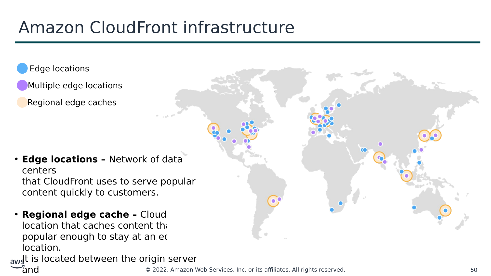

- **Edge locations –** Network of data centers  
that CloudFront uses to serve popular content quickly to customers.
- **Regional edge cache –** CloudFront  
location that caches content that is not  
popular enough to stay at an edge location.  
It is located between the origin server and  
the global edge location.

Текст зі схеми

Edge locations

Multiple edge locations

Regional edge caches

> **Нотатки:**
>
> Amazon CloudFront delivers content through a worldwide network of data centers that are called edge locations. When a user requests content that you serve with CloudFront, the user is routed to the edge location that provides the lowest latency (or time delay) so that content is delivered with the best possible performance. CloudFront edge locations are designed to serve popular content quickly to your viewers.  
>
> As objects become less popular, individual edge locations might remove those objects to make room for more popular content. For the less popular content, CloudFront has Regional edge caches. Regional edge caches are CloudFront locations that are deployed globally and are close to your viewers. They are located between your origin server and the global edge locations that serve content directly to viewers. A Regional edge cache has a larger cache than an individual edge location, so objects remain in the Regional edge cache longer. More of your content remains closer to your viewers, which reduces the need for CloudFront to go back to your origin server and improves overall performance for viewers.  
>
> For more information about how Amazon CloudFront works, see How CloudFront Delivers Content in the AWS Documentation at https://docs.aws.amazon.com/AmazonCloudFront/latest/DeveloperGuide/HowCloudFrontWorks.html#HowCloudFrontWorksContentDelivery.

---

## Слайд 61: Amazon CloudFront benefits

- Fast and global
- Security at the edge
- Highly programmable
- Deeply integrated with AWS
- Cost-effective

> **Нотатки:**
>
> Amazon CloudFront provides the following benefits:  
> Fast and global – Amazon CloudFront is massively scaled and globally distributed. To deliver content to end users with low latency, Amazon CloudFront uses a global network that consists of edge locations and regional caches.  
> Security at the edge – Amazon CloudFront provides both network-level and application-level protection. Your traffic and applications benefit through various built-in protections, such as AWS Shield Standard, at no additional cost. You can also use configurable features, such as AWS Certificate Manager (ACM), to create and manage custom Secure Sockets Layer (SSL) certificates at no extra cost.  
> Highly programmable – Amazon CloudFront features can be customized for specific application requirements. It integrates with Lambda@Edge so that you can run custom code across AWS locations worldwide, which enables you to move complex application logic closer to users to improve responsiveness. The CDN also supports integrations with other tools and automation interfaces for DevOps. It offers continuous integration and continuous delivery (CI/CD) environments.  
> Deeply integrated with AWS – Amazon CloudFront is integrated with AWS, with both physical locations that are directly connected to the AWS Global Infrastructure and other AWS services. You can use APIs or the AWS Management Console to programmatically configure all features in the CDN.  
> Cost-effective – Amazon CloudFront is cost-effective because it has no minimum commitments and charges you only for what you use. Compared to self-hosting, Amazon CloudFront avoids the expense and complexity of operating a network of cache servers in multiple sites across the internet. It eliminates the need to overprovision capacity to serve potential spikes in traffic. Amazon CloudFront also uses techniques like collapsing simultaneous viewer requests at an edge location for the same file into a single request to your origin server. The result is reduced load on your origin servers and reduced need to scale your origin infrastructure, which can result in further cost savings. If you use AWS origins such as Amazon Simple Storage Service (Amazon S3) or Elastic Load Balancing, you pay only for storage costs, not for any data transferred between these services and CloudFront.

---

## Слайд 62: Amazon CloudFront pricing

Data transfer out

- Charged for the volume of data transferred out from Amazon CloudFront edge location to the internet or to your origin.

HTTP(S) requests

- Charged for number of HTTP(S) requests.

Invalidation requests

- No additional charge for the first 1,000 paths that are requested for invalidation each month. Thereafter, $0.005 per path that is requested for invalidation.

Dedicated IP custom SSL

- $600 per month for each custom SSL certificate that is associated with one or more CloudFront distributions that use the Dedicated IP version of custom SSL certificate support.

> **Нотатки:**
>
> Amazon CloudFront charges are based on actual usage of the service in four areas:  
> Data transfer out – You are charged for the volume of data that is transferred out from Amazon CloudFront edge locations, measured in GB, to the internet or to your origin (both AWS origins and other origin servers). Data transfer usage is totaled separately for specific geographic regions, and then cost is calculated based on pricing tiers for each area. If you use other AWS services as the origins of your files, you are charged separately for your use of those services, including storage and compute hours.  
> HTTP(S) requests – You are charged for the number of HTTP(S) requests that are made to Amazon CloudFront for your content.  
> Invalidation requests – You are charged per path in your invalidation request. A path that is listed in your invalidation request represents the URL (or multiple URLs if the path contains a wildcard character) of the object that you want to invalidate from CloudFront cache. You can request up to 1,000 paths each month from Amazon CloudFront at no additional charge. Beyond the first 1,000 paths, you are charged per path that is listed in your invalidation requests.  
> Dedicated IP custom Secure Sockets Layer (SSL) – You pay $600 per month for each custom SSL certificate that is associated with one or more CloudFront distributions that use the Dedicated IP version of custom SSL certificate support. This monthly fee is prorated by the hour. For example, if your custom SSL certificate was associated with at least one CloudFront distribution for just 24 hours (that is, 1 day) in the month of June, your total charge for using the custom SSL certificate feature in June is (1 day / 30 days) * $600 = $20.  
>
> For the latest pricing information, see the Amazon CloudFront pricing page at https://aws.amazon.com/cloudfront/pricing/.

---

## Слайд 63: Section 6 key takeaways

- A CDN is a globally distributed system of caching servers that accelerates delivery of content.
- Amazon CloudFront is a fast CDN service that securely delivers data, videos, applications, and APIs over a global infrastructure with low latency and high transfer speeds.
- Amazon CloudFront offers many benefits.

> **Нотатки:**
>
> Some key takeaways from this section of the module include:  
> A CDN is a globally distributed system of caching servers that accelerates delivery of content.  
> Amazon CloudFront is a fast CDN service that securely delivers data, videos, applications, and APIs over a global infrastructure with low latency and high transfer speeds.  
> Amazon CloudFront offers many benefits, including:  
> Fast and global  
> Security at the edge  
> Highly programmable  
> Deeply integrated with AWS  
> Cost-effective

---

## Слайд 64: Module wrap-up

Module 5: Networking and Content Delivery

> **Нотатки:**
>
> It’s now time to review the module, and wrap up with a knowledge check and a discussion of a practice certification exam question.

---

## Слайд 65: Module summary

In summary, in this module you learned how to:

- Recognize the basics of networking
- Describe virtual networking in the cloud with Amazon VPC
- Label a network diagram
- Design a basic VPC architecture
- Indicate the steps to build a VPC
- Identify security groups
- Create your own VPC and added additional components to it to produce a customized network
- Identify the fundamentals of Amazon Route 53
- Recognize the benefits of Amazon CloudFront

> **Нотатки:**
>
> In summary, in this module you learned how to:  
> Recognize the basics of networking  
> Describe virtual networking in the cloud with Amazon VPC  
> Label a network diagram  
> Design a basic VPC architecture  
> Indicate the steps to build a VPC  
> Identify security groups  
> Create your own VPC and added additional components to it to produce a customized network  
> Identify the fundamentals of Amazon Route 53  
> Recognize the benefits of Amazon CloudFront

---

## Слайд 66: Complete the knowledge check

> **Нотатки:**
>
> Now, complete the knowledge check.

---

## Слайд 67: Sample exam question

Which AWS networking service enables a company to create a virtual network within AWS?

Choice

Response

A

AWS Config

B

Amazon Route 53

C

AWS Direct Connect

D

Amazon VPC

> **Нотатки:**
>
> Look at the answer choices and rule them out based on the keywords.

---

## Слайд 68: Sample exam question answer

Which AWS networking service enables a company to create a virtual network within AWS?

The correct answer is D.

The keywords in the question are “AWS networking service” and “create a virtual network”.

> **Нотатки:**
>
> The following are the keywords to recognize: “AWS networking service” and “create a virtual network”.  
>
> The correct answer is D.

---

## Слайд 69: Additional resources

- Amazon VPC Overview pag: https://docs.aws.amazon.com/vpc/latest/userguide/what-is-amazon-vpc.html
- Amazon Virtual Private Cloud Connectivity Options whitepaper: [https://docs.aws.amazon.com/whitepapers/latest/aws-vpc-connectivity-options/introduction.html](https://docs.aws.amazon.com/whitepapers/latest/aws-vpc-connectivity-options/introduction.html)
- One to Many: Evolving VPC Design AWS Architecture blog post: [https://aws.amazon.com/blogs/architecture/one-to-many-evolving-vpc-design/](https://aws.amazon.com/blogs/architecture/one-to-many-evolving-vpc-design/)
- Amazon VPC User Guide: [https://docs.aws.amazon.com/vpc/latest/userguide/what-is-amazon-vpc.html](https://docs.aws.amazon.com/vpc/latest/userguide/what-is-amazon-vpc.html)
- Amazon CloudFront overview page: [https://aws.amazon.com/cloudfront/?nc=sn&loc=1](https://aws.amazon.com/cloudfront/?nc=sn&loc=1)

> **Нотатки:**
>
> If you want to learn more about the topics covered in this module, you might find the following additional resources helpful:  
> Amazon VPC Overview page: https://docs.aws.amazon.com/vpc/latest/userguide/what-is-amazon-vpc.html  
> Amazon Virtual Private Cloud Connectivity Options whitepaper: https://docs.aws.amazon.com/whitepapers/latest/aws-vpc-connectivity-options/introduction.html  
> One to Many: Evolving VPC Design AWS Architecture blog post: https://aws.amazon.com/blogs/architecture/one-to-many-evolving-vpc-design/  
> Amazon VPC User Guide: https://docs.aws.amazon.com/vpc/latest/userguide/what-is-amazon-vpc.html  
> Amazon CloudFront overview page: https://aws.amazon.com/cloudfront/?nc=sn&loc=1

---

## Слайд 70: Thank you

All trademarks are the property of their owners.

> **Нотатки:**
>
> Thank you for completing this module.
