## Слайд 1: Модуль 5: Мережі та доставка контенту

AWS Academy Cloud Foundations

> **Нотатки:**
>
> Вітаємо в Модулі 5: Мережі та доставка контенту (Networking and Content Delivery)  
>
> Цей модуль охоплює три основні сервіси Amazon Web Services (AWS) для мереж і доставки контенту: Amazon Virtual Private Cloud (Amazon VPC), Amazon Route 53 і Amazon CloudFront.

---

## Слайд 2: Огляд модуля

**Теми**

- Основи мереж
- Amazon VPC
- Мережі VPC
- Безпека VPC
- Amazon Route 53
- Amazon CloudFront

**Практичні вправи**

- Підпишіть мережеву схему (Label a network diagram)
- Спроєктуйте базову архітектуру VPC

**Демонстрація**

- Демонстрація VPC

**Лабораторна робота**

- Створіть свою VPC і запустіть вебсервер (Build your VPC and launch a web server)

**Перевірка знань**

> **Нотатки:**
>
> У цьому модулі розглядаються такі теми:  
> Основи мереж  
> Amazon Virtual Private Cloud (Amazon VPC)  
> Мережі VPC  
> Безпека VPC  
> Amazon Route 53  
> Amazon CloudFront  
>
> Цей модуль містить кілька практичних вправ, що пропонують підписати мережеву схему та спроєктувати базову архітектуру VPC.  
>
> Ви переглянете записану демонстрацію, щоб дізнатися, як використовувати майстер VPC (VPC Wizard) для створення VPC із публічними та приватними підмережами.  
>
> Потім у вас буде нагода застосувати отримані знання в практичній лабораторній роботі, де ви використаєте майстер VPC для створення VPC і запуску вебсервера.  
>
> Наприкінці вам буде запропоновано пройти перевірку знань, яка перевіряє ваше розуміння ключових концепцій, розглянутих у цьому модулі.

---

## Слайд 3: Цілі модуля

Після завершення цього модуля ви повинні вміти:

- Розпізнавати основи мереж
- Описувати віртуальні мережі в хмарі за допомогою Amazon VPC
- Підписувати мережеву схему
- Проєктувати базову архітектуру VPC
- Вказувати кроки створення VPC
- Визначати групи безпеки
- Створювати власну VPC і додавати до неї додаткові компоненти для побудови настроюваної мережі
- Визначати основи Amazon Route 53
- Розпізнавати переваги Amazon CloudFront

> **Нотатки:**
>
> Після завершення цього модуля ви повинні вміти:  
> Розпізнавати основи мереж  
> Описувати віртуальні мережі в хмарі за допомогою Amazon VPC  
> Підписувати мережеву схему  
> Проєктувати базову архітектуру VPC  
> Вказувати кроки створення VPC  
> Визначати групи безпеки  
> Створювати власну VPC і додавати до неї додаткові компоненти для побудови настроюваної мережі  
> Визначати основи Amazon Route 53  
> Розпізнавати переваги Amazon CloudFront

---

## Слайд 4: Розділ 1: Основи мереж

Модуль 5: Мережі та доставка контенту

> **Нотатки:**
>
> Розділ 1: Основи мереж  
>
> У цьому розділі ви розглянете кілька базових мережевих концепцій, що створюють необхідну основу для розуміння мережевого сервісу AWS — Amazon Virtual Private Cloud (Amazon VPC).

---

## Слайд 5: Мережі

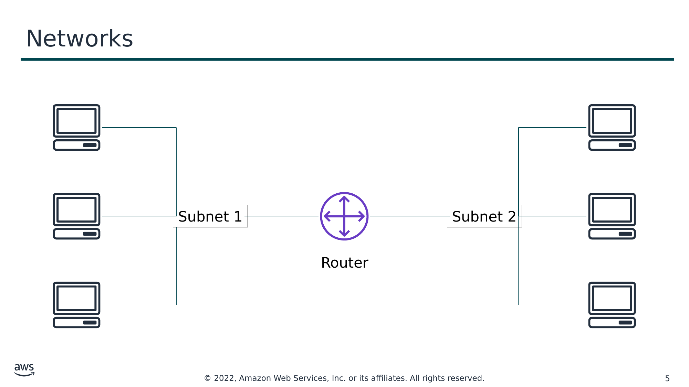

Текст зі схеми

Subnet 1 (Підмережа 1)

Subnet 2 (Підмережа 2)

Router (Маршрутизатор)

> **Нотатки:**
>
> Комп’ютерна мережа — це дві або більше клієнтські машини, з’єднані разом для спільного використання ресурсів. Мережу можна логічно розділити на підмережі (subnets). Для роботи мережі потрібен мережевий пристрій (як-от маршрутизатор або комутатор), що з’єднує всіх клієнтів і забезпечує зв’язок між ними.

---

## Слайд 6: IP-адреси

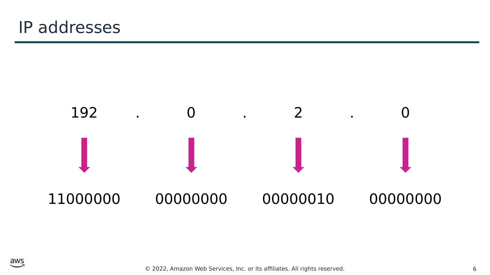

Текст зі схеми

192

0

2

0

11000000

00000000

00000010

00000000

> **Нотатки:**
>
> Кожна клієнтська машина в мережі має унікальну адресу Internet Protocol (IP), що її ідентифікує. IP-адреса — це числова мітка в десятковому форматі. Машини перетворюють це десяткове число на двійковий формат.  
>
> У цьому прикладі IP-адреса — 192.0.2.0. Кожне з чотирьох розділених крапками (.) чисел IP-адреси представляє 8 бітів у вісімковому форматі чисел. Це означає, що кожне з чотирьох чисел може бути будь-яким від 0 до 255. Загальна сума чотирьох чисел IP-адреси становить 32 біти у двійковому форматі.

---

## Слайд 7: Адреси IPv4 та IPv6

**IPv4 (32-бітна) адреса**: 192.0.2.0

**IPv6 (128-бітна) адреса**: 2600:1f18:22ba:8c00:ba86:a05e:a5ba:00FF

> **Нотатки:**
>
> 32-бітна IP-адреса називається адресою IPv4.  
>
> Також доступні адреси IPv6, що мають 128 бітів. Адреси IPv6 можуть охопити більше користувацьких пристроїв.  
>
> Адреса IPv6 складається з восьми груп по чотири літери й цифри, розділених двокрапками (:). У цьому прикладі адреса IPv6 — 2600:1f18:22ba:8c00:ba86:a05e:a5ba:00FF. Кожна з восьми розділених двокрапками груп адреси IPv6 представляє 16 бітів у шістнадцятковому форматі чисел. Це означає, що кожна з восьми груп може бути будь-якою від 0 до FFFF. Загальна сума восьми груп адреси IPv6 становить 128 бітів у двійковому форматі.

---

## Слайд 8: Безкласова міждоменна маршрутизація (Classless Inter-Domain Routing, CIDR)

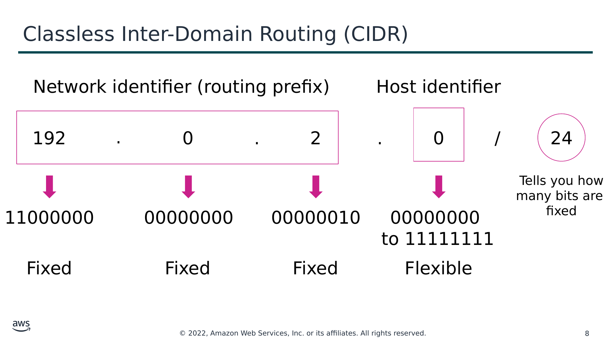

Текст зі схеми

Network identifier (routing prefix) (Ідентифікатор мережі (префікс маршрутизації))

Host identifier (Ідентифікатор хоста)

192

0

2

0

/

24

Tells you how  
many bits are  
fixed (Показує, скільки бітів фіксовано)

11000000

00000000

00000010

00000000  
to 11111111 (до 11111111)

Fixed (Фіксовано)

Fixed (Фіксовано)

Fixed (Фіксовано)

Flexible (Гнучко)

> **Нотатки:**
>
> Поширений метод опису мереж — безкласова міждоменна маршрутизація (Classless Inter-Domain Routing, CIDR). Адреса CIDR виражається так:  
> IP-адреса (яка є першою адресою мережі)  
> Далі символ скісної риски (/)  
> Нарешті число, що вказує, скільки бітів префікса маршрутизації має бути фіксованими, або виділеними для ідентифікатора мережі  
>
> Біти, які не є фіксованими, можуть змінюватися. CIDR — це спосіб виразити групу IP-адрес, що йдуть послідовно одна за одною.  
>
> У цьому прикладі адреса CIDR — 192.0.2.0/24. Останнє число (24) вказує, що перші 24 біти мають бути фіксованими. Останні 8 бітів гнучкі, що означає, що для мережі доступно 2⁸ (або 256) IP-адрес — від 192.0.2.0 до 192.0.2.255. Четверта десяткова цифра може змінюватися від 0 до 255.  
>
> Якби CIDR був 192.0.2.0/16, останнє число (16) вказувало б, що перші 16 бітів мають бути фіксованими. Останні 16 бітів гнучкі, що означає, що для мережі доступно 2¹⁶ (або 65 536) IP-адрес — від 192.0.0.0 до 192.0.255.255. Третя та четверта десяткові цифри можуть кожна змінюватися від 0 до 255.  
>
> Є два особливі випадки:  
> Фіксовані IP-адреси, де кожен біт фіксований, представляють одну IP-адресу (наприклад, 192.0.2.0/32). Цей тип адреси корисний, коли потрібно налаштувати правило брандмауера й надати доступ конкретному хосту.  
> Інтернет, де кожен біт гнучкий, позначається як 0.0.0.0/0

---

## Слайд 9: Модель взаємодії відкритих систем (Open Systems Interconnection, OSI)

| Рівень (Layer) | Номер (Number) | Функція (Function) | Протокол/адреса (Protocol/Address) |
|---|---|---|---|
| Прикладний (Application) | 7 | Засіб доступу застосунку до комп’ютерної мережі | HTTP(S), FTP, DHCP, LDAP |
| Представлення (Presentation) | 6 | • Гарантує, що прикладний рівень може прочитати дані • Шифрування | ASCII, ICA |
| Сеансовий (Session) | 5 | Забезпечує впорядкований обмін даними | NetBIOS, RPC |
| Транспортний (Transport) | 4 | Надає протоколи для підтримки зв’язку між хостами | TCP, UDP |
| Мережевий (Network) | 3 | Маршрутизація та пересилання пакетів (маршрутизатори) | IP |
| Канальний (Data link) | 2 | Передавання даних у тій самій локальній мережі (мости та комутатори) | MAC |
| Фізичний (Physical) | 1 | Передавання та приймання необроблених потоків бітів через фізичне середовище (концентратори) | Сигнали (1 і 0) |

> **Нотатки:**
>
> Модель взаємодії відкритих систем (Open Systems Interconnection, OSI) — це концептуальна модель, що використовується для пояснення того, як дані рухаються мережею. Вона складається із семи рівнів і показує поширені протоколи та адреси, що використовуються для надсилання даних на кожному рівні. Наприклад, концентратори та комутатори працюють на рівні 2 (канальний рівень). Маршрутизатори працюють на рівні 3 (мережевий рівень). Модель OSI також можна використовувати, щоб зрозуміти, як відбувається обмін даними у віртуальній приватній хмарі (VPC), про яку ви дізнаєтеся в наступному розділі.  
>
> ICA — це Independent Computing Architecture, розроблена Citrix Systems для полегшення ефективної передачі даних між сервером і клієнтом.

---

## Слайд 10: Розділ 2: Amazon VPC

Модуль 5: Мережі та доставка контенту

> **Нотатки:**
>
> Розділ 2: Amazon VPC  
>
> Багато концепцій локальної мережі застосовуються і до хмарної мережі, але значну частину складності налаштування мережі абстраговано без шкоди для контролю, безпеки та зручності використання. У цьому розділі ви дізнаєтеся про Amazon VPC та основні компоненти VPC.

---

## Слайд 11: Amazon VPC

- Дає змогу розгорнути логічно ізольовану ділянку хмари AWS, де ви можете запускати ресурси AWS у віртуальній мережі, яку визначаєте самі
- Надає вам контроль над вашими ресурсами віртуальної мережі, зокрема:
  - Вибір діапазону IP-адрес
  - Створення підмереж
  - Налаштування таблиць маршрутизації та мережевих шлюзів
- Дає змогу налаштувати конфігурацію мережі для вашої VPC
- Дає змогу використовувати кілька рівнів безпеки

Amazon  
VPC

> **Нотатки:**
>
> Amazon Virtual Private Cloud (Amazon VPC) — це сервіс, що дає змогу розгорнути логічно ізольовану ділянку хмари AWS (так звану віртуальну приватну хмару, або VPC), де ви можете запускати свої ресурси AWS.  
>
> Amazon VPC надає вам контроль над вашими ресурсами віртуальної мережі, зокрема вибір власного діапазону IP-адрес, створення підмереж і налаштування таблиць маршрутизації та мережевих шлюзів. У вашій VPC можна використовувати і IPv4, і IPv6 для безпечного доступу до ресурсів і застосунків.  
>
> Ви також можете налаштувати конфігурацію мережі для вашої VPC. Наприклад, можна створити публічну підмережу для ваших вебсерверів, що мають доступ до публічного інтернету. Ваші бекенд-системи (як-от бази даних або сервери застосунків) можна розмістити в приватній підмережі без доступу до публічного інтернету.  
>
> Нарешті, ви можете використовувати кілька рівнів безпеки, зокрема групи безпеки та списки контролю доступу до мережі (network ACLs), щоб допомогти контролювати доступ до екземплярів Amazon Elastic Compute Cloud (Amazon EC2) у кожній підмережі.

---

## Слайд 12: VPC та підмережі

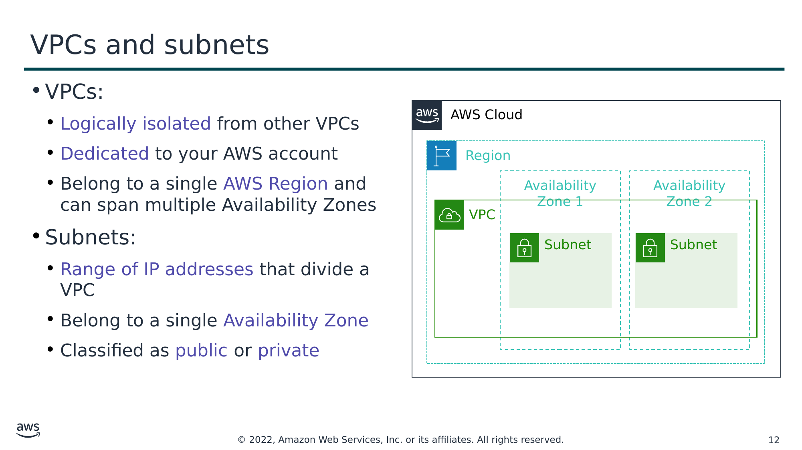

- VPC:
  - Логічно ізольовані від інших VPC
  - Виділені для вашого акаунта AWS
  - Належать до одного регіону AWS і можуть охоплювати кілька зон доступності
- Підмережі:
  - Діапазон IP-адрес, що розділяють VPC
  - Належать до однієї зони доступності
  - Класифікуються як публічні або приватні

Текст зі схеми

AWS Cloud

Region (Регіон)

Availability Zone 1 (Зона доступності 1)

Availability Zone 2 (Зона доступності 2)

VPC

Subnet (Підмережа)

Subnet (Підмережа)

> **Нотатки:**
>
> Amazon VPC дає змогу розгортати віртуальні приватні хмари (VPC). VPC — це віртуальна мережа, логічно ізольована від інших віртуальних мереж у хмарі AWS. VPC виділена для вашого акаунта. VPC належать до одного регіону AWS і можуть охоплювати кілька зон доступності.  
>
> Після створення VPC її можна розділити на одну чи кілька підмереж. Підмережа — це діапазон IP-адрес у VPC. Підмережі належать до однієї зони доступності. Ви можете створювати підмережі в різних зонах доступності для високої доступності. Підмережі загалом класифікують як публічні або приватні. Публічні підмережі мають прямий доступ до інтернету, а приватні — ні.

---

## Слайд 13: IP-адресація

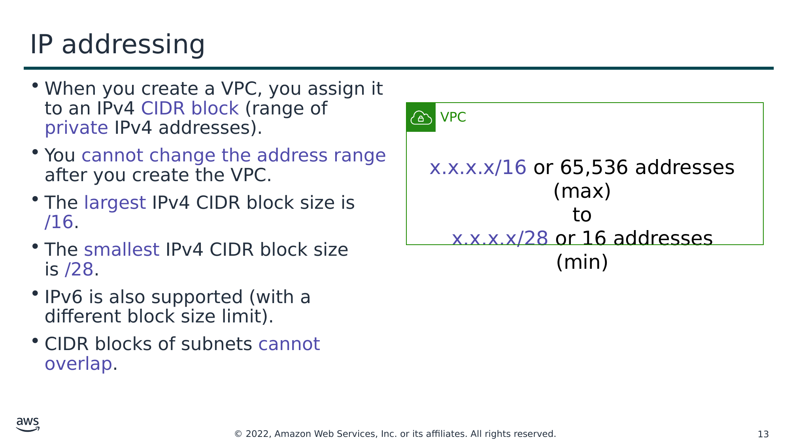

- Коли ви створюєте VPC, ви призначаєте їй блок CIDR IPv4 (діапазон приватних адрес IPv4).
- Ви не можете змінити діапазон адрес після створення VPC.
- Найбільший розмір блока CIDR IPv4 — /16.
- Найменший розмір блока CIDR IPv4 — /28.
- IPv6 також підтримується (з іншим обмеженням розміру блока).
- Блоки CIDR підмереж не можуть перетинатися.

Текст зі схеми

VPC

x.x.x.x/16 or 65,536 addresses (max) (x.x.x.x/16 або 65 536 адрес (макс.))

to (до)  
x.x.x.x/28 or 16 addresses (min) (x.x.x.x/28 або 16 адрес (мін.))

> **Нотатки:**
>
> IP-адреси дають змогу ресурсам у вашій VPC обмінюватися даними один з одним і з ресурсами через інтернет. Коли ви створюєте VPC, ви призначаєте їй блок CIDR IPv4 (діапазон приватних адрес IPv4). Після створення VPC змінити діапазон адрес не можна, тому важливо вибрати його ретельно. Блок CIDR IPv4 може бути розміром до /16 (що становить 2¹⁶, або 65 536 адрес) або розміром усього /28 (що становить 2⁴, або 16 адрес).  
>
> Ви можете за бажанням пов’язати блок CIDR IPv6 з вашою VPC і підмережами та призначати адреси IPv6 із цього блока ресурсам у вашій VPC. Блоки CIDR IPv6 мають інше обмеження розміру блока.  
>
> Блок CIDR підмережі може збігатися з блоком CIDR VPC. У цьому випадку VPC і підмережа мають однаковий розмір (одна підмережа у VPC). Також блок CIDR підмережі може бути підмножиною блока CIDR VPC. Така структура дає змогу визначати кілька підмереж. Якщо ви створюєте більше однієї підмережі у VPC, блоки CIDR підмереж не можуть перетинатися. У тій самій VPC не може бути дублікатів IP-адрес.  
>
> Щоб дізнатися більше про IP-адресацію у VPC, див. документацію AWS за адресою https://docs.aws.amazon.com/vpc/latest/userguide/what-is-amazon-vpc.html.

---

## Слайд 14: Зарезервовані IP-адреси

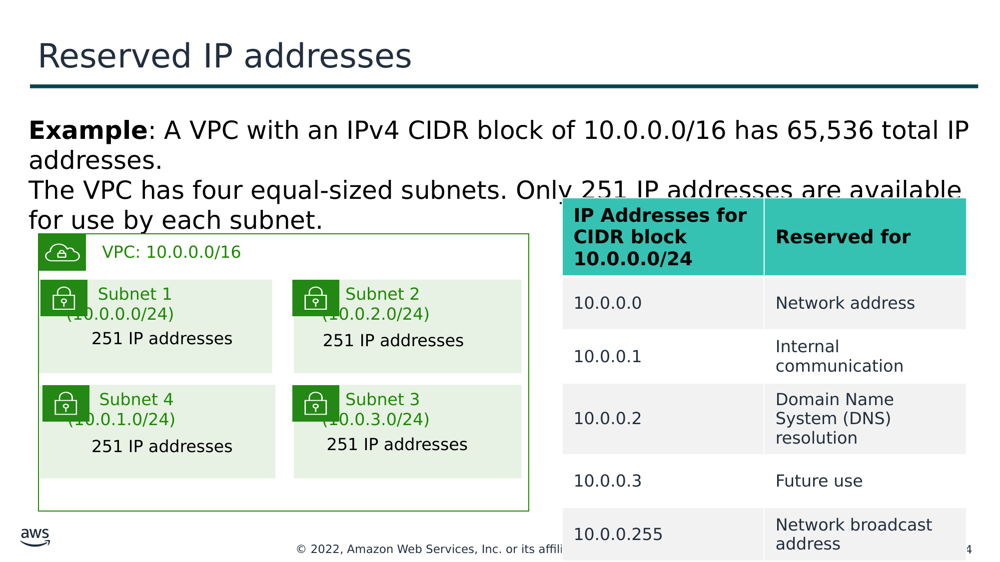

**Приклад**: VPC з блоком CIDR IPv4 10.0.0.0/16 має 65 536 IP-адрес загалом.  
VPC має чотири підмережі однакового розміру. Для використання кожною підмережею доступні лише 251 IP-адреса.

| IP-адреси для блока CIDR 10.0.0.0/24 | Зарезервовано для |
|---|---|
| 10.0.0.0 | Адреса мережі |
| 10.0.0.1 | Внутрішній обмін даними |
| 10.0.0.2 | Розв’язання імен системи доменних імен (DNS) |
| 10.0.0.3 | Майбутнє використання |
| 10.0.0.255 | Широкомовна адреса мережі (network broadcast address) |

Текст зі схеми

VPC: 10.0.0.0/16

Subnet 1 (10.0.0.0/24) (Підмережа 1)

Subnet 4 (10.0.1.0/24) (Підмережа 4)

Subnet 3 (10.0.3.0/24) (Підмережа 3)

Subnet 2 (10.0.2.0/24) (Підмережа 2)

251 IP addresses (251 IP-адреса)

251 IP addresses

251 IP addresses

251 IP addresses

> **Нотатки:**
>
> Коли ви створюєте підмережу, їй потрібен власний блок CIDR. Для кожного блока CIDR, який ви вказуєте, AWS резервує п’ять IP-адрес у цьому блоці, і ці адреси недоступні для використання. AWS резервує ці IP-адреси для:  
> Адреси мережі  
> Локального маршрутизатора VPC (внутрішній обмін даними)  
> Розв’язання імен системи доменних імен (DNS)  
> Майбутнього використання  
> Широкомовної адреси мережі  
>
> Наприклад, припустімо, що ви створюєте підмережу з блоком CIDR IPv4 10.0.0.0/24 (що має 256 IP-адрес загалом). Підмережа має 256 IP-адрес, але доступні лише 251, оскільки п’ять зарезервовано.

---

## Слайд 15: Типи публічних IP-адрес

Публічна адреса IPv4 (Public IPv4 address)

- Призначається вручну через еластичну IP-адресу (Elastic IP address)
- Призначається автоматично через налаштування автоматичного призначення публічної IP-адреси на рівні підмережі

Еластична IP-адреса (Elastic IP address)

- Пов’язана з акаунтом AWS
- Може бути виділена й переспрямована в будь-який час
- Можуть застосовуватися додаткові витрати

> **Нотатки:**
>
> Коли ви створюєте VPC, кожен екземпляр у цій VPC автоматично отримує приватну IP-адресу. Ви також можете запросити призначення публічної IP-адреси під час створення екземпляра, змінивши властивості автоматичного призначення публічної IP-адреси для підмережі.  
>
> Еластична IP-адреса (Elastic IP address) — це статична публічна адреса IPv4, розроблена для динамічних хмарних обчислень. Еластичну IP-адресу можна пов’язати з будь-яким екземпляром чи мережевим інтерфейсом для будь-якої VPC у вашому акаунті. За допомогою еластичної IP-адреси можна приховати відмову екземпляра, швидко переспрямувавши адресу на інший екземпляр у вашій VPC. Пов’язування еластичної IP-адреси з мережевим інтерфейсом має перевагу порівняно з пов’язуванням безпосередньо з екземпляром. Ви можете перемістити всі атрибути мережевого інтерфейсу з одного екземпляра на інший за один крок.  
>
> Під час використання еластичних IP-адрес можуть застосовуватися додаткові витрати, тому важливо вивільняти їх, коли вони більше не потрібні.  
>
> Щоб дізнатися більше про еластичні IP-адреси, див. «Elastic IP Addresses» у документації AWS за адресою https://docs.aws.amazon.com/vpc/latest/userguide/vpc-eips.html.

---

## Слайд 16: Еластичний мережевий інтерфейс (elastic network interface)

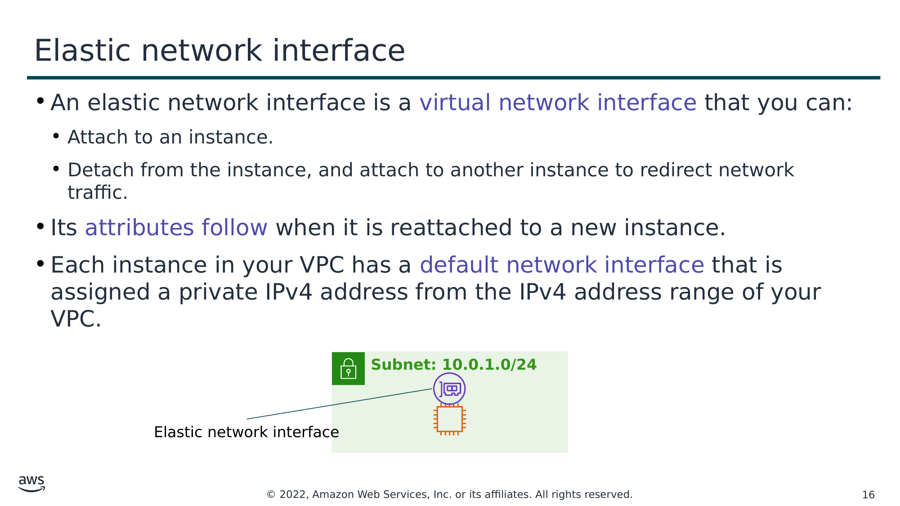

- Еластичний мережевий інтерфейс — це віртуальний мережевий інтерфейс, який можна:
  - Приєднати до екземпляра.
  - Від’єднати від екземпляра й приєднати до іншого екземпляра, щоб переспрямувати мережевий трафік.
- Його атрибути слідують за ним, коли його повторно приєднують до нового екземпляра.
- Кожен екземпляр у вашій VPC має мережевий інтерфейс за замовчуванням, якому призначено приватну адресу IPv4 з діапазону адрес IPv4 вашої VPC.

Текст зі схеми

**Subnet: 10.0.1.0/24 (Підмережа)**

Elastic network interface (Еластичний мережевий інтерфейс)

> **Нотатки:**
>
> Еластичний мережевий інтерфейс — це віртуальний мережевий інтерфейс, який можна приєднувати до екземпляра у VPC або від’єднувати від нього. Атрибути мережевого інтерфейсу слідують за ним, коли його повторно приєднують до іншого екземпляра. Коли ви переміщуєте мережевий інтерфейс з одного екземпляра на інший, мережевий трафік переспрямовується на новий екземпляр.  
>
> Кожен екземпляр у вашій VPC має мережевий інтерфейс за замовчуванням (основний мережевий інтерфейс), якому призначено приватну адресу IPv4 з діапазону адрес IPv4 вашої VPC. Основний мережевий інтерфейс не можна від’єднати від екземпляра. Ви можете створити й приєднати додатковий мережевий інтерфейс до будь-якого екземпляра у вашій VPC. Кількість мережевих інтерфейсів, які можна приєднати, залежить від типу екземпляра.  
>
> Докладніше про еластичні мережеві інтерфейси (Elastic Network Interfaces) див. документацію AWS за адресою https://docs.aws.amazon.com/AWSEC2/latest/UserGuide/using-eni.html.

---

## Слайд 17: Таблиці маршрутизації та маршрути (route tables and routes)

- Таблиця маршрутизації містить набір правил (або маршрутів), які можна налаштувати для спрямування мережевого трафіку з вашої підмережі.
- Кожен маршрут вказує призначення (destination) і ціль (target).
- За замовчуванням кожна таблиця маршрутизації містить локальний маршрут (local route) для обміну даними всередині VPC.
- Кожна підмережа має бути пов’язана з таблицею маршрутизації (щонайбільше з однією).

Main (Default) Route Table (Основна таблиця маршрутизації (за замовчуванням))

| Destination (Призначення) | Target (Ціль) |
|---|---|
| 10.0.0.0/16 | local |
|  |  |

VPC CIDR block (Блок CIDR VPC)

> **Нотатки:**
>
> Таблиця маршрутизації містить набір правил (які називаються маршрутами), що спрямовують мережевий трафік з вашої підмережі. Кожен маршрут вказує призначення та ціль. Призначення — це цільовий блок CIDR, куди ви хочете спрямувати трафік зі своєї підмережі. Ціль — це об’єкт, через який надсилається трафік призначення. За замовчуванням кожна створена вами таблиця маршрутизації містить локальний маршрут для обміну даними у VPC. Ви можете налаштувати таблиці маршрутизації, додаючи маршрути. Запис локального маршруту, що використовується для внутрішнього обміну даними, видалити не можна.  
>
> Кожна підмережа у вашій VPC має бути пов’язана з таблицею маршрутизації. Основна таблиця маршрутизації (main route table) — це таблиця маршрутизації, що автоматично призначається вашій VPC. Вона керує маршрутизацією для всіх підмереж, які явно не пов’язані з жодною іншою таблицею маршрутизації. Підмережа може бути пов’язана лише з однією таблицею маршрутизації одночасно, але з однією таблицею маршрутизації можна пов’язати кілька підмереж.  
>
> Щоб дізнатися більше про таблиці маршрутизації, див. документацію AWS за адресою https://docs.aws.amazon.com/vpc/latest/userguide/VPC_Route_Tables.html.

---

## Слайд 18: Ключові висновки розділу 2

- VPC — це логічно ізольована ділянка хмари AWS.
- VPC належить до одного регіону та потребує блока CIDR.
- VPC поділяється на підмережі.
- Підмережа належить до однієї зони доступності та потребує блока CIDR.
- Таблиці маршрутизації керують трафіком для підмережі.
- Таблиці маршрутизації мають вбудований локальний маршрут.
- Ви додаєте до таблиці додаткові маршрути.
- Локальний маршрут видалити не можна.

> **Нотатки:**
>
> Основні висновки цього розділу модуля:  
> VPC — це логічно ізольована ділянка хмари AWS.  
> VPC належить до одного регіону та потребує блока CIDR.  
> VPC поділяється на підмережі.  
> Підмережа належить до однієї зони доступності та потребує блока CIDR.  
> Таблиці маршрутизації керують трафіком для підмережі.  
> Таблиці маршрутизації мають вбудований локальний маршрут.  
> Ви додаєте до таблиці додаткові маршрути.  
> Локальний маршрут видалити не можна.

---

## Слайд 19: Розділ 3: Мережі VPC

Модуль 5: Мережі та доставка контенту

> **Нотатки:**
>
> Розділ 3: Мережі VPC  
>
> Тепер, коли ви ознайомилися з базовими компонентами VPC, ви можете почати маршрутизувати трафік цікавими способами. У цьому розділі ви дізнаєтеся про різні мережеві варіанти.

---

## Слайд 20: Інтернет-шлюз (internet gateway)

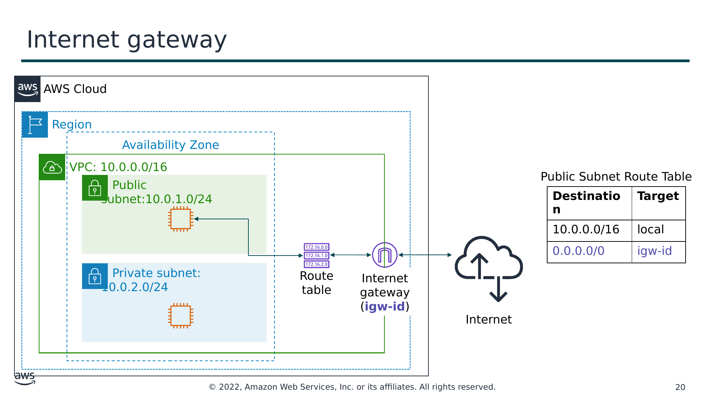

Public Subnet Route Table (Таблиця маршрутизації публічної підмережі)

| Destination (Призначення) | Target (Ціль) |
|---|---|
| 10.0.0.0/16 | local |
| 0.0.0.0/0 | igw-id |

Текст зі схеми

AWS Cloud

Region (Регіон)

Availability Zone (Зона доступності)

VPC: 10.0.0.0/16

Public subnet:10.0.1.0/24 (Публічна підмережа)

Private subnet: 10.0.2.0/24 (Приватна підмережа)

Route  
table (Таблиця маршрутизації)

Internet  
gateway (Інтернет-шлюз)  
(**igw-id**)

Internet (Інтернет)

> **Нотатки:**
>
> Інтернет-шлюз (internet gateway) — це масштабований, надлишковий і високодоступний компонент VPC, що забезпечує зв’язок між екземплярами у вашій VPC та інтернетом. Інтернет-шлюз виконує дві функції: надає ціль у таблицях маршрутизації вашої VPC для трафіку, що маршрутизується в інтернет, і виконує трансляцію мережевих адрес (network address translation) для екземплярів, яким призначено публічні адреси IPv4.  
>
> Щоб зробити підмережу публічною, ви приєднуєте інтернет-шлюз до вашої VPC і додаєте до таблиці маршрутизації маршрут для надсилання нелокального трафіку через інтернет-шлюз в інтернет (0.0.0.0/0).  
>
> Докладніше про інтернет-шлюзи див. «Internet Gateways» у документації AWS за адресою https://docs.aws.amazon.com/vpc/latest/userguide/VPC_Internet_Gateway.html.

---

## Слайд 21: Шлюз трансляції мережевих адрес (NAT gateway)

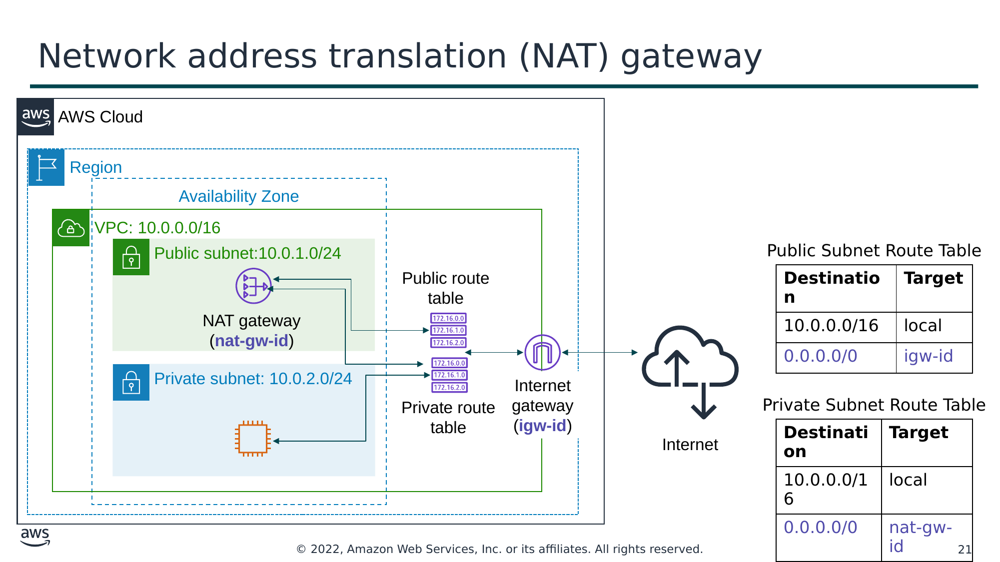

Public Subnet Route Table (Таблиця маршрутизації публічної підмережі)

| Destination (Призначення) | Target (Ціль) |
|---|---|
| 10.0.0.0/16 | local |
| 0.0.0.0/0 | igw-id |

Private Subnet Route Table (Таблиця маршрутизації приватної підмережі)

| Destination (Призначення) | Target (Ціль) |
|---|---|
| 10.0.0.0/16 | local |
| 0.0.0.0/0 | nat-gw-id |

Текст зі схеми

AWS Cloud

Region (Регіон)

Availability Zone (Зона доступності)

VPC: 10.0.0.0/16

Public subnet:10.0.1.0/24 (Публічна підмережа)

Public route  
table (Таблиця маршрутизації публічної підмережі)

NAT gateway (NAT-шлюз)  
(**nat-gw-id**)

Private subnet: 10.0.2.0/24 (Приватна підмережа)

Internet  
gateway (Інтернет-шлюз)  
(**igw-id**)

Private route  
table (Таблиця маршрутизації приватної підмережі)

Internet (Інтернет)

> **Нотатки:**
>
> Шлюз трансляції мережевих адрес (network address translation, NAT gateway) дає змогу екземплярам у приватній підмережі підключатися до інтернету чи інших сервісів AWS, але не дозволяє інтернету ініціювати з’єднання з цими екземплярами.  
>
> Щоб створити NAT-шлюз, потрібно вказати публічну підмережу, у якій має розміщуватися NAT-шлюз. Під час створення також потрібно вказати еластичну IP-адресу, яку слід пов’язати з NAT-шлюзом. Після створення NAT-шлюзу потрібно оновити таблицю маршрутизації, пов’язану з однією чи кількома вашими приватними підмережами, щоб спрямувати трафік, призначений для інтернету, до NAT-шлюзу. Таким чином екземпляри у ваших приватних підмережах можуть обмінюватися даними з інтернетом.  
>
> Замість NAT-шлюзу можна також використати екземпляр NAT (NAT instance) у публічній підмережі вашої VPC. Однак NAT-шлюз — це кероване NAT-обслуговування, що забезпечує кращу доступність, вищу пропускну здатність і менше адміністративних зусиль. Для типових сценаріїв використання AWS рекомендує використовувати NAT-шлюз замість екземпляра NAT.  
>
> Докладніше див. документацію AWS про  
> NAT-шлюзи: https://docs.aws.amazon.com/vpc/latest/userguide/vpc-nat-gateway.html.  
> Екземпляри NAT: https://docs.aws.amazon.com/vpc/latest/userguide/VPC_NAT_Instance.html.  
> Відмінності між NAT-шлюзами та екземплярами NAT: https://docs.aws.amazon.com/vpc/latest/userguide/vpc-nat-comparison.html.

---

## Слайд 22: Спільне використання VPC (VPC sharing)

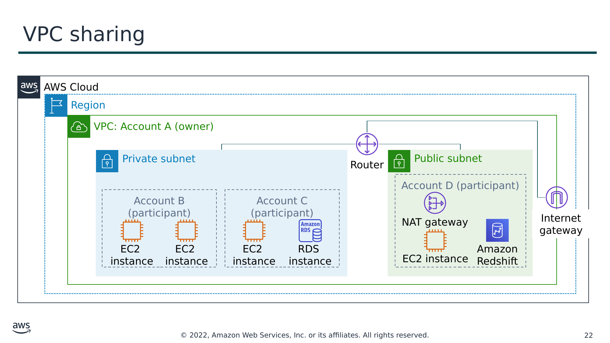

Текст зі схеми

AWS Cloud

Region (Регіон)

VPC: Account A (owner) (Акаунт A (власник))

Private subnet (Приватна підмережа)

Public subnet (Публічна підмережа)

Router (Маршрутизатор)

Account D (participant) (Акаунт D (учасник))

Account B (participant) (Акаунт B (учасник))

Account C (participant) (Акаунт C (учасник))

NAT gateway (NAT-шлюз)

Internet gateway (Інтернет-шлюз)

EC2  
instance (Екземпляр EC2)

EC2  
instance

EC2  
instance

RDS  
instance (Екземпляр RDS)

Amazon  
Redshift

EC2 instance (Екземпляр EC2)

> **Нотатки:**
>
> Спільне використання VPC (VPC sharing) дає змогу клієнтам ділитися підмережами з іншими акаунтами AWS у тій самій організації в AWS Organizations. Спільне використання VPC дає змогу кільком акаунтам AWS створювати ресурси своїх застосунків — як-от екземпляри Amazon EC2, бази даних Amazon Relational Database Service (Amazon RDS), кластери Amazon Redshift і функції AWS Lambda — у спільних, централізовано керованих VPC. У цій моделі акаунт, що володіє VPC (власник), ділиться однією чи кількома підмережами з іншими акаунтами (учасниками), що належать до тієї самої організації в AWS Organizations. Після того як підмережею поділилися, учасники можуть переглядати, створювати, змінювати й видаляти ресурси своїх застосунків у підмережах, до яких їм надано спільний доступ. Учасники не можуть переглядати, змінювати чи видаляти ресурси, що належать іншим учасникам або власнику VPC.  
>
> Спільне використання VPC пропонує кілька переваг:  
> Розподіл обов’язків (Separation of duties) — централізовано контрольована структура VPC, маршрутизація, виділення IP-адрес  
> Володіння (Ownership) — власники застосунків і далі володіють ресурсами, акаунтами та групами безпеки  
> Групи безпеки (Security groups) — учасники спільного використання VPC можуть посилатися на ідентифікатори груп безпеки один одного  
> Ефективність (Efficiencies) — вища щільність у підмережах, ефективне використання VPN та AWS Direct Connect  
> Відсутність жорстких лімітів (No hard limits) — жорстких лімітів можна уникнути — наприклад, 50 віртуальних інтерфейсів на одне з’єднання AWS Direct Connect — завдяки спрощеній мережевій архітектурі  
> Оптимізовані витрати (Optimized costs) — витрати можна оптимізувати завдяки повторному використанню NAT-шлюзів, кінцевих точок інтерфейсу VPC (VPC interface endpoints) і трафіку всередині зони доступності  
>
> Спільне використання VPC дає змогу роз’єднати акаунти та мережі. У вас менше, більших, централізовано керованих VPC. Високо взаємопов’язані застосунки автоматично виграють від цього підходу.

---

## Слайд 23: Пірингове з’єднання VPC (VPC peering)

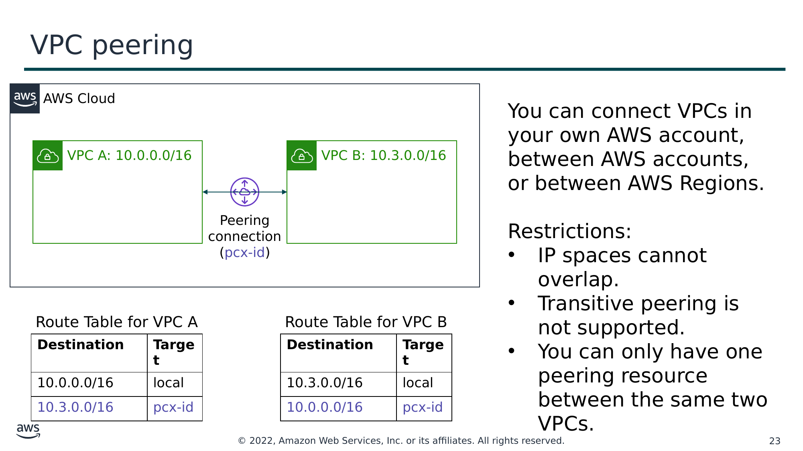

Ви можете з’єднувати VPC у вашому власному акаунті AWS, між акаунтами AWS або між регіонами AWS.

Обмеження:

- Простори IP-адрес не можуть перетинатися.
- Транзитивний піринг не підтримується.
- Між тими самими двома VPC може бути лише один пірінговий ресурс.

Route Table for VPC A (Таблиця маршрутизації для VPC A)

Route Table for VPC B (Таблиця маршрутизації для VPC B)

| Destination (Призначення) | Target (Ціль) |
|---|---|
| 10.0.0.0/16 | local |
| 10.3.0.0/16 | pcx-id |

| Destination (Призначення) | Target (Ціль) |
|---|---|
| 10.3.0.0/16 | local |
| 10.0.0.0/16 | pcx-id |

Текст зі схеми

AWS Cloud

VPC A: 10.0.0.0/16

VPC B: 10.3.0.0/16

Peering  
connection (Пірингове з’єднання)  
(pcx-id)

> **Нотатки:**
>
> Пірингове з’єднання VPC (VPC peering connection) — це мережеве з’єднання між двома VPC, що дає змогу приватно маршрутизувати трафік між ними. Екземпляри в будь-якій з VPC можуть обмінюватися даними один з одним так, ніби перебувають в одній мережі. Ви можете створити пірингове з’єднання VPC між власними VPC, з VPC в іншому акаунті AWS або з VPC в іншому регіоні AWS.  
>
> Коли ви налаштовуєте пірингове з’єднання, ви створюєте правила в таблиці маршрутизації, щоб дозволити VPC обмінюватися даними одна з одною через пірінговий ресурс. Наприклад, припустімо, що у вас є дві VPC. У таблиці маршрутизації для VPC A ви встановлюєте призначенням IP-адресу VPC B, а ціллю — ідентифікатор пірингового ресурсу. У таблиці маршрутизації для VPC B ви встановлюєте призначенням IP-адресу VPC A, а ціллю — ідентифікатор пірингового ресурсу.  
>
> Піринг VPC має деякі обмеження:  
> Діапазони IP-адрес не можуть перетинатися.  
> Транзитивний піринг не підтримується. Наприклад, припустімо, що у вас є три VPC: A, B і C. VPC A з’єднана з VPC B, а VPC A з’єднана з VPC C. Однак VPC B неявно не з’єднана з VPC C. Щоб з’єднати VPC B з VPC C, потрібно явно встановити це з’єднання.  
> Між тими самими двома VPC може бути лише один пірінговий ресурс.  
>
> Докладніше про піринг VPC див. «VPC Peering» у документації AWS за адресою https://docs.aws.amazon.com/vpc/latest/userguide/vpc-peering.html.

---

## Слайд 24: AWS Site-to-Site VPN

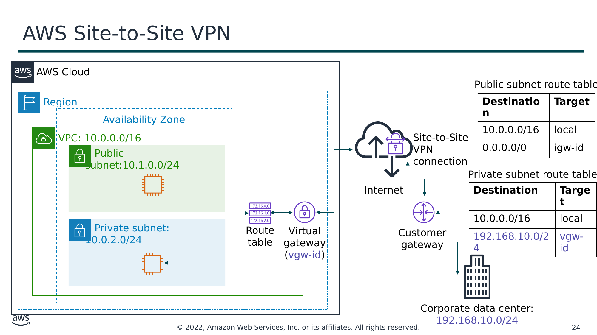

Public subnet route table (Таблиця маршрутизації публічної підмережі)

| Destination (Призначення) | Target (Ціль) |
|---|---|
| 10.0.0.0/16 | local |
| 0.0.0.0/0 | igw-id |

Private subnet route table (Таблиця маршрутизації приватної підмережі)

| Destination (Призначення) | Target (Ціль) |
|---|---|
| 10.0.0.0/16 | local |
| 192.168.10.0/24 | vgw-id |

Текст зі схеми

AWS Cloud

Region (Регіон)

Availability Zone (Зона доступності)

VPC: 10.0.0.0/16

Site-to-Site  
VPN  
connection (VPN-з’єднання Site-to-Site)

Public subnet:10.1.0.0/24 (Публічна підмережа)

Internet (Інтернет)

Private subnet: 10.0.2.0/24 (Приватна підмережа)

Route  
table (Таблиця маршрутизації)

Virtual  
gateway (Віртуальний шлюз)  
(vgw-id)

Customer gateway (Шлюз клієнта)

Corporate data center:  
192.168.10.0/24 (Корпоративний центр обробки даних)

> **Нотатки:**
>
> За замовчуванням екземпляри, які ви запускаєте у VPC, не можуть обмінюватися даними з віддаленою мережею. Щоб підключити вашу VPC до віддаленої мережі (тобто створити віртуальну приватну мережу, або VPN-з’єднання), потрібно:  
> Створити новий пристрій віртуального шлюзу (так званий шлюз віртуальної приватної мережі, VPN gateway) і приєднати його до вашої VPC.  
> Визначити конфігурацію пристрою VPN або шлюзу клієнта (customer gateway). Шлюз клієнта — це не пристрій, а ресурс AWS, що надає AWS інформацію про ваш пристрій VPN.  
> Створити власну таблицю маршрутизації, щоб спрямовувати трафік, призначений для корпоративного центру обробки даних, до VPN-шлюзу. Також потрібно оновити правила груп безпеки. (Про групи безпеки ви дізнаєтеся в наступному розділі.)  
> Встановити з’єднання AWS Site-to-Site VPN (Site-to-Site VPN), щоб зв’язати дві системи.  
> Налаштувати маршрутизацію для передавання трафіку через з’єднання.  
>
> Докладніше про AWS Site-to-Site VPN та інші варіанти VPN-підключення див. «VPN Connections» у документації AWS за адресою https://docs.aws.amazon.com/vpc/latest/userguide/vpn-connections.html.

---

## Слайд 25: AWS Direct Connect

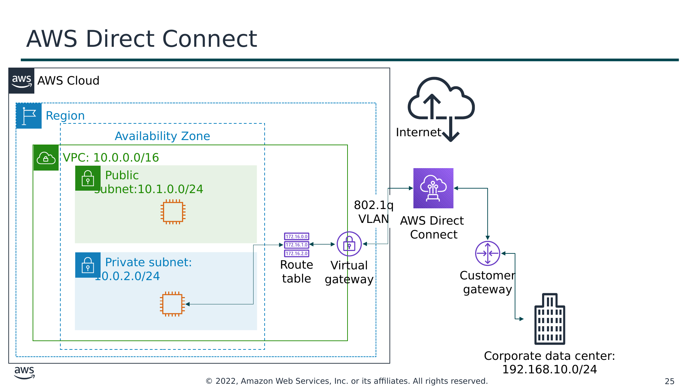

Текст зі схеми

AWS Cloud

Region (Регіон)

Availability Zone (Зона доступності)

Internet (Інтернет)

VPC: 10.0.0.0/16

Public subnet:10.1.0.0/24 (Публічна підмережа)

802.1q  
VLAN

AWS Direct  
Connect

Private subnet: 10.0.2.0/24 (Приватна підмережа)

Route  
table (Таблиця маршрутизації)

Virtual  
gateway (Віртуальний шлюз)

Customer gateway (Шлюз клієнта)

Corporate data center:  
192.168.10.0/24 (Корпоративний центр обробки даних)

> **Нотатки:**
>
> Одна з проблем мережевого обміну даними — продуктивність мережі. Продуктивність може погіршуватися, якщо ваш центр обробки даних розташований далеко від вашого регіону AWS. Для таких ситуацій AWS пропонує AWS Direct Connect, або DX. AWS Direct Connect дає змогу встановити виділене приватне мережеве з’єднання між вашою мережею та однією з локацій DX. Це приватне з’єднання може знизити ваші мережеві витрати, збільшити пропускну здатність і забезпечити стабільніший мережевий досвід, ніж з’єднання через інтернет. DX використовує віртуальні локальні мережі (VLAN) відкритого стандарту 802.1q.  
>
> Докладніше про DX див. сторінку продукту AWS Direct Connect за адресою https://aws.amazon.com/directconnect/.

---

## Слайд 26: Кінцеві точки VPC (VPC endpoints)

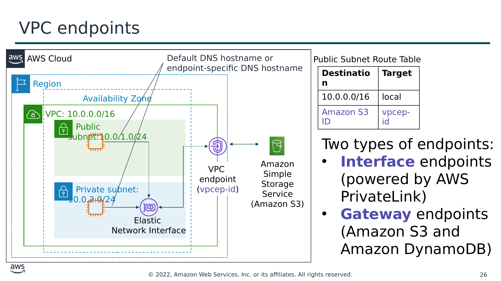

Public Subnet Route Table (Таблиця маршрутизації публічної підмережі)

| Destination (Призначення) | Target (Ціль) |
|---|---|
| 10.0.0.0/16 | local |
| Amazon S3 ID | vpcep-id |

Два типи кінцевих точок:

- Кінцеві точки **інтерфейсу (Interface)** (на основі AWS PrivateLink)
- Кінцеві точки **шлюзу (Gateway)** (Amazon S3 і Amazon DynamoDB)

Текст зі схеми

AWS Cloud

Default DNS hostname or  
endpoint-specific DNS hostname (DNS-ім’я хоста за замовчуванням або DNS-ім’я хоста, специфічне для кінцевої точки)

Region (Регіон)

Availability Zone (Зона доступності)

VPC: 10.0.0.0/16

Public subnet:10.0.1.0/24 (Публічна підмережа)

VPC  
endpoint (Кінцева точка VPC)  
(vpcep-id)

Amazon  
Simple Storage Service (Amazon S3)

Private subnet: 10.0.2.0/24 (Приватна підмережа)

Elastic  
Network Interface (Еластичний мережевий інтерфейс)

> **Нотатки:**
>
> Кінцева точка VPC (VPC endpoint) — це віртуальний пристрій, що дає змогу приватно підключити вашу VPC до підтримуваних сервісів AWS і сервісів кінцевих точок VPC, що працюють на основі AWS PrivateLink. Підключення до цих сервісів не потребує інтернет-шлюзу, NAT-пристрою, VPN-з’єднання чи з’єднання AWS Direct Connect. Екземплярам у вашій VPC не потрібні публічні IP-адреси для обміну даними з ресурсами в сервісі. Трафік між вашою VPC та іншим сервісом не залишає мережі Amazon.  
>
> Існує два типи кінцевих точок VPC:  
> Кінцева точка VPC інтерфейсу (interface endpoint) дає змогу підключатися до сервісів, що працюють на основі AWS PrivateLink. До цих сервісів належать деякі сервіси AWS, сервіси, розміщені іншими клієнтами AWS і партнерами AWS Partner Network (APN) у їхніх власних VPC (так звані сервіси кінцевих точок, endpoint services), а також підтримувані сервіси партнерів APN в AWS Marketplace. Власник сервісу — це постачальник сервісу, а ви — як принципал, що створює кінцеву точку інтерфейсу, — споживач сервісу. Плата стягується за створення та використання кінцевої точки інтерфейсу до сервісу. Застосовуються погодинні тарифи використання та тарифи обробки даних. Список підтримуваних кінцевих точок інтерфейсу та докладніше про наведений тут приклад див. у документації AWS за адресою https://docs.aws.amazon.com/vpc/latest/privatelink/create-interface-endpoint.html.  
> Кінцеві точки шлюзу (Gateway endpoints): використання кінцевих точок шлюзу не передбачає додаткової плати. Застосовуються стандартні тарифи за передавання даних і використання ресурсів.  
>
> Докладніше про кінцеві точки VPC див. «VPC Endpoints» у документації AWS за адресою https://docs.aws.amazon.com/vpc/latest/privatelink/concepts.html.

---

## Слайд 27: AWS Transit Gateway

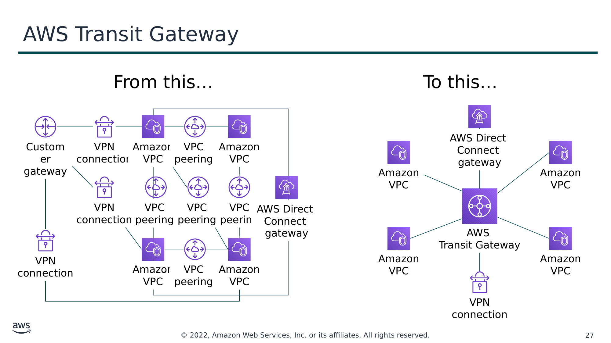

From this… (Від цього…)

To this… (До цього…)

Текст зі схеми

AWS Direct  
Connect  
gateway (Шлюз AWS Direct Connect)

Customer gateway (Шлюз клієнта)

Amazon  
VPC

AWS Direct  
Connect  
gateway

Amazon  
VPC

Amazon  
VPC

Amazon  
VPC

Amazon  
VPC

Amazon  
VPC

VPC  
peering (Піринг VPC)

AWS  
Transit Gateway

VPN  
connection (VPN-з’єднання)

VPN  
connection

VPN  
connection

Amazon  
VPC

Amazon  
VPC

VPN  
connection

VPC  
peering

VPC  
peering

VPC  
peering

VPC  
peering

> **Нотатки:**
>
> Ви можете налаштовувати свої VPC кількома способами та користуватися численними варіантами підключення й шлюзами. Ці варіанти та шлюзи включають AWS Direct Connect (через шлюзи DX), NAT-шлюзи, інтернет-шлюзи, піринг VPC тощо. Нерідко трапляються клієнти AWS із сотнями VPC, розподілених між акаунтами та регіонами AWS для обслуговування кількох напрямів бізнесу, команд, проєктів тощо. Ситуація ускладнюється, коли клієнти починають налаштовувати підключення між своїми VPC. Усі варіанти підключення суворо «точка-точка» (point-to-point), тому кількість з’єднань між VPC може швидко зростати. У міру збільшення кількості робочих навантажень, що працюють в AWS, ви повинні мати змогу масштабувати свої мережі між кількома акаунтами та VPC, щоб встигати за зростанням.  
>
> Хоча піринг VPC можна використовувати для з’єднання пар VPC, керування з’єднаннями «точка-точка» між багатьма VPC без можливості централізовано керувати політиками підключення може бути операційно дорогим і складним. Для підключення до локальної мережі потрібно приєднувати VPN до кожної окремої VPC. Це рішення може бути трудомістким у побудові й складним в управлінні, коли кількість VPC сягає сотень.  
>
> Щоб розв’язати цю проблему, можна використати AWS Transit Gateway для спрощення вашої мережевої моделі. З AWS Transit Gateway вам потрібно створити й підтримувати лише одне з’єднання від центрального шлюзу до кожної VPC, локального центру обробки даних чи віддаленого офісу у вашій мережі. Транзитний шлюз (transit gateway) діє як концентратор (hub), що керує тим, як трафік маршрутизується між усіма підключеними мережами, які діють як промені (spokes). Ця модель «концентратор і промені» (hub-and-spoke) значно спрощує керування та знижує операційні витрати, оскільки кожній мережі потрібно підключатися лише до транзитного шлюзу, а не до кожної іншої мережі. Будь-яка нова VPC підключається до транзитного шлюзу й потім автоматично стає доступною для кожної іншої мережі, підключеної до транзитного шлюзу. Ця легкість підключення полегшує масштабування вашої мережі в міру зростання.

---

## Слайд 28: Практична вправа: підпишіть цю мережеву схему

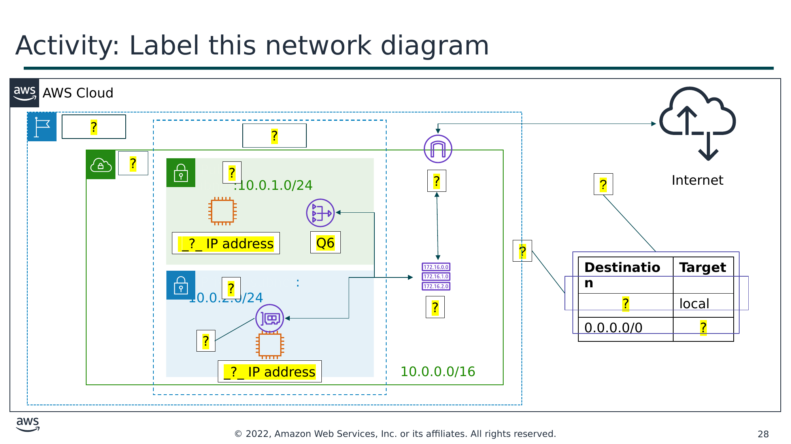

| Destination (Призначення) | Target (Ціль) |
|---|---|
| ? | local |
| 0.0.0.0/0 | ? |

Текст зі схеми

AWS Cloud

?

?

?

Public subnet:10.0.1.0/24 (Публічна підмережа)

?

?

?

Internet (Інтернет)

_?_ IP address (_?_ IP-адреса)

Q6

?

Private subnet: 10.0.2.0/24 (Приватна підмережа)

?

?

?

_?_ IP address (_?_ IP-адреса)

10.0.0.0/16

> **Нотатки:**
>
> Перевірте, чи можете ви розпізнати різні компоненти мережі VPC, про які ви дізналися, підписавши цю мережеву схему.

---

## Слайд 29: Практична вправа: розв’язання

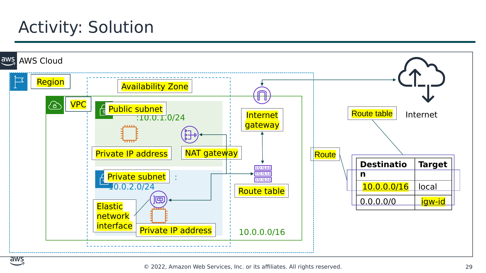

| Destination (Призначення) | Target (Ціль) |
|---|---|
| 10.0.0.0/16 | local |
| 0.0.0.0/0 | igw-id |

Текст зі схеми

AWS Cloud

Region (Регіон)

Availability Zone (Зона доступності)

VPC

Public subnet:10.0.1.0/24 (Публічна підмережа)

Public subnet (Публічна підмережа)

Internet  
gateway (Інтернет-шлюз)

Route table (Таблиця маршрутизації)

Internet (Інтернет)

Private IP address (Приватна IP-адреса)

NAT gateway (NAT-шлюз)

Route (Маршрут)

Private subnet: 10.0.2.0/24 (Приватна підмережа)

Private subnet (Приватна підмережа)

Route table (Таблиця маршрутизації)

Elastic  
network  
interface (Еластичний мережевий інтерфейс)

Private IP address (Приватна IP-адреса)

10.0.0.0/16

> **Нотатки:**
>
> Тепер подивіться, наскільки добре у вас вийшло.

---

## Слайд 30: Записана демонстрація Amazon VPC

> **Нотатки:**
>
> Тепер, коли ви знаєте, як проєктувати VPC, перегляньте демонстрацію за адресою https://aws-tc-largeobjects.s3-us-west-2.amazonaws.com/ILT-TF-100-ACFNDS-20-EN/Module_5_VPC_Wizard+v2.0.mp4 — щоб дізнатися, як використовувати майстер VPC (VPC Wizard) для налаштування VPC із публічними та приватними підмережами.

---

## Слайд 31: Ключові висновки розділу 3

- Існує кілька варіантів мережі VPC, які включають:
  - Інтернет-шлюз (internet gateway)
  - NAT-шлюз (NAT gateway)
  - Кінцеву точку VPC (VPC endpoint)
  - Піринг VPC (VPC peering)
  - Спільне використання VPC (VPC sharing)
  - AWS Site-to-Site VPN
  - AWS Direct Connect
  - AWS Transit Gateway
- Ви можете використовувати майстер VPC (VPC Wizard) для реалізації вашого проєкту.

> **Нотатки:**
>
> Основні висновки цього розділу модуля:  
> Існує кілька варіантів мережі VPC, які включають:  
> Інтернет-шлюз: з’єднує вашу VPC з інтернетом  
> NAT-шлюз: дає змогу екземплярам у приватній підмережі підключатися до інтернету  
> Кінцева точка VPC: з’єднує вашу VPC з підтримуваними сервісами AWS  
> Піринг VPC: з’єднує вашу VPC з іншими VPC  
> Спільне використання VPC: дозволяє кільком акаунтам AWS створювати ресурси своїх застосунків у спільних, централізовано керованих Amazon VPC  
> AWS Site-to-Site VPN: з’єднує вашу VPC з віддаленими мережами  
> AWS Direct Connect: з’єднує вашу VPC з віддаленою мережею за допомогою виділеного мережевого з’єднання  
> AWS Transit Gateway: альтернативне підключення за моделлю «концентратор і промені» (hub-and-spoke) замість піринга VPC  
> Ви можете використовувати майстер VPC (VPC Wizard) для реалізації вашого проєкту.

---

## Слайд 32: Розділ 4: Безпека VPC

Модуль 5: Мережі та доставка контенту

> **Нотатки:**
>
> Розділ 4: Безпека VPC  
>
> Ви можете вбудувати безпеку в архітектуру вашої VPC кількома способами, щоб мати повний контроль як над вхідним, так і над вихідним трафіком. У цьому розділі ви дізнаєтеся про два варіанти брандмауера Amazon VPC, які можна використовувати для захисту вашої VPC: групи безпеки (security groups) і списки контролю доступу до мережі (network access control lists, network ACLs).

---

## Слайд 33: Групи безпеки (1 із 2)

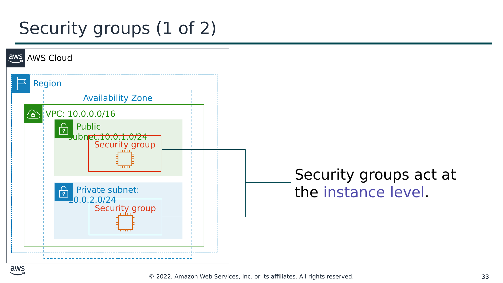

Групи безпеки діють на  
рівні екземпляра.

Текст зі схеми

AWS Cloud

Region (Регіон)

Availability Zone (Зона доступності)

VPC: 10.0.0.0/16

Public subnet:10.0.1.0/24 (Публічна підмережа)

Security group (Група безпеки)

Private subnet: 10.0.2.0/24 (Приватна підмережа)

Security group (Група безпеки)

> **Нотатки:**
>
> Група безпеки діє як віртуальний брандмауер для вашого екземпляра та контролює вхідний і вихідний трафік. Групи безпеки діють на рівні екземпляра, а не на рівні підмережі. Тому кожному екземпляру в підмережі у вашій VPC можна призначити різний набір груп безпеки.  
>
> На найпростішому рівні група безпеки — це спосіб фільтрувати трафік до ваших екземплярів.

---

## Слайд 34: Групи безпеки (2 із 2)

- Групи безпеки мають правила, що контролюють вхідний і вихідний трафік екземпляра.
- Групи безпеки за замовчуванням забороняють весь вхідний трафік і дозволяють весь вихідний трафік.
- Групи безпеки є станними (stateful).

Inbound (Вхідний)

| Source (Джерело) | Protocol (Протокол) | Port Range (Діапазон портів) | Description (Опис) |
|---|---|---|---|
| sg-xxxxxxxx | All | All | Дозволити вхідний трафік від мережевих інтерфейсів, призначених тій самій групі безпеки. |

Outbound (Вихідний)

| Destination (Призначення) | Protocol (Протокол) | Port Range (Діапазон портів) | Description (Опис) |
|---|---|---|---|
| 0.0.0.0/0 | All | All | Дозволити весь вихідний трафік IPv4. |
| ::/0 | All | All | Дозволити весь вихідний трафік IPv6. |

> **Нотатки:**
>
> Групи безпеки мають правила, що контролюють вхідний і вихідний трафік. Коли ви створюєте групу безпеки, вона не має вхідних правил. Тому жоден вхідний трафік, що надходить від іншого хоста до вашого екземпляра, не дозволяється, доки ви не додасте вхідні правила до групи безпеки. За замовчуванням група безпеки включає вихідне правило, що дозволяє весь вихідний трафік. Ви можете видалити це правило та додати вихідні правила, що дозволяють лише певний вихідний трафік. Якщо у вашої групи безпеки немає вихідних правил, жоден вихідний трафік, що походить від вашого екземпляра, не дозволяється.  
>
> Групи безпеки є станними (stateful), що означає, що інформація про стан зберігається навіть після обробки запиту. Тому, якщо ви надсилаєте запит зі свого екземпляра, трафік відповіді на цей запит може надходити незалежно від вхідних правил групи безпеки. Відповіді на дозволений вхідний трафік можуть виходити незалежно від вихідних правил.

---

## Слайд 35: Приклади користувацьких груп безпеки

- Ви можете **вказувати правила дозволу (allow)**, але не правила заборони (deny).
- **Усі правила оцінюються** перед ухваленням рішення про дозвіл трафіку.

Inbound (Вхідний)

| Source (Джерело) | Protocol (Протокол) | Port Range (Діапазон портів) | Description (Опис) |
|---|---|---|---|
| 0.0.0.0/0 | TCP | 80 | Дозволити вхідний доступ HTTP з усіх адрес IPv4 |
| 0.0.0.0/0 | TCP | 443 | Дозволити вхідний доступ HTTPS з усіх адрес IPv4 |
| Діапазон публічних адрес IPv4 вашої мережі | TCP | 22 | Дозволити вхідний доступ SSH до екземплярів Linux з IP-адрес IPv4 у вашій мережі (через інтернет-шлюз) |

Outbound (Вихідний)

| Destination (Призначення) | Protocol (Протокол) | Port Range (Діапазон портів) | Description (Опис) |
|---|---|---|---|
| Ідентифікатор групи безпеки для ваших серверів баз даних Microsoft SQL Server | TCP | 1433 | Дозволити вихідний доступ Microsoft SQL Server до екземплярів у вказаній групі безпеки |

> **Нотатки:**
>
> Коли ви створюєте користувацьку групу безпеки, ви можете вказувати правила дозволу, але не правила заборони. Усі правила оцінюються перед ухваленням рішення про дозвіл трафіку.

---

## Слайд 36: Списки контролю доступу до мережі (network ACLs, 1 із 2)

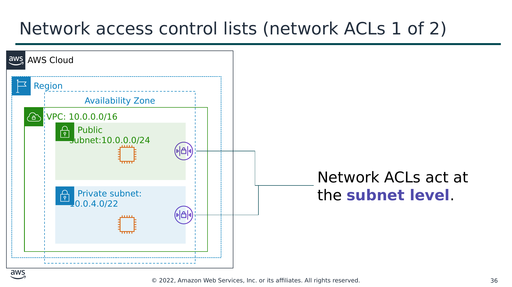

Мережеві ACL діють на  
**рівні підмережі**.

Текст зі схеми

AWS Cloud

Region (Регіон)

Availability Zone (Зона доступності)

VPC: 10.0.0.0/16

Public subnet:10.0.0.0/24 (Публічна підмережа)

Private subnet: 10.0.4.0/22 (Приватна підмережа)

> **Нотатки:**
>
> Список контролю доступу до мережі (network ACL) — це необов’язковий рівень безпеки для вашої Amazon VPC. Він діє як брандмауер для контролю трафіку, що входить до однієї чи кількох підмереж і виходить з них. Щоб додати ще один рівень безпеки до вашої VPC, можна налаштувати мережеві ACL з правилами, подібними до ваших груп безпеки.  
>
> Кожна підмережа у вашій VPC має бути пов’язана з мережевим ACL. Якщо ви явно не пов’язуєте підмережу з мережевим ACL, підмережа автоматично пов’язується з мережевим ACL за замовчуванням. Мережевий ACL можна пов’язати з кількома підмережами; однак підмережа може бути пов’язана лише з одним мережевим ACL одночасно. Коли ви пов’язуєте мережевий ACL з підмережею, попередній зв’язок видаляється.

---

## Слайд 37: Списки контролю доступу до мережі (network ACLs, 2 із 2)

- Мережевий ACL має окремі вхідні та вихідні правила, і кожне правило може  
або дозволяти, або забороняти трафік.
- Мережеві ACL за замовчуванням дозволяють весь вхідний і вихідний трафік IPv4.
- Мережеві ACL є безстанними (stateless).

Inbound (Вхідний)

| Rule (Правило) | Type (Тип) | Protocol (Протокол) | Port Range (Діапазон портів) | Source (Джерело) | Allow/Deny (Дозвіл/заборона) |
|---|---|---|---|---|---|
| 100 | Весь трафік IPv4 | All | All | 0.0.0.0/0 | ALLOW |
| * | Весь трафік IPv4 | All | All | 0.0.0.0/0 | DENY |

Outbound (Вихідний)

| Rule (Правило) | Type (Тип) | Protocol (Протокол) | Port Range (Діапазон портів) | Destination (Призначення) | Allow/Deny (Дозвіл/заборона) |
|---|---|---|---|---|---|
| 100 | Весь трафік IPv4 | All | All | 0.0.0.0/0 | ALLOW |
| * | Весь трафік IPv4 | All | All | 0.0.0.0/0 | DENY |

> **Нотатки:**
>
> Мережевий ACL має окремі вхідні та вихідні правила, і кожне правило може або дозволяти, або забороняти трафік. Ваша VPC автоматично постачається зі змінюваним мережевим ACL за замовчуванням. За замовчуванням він дозволяє весь вхідний і вихідний трафік IPv4 і, за потреби, трафік IPv6. У таблиці показано мережевий ACL за замовчуванням.  
>
> Мережеві ACL є безстанними (stateless), що означає, що жодна інформація про запит не зберігається після його обробки.

---

## Слайд 38: Приклади користувацьких мережевих ACL

- **Користувацькі (custom)** мережеві ACL **забороняють** весь вхідний і вихідний трафік, доки ви не додасте правила.
- Ви можете вказувати **як правила дозволу, так і заборони**.
- Правила оцінюються за порядком номерів, починаючи з **найменшого номера**.

Inbound (Вхідний)

| Rule (Правило) | Type (Тип) | Protocol (Протокол) | Port Range (Діапазон портів) | Source (Джерело) | Allow/Deny (Дозвіл/заборона) |
|---|---|---|---|---|---|
| 100 | HTTPS | TCP | 443 | 0.0.0.0/0 | ALLOW |
| 120 | SSH | TCP | 22 | 192.0.2.0/24 | ALLOW |
| * | Весь трафік IPv4 | All | All | 0.0.0.0/0 | DENY |

Outbound (Вихідний)

| Rule (Правило) | Type (Тип) | Protocol (Протокол) | Port Range (Діапазон портів) | Destination (Призначення) | Allow/Deny (Дозвіл/заборона) |
|---|---|---|---|---|---|
| 100 | HTTPS | TCP | 443 | 0.0.0.0/0 | ALLOW |
| 120 | SSH | TCP | 22 | 192.0.2.0/24 | ALLOW |
| * | Весь трафік IPv4 | All | All | 0.0.0.0/0 | DENY |

> **Нотатки:**
>
> Ви можете створити користувацький мережевий ACL і пов’язати його з підмережею. За замовчуванням кожен користувацький мережевий ACL забороняє весь вхідний і вихідний трафік, доки ви не додасте правила.  
>
> Мережевий ACL містить пронумерований список правил, що оцінюються по порядку, починаючи з правила з найменшим номером. Мета — визначити, чи дозволено трафік входити до будь-якої підмережі, пов’язаної з мережевим ACL, або виходити з неї. Найбільший номер, який можна використати для правила, — 32 766. AWS рекомендує створювати правила з певним кроком (наприклад, з кроком 10 або 100), щоб пізніше можна було вставляти нові правила там, де потрібно.  
>
> Докладніше про мережеві ACL див. «Network ACLs» у документації AWS за адресою https://docs.aws.amazon.com/vpc/latest/userguide/vpc-network-acls.html.

---

## Слайд 39: Групи безпеки та мережеві ACL: порівняння

| Атрибут (Attribute) | Групи безпеки (Security Groups) | Мережеві ACL (Network ACLs) |
|---|---|---|
| Область дії (Scope) | Рівень екземпляра | Рівень підмережі |
| Підтримувані правила (Supported Rules) | Лише правила дозволу | Правила дозволу та заборони |
| Стан (State) | Станні (stateful; зворотний трафік автоматично дозволений незалежно від правил) | Безстанні (stateless; зворотний трафік має бути явно дозволений правилами) |
| Порядок правил (Order of Rules) | Усі правила оцінюються перед ухваленням рішення про дозвіл трафіку | Правила оцінюються за порядком номерів перед ухваленням рішення про дозвіл трафіку |

> **Нотатки:**
>
> Ось підсумок відмінностей між групами безпеки та мережевими ACL:  
> Групи безпеки діють на рівні екземпляра, а мережеві ACL — на рівні підмережі.  
> Групи безпеки підтримують лише правила дозволу, а мережеві ACL підтримують і правила дозволу, і правила заборони.  
> Групи безпеки є станними, а мережеві ACL — безстанними.  
> Для груп безпеки перед ухваленням рішення про дозвіл трафіку оцінюються всі правила. Для мережевих ACL правила оцінюються за порядком номерів перед ухваленням рішення про дозвіл трафіку.

---

## Слайд 40: Практична вправа: спроєктуйте VPC

Сценарій: у вас невеликий бізнес із вебсайтом, розміщеним на екземплярі Amazon Elastic Compute Cloud (Amazon EC2). У вас є дані клієнтів, що зберігаються в бекенд-базі даних, яку ви хочете тримати приватною. Ви хочете використати Amazon VPC, щоб налаштувати VPC, що відповідає таким вимогам:

- Ваш вебсервер і сервер бази даних мають бути в окремих підмережах.
- Перша адреса вашої мережі має бути 10.0.0.0. Кожна підмережа має мати 256 IP-адрес IPv4 загалом.
- Ваші клієнти завжди мають мати змогу отримати доступ до вашого вебсервера.
- Ваш сервер бази даних має мати змогу отримати доступ до інтернету для встановлення оновлень (патчів).
- Ваша архітектура має бути високодоступною та використовувати щонайменше один користувацький рівень брандмауера.

> **Нотатки:**
>
> Тепер ваша черга! У цьому сценарії ви — власник малого бізнесу з вебсайтом, розміщеним на екземплярі Amazon Elastic Compute Cloud (Amazon EC2). У вас є дані клієнтів, що зберігаються в бекенд-базі даних, яку ви хочете тримати приватною.  
>
> Подивіться, чи можете ви спроєктувати VPC, що відповідає таким вимогам:  
> Ваш вебсервер і сервер бази даних мають бути в окремих підмережах.  
> Перша адреса вашої мережі має бути 10.0.0.0. Кожна підмережа має мати 256 IP-адрес IPv4.  
> Ваші клієнти завжди мають мати змогу отримати доступ до вашого вебсервера.  
> Ваш сервер бази даних має мати змогу отримати доступ до інтернету для встановлення оновлень (патчів).  
> Ваша архітектура має бути високодоступною та використовувати щонайменше один користувацький рівень брандмауера.

---

## Слайд 41: Ключові висновки розділу 4

- Вбудовуйте безпеку в архітектуру вашої VPC:
  - За можливості ізолюйте підмережі.
  - Обирайте відповідний пристрій шлюзу або VPN-з’єднання для ваших потреб.
  - Використовуйте брандмауери.
- Групи безпеки та мережеві ACL — це варіанти брандмауера, які можна використовувати для захисту вашої VPC.

> **Нотатки:**
>
> Основні висновки цього розділу модуля:  
> Вбудовуйте безпеку в архітектуру вашої VPC.  
> Групи безпеки та мережеві ACL — це варіанти брандмауера, які можна використовувати для захисту вашої VPC.

---

## Слайд 42: Лабораторна робота 2: Build Your VPC and Launch a Web Server (створення VPC і запуск вебсервера)

> **Нотатки:**
>
> Зараз ви виконаєте Лабораторну роботу 2: Build Your VPC and Launch a Web Server.

---

## Слайд 43: Сценарій лабораторної роботи 2

У цій лабораторній роботі ви використовуєте Amazon VPC, щоб створити власну VPC і додати деякі компоненти для побудови настроюваної мережі. Ви створюєте групу безпеки для вашої VPC. Також ви створюєте екземпляр EC2 і налаштовуєте його на запуск вебсервера та використання групи безпеки. Потім ви запускаєте екземпляр EC2 у VPC.

Amazon  
VPC

Amazon  
EC2

> **Нотатки:**
>
> У цій лабораторній роботі ви використовуєте Amazon VPC, щоб створити власну VPC і додати деякі компоненти для побудови настроюваної мережі. Також ви створюєте групу безпеки для вашої VPC, а потім створюєте екземпляр EC2 і налаштовуєте його на запуск вебсервера та використання групи безпеки. Потім ви запускаєте екземпляр EC2 у VPC.

---

## Слайд 44: Лабораторна робота 2: завдання

- Створіть VPC.
- Створіть додаткові підмережі.
- Створіть групу безпеки VPC.
- Запустіть екземпляр вебсервера.

Security group (Група безпеки)

> **Нотатки:**
>
> У цій лабораторній роботі ви виконаєте такі завдання:  
> Створіть VPC.  
> Створіть додаткові підмережі.  
> Створіть групу безпеки VPC.  
> Запустіть екземпляр вебсервера.

---

## Слайд 45: Лабораторна робота 2: підсумковий результат

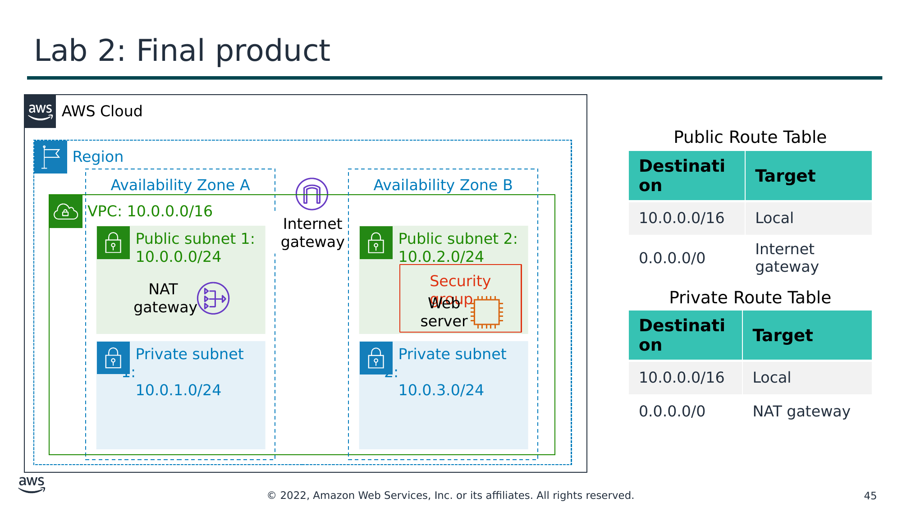

Public Route Table (Таблиця маршрутизації публічної підмережі)

| Destination (Призначення) | Target (Ціль) |
|---|---|
| 10.0.0.0/16 | Local |
| 0.0.0.0/0 | Internet gateway |

Private Route Table (Таблиця маршрутизації приватної підмережі)

| Destination (Призначення) | Target (Ціль) |
|---|---|
| 10.0.0.0/16 | Local |
| 0.0.0.0/0 | NAT gateway |

Текст зі схеми

AWS Cloud

Region (Регіон)

Availability Zone A (Зона доступності A)

Availability Zone B (Зона доступності B)

VPC: 10.0.0.0/16

Public subnet 1 (Публічна підмережа 1):  
   10.0.0.0/24

Internet  
gateway (Інтернет-шлюз)

Public subnet 2 (Публічна підмережа 2):  
   10.0.2.0/24

Security group (Група безпеки)

NAT  
gateway (NAT-шлюз)

Web  
server (Вебсервер)

Private subnet 1 (Приватна підмережа 1):  
   10.0.1.0/24

Private subnet 2 (Приватна підмережа 2):  
   10.0.3.0/24

> **Нотатки:**
>
> Ця архітектурна схема зображує те, що ви створюєте в лабораторній роботі.

---

## Слайд 46: Початок лабораторної роботи 2: Build Your VPC and Launch a Web Server

~ 30 хвилин

> **Нотатки:**
>
> Настав час розпочати лабораторну роботу. На її виконання має піти приблизно 30 хвилин.

---

## Слайд 47: Підсумки лабораторної роботи: ключові висновки

> **Нотатки:**
>
> У цій лабораторній роботі ви:  
> Створили Amazon VPC.  
> Створили додаткові підмережі.  
> Створили групу безпеки Amazon VPC.  
> Запустили екземпляр вебсервера на Amazon EC2.

---

## Слайд 48: Розділ 5: Amazon Route 53

Модуль 5: Мережі та доставка контенту

> **Нотатки:**
>
> Розділ 5: Amazon Route 53

---

## Слайд 49: Amazon Route 53

- Це високодоступний і масштабований вебсервіс системи доменних імен (Domain Name System, DNS)
- Використовується для маршрутизації кінцевих користувачів до інтернет-застосунків шляхом перетворення імен (як-от [*www.example.com*](http://www.example.com/)) на числові IP-адреси (як-от *192.0.2.1*), що їх комп’ютери використовують для з’єднання один з одним
- Повністю сумісний з IPv4 та IPv6
- З’єднує запити користувачів з інфраструктурою, що працює в AWS, а також поза AWS
- Використовується для перевірки стану ваших ресурсів
- Має функцію керування потоком трафіку (traffic flow)
- Дає змогу реєструвати доменні імена

Amazon  
Route 53

> **Нотатки:**
>
> Amazon Route 53 — це високодоступний і масштабований хмарний вебсервіс системи доменних імен (DNS). Його розроблено, щоб надати розробникам і підприємствам надійний та економічно ефективний спосіб маршрутизації користувачів до інтернет-застосунків шляхом перетворення імен (як-от www.example.com) на числові IP-адреси (як-от 192.0.2.1), що їх комп’ютери використовують для з’єднання один з одним. Крім того, Amazon Route 53 повністю сумісний з IPv6. Докладніше про системи доменних імен див. https://aws.amazon.com/route53/what-is-dns/.  
>
> Amazon Route 53 ефективно з’єднує запити користувачів з інфраструктурою, що працює в AWS — як-от екземпляри Amazon EC2, балансувальники навантаження Elastic Load Balancing чи бакети Amazon S3, — а також може використовуватися для маршрутизації користувачів до інфраструктури поза AWS.  
>
> Ви можете використовувати Amazon Route 53 для налаштування перевірок стану DNS (DNS health checks), щоб маршрутизувати трафік до справних кінцевих точок або незалежно відстежувати стан вашого застосунку та його кінцевих точок.  
>
> Керування потоком трафіку Amazon Route 53 (traffic flow) допомагає глобально керувати трафіком за допомогою кількох типів маршрутизації, які можна поєднувати з відмовостійким перемиканням DNS (DNS failover) для побудови різноманітних архітектур із низькою затримкою та відмовостійкістю. Ви можете використовувати простий візуальний редактор traffic flow Amazon Route 53 для керування тим, як ваших користувачів маршрутизують до кінцевих точок вашого застосунку — чи то в одному регіоні AWS, чи то розподілених по всьому світу.  
>
> Amazon Route 53 також пропонує реєстрацію доменних імен (Domain Name Registration) — ви можете купувати доменні імена (як-от example.com) і керувати ними, а Amazon Route 53 автоматично налаштує параметри DNS для ваших доменів.

---

## Слайд 50: Розв’язання імен DNS в Amazon Route 53

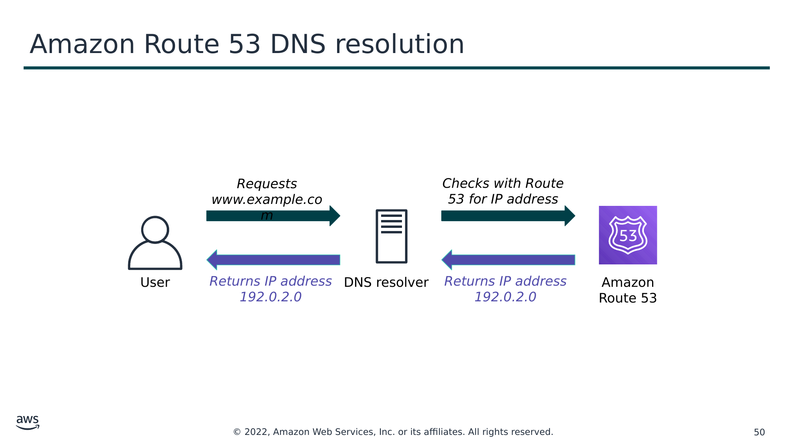

Текст зі схеми

*Requests www.example.com (Запитує www.example.com)*

*Checks with Route 53 for IP address (Перевіряє IP-адресу в Route 53)*

User (Користувач)

*Returns IP address 192.0.2.0 (Повертає IP-адресу 192.0.2.0)*

DNS resolver (DNS-резолвер)

*Returns IP address 192.0.2.0 (Повертає IP-адресу 192.0.2.0)*

Amazon Route 53

> **Нотатки:**
>
> Ось базовий шаблон, якого дотримується Amazon Route 53, коли користувач ініціює DNS-запит. DNS-резолвер перевіряє ваш домен у Route 53, отримує IP-адресу та повертає її користувачеві.

---

## Слайд 51: Підтримувана маршрутизація Amazon Route 53

- Проста маршрутизація (Simple routing) – використовуйте в середовищах з одним сервером
- Зважена маршрутизація за круговим алгоритмом (Weighted round robin routing) – призначайте ваги наборам записів ресурсів, щоб указати частоту
- Маршрутизація за затримкою (Latency routing) – допомагає покращити ваші глобальні застосунки
- Маршрутизація за геолокацією (Geolocation routing) – маршрутизуйте трафік залежно від розташування ваших користувачів
- Маршрутизація за геопроксимальністю (Geoproximity routing) – маршрутизуйте трафік залежно від розташування ваших ресурсів
- Маршрутизація з відмовостійким перемиканням (Failover routing) – перемикайтеся на резервний сайт, якщо ваш основний сайт стає недосяжним
- Маршрутизація з відповіддю з кількома значеннями (Multivalue answer routing) – відповідайте на DNS-запити щонайбільше вісьмома справними записами, вибраними випадково

> **Нотатки:**
>
> Amazon Route 53 підтримує кілька типів політик маршрутизації, що визначають, як Amazon Route 53 відповідає на запити:  
> Проста маршрутизація (round robin) — використовуйте для одного ресурсу, що виконує певну функцію для вашого домену (наприклад, вебсервер, що обслуговує контент вебсайту example.com).  
> Зважена маршрутизація за круговим алгоритмом (Weighted round robin routing) — використовуйте для маршрутизації трафіку до кількох ресурсів у вказаних вами пропорціях. Дає змогу призначати ваги наборам записів ресурсів, щоб указати частоту, з якою надаються різні відповіді. Цю можливість можна використати для A/B-тестування — коли невелику частину трафіку надсилають на сервер, де ви внесли зміни до програмного забезпечення. Наприклад, припустімо, що у вас є два набори записів, пов’язані з одним DNS-іменем: один із вагою 3, а інший із вагою 1. У цьому випадку в 75 відсотках випадків Amazon Route 53 повертатиме набір записів із вагою 3, а в 25 відсотках — набір записів із вагою 1. Ваги можуть бути будь-яким числом від 0 до 255.  
> Маршрутизація за затримкою (Latency routing, LBR) — використовуйте, коли у вас є ресурси в кількох регіонах AWS і ви хочете маршрутизувати трафік до регіону, що забезпечує найкращу затримку. Маршрутизація за затримкою працює, спрямовуючи ваших клієнтів до кінцевої точки AWS (наприклад, екземплярів Amazon EC2, еластичних IP-адрес або балансувальників навантаження), що забезпечує найшвидший досвід на основі фактичних вимірювань продуктивності різних регіонів AWS, де працює ваш застосунок.  
> Маршрутизація за геолокацією (Geolocation routing) — використовуйте, коли хочете маршрутизувати трафік залежно від розташування ваших користувачів. Коли ви використовуєте маршрутизацію за геолокацією, ви можете локалізувати свій контент і подавати частину чи весь свій вебсайт мовою ваших користувачів. Також можна використовувати маршрутизацію за геолокацією, щоб обмежити розповсюдження контенту лише тими місцями, де у вас є права на розповсюдження. Ще одне можливе застосування — балансування навантаження між кінцевими точками передбачуваним, легким у керуванні способом, щоб кожне розташування користувачів послідовно маршрутизувалося до тієї самої кінцевої точки.  
> Маршрутизація за геопроксимальністю (Geoproximity routing) — використовуйте, коли хочете маршрутизувати трафік залежно від розташування ваших ресурсів і, за бажанням, переміщувати трафік з ресурсів в одному розташуванні на ресурси в іншому.  
> Маршрутизація з відмовостійким перемиканням (Failover routing, DNS failover) — використовуйте, коли хочете налаштувати перемикання «активний–пасивний» (active-passive). Amazon Route 53 може допомогти виявити збій вашого вебсайту та перенаправити ваших користувачів до альтернативних розташувань, де ваш застосунок працює належним чином. Коли ви вмикаєте цю функцію, агенти перевірки стану Amazon Route 53 відстежуватимуть кожне розташування чи кінцеву точку вашого застосунку, щоб визначити його доступність. Ви можете скористатися цією функцією, щоб підвищити доступність вашого застосунку, орієнтованого на клієнтів.  
> Маршрутизація з відповіддю з кількома значеннями (Multivalue answer routing) — використовуйте, коли хочете, щоб Route 53 відповідав на DNS-запити щонайбільше вісьмома справними записами, вибраними випадково. Ви можете налаштувати Amazon Route 53 так, щоб він повертав кілька значень — як-от IP-адреси ваших вебсерверів — у відповідь на DNS-запити. Можна вказати кілька значень майже для будь-якого запису, але маршрутизація з відповіддю з кількома значеннями також дає змогу перевіряти стан кожного ресурсу, щоб Route 53 повертав лише значення для справних ресурсів. Це не заміна балансувальника навантаження, але можливість повертати кілька IP-адрес, стан яких можна перевірити, — це спосіб використати DNS для покращення доступності та балансування навантаження.

---

## Слайд 52: Сценарій використання: розгортання в кількох регіонах (multi-region deployment)

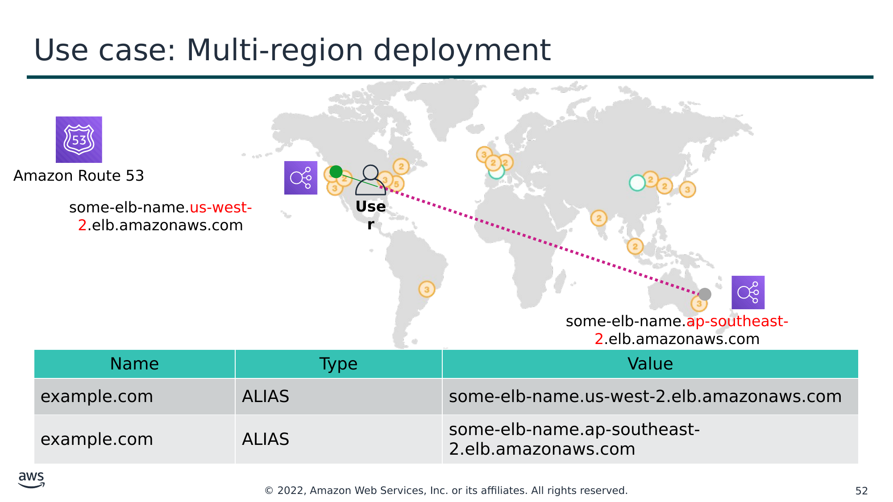

| Name (Ім’я) | Type (Тип) | Value (Значення) |
|---|---|---|
| example.com | ALIAS | some-elb-name.us-west-2.elb.amazonaws.com |
| example.com | ALIAS | some-elb-name.ap-southeast-2.elb.amazonaws.com |

Текст зі схеми

Amazon Route 53

some-elb-name.us-west-2.elb.amazonaws.com

**User (Користувач)**

some-elb-name.ap-southeast-2.elb.amazonaws.com

> **Нотатки:**
>
> Розгортання в кількох регіонах (multi-Region deployment) — приклад сценарію використання Amazon Route 53. З Amazon Route 53 користувача автоматично спрямовують до балансувальника навантаження Elastic Load Balancing, найближчого до користувача.  
>
> Переваги розгортання Route 53 у кількох регіонах включають:  
> Маршрутизацію до регіону на основі затримки (latency-based routing)  
> Маршрутизацію з балансуванням навантаження до зони доступності

---

## Слайд 53: Відмовостійке перемикання DNS в Amazon Route 53 (DNS failover)

Покращуйте доступність ваших застосунків, що працюють в AWS, за допомогою:

- Налаштування сценаріїв резервного копіювання та відмовостійкого перемикання для ваших власних застосунків
- Увімкнення високодоступних архітектур у кількох регіонах в AWS
- Створення перевірок стану (health checks)

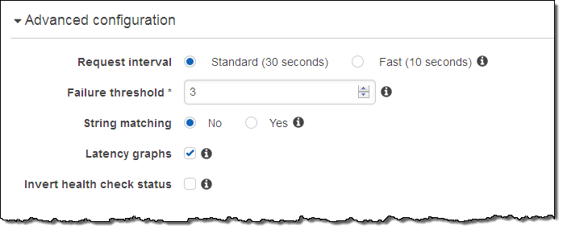

> **Нотатки:**
>
> Amazon Route 53 дає змогу покращувати доступність ваших застосунків, що працюють в AWS, за допомогою:  
> Налаштування сценаріїв резервного копіювання та відмовостійкого перемикання для ваших власних застосунків.  
> Увімкнення високодоступних архітектур у кількох регіонах в AWS.  
> Створення перевірок стану для відстеження стану та продуктивності ваших вебзастосунків, вебсерверів та інших ресурсів. Кожна створена вами перевірка стану може відстежувати одне з такого — стан указаного ресурсу, як-от вебсервера; статус інших перевірок стану; і статус сигналу (alarm) Amazon CloudWatch.

---

## Слайд 54: Відмовостійке перемикання DNS для багаторівневого вебзастосунку

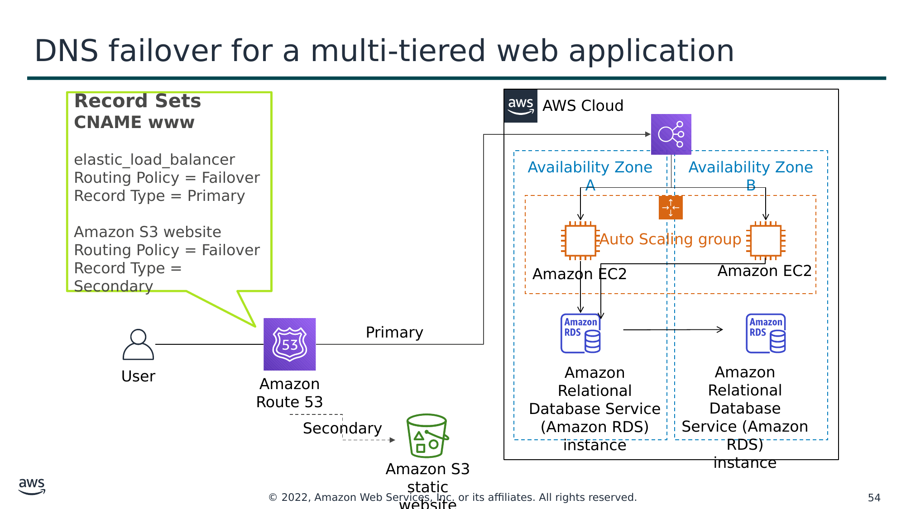

Текст зі схеми

**Record Sets (Набори записів)**

**CNAME www**

elastic_load_balancer  
Routing Policy = Failover  
Record Type = Primary

Amazon S3 website  
Routing Policy = Failover  
Record Type = Secondary

AWS Cloud

Availability Zone A (Зона доступності A)

Availability Zone B (Зона доступності B)

Auto Scaling group (Група Auto Scaling)

Amazon EC2

Amazon EC2

Primary (Основний)

User (Користувач)

Amazon Relational Database Service (Amazon RDS)  
instance (екземпляр)

Amazon Relational Database Service (Amazon RDS)  
instance (екземпляр)

Amazon Route 53

Secondary (Резервний)

Amazon S3 static website (Статичний вебсайт Amazon S3)

> **Нотатки:**
>
> Ця схема показує, як працює відмовостійке перемикання DNS у типовій архітектурі багаторівневого вебзастосунку. Route 53 передає трафік балансувальнику навантаження, який потім розподіляє трафік між парком екземплярів EC2.  
>
> Ви можете виконати в Route 53 такі завдання, щоб забезпечити високу доступність:  
> Створіть два записи DNS для канонічного імені (Canonical Name Record, CNAME) www із політикою маршрутизації Failover Routing. Перший запис — основна політика маршрутизації, що вказує на балансувальник навантаження вашого вебзастосунку. Другий запис — вторинна політика маршрутизації, що вказує на ваш статичний вебсайт Amazon S3.  
> Використовуйте перевірки стану Route 53, щоб переконатися, що основний ресурс працює. Якщо так, увесь трафік за замовчуванням іде на стек вашого вебзастосунку. Перемикання на статичний резервний сайт буде запущено, якщо вебсервер вийде з ладу (або перестане відповідати) чи якщо вийде з ладу екземпляр бази даних.

---

## Слайд 55: Ключові висновки розділу 5

- Amazon Route 53 — це високодоступний і масштабований хмарний вебсервіс DNS, що перетворює доменні імена на числові IP-адреси.
- Amazon Route 53 підтримує кілька типів політик маршрутизації.
- Розгортання в кількох регіонах (multi-Region deployment) покращує продуктивність вашого застосунку для глобальної аудиторії.
- Ви можете використовувати відмовостійке перемикання (failover) Amazon Route 53, щоб покращити доступність ваших застосунків.

> **Нотатки:**
>
> Основні висновки цього розділу модуля:  
> Amazon Route 53 — це високодоступний і масштабований хмарний вебсервіс DNS, що перетворює доменні імена на числові IP-адреси.  
> Amazon Route 53 підтримує кілька типів політик маршрутизації.  
> Розгортання в кількох регіонах покращує продуктивність вашого застосунку для глобальної аудиторії.  
> Ви можете використовувати відмовостійке перемикання Amazon Route 53, щоб покращити доступність ваших застосунків.

---

## Слайд 56: Розділ 6: Amazon CloudFront

Модуль 5: Мережі та доставка контенту

> **Нотатки:**
>
> Розділ 6: Amazon CloudFront  
>
> Мета мереж — обмінюватися інформацією між підключеними ресурсами. Досі в цьому модулі ви дізнавалися про мережі VPC з Amazon VPC. Ви дізналися про різні варіанти підключення вашої VPC до інтернету, до віддалених мереж, до інших VPC і до сервісів AWS.  
>
> Доставка контенту також відбувається через мережі — наприклад, коли ви дивитеся фільм у вашому улюбленому стрімінговому сервісі. У цьому завершальному розділі ви дізнаєтеся про Amazon CloudFront — сервіс мережі доставки контенту (content delivery network, CDN).

---

## Слайд 57: Доставка контенту та мережева затримка (network latency)

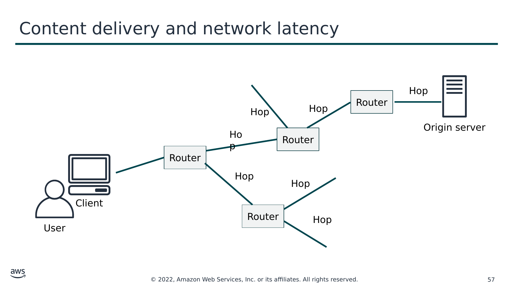

Текст зі схеми

Hop (Стрибок)

Router (Маршрутизатор)

Hop

Hop

Hop

Origin server (Початковий сервер)

Router

Router

Hop

Hop

Client (Клієнт)

Router

User (Користувач)

Hop

> **Нотатки:**
>
> Як пояснювалося раніше в цьому модулі, коли ви вивчали AWS Direct Connect, одна з проблем мережевого обміну даними — продуктивність мережі. Коли ви переглядаєте вебсайт чи транслюєте відео, ваш запит маршрутизується через багато різних мереж, щоб досягти початкового сервера (origin server). Початковий сервер (або origin) зберігає оригінальні, остаточні версії об’єктів (вебсторінок, зображень і медіафайлів). Кількість мережевих стрибків (network hops) і відстань, яку має подолати запит, значно впливають на продуктивність і швидкість реагування вебсайту. Крім того, мережева затримка різна в різних географічних розташуваннях. З цих причин рішенням може бути мережа доставки контенту.

---

## Слайд 58: Мережа доставки контенту (content delivery network, CDN)

- Це глобально розподілена система серверів кешування
- Кешує копії часто запитуваних файлів (статичний контент)
- Доставляє локальну копію запитаного контенту з найближчого периферійного кеша (cache edge) або точки присутності (Point of Presence)
- Прискорює доставку динамічного контенту
- Покращує продуктивність і масштабування застосунків

> **Нотатки:**
>
> Мережа доставки контенту (content delivery network, CDN) — це глобально розподілена система серверів кешування. CDN кешує копії часто запитуваних файлів (статичний контент, як-от файли Hypertext Markup Language, або HTML; Cascading Style Sheets, або CSS; JavaScript; і зображення), що розміщені на початковому сервері застосунку. CDN доставляє локальну копію запитаного контенту з периферійного кеша або точки присутності (Point of Presence), що забезпечує найшвидшу доставку одержувачу запиту.  
>
> CDN також доставляють динамічний контент, який є унікальним для того, хто його запитує, і не підлягає кешуванню. Доставка динамічного контенту через CDN покращує продуктивність і масштабування застосунку. CDN встановлює та підтримує безпечні з’єднання ближче до того, хто робить запит. Якщо CDN перебуває в тій самій мережі, що й початковий сервер, маршрутизація назад до початкового сервера для отримання динамічного контенту прискорюється. Крім того, такий контент, як дані форм, зображення й текст, можна приймати та надсилати назад до початкового сервера, скориставшись таким чином з’єднаннями з низькою затримкою та поведінкою проксі точки присутності (PoP).

---

## Слайд 59: Amazon CloudFront

- Швидкий, глобальний і безпечний сервіс CDN
- Глобальна мережа периферійних локацій (edge locations) і регіональних периферійних кешів (Regional edge caches)
- Модель самообслуговування (self-service)
- Ціноутворення з оплатою за фактом використання (pay-as-you-go)

Amazon  
CloudFront

> **Нотатки:**
>
> Amazon CloudFront — це швидкий сервіс CDN, що безпечно доставляє дані, відео, застосунки та прикладні програмні інтерфейси (API) клієнтам у всьому світі з низькою затримкою та високою швидкістю передавання. Він також надає дружнє до розробників середовище. Amazon CloudFront доставляє файли користувачам через глобальну мережу периферійних локацій і регіональних периферійних кешів. Amazon CloudFront відрізняється від традиційних рішень для доставки контенту тим, що дає змогу швидко отримати переваги високопродуктивної доставки контенту без узгоджених контрактів, високих цін чи мінімальних платежів. Як і інші сервіси AWS, Amazon CloudFront — це пропозиція самообслуговування з оплатою за фактом використання.

---

## Слайд 60: Інфраструктура Amazon CloudFront

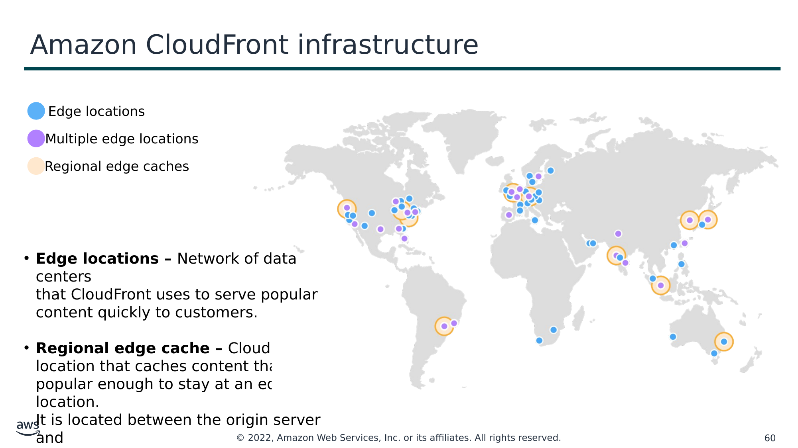

- **Периферійні локації (Edge locations) –** мережа центрів обробки даних,  
які CloudFront використовує для швидкого обслуговування клієнтів популярним контентом.
- **Регіональний периферійний кеш (Regional edge cache) –** локація CloudFront,  
що кешує контент, недостатньо популярний,  
щоб залишатися в периферійній локації.  
Вона розташована між початковим сервером і  
глобальною периферійною локацією.

Текст зі схеми

Edge locations (Периферійні локації)

Multiple edge locations (Кілька периферійних локацій)

Regional edge caches (Регіональні периферійні кеші)

> **Нотатки:**
>
> Amazon CloudFront доставляє контент через всесвітню мережу центрів обробки даних, які називаються периферійними локаціями (edge locations). Коли користувач запитує контент, який ви обслуговуєте за допомогою CloudFront, користувача маршрутизують до периферійної локації, що забезпечує найнижчу затримку (або часову затримку), щоб контент доставлявся з найкращою можливою продуктивністю. Периферійні локації CloudFront розроблено для швидкого обслуговування ваших глядачів популярним контентом.  
>
> Коли об’єкти стають менш популярними, окремі периферійні локації можуть видаляти ці об’єкти, щоб звільнити місце для популярнішого контенту. Для менш популярного контенту CloudFront має регіональні периферійні кеші (Regional edge caches). Регіональні периферійні кеші — це локації CloudFront, розгорнуті глобально й розташовані поблизу ваших глядачів. Вони розташовані між вашим початковим сервером і глобальними периферійними локаціями, що обслуговують контент безпосередньо глядачам. Регіональний периферійний кеш має більший кеш, ніж окрема периферійна локація, тому об’єкти залишаються в регіональному периферійному кеші довше. Більше вашого контенту залишається ближче до ваших глядачів, що зменшує потребу CloudFront звертатися до вашого початкового сервера й покращує загальну продуктивність для глядачів.  
>
> Докладніше про те, як працює Amazon CloudFront, див. «How CloudFront Delivers Content» у документації AWS за адресою https://docs.aws.amazon.com/AmazonCloudFront/latest/DeveloperGuide/HowCloudFrontWorks.html#HowCloudFrontWorksContentDelivery.

---

## Слайд 61: Переваги Amazon CloudFront

- Швидкість і глобальність
- Безпека на периферії (security at the edge)
- Висока програмованість
- Глибока інтеграція з AWS
- Економічна ефективність

> **Нотатки:**
>
> Amazon CloudFront надає такі переваги:  
> Швидкість і глобальність (Fast and global) — Amazon CloudFront має масивний масштаб і глобальний розподіл. Щоб доставляти контент кінцевим користувачам із низькою затримкою, Amazon CloudFront використовує глобальну мережу, що складається з периферійних локацій і регіональних кешів.  
> Безпека на периферії (Security at the edge) — Amazon CloudFront забезпечує захист як на мережевому рівні, так і на рівні застосунків. Ваш трафік і застосунки отримують користь від різних вбудованих засобів захисту, як-от AWS Shield Standard, без додаткової плати. Ви також можете використовувати настроювані функції, як-от AWS Certificate Manager (ACM), щоб створювати й керувати власними сертифікатами Secure Sockets Layer (SSL) без додаткової плати.  
> Висока програмованість (Highly programmable) — функції Amazon CloudFront можна налаштувати під конкретні вимоги застосунку. Він інтегрується з Lambda@Edge, щоб ви могли запускати власний код у локаціях AWS по всьому світу, що дає змогу наблизити складну логіку застосунку до користувачів для підвищення швидкості реагування. CDN також підтримує інтеграції з іншими інструментами та інтерфейсами автоматизації для DevOps. Він пропонує середовища безперервної інтеграції та безперервної доставки (CI/CD).  
> Глибока інтеграція з AWS (Deeply integrated with AWS) — Amazon CloudFront інтегровано з AWS: як із фізичними локаціями, безпосередньо підключеними до глобальної інфраструктури AWS, так і з іншими сервісами AWS. Ви можете використовувати API або AWS Management Console для програмного налаштування всіх функцій у CDN.  
> Економічна ефективність (Cost-effective) — Amazon CloudFront економічно ефективний, оскільки не має мінімальних зобов’язань і стягує плату лише за те, що ви використовуєте. Порівняно з самостійним хостингом Amazon CloudFront дозволяє уникнути витрат і складності експлуатації мережі серверів кешування на кількох майданчиках в інтернеті. Він усуває потребу надмірного розгортання потужностей для обслуговування потенційних сплесків трафіку. Amazon CloudFront також використовує такі методи, як об’єднання одночасних запитів глядачів на один і той самий файл у периферійній локації в один запит до вашого початкового сервера. Результат — менше навантаження на ваші початкові сервери та менша потреба масштабувати вашу початкову інфраструктуру, що може призвести до додаткової економії. Якщо ви використовуєте початкові сервери AWS, як-от Amazon Simple Storage Service (Amazon S3) чи Elastic Load Balancing, ви платите лише за витрати на зберігання, а не за будь-які дані, передані між цими сервісами та CloudFront.

---

## Слайд 62: Ціноутворення Amazon CloudFront

Вихідне передавання даних (Data transfer out)

- Плата стягується за обсяг даних, переданих з периферійної локації Amazon CloudFront в інтернет або до вашого початкового сервера.

Запити HTTP(S)

- Плата стягується за кількість запитів HTTP(S).

Запити на інвалідацію (Invalidation requests)

- Без додаткової плати за перші 1000 шляхів, запитаних для інвалідації щомісяця. Далі — 0,005 долара за кожен шлях, запитаний для інвалідації.

Виділена IP-адреса для власного SSL (Dedicated IP custom SSL)

- 600 доларів на місяць за кожен власний сертифікат SSL, пов’язаний з одним чи кількома дистрибутивами CloudFront, що використовують версію підтримки власних сертифікатів SSL з виділеною IP-адресою (Dedicated IP).

> **Нотатки:**
>
> Плата за Amazon CloudFront ґрунтується на фактичному використанні сервісу в чотирьох сферах:  
> Вихідне передавання даних (Data transfer out) — ви платите за обсяг даних, переданих з периферійних локацій Amazon CloudFront, виміряний у ГБ, в інтернет або до вашого початкового сервера (як початкових серверів AWS, так і інших початкових серверів). Використання передавання даних сумується окремо для певних географічних регіонів, а потім вартість обчислюється на основі цінових рівнів для кожної області. Якщо ви використовуєте інші сервіси AWS як початкові джерела ваших файлів, ви платите окремо за використання цих сервісів, зокрема за години зберігання й обчислень.  
> Запити HTTP(S) — ви платите за кількість запитів HTTP(S), надісланих до Amazon CloudFront щодо вашого контенту.  
> Запити на інвалідацію (Invalidation requests) — ви платите за кожен шлях у вашому запиті на інвалідацію. Шлях, указаний у вашому запиті на інвалідацію, представляє URL (або кілька URL, якщо шлях містить символ підстановки) об’єкта, який ви хочете інвалідувати в кеші CloudFront. Ви можете запитувати до 1000 шляхів щомісяця з Amazon CloudFront без додаткової плати. Після перших 1000 шляхів ви платите за кожен шлях, указаний у ваших запитах на інвалідацію.  
> Виділена IP-адреса для власного Secure Sockets Layer (SSL) (Dedicated IP custom SSL) — ви платите 600 доларів на місяць за кожен власний сертифікат SSL, пов’язаний з одним чи кількома дистрибутивами CloudFront, що використовують версію підтримки власних сертифікатів SSL з виділеною IP-адресою. Ця щомісячна плата розраховується пропорційно за годинами. Наприклад, якщо ваш власний сертифікат SSL було пов’язано принаймні з одним дистрибутивом CloudFront лише протягом 24 годин (тобто 1 дня) у червні, ваша загальна плата за використання функції власного сертифіката SSL у червні становитиме (1 день / 30 днів) * 600 доларів = 20 доларів.  
>
> Найновішу інформацію про ціни див. на сторінці цін Amazon CloudFront за адресою https://aws.amazon.com/cloudfront/pricing/.

---

## Слайд 63: Ключові висновки розділу 6

- CDN — це глобально розподілена система серверів кешування, що прискорює доставку контенту.
- Amazon CloudFront — це швидкий сервіс CDN, що безпечно доставляє дані, відео, застосунки та API через глобальну інфраструктуру з низькою затримкою та високою швидкістю передавання.
- Amazon CloudFront пропонує багато переваг.

> **Нотатки:**
>
> Основні висновки цього розділу модуля:  
> CDN — це глобально розподілена система серверів кешування, що прискорює доставку контенту.  
> Amazon CloudFront — це швидкий сервіс CDN, що безпечно доставляє дані, відео, застосунки та API через глобальну інфраструктуру з низькою затримкою та високою швидкістю передавання.  
> Amazon CloudFront пропонує багато переваг, зокрема:  
> Швидкість і глобальність  
> Безпека на периферії  
> Висока програмованість  
> Глибока інтеграція з AWS  
> Економічна ефективність

---

## Слайд 64: Підсумки модуля

Модуль 5: Мережі та доставка контенту

> **Нотатки:**
>
> Настав час повторити матеріал модуля та завершити його перевіркою знань і розбором запитання практичного сертифікаційного іспиту.

---

## Слайд 65: Резюме модуля

Підсумовуючи, у цьому модулі ви навчилися:

- Розпізнавати основи мереж
- Описувати віртуальні мережі в хмарі за допомогою Amazon VPC
- Підписувати мережеву схему
- Проєктувати базову архітектуру VPC
- Вказувати кроки створення VPC
- Визначати групи безпеки
- Створювати власну VPC і додавати до неї додаткові компоненти для побудови настроюваної мережі
- Визначати основи Amazon Route 53
- Розпізнавати переваги Amazon CloudFront

> **Нотатки:**
>
> Підсумовуючи, у цьому модулі ви навчилися:  
> Розпізнавати основи мереж  
> Описувати віртуальні мережі в хмарі за допомогою Amazon VPC  
> Підписувати мережеву схему  
> Проєктувати базову архітектуру VPC  
> Вказувати кроки створення VPC  
> Визначати групи безпеки  
> Створювати власну VPC і додавати до неї додаткові компоненти для побудови настроюваної мережі  
> Визначати основи Amazon Route 53  
> Розпізнавати переваги Amazon CloudFront

---

## Слайд 66: Пройдіть перевірку знань

> **Нотатки:**
>
> А тепер пройдіть перевірку знань.

---

## Слайд 67: Приклад запитання іспиту

Який мережевий сервіс AWS дає змогу компанії створити віртуальну мережу в AWS?

Варіант

Відповідь

A

AWS Config

B

Amazon Route 53

C

AWS Direct Connect

D

Amazon VPC

> **Нотатки:**
>
> Розгляньте варіанти відповідей і відсійте їх за ключовими словами.

---

## Слайд 68: Відповідь на приклад запитання іспиту

Який мережевий сервіс AWS дає змогу компанії створити віртуальну мережу в AWS?

Правильна відповідь — D.

Ключові слова в запитанні: «мережевий сервіс AWS» та «створити віртуальну мережу».

> **Нотатки:**
>
> Ключові слова, які потрібно розпізнати: «мережевий сервіс AWS» та «створити віртуальну мережу».  
>
> Правильна відповідь — D.

---

## Слайд 69: Додаткові ресурси

- Сторінка огляду Amazon VPC (Amazon VPC Overview): https://docs.aws.amazon.com/vpc/latest/userguide/what-is-amazon-vpc.html
- Технічний документ про варіанти підключення Amazon Virtual Private Cloud (Amazon Virtual Private Cloud Connectivity Options whitepaper): [https://docs.aws.amazon.com/whitepapers/latest/aws-vpc-connectivity-options/introduction.html](https://docs.aws.amazon.com/whitepapers/latest/aws-vpc-connectivity-options/introduction.html)
- Допис у блозі AWS Architecture «One to Many: Evolving VPC Design»: [https://aws.amazon.com/blogs/architecture/one-to-many-evolving-vpc-design/](https://aws.amazon.com/blogs/architecture/one-to-many-evolving-vpc-design/)
- Посібник користувача Amazon VPC (Amazon VPC User Guide): [https://docs.aws.amazon.com/vpc/latest/userguide/what-is-amazon-vpc.html](https://docs.aws.amazon.com/vpc/latest/userguide/what-is-amazon-vpc.html)
- Сторінка огляду Amazon CloudFront: [https://aws.amazon.com/cloudfront/?nc=sn&loc=1](https://aws.amazon.com/cloudfront/?nc=sn&loc=1)

> **Нотатки:**
>
> Якщо ви хочете дізнатися більше про теми, розглянуті в цьому модулі, вам можуть бути корисними такі додаткові ресурси:  
> Сторінка огляду Amazon VPC (Amazon VPC Overview): https://docs.aws.amazon.com/vpc/latest/userguide/what-is-amazon-vpc.html  
> Технічний документ про варіанти підключення Amazon Virtual Private Cloud: https://docs.aws.amazon.com/whitepapers/latest/aws-vpc-connectivity-options/introduction.html  
> Допис у блозі AWS Architecture «One to Many: Evolving VPC Design»: https://aws.amazon.com/blogs/architecture/one-to-many-evolving-vpc-design/  
> Посібник користувача Amazon VPC: https://docs.aws.amazon.com/vpc/latest/userguide/what-is-amazon-vpc.html  
> Сторінка огляду Amazon CloudFront: https://aws.amazon.com/cloudfront/?nc=sn&loc=1

---

## Слайд 70: Дякуємо

Усі торговельні марки є власністю їхніх власників.

> **Нотатки:**
>
> Дякуємо, що пройшли цей модуль.
