## Слайд 1: Module 6: Compute

AWS Academy Cloud Foundations

> **Нотатки:**
>
> Welcome to Module 6: Compute

---

## Слайд 2: Module overview

**Topics**

- Compute services overview
- Amazon EC2
- Amazon EC2 cost optimization
- Container services
- Introduction to AWS Lambda
- Introduction to AWS Elastic Beanstalk

**Activities**

- Amazon EC2 versus Managed Service
- Hands-on with AWS Lambda
- Hands-on with AWS Elastic Beanstalk

**Demo**

- Recorded demonstration of Amazon EC2

**Lab**

- Introduction to Amazon EC2

**Knowledge check**

> **Нотатки:**
>
> This module will address the following topics:  
> Compute services overview  
> Amazon EC2  
> Amazon EC2 cost optimization  
> Container services  
> Introduction to AWS Lambda  
> Introduction to AWS Elastic Beanstalk  
>
> Section 2 includes a recorded Amazon EC2 demonstration. The end of this same section includes a hands-on lab, where you will practice launching an EC2 instance by using the AWS Management Console. There is also an activity in this section that has you compare the advantages and disadvantages of running a database deployment on Amazon EC2, versus running it on Amazon Relational Database Service (RDS).  
>
> Section 5 includes a hands-on AWS Lambda activity and section 6 includes a hands-on Elastic Beanstalk activity.  
>
> Finally, you will be asked to complete a knowledge check that will test your understanding of the key concepts that are covered in this module.

---

## Слайд 3: Module objectives

After completing this module, you should be able to:

- Provide an overview of different AWS compute services in the cloud
- Demonstrate why to use Amazon Elastic Compute Cloud (Amazon EC2)
- Identify the functionality in the EC2 console
- Perform basic functions in Amazon EC2 to build a virtual computing environment
- Identify Amazon EC2 cost optimization elements
- Demonstrate when to use AWS Elastic Beanstalk
- Demonstrate when to use AWS Lambda
- Identify how to run containerized applications in a cluster of managed servers

> **Нотатки:**
>
> After completing this module, you should be able to:  
> Provide an overview of different AWS compute services in the cloud  
> Demonstrate why to use Amazon Elastic Compute Cloud (Amazon EC2)  
> Identify the functionality in the EC2 console  
> Perform basic functions in EC2 to build a virtual computing environment  
> Identify EC2 cost optimization elements  
> Demonstrate when to use AWS Elastic Beanstalk  
> Demonstrate when to use AWS Lambda  
> Identify how to run containerized applications in a cluster of managed servers

---

## Слайд 4: Section 1: Compute services overview

Module 6: Compute

> **Нотатки:**
>
> Introducing Section 1: Compute services overview.

---

## Слайд 5: AWS compute services

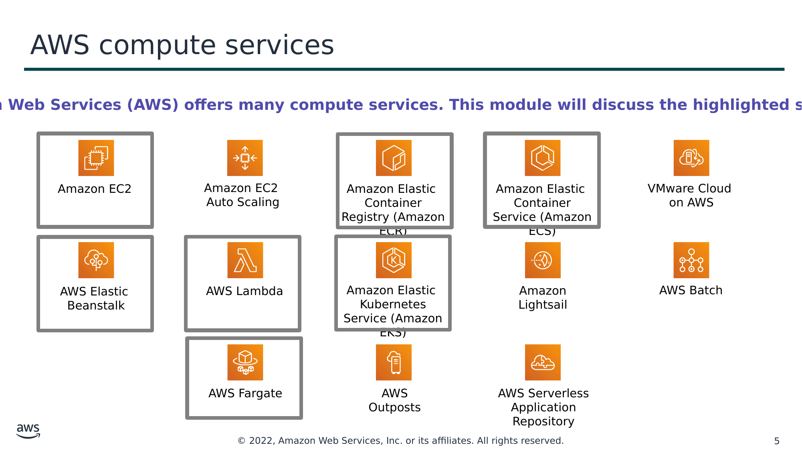

**Amazon Web Services (AWS) offers many compute services. This module will discuss the highlighted services.**

<details>
<summary>Текст зі схеми</summary>

Amazon EC2

Amazon EC2  
Auto Scaling

Amazon Elastic  
Container Registry (Amazon ECR)

Amazon Elastic  
Container Service (Amazon ECS)

VMware Cloud  
on AWS

AWS Elastic  
Beanstalk

AWS Lambda

Amazon Elastic  
Kubernetes Service (Amazon EKS)

Amazon Lightsail

AWS Batch

AWS Fargate

AWS Outposts

AWS Serverless Application Repository

</details>

> **Нотатки:**
>
> Amazon Web Services (AWS) offers many compute services. Here is a brief summary of what each compute service offers:  
> Amazon Elastic Compute Cloud (Amazon EC2) provides resizable virtual machines.  
> Amazon EC2 Auto Scaling supports application availability by allowing you to define conditions that will automatically launch or terminate EC2 instances.  
> Amazon Elastic Container Registry (Amazon ECR) is used to store and retrieve Docker images.  
> Amazon Elastic Container Service (Amazon ECS) is a container orchestration service that supports Docker.  
> VMware Cloud on AWS enables you to provision a hybrid cloud without custom hardware.  
> AWS Elastic Beanstalk provides a simple way to run and manage web applications.  
> AWS Lambda is a serverless compute solution. You pay only for the compute time that you use.  
> Amazon Elastic Kubernetes Service (Amazon EKS) enables you to run managed Kubernetes on AWS.  
> Amazon Lightsail provides a simple-to-use service for building an application or website.  
> AWS Batch provides a tool for running batch jobs at any scale.  
> AWS Fargate provides a way to run containers that reduce the need for you to manage servers or clusters.  
> AWS Outposts provides a way to run select AWS services in your on-premises data center.  
> AWS Serverless Application Repository provides a way to discover, deploy, and publish serverless applications.  
>
> This module will discuss details of the services that are highlighted on the slide.

---

## Слайд 6: Categorizing compute services

| Services | Key Concepts | Characteristics | Ease of Use |
|---|---|---|---|
| Amazon EC2 | • Infrastructure as a service (IaaS)<br>• Instance-based<br>• Virtual machines | Provision virtual machines that you can manage as you choose | A familiar concept to many IT professionals. |
| AWS Lambda | • Serverless computing<br>• Function-based<br>• Low-cost | • Write and deploy code that runs on a schedule or that can be triggered by events<br>• Use when possible (architect for the cloud) | A relatively new concept for many IT staff members, but easy to use after you learn how. |
| • Amazon ECS<br>• Amazon EKS<br>• AWS Fargate<br>• Amazon ECR | • Container-based computing<br>• Instance-based | Spin up and run jobs more quickly | AWS Fargate reduces administrative overhead, but you can use options that give you more control. |
| AWS Elastic Beanstalk | • Platform as a service (PaaS)<br>• For web applications | • Focus on your code (building your application)<br>• Can easily tie into other services—databases, Domain Name System (DNS), etc. | Fast and easy to get started. |

> **Нотатки:**
>
> You can think of each AWS compute service as belonging to one of four broad categories: virtual machines (VMs) that provide infrastructure as a service (IaaS), serverless, container-based, and platform as a service (PaaS).  
>
> Amazon EC2 provides virtual machines, and you can think of it as infrastructure as a service (IaaS). IaaS services provide flexibility and leave many of the server management responsibilities to you. You choose the operating system, and you also choose the size and resource capabilities of the servers that you launch. For IT professionals who have experience using on-premises computing, virtual machines are a familiar concept. Amazon EC2 was one of the first AWS services, and it remains one of the most popular services.  
>
> AWS Lambda is a zero-administration compute platform. AWS Lambda enables you to run code without provisioning or managing servers. You pay only for the compute time that is consumed. This serverless technology concept is relatively new to many IT professionals. However, it is becoming more popular because it supports cloud-native architectures, which enable massive scalability at a lower cost than running servers 24/7 to support the same workloads.  
>
> Container-based services—including Amazon Elastic Container Service, Amazon Elastic Kubernetes Service, AWS Fargate, and Amazon Elastic Container Registry—enable you to run multiple workloads on a single operating system (OS). Containers spin up more quickly than virtual machines, thus offering responsiveness. Container-based solutions continue to grow in popularity.  
>
> Finally, AWS Elastic Beanstalk provides a platform as a service (PaaS). It facilitates the quick deployment of applications that you create by providing all the application services that you need. AWS manages the OS, the application server, and the other infrastructure components so that you can focus on developing your application code.

---

## Слайд 7: Choosing the optimal compute service

- The optimal compute service or services that you use will depend on your use case
- Some aspects to consider –
  - What is your application design?
  - What are your usage patterns?
  - Which configuration settings will you want to manage?
- Selecting the wrong compute solution for an architecture can lead to lower performance efficiency
  - A good starting place—Understand the available compute options

> **Нотатки:**
>
> AWS offers many compute services because different use cases benefit from different compute environments. The optimal compute service or services that you use will depend on your use case.  
>
> Often, the compute architecture that you use is determined by legacy code. However, that does not mean that you cannot evolve the architecture to take advantage of proven cloud-native designs.  
>
> Best practices include:  
> Evaluate the available compute options  
> Understand the available compute configuration options  
> Collect computer-related metrics  
> Use the available elasticity of resources  
> Re-evaluate compute needs based on metrics  
>
> Sometimes, a customer will start with one compute solution and decide to change the design based on their analysis of metrics. If you are interested in seeing an example of how a customer modified their choice of compute services for a particular use case, view this Inventory Tracking solution video at https://www.youtube.com/watch?v=zr3Kib0i-OQ&feature=youtu.be&did=ta_card&trk=ta_card.

---

## Слайд 8: Section 2: Amazon EC2

Module 6: Compute

> **Нотатки:**
>
> Introducing Section 2: Amazon EC2.

---

## Слайд 9: Amazon Elastic Compute Cloud (Amazon EC2)

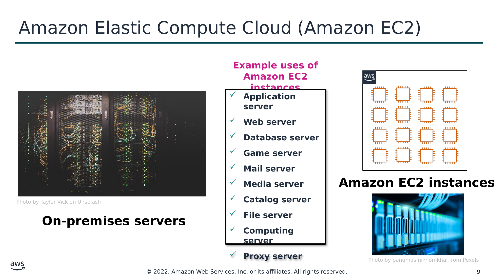

**Example uses of Amazon EC2 instances**

- **Application server**
- **Web server**
- **Database server**
- **Game server**
- **Mail server**
- **Media server**
- **Catalog server**
- **File server**
- **Computing server**
- **Proxy server**

**Amazon EC2 instances**

Photo by Taylor Vick on Unsplash

**On-premises servers**

Photo by panumas nikhomkhai from Pexels

> **Нотатки:**
>
> Running servers on-premises is an expensive undertaking. Hardware must be procured, and this procurement can be based on project plans instead of the reality of how the servers are used. Data centers are expensive to build, staff, and maintain. Organizations also need to permanently provision a sufficient amount of hardware to handle traffic spikes and peak workloads. After traditional on-premises deployments are built, server capacity might be unused and idle for a significant portion of the time that the servers are running, which is wasteful.  
>
> Amazon Elastic Compute Cloud (Amazon EC2) provides virtual machines where you can host the same kinds of applications that you might run on a traditional on-premises server. It provides secure, resizable compute capacity in the cloud. EC2 instances can support a variety of workloads. Common uses for EC2 instances include, but are not limited to:  
> Application servers  
> Web servers  
> Database servers  
> Game servers  
> Mail servers  
> Media servers  
> Catalog servers  
> File servers  
> Computing servers  
> Proxy servers

---

## Слайд 10: Amazon EC2 overview

- **Amazon Elastic Compute Cloud (Amazon EC2)**
  - Provides virtual machines—referred to as EC2 instances—in the cloud.
  - Gives you *full control* over the guest operating system (Windows or Linux) on each instance.
- You can launch instances of any size into an Availability Zone anywhere in the world.
  - Launch instances from **Amazon Machine Images (AMIs)**.
  - Launch instances with a few clicks or a line of code, and they are ready in minutes.
- You can control traffic to and from instances.

Amazon EC2

> **Нотатки:**
>
> The EC2 in Amazon EC2 stands for Elastic Compute Cloud:  
> Elastic refers to the fact that you can easily increase or decrease the number of servers you run to support an application automatically, and you can also increase or decrease the size of existing servers.  
> Compute refers to reason why most users run servers in the first place, which is to host running applications or process data—actions that require compute resources, including processing power (CPU) and memory (RAM).  
> Cloud refers to the fact that the EC2 instances that you run are hosted in the cloud.  
>
> Amazon EC2 provides virtual machines in the cloud and gives you full administrative control over the Windows or Linux operating system that runs on the instance. Most server operating systems are supported, including: Windows 2008, 2012, 2016, and 2019, Red Hat, SuSE, Ubuntu, and Amazon Linux.  
>
> An operating system that runs on a virtual machine is often called a guest operating system to distinguish it from the host operating system. The host operating system is directly installed on any server hardware that hosts one or more virtual machines.  
>
> With Amazon EC2, you can launch any number of instances of any size into any Availability Zone anywhere in the world in a matter of minutes. Instances launch from Amazon Machine Images (AMIs), which are effectively virtual machine templates. AMIs are discussed in more detail later in this module.  
>
> You can control traffic to and from instances by using security groups. Also, because the servers run in the AWS Cloud, you can build solutions that take use multiple AWS services.

---

## Слайд 11: Launching an Amazon EC2 instance

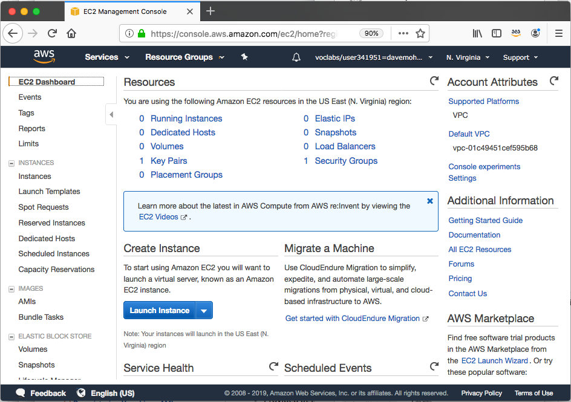

This section of the module walks through **nine key decisions** to make when you create an EC2 instance by using the AWS Management Console **Launch Instance Wizard.**

- Along the way, essential Amazon EC2 concepts will be explored.

> **Нотатки:**
>
> The first time you launch an Amazon EC2 instance, you will likely use the AWS Management Console Launch Instance Wizard. You will have the opportunity to experience using the Launch Wizard in the lab that is in this module.  
>
> The Launch Instance Wizard makes it easy to launch an instance. For example, if you choose to accept all the default settings, you can skip most of the steps that are provided by the wizard and launch an EC2 instance in as few as six clicks. An example of this process is shown in the demonstration at the end of this section.  
>
> However, for most deployments you will want to modify the default settings so that the servers you launch are deployed in a way that matches your specific needs.  
>
> The next series of slides introduce you to the essential choices that you must make when you launch an instance. The slides cover essential concepts that are good to know when you make these choices. These concepts are described to help you understand the options that are available, and the effects of the decisions that you will make.

---

## Слайд 12: 1. Select an AMI

**Choices made using the**  
**Launch Instance Wizard:**

1. **AMI**
2. **Instance Type**
3. **Network settings**
4. **IAM role**
5. **User data**
6. **Storage options**
7. **Tags**
8. **Security group**
9. **Key pair**

Launch

instance

AMI

Instance

- Amazon Machine Image (AMI)
  - Is a template that is used to create an EC2 instance (which is a **virtual machine, or VM,** that runs in the AWS Cloud)
  - Contains a **Windows** or **Linux** operating system
  - Often also has some **software** pre-installed
- AMI choices:
  - Quick Start *– Linux and Windows AMIs that are provided by AWS*
  - My AMIs *– Any AMIs that you created*
  - AWS Marketplace *– Pre-configured templates from third parties*
  - Community AMIs *– AMIs shared by others; use at your own risk*

> **Нотатки:**
>
> An Amazon Machine Image (AMI) provides information that is required to launch an EC2 instance. You must specify a source AMI when you launch an instance. You can use different AMIs to launch different types of instances. For example, you can choose one AMI to launch an instance that will become a web server and another AMI to deploy an instance that will host an application server. You can also launch multiple instances from a single AMI.  
>
> An AMI includes the following components:  
> A template for the root volume of the instance. A root volume typically contains an operating system (OS) and everything that was installed in that OS (applications, libraries, etc.). Amazon EC2 copies the template to the root volume of a new EC2 instance, and then starts it.  
> Launch permissions that control which AWS accounts can use the AMI.  
> A block device mapping that specifies the volumes to attach to the instance (if any) when it is launched.  
>
> You can choose many AMIs:  
> Quick Start – AWS offers a number of pre-built AMIs for launching your instances. These AMIs include many Linux and Windows options.  
> My AMIs – These AMIs are AMIs that you created.  
> AWS Marketplace – The AWS Marketplace offers a digital catalog that lists thousands of software solutions. These AMIs can offer specific use cases to help you get started quickly.  
> Community AMIs – These AMIs are created by people all around the world. These AMIs are not checked by AWS, so use them at your own risk. Community AMIs can offer many different solutions to various problems, but use them with care. Avoid using them in any production or corporate environment.

---

## Слайд 13: Creating a new AMI: Example

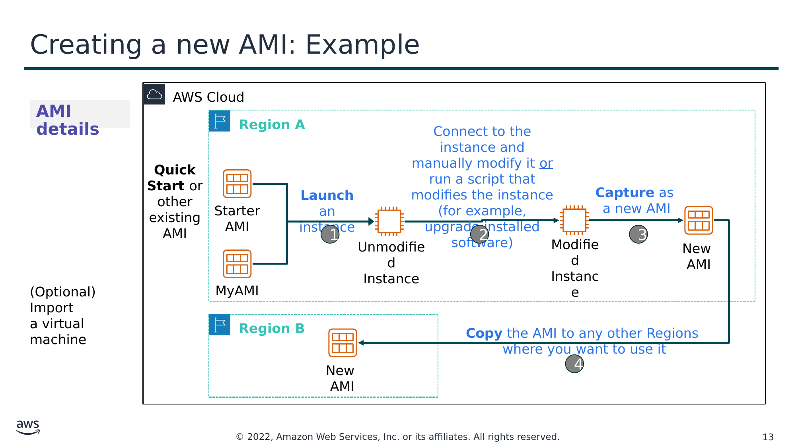

<details>
<summary>Текст зі схеми</summary>

AWS Cloud

**AMI details**

**Region A**

Connect to the instance and manually modify it or run a script that modifies the instance (for example, upgrade installed software)

**Quick Start** or other

existing AMI

**Launch** an instance

**Capture** as  
a new AMI

Starter  
AMI

1

Unmodified

Instance

2

Modified

Instance

3

New  
AMI

(Optional) Import

a virtual machine

MyAMI

**Region B**

**Copy** the AMI to any other Regions  
where you want to use it

New  
AMI

4

</details>

> **Нотатки:**
>
> An AMI is created from an EC2 instance. You can import a virtual machine so that it becomes an EC2 instance, and then save the EC2 instance as an AMI. You can then launch an EC2 instance from that AMI. Alternatively, you can start with an existing AMI—such as of the Quick Start AMIs provided by AWS—and create an EC2 instance from it.  
>
> Regardless of which options you chose (step 1), you will have what the diagram refers to as an unmodified instance. From that instance, you might then create a golden instance—that is, a virtual machine that you configured with the specific OS and application settings that you want (step 2)—and then capture that as a new AMI (step 3). When you create an AMI, Amazon EC2 stops the instance, creates a snapshot of its root volume, and finally registers the snapshot as an AMI.  
>
> After an AMI is registered, the AMI can be used to launch new instances in the same AWS Region. The new AMI can now be thought of as a new starter AMI. You might want to also copy the AMI to other Regions (step 4), so that EC2 instances can also be launched in those locations.

---

## Слайд 14: 2. Select an instance type

- Consider your use case
  - How will the EC2 instance you create be used?
- The **instance type** that you choose determines –
  - Memory (RAM)
  - Processing power (CPU)
  - Disk space and disk type (Storage)
  - Network performance
- Instance type categories –
  - General purpose
  - Compute optimized
  - Memory optimized
  - Storage optimized
  - Accelerated computing
- Instance types offer *family*, *generation*, and *size*

**Choices made using the**  
**Launch Instance Wizard:**

1. **AMI**
2. **Instance Type**
3. **Network settings**
4. **IAM role**
5. **User data**
6. **Storage options**
7. **Tags**
8. **Security group**
9. **Key pair**

> **Нотатки:**
>
> After you choose the AMI for launching the instance, you must choose on an instance type.  
>
> Amazon EC2 provides a selection of instance types that optimized to fit different use cases. Instance types comprise varying combinations of CPU, memory, storage, and networking capacity. The different instance types give you the flexibility to choose the appropriate mix of resources for your applications. Each instance type includes one or more instance sizes, which enable you to scale your resources to the requirements of your target workload.  
>
> Instance type categories include general purpose, compute optimized, memory optimized, storage optimized, and accelerated computing instances. Each instance type category offers many instance types to choose from.

---

## Слайд 15: EC2 instance type naming and sizes

**Example instance sizes**

Instance type naming

- Example: **t3.large**
  - T is the family name
  - 3 is the generation number
  - Large is the size

| Instance Name | vCPU | Memory (GB) | Storage |
|---|---|---|---|
| t3.nano | 2 | 0.5 | EBS-Only |
| t3.micro | 2 | 1 | EBS-Only |
| t3.small | 2 | 2 | EBS-Only |
| t3.medium | 2 | 4 | EBS-Only |
| t3.large | 2 | 8 | EBS-Only |
| t3.xlarge | 4 | 16 | EBS-Only |
| t3.2xlarge | 8 | 32 | EBS-Only |

> **Нотатки:**
>
> When you look at an EC2 instance type, you will see that its name has several parts. For example, consider the T type.  
>
> T is the family name, which is then followed by a number. Here, that number is 3.  
>
> The number is the generation number of that type. So, a t3 instance is the third generation of the T family. In general, instance types that are of a higher generation are more powerful and provide a better value for the price.  
>
> The next part of the name is the size portion of the instance. When you compare sizes, it is important to look at the coefficient portion of the size category.  
>
> For example, a t3.2xlarge has twice the vCPU and memory of a t3.xlarge. The t3.xlarge has, in turn, twice the vCPU and memory of a t3.large.  
>
> It is also important to note that network bandwidth is also tied to the size of the Amazon EC2 instance. If you will run jobs that will be very network-intensive, you might be required to increase the instance specifications to meet your needs.

---

## Слайд 16: Select instance type: Based on use case

|  | General Purpose | Compute Optimized | Memory Optimized | Accelerated Computing | Storage Optimized |
|---|---|---|---|---|---|
| Instance Types | a1, m4, m5, t2, t3 | c4, c5 | r4, r5, x1, z1 | f1, g3, g4,  p2, p3 | d2, h1, i3 |
| Use Case | Broad | High performance | In-memory databases | Machine learning | Distributed file systems |

> **Нотатки:**
>
> Instance types vary in several ways, including: CPU type, CPU or core count, storage type, storage amount, memory amount, and network performance. The chart provides a high-level view of the different instance categories, and which instance type families and generation numbers fit into each category type. Consider a few of the instance types in more detail:  
> T3 instances provide burstable performance general purpose instances that provide a baseline level of CPU performance with the ability to burst above the baseline. Use cases for this type of instance include websites and web applications, development environments, build servers, code repositories, microservices, test and staging environments, and line-of-business applications.  
> C5 instances are optimized for compute-intensive workloads, and deliver cost-effective high performance at a low price per compute ratio. Use cases include scientific modeling, batch processing, ad serving, highly scalable multiplayer gaming, and video encoding.  
> R5 instances are optimized for memory-intensive applications. Use cases include high-performance databases, data mining and analysis, in-memory databases, distributed web-scale in-memory caches, applications that perform real-time processing of unstructured big data, Apache Hadoop or Apache Spark clusters, and other enterprise applications.  
>
> To learn more about each instance type, see the Amazon EC2 Instance Types documentation at https://aws.amazon.com/ec2/instance-types/.

---

## Слайд 17: Instance types: Networking features

- The network bandwidth (Gbps) varies by instance type.
  - See [Amazon EC2 Instance Types](https://aws.amazon.com/ec2/instance-types/) to compare.
- To maximize networking and bandwidth performance of your instance type:
  - If you have interdependent instances, launch them into a **cluster placement group**.
  - Enable enhanced networking.
- Enhanced networking types are supported on most instance types.
  - See the [Networking and Storage Features](https://docs.aws.amazon.com/AWSEC2/latest/UserGuide/instance-types.html#instance-networking-storage) documentation for details.
- Enhanced networking types –
  - **Elastic Network Adapter (ENA):** Supports network speeds of up to 100 Gbps.
  - **Intel 82599 Virtual Function interface:** Supports network speeds of up to 10 Gbps.

> **Нотатки:**
>
> In addition to considering the CPU, RAM, and storage needs of your workloads, it is also important to consider your network bandwidth requirements.  
>
> Each instance type provides a documented network performance level. For example, an a1.medium instance will provide up to 10 Gbps, but a p3dn.24xlarge instance provides up to 100 Gbps. Choose an instance type that meets your requirements.  
>
> When you launch multiple new EC2 instances, Amazon EC2 attempts to place the instances so that they are spread out across the underlying hardware by default. It does this to minimize correlated failures. However, if you want to specify specific placement criteria, you can use placement groups to influence the placement of a group of interdependent instances to meet the needs of your workload. For example, you might specify that three instances should all be deployed in the same Availability Zone to ensure lower network latency and higher network throughput between instances. See the Placement Group documentation at https://docs.aws.amazon.com/AWSEC2/latest/UserGuide/placement-groups.html for details.  
>
> Many instance types also enable you to configure enhanced networking to get significantly higher packet per second (PPS) performance, lower delay variation in the arrival of packets over the network (network jitter), and lower latencies. See the Elastic Network Adapter (ENA) documentation at https://docs.aws.amazon.com/AWSEC2/latest/UserGuide/enhanced-networking-ena.htmlfor details.

---

## Слайд 18: 3. Specify network settings

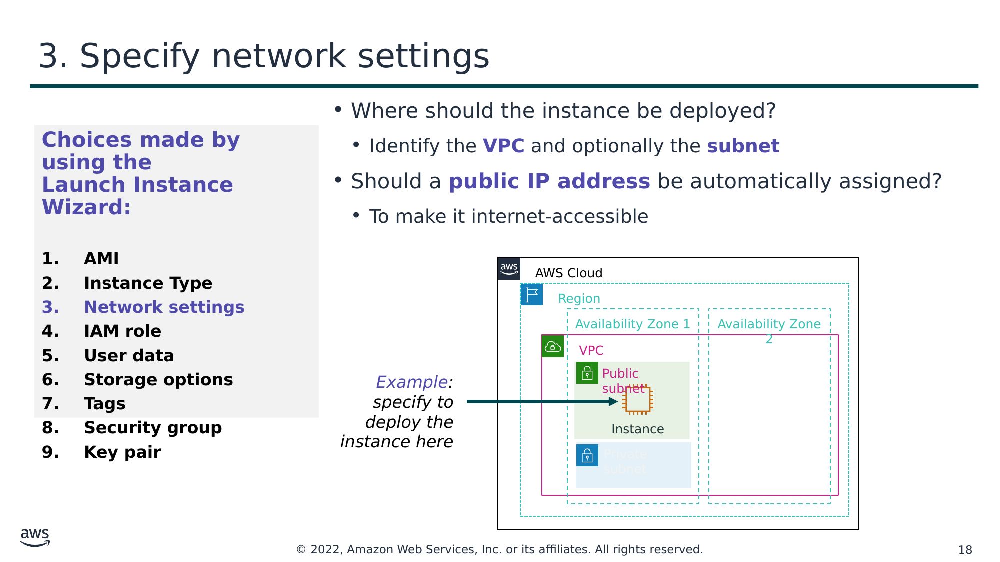

- Where should the instance be deployed?
  - Identify the **VPC** and optionally the **subnet**
- Should a **public IP address** be automatically assigned?
  - To make it internet-accessible

**Choices made by using the**  
**Launch Instance Wizard:**

1. **AMI**
2. **Instance Type**
3. **Network settings**
4. **IAM role**
5. **User data**
6. **Storage options**
7. **Tags**
8. **Security group**
9. **Key pair**

<details>
<summary>Текст зі схеми</summary>

AWS Cloud

Region

Availability Zone 1

Availability Zone 2

VPC

Public subnet

Instance

Private subnet

*Example**: specify to deploy the instance here*

</details>

> **Нотатки:**
>
> After you have choose an AMI and an instance type, you must specify the network location where the EC2 instance will be deployed. The choice of Region must be made before you start the Launch Instance Wizard. Verify that you are in the correct Region page of the Amazon EC2 console before you choose Launch Instance.  
>
> When you launch an instance in a default VPC, AWS will assign it a public IP address by default. When you launch an instance into a nondefault VPC, the subnet has an attribute that determines whether instances launched into that subnet receive a public IP address from the public IPv4 address pool. By default, AWS will not assign a public IP address to instances that are launched in a nondefault subnet. You can control whether your instance receives a public IP address by either modifying the public IP addressing attribute of your subnet, or by enabling or disabling the public IP addressing feature during launch (which overrides the subnet's public IP addressing attribute).

---

## Слайд 19: 4. Attach IAM role (optional)

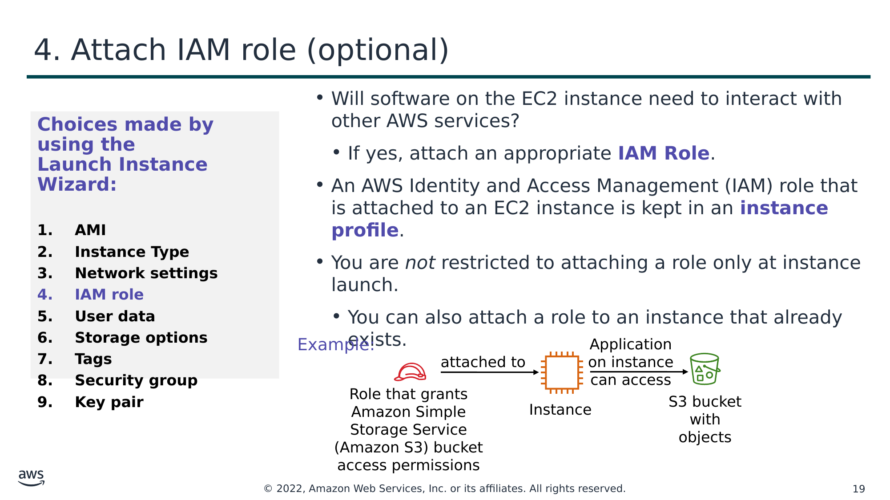

- Will software on the EC2 instance need to interact with other AWS services?
  - If yes, attach an appropriate **IAM Role**.
- An AWS Identity and Access Management (IAM) role that is attached to an EC2 instance is kept in an **instance profile**.
- You are *not* restricted to attaching a role only at instance launch.
  - You can also attach a role to an instance that already exists.

**Choices made by using the**  
**Launch Instance Wizard:**

1. **AMI**
2. **Instance Type**
3. **Network settings**
4. **IAM role**
5. **User data**
6. **Storage options**
7. **Tags**
8. **Security group**
9. **Key pair**

Example:

<details>
<summary>Текст зі схеми</summary>

Application on instance can access

attached to

Role that grants Amazon Simple Storage Service (Amazon S3) bucket access permissions

S3 bucket with objects

Instance

</details>

> **Нотатки:**
>
> It is common to use EC2 instances to run an application that must make secure API calls to other AWS services. To support these use cases, AWS enables you to attach an AWS Identity and Access Management (IAM) role to an EC2 instance. Without this feature, you might be tempted to place AWS credentials on an EC2 instance so an application that runs on that instance to use. However, you should never store AWS credentials on an EC2 instance. It is highly insecure. Instead, attach an IAM role to the EC2 instance. The IAM role then grants permission to make application programming interface (API) requests to the applications that run on the EC2 instance.  
>
> An instance profile is a container for an IAM role. If you use the AWS Management Console to create a role for Amazon EC2, the console automatically creates an instance profile and gives it the same name as the role. When you then use the Amazon EC2 console to launch an instance with an IAM role, you can select a role to associate with the instance. In the console, the list that displays is actually a list of instance profile names.  
>
> In the example, you see that an IAM role is used to grant permissions to an application that runs on an EC2 instance. The application must access a bucket in Amazon S3.  
>
> You can attach an IAM role when you launch the instance, but you can also attach a role to an already running EC2 instance. When you define a role that can be used by an EC2 instance, you define which accounts or AWS services can assume the role. You also define which API actions and resources the application can use after it assumes the role. If you change a role, the change is propagated to all instances that have the role attached to them.

---

## Слайд 20: 5. User data script (optional)

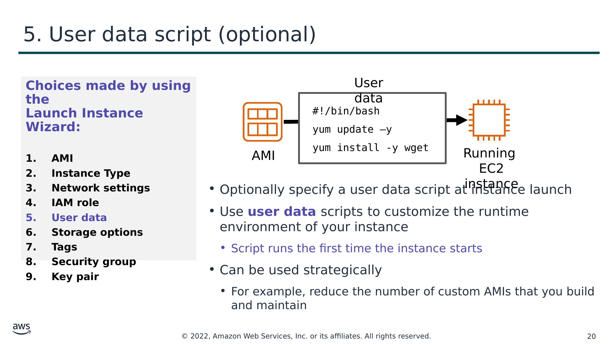

**Choices made by using the**  
**Launch Instance Wizard:**

1. **AMI**
2. **Instance Type**
3. **Network settings**
4. **IAM role**
5. **User data**
6. **Storage options**
7. **Tags**
8. **Security group**
9. **Key pair**

- Optionally specify a user data script at instance launch
- Use **user data** scripts to customize the runtime environment of your instance
  - Script runs the first time the instance starts
- Can be used strategically
  - For example, reduce the number of custom AMIs that you build and maintain

<details>
<summary>Текст зі схеми</summary>

User data

```
#!/bin/bash
yum update –y
yum install -y wget
```

AMI

Running  
EC2 instance

</details>

> **Нотатки:**
>
> When you create your EC2 instances, you have the option of passing user data to the instance. User data can automate the completion of installations and configurations at instance launch. For example, a user data script might patch and update the instance's operating system, fetch and install software license keys, or install additional software.  
>
> In the example user data script, you see a simple three-line Linux Bash shell script. The first line indicates that the script should be run by the Bash shell. The second line invokes the Yellowdog Updater, Modified (YUM) utility, which is commonly used in many Linux distributions—such as Amazon Linux, CentOS, and Red Hat Linux—to retrieve software from an online repository and install it. In line two of the example, that command tells YUM to update all installed packages to the latest versions that are known to the software repository that it is configured to access. Line three of the script indicates that the Wget utility should be installed. Wget is a common utility for downloading files from the web.  
>
> For a Windows instance, the user data script should be written in a format that is compatible with a Command Prompt window (batch commands) or with Windows PowerShell. See the Windows User Data Scripts documentation for details at https://docs.aws.amazon.com/AWSEC2/latest/WindowsGuide/ec2-windows-user-data.html.  
>
> When the EC2 instance is created, the user data script will run with root privileges during the final phases of the boot process. On Linux instances, it is run by the cloud-init service. On Windows instances, it is run by the EC2Config or EC2Launch utility. By default, user data only runs the first time that the instance starts up. However, if you would like your user data script to run every time the instance is booted, you can create a Multipurpose Internet Mail Extensions (MIME) multipart file user data script (this process is not commonly done). See https://aws.amazon.com/premiumsupport/knowledge-center/execute-user-data-ec2/ for more information.

---

## Слайд 21: 6. Specify storage

- Configure the root volume
  - Where the guest operating system is installed
- Attach additional storage volumes (optional)
  - AMI might already include more than one volume
- For each volume, specify:
  - The **size** of the disk (in GB)
  - The **volume type**
    - Different types of solid state drives (SSDs) and hard disk drives (HDDs) are available
  - If the volume will be deleted when the instance is terminated
  - If **encryption** should be used

**Choices made by using the**  
**Launch Instance Wizard:**

1. **AMI**
2. **Instance Type**
3. **Network settings**
4. **IAM role**
5. **User data**
6. **Storage options**
7. **Tags**
8. **Security group**
9. **Key pair**

> **Нотатки:**
>
> When you launch an EC2 instance, you can configure storage options. For example, you can configure the size of the root volume where the guest operating system is installed. You can also attach additional storage volumes when you launch the instance. Some AMIs are also configured to launch more than one storage volume by default to provide storage that is separate from the root volume.  
>
> For each volume that your instance will have, you can specify the size of the disks, the volume types, and whether the storage will be retained if the instance is terminated. You can also specify if encryption should be used.

---

## Слайд 22: Amazon EC2 storage options

- **Amazon Elastic Block Store (Amazon EBS) –**
  - Durable, block-level storage volumes.
  - You can stop the instance and start it again, and the data will still be there.
- **Amazon EC2 Instance Store –**
  - Ephemeral storage is provided on disks that are attached to the host computer where the EC2 instance is running.
  - If the instance stops, data stored here is deleted.
- Other options for storage (not for the root volume) –
  - Mount an **Amazon Elastic File System (Amazon EFS)** file system.
  - Connect to **Amazon Simple Storage Service (Amazon S3)**.

> **Нотатки:**
>
> Amazon Elastic Block Store (Amazon EBS) is an easy-to-use, high-performance durable block storage service that is designed to be used with Amazon EC2 for both throughput- and transaction-intensive workloads. With Amazon EBS, you can choose from four different volume types to balance the optimal price and performance. You can change volume types or increase volume size without disrupting your critical applications, so you can have cost-effective storage when you need it.  
>
> Amazon EC2 Instance Store provides ephemeral, or temporary, block-level storage for your instance. This storage is located on disks that are physically attached to the host computer. Instance Store works well when you must temporarily store information that changes frequently, such as buffers, caches, scratch data, and other temporary content. You can also use Instance Store for data that is replicated across a fleet of instances, such as a load balanced pool of web servers. If the instances are stopped—either because of user error or a malfunction—the data on the instance store will be deleted.  
>
> Amazon Elastic File System (Amazon EFS) provides a simple, scalable, fully managed elastic Network File System (NFS) file system for use with AWS Cloud services and on-premises resources. It is built to scale on-demand to petabytes without disrupting applications. It grows and shrinks automatically as you add and remove files, which reduces the need to provision and manage capacity to accommodate growth.  
>
> Amazon Simple Storage Service (Amazon S3) is an object storage service that offers scalability, data availability, security, and performance. You can store and protect any amount of data for a variety of use cases, such as websites, mobile apps, backup and restore, archive, enterprise applications, Internet of Things (IoT) devices, and big data analytics.

---

## Слайд 23: Example storage options

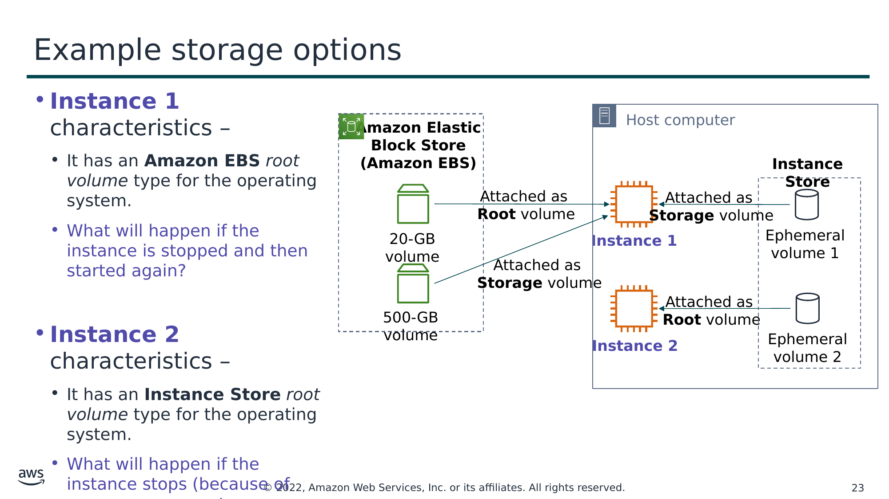

- **Instance 1** characteristics –
  - It has an **Amazon EBS** *root volume* type for the operating system.
  - What will happen if the instance is stopped and then started again?
- **Instance 2** characteristics –
  - It has an **Instance Store** *root volume* type for the operating system.
  - What will happen if the instance stops (because of user error or a system malfunction)?

<details>
<summary>Текст зі схеми</summary>

Host computer

**Amazon Elastic Block Store (Amazon EBS)**

**Instance Store**

Attached as

**Root** volume

Attached as

**Storage** volume

20-GB volume

**Instance 1**

Ephemeral

volume 1

Attached as

**Storage** volume

Attached as

**Root** volume

500-GB volume

**Instance 2**

Ephemeral volume 2

</details>

> **Нотатки:**
>
> Here, you see two examples of how storage options could be configured for EC2 instances.  
>
> The Instance 1 example shows that the root volume—which contains the OS and possibly other data—is stored on Amazon EBS. This instance also has two attached volumes. One volume is a 500-GB Amazon EBS storage volume, and the other volume is an Instance Store volume. If this instance was stopped and then started again, the OS would survive and any data that was stored on either the 20-GB Amazon EBS volume or the 500-GB Amazon EBS volume would remain intact. However, any data that was stored on Ephemeral volume 1 would be permanently lost. Instance Store works well for temporarily storing information that changes frequently, such as buffers, caches, scratch data, and other temporary content.  
>
> The Instance 2 example shows that the root volume is on an instance store (Ephemeral volume 2). An instance with an Instance Store root volume cannot be stopped by an Amazon EC2 API call. It can only be terminated. However, it could be stopped from within the instance's OS (for example, by issuing a shutdown command)—or it could stop because of OS or disk failure—which would cause the instance to be terminated. If the instance was terminated, all the data that was stored on Ephemeral volume 2 would be lost, including the OS. You would not be able to start the instance again. Therefore, do not rely on Instance Store for valuable, long-term data. Instead, use more durable data storage, such as Amazon EBS, Amazon EFS, or Amazon S3.  
>
> If an instance reboots (intentionally or unintentionally), data on the instance store root volume does persist.

---

## Слайд 24: 7. Add tags

- A tag is a label that you can assign to an AWS resource.
  - Consists of a *key* and an optional *value.*
- Tagging is how you can attach **metadata** to an EC2 instance.
- Potential benefits of tagging—Filtering, automation, cost allocation, and access control.

Example:

**Choices made by using the**  
**Launch Instance Wizard:**

1. **AMI**
2. **Instance Type**
3. **Network settings**
4. **IAM role**
5. **User data**
6. **Storage options**
7. **Tags**
8. **Security group**
9. **Key pair**

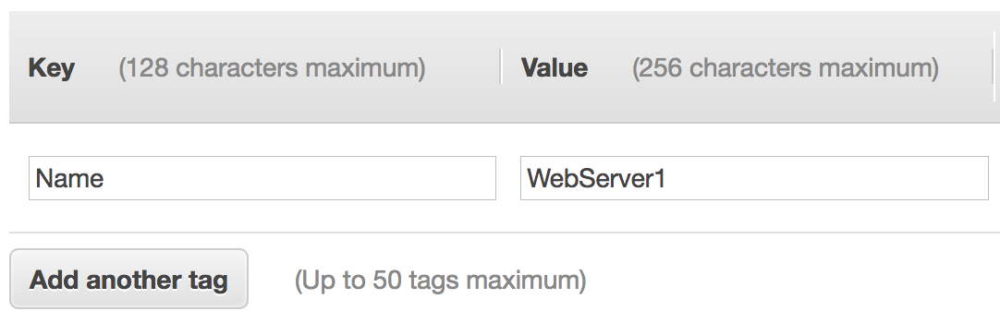

> **Нотатки:**
>
> A tag is a label that you assign to an AWS resource. Each tag consists of a key and an optional value, both of which you define. Tags enable you to categorize AWS resources, such as EC2 instances, in different ways. For example, you might tag instances by purpose, owner, or environment.  
>
> Tagging is how you can attach metadata to an EC2 instance.  
>
> Tag keys and tag values are case-sensitive. For example, a commonly used tag for EC2 instances is a tag key that is called Name and a tag value that describes the instance, such as My Web Server. The Name tag is exposed by default in the Amazon EC2 console Instances page. However, if you create a key that is called name (with lower-case n), it will not appear in the Name column for the list of instances (though it will still appear in the instance details panel in the Tags tab).  
>
> It is a best practice to develop tagging strategies. Using a consistent set of tag keys makes it easier for you to manage your resources. You can also search and filter the resources based on the tags that you add. See https://d1.awsstatic.com/whitepapers/aws-tagging-best-practices.pdf for more information.

---

## Слайд 25: 8. Security group settings

- A security group is a **set of firewall rules** that control traffic to the instance.
  - It exists *outside* of the instance's guest OS.
- Create **rules** that specify the **source** and which **ports** that network communications can use.
  - Specify the **port** number and the **protocol**, such as Transmission Control Protocol (TCP), User Datagram Protocol (UDP), or Internet Control Message Protocol (ICMP).
  - Specify the **source** (for example, an IP address or another security group) that is allowed to use the rule.

Example rule:

**Choices made by using the**  
**Launch Instance Wizard:**

1. **AMI**
2. **Instance Type**
3. **Network settings**
4. **IAM role**
5. **User data**
6. **Storage options**
7. **Tags**
8. **Security group**
9. **Key pair**

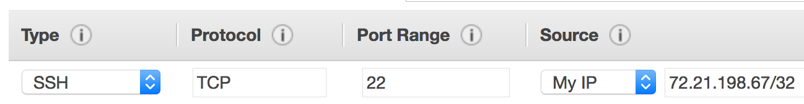

> **Нотатки:**
>
> A security group acts as a virtual firewall that controls network traffic for one or more instances. When you launch an instance, you can specify one or more security groups; otherwise, the default security group is used.  
>
> You can add rules to each security group. Rules allow traffic to or from its associated instances. You can modify the rules for a security group at any time, and the new rules will be automatically applied to all instances that are associated with the security group. When AWS decides whether to allow traffic to reach an instance, all the rules from all the security groups that are associated with the instance are evaluated. When you launch an instance in a virtual private cloud (VPC), you must either create a new security group or use one that already exists in that VPC. After you launch an instance, you can change its security groups.  
>
> When you define a rule, you can specify the allowable source of the network communication (inbound rules) or destination (outbound rules). The source can be an IP address, an IP address range, another security group, a gateway VPC endpoint, or anywhere (which means that all sources will be allowed). By default, a security group includes an outbound rule that allows all outbound traffic. You can remove the rule and add outbound rules that only allow specific outbound traffic. If your security group has no outbound rules, no outbound traffic that originates from your instance is allowed.  
>
> In the example rule, the rule allows Secure Shell (SSH) traffic over Transmission Control Protocol (TCP) port 22 if the source of the request is My IP. The My IP IP address is calculated by determining what IP address you are currently connected to the AWS Cloud from when you define the rule.  
>
> Network access control lists (network ACLs) can also be used are firewalls to protect subnets in a VPC.  
>
> For accessibility: Screenshot of the EC2 console screen where you can define a security group rule. It shows a rule with type SSH, protocol TCP, port range 22, source My IP, and a CIDR block that shows an example My IP address. End of accessibility description.

---

## Слайд 26: 9. Identify or create the key pair

- At instance launch, you specify an existing key pair *or* create a new key pair.
- A key pair consists of –
  - A **public key** that AWS stores.
  - A **private key** file that you store.
- It enables secure connections to the instance.
- For **Windows AMIs –**
  - Use the private key to obtain the administrator password that you need to log in to your instance.
- For **Linux AMIs –**
  - Use the private key to use SSH to securely connect to your instance.

**Choices made by using the**  
**Launch Instance Wizard:**

1. **AMI**
2. **Instance Type**
3. **Network settings**
4. **IAM role**
5. **User data**
6. **Storage options**
7. **Tags**
8. **Security group**
9. **Key pair**

mykey.pem

> **Нотатки:**
>
> After you specify all the required configurations to launch an EC2 instance, and after you customize any optional EC2 launch wizard configuration settings, you are presented with a Review Instance Launch window. If you then choose Launch, a dialog asks you to choose an existing key pair, proceed without a key pair, or create a new key pair before you can choose Launch Instances and create the EC2 instance.  
>
> Amazon EC2 uses public–key cryptography to encrypt and decrypt login information. The technology uses a public key to encrypt a piece of data, and then the recipient uses the private key to decrypt the data. The public and private keys are known as a key pair. Public-key cryptography enables you to securely access your instances by using a private key instead of a password.  
>
> When you launch an instance, you specify a key pair. You can specify an existing key pair or a new key pair that you create at launch. If you create a new key pair, download it and save it in a safe location. This opportunity is the only chance you get to save the private key file.  
>
> To connect to a Windows instance, use the private key to obtain the administrator password, and then log in to the EC2 instance's Windows Desktop by using Remote Desktop Protocol (RDP). To establish an SSH connection from a Windows machine to an Amazon EC2 instance, you can use a tool such as PuTTY, which will require the same private key.  
>
> With Linux instances, at boot time, the public key content is placed on the instance. An entry is created in within ~/.ssh/authorized_keys. To log in to your Linux instance (for example, by using SSH), you must provide the private key when you establish the connection.

---

## Слайд 27: Amazon EC2 console view of a running EC2 instance

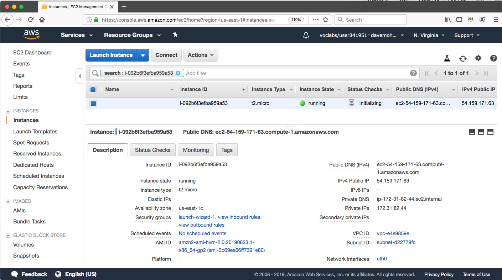

> **Нотатки:**
>
> After you choose Launch Instances and then choose View Instances, you will be presented with a screen that looks similar to the example.  
>
> Many of the settings that you specified during launch are visible in the Description panel.  
>
> Information about the available instance includes IP address and DNS address information, the instance type, the unique instance ID that was assigned to the instance, the AMI ID of the AMI that you used to launch the instance, the VPC ID, the subnet ID, and more.  
>
> Many of these details provide hyperlinks that you can choose to learn more information about the resources that are relevant to the EC2 instance you launched.

---

## Слайд 28: Another option: Launch an EC2 instance with the AWS Command Line Interface

- EC2 instances can also be created programmatically.
- This example shows how simple the command can be.
  - This command assumes that the key pair and security group already exist.
  - More options could be specified. See the [AWS CLI Command Reference](https://docs.aws.amazon.com/cli/latest/reference/ec2/run-instances.html) for details.

AWS Command Line Interface (AWS CLI)

**Example command:**

```
aws ec2 run-instances \
--image-id ami-1a2b3c4d \
--count 1 \
--instance-type c3.large \
--key-name MyKeyPair \
--security-groups MySecurityGroup \
--region us-east-1
```

> **Нотатки:**
>
> You can also launch EC2 instances programmatically, either by using the AWS Command Line Interface (AWS CLI) or one of the AWS software development kits (SDKs).  
>
> In the example AWS CLI command, you see a single command that specifies the minimal information that is needed to launch an instance. The command includes the following information:  
> aws – Specifies an invocation of the aws command line utility.  
> ec2 – Specifies an invocation of the ec2 service command.  
> run-instances – Is the subcommand that is being invoked.  
>
> The rest of the command specifies several parameters, including:  
> image-id – This parameter is followed by an AMI ID. All AMIs have a unique AMI ID.  
> count – You can specify more than one.  
> instance-type – You can specify the instance type to create (for example) a c3.large instance  
> key-name – In the example, assume that MyKeyPair already exists.  
> security-groups - In this example, assume that MySecurityGroup already exists.  
> region - AMIs exist in an AWS Region, so you must specify the Region where the AWS CLI will find the AMI and launch the EC2 instance.  
>
> The command should successfully create an EC2 instance if:  
> The command is properly formed  
> The resources that the command needs already exist  
> You have sufficient permissions to run the command  
> You have sufficient capacity in the AWS account  
> If the command is successful, the API responds to the command with the instance ID and other relevant data for your application to use in subsequent API requests.

---

## Слайд 29: Amazon EC2 instance lifecycle

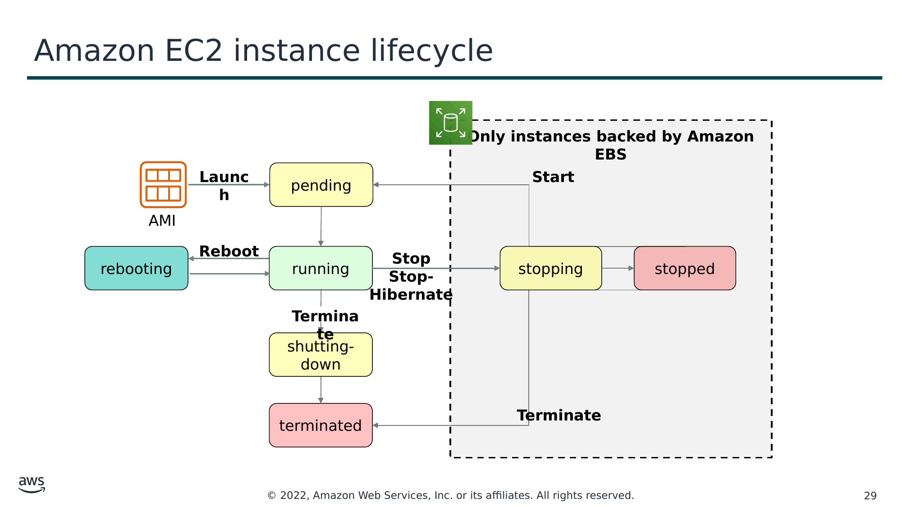

<details>
<summary>Текст зі схеми</summary>

**Start**

**Only instances backed by Amazon EBS**

**Launch**

pending

**Terminate**

AMI

shutting-down

rebooting

**Reboot**

running

stopping

stopped

terminated

**Stop**

**Stop-Hibernate**

**Terminate**

</details>

> **Нотатки:**
>
> Here, you see the lifecycle of an instance. The arrows show actions that you can take and the boxes show the state the instance will enter after that action. An instance can be in one of the following states:  
> Pending – When an instance is first launched from an AMI, or when you start a stopped instance, it enters the pending state when the instance is booted and deployed to a host computer. The instance type that you specified at launch determines the hardware of the host computer for your instance.  
> Running – When the instance is fully booted and ready, it exits the pending state and enters the running state. You can connect over the internet to your running instance.  
> Rebooting – AWS recommends you reboot an instance by using the Amazon EC2 console, AWS CLI, or AWS SDKs instead of invoking a reboot from within the guest operating system (OS). A rebooted instance stays on the same physical host, maintains the same public DNS name and public IP address, and if it has instance store volumes, it retains the data on those volumes.  
> Shutting down – This state is an intermediary state between running and terminated.  
> Terminated – A terminated instance remains visible in the Amazon EC2 console for a while before the virtual machine is deleted. However, you can’t connect to or recover a terminated instance.  
> Stopping – Instances that are backed by Amazon EBS can be stopped. They enter the stopping state before they attain the fully stopped state.  
> Stopped – A stopped instance will not incur the same cost as a running instance. Starting a stopped instance puts it back into the pending state, which moves the instance to a new host machine.

---

## Слайд 30: Instance hibernation option

<!-- hidden slide -->

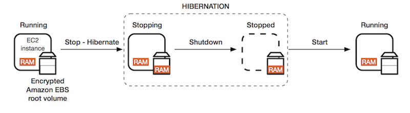

- Benefits
  - It saves the contents from the instance memory (RAM).
  - On instance restart, RAM contents are reloaded, previously running processes are resumed.
  - You can save on cost in a hibernated state versus a running state (costs are similar to a stopped instance).
- Prerequisites
  - Only certain Linux AMIs (such as Amazon Linux 2) and only certain instance families support it.
  - Instance must have an encrypted Amazon EBS root volume and a maximum of150 GB RAM.
  - Hibernation must be enabled at instance launch.

> **Нотатки:**
>
> Some instances that are backed by Amazon EBS support hibernation. When you hibernate an instance, the guest OS saves the contents from the instance memory (RAM) to your Amazon EBS root volume. When you restart the instance, the root volume is restored to its previous state, the RAM contents are reloaded, and the processes that were previously running on the instance are resumed.  
>
> Only certain Linux AMIs that are backed by Amazon EBS and other certain instance types support hibernation. Hibernation also requires that you encrypt the root EBS volume. In addition, you must enable hibernation when the instance is first launched. You cannot enable hibernation on an existing instance that did not originally have hibernation enabled.  
>
> For further details about prerequisites and cost, see https://docs.aws.amazon.com/AWSEC2/latest/UserGuide/Hibernate.html.

---

## Слайд 31: Consider using an Elastic IP address

- **Rebooting** an instance will *not* change any IP addresses or DNS hostnames.
- When an instance is **stopped** and then **started** again –
  - The *public* IPv4 address and *external* DNS hostname will change.
  - The *private* IPv4 address and internal DNS hostname do *not* change.

- If you require a persistent public IP address –
  - Associate an **Elastic IP address** with the instance.
- Elastic IP address characteristics –
  - Can be associated with instances in the Region as needed.
  - Remains allocated to your account until you choose to release it.

Elastic IP Address

> **Нотатки:**
>
> A public IP address is an IPv4 address that is reachable from the internet. Each instance that receives a public IP address is also given an external DNS hostname. For example, if the public IP address assigned to the instance is 203.0.113.25, then the external DNS hostname might be ec2-203-0-113-25.compute-1.amazonaws.com.  
>
> If you specify that a public IP address should be assigned to your instance, it is assigned from the AWS pool of public IPv4 addresses. The public IP address is not associated with your AWS account. When a public IP address is disassociated from your instance, it is released back into the public IPv4 address pool, and you will not be able to specify that you want to reuse it. AWS releases your instance's public IP address when the instance is stopped or terminated. Your stopped instance receives a new public IP address when it is restarted.  
>
> If you require a persistent public IP address, you might want to associate an Elastic IP address with the instance. To associate an Elastic IP address, you must first allocate a new Elastic IP address in the Region where the instance exists. After the Elastic IP address is allocated, you can associate the Elastic IP address with an EC2 instance.  
>
> By default, all AWS accounts are limited to five (5) Elastic IP addresses per Region because public (IPv4) internet addresses are a scarce public resource. However, this is a soft limit, and you can request a limit increase (which might be approved).

---

## Слайд 32: EC2 instance metadata

- **Instance metadata** is data about your instance.
- While you are connected to the instance, you can view it –
  - In a browser: `http://169.254.169.254/latest/meta-data/`
  - In a terminal window: `curl http://169.254.169.254/latest/meta-data/`
- Example retrievable values –
  - Public IP address, private IP address, public hostname, instance ID, security groups, Region, Availability Zone.
  - Any user data specified at instance launch can also be accessed at: `http://169.254.169.254/latest/user-data/`
- It can be used to configure or manage a running instance.
  - For example, author a configuration script that reads the metadata and uses it to configure applications or OS settings.

> **Нотатки:**
>
> Instance metadata is data about your instance. You can view it while you are connected to the instance. To access it in a browser, go to the following URL: http://169.254.169.254/latest/meta-data/. The data can also be read programmatically, such as from a terminal window that has the cURL utility. In the terminal window, run curl http://169.254.169.254/latest/meta-data/ to retrieve it. The IP address 169.254.169.254 is a link-local address and it is valid only from the instance.  
> Instance metadata provides much of the same information about the running instance that you can find in the AWS Management Console. For example, you can discover the public IP address, private IP address, public hostname, instance ID, security groups, Region, Availability Zone, and more.  
> Any user data that is specified at instance launch can also be accessed at the following URL: http://169.254.169.254/latest/user-data.  
> EC2 instance metadata can be used to configure or manage a running instance. For example, you can author a configuration script that accesses the metadata information and uses it to configure applications or OS settings.

---

## Слайд 33: Amazon CloudWatch for monitoring

- Use **Amazon CloudWatch** to monitor EC2 instances
  - Provides near-real-time metrics
  - Provides charts in the Amazon EC2 console **Monitoring** tab that you can view
  - Maintains 15 months of historical data
- **Basic monitoring**
  - Default, no additional cost
  - Metric data sent to CloudWatch every 5 minutes
- **Detailed monitoring**
  - Fixed monthly rate for seven pre-selected metrics
  - Metric data delivered every 1 minute

Amazon CloudWatch

Instance with CloudWatch

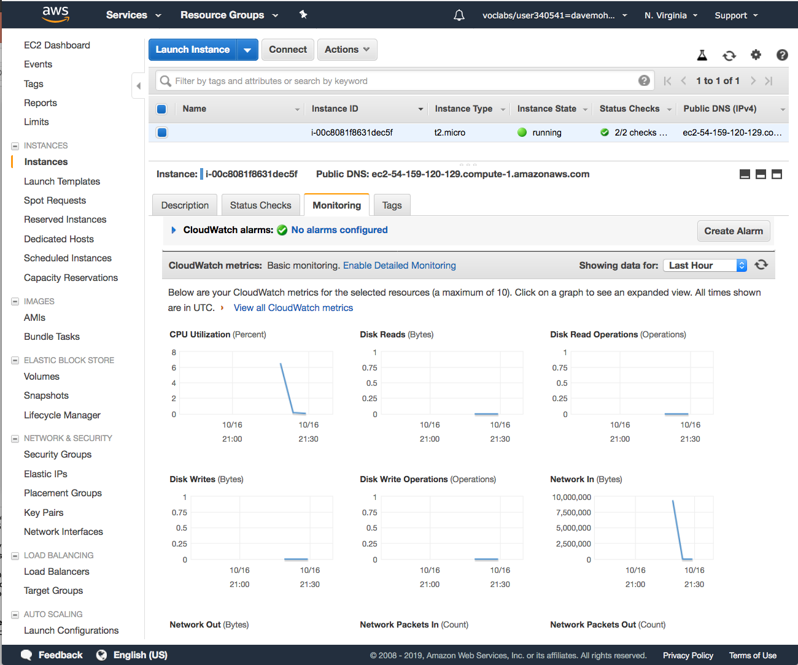

> **Нотатки:**
>
> You can monitor your instances by using Amazon CloudWatch, which collects and processes raw data from Amazon EC2 into readable, near-real-time metrics. These statistics are recorded for a period of 15 months, so you can access historical information and gain a better perspective on how your web application or service is performing.  
>
> By default, Amazon EC2 provides basic monitoring, which sends metric data to CloudWatch in 5-minute periods. To send metric data for your instance to CloudWatch in 1-minute periods, you can enable detailed monitoring on the instance. For more information, see Enable or Disable Detailed Monitoring for Your Instances at https://docs.aws.amazon.com/AWSEC2/latest/UserGuide/using-cloudwatch-new.html.  
>
> The Amazon EC2 console displays a series of graphs based on the raw data from Amazon CloudWatch. Depending on your needs, you might prefer to get data for your instances from Amazon CloudWatch instead of through the graphs in the console. By default, Amazon CloudWatch does not provide RAM metrics for EC2 instances, though that is an option that you can configure if you want to CloudWatch to collect that data.

---

## Слайд 34: Section 2 key takeaways

- **Amazon EC2** enables you to run Windows and Linux **virtual machines** in the cloud.
- You launch **EC2 instances** from an **AMI** template into a VPC in your account.
- You can choose from many **instance types**. Each instance type offers different combinations of CPU, RAM, storage, and networking capabilities.
- You can configure **security groups** to control access to instances (specify allowed ports and source).
- **User data** enables you to specify a script to run the first time that an instance launches.
- Only **instances that are backed by Amazon EBS can be stopped.**
- You can use **Amazon CloudWatch** to capture and review metrics on EC2 instances.

> **Нотатки:**
>
> Some key takeaways from this section of the module include:  
> Amazon EC2 enables you to run Windows and Linux virtual machines in the cloud.  
> You launch EC2 instances from an AMI template into a VPC in your account.  
> You can choose from many instance types. Each instance type offers different combinations of CPU, RAM, storage, and networking capabilities.  
> You can configure security groups to control access to instances (specify allowed ports and source).  
> User data enables you to specify a script to run the first time that an instance launches.  
> Only instances that are backed by Amazon EBS can be stopped.  
> You can use Amazon CloudWatch to capture and review metrics on EC2 instances.

---

## Слайд 35: Recorded Amazon EC2 demonstration

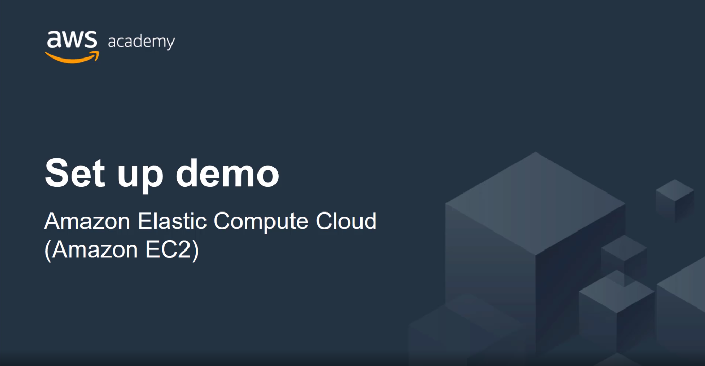

> **Нотатки:**
>
> Now, take a moment to watch the EC2 Demo at https://aws-tc-largeobjects.s3-us-west-2.amazonaws.com/ILT-TF-100-ACFNDS-20-EN/Module_6_EC2+v2.0.mp4. The recording runs just over 3 minutes and reinforces some of the concepts that were discussed in this section of the module.  
>
> The demonstration shows:  
> How to use the AWS Management Console to launch an Amazon EC2 instance (with all the default instance settings accepted).  
> How to connect to the Windows instance by using a Remote Desktop client and the key pair that was identified during instance launch to decrypt the Windows password for login.  
> How to terminate the instance after it is no longer needed.

---

## Слайд 36: Lab 3: Introduction to Amazon EC2


> **Нотатки:**
>
> Introducing Lab 3: Introduction to Amazon EC2. This lab provides hands-on practice with launching, resizing, managing, and monitoring an Amazon EC2 instance.

---

## Слайд 37: Lab 3 scenario

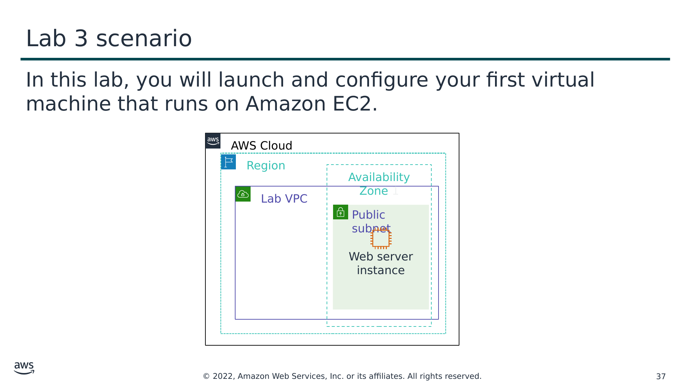

In this lab, you will launch and configure your first virtual machine that runs on Amazon EC2.

<details>
<summary>Текст зі схеми</summary>

AWS Cloud

Region

Availability Zone 1

Lab VPC

Public subnet

Web server  
instance

</details>

> **Нотатки:**
>
> Introducing Lab 3: Introduction to Amazon EC2.  
>
> In this lab, you will launch and configure a virtual machine that runs on Amazon EC2.

---

## Слайд 38: Lab 3: Tasks

- Task 1 – Launch Your Amazon EC2 Instance
- Task 2 – Monitor Your Instance
- Task 3 – Update Your Security Group and Access the Web Server
- Task 4 – Resize Your Instance: Instance Type and EBS Volume
- Task 5 – Explore EC2 Limits
- Task 6 – Test Termination Protection

> **Нотатки:**
>
> In this hands-on lab, you will:  
> Launch Your Amazon EC2 Instance  
> Monitor Your Instance  
> Update Your Security Group and Access the Web Server  
> Resize Your Instance: Instance Type and EBS Volume  
> Explore EC2 Limits  
> Test Termination Protection

---

## Слайд 39: Lab 3: Final product

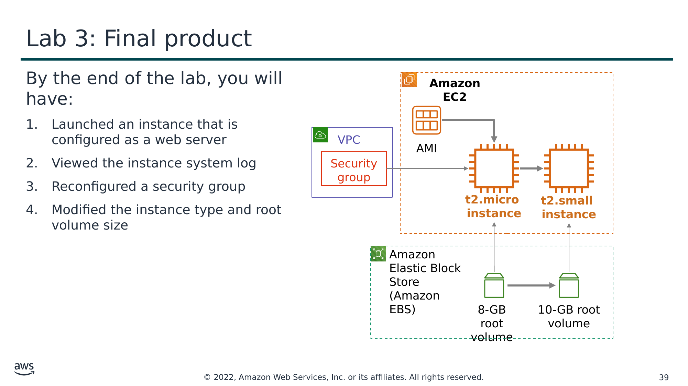

By the end of the lab, you will have:

1. Launched an instance that is configured as a web server
2. Viewed the instance system log
3. Reconfigured a security group
4. Modified the instance type and root volume size

<details>
<summary>Текст зі схеми</summary>

**Amazon EC2**

VPC

Security group

AMI

**t2.micro**

**instance**

**t2.small**

**instance**

Amazon Elastic Block Store (Amazon EBS)

8-GB root volume

10-GB root volume

</details>

> **Нотатки:**
>
> By the end of the lab, you will have:  
> Launched an instance that is configured as a web server  
> Viewed the instance system log  
> Reconfigured a security group  
> Modified the instance type and root volume size

---

## Слайд 40: Begin Lab 3: Introduction to Amazon EC2

~ 35 minutes

> **Нотатки:**
>
> It is now time to start the lab.

---

## Слайд 41: Lab debrief: Key takeaways


> **Нотатки:**
>
> The instructor will lead a conversation about the key takeaways from the lab after you have completed it.

---

## Слайд 42: Activity: Amazon EC2


Photo by Pixabay from Pexels.

> **Нотатки:**
>
> In this educator-led activity, you will discuss the advantages and disadvantages of using Amazon EC2 versus using a managed service like Amazon Relational Database Service (Amazon RDS).

---

## Слайд 43: Activity: Gather information

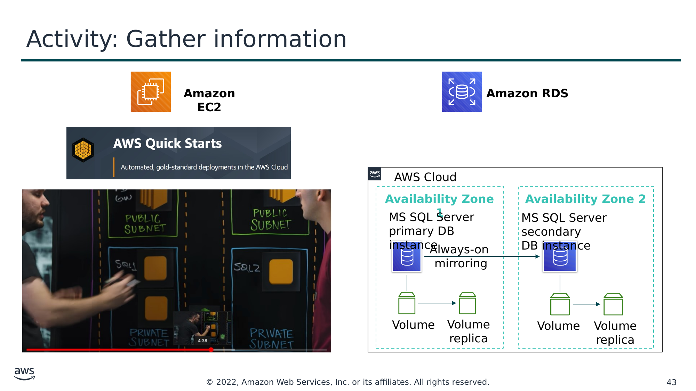

**Amazon EC2**

**Amazon RDS**

<details>
<summary>Текст зі схеми</summary>

AWS Cloud

**Availability Zone 1**

**Availability Zone 2**

MS SQL Server primary DB instance

MS SQL Server secondary

DB instance

Always-on

mirroring

Volume

Volume

replica

Volume

Volume replica

</details>

> **Нотатки:**
>
> The objective of this activity is to demonstrate that you understand the differences between building a deployment that uses Amazon EC2 and using a fully managed service, such as Amazon RDS, to deploy your solution. At the end of this activity, you should be prepared to discuss the advantages and disadvantages of deploying Microsoft SQL Server on Amazon EC2 versus deploying it on Amazon RDS.  
>
> The educator will ask you to:  
> 1. Watch an 8-minute video at https://www.youtube.com/watch?v=UYy-UeQ29jo&did=ta_card&trk=ta_card that explains the benefits of deploying Microsoft SQL Server on Amazon EC2 by using the AWS Quick Start – SQL Server Reference Architecture: https://aws.amazon.com/quickstart/architecture/sql/ deployment. You are encouraged to take notes.  
> 2. Read a blog post at https://aws.amazon.com/blogs/publicsector/the-scoop-on-moving-your-microsoft-sql-server-to-aws/about the benefits of running Microsoft SQL Server on Amazon RDS. You are again encouraged to take notes.  
> 3. Participate in the class conversation about the questions posed on the next slide.

---

## Слайд 44: Activity: Check your understanding

1. Between Amazon EC2 or Amazon RDS, which provides a managed service? What does *managed service* mean?
   - **ANSWER:** Amazon RDS provides a managed service. Amazon RDS handles provisioning, installation and patching, automated backups, restoring snapshots from points in time, high availability, and monitoring.
2. Name at least one advantage of deploying Microsoft SQL Server on Amazon EC2 instead of Amazon RDS.
   - **ANSWER:** Amazon EC2 offers complete control over every configuration, the OS, and the software stack.
3. What advantage does the Quick Start provide over a manual installation on Amazon EC2?
   - **ANSWER:** The Quick Start is a reference architecture with proven best practices built into the design.
4. Which deployment option offers the best approach for all use cases?
   - **ANSWER:** Neither. The correct deployment option depends on your specific needs.
5. Which approach costs more: using Amazon EC2 or using Amazon RDS?
   - **ANSWER:** It depends. Managing the database deployment on Amazon EC2 requires more customer oversight and time. If time is your priority, then Amazon RDS might be less expensive. If you have in-house expertise, Amazon EC2 might be more cost-effective.

> **Нотатки:**
>
> The educator will lead the class in a conversation as each question is revealed. Then, the educator will display the written suggested responses and you can discuss these points further.  
>
> Regarding question 5, the answer was based on the information that is listed on the AWS Pricing pages as of October, 2019.  
> For Amazon RDS, you pay $0.977 per hour if you run Microsoft SQL Server based on these parameters:  
> Instance – Standard (Single-AZ) instance  
> Instance size – db.m5.large  
> Region – US East (Ohio)  
> Pricing – On-Demand Instance  
> For Amazon EC2, you pay $0.668 per hour if you run Microsoft SQL Server based on these parameters:  
> Instance – Windows instance  
> Instance size – m5.large  
> Region – US East (Ohio)  
> Pricing – On-Demand Instance  
>
> As you consider cost, do not forget to include the cost of labor. For example, keep in mind that with a standard Single-AZ Amazon RDS deployment—which is the basis of the example price reference—automated backups are provided.  With Amazon RDS, if a DB instance component failed and a user-initiated restore operation is required, you would have a restorable backup that you could use. If you run the database on Amazon EC2, you could configure an equally robust backup procedure for Microsoft SQL Server. However, it would take time, knowledge, and technical skill to build the solution. You would also need to pre-configure the solution before you encounter the situation where you need it. For these reasons, when you consider the needs of your deployments holistically, you might find that using Amazon RDS is less expensive than using Amazon EC2. However, if you have skilled database administrators on staff—and you also have very specific deployment requirements that make it preferable for you to have total control over all aspects of the deployment—you could use Amazon EC2. In this case, you might find Amazon EC2 to be the more cost-effective solution.

---

## Слайд 45: Section 3: Amazon EC2 cost optimization

Module 6: Compute

> **Нотатки:**
>
> Introducing Section 3: Amazon EC2 cost optimization.

---

## Слайд 46: Amazon EC2 pricing models

**On-Demand Instances**

- Pay by the hour
- No long-term commitments.
- Eligible for the [AWS Free Tier](https://aws.amazon.com/free/).

**Dedicated Hosts**

- A physical server with EC2 instance capacity fully dedicated to your use.

**Dedicated Instances**

- Instances that run in a VPC on hardware that is dedicated to a single customer.

**Reserved Instances**

- Full, partial, or no upfront payment for instance you reserve.
- Discount on hourly charge for that instance.
- 1-year or 3-year term.

**Scheduled Reserved Instances**

- Purchase a capacity reservation that is always available on a recurring schedule you specify.
- 1-year term.

**Spot Instances**

- Instances run as long as they are available and your bid is above the Spot Instance price.
- They can be interrupted by AWS with a 2-minute notification.
- Interruption options include terminated, stopped or hibernated.
- Prices can be significantly less expensive compared to On-Demand Instances
- Good choice when you have flexibility in when your applications can run.

**Per second billing** available for On-Demand Instances, Reserved Instances, and

Spot Instances that run Amazon Linux or Ubuntu.

> **Нотатки:**
>
> Amazon offers different pricing models to choose from when you want to run EC2 instances.  
> Per second billing is only available for On-Demand Instances, Reserved Instances, and Spot Instances that run Amazon Linux or Ubuntu.  
> On-Demand Instances are eligible for the AWS Free Tier (https://aws.amazon.com/free/). They have the lowest upfront cost and the most flexibility. There are no upfront commitments or long-term contracts. It is a good choice for applications with short-term, spiky, or unpredictable workloads.  
> Dedicated Hosts are physical servers with instance capacity that is dedicated to your use. They enable you to use your existing per-socket, per-core, or per-VM software licenses, such as for Microsoft Windows or Microsoft SQL Server.  
> Dedicated Instances are instances that run in a virtual private cloud (VPC) on hardware that’s dedicated to a single customer. They are physically isolated at the host hardware level from instances that belong to other AWS accounts.  
> Reserved Instance enable you to reserve computing capacity for 1-year or 3-year term with lower hourly running costs. The discounted usage price is fixed for as long as you own the Reserved Instance. If you expect consistent, heavy use, they can provide substantial savings compared to On-Demand Instances.  
> Scheduled Reserved Instances enable you to purchase capacity reservations that recur on a daily, weekly, or monthly basis, with a specified duration, for a 1-year term. You pay for the time that the instances are scheduled, even if you do not use them.  
> Spot Instances enable you to bid on unused EC2 instances, which can lower your costs. The hourly price for a Spot Instance fluctuates depending on supply and demand. Your Spot Instance runs whenever your bid exceeds the current market price.

---

## Слайд 47: Amazon EC2 pricing models: Benefits

| On-Demand Instances | Spot Instances | Reserved Instances | Dedicated Hosts |
|---|---|---|---|
| Low cost and flexibility | Large scale, dynamic workload | Predictability ensures compute capacity is available when needed | • Save money on licensing costs<br>• Help meet compliance and regulatory requirements |

> **Нотатки:**
>
> Each Amazon EC2 pricing model provides a different set of benefits.  
>
> On-Demand Instances offer the most flexibility, with no long-term contract and low rates.  
>
> Spot Instances provide large scale at a significantly discounted price.  
>
> Reserved Instances are a good choice if you have predictable or steady-state compute needs (for example, an instance that you know you want to keep running most or all of the time for months or years).  
>
> Dedicated Hosts are a good choice when you have licensing restrictions for the software you want to run on Amazon EC2, or when you have specific compliance or regulatory requirements that preclude you from using the other deployment options.

---

## Слайд 48: Amazon EC2 pricing models: Use cases

**Spiky Workloads**

**Time-Insensitive Workloads**

**Steady-State Workloads**

**Highly Sensitive Workloads**

| On-Demand Instances | Spot Instances | Reserved Instances | Dedicated Hosts |
|---|---|---|---|
| • Short-term, spiky, or unpredictable workloads<br>• Application development or testing | • Applications with flexible start and end times<br>• Applications only feasible at very low compute prices<br>• Users with urgent computing needs for large amounts of additional capacity | • Steady state or predictable usage workloads<br>• Applications that require reserved capacity, including disaster recovery<br>• Users able to make upfront payments to reduce total computing costs even further | • Bring your own license (BYOL)<br>• Compliance and regulatory restrictions<br>• Usage and licensing tracking<br>• Control instance placement |

> **Нотатки:**
>
> Here is a review of some use cases for the various pricing options.  
>
> On-Demand Instance pricing works well for spiky workloads or if you only need to test or run an application for a short time (for example, during application development or testing). Sometimes, your workloads are unpredictable, and On-Demand Instances are a good choice for these cases.  
>
> Spot Instances are a good choice if your applications can tolerate interruption with a 2-minute warning notification. By default, instances are terminated, but you can configure them to stop or hibernate instead. Common use cases include fault-tolerant applications such as web servers, API backends, and big data processing. Workloads that constantly save data to persistent storage (such as Amazon S3) are also good candidates.  
>
> Reserved Instances are a good choice when you have long-term workloads with predictable usage patterns, such as servers that you know you will want to run in a consistent way over many months.  
>
> Dedicated Hosts are a good choice when you have existing per-socket, per-core, or per-VM software licenses, or when you must address specific corporate compliance and regulatory requirements.

---

## Слайд 49: The four pillars of cost optimization

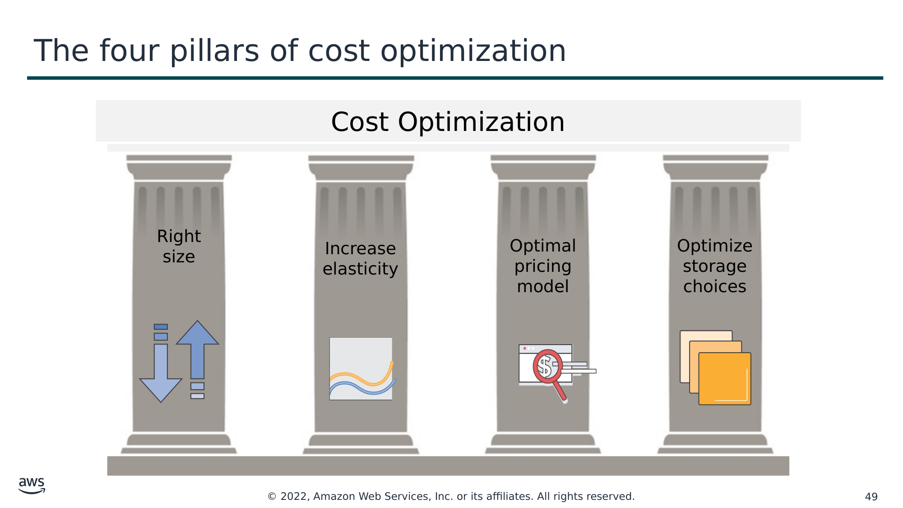

<details>
<summary>Текст зі схеми</summary>

Cost Optimization

Right size

Increase elasticity

Optimal pricing model

Optimize storage choices

</details>

> **Нотатки:**
>
> To optimize costs, you must consider four consistent, powerful drivers:  
> Right-size – Choose the right balance of instance types. Notice when servers can be either sized down or turned off, and still meet your performance requirements.  
> Increase elasticity – Design your deployments to reduce the amount of server capacity that is idle by implementing deployments that are elastic, such as deployments that use automatic scaling to handle peak loads.  
> Optimal pricing model – Recognize the available pricing options. Analyze your usage patterns so that you can run EC2 instances with the right mix of pricing options.  
> Optimize storage choices – Analyze the storage requirements of your deployments. Reduce unused storage overhead when possible, and choose less expensive storage options if they can still meet your requirements for storage performance.

---

## Слайд 50: Pillar 1: Right size

- Provision instances to match the need
  - CPU, memory, storage, and network throughput
  - Select appropriate instance types for your use
- Use Amazon CloudWatch metrics
  - How idle are instances? When?
  - Downsize instances
- Best practice: Right size, then reserve

**Pillars:**

1. Right size
2. Increase elasticity
3. Optimal pricing model
4. Optimize storage choices

> **Нотатки:**
>
> First, consider right-sizing. AWS offers approximately 60 instance types and sizes. The wide choice of options enables customers to select the instance that best fits their workload. It can be difficult to know where to start and what instance choice will prove to be the best, from both a technical perspective and a cost perspective. Right-sizing is the process of reviewing deployed resources and looking for opportunities to downsize when possible.  
>
> To right-size:  
> Select the cheapest instance available that still meets your performance requirements.  
> Review CPU, RAM, storage, and network utilization to identify instances that could be downsized. You might want to provision a variety of instance types and sizes in a test environment, and then test your application on those different test deployments to identify which instances offer the best performance-to-cost ratio. For right-sizing, use techniques such as load testing to your advantage.  
> Use Amazon CloudWatch metrics and set up custom metrics. A metric represents a time-ordered set of values that are published to CloudWatch (for example, the CPU usage of a particular EC2 instance). Data points can come from any application or business activity for which you collect data.

---

## Слайд 51: Pillar 2: Increase elasticity

- **Stop** or **hibernate** Amazon EBS-backed instances that are not actively in use
  - Example: non-production development or test instances
- Use **automatic scaling** to match needs based on usage
  - Automated and time-based elasticity

**Pillars:**

1. Right-Size
2. Increase Elasticity
3. Optimal pricing model
4. Optimize storage choices

> **Нотатки:**
>
> One form of elasticity is to create, start, or use EC2 instances when they are needed, but then to turn them off when they are not in use. Elasticity is one of the central tenets of the cloud, but customers often go through a learning process to operationalize elasticity to drive cost savings.  
>
> The easiest way for large customers to embrace elasticity is to look for resources that look like good candidates for stopping or hibernating, such as non-production environments, development workloads, or test workloads. For example, if you run development or test workloads in a single time zone, you can easily turn off those instances outside of business hours and thus reduce runtime costs by perhaps 65 percent. The concept is similar to why there is a light switch next to the door, and why most offices encourage employees to turn off the lights on their way out of the office each night.  
>
> For production workloads, configuring more precise and granular automatic scaling policies can help you take advantage of horizontal scaling to meet peak capacity needs and to not pay for peak capacity all the time.  
>
> As a rule of thumb, you should target 20–30 percent of your Amazon EC2 instances to run as On-Demand Instances or Spot Instances, and you should also actively look for ways to maximize elasticity.

---

## Слайд 52: Pillar 3: Optimal pricing model

- Leverage the right pricing model for your use case
  - Consider your usage patterns
- Optimize and *combine* purchase types
- Examples:
  - Use **On-Demand Instance** and **Spot Instances** for variable workloads
  - Use **Reserved Instances** for predictable workloads
- Consider serverless solutions (AWS Lambda)

**Pillars:**

1. Right-Size
2. Increase Elasticity
3. Optimal pricing model
4. Optimize storage choices


> **Нотатки:**
>
> AWS provides a number of pricing models for Amazon EC2 to help customers save money. The models available were discussed in detail earlier in this module. Customers can combine multiple purchase types to optimize pricing based on their current and forecast capacity needs.  
>
> Customers are also encouraged to consider their application architecture. For example, does the functionality provided by your application need to run on an EC2 virtual machine? Perhaps by making use of the AWS Lambda service instead, you could significantly decrease your costs.  
>
> AWS Lambda is discussed later in this module.

---

## Слайд 53: Pillar 4: Optimize storage choices

- Reduce costs while maintaining storage performance and availability
- Resize EBS volumes
- Change EBS volume types
  - Can you meet performance requirements with less expensive storage?
  - Example: **Amazon EBS Throughput Optimized HDD (st1)** storage typically costs half as much as the default **General Purpose SSD (gp2)** storage option.
- Delete EBS snapshots that are no longer needed
- Identify the most appropriate destination for specific types of data
  - Does the application need the instance to reside on Amazon EBS?
  - Amazon S3 storage options with lifecycle policies can reduce costs

**Pillars:**

1. Right-Size
2. Increase Elasticity
3. Optimal pricing model
4. Optimize storage choices

> **Нотатки:**
>
> Customers can also reduce storage costs. When you launch EC2 instances, different instance types offer different storage options. It is a best practice to try to reduce costs while also maintaining storage performance and availability.  
>
> One way you can accomplish this is by resizing EBS volumes. For example, if you originally provisioned a 500-GB volume for an EC2 instance that will only need a maximum of 20 GB of storage space, you can reduce the size of the volume and save on costs.  
>
> There are also a variety of EBS volume types. Choose the least expensive type that still meets your performance requirements. For example, Amazon EBS Throughput Optimized HDD (st1) storage typically costs half as much as the default General Purpose SSD (gp2) storage option. If an st1 drive will meet the needs of your workload, take advantage of the cost savings.  
>
> Customers often use EBS snapshots to create data backups. However, some customers forget to delete snapshots that are no longer needed. Delete these unneeded snapshots to save on costs.  
>
> Finally, try to identify the most appropriate destination for specific types of data. Does your application need the data it uses to reside on Amazon EBS? Would the application run equally as well if it used Amazon S3 for storage instead? Configuring data lifecycle policies can also reduce costs. For example, you might automate the migration of older infrequently accessed data to cheaper storage locations, such as Amazon Simple Storage Service Glacier.

---

## Слайд 54: Measure, monitor, and improve

- Cost optimization is an ongoing process.
- Recommendations –
  - Define and enforce **cost allocation tagging**.
  - Define metrics, set targets, and review regularly.
  - Encourage teams to **architect for cost**.
  - Assign the responsibility of optimization to an individual or to a team.

> **Нотатки:**
>
> If it is done correctly, cost optimization is not a one-time process that a customer completes. Instead, by routinely measuring and analyzing your systems, you can continually improve and adjust your costs.  
>
> Tagging helps provide information about what resources are being used by whom and for what purpose. You can activate cost allocation tags in the Billing and Cost Management console, and AWS can generate a cost allocation report with usage and costs grouped by your active tags. Apply tags that represent business categories (such as cost centers, application names, or owners) to organize your costs across multiple services.  
>
> Encourage teams to architect for cost. AWS Cost Explorer is a free tool that you can use to view graphs of your costs. You can use Cost Explorer to see patterns in how much you spend on AWS resources over time, identify areas that need further inquiry, and see trends that you can use to understand your costs.  
>
> Use AWS services such as AWS Trusted Advisor, which provides real-time guidance to help you provision resources that follow AWS best practices.  
>
> Cost-optimization efforts are typically more successful when the responsibility for cost optimization is assigned to an individual or to a team.

---

## Слайд 55: Section 3 key takeaways

- **Amazon EC2 pricing models** include On-Demand Instances, Reserved Instances, Spot Instances, Dedicated Instances, and Dedicated Hosts.
- **Spot Instances** can be interrupted with a 2-minute notification. However, they can offer significant cost savings over On-Demand Instances.
- The **four pillars of cost optimization** are:
  - Right size
  - Increase elasticity
  - Optimal pricing model
  - Optimize storage choices

> **Нотатки:**
>
> Some key takeaways from this section of the module are:  
> Amazon EC2 pricing models include On-Demand Instances, Reserved Instances, Spot Instances, Dedicated Instances, and Dedicated Hosts. Per second billing is available for On-Demand Instances, Reserved Instances, and Spot Instances that use only Amazon Linux and Ubuntu.  
> Spot Instances can be interrupted with a 2-minute notification. However, they can offer significant cost savings over On-Demand Instances.  
> The four pillars of cost optimization are –  
> Right size  
> Increase elasticity  
> Optimal pricing model  
> Optimize storage choices

---

## Слайд 56: Section 4: Container services

Module 6: Compute

> **Нотатки:**
>
> Introducing Section 4: Container services.

---

## Слайд 57: Container basics

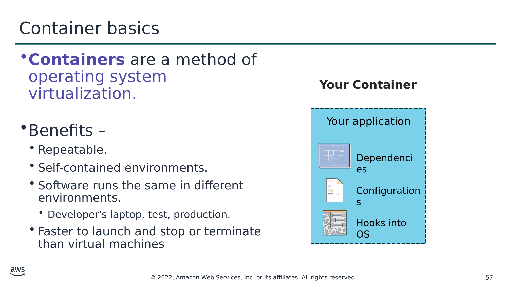

- **Containers** are a method of operating system virtualization.
- Benefits –
  - Repeatable.
  - Self-contained environments.
  - Software runs the same in different environments.
    - Developer's laptop, test, production.
  - Faster to launch and stop or terminate than virtual machines

<details>
<summary>Текст зі схеми</summary>

**Your Container**

Your application

Dependencies

Configurations

Hooks into OS

</details>

> **Нотатки:**
>
> Containers are a method of operating system virtualization that enables you to run an application and its dependencies in resource-isolated processes. By using containers, you can easily package an application's code, configurations, and dependencies into easy-to-use building blocks that deliver environmental consistency, operational efficiency, developer productivity, and version control.  
>
> Containers are smaller than virtual machines, and do not contain an entire operating system. Instead, containers share a virtualized operating system and run as resource-isolated processes, which ensure quick, reliable, and consistent deployments. Containers hold everything that the software needs to run, such as libraries, system tools, code, and the runtime.  
>
> Containers deliver environmental consistency because the application’s code, configurations, and dependencies are packaged into a single object.  
>
> In terms of space, container images are usually an order of magnitude smaller than virtual machines. Spinning up a container happens in hundreds of milliseconds. Thus, by using containers, you can use a fast, portable, and infrastructure-agnostic environments.  
>
> Containers can help ensure that applications deploy quickly, reliably, and consistently, regardless of deployment environment. Containers also give you more granular control over resources, which gives your infrastructure improved efficiency.

---

## Слайд 58: What is Docker?

- **Docker** is a software platform that enables you to build, test, and deploy applications quickly.
- You run containers on Docker.
  - Containers are created from a template called an *image*.
- A **container** has everything a software application needs to run.

Container

> **Нотатки:**
>
> Docker is a software platform that packages software (such as applications) into containers.  
>
> Docker is installed on each server that will host containers, and it provides simple commands that you can use to build, start, or stop containers.  
>
> By using Docker, you can quickly deploy and scale applications into any environment.  
>
> Docker is best used as a solution when you want to:  
> Standardize environments  
> Reduce conflicts between language stacks and versions  
> Use containers as a service  
> Run microservices using standardized code deployments  
> Require portability for data processing

---

## Слайд 59: Containers versus virtual machines

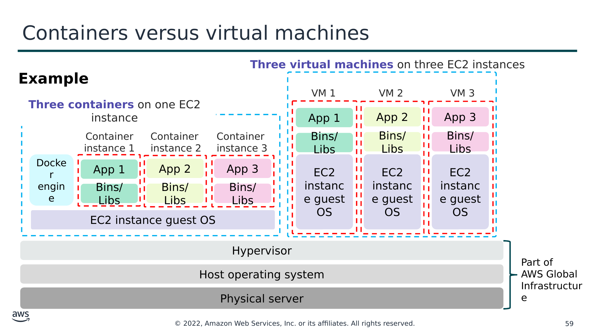

**Three virtual machines** on three EC2 instances

<details>
<summary>Текст зі схеми</summary>

**Example**

VM 1

VM 2

VM 3

**Three containers** on one EC2 instance

Container

App 1

App 2

App 3

Container instance 1

Container  
instance 2

Container  
instance 3

Bins/Libs

Bins/Libs

Bins/Libs

Docker engine

App 1

App 2

App 3

EC2 instance guest OS

EC2 instance guest OS

EC2 instance guest OS

Bins/Libs

Bins/Libs

Bins/Libs

EC2 instance guest OS

Hypervisor

Part of  
AWS Global Infrastructure

Host operating system

Physical server

</details>

> **Нотатки:**
>
> Many people who are first introduced to the concept of a container think that containers are exactly like virtual machines. However, the differences are in the details. One significant difference is that virtual machines run directly on a hypervisor, but containers can run on any Linux OS if they have the appropriate kernel feature support and the Docker daemon is present. This makes containers very portable. Your laptop, your VM, your EC2 instance, and your bare metal server are all potential hosts where you can run a container.  
>
> The right of the diagram has a virtual machine (VM)-based deployment. Each of the three EC2 instances runs directly on the hypervisor that is provided by the AWS Global Infrastructure. Each EC2 instance runs a virtual machine. In this VM-based deployment, each of the three apps runs on its own VM, which provides process isolation.  
>
> The left of the diagram has a container-based deployment. There is only one EC2 instance that runs a virtual machine. The Docker engine is installed on the Linux guest OS of the EC2 instance, and there are three containers. In this container-based deployment, each app runs in its own container (which provides process isolation), but all the containers run on a single EC2 instance. The processes that run in the containers communicate directly to the kernel in the Linux guest OS and are largely unaware of their container silo. The Docker engine is present to manage how the containers run on the Linux guest OS, and it also provides essential management functions throughout the container lifecycle.  
>
> In an actual container-based deployment, a large EC2 instance could run hundreds of containers.

---

## Слайд 60: Amazon Elastic Container Service (Amazon ECS)

- Amazon Elastic Container Service (**Amazon ECS**) –
  - A highly scalable, fast, container management service
- Key benefits –
  - Orchestrates the running of Docker containers
  - Maintains and scales the fleet of nodes that run your containers
  - Removes the complexity of standing up the infrastructure
- Integrated with features that are familiar to Amazon EC2 service users –
  - Elastic Load Balancing
  - Amazon EC2 security groups
  - Amazon EBS volumes
  - IAM roles

**Amazon Elastic Container Service**

> **Нотатки:**
>
> Given what you now know about containers, you might think that you could launch one or more Amazon EC2 instances, install Docker on each instance, and manage and run the Docker containers on those Amazon EC2 instances yourself. While that is an option, AWS provides a service called Amazon Elastic Container Service (Amazon ECS) that simplifies container management.  
>
> Amazon Elastic Container Service (Amazon ECS) is a highly scalable, high-performance container management service that supports Docker containers. Amazon ECS enables you to easily run applications on a managed cluster of Amazon EC2 instances.  
>
> Essential Amazon ECS features include the ability to:  
> Launch up to tens of thousands of Docker containers in seconds  
> Monitor container deployment  
> Manage the state of the cluster that runs the containers  
> Schedule containers by using a built-in scheduler or a third-party scheduler (for example, Apache Mesos or Blox)  
>
> Amazon ECS clusters can also use Spot Instances and Reserved Instances.

---

## Слайд 61: Amazon ECS orchestrates containers

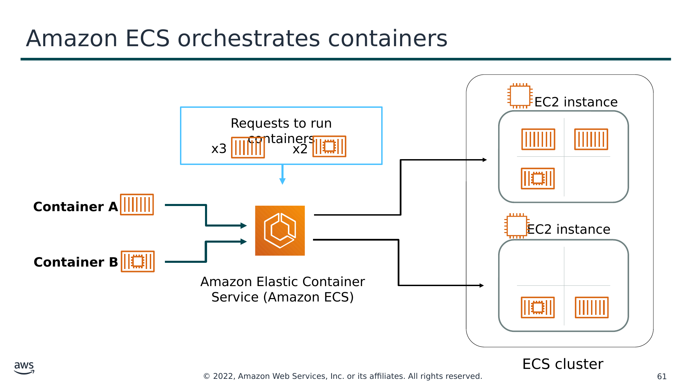

<details>
<summary>Текст зі схеми</summary>

EC2 instance

Requests to run containers

x3

x2

**Container A**

EC2 instance

**Container B**

Amazon Elastic Container Service (Amazon ECS)

ECS cluster

</details>

> **Нотатки:**
>
> To prepare your application to run on Amazon ECS, you create a task definition which is a text file that describes one or more containers, up to a maximum of ten, that form your application. It can be thought of as a blueprint for your application. Task definitions specify parameters for your application, for example which containers to use, which ports should be opened for your application, and what data volumes should be used with the containers in the task.  
>
> A task is the instantiation of a task definition within a cluster. You can specify the number of tasks that will run on your cluster. The Amazon ECS task scheduler is responsible for placing tasks within your cluster. A task will run anywhere from one to ten containers, depending on the task definition you defined.  
>
> When Amazon ECS runs the containers that make up your task, it places them on an ECS cluster. The cluster (when you choose the EC2 launch type) consists of a group of EC2 instances each of which is running an Amazon ECS container agent.  
>
> Amazon ECS provides multiple scheduling strategies that will place containers across your clusters based on your resource needs (for example, CPU or RAM) and availability requirements.

---

## Слайд 62: Amazon ECS cluster options

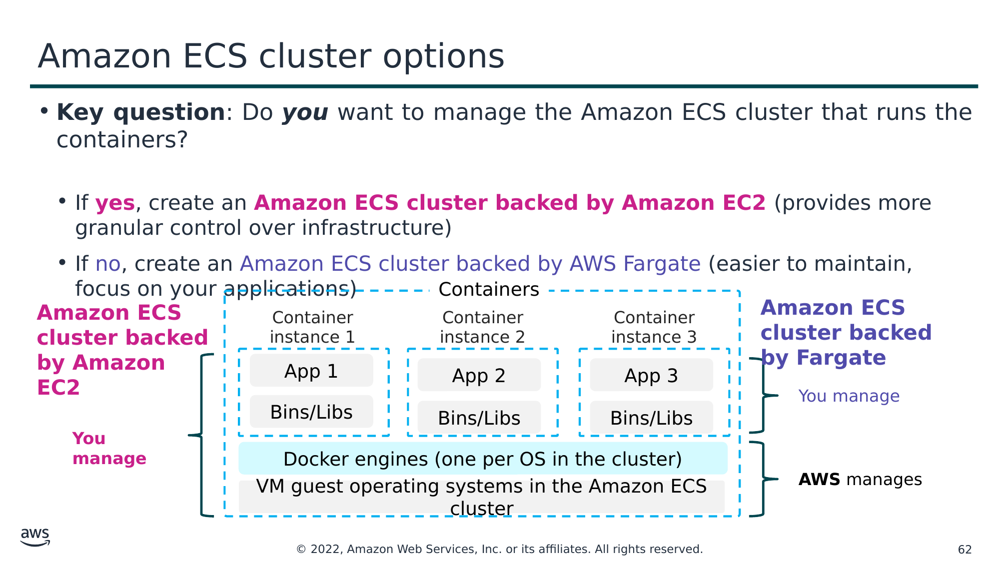

- **Key question**: Do ***you*** want to manage the Amazon ECS cluster that runs the containers?
  - If **yes**, create an **Amazon ECS cluster backed by Amazon EC2** (provides more granular control over infrastructure)
  - If no, create an Amazon ECS cluster backed by AWS Fargate (easier to maintain, focus on your applications)

<details>
<summary>Текст зі схеми</summary>

Containers

**Amazon ECS cluster backed by Amazon EC2**

Container instance 1

Container instance 2

Container instance 3

**Amazon ECS cluster backed by Fargate**

App 1

App 2

App 3

You manage

Bins/Libs

Bins/Libs

Bins/Libs

**You manage**

Docker engines (one per OS in the cluster)

**AWS** manages

VM guest operating systems in the Amazon ECS cluster

</details>

> **Нотатки:**
>
> When you create an Amazon ECS cluster, you have three options:  
> A Networking Only cluster (powered by AWS Fargate)  
> An EC2 Linux + Networking cluster  
> An EC2 Windows + Networking cluster  
>
> If you choose one of the two EC2 launch type options, you will then be prompted to choose whether the cluster EC2 instances will run as On-Demand Instances or Spot Instances. In addition, you will need to specify many details about the EC2 instances that will make up your cluster—the same details that you must specify when you launch a stand lone EC2 instance. In this way, the EC2 launch type provides more granular control over the infrastructure that runs your container applications because you manage the EC2 instances that make up the cluster.  
> Amazon ECS keeps track of all the CPU, memory, and other resources in your cluster. Amazon ECS also finds the best server for your container on based on your specified resource requirements.  
>
> If you choose the networking-only Fargate launch type, then the cluster that will run your containers will be managed by AWS. With this option, you only need to package your application in containers, specify the CPU and memory requirements, define networking and IAM policies, and launch the application. You do not need to provision, configure, or scale the cluster. It removes the need to choose server types, decide when to scale your clusters, or optimize cluster packing. The Fargate option enables you to focus on designing and building your applications.

---

## Слайд 63: What is Kubernetes?

- Kubernetes is open source software for container orchestration.
  - Deploy and **manage containerized applications** *at scale*.
  - The same toolset can be used on premises and in the cloud.
- Complements Docker.
  - Docker enables you to run multiple containers on a single OS host.
  - Kubernetes **orchestrates** multiple Docker hosts (nodes).
- Automates –
  - Container provisioning.
  - Networking.
  - Load distribution.
  - Scaling.

> **Нотатки:**
>
> Kubernetes is open source software for container orchestration. Kubernetes can work with many containerization technologies, including Docker. Because it is a popular open source project, a large community of developers and companies build extensions, integrations, and plugins that keep the software relevant, and new and in-demand features are added frequently.  
>
> Kubernetes enables you to deploy and manage containerized applications at scale. With Kubernetes, you can run any type of containerized application by using the same toolset in both on-premises data centers and the cloud. Kubernetes manages a cluster of compute instances (called nodes). It runs containers on the cluster, which are based on where compute resources are available and the resource requirements of each container. Containers are run in logical groupings called pods. You can run and scale one or many containers together as a pod. Each pod is given an IP address and a single Domain Name System (DNS) name, which Kubernetes uses to connect your services with each other and external traffic.  
>
> A key advantage of Kubernetes is that you can use it to run your containerized applications anywhere without needing to change your operational tooling. For example, applications can be moved from local on-premises development machines to production deployments in the cloud by using the same operational tooling.

---

## Слайд 64: Amazon Elastic Kubernetes Service (Amazon EKS)

- Amazon Elastic Kubernetes Service (**Amazon EKS**)
  - Enables you to run Kubernetes on AWS
  - Certified Kubernetes conformant (supports easy migration)
  - Supports Linux and Windows containers
  - Compatible with Kubernetes community tools and supports popular Kubernetes add-ons
- Use Amazon EKS to –
  - Manage clusters of Amazon EC2 compute instances
  - Run containers that are orchestrated by Kubernetes on those instances

**Amazon Elastic Kubernetes Service**

> **Нотатки:**
>
> You might think that you could launch one or more Amazon EC2 instances, install Docker on each instance, install Kubernetes on the cluster, and manage and run Kubernetes yourself. While that is an option, AWS provides a service called Amazon Elastic Kubernetes Service (Amazon EKS) that simplifies the management of Kubernetes clusters.  
>
> Amazon Elastic Kubernetes Service (Amazon EKS) is a managed Kubernetes service that makes it easy for you to run Kubernetes on AWS without needing to install, operate, and maintain your own Kubernetes control plane. It is certified Kubernetes conformant, so existing applications that run on upstream Kubernetes are compatible with Amazon EKS.  
>
> Amazon EKS automatically manages the availability and scalability of the cluster nodes that are responsible for starting and stopping containers, scheduling containers on virtual machines, storing cluster data, and other tasks. It automatically detects and replaces unhealthy control plane nodes for each cluster. You can take advantage of the performance, scale, reliability, and availability of the AWS Cloud, which includes AWS networking and security services like Application Load Balancers for load distribution, IAM for role-based access control, and VPC for pod networking.  
>
> You may be wondering why Amazon offers both Amazon ECS and Amazon EKS, since they are both capable of orchestrating Docker containers. The reason that both services exist is to provide customers with flexible options. You can decide which option best matches your needs.

---

## Слайд 65: Amazon Elastic Container Registry (Amazon ECR)

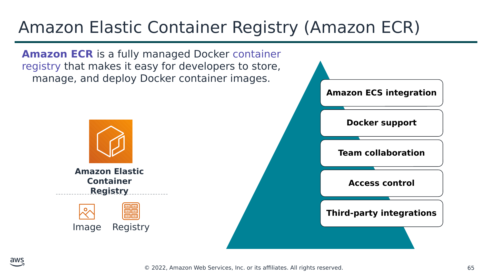

**Amazon ECR** is a fully managed Docker container registry that makes it easy for developers to store, manage, and deploy Docker container images.

<details>
<summary>Текст зі схеми</summary>

**Amazon Elastic Container Registry**

Image

Registry

</details>

> **Нотатки:**
>
> Amazon Elastic Container Registry (Amazon ECR) is a fully managed Docker container registry that makes it easy for developers to store, manage, and deploy Docker container images. It is integrated with Amazon ECS, so you can store, run, and manage container images for applications that run on Amazon ECS. Specify the Amazon ECR repository in your task definition, and Amazon ECS will retrieve the appropriate images for your applications.  
>
> Amazon ECR supports Docker Registry HTTP API version 2, which enables you to interact with Amazon ECR by using Docker CLI commands or your preferred Docker tools. Thus, you can maintain your existing development workflow and access Amazon ECR from any Docker environment—whether it is in the cloud, on premises, or on your local machine.  
>
> You can transfer your container images to and from Amazon ECS via HTTPS. Your images are also automatically encrypted at rest using Amazon S3 server-side encryption.  
>
> It is also possible to use Amazon ECR images with Amazon EKS. See the Using Amazon ECR Images with Amazon EKS documentation at https://docs.aws.amazon.com/AmazonECR/latest/userguide/ECR_on_EKS.html for details.

---

## Слайд 66: Section 4 key takeaways

- **Containers** can hold everything that an application needs to run.
- **Docker** is a software platform that packages software into containers.
  - A single application can span multiple containers.
- Amazon Elastic Container Service (**Amazon ECS**) orchestrates the running of Docker containers.
- **Kubernetes** is open source software for container orchestration.
- Amazon Elastic Kubernetes Service (**Amazon EKS**) enables you to run Kubernetes on AWS
- Amazon Elastic Container Registry (**Amazon ECR**) enables you to store, manage, and deploy your Docker containers.

> **Нотатки:**
>
> Some key takeaways from this section include:  
> Containers can hold everything that an application needs to run.  
> Docker is a software platform that packages software into containers.  
> A single application can span multiple containers.  
> Amazon Elastic Container Service (Amazon ECS) orchestrates the running of Docker containers.  
> Kubernetes is open source software for container orchestration.  
> Amazon Elastic Kubernetes Service (Amazon EKS) enables you to run Kubernetes on AWS  
> Amazon Elastic Container Registry (Amazon ECR) enables you to store, manage, and deploy your Docker containers.

---

## Слайд 67: Section 5: Introduction to AWS Lambda

Module 6: Compute

> **Нотатки:**
>
> Introducing Section 5: Introduction to AWS Lambda.

---

## Слайд 68: AWS Lambda: Run code without servers

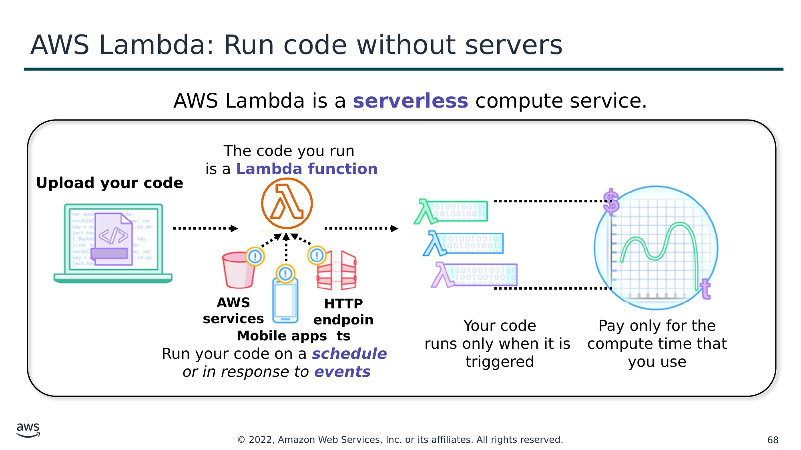

AWS Lambda is a **serverless** compute service.

<details>
<summary>Текст зі схеми</summary>

The code you run

is a **Lambda function**

**Upload your code**

**AWS**  
**services**

**HTTP endpoints**

**Mobile apps**

Your code  
runs only when it is

triggered

Pay only for the  
compute time that  
you use

Run your code on a ***schedule***

*or in response to* ***events***

</details>

> **Нотатки:**
>
> As you saw in the earlier sections of this module, AWS offers many compute options. For example, Amazon EC2 provides virtual machines. As another example, Amazon ECS and Amazon EKS are container-based compute services.  
>
> However, there is another approach to compute that does not require you to provision or manage servers. This third approach is often referred to as serverless computing.  
>
> AWS Lambda is an event-driven, serverless compute service. Lambda enables you to run code without provisioning or managing servers.  
>
> You create a Lambda function, which is the AWS resource that contains the code that you upload. You then set the Lambda function to be triggered, either on a scheduled basis or in response to an event. Your code only runs when it is triggered.  
>
> You pay only for the compute time you consume—you are not charged when your code is not running.

---

## Слайд 69: Benefits of Lambda

It supports multiple programming languages

Completely automated administration

Built-in fault tolerance

It supports the orchestration of multiple functions

Pay-per-use pricing

**AWS**

**Lambda**

> **Нотатки:**
>
> With Lambda, there are no new languages, tools, or frameworks to learn. Lambda supports multiple programming languages, including Java, Go, PowerShell, Node.js, C#, Python, and Ruby. Your code can use any library, either native or third-party.  
>
> Lambda completely automates the administration. It manages all the infrastructure to run your code on highly available, fault-tolerant infrastructure, which enables you to focus on building differentiated backend services. Lambda seamlessly deploys your code; does all the administration, maintenance, and security patches; and provides built-in logging and monitoring through Amazon CloudWatch.  
>
> Lambda provides built-in fault tolerance. It maintains compute capacity across multiple Availability Zones in each Region to help protect your code against individual machine failures or data center failures. There are no maintenance windows or scheduled downtimes.  
>
> You can orchestrate multiple Lambda functions for complex or long-running tasks by building workflows with AWS Step Functions. Use Step Functions to define workflows. These workflows trigger a collection of Lambda functions by using sequential, parallel, branching, and error-handling steps. With Step Functions and Lambda, you can build stateful, long-running processes for applications and backends.  
>
> With Lambda, you pay only for the requests that are served and the compute time that is required to run your code. Billing is metered in increments of 100 milliseconds, which make it cost-effective and easy to scale automatically from a few requests per day to thousands of requests per second.

---

## Слайд 70: AWS Lambda event sources

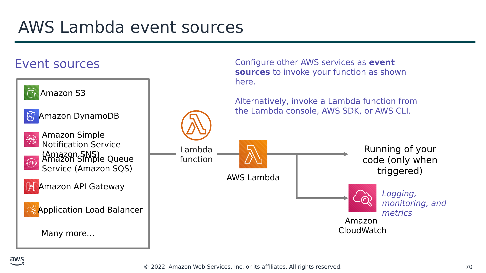

<details>
<summary>Текст зі схеми</summary>

Event sources

Configure other AWS services as **event sources** to invoke your function as shown here.

Alternatively, invoke a Lambda function from the Lambda console, AWS SDK, or AWS CLI.

Amazon S3

Amazon DynamoDB

Amazon Simple Notification Service (Amazon SNS)

Lambda function

Running of your code (only when triggered)

Amazon Simple Queue Service (Amazon SQS)

AWS Lambda

Amazon API Gateway

*Logging, monitoring, and metrics*

Application Load Balancer

Amazon

CloudWatch

Many more…

</details>

> **Нотатки:**
>
> An event source is an AWS service or a developer-created application that produces events that trigger an AWS Lambda function to run.  
>
> Some services publish events to Lambda by invoking the Lambda function directly. These services that invoke Lambda functions asynchronously include, but are not limited to, Amazon S3, Amazon Simple Notification Service (Amazon SNS), and Amazon CloudWatch Events.  
>
> Lambda can also poll resources in other services that do not publish events to Lambda. For example, Lambda can pull records from an Amazon Simple Queue Service (Amazon SQS) queue and run a Lambda function for each fetched message. Lambda can similarly read events from Amazon DynamoDB.  
>
> Some services, such as Elastic Load Balancing (Application Load Balancer) and Amazon API Gateway can invoke your Lambda function directly.  
>
> You can invoke Lambda functions directly with the Lambda console, the Lambda API, the AWS software development kit (SDK), the AWS CLI, and AWS toolkits. The direct invocation approach can be useful, such as when you are developing a mobile app and want the app to call Lambda functions. See the Using Lambda with Other Services documentation at https://docs.aws.amazon.com/lambda/latest/dg/lambda-services.html for further details about all supported services.  
>
> AWS Lambda automatically monitors Lambda functions by using Amazon CloudWatch. To help you troubleshoot failures in a function, Lambda logs all requests that are handled by your function. It also automatically stores logs that are generated by your code through Amazon CloudWatch Logs.

---

## Слайд 71: AWS Lambda function configuration

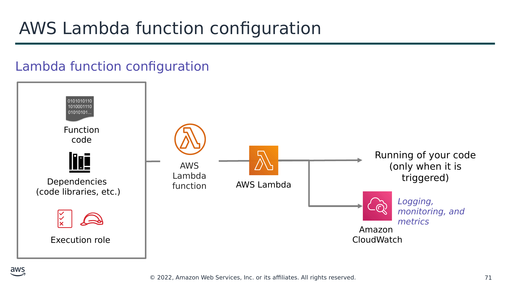

Lambda function configuration

<details>
<summary>Текст зі схеми</summary>

Function code

Running of your code (only when it is triggered)

AWS Lambda function

Dependencies

(code libraries, etc.)

AWS Lambda

*Logging, monitoring, and metrics*

Amazon

CloudWatch

Execution role

</details>

> **Нотатки:**
>
> Remember that a Lambda function is the custom code that you write to process events, and that Lambda runs the Lambda function on your behalf.  
>
> When you use the AWS Management Console to create a Lambda function, you first give the function a name. Then, you specify:  
> The runtime environment the function will use (for example, a version of Python or Node.js)  
> An execution role (to grant IAM permission to the function so that it can interact with other AWS services as necessary)  
>
> Next, after you click Create Function, you configure the function. Configurations include:  
> Add a trigger (specify one of the available event sources from the previous slide)  
> Add your function code (use the provided code editor or upload a file that contains your code)  
> Specify the memory in MB to allocate to your function (128 MB to 10,240 MB)  
> Optionally specify environment variables, description, timeout, the specific virtual private cloud (VPC) to run the function in, tags you would like to use, and other settings. For more information, see Configuring functions in the AWS Lambda console https://docs.aws.amazon.com/lambda/latest/dg/configuration-console.html in the AWS Documentation.  
>
> All of the above settings end up in a Lambda deployment package which is a ZIP archive that contains your function code and dependencies. When you use the Lambda console to author your function, the console manages the package for you. However, you need to create a deployment package if you use the Lambda API to manage functions.

---

## Слайд 72: Schedule-based Lambda function example: Start and stop EC2 instances

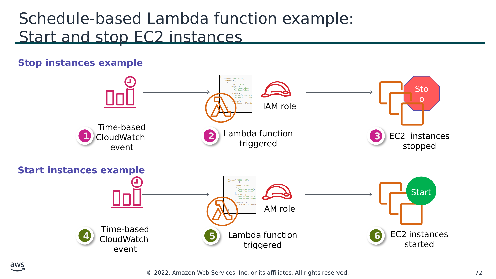

**Stop instances example**

**Start instances example**

<details>
<summary>Текст зі схеми</summary>

Stop

IAM role

Time-based CloudWatch  
event

**1**

**2**

Lambda function triggered

**3**

EC2  instances stopped

Start

IAM role

Time-based CloudWatch  
event

Lambda function triggered

**6**

EC2 instances started

**4**

**5**

</details>

> **Нотатки:**
>
> Consider an example use case for a schedule-based Lambda function. Say that you are in a situation where you want to reduce your Amazon EC2 usage. You decide that you want to stop instances at a predefined time (for example, at night when no one is accessing them) and then you want to start the instances back up in the morning (before the workday starts).  
>
> In this situation, you could configure AWS Lambda and Amazon CloudWatch Events to help you accomplish these actions automatically.  
>
> Here is what happens at each step in the example:  
> A CloudWatch event is scheduled to run a Lambda function to stop your EC2 instances at (for example) 22:00 GMT.  
> The Lambda function is triggered and runs with the IAM role that gives the function permission to stop the EC2 instances.  
> The EC2 instances enter the stopped state.  
> Later, at (for example) 05:00 AM GMT, a CloudWatch event is scheduled to run a Lambda function to start the EC2 instances.  
> The Lambda function is triggered and runs with the IAM role that gives it permission to start the EC2 instances.  
> The EC2 instances enter the running state.

---

## Слайд 73: Event-based Lambda function example: Create thumbnail images

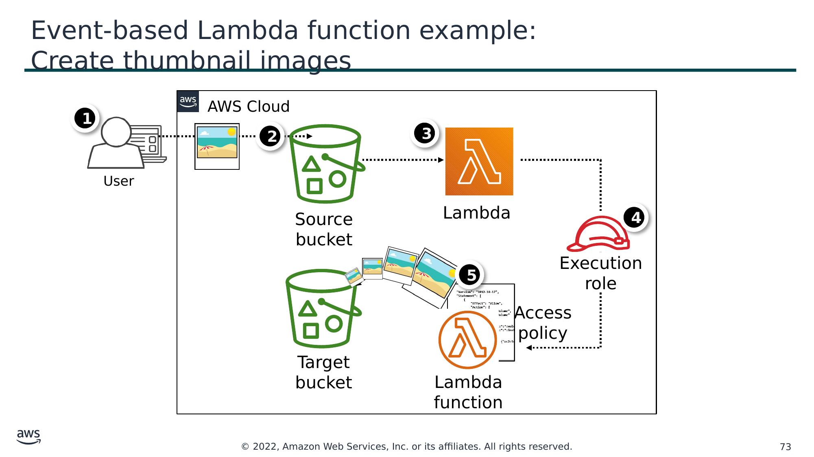

<details>
<summary>Текст зі схеми</summary>

AWS Cloud

**1**

**2**

**3**

User

Lambda

Source  
bucket

**4**

**5**

Execution  
role

Access  
policy

Target  
bucket

Lambda  
function

</details>

> **Нотатки:**
>
> Now, consider an example use case for an event-based Lambda function. Suppose that you want to create a thumbnail for each image (.jpg or .png object) that is uploaded to an S3 bucket.  
>
> To build a solution, you can create a Lambda function that Amazon S3 invokes when objects are uploaded. Then, the Lambda function reads the image object from the source bucket and creates a thumbnail image in a target bucket. Here’s how it works:  
> A user uploads an object to the source bucket in Amazon S3 (object-created event).  
> Amazon S3 detects the object-created event.  
> Amazon S3 publishes the object-created event to Lambda by invoking the Lambda function and passing event data.  
> Lambda runs the Lambda function by assuming the execution role that you specified when you created the Lambda function.  
> Based the event data that the Lambda function receives, it knows the source bucket name and object key name. The Lambda function reads the object and creates a thumbnail by using graphics libraries, and saves the thumbnail to the target bucket.

---

## Слайд 74: AWS Lambda quotas

Soft limits per Region:

- Concurrent executions = 1,000
- Function and layer storage = 75 GB

Hard limits for individual functions:

- Maximum function memory allocation = 10,240 MB
- Function timeout = 15 minutes
- Deployment package size = 250 MB unzipped, including layers
- Container image code package size = 10 GB

Additional limits also exist. Details are in the AWS Lambda quotas documentation at [https://docs.aws.amazon.com/lambda/latest/dg/gettingstarted-limits.html](https://docs.aws.amazon.com/lambda/latest/dg/gettingstarted-limits.html).

> **Нотатки:**
>
> AWS Lambda does have some quotas that you should know about when you create and deploy Lambda functions.  
>
> AWS Lambda limits the amount of compute and storage resources that you can use to run and store functions. For example, as of this writing, the maximum memory allocation for a single Lambda function is 10,240 MB. It also has limits of 1,000 concurrent executions in a Region. Lambda functions can be configured to run up to 15 minutes per run. You can set the timeout to any value between 1 second and 15 minutes. If you are troubleshooting a Lambda deployment, keep these limits in mind.  
>
> There are limits on the deployment package size of a function (250 MB). A layer is a ZIP archive that contains libraries, a custom runtime, or other dependencies. With layers, you can use libraries in your function without needing to include them in your deployment package. Using layers can help avoid reaching the size limit for deployment package. Layers are also a good way to share code and data between Lambda functions.  
>
> For larger workloads that rely on sizable dependencies, such as machine learning or data intensive workloads, you can deploy your Lambda function to a container image up to 10 GB in size.  
>
> Limits are either soft or hard. Soft limits on an account can potentially be relaxed by submitting a support ticket and providing justification for the request. Hard limits cannot be increased.  
>
> For the details on current AWS Lambda quotas, refer to the AWS Lambda quotas documentation at https://docs.aws.amazon.com/lambda/latest/dg/gettingstarted-limits.html.

---

## Слайд 75: Section 5 key takeaways

- **Serverless computing** enables you to build and run applications and services without provisioning or managing servers.
- **AWS Lambda is a serverless compute service** that provides built-in fault tolerance and automatic scaling.
- An **event source** is an AWS service or developer-created application that triggers a Lambda function to run.
- The maximum memory allocation for a single Lambda function is 10,240 MB.
- The maximum run time for a Lambda function is 15 minutes.

> **Нотатки:**
>
> Some key takeaways from this section of the module include:  
> Serverless computing enables you to build and run applications and services without provisioning or managing servers.  
> AWS Lambda is a serverless compute service that provides built-in fault tolerance and automatic scaling.  
> An event source is an AWS service or developer-created application that triggers a Lambda function to run.  
> The maximum memory allocation for a single Lambda function is 10,240 MB.  
> The maximum run time for a Lambda function is 15 minutes.

---

## Слайд 76: Activity: Create an AWS Lambda Stopinator Function

**To complete this activity:**

- Go to the hands-on lab environment and launch the AWS Lambda activity.
- Follow the instructions that are provided in the hands-on lab environment.

> **Нотатки:**
>
> In this hands-on activity, you will create a basic Lambda function that stops an EC2 instance.

---

## Слайд 77: Activity debrief: key takeaways


> **Нотатки:**
>
> The instructor will lead a conversation about the key takeaways from the activity after students have completed it.

---

## Слайд 78: Section 6: Introduction to AWS Elastic Beanstalk

Module 6: Compute

> **Нотатки:**
>
> Introducing Section 6: Introduction to AWS Elastic Beanstalk.

---

## Слайд 79: AWS Elastic Beanstalk

- An easy way to get **web applications** up and running
- A **managed service** that automatically handles –
  - Infrastructure provisioning and configuration
  - Deployment
  - Load balancing
  - Automatic scaling
  - Health monitoring
  - Analysis and debugging
  - Logging
- No additional charge for Elastic Beanstalk
  - Pay only for the underlying resources that are used


**AWS Elastic**

**Beanstalk**

> **Нотатки:**
>
> AWS Elastic Beanstalk is another AWS compute service option. It is a platform as a service (or PaaS) that facilitates the quick deployment, scaling, and management of your web applications and services.  
>
> You remain in control. The entire platform is already built, and you only need to upload your code. Choose your instance type, your database, set and adjust automatic scaling, update your application, access the server log files, and enable HTTPS on the load balancer.  
>
> You upload your code and Elastic Beanstalk automatically handles the deployment, from capacity provisioning and load balancing to automatic scaling and monitoring application health. At the same time, you retain full control over the AWS resources that power your application, and you can access the underlying resources at any time.  
>
> There is no additional charge for AWS Elastic Beanstalk. You pay for the AWS resources (for example, EC2 instances or S3 buckets) you create to store and run your application. You only pay for what you use, as you use it. There are no minimum fees and no upfront commitments.

---

## Слайд 80: AWS Elastic Beanstalk deployments

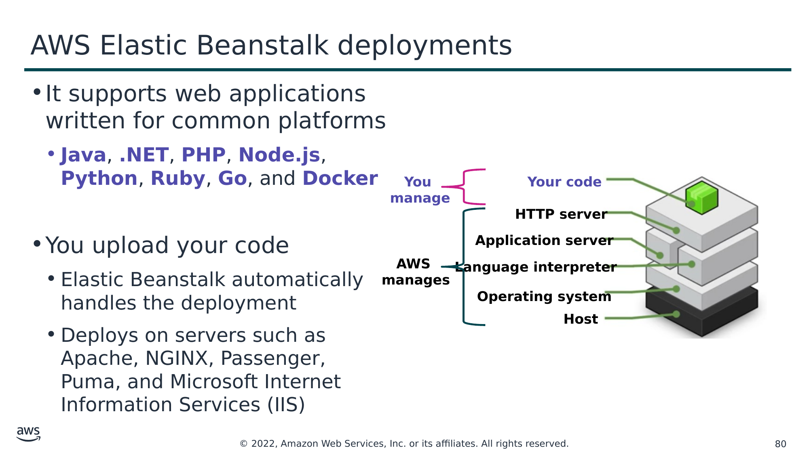

- It supports web applications written for common platforms
  - **Java**, **.NET**, **PHP**, **Node.js**, **Python**, **Ruby**, **Go**, and **Docker**
- You upload your code
  - Elastic Beanstalk automatically handles the deployment
  - Deploys on servers such as Apache, NGINX, Passenger, Puma, and Microsoft Internet Information Services (IIS)

<details>
<summary>Текст зі схеми</summary>

**You**

**manage**

**Your code**

**HTTP server**

**Application server**

**AWS**

**manages**

**Language interpreter**

**Operating system**

**Host**

</details>

> **Нотатки:**
>
> AWS Elastic Beanstalk enables you to deploy your code through the AWS Management Console, the AWS Command Line Interface (AWS CLI), Visual Studio, and Eclipse. It provides all the application services that you need for your application. The only thing you must create is your code. Elastic Beanstalk is designed to make deploying your application a quick and easy process.  
>
> Elastic Beanstalk supports a broad range of platforms. Supported platforms include Docker, Go, Java, .NET, Node.js, PHP, Python, and Ruby.  
>
> AWS Elastic Beanstalk deploys your code on Apache Tomcat for Java applications; Apache HTTP Server for PHP and Python applications; NGINX or Apache HTTP Server for Node.js applications; Passenger or Puma for Ruby applications; and Microsoft Internet Information Services (IIS) for .NET applications, Java SE, Docker, and Go.

---

## Слайд 81: Benefits of Elastic Beanstalk


Fast and simple to start using

Developer productivity

Difficult to outgrow

Complete resource control

> **Нотатки:**
>
> Elastic Beanstalk is fast and simple to start using. Use the AWS Management Console, a Git repository, or an integrated development environment (IDE) such as Eclipse or Visual Studio to upload your application. Elastic Beanstalk automatically handles the deployment details of capacity provisioning, load balancing, automatic scaling, and monitoring application health.  
>
> You can improve your developer productivity by focusing on writing code instead of managing and configuring servers, databases, load balancers, firewalls, and networks. AWS updates the underlying platform that runs your application with patches and updates.  
>
> Elastic Beanstalk is difficult to outgrow. With Elastic Beanstalk, your application can handle peaks in workload or traffic while minimizing your costs. It automatically scales your application up or down based on your application's specific needs by using easily adjustable automatic scaling settings. You can use CPU utilization metrics to trigger automatic scaling actions.  
>
> You have the freedom to select the AWS resources—such as Amazon EC2 instance type—that are optimal for your application. Elastic Beanstalk enables you to retain full control over the AWS resources that power your application. If you decide that you want to take over some (or all) of the elements of your infrastructure, you can do so seamlessly by using the management capabilities that are provided by Elastic Beanstalk.

---

## Слайд 82: Activity: AWS Elastic Beanstalk

**To complete this activity:**

- Go to the hands-on lab environment and launch the AWS Elastic Beanstalk activity.
- Follow the instructions that are provided in the hands-on lab environment.

> **Нотатки:**
>
> In this hands-on activity, you will gain an understanding of why you might want to use Elastic Beanstalk to deploy a web application on AWS.

---

## Слайд 83: Activity debrief: Key takeaways


> **Нотатки:**
>
> The instructor might choose to lead a conversation about the key takeaways from the activity after you have completed it.

---

## Слайд 84: Section 6 key takeaways

- **AWS Elastic Beanstalk** enhances developer productivity.
  - Simplifies the process of deploying your application.
  - Reduces management complexity.
- Elastic Beanstalk supports **Java**, **.NET**, **PHP**, **Node.js**, **Python**, **Ruby**, **Go**, and **Docker**
- There is no charge for Elastic Beanstalk. Pay only for the AWS resources that you use.

> **Нотатки:**
>
> Some key takeaways from this section of the module include:  
> AWS Elastic Beanstalk enhances developer productivity.  
> Simplifies the process of deploying your application.  
> Reduces management complexity.  
> Elastic Beanstalk supports Java, .NET, PHP, Node.js, Python, Ruby, Go, and Docker.  
> There is no charge for Elastic Beanstalk. Pay only for the AWS resources you use.

---

## Слайд 85: Module wrap-up

Module 6: Compute

> **Нотатки:**
>
> It’s now time to review the module and wrap up with a knowledge check and discussion of a practice certification exam question.

---

## Слайд 86: Module summary

In summary, in this module, you learned how to:

- Provide an overview of different AWS compute services in the cloud
- Demonstrate why to use Amazon Elastic Compute Cloud (Amazon EC2)
- Identify the functionality in the Amazon EC2 console
- Perform basic functions in Amazon EC2 to build a virtual computing environment
- Identify Amazon EC2 cost optimization elements
- Demonstrate when to use AWS Elastic Beanstalk
- Demonstrate when to use AWS Lambda
- Identify how to run containerized applications in a cluster of managed servers

> **Нотатки:**
>
> In summary, in this module, you learned how to:  
> Provide an overview of different AWS compute services in the cloud  
> Demonstrate why to use Amazon Elastic Compute Cloud (Amazon EC2)  
> Identify the functionality in the Amazon EC2 console  
> Perform basic functions in Amazon EC2 to build a virtual computing environment  
> Identify Amazon EC2 cost optimization elements  
> Demonstrate when to use AWS Elastic Beanstalk  
> Demonstrate when to use AWS Lambda  
> Identify how to run containerized applications in a cluster of managed servers

---

## Слайд 87: Complete the knowledge check


> **Нотатки:**
>
> It is now time to complete the knowledge check for this module.

---

## Слайд 88: Sample exam question

Which AWS service helps developers quickly deploy resources which can make use of different programming languages, such as .NET and Java?

Choice

Response

A

AWS CloudFormation

B

AWS SQS

C

AWS Elastic Beanstalk

D

Amazon Elastic Compute Cloud (Amazon EC2)

> **Нотатки:**
>
> Look at the answer choices and rule them out based on the keywords.

---

## Слайд 89: Sample exam question answer

Which AWS service helps developers quickly deploy resources which can make use of different programming languages, such as .NET and Java?

The correct answer is C.

The keywords in the question are developers quickly deploy resources and different programming languages.

> **Нотатки:**
>
> The following are the keywords to recognize: developers quickly deploy resources and different programming languages.  
>
> The correct answer is C. AWS Elastic Beanstalk  
>
> Incorrect answers:  
> Answer A: AWS CloudFormation  
> Answer B: AWS SQS  
> Answer D: Amazon Elastic Compute Cloud (Amazon EC2)

---

## Слайд 90: Additional resources

- Amazon EC2 Documentation: [https://docs.aws.amazon.com/ec2/](https://docs.aws.amazon.com/ec2/)
- Amazon EC2 Pricing: [https://aws.amazon.com/ec2/pricing/](https://aws.amazon.com/ec2/pricing/)
- Amazon ECS Workshop: [https://ecsworkshop.com/](https://ecsworkshop.com/)
- Running Containers on AWS: [https://containersonaws.com/](https://containersonaws.com/)
- Amazon EKS Workshop: [https://www.eksworkshop.com/](https://www.eksworkshop.com/)
- AWS Lambda Documentation: [https://docs.aws.amazon.com/lambda/](https://docs.aws.amazon.com/lambda/)
- AWS Elastic Beanstalk Documentation: [https://docs.aws.amazon.com/elastic-beanstalk/](https://docs.aws.amazon.com/elastic-beanstalk/)
- Cost Optimization Playbook: [https://d1.awsstatic.com/pricing/AWS_CO_Playbook_Final.pdf](https://d1.awsstatic.com/pricing/AWS_CO_Playbook_Final.pdf)

> **Нотатки:**
>
> Compute services on AWS is a large topic, and this module only provided an introduction to the subject. The following resources provide more detail:  
> Amazon EC2 Documentation: https://docs.aws.amazon.com/ec2/  
> Amazon EC2 Pricing: https://aws.amazon.com/ec2/pricing/  
> Amazon ECS Workshop: https://ecsworkshop.com/  
> Running Containers on AWS: https://containersonaws.com/  
> Amazon EKS Workshop: https://www.eksworkshop.com/  
> AWS Lambda Documentation: https://docs.aws.amazon.com/lambda/  
> AWS Elastic Beanstalk Documentation: https://docs.aws.amazon.com/elastic-beanstalk/  
> Cost Optimization Playbook: https://d1.awsstatic.com/pricing/AWS_CO_Playbook_Final.pdf

---

## Слайд 91: Thank you

All trademarks are the property of their owners.

> **Нотатки:**
>
> Thank you for completing this module.
