## Слайд 1: Модуль 6: Обчислення

AWS Academy Cloud Foundations

> **Нотатки:**
>
> Вітаємо в Модулі 6: Обчислення (Compute)

---

## Слайд 2: Огляд модуля

**Теми**

- Огляд обчислювальних сервісів
- Amazon EC2
- Оптимізація витрат Amazon EC2
- Контейнерні сервіси
- Вступ до AWS Lambda
- Вступ до AWS Elastic Beanstalk

**Практичні вправи**

- Amazon EC2 проти керованого сервісу (Amazon EC2 versus Managed Service)
- Практична робота з AWS Lambda
- Практична робота з AWS Elastic Beanstalk

**Демонстрація**

- Записана демонстрація Amazon EC2

**Лабораторна робота**

- Вступ до Amazon EC2 (Introduction to Amazon EC2)

**Перевірка знань**

> **Нотатки:**
>
> У цьому модулі розглядаються такі теми:  
> Огляд обчислювальних сервісів  
> Amazon EC2  
> Оптимізація витрат Amazon EC2  
> Контейнерні сервіси  
> Вступ до AWS Lambda  
> Вступ до AWS Elastic Beanstalk  
>
> Розділ 2 містить записану демонстрацію Amazon EC2. Наприкінці цього самого розділу є практична лабораторна робота, де ви потренуєтеся запускати екземпляр EC2 за допомогою AWS Management Console. У цьому розділі також є практична вправа, у якій ви порівняєте переваги й недоліки розгортання бази даних на Amazon EC2 порівняно із запуском на Amazon Relational Database Service (RDS).  
>
> Розділ 5 містить практичну вправу з AWS Lambda, а розділ 6 — практичну вправу з Elastic Beanstalk.  
>
> Наприкінці вам буде запропоновано пройти перевірку знань, яка перевірить ваше розуміння ключових концепцій, розглянутих у цьому модулі.

---

## Слайд 3: Цілі модуля

Після завершення цього модуля ви повинні вміти:

- Надавати огляд різних обчислювальних сервісів AWS у хмарі
- Пояснювати, навіщо використовувати Amazon Elastic Compute Cloud (Amazon EC2)
- Визначати функціональність консолі EC2
- Виконувати базові функції в Amazon EC2 для побудови віртуального обчислювального середовища
- Визначати елементи оптимізації витрат Amazon EC2
- Пояснювати, коли використовувати AWS Elastic Beanstalk
- Пояснювати, коли використовувати AWS Lambda
- Визначати, як запускати контейнеризовані застосунки в кластері керованих серверів

> **Нотатки:**
>
> Після завершення цього модуля ви повинні вміти:  
> Надавати огляд різних обчислювальних сервісів AWS у хмарі  
> Пояснювати, навіщо використовувати Amazon Elastic Compute Cloud (Amazon EC2)  
> Визначати функціональність консолі EC2  
> Виконувати базові функції в EC2 для побудови віртуального обчислювального середовища  
> Визначати елементи оптимізації витрат EC2  
> Пояснювати, коли використовувати AWS Elastic Beanstalk  
> Пояснювати, коли використовувати AWS Lambda  
> Визначати, як запускати контейнеризовані застосунки в кластері керованих серверів

---

## Слайд 4: Розділ 1: Огляд обчислювальних сервісів

Модуль 6: Обчислення

> **Нотатки:**
>
> Представляємо Розділ 1: Огляд обчислювальних сервісів.

---

## Слайд 5: Обчислювальні сервіси AWS

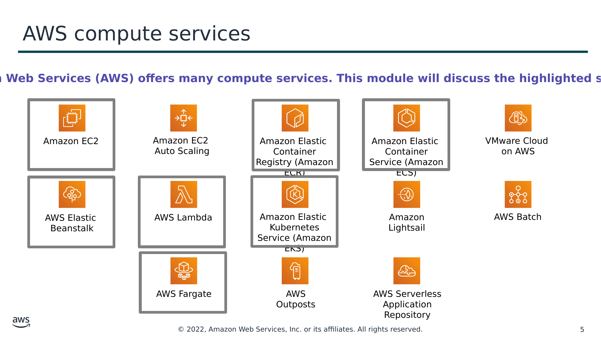

**Amazon Web Services (AWS) пропонує багато обчислювальних сервісів. У цьому модулі розглядаються виділені сервіси.**

<details>
<summary>Текст зі схеми</summary>

Amazon EC2

Amazon EC2  
Auto Scaling

Amazon Elastic  
Container Registry (Amazon ECR)

Amazon Elastic  
Container Service (Amazon ECS)

VMware Cloud  
on AWS

AWS Elastic  
Beanstalk

AWS Lambda

Amazon Elastic  
Kubernetes Service (Amazon EKS)

Amazon Lightsail

AWS Batch

AWS Fargate

AWS Outposts

AWS Serverless Application Repository

</details>

> **Нотатки:**
>
> Amazon Web Services (AWS) пропонує багато обчислювальних сервісів. Ось короткий підсумок того, що пропонує кожен обчислювальний сервіс:  
> Amazon Elastic Compute Cloud (Amazon EC2) надає віртуальні машини зі змінним розміром.  
> Amazon EC2 Auto Scaling підтримує доступність застосунку, дозволяючи визначати умови, за яких екземпляри EC2 автоматично запускаються чи завершують роботу.  
> Amazon Elastic Container Registry (Amazon ECR) використовується для зберігання й отримання образів Docker.  
> Amazon Elastic Container Service (Amazon ECS) — це сервіс оркестрації контейнерів (container orchestration), що підтримує Docker.  
> VMware Cloud on AWS дає змогу розгорнути гібридну хмару без спеціального апаратного забезпечення.  
> AWS Elastic Beanstalk надає простий спосіб запуску вебзастосунків і керування ними.  
> AWS Lambda — це безсерверне (serverless) обчислювальне рішення. Ви платите лише за використаний обчислювальний час.  
> Amazon Elastic Kubernetes Service (Amazon EKS) дає змогу запускати кероване середовище Kubernetes в AWS.  
> Amazon Lightsail надає простий у використанні сервіс для створення застосунку чи вебсайту.  
> AWS Batch надає інструмент для запуску пакетних завдань (batch jobs) у будь-якому масштабі.  
> AWS Fargate надає спосіб запуску контейнерів, що зменшує потребу керувати серверами чи кластерами.  
> AWS Outposts надає спосіб запуску вибраних сервісів AWS у вашому локальному (on-premises) центрі обробки даних.  
> AWS Serverless Application Repository надає спосіб знаходити, розгортати та публікувати безсерверні застосунки.  
>
> Цей модуль розглядає деталі сервісів, які виділено на слайді.

---

## Слайд 6: Категоризація обчислювальних сервісів

| Сервіси (Services) | Ключові концепції (Key Concepts) | Характеристики (Characteristics) | Простота використання (Ease of Use) |
|---|---|---|---|
| Amazon EC2 | • Інфраструктура як послуга (IaaS)<br>• На основі екземплярів<br>• Віртуальні машини | Розгортання віртуальних машин, якими ви можете керувати на власний розсуд | Знайома концепція для багатьох ІТ-фахівців. |
| AWS Lambda | • Безсерверні обчислення (serverless computing)<br>• На основі функцій<br>• Низька вартість | • Пишіть і розгортайте код, що працює за розкладом або може запускатися подіями<br>• Використовуйте, коли можливо (проєктуйте архітектуру для хмари) | Відносно нова концепція для багатьох ІТ-працівників, але проста у використанні після навчання. |
| • Amazon ECS<br>• Amazon EKS<br>• AWS Fargate<br>• Amazon ECR | • Обчислення на основі контейнерів<br>• На основі екземплярів | Швидше розгортання та запуск завдань | AWS Fargate зменшує адміністративні накладні витрати, але можна використовувати варіанти, що дають більше контролю. |
| AWS Elastic Beanstalk | • Платформа як послуга (PaaS)<br>• Для вебзастосунків | • Зосередьтеся на коді (створенні застосунку)<br>• Легко інтегрується з іншими сервісами — базами даних, системою доменних імен (DNS) тощо | Швидко та легко почати роботу. |

> **Нотатки:**
>
> Кожен обчислювальний сервіс AWS можна віднести до однієї з чотирьох широких категорій: віртуальні машини (VM), що надають інфраструктуру як послугу (IaaS), безсерверні (serverless), на основі контейнерів і платформа як послуга (PaaS).  
>
> Amazon EC2 надає віртуальні машини, і його можна розглядати як інфраструктуру як послугу (IaaS). Сервіси IaaS надають гнучкість і залишають багато обов’язків із керування серверами на вас. Ви обираєте операційну систему, а також обираєте розмір і ресурсні можливості серверів, які запускаєте. Для ІТ-фахівців, що мають досвід роботи з локальними (on-premises) обчисленнями, віртуальні машини — знайома концепція. Amazon EC2 був одним із перших сервісів AWS і залишається одним із найпопулярніших.  
>
> AWS Lambda — це обчислювальна платформа без адміністрування. AWS Lambda дає змогу запускати код без розгортання чи керування серверами. Ви платите лише за спожитий обчислювальний час. Ця концепція безсерверної технології відносно нова для багатьох ІТ-фахівців. Однак вона набуває популярності, оскільки підтримує хмарно-орієнтовані (cloud-native) архітектури, що забезпечують масивну масштабованість за нижчою вартістю, ніж запуск серверів 24/7 для підтримки тих самих робочих навантажень.  
>
> Сервіси на основі контейнерів — зокрема Amazon Elastic Container Service, Amazon Elastic Kubernetes Service, AWS Fargate та Amazon Elastic Container Registry — дають змогу запускати кілька робочих навантажень на одній операційній системі (ОС). Контейнери розгортаються швидше за віртуальні машини, тим самим забезпечуючи швидкість реагування. Рішення на основі контейнерів і далі набувають популярності.  
>
> Нарешті, AWS Elastic Beanstalk надає платформу як послугу (PaaS). Він полегшує швидке розгортання застосунків, які ви створюєте, надаючи всі потрібні сервіси застосунків. AWS керує ОС, сервером застосунків та іншими компонентами інфраструктури, щоб ви могли зосередитися на розробці коду застосунку.

---

## Слайд 7: Вибір оптимального обчислювального сервісу

- Оптимальний обчислювальний сервіс або сервіси, які ви використовуєте, залежатимуть від вашого сценарію використання
- Деякі аспекти, які слід враховувати –
  - Яка архітектура вашого застосунку?
  - Які ваші шаблони використання?
  - Якими налаштуваннями конфігурації ви хочете керувати?
- Вибір неправильного обчислювального рішення для архітектури може призвести до нижчої ефективності продуктивності
  - Гарне місце для початку — ознайомитися з наявними обчислювальними варіантами

> **Нотатки:**
>
> AWS пропонує багато обчислювальних сервісів, оскільки різні сценарії використання виграють від різних обчислювальних середовищ. Оптимальний обчислювальний сервіс або сервіси, які ви використовуєте, залежатимуть від вашого сценарію використання.  
>
> Часто обчислювальна архітектура, яку ви використовуєте, визначається застарілим (legacy) кодом. Однак це не означає, що ви не можете розвивати архітектуру, щоб скористатися перевіреними хмарно-орієнтованими проєктами.  
>
> Найкращі практики включають:  
> Оцінювання наявних обчислювальних варіантів  
> Розуміння наявних варіантів конфігурації обчислень  
> Збирання метрик, пов’язаних з обчисленнями  
> Використання наявної еластичності ресурсів  
> Повторне оцінювання обчислювальних потреб на основі метрик  
>
> Іноді клієнт починає з одного обчислювального рішення й вирішує змінити проєкт на основі свого аналізу метрик. Якщо вас цікавить приклад того, як клієнт змінив свій вибір обчислювальних сервісів для конкретного сценарію використання, перегляньте це відео про рішення для відстеження запасів (Inventory Tracking) за адресою https://www.youtube.com/watch?v=zr3Kib0i-OQ&feature=youtu.be&did=ta_card&trk=ta_card.

---

## Слайд 8: Розділ 2: Amazon EC2

Модуль 6: Обчислення

> **Нотатки:**
>
> Представляємо Розділ 2: Amazon EC2.

---

## Слайд 9: Amazon Elastic Compute Cloud (Amazon EC2)

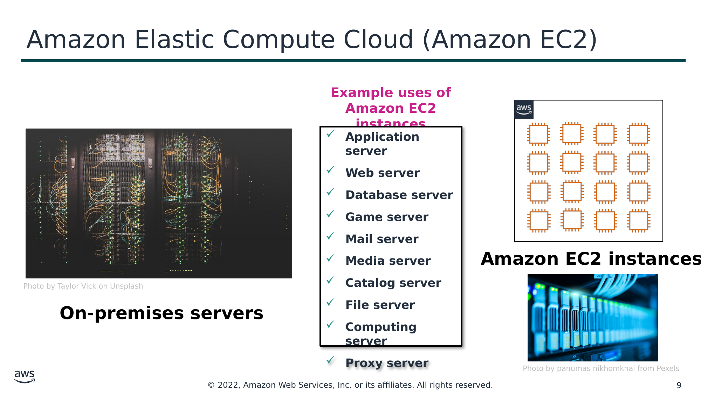

**Приклади використання екземплярів Amazon EC2**

- **Сервер застосунків**
- **Вебсервер**
- **Сервер баз даних**
- **Ігровий сервер**
- **Поштовий сервер**
- **Медіасервер**
- **Сервер каталогів**
- **Файловий сервер**
- **Обчислювальний сервер**
- **Проксі-сервер**

**Екземпляри Amazon EC2**

Фото: Taylor Vick, Unsplash

**Локальні сервери (On-premises servers)**

Фото: panumas nikhomkhai, Pexels

> **Нотатки:**
>
> Експлуатація серверів локально (on-premises) — дорога справа. Апаратне забезпечення потрібно закуповувати, і ця закупівля може ґрунтуватися на планах проєктів, а не на реальності використання серверів. Центри обробки даних дорогі у побудові, укомплектуванні персоналом і обслуговуванні. Організаціям також потрібно постійно розгортати достатній обсяг апаратного забезпечення для обробки сплесків трафіку та пікових навантажень. Після побудови традиційних локальних розгортань потужності серверів можуть простоювати протягом значної частини часу роботи серверів, що є марнотратством.  
>
> Amazon Elastic Compute Cloud (Amazon EC2) надає віртуальні машини, де можна розміщувати ті самі види застосунків, які ви могли б запускати на традиційному локальному сервері. Він надає безпечні обчислювальні потужності зі змінним розміром у хмарі. Екземпляри EC2 можуть підтримувати різноманітні робочі навантаження. Поширені сценарії використання екземплярів EC2 включають, зокрема:  
> Сервери застосунків  
> Вебсервери  
> Сервери баз даних  
> Ігрові сервери  
> Поштові сервери  
> Медіасервери  
> Сервери каталогів  
> Файлові сервери  
> Обчислювальні сервери  
> Проксі-сервери

---

## Слайд 10: Огляд Amazon EC2

- **Amazon Elastic Compute Cloud (Amazon EC2)**
  - Надає віртуальні машини — так звані екземпляри EC2 (EC2 instances) — у хмарі.
  - Дає вам *повний контроль* над гостьовою операційною системою (Windows або Linux) на кожному екземплярі.
- Ви можете запускати екземпляри будь-якого розміру в зоні доступності будь-де у світі.
  - Запускайте екземпляри з **образів Amazon Machine Images (AMI)**.
  - Запускайте екземпляри кількома кліками або одним рядком коду, і вони готові за лічені хвилини.
- Ви можете контролювати трафік до екземплярів і від них.

Amazon EC2

> **Нотатки:**
>
> EC2 в Amazon EC2 розшифровується як Elastic Compute Cloud:  
> Elastic (еластичний) означає, що ви можете легко збільшувати або зменшувати кількість серверів, які запускаєте для підтримки застосунку, автоматично, а також можете збільшувати чи зменшувати розмір наявних серверів.  
> Compute (обчислення) стосується причини, з якої більшість користувачів узагалі запускають сервери: розміщувати застосунки, що працюють, або обробляти дані — дії, що потребують обчислювальних ресурсів, зокрема процесорної потужності (CPU) і пам’яті (RAM).  
> Cloud (хмара) означає, що екземпляри EC2, які ви запускаєте, розміщені в хмарі.  
>
> Amazon EC2 надає віртуальні машини в хмарі й дає вам повний адміністративний контроль над операційною системою Windows чи Linux, що працює на екземплярі. Підтримується більшість серверних операційних систем, зокрема: Windows 2008, 2012, 2016 і 2019, Red Hat, SuSE, Ubuntu та Amazon Linux.  
>
> Операційну систему, що працює на віртуальній машині, часто називають гостьовою операційною системою (guest operating system), щоб відрізнити її від хостової операційної системи (host operating system). Хостова операційна система встановлюється безпосередньо на будь-якому серверному апаратному забезпеченні, що розміщує одну чи кілька віртуальних машин.  
>
> З Amazon EC2 ви можете запустити будь-яку кількість екземплярів будь-якого розміру в будь-якій зоні доступності будь-де у світі за лічені хвилини. Екземпляри запускаються з образів Amazon Machine Images (AMI), які фактично є шаблонами віртуальних машин. AMI докладніше розглядаються пізніше в цьому модулі.  
>
> Ви можете контролювати трафік до екземплярів і від них за допомогою груп безпеки (security groups). Також, оскільки сервери працюють у хмарі AWS, ви можете будувати рішення, що використовують кілька сервісів AWS.

---

## Слайд 11: Запуск екземпляра Amazon EC2

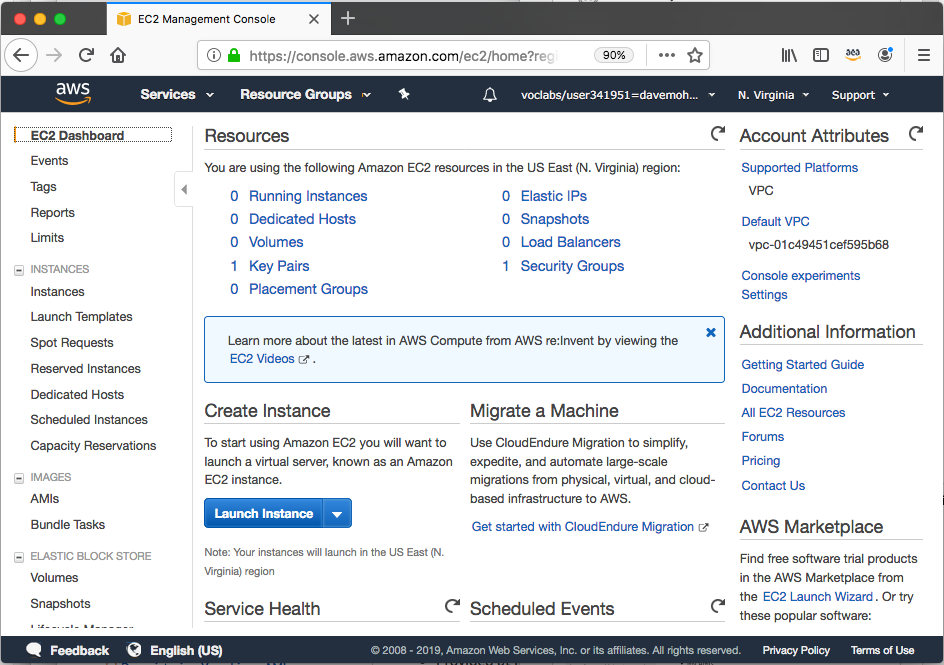

Цей розділ модуля проводить вас через **дев’ять ключових рішень**, які потрібно ухвалити під час створення екземпляра EC2 за допомогою **майстра запуску екземпляра (Launch Instance Wizard)** AWS Management Console.

- Попутно будуть розглянуті основні концепції Amazon EC2.

> **Нотатки:**
>
> Коли ви вперше запускаєте екземпляр Amazon EC2, ви, імовірно, використаєте майстер запуску екземпляра (Launch Instance Wizard) в AWS Management Console. Ви матимете можливість спробувати майстер запуску в лабораторній роботі цього модуля.  
>
> Майстер запуску екземпляра полегшує запуск екземпляра. Наприклад, якщо ви вирішите прийняти всі налаштування за замовчуванням, ви можете пропустити більшість кроків майстра й запустити екземпляр EC2 лише за шість кліків. Приклад цього процесу показано в демонстрації наприкінці цього розділу.  
>
> Однак для більшості розгортань вам потрібно буде змінити налаштування за замовчуванням, щоб сервери, які ви запускаєте, розгортались у спосіб, що відповідає вашим конкретним потребам.  
>
> Наступна серія слайдів знайомить вас з основними виборами, які потрібно зробити під час запуску екземпляра. Слайди охоплюють основні концепції, які корисно знати під час цих виборів. Ці концепції описано, щоб допомогти вам зрозуміти доступні варіанти та наслідки рішень, які ви ухвалюватимете.

---

## Слайд 12: 1. Виберіть AMI

**Вибір, що робляться за допомогою**  
**Launch Instance Wizard:**

1. **AMI**
2. **Тип екземпляра (Instance Type)**
3. **Мережеві налаштування (Network settings)**
4. **Роль IAM (IAM role)**
5. **Дані користувача (User data)**
6. **Варіанти сховища (Storage options)**
7. **Теги (Tags)**
8. **Група безпеки (Security group)**
9. **Пара ключів (Key pair)**

Launch (Запуск)

instance (екземпляр)

AMI

Instance (Екземпляр)

- Amazon Machine Image (AMI)
  - Це шаблон, що використовується для створення екземпляра EC2 (який є **віртуальною машиною, або VM**, що працює в хмарі AWS)
  - Містить операційну систему **Windows** або **Linux**
  - Часто також має певне попередньо встановлене **програмне забезпечення**
- Варіанти AMI:
  - Quick Start *– AMI для Linux і Windows, надані AWS*
  - My AMIs *– будь-які AMI, створені вами*
  - AWS Marketplace *– попередньо налаштовані шаблони від третіх сторін*
  - Community AMIs *– AMI, до яких надали спільний доступ інші; використовуйте на власний ризик*

> **Нотатки:**
>
> Образ Amazon Machine Image (AMI) надає інформацію, потрібну для запуску екземпляра EC2. Під час запуску екземпляра потрібно вказати вихідний AMI. Ви можете використовувати різні AMI для запуску різних типів екземплярів. Наприклад, можна обрати один AMI для запуску екземпляра, який стане вебсервером, і інший AMI для розгортання екземпляра, що розміщуватиме сервер застосунків. Також можна запустити кілька екземплярів з одного AMI.  
>
> AMI включає такі компоненти:  
> Шаблон кореневого тому (root volume) екземпляра. Кореневий том зазвичай містить операційну систему (ОС) і все, що було встановлено в цій ОС (застосунки, бібліотеки тощо). Amazon EC2 копіює шаблон на кореневий том нового екземпляра EC2, а потім запускає його.  
> Дозволи на запуск (launch permissions), що контролюють, які акаунти AWS можуть використовувати AMI.  
> Зіставлення блочних пристроїв (block device mapping), що визначає томи, які потрібно приєднати до екземпляра (за наявності) під час його запуску.  
>
> Ви можете обрати багато AMI:  
> Quick Start — AWS пропонує низку попередньо зібраних AMI для запуску ваших екземплярів. Ці AMI включають багато варіантів для Linux і Windows.  
> My AMIs — це AMI, які ви створили.  
> AWS Marketplace — AWS Marketplace пропонує цифровий каталог, що містить тисячі програмних рішень. Ці AMI можуть пропонувати конкретні сценарії використання, щоб допомогти вам швидко почати.  
> Community AMIs — ці AMI створені людьми з усього світу. Ці AMI не перевіряються AWS, тож використовуйте їх на власний ризик. Community AMI можуть пропонувати багато різних рішень для різних проблем, але використовуйте їх обережно. Уникайте їх використання в будь-якому продуктивному чи корпоративному середовищі.

---

## Слайд 13: Створення нового AMI: приклад

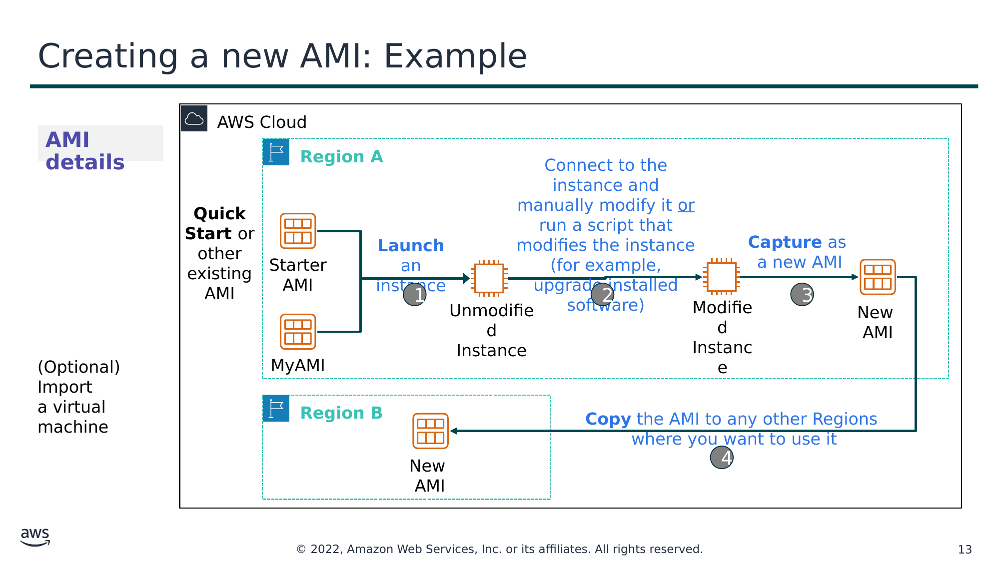

<details>
<summary>Текст зі схеми</summary>

AWS Cloud

**AMI details (Відомості про AMI)**

**Region A (Регіон A)**

Connect to the instance and manually modify it or run a script that modifies the instance (for example, upgrade installed software) (Підключіться до екземпляра й вручну змініть його або запустіть скрипт, що змінює екземпляр (наприклад, оновлення встановленого програмного забезпечення))

**Quick Start** or other  
existing AMI (**Quick Start** або інший наявний AMI)

**Launch** an instance (**Запустіть** екземпляр)

**Capture** as  
a new AMI (**Створіть** новий AMI)

Starter  
AMI (Початковий AMI)

1

Unmodified  
Instance (Незмінений екземпляр)

2

Modified  
Instance (Змінений екземпляр)

3

New  
AMI (Новий AMI)

(Optional) Import  
a virtual machine ((Необов’язково) Імпортуйте віртуальну машину)

MyAMI

**Region B (Регіон B)**

**Copy** the AMI to any other Regions  
where you want to use it (**Скопіюйте** AMI в будь-які інші регіони, де ви хочете його використовувати)

New  
AMI (Новий AMI)

4

</details>

> **Нотатки:**
>
> AMI створюється з екземпляра EC2. Ви можете імпортувати віртуальну машину, щоб вона стала екземпляром EC2, а потім зберегти екземпляр EC2 як AMI. Потім ви можете запустити екземпляр EC2 із цього AMI. Як варіант, можна почати з наявного AMI — наприклад, одного з AMI Quick Start, наданих AWS, — і створити з нього екземпляр EC2.  
>
> Незалежно від того, які варіанти ви обрали (крок 1), у вас буде те, що схема називає незмінений екземпляр (unmodified instance). З цього екземпляра ви можете створити «золотий» екземпляр (golden instance) — тобто віртуальну машину, яку ви налаштували з потрібними вам ОС і налаштуваннями застосунків (крок 2), — а потім зберегти його як новий AMI (крок 3). Коли ви створюєте AMI, Amazon EC2 зупиняє екземпляр, створює знімок (snapshot) його кореневого тому і, нарешті, реєструє знімок як AMI.  
>
> Після реєстрації AMI його можна використовувати для запуску нових екземплярів у тому самому регіоні AWS. Новий AMI тепер можна розглядати як новий початковий AMI. Можливо, ви також захочете скопіювати AMI в інші регіони (крок 4), щоб екземпляри EC2 можна було запускати і в цих розташуваннях.

---

## Слайд 14: 2. Виберіть тип екземпляра

- Враховуйте свій сценарій використання
  - Як використовуватиметься створюваний вами екземпляр EC2?
- **Тип екземпляра (instance type)**, який ви обираєте, визначає –
  - Пам’ять (RAM)
  - Процесорну потужність (CPU)
  - Дисковий простір і тип диска (сховище)
  - Мережеву продуктивність
- Категорії типів екземплярів –
  - Загального призначення (General purpose)
  - З оптимізацією обчислень (Compute optimized)
  - З оптимізацією пам’яті (Memory optimized)
  - З оптимізацією сховища (Storage optimized)
  - Прискорені обчислення (Accelerated computing)
- Типи екземплярів пропонують *сімейство (family)*, *покоління (generation)* та *розмір (size)*

**Вибір, що робляться за допомогою**  
**Launch Instance Wizard:**

1. **AMI**
2. **Тип екземпляра (Instance Type)**
3. **Мережеві налаштування (Network settings)**
4. **Роль IAM (IAM role)**
5. **Дані користувача (User data)**
6. **Варіанти сховища (Storage options)**
7. **Теги (Tags)**
8. **Група безпеки (Security group)**
9. **Пара ключів (Key pair)**

> **Нотатки:**
>
> Після вибору AMI для запуску екземпляра потрібно вибрати тип екземпляра.  
>
> Amazon EC2 надає вибір типів екземплярів, оптимізованих під різні сценарії використання. Типи екземплярів складаються з різних комбінацій потужності ЦП, пам’яті, сховища та мережі. Різні типи екземплярів дають вам гнучкість обрати відповідне поєднання ресурсів для ваших застосунків. Кожен тип екземпляра включає один або кілька розмірів екземпляра, що дає змогу масштабувати ресурси відповідно до вимог цільового робочого навантаження.  
>
> Категорії типів екземплярів включають екземпляри загального призначення, з оптимізацією обчислень, з оптимізацією пам’яті, з оптимізацією сховища та прискорені обчислення. Кожна категорія типів екземплярів пропонує багато типів екземплярів на вибір.

---

## Слайд 15: Найменування типів і розміри екземплярів EC2

**Приклади розмірів екземплярів (Example instance sizes)**

Найменування типу екземпляра

- Приклад: **t3.large**
  - T — назва сімейства
  - 3 — номер покоління
  - Large — розмір

| Назва екземпляра | vCPU | Пам’ять (ГБ) | Сховище |
|---|---|---|---|
| t3.nano | 2 | 0,5 | Лише EBS (EBS-Only) |
| t3.micro | 2 | 1 | Лише EBS |
| t3.small | 2 | 2 | Лише EBS |
| t3.medium | 2 | 4 | Лише EBS |
| t3.large | 2 | 8 | Лише EBS |
| t3.xlarge | 4 | 16 | Лише EBS |
| t3.2xlarge | 8 | 32 | Лише EBS |

> **Нотатки:**
>
> Подивившись на тип екземпляра EC2, ви побачите, що його назва складається з кількох частин. Наприклад, розгляньте тип T.  
>
> T — це назва сімейства, за якою слідує число. Тут це число 3.  
>
> Це число — номер покоління цього типу. Отже, екземпляр t3 — це третє покоління сімейства T. Загалом типи екземплярів вищого покоління потужніші та забезпечують кращу ціну за відповідну якість.  
>
> Наступна частина назви — розмір екземпляра. Порівнюючи розміри, важливо дивитися на коефіцієнт у категорії розміру.  
>
> Наприклад, t3.2xlarge має вдвічі більше vCPU і пам’яті, ніж t3.xlarge. У свою чергу, t3.xlarge має вдвічі більше vCPU і пам’яті, ніж t3.large.  
>
> Також важливо зазначити, що пропускна здатність мережі пов’язана з розміром екземпляра Amazon EC2. Якщо ви запускатимете завдання з дуже інтенсивним використанням мережі, вам може знадобитися збільшити специфікації екземпляра, щоб задовольнити свої потреби.

---

## Слайд 16: Вибір типу екземпляра: залежно від сценарію використання

|  | General Purpose (Загального призначення) | Compute Optimized (З оптимізацією обчислень) | Memory Optimized (З оптимізацією пам’яті) | Accelerated Computing (Прискорені обчислення) | Storage Optimized (З оптимізацією сховища) |
|---|---|---|---|---|---|
| Типи екземплярів (Instance Types) | a1, m4, m5, t2, t3 | c4, c5 | r4, r5, x1, z1 | f1, g3, g4,  p2, p3 | d2, h1, i3 |
| Сценарій використання (Use Case) | Широкий | Висока продуктивність | Бази даних в оперативній пам’яті (in-memory) | Машинне навчання | Розподілені файлові системи |

> **Нотатки:**
>
> Типи екземплярів відрізняються кількома способами, зокрема: типом ЦП, кількістю ЦП чи ядер, типом сховища, обсягом сховища, обсягом пам’яті та мережевою продуктивністю. Діаграма дає високорівневий огляд різних категорій екземплярів і того, які сімейства типів екземплярів і номери поколінь належать до кожної категорії. Розгляньте детальніше кілька типів екземплярів:  
> Екземпляри T3 — це екземпляри загального призначення з нарощуваною продуктивністю (burstable performance), що забезпечують базовий рівень продуктивності ЦП із можливістю короткочасно перевищувати базовий рівень. Сценарії використання цього типу екземплярів включають вебсайти та вебзастосунки, середовища розробки, сервери збирання, репозиторії коду, мікросервіси, тестові та проміжні середовища, а також бізнес-застосунки.  
> Екземпляри C5 оптимізовано для обчислювально інтенсивних робочих навантажень, і вони забезпечують економічно ефективну високу продуктивність за низької ціни за обчислювальну одиницю. Сценарії використання включають наукове моделювання, пакетну обробку, показ реклами, високомасштабовані багатокористувацькі ігри та кодування відео.  
> Екземпляри R5 оптимізовано для застосунків з інтенсивним використанням пам’яті. Сценарії використання включають високопродуктивні бази даних, інтелектуальний аналіз і аналіз даних, бази даних в оперативній пам’яті, розподілені кеші в оперативній пам’яті веб-масштабу, застосунки, що виконують обробку неструктурованих великих даних у реальному часі, кластери Apache Hadoop чи Apache Spark та інші корпоративні застосунки.  
>
> Щоб дізнатися більше про кожен тип екземпляра, див. документацію Amazon EC2 Instance Types за адресою https://aws.amazon.com/ec2/instance-types/.

---

## Слайд 17: Типи екземплярів: мережеві функції

- Пропускна здатність мережі (Гбіт/с) залежить від типу екземпляра.
  - Для порівняння див. [Amazon EC2 Instance Types](https://aws.amazon.com/ec2/instance-types/).
- Щоб максимізувати мережеву продуктивність і пропускну здатність вашого типу екземпляра:
  - Якщо у вас є взаємозалежні екземпляри, запускайте їх у **кластерну групу розміщення (cluster placement group)**.
  - Увімкніть розширену мережеву підтримку (enhanced networking).
- Типи розширеної мережевої підтримки підтримуються на більшості типів екземплярів.
  - Докладніше див. документацію [Networking and Storage Features](https://docs.aws.amazon.com/AWSEC2/latest/UserGuide/instance-types.html#instance-networking-storage).
- Типи розширеної мережевої підтримки –
  - **Elastic Network Adapter (ENA):** підтримує мережеві швидкості до 100 Гбіт/с.
  - **Інтерфейс Intel 82599 Virtual Function:** підтримує мережеві швидкості до 10 Гбіт/с.

> **Нотатки:**
>
> Окрім врахування потреб ваших робочих навантажень у ЦП, RAM та сховищі, важливо також враховувати ваші вимоги до пропускної здатності мережі.  
>
> Кожен тип екземпляра надає задокументований рівень мережевої продуктивності. Наприклад, екземпляр a1.medium забезпечить до 10 Гбіт/с, а екземпляр p3dn.24xlarge — до 100 Гбіт/с. Оберіть тип екземпляра, що відповідає вашим вимогам.  
>
> Коли ви запускаєте кілька нових екземплярів EC2, Amazon EC2 за замовчуванням намагається розмістити екземпляри так, щоб вони були розподілені по базовому апаратному забезпеченню. Це робиться для мінімізації корельованих збоїв. Однак якщо ви хочете вказати конкретні критерії розміщення, можна використовувати групи розміщення (placement groups), щоб вплинути на розміщення групи взаємозалежних екземплярів відповідно до потреб вашого робочого навантаження. Наприклад, можна вказати, що три екземпляри мають бути розгорнуті в одній зоні доступності, щоб забезпечити нижчу мережеву затримку та вищу мережеву пропускну здатність між екземплярами. Докладніше див. у документації Placement Group: https://docs.aws.amazon.com/AWSEC2/latest/UserGuide/placement-groups.html  
>
> Багато типів екземплярів також дають змогу налаштувати розширену мережеву підтримку, щоб отримати значно вищу продуктивність у пакетах на секунду (packets per second, PPS), меншу варіацію затримки надходження пакетів по мережі (мережевий джитер, network jitter) і менші затримки. Докладніше див. у документації Elastic Network Adapter (ENA): https://docs.aws.amazon.com/AWSEC2/latest/UserGuide/enhanced-networking-ena.html

---

## Слайд 18: 3. Вкажіть мережеві налаштування

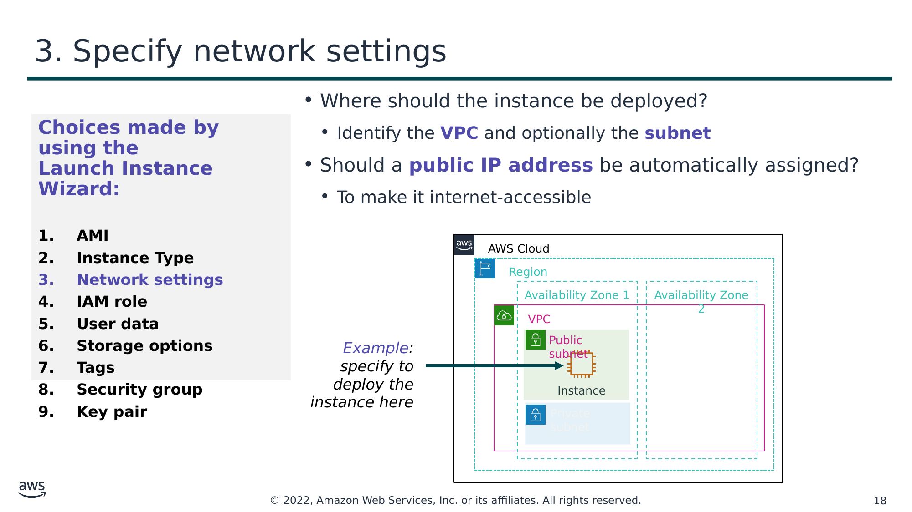

- Де слід розгорнути екземпляр?
  - Вкажіть **VPC** і, за бажанням, **підмережу (subnet)**
- Чи слід автоматично призначити **публічну IP-адресу (public IP address)**?
  - Щоб зробити його доступним з інтернету

**Вибір, що робляться за допомогою**  
**Launch Instance Wizard:**

1. **AMI**
2. **Тип екземпляра (Instance Type)**
3. **Мережеві налаштування (Network settings)**
4. **Роль IAM (IAM role)**
5. **Дані користувача (User data)**
6. **Варіанти сховища (Storage options)**
7. **Теги (Tags)**
8. **Група безпеки (Security group)**
9. **Пара ключів (Key pair)**

<details>
<summary>Текст зі схеми</summary>

AWS Cloud

Region (Регіон)

Availability Zone 1 (Зона доступності 1)

Availability Zone 2 (Зона доступності 2)

VPC

Public subnet (Публічна підмережа)

Instance (Екземпляр)

Private subnet (Приватна підмережа)

*Example**: specify to deploy the instance here (Приклад: укажіть, щоб розгорнути екземпляр тут)*

</details>

> **Нотатки:**
>
> Після вибору AMI і типу екземпляра потрібно вказати мережеве розташування, де буде розгорнуто екземпляр EC2. Вибір регіону слід зробити до запуску Launch Instance Wizard. Переконайтеся, що ви на сторінці правильного регіону консолі Amazon EC2, перш ніж обирати Launch Instance.  
>
> Коли ви запускаєте екземпляр у VPC за замовчуванням (default VPC), AWS за замовчуванням призначить йому публічну IP-адресу. Коли ви запускаєте екземпляр у VPC не за замовчуванням (nondefault VPC), підмережа має атрибут, що визначає, чи отримують екземпляри, запущені в цій підмережі, публічну IP-адресу з пулу публічних адрес IPv4. За замовчуванням AWS не призначатиме публічну IP-адресу екземплярам, запущеним у підмережі не за замовчуванням. Ви можете контролювати, чи отримує ваш екземпляр публічну IP-адресу, змінивши атрибут публічної IP-адресації вашої підмережі або ввімкнувши чи вимкнувши функцію публічної IP-адресації під час запуску (що перевизначає атрибут публічної IP-адресації підмережі).

---

## Слайд 19: 4. Прикріпіть роль IAM (необов’язково)

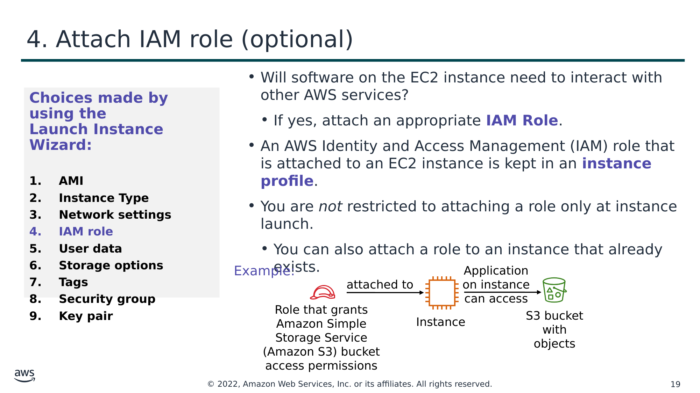

- Чи потрібно програмному забезпеченню на екземплярі EC2 взаємодіяти з іншими сервісами AWS?
  - Якщо так, прикріпіть відповідну **роль IAM (IAM Role)**.
- Роль AWS Identity and Access Management (IAM), прикріплена до екземпляра EC2, зберігається в **профілі екземпляра (instance profile)**.
- Ви *не обмежені* прикріпленням ролі лише під час запуску екземпляра.
  - Ви також можете прикріпити роль до вже наявного екземпляра.

**Вибір, що робляться за допомогою**  
**Launch Instance Wizard:**

1. **AMI**
2. **Тип екземпляра (Instance Type)**
3. **Мережеві налаштування (Network settings)**
4. **Роль IAM (IAM role)**
5. **Дані користувача (User data)**
6. **Варіанти сховища (Storage options)**
7. **Теги (Tags)**
8. **Група безпеки (Security group)**
9. **Пара ключів (Key pair)**

Приклад:

<details>
<summary>Текст зі схеми</summary>

Application on instance can access (Застосунок на екземплярі має доступ)

attached to (прикріплено до)

Role that grants Amazon Simple Storage Service (Amazon S3) bucket access permissions (Роль, що надає дозволи на доступ до бакета Amazon S3)

S3 bucket with objects (Бакет S3 з об’єктами)

Instance (Екземпляр)

</details>

> **Нотатки:**
>
> Поширена практика — використовувати екземпляри EC2 для запуску застосунку, що має виконувати безпечні виклики API до інших сервісів AWS. Для підтримки таких сценаріїв AWS дає змогу прикріпити роль AWS Identity and Access Management (IAM) до екземпляра EC2. Без цієї функції у вас може виникнути спокуса помістити облікові дані AWS на екземпляр EC2, щоб їх використовував застосунок, що працює на цьому екземплярі. Однак ніколи не слід зберігати облікові дані AWS на екземплярі EC2. Це вкрай небезпечно. Натомість прикріпіть до екземпляра EC2 роль IAM. Тоді роль IAM надає застосункам, що працюють на екземплярі EC2, дозвіл виконувати запити прикладного програмного інтерфейсу (API).  
>
> Профіль екземпляра (instance profile) — це контейнер для ролі IAM. Якщо ви використовуєте AWS Management Console для створення ролі для Amazon EC2, консоль автоматично створює профіль екземпляра та дає йому ту саму назву, що й ролі. Коли ви потім використовуєте консоль Amazon EC2 для запуску екземпляра з роллю IAM, ви можете вибрати роль для зв’язування з екземпляром. У консолі список, що відображається, насправді є списком назв профілів екземплярів.  
>
> У прикладі ви бачите, що роль IAM використовується для надання дозволів застосунку, що працює на екземплярі EC2. Застосунок має отримати доступ до бакета в Amazon S3.  
>
> Ви можете прикріпити роль IAM під час запуску екземпляра, але також можете прикріпити роль до вже запущеного екземпляра EC2. Коли ви визначаєте роль, яку може використовувати екземпляр EC2, ви визначаєте, які акаунти чи сервіси AWS можуть прийняти цю роль (assume the role). Ви також визначаєте, які дії API та ресурси застосунок може використовувати після прийняття ролі. Якщо ви змінюєте роль, зміна поширюється на всі екземпляри, до яких її прикріплено.

---

## Слайд 20: 5. Скрипт даних користувача (user data, необов’язково)

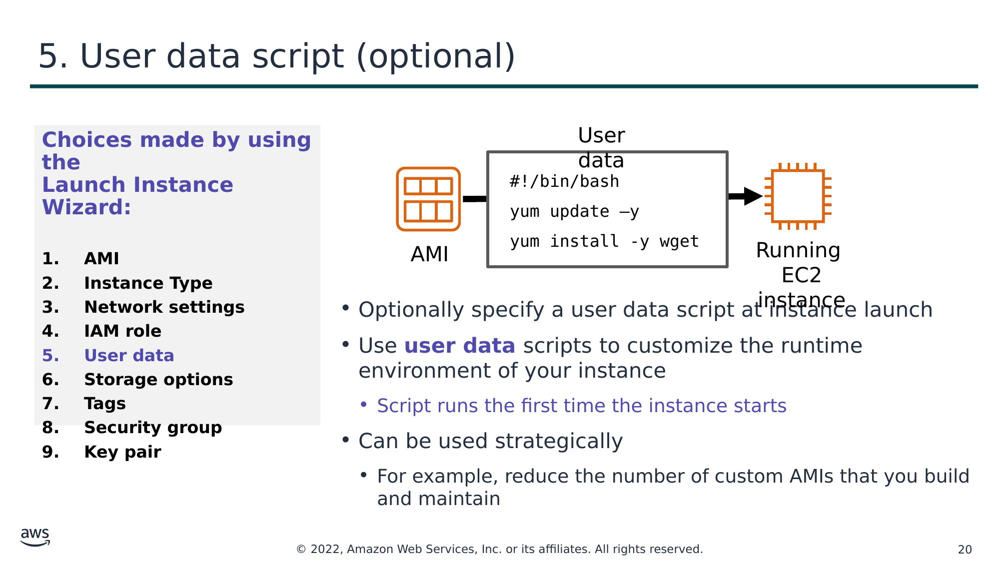

**Вибір, що робляться за допомогою**  
**Launch Instance Wizard:**

1. **AMI**
2. **Тип екземпляра (Instance Type)**
3. **Мережеві налаштування (Network settings)**
4. **Роль IAM (IAM role)**
5. **Дані користувача (User data)**
6. **Варіанти сховища (Storage options)**
7. **Теги (Tags)**
8. **Група безпеки (Security group)**
9. **Пара ключів (Key pair)**

- За бажанням укажіть скрипт даних користувача (user data) під час запуску екземпляра
- Використовуйте скрипти **даних користувача (user data)** для налаштування середовища виконання вашого екземпляра
  - Скрипт запускається під час першого старту екземпляра
- Можна використовувати стратегічно
  - Наприклад, щоб зменшити кількість власних AMI, які ви створюєте й підтримуєте

<details>
<summary>Текст зі схеми</summary>

User data (Дані користувача)

```
#!/bin/bash
yum update –y
yum install -y wget
```

AMI

Running  
EC2 instance (Запущений екземпляр EC2)

</details>

> **Нотатки:**
>
> Коли ви створюєте свої екземпляри EC2, у вас є можливість передати екземпляру дані користувача (user data). Дані користувача можуть автоматизувати завершення встановлень і налаштувань під час запуску екземпляра. Наприклад, скрипт даних користувача може встановлювати виправлення та оновлювати операційну систему екземпляра, отримувати й встановлювати ключі ліцензій на програмне забезпечення або встановлювати додаткове програмне забезпечення.  
>
> У прикладі скрипта даних користувача ви бачите простий триряд­ковий скрипт оболонки Bash для Linux. Перший рядок вказує, що скрипт має виконуватися оболонкою Bash. Другий рядок викликає утиліту Yellowdog Updater, Modified (YUM), яку зазвичай використовують у багатьох дистрибутивах Linux — як-от Amazon Linux, CentOS і Red Hat Linux — для отримання програмного забезпечення з онлайн-репозиторію та його встановлення. У другому рядку прикладу ця команда наказує YUM оновити всі встановлені пакети до найновіших версій, відомих репозиторію програмного забезпечення, до якого його налаштовано мати доступ. Третій рядок скрипта вказує, що слід встановити утиліту Wget. Wget — це поширена утиліта для завантаження файлів із вебу.  
>
> Для екземпляра Windows скрипт даних користувача слід писати у форматі, сумісному з вікном командного рядка (пакетні команди) або з Windows PowerShell. Докладніше див. документацію Windows User Data Scripts за адресою https://docs.aws.amazon.com/AWSEC2/latest/WindowsGuide/ec2-windows-user-data.html.  
>
> Коли екземпляр EC2 створюється, скрипт даних користувача виконується з привілеями root на завершальних етапах процесу завантаження. На екземплярах Linux його виконує служба cloud-init. На екземплярах Windows його виконує утиліта EC2Config або EC2Launch. За замовчуванням дані користувача виконуються лише під час першого запуску екземпляра. Однак якщо ви хочете, щоб скрипт даних користувача виконувався щоразу під час завантаження екземпляра, можна створити багаточастинний файл скрипта даних користувача Multipurpose Internet Mail Extensions (MIME) (цей процес застосовується нечасто). Докладніше див. https://aws.amazon.com/premiumsupport/knowledge-center/execute-user-data-ec2/

---

## Слайд 21: 6. Вкажіть сховище

- Налаштуйте кореневий том (root volume)
  - Де встановлено гостьову операційну систему
- Приєднайте додаткові томи сховища (необов’язково)
  - AMI може вже включати більше ніж один том
- Для кожного тому вкажіть:
  - **Розмір** диска (у ГБ)
  - **Тип тому**
    - Доступні різні типи твердотільних накопичувачів (SSD) і жорстких дисків (HDD)
  - Чи буде том видалено під час завершення роботи екземпляра
  - Чи слід використовувати **шифрування (encryption)**

**Вибір, що робляться за допомогою**  
**Launch Instance Wizard:**

1. **AMI**
2. **Тип екземпляра (Instance Type)**
3. **Мережеві налаштування (Network settings)**
4. **Роль IAM (IAM role)**
5. **Дані користувача (User data)**
6. **Варіанти сховища (Storage options)**
7. **Теги (Tags)**
8. **Група безпеки (Security group)**
9. **Пара ключів (Key pair)**

> **Нотатки:**
>
> Коли ви запускаєте екземпляр EC2, ви можете налаштувати варіанти сховища. Наприклад, можна налаштувати розмір кореневого тому, де встановлено гостьову операційну систему. Також можна приєднати додаткові томи сховища під час запуску екземпляра. Деякі AMI також налаштовані на запуск із більш ніж одним томом сховища за замовчуванням, щоб надати сховище, окреме від кореневого тому.  
>
> Для кожного тому, який матиме ваш екземпляр, можна вказати розмір дисків, типи томів та чи зберігатиметься сховище після завершення роботи екземпляра. Також можна вказати, чи слід використовувати шифрування.

---

## Слайд 22: Варіанти сховища Amazon EC2

- **Amazon Elastic Block Store (Amazon EBS) –**
  - Довговічні томи блочного сховища.
  - Ви можете зупинити екземпляр і знову запустити його, і дані все одно будуть на місці.
- **Amazon EC2 Instance Store –**
  - Ефемерне сховище (ephemeral storage) надається на дисках, приєднаних до хост-комп’ютера, де працює екземпляр EC2.
  - Якщо екземпляр зупиняється, збережені тут дані видаляються.
- Інші варіанти сховища (не для кореневого тому) –
  - Змонтуйте файлову систему **Amazon Elastic File System (Amazon EFS)**.
  - Підключіться до **Amazon Simple Storage Service (Amazon S3)**.

> **Нотатки:**
>
> Amazon Elastic Block Store (Amazon EBS) — це проста у використанні, високопродуктивна довговічна служба блочного сховища, розроблена для використання з Amazon EC2 як для робочих навантажень з інтенсивною пропускною здатністю, так і для навантажень з інтенсивними транзакціями. З Amazon EBS ви можете обирати з чотирьох різних типів томів, щоб збалансувати оптимальну ціну та продуктивність. Ви можете змінювати типи томів або збільшувати розмір тому без переривання роботи ваших критично важливих застосунків, тож у вас може бути економічно ефективне сховище, коли воно вам потрібне.  
>
> Amazon EC2 Instance Store надає ефемерне, або тимчасове, блочне сховище для вашого екземпляра. Це сховище розташоване на дисках, фізично приєднаних до хост-комп’ютера. Instance Store добре підходить, коли потрібно тимчасово зберігати інформацію, що часто змінюється, як-от буфери, кеші, тимчасові (scratch) дані та інший тимчасовий вміст. Instance Store також можна використовувати для даних, що реплікуються в парку екземплярів, наприклад у пулі вебсерверів із балансуванням навантаження. Якщо екземпляри зупиняються — через помилку користувача чи несправність — дані в instance store буде видалено.  
>
> Amazon Elastic File System (Amazon EFS) надає просту, масштабовану, повністю керовану еластичну файлову систему Network File System (NFS) для використання з хмарними сервісами AWS і локальними ресурсами. Її створено для масштабування за запитом до петабайтів без переривання роботи застосунків. Вона автоматично зростає й зменшується, коли ви додаєте та видаляєте файли, що зменшує потребу розгортати та контролювати потужності для задоволення зростання.  
>
> Amazon Simple Storage Service (Amazon S3) — це сервіс об’єктного сховища, що пропонує масштабованість, доступність даних, безпеку та продуктивність. Ви можете зберігати й захищати будь-який обсяг даних для різноманітних сценаріїв використання, як-от вебсайти, мобільні застосунки, резервне копіювання та відновлення, архівування, корпоративні застосунки, пристрої Інтернету речей (IoT) і аналітика великих даних.

---

## Слайд 23: Приклади варіантів сховища

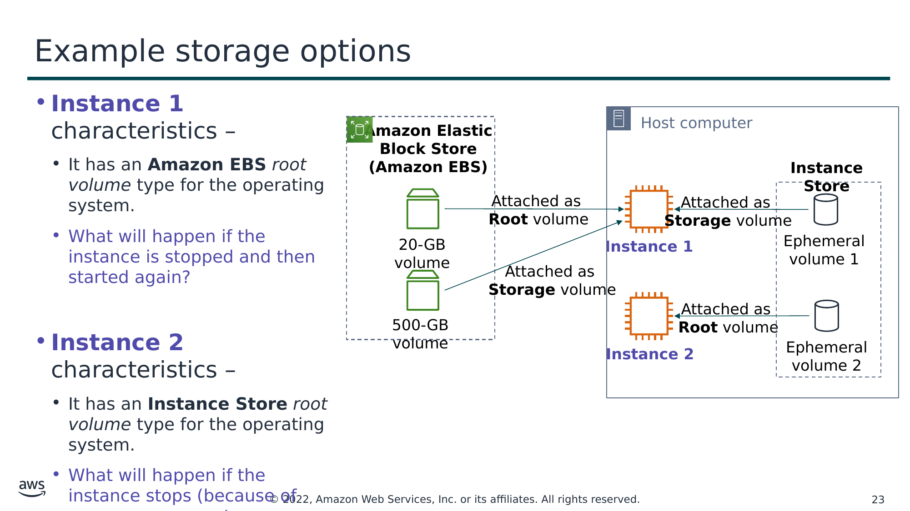

- Характеристики **екземпляра 1 (Instance 1)** –
  - Має тип кореневого тому (*root volume*) **Amazon EBS** для операційної системи.
  - Що станеться, якщо екземпляр буде зупинено, а потім знову запущено?
- Характеристики **екземпляра 2 (Instance 2)** –
  - Має тип кореневого тому (*root volume*) **Instance Store** для операційної системи.
  - Що станеться, якщо екземпляр зупиниться (через помилку користувача чи системну несправність)?

<details>
<summary>Текст зі схеми</summary>

Host computer (Хост-комп’ютер)

**Amazon Elastic Block Store (Amazon EBS)**

**Instance Store**

Attached as  
**Root** volume (Приєднано як **кореневий** том)

Attached as  
**Storage** volume (Приєднано як **накопичувальний** том)

20-GB volume (Том 20 ГБ)

**Instance 1 (Екземпляр 1)**

Ephemeral  
volume 1 (Ефемерний том 1)

Attached as  
**Storage** volume (Приєднано як **накопичувальний** том)

Attached as  
**Root** volume (Приєднано як **кореневий** том)

500-GB volume (Том 500 ГБ)

**Instance 2 (Екземпляр 2)**

Ephemeral volume 2 (Ефемерний том 2)

</details>

> **Нотатки:**
>
> Тут ви бачите два приклади того, як можна налаштувати варіанти сховища для екземплярів EC2.  
>
> Приклад Екземпляра 1 показує, що кореневий том — який містить ОС і, можливо, інші дані — зберігається в Amazon EBS. Цей екземпляр також має два приєднані томи. Один том — це том сховища Amazon EBS на 500 ГБ, а інший — том Instance Store. Якби цей екземпляр було зупинено, а потім знову запущено, ОС збереглася б, і будь-які дані, що зберігалися на томі Amazon EBS на 20 ГБ чи томі Amazon EBS на 500 ГБ, залишилися б незмінними. Однак будь-які дані, що зберігалися на ефемерному томі 1 (Ephemeral volume 1), були б безповоротно втрачені. Instance Store добре підходить для тимчасового зберігання інформації, що часто змінюється, як-от буфери, кеші, тимчасові дані та інший тимчасовий вміст.  
>
> Приклад Екземпляра 2 показує, що кореневий том розташований у instance store (ефемерний том 2). Екземпляр із кореневим томом Instance Store не можна зупинити викликом API Amazon EC2. Його можна лише завершити (terminate). Однак його можна зупинити зсередини ОС екземпляра (наприклад, видавши команду вимкнення) — або він може зупинитися через збій ОС чи диска — що призведе до завершення екземпляра. Якщо екземпляр було завершено, усі дані, що зберігалися на ефемерному томі 2, будуть втрачені, зокрема ОС. Ви не зможете знову запустити екземпляр. Тому не покладайтеся на Instance Store для цінних, довгострокових даних. Натомість використовуйте довговічніше сховище даних, як-от Amazon EBS, Amazon EFS чи Amazon S3.  
>
> Якщо екземпляр перезавантажується (навмисно чи ненавмисно), дані на кореневому томі instance store зберігаються.

---

## Слайд 24: 7. Додайте теги

- Тег (tag) — це мітка, яку можна призначити ресурсу AWS.
  - Складається з *ключа (key)* та необов’язкового *значення (value).*
- Теги — це спосіб прикріпити **метадані (metadata)** до екземпляра EC2.
- Потенційні переваги тегування — фільтрація, автоматизація, розподіл витрат і контроль доступу.

Приклад:

**Вибір, що робляться за допомогою**  
**Launch Instance Wizard:**

1. **AMI**
2. **Тип екземпляра (Instance Type)**
3. **Мережеві налаштування (Network settings)**
4. **Роль IAM (IAM role)**
5. **Дані користувача (User data)**
6. **Варіанти сховища (Storage options)**
7. **Теги (Tags)**
8. **Група безпеки (Security group)**
9. **Пара ключів (Key pair)**

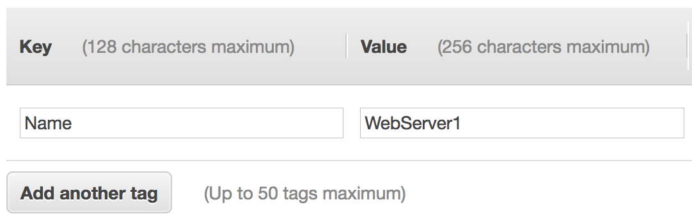

> **Нотатки:**
>
> Тег — це мітка, яку ви призначаєте ресурсу AWS. Кожен тег складається з ключа та необов’язкового значення, обидва з яких ви визначаєте. Теги дають змогу категоризувати ресурси AWS, як-от екземпляри EC2, різними способами. Наприклад, можна тегувати екземпляри за призначенням, власником чи середовищем.  
>
> Тегування — це спосіб прикріпити метадані до екземпляра EC2.  
>
> Ключі та значення тегів чутливі до регістру. Наприклад, поширений тег для екземплярів EC2 — це ключ тега з назвою Name і значення тега, що описує екземпляр, наприклад My Web Server. Тег Name за замовчуванням відображається на сторінці Instances консолі Amazon EC2. Однак якщо ви створите ключ із назвою name (з малої літери n), він не відображатиметься в стовпці Name у списку екземплярів (хоча все одно відображатиметься на панелі відомостей про екземпляр на вкладці Tags).  
>
> Найкраща практика — розробляти стратегії тегування. Використання узгодженого набору ключів тегів полегшує керування вашими ресурсами. Ви також можете шукати та фільтрувати ресурси на основі доданих вами тегів. Докладніше див. https://d1.awsstatic.com/whitepapers/aws-tagging-best-practices.pdf

---

## Слайд 25: 8. Налаштування групи безпеки

- Група безпеки (security group) — це **набір правил брандмауера**, що контролюють трафік до екземпляра.
  - Вона існує *поза* гостьовою ОС екземпляра.
- Створюйте **правила**, що вказують **джерело (source)** і які **порти** може використовувати мережевий обмін даними.
  - Вкажіть номер **порту** і **протокол**, як-от Transmission Control Protocol (TCP), User Datagram Protocol (UDP) або Internet Control Message Protocol (ICMP).
  - Вкажіть **джерело** (наприклад, IP-адресу або іншу групу безпеки), якому дозволено використовувати правило.

Приклад правила:

**Вибір, що робляться за допомогою**  
**Launch Instance Wizard:**

1. **AMI**
2. **Тип екземпляра (Instance Type)**
3. **Мережеві налаштування (Network settings)**
4. **Роль IAM (IAM role)**
5. **Дані користувача (User data)**
6. **Варіанти сховища (Storage options)**
7. **Теги (Tags)**
8. **Група безпеки (Security group)**
9. **Пара ключів (Key pair)**

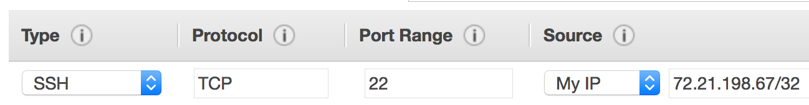

> **Нотатки:**
>
> Група безпеки діє як віртуальний брандмауер, що контролює мережевий трафік для одного чи кількох екземплярів. Коли ви запускаєте екземпляр, ви можете вказати одну чи кілька груп безпеки; інакше використовується група безпеки за замовчуванням.  
>
> Ви можете додавати правила до кожної групи безпеки. Правила дозволяють трафік до пов’язаних з нею екземплярів або від них. Ви можете змінювати правила групи безпеки в будь-який час, і нові правила автоматично застосовуватимуться до всіх екземплярів, пов’язаних із групою безпеки. Коли AWS вирішує, чи дозволити трафіку досягти екземпляра, оцінюються всі правила з усіх груп безпеки, пов’язаних з екземпляром. Коли ви запускаєте екземпляр у віртуальній приватній хмарі (VPC), потрібно або створити нову групу безпеки, або використати наявну в цій VPC. Після запуску екземпляра ви можете змінити його групи безпеки.  
>
> Коли ви визначаєте правило, ви можете вказати допустиме джерело мережевого обміну даними (вхідні правила, inbound rules) або призначення (вихідні правила, outbound rules). Джерелом може бути IP-адреса, діапазон IP-адрес, інша група безпеки, кінцева точка шлюзу VPC (gateway VPC endpoint) або будь-де (anywhere; це означає, що всі джерела будуть дозволені). За замовчуванням група безпеки включає вихідне правило, що дозволяє весь вихідний трафік. Ви можете видалити це правило та додати вихідні правила, що дозволяють лише певний вихідний трафік. Якщо у вашої групи безпеки немає вихідних правил, жоден вихідний трафік, що походить від вашого екземпляра, не дозволяється.  
>
> У прикладі правило дозволяє трафік Secure Shell (SSH) через порт Transmission Control Protocol (TCP) 22, якщо джерелом запиту є My IP. IP-адреса My IP обчислюється шляхом визначення того, з якої IP-адреси ви наразі підключені до хмари AWS, коли визначаєте правило.  
>
> Списки контролю доступу до мережі (network ACLs) також можна використовувати як брандмауери для захисту підмереж у VPC.  
>
> Для доступності: знімок екрана консолі EC2, де можна визначити правило групи безпеки. Він показує правило з типом SSH, протоколом TCP, діапазоном портів 22, джерелом My IP і блоком CIDR, що показує приклад IP-адреси My IP. Кінець опису для доступності.

---

## Слайд 26: 9. Визначте або створіть пару ключів (key pair)

- Під час запуску екземпляра ви вказуєте наявну пару ключів *або* створюєте нову пару ключів.
- Пара ключів складається з –
  - **Відкритого ключа (public key)**, який зберігає AWS.
  - Файлу **закритого ключа (private key)**, який зберігаєте ви.
- Вона забезпечує безпечні з’єднання з екземпляром.
- Для **AMI Windows –**
  - Використовуйте закритий ключ, щоб отримати пароль адміністратора, потрібний для входу до вашого екземпляра.
- Для **AMI Linux –**
  - Використовуйте закритий ключ, щоб за допомогою SSH безпечно підключитися до вашого екземпляра.

**Вибір, що робляться за допомогою**  
**Launch Instance Wizard:**

1. **AMI**
2. **Тип екземпляра (Instance Type)**
3. **Мережеві налаштування (Network settings)**
4. **Роль IAM (IAM role)**
5. **Дані користувача (User data)**
6. **Варіанти сховища (Storage options)**
7. **Теги (Tags)**
8. **Група безпеки (Security group)**
9. **Пара ключів (Key pair)**

mykey.pem

> **Нотатки:**
>
> Після того як ви вкажете всі потрібні конфігурації для запуску екземпляра EC2 і налаштуєте будь-які необов’язкові параметри майстра запуску EC2, вам показується вікно Review Instance Launch. Якщо потім ви оберете Launch, діалогове вікно запропонує обрати наявну пару ключів, продовжити без пари ключів або створити нову пару ключів, перш ніж можна буде обрати Launch Instances і створити екземпляр EC2.  
>
> Amazon EC2 використовує криптографію з відкритим ключем (public-key cryptography) для шифрування та розшифрування інформації для входу. Ця технологія використовує відкритий ключ для шифрування фрагмента даних, а потім одержувач використовує закритий ключ для розшифрування даних. Відкритий і закритий ключі відомі як пара ключів. Криптографія з відкритим ключем дає змогу безпечно отримувати доступ до ваших екземплярів за допомогою закритого ключа замість пароля.  
>
> Коли ви запускаєте екземпляр, ви вказуєте пару ключів. Можна вказати наявну пару ключів або нову пару ключів, яку ви створюєте під час запуску. Якщо ви створюєте нову пару ключів, завантажте її та збережіть у безпечному місці. Ця можливість — єдиний шанс зберегти файл закритого ключа.  
>
> Щоб підключитися до екземпляра Windows, використовуйте закритий ключ для отримання пароля адміністратора, а потім увійдіть у робочий стіл Windows екземпляра EC2 за допомогою протоколу віддаленого робочого стола (Remote Desktop Protocol, RDP). Щоб встановити з’єднання SSH із машини Windows до екземпляра Amazon EC2, можна використовувати інструмент на кшталт PuTTY, який вимагатиме той самий закритий ключ.  
>
> З екземплярами Linux під час завантаження вміст відкритого ключа розміщується на екземплярі. У ~/.ssh/authorized_keys створюється запис. Щоб увійти до вашого екземпляра Linux (наприклад, за допомогою SSH), потрібно надати закритий ключ під час встановлення з’єднання.

---

## Слайд 27: Вигляд запущеного екземпляра EC2 у консолі Amazon EC2

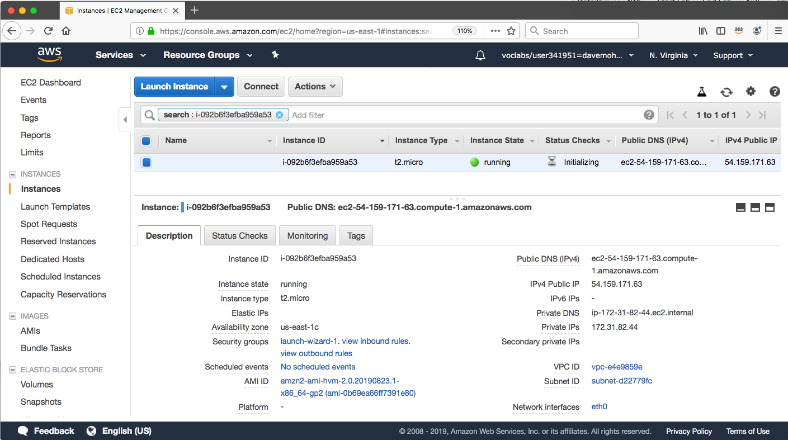

> **Нотатки:**
>
> Після вибору Launch Instances, а потім View Instances вам буде показано екран, подібний до прикладу.  
>
> Багато налаштувань, які ви вказали під час запуску, видно на панелі Description.  
>
> Інформація про наявний екземпляр включає IP-адресу та відомості про DNS-адресу, тип екземпляра, унікальний ідентифікатор екземпляра, призначений екземпляру, ідентифікатор AMI, з якого ви запустили екземпляр, ідентифікатор VPC, ідентифікатор підмережі тощо.  
>
> Багато з цих відомостей є гіперпосиланнями, які можна обрати, щоб дізнатися більше про ресурси, пов’язані із запущеним вами екземпляром EC2.

---

## Слайд 28: Інший варіант: запуск екземпляра EC2 за допомогою AWS Command Line Interface

- Екземпляри EC2 також можна створювати програмно.
- Цей приклад показує, наскільки простою може бути команда.
  - Ця команда припускає, що пара ключів і група безпеки вже існують.
  - Можна вказати більше параметрів. Докладніше див. [AWS CLI Command Reference](https://docs.aws.amazon.com/cli/latest/reference/ec2/run-instances.html).

AWS Command Line Interface (AWS CLI)

**Приклад команди:**

```
aws ec2 run-instances \
--image-id ami-1a2b3c4d \
--count 1 \
--instance-type c3.large \
--key-name MyKeyPair \
--security-groups MySecurityGroup \
--region us-east-1
```

> **Нотатки:**
>
> Також можна запускати екземпляри EC2 програмно — або за допомогою AWS Command Line Interface (AWS CLI), або за допомогою одного з наборів для розробки програмного забезпечення AWS (SDK).  
>
> У прикладі команди AWS CLI ви бачите одну команду, що вказує мінімальну інформацію, потрібну для запуску екземпляра. Команда включає таку інформацію:  
> aws — вказує виклик утиліти командного рядка aws.  
> ec2 — вказує виклик команди сервісу ec2.  
> run-instances — підкоманда, що викликається.  
>
> Решта команди вказує кілька параметрів, зокрема:  
> image-id — за цим параметром іде ідентифікатор AMI. Усі AMI мають унікальний ідентифікатор AMI.  
> count — можна вказати більше одного.  
> instance-type — можна вказати тип екземпляра, щоб створити (наприклад) екземпляр c3.large  
> key-name — у прикладі припускається, що MyKeyPair уже існує.  
> security-groups — у цьому прикладі припускається, що MySecurityGroup уже існує.  
> region — AMI існують у регіоні AWS, тож потрібно вказати регіон, де AWS CLI знайде AMI та запустить екземпляр EC2.  
>
> Команда має успішно створити екземпляр EC2, якщо:  
> Команду сформовано правильно  
> Ресурси, потрібні команді, уже існують  
> У вас достатньо дозволів для виконання команди  
> У вас достатньо потужностей в акаунті AWS  
> Якщо команда успішна, API відповідає на команду ідентифікатором екземпляра та іншими відповідними даними для використання вашим застосунком у наступних запитах API.

---

## Слайд 29: Життєвий цикл екземпляра Amazon EC2

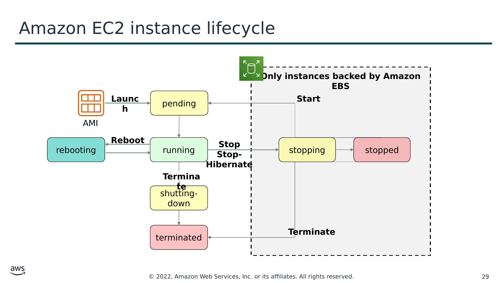

<details>
<summary>Текст зі схеми</summary>

**Start (Запуск)**

**Only instances backed by Amazon EBS (Лише екземпляри на основі Amazon EBS)**

**Launch (Запустити)**

pending

**Terminate (Завершити)**

AMI

shutting-down

rebooting

**Reboot (Перезавантажити)**

running

stopping

stopped

terminated

**Stop (Зупинити)**

**Stop-Hibernate (Зупинити з гібернацією)**

**Terminate (Завершити)**

</details>

> **Нотатки:**
>
> Тут ви бачите життєвий цикл екземпляра. Стрілки показують дії, які можна виконати, а прямокутники — стан, у який перейде екземпляр після цієї дії. Екземпляр може перебувати в одному з таких станів:  
> Pending (очікування) — коли екземпляр уперше запускається з AMI або коли ви запускаєте зупинений екземпляр, він переходить у стан pending, поки екземпляр завантажується та розгортається на хост-комп’ютері. Тип екземпляра, який ви вказали під час запуску, визначає апаратне забезпечення хост-комп’ютера для вашого екземпляра.  
> Running (працює) — коли екземпляр повністю завантажено й він готовий, він виходить зі стану pending і переходить у стан running. Ви можете підключитися до запущеного екземпляра через інтернет.  
> Rebooting (перезавантаження) — AWS рекомендує перезавантажувати екземпляр за допомогою консолі Amazon EC2, AWS CLI чи AWS SDK замість виклику перезавантаження зсередини гостьової операційної системи (ОС). Перезавантажений екземпляр залишається на тому самому фізичному хості, зберігає те саме публічне DNS-ім’я та ту саму публічну IP-адресу, а якщо він має томи instance store, зберігає дані на цих томах.  
> Shutting down (завершення роботи) — цей стан є проміжним між running і terminated.  
> Terminated (завершено) — завершений екземпляр залишається видимим у консолі Amazon EC2 ще деякий час, перш ніж віртуальну машину буде видалено. Однак ви не можете підключитися до завершеного екземпляра чи відновити його.  
> Stopping (зупинка) — екземпляри на основі Amazon EBS можна зупинити. Вони переходять у стан stopping, перш ніж досягнути повністю зупиненого стану.  
> Stopped (зупинено) — зупинений екземпляр не коштуватиме так само, як запущений. Запуск зупиненого екземпляра повертає його в стан pending, що переміщує екземпляр на нову хост-машину.

---

## Слайд 30: Варіант гібернації екземпляра (instance hibernation)

<!-- hidden slide -->

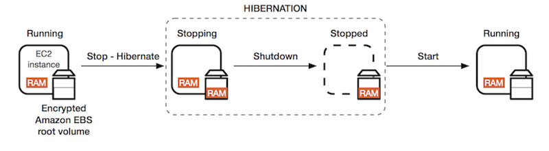

- Переваги
  - Зберігає вміст пам’яті екземпляра (RAM).
  - Під час перезапуску екземпляра вміст RAM перезавантажується, а раніше запущені процеси відновлюються.
  - Ви можете заощадити кошти в стані гібернації порівняно з працюючим станом (вартість подібна до зупиненого екземпляра).
- Передумови
  - Це підтримують лише певні AMI Linux (як-от Amazon Linux 2) і лише певні сімейства екземплярів.
  - Екземпляр повинен мати зашифрований кореневий том Amazon EBS і щонайбільше 150 ГБ RAM.
  - Гібернацію потрібно ввімкнути під час запуску екземпляра.

> **Нотатки:**
>
> Деякі екземпляри на основі Amazon EBS підтримують гібернацію. Коли ви переводите екземпляр у гібернацію, гостьова ОС зберігає вміст пам’яті екземпляра (RAM) на ваш кореневий том Amazon EBS. Коли ви перезапускаєте екземпляр, кореневий том відновлюється до попереднього стану, вміст RAM перезавантажується, а процеси, що раніше працювали на екземплярі, відновлюються.  
>
> Гібернацію підтримують лише певні AMI Linux на основі Amazon EBS та певні інші типи екземплярів. Гібернація також вимагає шифрування кореневого тому EBS. Крім того, гібернацію потрібно ввімкнути під час першого запуску екземпляра. Не можна ввімкнути гібернацію на наявному екземплярі, для якого її спочатку не було ввімкнено.  
>
> Докладніше про передумови та вартість див. https://docs.aws.amazon.com/AWSEC2/latest/UserGuide/Hibernate.html.

---

## Слайд 31: Розгляньте використання еластичної IP-адреси (Elastic IP address)

- **Перезавантаження (Rebooting)** екземпляра *не* змінює жодних IP-адрес чи DNS-імен хостів.
- Коли екземпляр **зупиняється (stopped)**, а потім знову **запускається (started)** –
  - *Публічна* адреса IPv4 та *зовнішнє* DNS-ім’я хоста змінюються.
  - *Приватна* адреса IPv4 та внутрішнє DNS-ім’я хоста *не* змінюються.

- Якщо вам потрібна постійна публічна IP-адреса –
  - Пов’яжіть із екземпляром **еластичну IP-адресу (Elastic IP address)**.
- Характеристики еластичної IP-адреси –
  - Може бути пов’язана з екземплярами в регіоні за потреби.
  - Залишається виділеною вашому акаунту, доки ви не вирішите її звільнити.

Elastic IP Address

> **Нотатки:**
>
> Публічна IP-адреса — це адреса IPv4, досяжна з інтернету. Кожен екземпляр, що отримує публічну IP-адресу, також отримує зовнішнє DNS-ім’я хоста. Наприклад, якщо публічна IP-адреса, призначена екземпляру, — 203.0.113.25, то зовнішнім DNS-іменем хоста може бути ec2-203-0-113-25.compute-1.amazonaws.com.  
>
> Якщо ви вказуєте, що вашому екземпляру слід призначити публічну IP-адресу, вона призначається з пулу публічних адрес IPv4 AWS. Публічна IP-адреса не пов’язана з вашим акаунтом AWS. Коли публічну IP-адресу від’єднують від вашого екземпляра, її повертають у пул публічних адрес IPv4, і ви не зможете вказати, що хочете використати її повторно. AWS звільняє публічну IP-адресу вашого екземпляра, коли екземпляр зупиняється чи завершується. Ваш зупинений екземпляр отримує нову публічну IP-адресу під час перезапуску.  
>
> Якщо вам потрібна постійна публічна IP-адреса, ви можете пов’язати з екземпляром еластичну IP-адресу. Щоб пов’язати еластичну IP-адресу, спершу потрібно виділити нову еластичну IP-адресу в регіоні, де існує екземпляр. Після виділення еластичної IP-адреси ви можете пов’язати її з екземпляром EC2.  
>
> За замовчуванням усі акаунти AWS обмежені п’ятьма (5) еластичними IP-адресами на регіон, оскільки публічні (IPv4) інтернет-адреси є дефіцитним публічним ресурсом. Однак це м’яке обмеження (soft limit), і ви можете запросити збільшення ліміту (яке може бути схвалено).

---

## Слайд 32: Метадані екземпляра EC2 (instance metadata)

- **Метадані екземпляра (Instance metadata)** — це дані про ваш екземпляр.
- Поки ви підключені до екземпляра, ви можете переглядати їх –
  - У браузері: `http://169.254.169.254/latest/meta-data/`
  - У вікні терміналу: `curl http://169.254.169.254/latest/meta-data/`
- Приклади значень, які можна отримати –
  - Публічна IP-адреса, приватна IP-адреса, публічне ім’я хоста, ідентифікатор екземпляра, групи безпеки, регіон, зона доступності.
  - Будь-які дані користувача, указані під час запуску екземпляра, також доступні за адресою: `http://169.254.169.254/latest/user-data/`
- Їх можна використовувати для налаштування чи керування запущеним екземпляром.
  - Наприклад, напишіть скрипт конфігурації, що читає метадані та використовує їх для налаштування застосунків чи параметрів ОС.

> **Нотатки:**
>
> Метадані екземпляра — це дані про ваш екземпляр. Ви можете переглядати їх, поки підключені до екземпляра. Щоб отримати до них доступ у браузері, перейдіть за такою URL-адресою: http://169.254.169.254/latest/meta-data/. Дані також можна читати програмно, наприклад з вікна терміналу, у якому є утиліта cURL. У вікні терміналу виконайте curl http://169.254.169.254/latest/meta-data/ — щоб отримати їх. IP-адреса 169.254.169.254 — це адреса канального рівня (link-local address) і дійсна лише з екземпляра.  
> Метадані екземпляра надають значну частину тієї самої інформації про запущений екземпляр, яку можна знайти в AWS Management Console. Наприклад, ви можете дізнатися публічну IP-адресу, приватну IP-адресу, публічне ім’я хоста, ідентифікатор екземпляра, групи безпеки, регіон, зону доступності тощо.  
> Будь-які дані користувача, указані під час запуску екземпляра, також доступні за такою URL-адресою: http://169.254.169.254/latest/user-data.  
> Метадані екземпляра EC2 можна використовувати для налаштування чи керування запущеним екземпляром. Наприклад, ви можете написати скрипт конфігурації, що отримує доступ до інформації метаданих і використовує її для налаштування застосунків чи параметрів ОС.

---

## Слайд 33: Amazon CloudWatch для моніторингу

- Використовуйте **Amazon CloudWatch** для моніторингу екземплярів EC2
  - Надає метрики майже в реальному часі
  - Надає діаграми на вкладці **Monitoring** консолі Amazon EC2, які можна переглядати
  - Зберігає 15 місяців історичних даних
- **Базовий моніторинг (Basic monitoring)**
  - За замовчуванням, без додаткової плати
  - Дані метрик надсилаються в CloudWatch кожні 5 хвилин
- **Детальний моніторинг (Detailed monitoring)**
  - Фіксована щомісячна ставка за сім попередньо вибраних метрик
  - Дані метрик доставляються щохвилини

Amazon CloudWatch

Instance with CloudWatch (Екземпляр із CloudWatch)

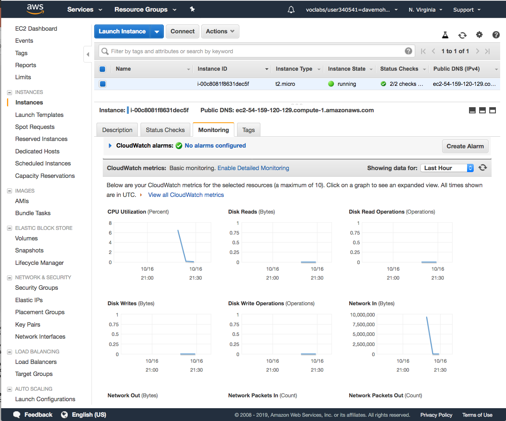

> **Нотатки:**
>
> Ви можете відстежувати свої екземпляри за допомогою Amazon CloudWatch, що збирає й обробляє необроблені дані з Amazon EC2 у зрозумілі метрики майже в реальному часі. Ця статистика записується протягом 15 місяців, тож ви можете отримати доступ до історичної інформації та краще зрозуміти, як працює ваш вебзастосунок чи сервіс.  
>
> За замовчуванням Amazon EC2 надає базовий моніторинг, що надсилає дані метрик у CloudWatch з періодом 5 хвилин. Щоб надсилати дані метрик вашого екземпляра в CloudWatch з періодом 1 хвилина, можна ввімкнути детальний моніторинг на екземплярі. Докладніше див. «Увімкнення чи вимкнення детального моніторингу для ваших екземплярів» (Enable or Disable Detailed Monitoring for Your Instances) за адресою https://docs.aws.amazon.com/AWSEC2/latest/UserGuide/using-cloudwatch-new.html.  
>
> Консоль Amazon EC2 відображає низку графіків на основі необроблених даних з Amazon CloudWatch. Залежно від ваших потреб, ви можете віддати перевагу отриманню даних про ваші екземпляри з Amazon CloudWatch замість графіків у консолі. За замовчуванням Amazon CloudWatch не надає метрик RAM для екземплярів EC2, хоча це опція, яку можна налаштувати, якщо ви хочете, щоб CloudWatch збирав ці дані.

---

## Слайд 34: Ключові висновки розділу 2

- **Amazon EC2** дає змогу запускати **віртуальні машини** Windows і Linux у хмарі.
- Ви запускаєте **екземпляри EC2** із шаблону **AMI** у VPC у вашому акаунті.
- Ви можете обирати з багатьох **типів екземплярів**. Кожен тип екземпляра пропонує різні комбінації можливостей ЦП, RAM, сховища та мережі.
- Ви можете налаштувати **групи безпеки** для контролю доступу до екземплярів (укажіть дозволені порти та джерело).
- **Дані користувача (User data)** дають змогу вказати скрипт, що виконується під час першого запуску екземпляра.
- Лише **екземпляри на основі Amazon EBS можна зупинити.**
- Ви можете використовувати **Amazon CloudWatch**, щоб збирати й переглядати метрики екземплярів EC2.

> **Нотатки:**
>
> Основні висновки цього розділу модуля:  
> Amazon EC2 дає змогу запускати віртуальні машини Windows і Linux у хмарі.  
> Ви запускаєте екземпляри EC2 із шаблону AMI у VPC у вашому акаунті.  
> Ви можете обирати з багатьох типів екземплярів. Кожен тип екземпляра пропонує різні комбінації можливостей ЦП, RAM, сховища та мережі.  
> Ви можете налаштувати групи безпеки для контролю доступу до екземплярів (укажіть дозволені порти та джерело).  
> Дані користувача дають змогу вказати скрипт, що виконується під час першого запуску екземпляра.  
> Лише екземпляри на основі Amazon EBS можна зупинити.  
> Ви можете використовувати Amazon CloudWatch, щоб збирати й переглядати метрики екземплярів EC2.

---

## Слайд 35: Записана демонстрація Amazon EC2

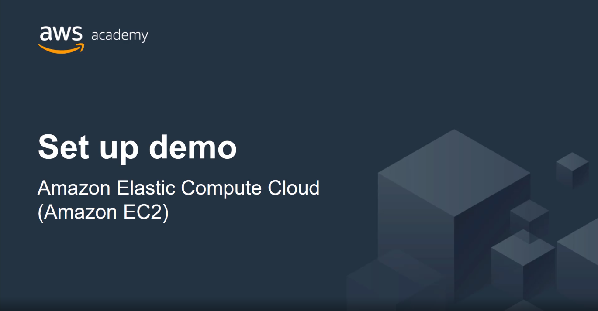

> **Нотатки:**
>
> Тепер знайдіть хвилинку, щоб переглянути демонстрацію EC2 за адресою https://aws-tc-largeobjects.s3-us-west-2.amazonaws.com/ILT-TF-100-ACFNDS-20-EN/Module_6_EC2+v2.0.mp4. Запис триває трохи більше 3 хвилин і закріплює деякі концепції, обговорені в цьому розділі модуля.  
>
> Демонстрація показує:  
> Як використати AWS Management Console для запуску екземпляра Amazon EC2 (з прийняттям усіх налаштувань екземпляра за замовчуванням).  
> Як підключитися до екземпляра Windows за допомогою клієнта віддаленого робочого стола (Remote Desktop) і пари ключів, визначеної під час запуску екземпляра, щоб розшифрувати пароль Windows для входу.  
> Як завершити екземпляр після того, як він більше не потрібен.

---

## Слайд 36: Лабораторна робота 3: Introduction to Amazon EC2 (вступ до Amazon EC2)


> **Нотатки:**
>
> Представляємо Лабораторну роботу 3: Introduction to Amazon EC2. Ця лабораторна робота надає практичний досвід запуску, зміни розміру, керування та моніторингу екземпляра Amazon EC2.

---

## Слайд 37: Сценарій лабораторної роботи 3

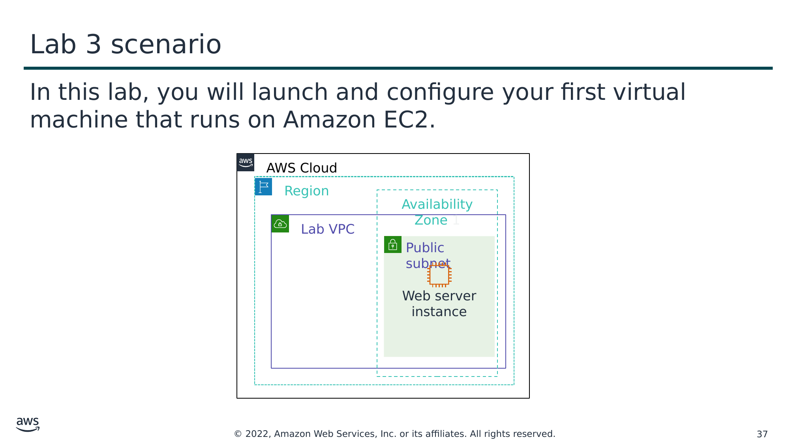

У цій лабораторній роботі ви запустите й налаштуєте свою першу віртуальну машину, що працює на Amazon EC2.

<details>
<summary>Текст зі схеми</summary>

AWS Cloud

Region (Регіон)

Availability Zone 1 (Зона доступності 1)

Lab VPC

Public subnet (Публічна підмережа)

Web server  
instance (Екземпляр вебсервера)

</details>

> **Нотатки:**
>
> Представляємо Лабораторну роботу 3: Introduction to Amazon EC2.  
>
> У цій лабораторній роботі ви запустите й налаштуєте віртуальну машину, що працює на Amazon EC2.

---

## Слайд 38: Лабораторна робота 3: завдання

- Завдання 1 – Запуск вашого екземпляра Amazon EC2 (Launch Your Amazon EC2 Instance)
- Завдання 2 – Моніторинг вашого екземпляра (Monitor Your Instance)
- Завдання 3 – Оновлення вашої групи безпеки та доступ до вебсервера (Update Your Security Group and Access the Web Server)
- Завдання 4 – Зміна розміру вашого екземпляра: тип екземпляра та том EBS (Resize Your Instance: Instance Type and EBS Volume)
- Завдання 5 – Дослідження лімітів EC2 (Explore EC2 Limits)
- Завдання 6 – Перевірка захисту від завершення роботи (Test Termination Protection)

> **Нотатки:**
>
> У цій практичній лабораторній роботі ви:  
> Запустите свій екземпляр Amazon EC2  
> Відстежуватимете свій екземпляр  
> Оновите свою групу безпеки та отримаєте доступ до вебсервера  
> Зміните розмір свого екземпляра: тип екземпляра та том EBS  
> Дослідите ліміти EC2  
> Перевірите захист від завершення роботи (termination protection)

---

## Слайд 39: Лабораторна робота 3: підсумковий результат

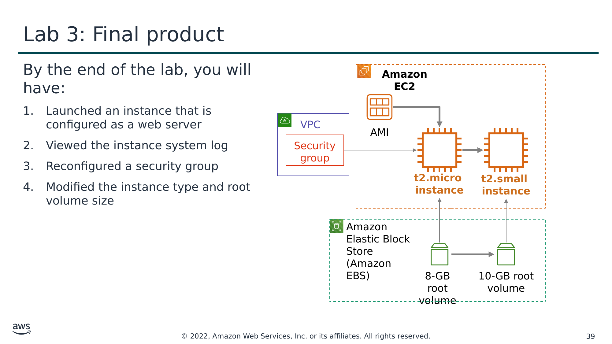

Наприкінці лабораторної роботи ви:

1. Запустите екземпляр, налаштований як вебсервер
2. Переглянете системний журнал екземпляра
3. Переналаштуєте групу безпеки
4. Зміните тип екземпляра та розмір кореневого тому

<details>
<summary>Текст зі схеми</summary>

**Amazon EC2**

VPC

Security group (Група безпеки)

AMI

**t2.micro**

**instance (екземпляр)**

**t2.small**

**instance (екземпляр)**

Amazon Elastic Block Store (Amazon EBS)

8-GB root volume (Кореневий том 8 ГБ)

10-GB root volume (Кореневий том 10 ГБ)

</details>

> **Нотатки:**
>
> Наприкінці лабораторної роботи ви:  
> Запустите екземпляр, налаштований як вебсервер  
> Переглянете системний журнал екземпляра  
> Переналаштуєте групу безпеки  
> Зміните тип екземпляра та розмір кореневого тому

---

## Слайд 40: Початок лабораторної роботи 3: Introduction to Amazon EC2

~ 35 хвилин

> **Нотатки:**
>
> Настав час розпочати лабораторну роботу.

---

## Слайд 41: Підсумки лабораторної роботи: ключові висновки


> **Нотатки:**
>
> Викладач проведе обговорення ключових висновків із лабораторної роботи після її завершення.

---

## Слайд 42: Практична вправа: Amazon EC2


Фото: Pixabay (Pexels).

> **Нотатки:**
>
> У цій вправі під керівництвом викладача ви обговорите переваги й недоліки використання Amazon EC2 порівняно з використанням керованого сервісу, як-от Amazon Relational Database Service (Amazon RDS).

---

## Слайд 43: Практична вправа: збирання інформації

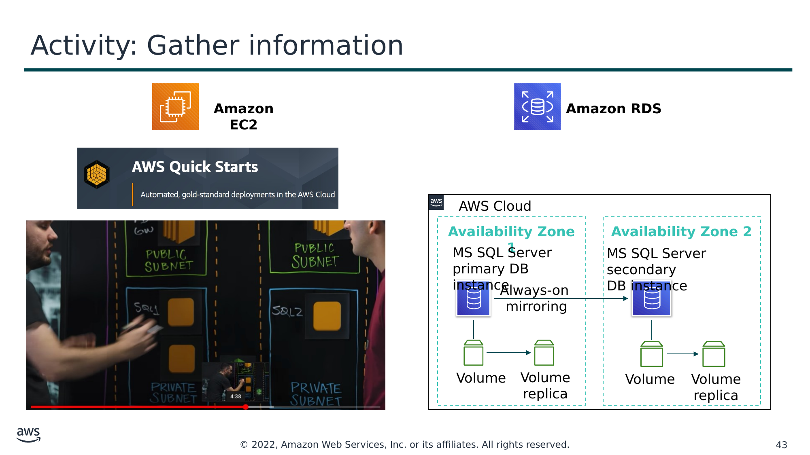

**Amazon EC2**

**Amazon RDS**

<details>
<summary>Текст зі схеми</summary>

AWS Cloud

**Availability Zone 1 (Зона доступності 1)**

**Availability Zone 2 (Зона доступності 2)**

MS SQL Server primary DB instance (Основний екземпляр БД MS SQL Server)

MS SQL Server secondary  
DB instance (Резервний екземпляр БД MS SQL Server)

Always-on  
mirroring (Дзеркалювання Always-on)

Volume (Том)

Volume (Том)

replica (репліка)

Volume (Том)

Volume replica (Репліка тому)

</details>

> **Нотатки:**
>
> Мета цієї вправи — продемонструвати, що ви розумієте відмінності між створенням розгортання з використанням Amazon EC2 і використанням повністю керованого сервісу, як-от Amazon RDS, для розгортання вашого рішення. Наприкінці цієї вправи ви маєте бути готові обговорити переваги й недоліки розгортання Microsoft SQL Server на Amazon EC2 порівняно з розгортанням на Amazon RDS.  
>
> Викладач попросить вас:  
> 1. Переглянути 8-хвилинне відео за адресою https://www.youtube.com/watch?v=UYy-UeQ29jo&did=ta_card&trk=ta_card — що пояснює переваги розгортання Microsoft SQL Server на Amazon EC2 за допомогою AWS Quick Start – SQL Server Reference Architecture: https://aws.amazon.com/quickstart/architecture/sql/ deployment. Радимо робити нотатки.  
> 2. Прочитати допис у блозі за адресою https://aws.amazon.com/blogs/publicsector/the-scoop-on-moving-your-microsoft-sql-server-to-aws/about про переваги запуску Microsoft SQL Server на Amazon RDS. Знову ж таки радимо робити нотатки.  
> 3. Взяти участь у обговоренні в класі запитань, поставлених на наступному слайді.

---

## Слайд 44: Практична вправа: перевірте своє розуміння

1. Що з Amazon EC2 чи Amazon RDS надає кероване обслуговування (managed service)? Що означає *кероване обслуговування*?
   - **ВІДПОВІДЬ:** Amazon RDS надає кероване обслуговування. Amazon RDS бере на себе розгортання, встановлення та виправлення, автоматичне резервне копіювання, відновлення зі знімків на певний момент часу, високу доступність і моніторинг.
2. Назвіть принаймні одну перевагу розгортання Microsoft SQL Server на Amazon EC2 замість Amazon RDS.
   - **ВІДПОВІДЬ:** Amazon EC2 пропонує повний контроль над кожною конфігурацією, ОС і стеком програмного забезпечення.
3. Яку перевагу надає Quick Start порівняно з ручним встановленням на Amazon EC2?
   - **ВІДПОВІДЬ:** Quick Start — це еталонна архітектура з перевіреними найкращими практиками, вбудованими в проєкт.
4. Який варіант розгортання пропонує найкращий підхід для всіх сценаріїв використання?
   - **ВІДПОВІДЬ:** Жоден. Правильний варіант розгортання залежить від ваших конкретних потреб.
5. Який підхід коштує дорожче: використання Amazon EC2 чи використання Amazon RDS?
   - **ВІДПОВІДЬ:** Залежить. Керування розгортанням бази даних на Amazon EC2 вимагає більшого нагляду з боку клієнта й більше часу. Якщо пріоритет — час, то Amazon RDS може бути дешевшим. Якщо у вас є власна експертиза, Amazon EC2 може бути економічно ефективнішим.

> **Нотатки:**
>
> Викладач проведе обговорення з класом у міру розкриття кожного запитання. Потім викладач покаже письмові запропоновані відповіді, і ви зможете додатково обговорити ці пункти.  
>
> Щодо запитання 5: відповідь ґрунтувалася на інформації, наведеній на сторінках цін AWS станом на жовтень 2019 року.  
> Для Amazon RDS ви платите 0,977 долара за годину, якщо запускаєте Microsoft SQL Server за такими параметрами:  
> Екземпляр — стандартний (Single-AZ)  
> Розмір екземпляра — db.m5.large  
> Регіон — US East (Ohio)  
> Ціноутворення — екземпляр за запитом (On-Demand Instance)  
> Для Amazon EC2 ви платите 0,668 долара за годину, якщо запускаєте Microsoft SQL Server за такими параметрами:  
> Екземпляр — екземпляр Windows  
> Розмір екземпляра — m5.large  
> Регіон — US East (Ohio)  
> Ціноутворення — екземпляр за запитом (On-Demand Instance)  
>
> Розглядаючи вартість, не забудьте включити вартість праці. Наприклад, пам’ятайте, що зі стандартним розгортанням Amazon RDS Single-AZ — яке є основою наведеного прикладу ціни — надається автоматичне резервне копіювання.  З Amazon RDS, якби компонент екземпляра БД вийшов з ладу й була б потрібна ініційована користувачем операція відновлення, у вас була б резервна копія, яку можна відновити й використати. Якщо ви запускаєте базу даних на Amazon EC2, ви можете налаштувати так само надійну процедуру резервного копіювання для Microsoft SQL Server. Однак для побудови такого рішення знадобляться час, знання та технічна майстерність. Вам також доведеться налаштувати рішення заздалегідь, до виникнення ситуації, коли воно знадобиться. З цих причин, розглядаючи потреби ваших розгортань комплексно, ви можете виявити, що використання Amazon RDS дешевше, ніж використання Amazon EC2. Однак якщо у вас у штаті є кваліфіковані адміністратори баз даних — і також є дуже специфічні вимоги до розгортання, через які вам краще мати повний контроль над усіма аспектами розгортання, — ви можете використати Amazon EC2. У цьому випадку ви можете виявити, що Amazon EC2 є економічно ефективнішим рішенням.

---

## Слайд 45: Розділ 3: Оптимізація витрат Amazon EC2

Модуль 6: Обчислення

> **Нотатки:**
>
> Представляємо Розділ 3: Оптимізація витрат Amazon EC2.

---

## Слайд 46: Моделі ціноутворення Amazon EC2

**Екземпляри за запитом (On-Demand Instances)**

- Оплата за годину
- Без довгострокових зобов’язань.
- Доступні в межах [AWS Free Tier](https://aws.amazon.com/free/).

**Виділені хости (Dedicated Hosts)**

- Фізичний сервер із потужностями екземплярів EC2, повністю виділеними для вашого використання.

**Виділені екземпляри (Dedicated Instances)**

- Екземпляри, що працюють у VPC на апаратному забезпеченні, виділеному одному клієнту.

**Зарезервовані екземпляри (Reserved Instances)**

- Повна, часткова або відсутня авансова оплата за резервований вами екземпляр.
- Знижка на погодинну плату за цей екземпляр.
- Термін 1 рік або 3 роки.

**Заплановані зарезервовані екземпляри (Scheduled Reserved Instances)**

- Придбайте резервування потужностей, що завжди доступні за вказаним вами періодичним розкладом.
- Термін 1 рік.

**Спотові екземпляри (Spot Instances)**

- Екземпляри працюють, доки вони доступні й ваша ставка перевищує ціну спотового екземпляра.
- Їх може перервати AWS із 2-хвилинним сповіщенням.
- Варіанти переривання включають завершення, зупинку або гібернацію.
- Ціни можуть бути значно нижчими порівняно з екземплярами за запитом
- Гарний вибір, коли у вас є гнучкість щодо часу роботи ваших застосунків.

**Посекундна тарифікація (Per second billing)** доступна для екземплярів за запитом, зарезервованих екземплярів і

спотових екземплярів, що працюють на Amazon Linux або Ubuntu.

> **Нотатки:**
>
> Amazon пропонує різні моделі ціноутворення на вибір, коли ви хочете запускати екземпляри EC2.  
> Посекундна тарифікація доступна лише для екземплярів за запитом, зарезервованих екземплярів і спотових екземплярів, що працюють на Amazon Linux або Ubuntu.  
> Екземпляри за запитом (On-Demand Instances) доступні в межах AWS Free Tier (https://aws.amazon.com/free/). Вони мають найнижчі початкові витрати та найбільшу гнучкість. Немає авансових зобов’язань чи довгострокових контрактів. Це гарний вибір для застосунків із короткостроковими, різкими чи непередбачуваними робочими навантаженнями.  
> Виділені хости (Dedicated Hosts) — це фізичні сервери з потужностями екземплярів, виділеними для вашого використання. Вони дають змогу використовувати наявні ліцензії на програмне забезпечення за сокет, за ядро або за віртуальну машину, як-от для Microsoft Windows чи Microsoft SQL Server.  
> Виділені екземпляри (Dedicated Instances) — це екземпляри, що працюють у віртуальній приватній хмарі (VPC) на апаратному забезпеченні, виділеному одному клієнту. Вони фізично ізольовані на рівні хостового апаратного забезпечення від екземплярів, що належать іншим акаунтам AWS.  
> Зарезервовані екземпляри (Reserved Instances) дають змогу резервувати обчислювальні потужності на термін 1 рік або 3 роки з нижчими погодинними витратами на роботу. Знижена ціна використання фіксується, доки ви володієте зарезервованим екземпляром. Якщо ви очікуєте стабільного інтенсивного використання, вони можуть забезпечити значну економію порівняно з екземплярами за запитом.  
> Заплановані зарезервовані екземпляри (Scheduled Reserved Instances) дають змогу придбати резервування потужностей, що повторюються щодня, щотижня чи щомісяця, із вказаною тривалістю на термін 1 рік. Ви платите за час, на який заплановано екземпляри, навіть якщо не використовуєте їх.  
> Спотові екземпляри (Spot Instances) дають змогу робити ставки на невикористані екземпляри EC2, що може знизити ваші витрати. Погодинна ціна спотового екземпляра коливається залежно від пропозиції та попиту. Ваш спотовий екземпляр працює щоразу, коли ваша ставка перевищує поточну ринкову ціну.

---

## Слайд 47: Моделі ціноутворення Amazon EC2: переваги

| On-Demand Instances (За запитом) | Spot Instances (Спотові) | Reserved Instances (Зарезервовані) | Dedicated Hosts (Виділені хости) |
|---|---|---|---|
| Низька вартість і гнучкість | Масштабні динамічні робочі навантаження | Передбачуваність гарантує наявність обчислювальних потужностей, коли вони потрібні | • Економія на витратах на ліцензування<br>• Допомога у відповідності вимогам відповідності та регуляторним вимогам |

> **Нотатки:**
>
> Кожна модель ціноутворення Amazon EC2 надає різний набір переваг.  
>
> Екземпляри за запитом пропонують найбільшу гнучкість без довгострокового контракту та з низькими тарифами.  
>
> Спотові екземпляри забезпечують великий масштаб за значно зниженою ціною.  
>
> Зарезервовані екземпляри — гарний вибір, якщо у вас передбачувані або стабільні (steady-state) обчислювальні потреби (наприклад, екземпляр, який ви хочете тримати запущеним більшість часу чи весь час протягом місяців або років).  
>
> Виділені хости — гарний вибір, коли у вас є ліцензійні обмеження для програмного забезпечення, яке ви хочете запускати на Amazon EC2, або коли у вас є конкретні вимоги відповідності чи регуляторні вимоги, що не дозволяють використовувати інші варіанти розгортання.

---

## Слайд 48: Моделі ціноутворення Amazon EC2: сценарії використання

**Різкі навантаження (Spiky Workloads)**

**Навантаження, нечутливі до часу (Time-Insensitive Workloads)**

**Навантаження сталого стану (Steady-State Workloads)**

**Високочутливі навантаження (Highly Sensitive Workloads)**

| On-Demand Instances (За запитом) | Spot Instances (Спотові) | Reserved Instances (Зарезервовані) | Dedicated Hosts (Виділені хости) |
|---|---|---|---|
| • Короткострокові, різкі чи непередбачувані робочі навантаження<br>• Розробка або тестування застосунків | • Застосунки з гнучким часом початку та завершення<br>• Застосунки, можливі лише за дуже низьких цін на обчислення<br>• Користувачі з терміновими обчислювальними потребами у великих обсягах додаткових потужностей | • Робочі навантаження зі сталим або передбачуваним використанням<br>• Застосунки, що потребують зарезервованих потужностей, зокрема для аварійного відновлення<br>• Користувачі, здатні робити авансові платежі, щоб ще більше знизити загальні витрати на обчислення | • Використання власної ліцензії (bring your own license, BYOL)<br>• Обмеження відповідності та регуляторні обмеження<br>• Відстеження використання та ліцензування<br>• Контроль розміщення екземплярів |

> **Нотатки:**
>
> Ось огляд деяких сценаріїв використання для різних варіантів ціноутворення.  
>
> Ціноутворення екземплярів за запитом добре підходить для різких робочих навантажень або якщо вам потрібно лише протестувати чи запускати застосунок протягом короткого часу (наприклад, під час розробки чи тестування застосунку). Іноді ваші робочі навантаження непередбачувані, і екземпляри за запитом — гарний вибір для таких випадків.  
>
> Спотові екземпляри — гарний вибір, якщо ваші застосунки можуть витримати переривання з 2-хвилинним попередженням. За замовчуванням екземпляри завершуються, але ви можете налаштувати їх на зупинку чи гібернацію. Поширені сценарії використання включають відмовостійкі застосунки, як-от вебсервери, бекенди API та обробка великих даних. Робочі навантаження, що постійно зберігають дані в постійному сховищі (як-от Amazon S3), також є хорошими кандидатами.  
>
> Зарезервовані екземпляри — гарний вибір, коли у вас є довгострокові робочі навантаження з передбачуваними шаблонами використання, як-от сервери, які ви збираєтеся запускати стабільно протягом багатьох місяців.  
>
> Виділені хости — гарний вибір, коли у вас є наявні ліцензії на програмне забезпечення за сокет, за ядро або за віртуальну машину, або коли потрібно виконати конкретні корпоративні вимоги відповідності та регуляторні вимоги.

---

## Слайд 49: Чотири опори оптимізації витрат (pillars of cost optimization)

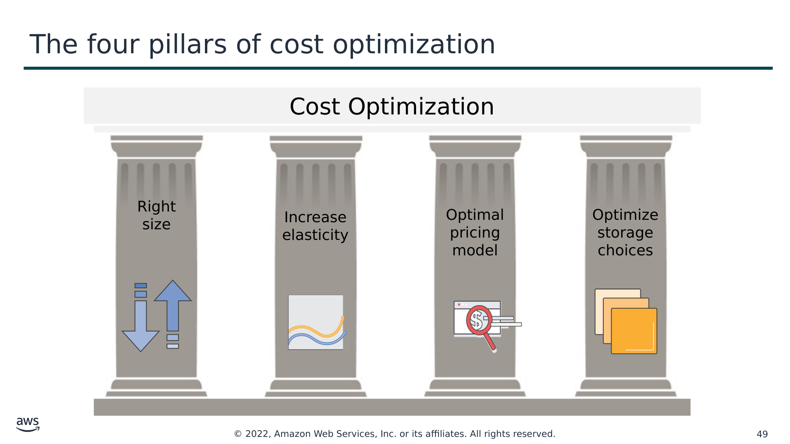

<details>
<summary>Текст зі схеми</summary>

Cost Optimization (Оптимізація витрат)

Right size (Правильний розмір)

Increase elasticity (Підвищення еластичності)

Optimal pricing model (Оптимальна модель ціноутворення)

Optimize storage choices (Оптимізація вибору сховищ)

</details>

> **Нотатки:**
>
> Щоб оптимізувати витрати, потрібно враховувати чотири сталі, потужні чинники:  
> Правильний розмір (Right-size) — оберіть правильний баланс типів екземплярів. Помічайте, коли розмір серверів можна зменшити або їх можна вимкнути, і вони все одно відповідатимуть вашим вимогам до продуктивності.  
> Підвищення еластичності (Increase elasticity) — проєктуйте свої розгортання так, щоб зменшити обсяг простоюючих серверних потужностей, впроваджуючи еластичні розгортання, як-от розгортання, що використовують автоматичне масштабування для обробки пікових навантажень.  
> Оптимальна модель ціноутворення (Optimal pricing model) — знайте доступні варіанти ціноутворення. Аналізуйте свої шаблони використання, щоб запускати екземпляри EC2 з правильним поєднанням варіантів ціноутворення.  
> Оптимізація вибору сховищ (Optimize storage choices) — аналізуйте вимоги до сховищ ваших розгортань. За можливості зменшуйте накладні витрати на невикористане сховище та обирайте дешевші варіанти сховищ, якщо вони все ще відповідають вашим вимогам до продуктивності зберігання.

---

## Слайд 50: Опора 1: правильний розмір (right size)

- Розгортайте екземпляри відповідно до потреби
  - ЦП, пам’ять, сховище та мережева пропускна здатність
  - Обирайте відповідні типи екземплярів для вашого використання
- Використовуйте метрики Amazon CloudWatch
  - Наскільки простоюють екземпляри? Коли?
  - Зменшуйте розмір екземплярів
- Найкраща практика: спершу правильний розмір, потім резервування

**Опори (Pillars):**

1. Правильний розмір (Right size)
2. Підвищення еластичності (Increase elasticity)
3. Оптимальна модель ціноутворення (Optimal pricing model)
4. Оптимізація вибору сховищ (Optimize storage choices)

> **Нотатки:**
>
> Спершу розгляньте правильний розмір (right-sizing). AWS пропонує приблизно 60 типів і розмірів екземплярів. Широкий вибір варіантів дає клієнтам змогу обрати екземпляр, що найкраще відповідає їхньому робочому навантаженню. Може бути важко зрозуміти, з чого почати і який вибір екземпляра виявиться найкращим — як з технічного, так і з вартісного погляду. Підбір правильного розміру (right-sizing) — це процес перегляду розгорнутих ресурсів і пошуку можливостей зменшити їх за можливості.  
>
> Щоб підібрати правильний розмір:  
> Оберіть найдешевший доступний екземпляр, що все ще відповідає вашим вимогам до продуктивності.  
> Перегляньте використання ЦП, RAM, сховища та мережі, щоб визначити екземпляри, розмір яких можна зменшити. Можливо, ви захочете розгорнути різні типи й розміри екземплярів у тестовому середовищі, а потім протестувати свій застосунок на цих різних тестових розгортаннях, щоб визначити, які екземпляри пропонують найкраще співвідношення продуктивності та вартості. Для підбору правильного розміру використовуйте на свою користь такі методи, як навантажувальне тестування (load testing).  
> Використовуйте метрики Amazon CloudWatch і налаштуйте власні метрики. Метрика — це впорядкований за часом набір значень, що публікуються в CloudWatch (наприклад, використання ЦП певним екземпляром EC2). Точки даних можуть надходити з будь-якого застосунку чи бізнес-активності, щодо яких ви збираєте дані.

---

## Слайд 51: Опора 2: підвищення еластичності (increase elasticity)

- **Зупиняйте (stop)** або **переводьте в гібернацію (hibernate)** екземпляри на основі Amazon EBS, що активно не використовуються
  - Приклад: непродуктивні екземпляри для розробки чи тестування
- Використовуйте **автоматичне масштабування (automatic scaling)** для відповідності потребам залежно від використання
  - Автоматизована та часова еластичність

**Опори (Pillars):**

1. Правильний розмір (Right-Size)
2. Підвищення еластичності (Increase Elasticity)
3. Оптимальна модель ціноутворення (Optimal pricing model)
4. Оптимізація вибору сховищ (Optimize storage choices)

> **Нотатки:**
>
> Одна з форм еластичності — створювати, запускати чи використовувати екземпляри EC2, коли вони потрібні, а потім вимикати їх, коли вони не використовуються. Еластичність — один із центральних принципів хмари, але клієнти часто проходять процес навчання, щоб запровадити еластичність у практику для економії коштів.  
>
> Найпростіший спосіб для великих клієнтів скористатися еластичністю — шукати ресурси, що виглядають добрими кандидатами для зупинки чи гібернації, наприклад непродуктивні середовища, робочі навантаження розробки чи тестові робочі навантаження. Наприклад, якщо ви запускаєте робочі навантаження розробки чи тестування в одному часовому поясі, ви можете легко вимикати ці екземпляри поза робочими годинами й таким чином знизити витрати на час роботи приблизно на 65 відсотків. Ця концепція схожа на те, чому поруч із дверима є вимикач світла і чому більшість офісів заохочують працівників вимикати світло, виходячи з офісу щовечора.  
>
> Для продуктивних робочих навантажень налаштування точніших і детальніших політик автоматичного масштабування може допомогти скористатися горизонтальним масштабуванням для задоволення потреб у пікових потужностях і не платити за пікові потужності постійно.  
>
> Як практичне правило, слід прагнути, щоб 20–30 відсотків ваших екземплярів Amazon EC2 працювали як екземпляри за запитом або спотові екземпляри, а також активно шукати способи максимізувати еластичність.

---

## Слайд 52: Опора 3: оптимальна модель ціноутворення (optimal pricing model)

- Використовуйте правильну модель ціноутворення для вашого сценарію використання
  - Враховуйте свої шаблони використання
- Оптимізуйте та *поєднуйте* типи придбання
- Приклади:
  - Використовуйте **екземпляри за запитом (On-Demand Instance)** і **спотові екземпляри (Spot Instances)** для змінних робочих навантажень
  - Використовуйте **зарезервовані екземпляри (Reserved Instances)** для передбачуваних робочих навантажень
- Розгляньте безсерверні рішення (AWS Lambda)

**Опори (Pillars):**

1. Правильний розмір (Right-Size)
2. Підвищення еластичності (Increase Elasticity)
3. Оптимальна модель ціноутворення (Optimal pricing model)
4. Оптимізація вибору сховищ (Optimize storage choices)


> **Нотатки:**
>
> AWS надає низку моделей ціноутворення для Amazon EC2, щоб допомогти клієнтам заощаджувати кошти. Доступні моделі було детально розглянуто раніше в цьому модулі. Клієнти можуть поєднувати кілька типів придбання, щоб оптимізувати ціноутворення на основі їхніх поточних і прогнозованих потреб у потужностях.  
>
> Клієнтам також радимо враховувати архітектуру свого застосунку. Наприклад, чи потрібно, щоб функціональність, яку надає ваш застосунок, працювала на віртуальній машині EC2? Можливо, скориставшись натомість сервісом AWS Lambda, ви могли б значно знизити свої витрати.  
>
> AWS Lambda розглядається пізніше в цьому модулі.

---

## Слайд 53: Опора 4: оптимізація вибору сховищ (optimize storage choices)

- Знижуйте витрати, зберігаючи продуктивність і доступність сховища
- Змінюйте розмір томів EBS
- Змінюйте типи томів EBS
  - Чи можете ви задовольнити вимоги до продуктивності дешевшим сховищем?
  - Приклад: сховище **Amazon EBS Throughput Optimized HDD (st1)** зазвичай коштує вдвічі менше, ніж типовий варіант сховища **General Purpose SSD (gp2)**.
- Видаляйте знімки EBS, які більше не потрібні
- Визначайте найвідповідніше призначення для конкретних типів даних
  - Чи потрібно застосунку, щоб екземпляр розміщувався на Amazon EBS?
  - Варіанти сховищ Amazon S3 з політиками життєвого циклу можуть знизити витрати

**Опори (Pillars):**

1. Правильний розмір (Right-Size)
2. Підвищення еластичності (Increase Elasticity)
3. Оптимальна модель ціноутворення (Optimal pricing model)
4. Оптимізація вибору сховищ (Optimize storage choices)

> **Нотатки:**
>
> Клієнти також можуть знизити витрати на сховище. Коли ви запускаєте екземпляри EC2, різні типи екземплярів пропонують різні варіанти сховища. Найкраща практика — намагатися знижувати витрати, водночас зберігаючи продуктивність і доступність сховища.  
>
> Один зі способів цього досягти — зміна розміру томів EBS. Наприклад, якщо ви спочатку розгорнули том на 500 ГБ для екземпляра EC2, якому знадобиться максимум 20 ГБ місця для зберігання, ви можете зменшити розмір тому та заощадити кошти.  
>
> Також існує різноманітність типів томів EBS. Оберіть найдешевший тип, що все ще відповідає вашим вимогам до продуктивності. Наприклад, сховище Amazon EBS Throughput Optimized HDD (st1) зазвичай коштує вдвічі менше, ніж типовий варіант сховища General Purpose SSD (gp2). Якщо диск st1 задовольнить потреби вашого робочого навантаження, скористайтеся економією коштів.  
>
> Клієнти часто використовують знімки EBS для створення резервних копій даних. Однак деякі клієнти забувають видаляти знімки, які більше не потрібні. Видаляйте ці непотрібні знімки, щоб заощадити кошти.  
>
> Нарешті, спробуйте визначити найвідповідніше призначення для конкретних типів даних. Чи потрібно вашому застосунку, щоб дані, які він використовує, розташовувалися на Amazon EBS? Чи працював би застосунок так само добре, якби натомість використовував Amazon S3 для зберігання? Налаштування політик життєвого циклу даних також може знизити витрати. Наприклад, можна автоматизувати міграцію старіших даних нечастого доступу в дешевші сховища, як-от Amazon Simple Storage Service Glacier.

---

## Слайд 54: Вимірюйте, відстежуйте та вдосконалюйте

- Оптимізація витрат — це безперервний процес.
- Рекомендації –
  - Визначте та впровадьте **тегування для розподілу витрат (cost allocation tagging)**.
  - Визначте метрики, встановіть цілі та регулярно переглядайте їх.
  - Заохочуйте команди **проєктувати архітектуру з урахуванням вартості (architect for cost)**.
  - Призначте відповідальність за оптимізацію окремій особі або команді.

> **Нотатки:**
>
> Якщо її виконувати правильно, оптимізація витрат — це не одноразовий процес, який клієнт завершує. Натомість, регулярно вимірюючи та аналізуючи свої системи, ви можете постійно покращувати та коригувати свої витрати.  
>
> Тегування допомагає надати інформацію про те, які ресурси використовуються, ким і з якою метою. Ви можете активувати теги розподілу витрат (cost allocation tags) у консолі Billing and Cost Management, і AWS може згенерувати звіт про розподіл витрат із використанням і витратами, згрупованими за вашими активними тегами. Застосовуйте теги, що представляють бізнес-категорії (як-от центри витрат, назви застосунків чи власники), щоб упорядкувати свої витрати по кількох сервісах.  
>
> Заохочуйте команди проєктувати архітектуру з урахуванням вартості. AWS Cost Explorer — це безкоштовний інструмент, який можна використовувати для перегляду графіків ваших витрат. Ви можете використовувати Cost Explorer, щоб бачити закономірності в тому, скільки ви витрачаєте на ресурси AWS із часом, визначати області, що потребують додаткового вивчення, і бачити тренди, які можна використати для розуміння ваших витрат.  
>
> Використовуйте сервіси AWS, як-от AWS Trusted Advisor, що надає рекомендації в реальному часі, щоб допомогти вам розгортати ресурси відповідно до найкращих практик AWS.  
>
> Зусилля з оптимізації витрат зазвичай успішніші, коли відповідальність за оптимізацію витрат покладено на окрему особу або команду.

---

## Слайд 55: Ключові висновки розділу 3

- **Моделі ціноутворення Amazon EC2** включають екземпляри за запитом (On-Demand), зарезервовані екземпляри (Reserved), спотові екземпляри (Spot), виділені екземпляри (Dedicated Instances) і виділені хости (Dedicated Hosts).
- **Спотові екземпляри** можуть бути перервані з 2-хвилинним сповіщенням. Однак вони можуть забезпечити значну економію порівняно з екземплярами за запитом.
- **Чотири опори оптимізації витрат** такі:
  - Правильний розмір
  - Підвищення еластичності
  - Оптимальна модель ціноутворення
  - Оптимізація вибору сховищ

> **Нотатки:**
>
> Основні висновки цього розділу модуля:  
> Моделі ціноутворення Amazon EC2 включають екземпляри за запитом, зарезервовані екземпляри, спотові екземпляри, виділені екземпляри та виділені хости. Посекундна тарифікація доступна для екземплярів за запитом, зарезервованих екземплярів і спотових екземплярів, що використовують лише Amazon Linux і Ubuntu.  
> Спотові екземпляри можуть бути перервані з 2-хвилинним сповіщенням. Однак вони можуть забезпечити значну економію порівняно з екземплярами за запитом.  
> Чотири опори оптимізації витрат –  
> Правильний розмір  
> Підвищення еластичності  
> Оптимальна модель ціноутворення  
> Оптимізація вибору сховищ

---

## Слайд 56: Розділ 4: Контейнерні сервіси

Модуль 6: Обчислення

> **Нотатки:**
>
> Представляємо Розділ 4: Контейнерні сервіси.

---

## Слайд 57: Основи контейнерів (container basics)

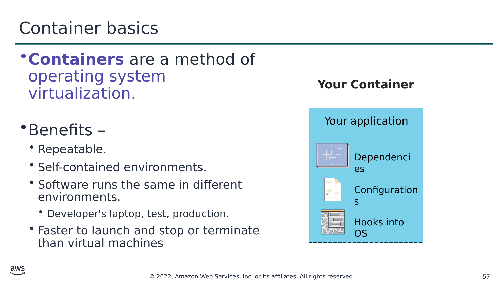

- **Контейнери (Containers)** — це метод віртуалізації на рівні операційної системи.
- Переваги –
  - Відтворюваність.
  - Самодостатні середовища.
  - Програмне забезпечення працює однаково в різних середовищах.
    - Ноутбук розробника, тестування, продуктивне середовище.
  - Швидше запускаються й зупиняються чи завершуються, ніж віртуальні машини

<details>
<summary>Текст зі схеми</summary>

**Your Container (Ваш контейнер)**

Your application (Ваш застосунок)

Dependencies (Залежності)

Configurations (Конфігурації)

Hooks into OS (Зв’язки з ОС)

</details>

> **Нотатки:**
>
> Контейнери — це метод віртуалізації на рівні операційної системи, що дає змогу запускати застосунок і його залежності в процесах з ізоляцією ресурсів. Використовуючи контейнери, ви можете легко упакувати код, конфігурації та залежності застосунку в прості у використанні будівельні блоки, що забезпечують узгодженість середовища, операційну ефективність, продуктивність розробників і контроль версій.  
>
> Контейнери менші за віртуальні машини й не містять усієї операційної системи. Натомість контейнери спільно використовують віртуалізовану операційну систему та працюють як процеси з ізоляцією ресурсів, що забезпечує швидкі, надійні та узгоджені розгортання. Контейнери містять усе, що потрібно програмному забезпеченню для роботи, як-от бібліотеки, системні інструменти, код і середовище виконання (runtime).  
>
> Контейнери забезпечують узгодженість середовища, оскільки код, конфігурації та залежності застосунку упаковано в один об’єкт.  
>
> З погляду простору образи контейнерів зазвичай на порядок менші за віртуальні машини. Запуск контейнера відбувається за сотні мілісекунд. Таким чином, використовуючи контейнери, ви можете використовувати швидкі, портативні та незалежні від інфраструктури середовища.  
>
> Контейнери можуть допомогти забезпечити швидке, надійне й узгоджене розгортання застосунків незалежно від середовища розгортання. Контейнери також надають вам детальніший контроль над ресурсами, що підвищує ефективність вашої інфраструктури.

---

## Слайд 58: Що таке Docker?

- **Docker** — це програмна платформа, що дає змогу швидко створювати, тестувати та розгортати застосунки.
- Ви запускаєте контейнери на Docker.
  - Контейнери створюються із шаблону, що називається *образом (image)*.
- **Контейнер (container)** має все, що потрібно програмному застосунку для роботи.

Container (Контейнер)

> **Нотатки:**
>
> Docker — це програмна платформа, що пакує програмне забезпечення (як-от застосунки) в контейнери.  
>
> Docker встановлюється на кожному сервері, що розміщуватиме контейнери, і надає прості команди, за допомогою яких можна створювати, запускати чи зупиняти контейнери.  
>
> Використовуючи Docker, ви можете швидко розгортати та масштабувати застосунки в будь-якому середовищі.  
>
> Docker найкраще використовувати як рішення, коли ви хочете:  
> Стандартизувати середовища  
> Зменшити конфлікти між стеками мов програмування та версіями  
> Використовувати контейнери як сервіс  
> Запускати мікросервіси за допомогою стандартизованих розгортань коду  
> Потребуєте портативності для обробки даних

---

## Слайд 59: Контейнери та віртуальні машини

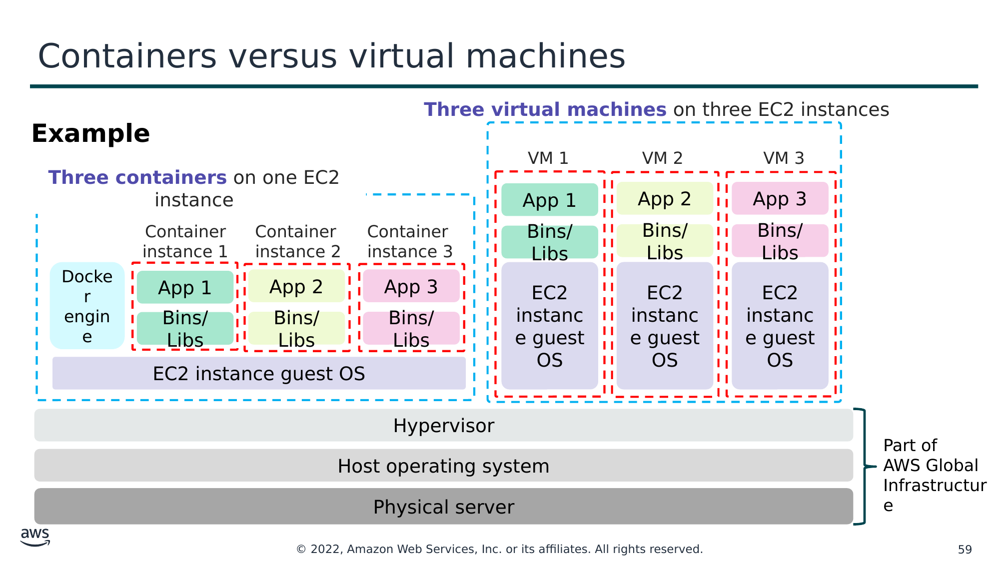

**Три віртуальні машини (Three virtual machines)** на трьох екземплярах EC2

<details>
<summary>Текст зі схеми</summary>

**Example (Приклад)**

VM 1

VM 2

VM 3

**Three containers (Три контейнери)** on one EC2 instance (на одному екземплярі EC2)

Container (Контейнер)

App 1

App 2

App 3

Container instance 1 (Екземпляр контейнера 1)

Container  
instance 2 (Екземпляр контейнера 2)

Container  
instance 3 (Екземпляр контейнера 3)

Bins/Libs (Бінарні файли/бібліотеки)

Bins/Libs

Bins/Libs

Docker engine (Рушій Docker)

App 1

App 2

App 3

EC2 instance guest OS (Гостьова ОС екземпляра EC2)

EC2 instance guest OS

EC2 instance guest OS

Bins/Libs

Bins/Libs

Bins/Libs

EC2 instance guest OS

Hypervisor (Гіпервізор)

Part of  
AWS Global Infrastructure (Частина глобальної інфраструктури AWS)

Host operating system (Хостова операційна система)

Physical server (Фізичний сервер)

</details>

> **Нотатки:**
>
> Багато людей, яких уперше знайомлять із концепцією контейнера, думають, що контейнери — це точно те саме, що віртуальні машини. Однак відмінності — у деталях. Одна суттєва відмінність у тому, що віртуальні машини працюють безпосередньо на гіпервізорі, а контейнери можуть працювати на будь-якій ОС Linux, якщо є відповідна підтримка функцій ядра й наявний демон Docker. Це робить контейнери дуже портативними. Ваш ноутбук, ваша VM, ваш екземпляр EC2 і ваш фізичний сервер (bare metal) — усе це потенційні хости, де можна запустити контейнер.  
>
> Праворуч на схемі показано розгортання на основі віртуальних машин (VM). Кожен із трьох екземплярів EC2 працює безпосередньо на гіпервізорі, що надається глобальною інфраструктурою AWS. Кожен екземпляр EC2 запускає віртуальну машину. У цьому розгортанні на основі VM кожен із трьох застосунків працює на власній VM, що забезпечує ізоляцію процесів.  
>
> Ліворуч на схемі показано розгортання на основі контейнерів. Є лише один екземпляр EC2, що запускає віртуальну машину. Рушій Docker встановлено на гостьовій ОС Linux екземпляра EC2, і є три контейнери. У цьому розгортанні на основі контейнерів кожен застосунок працює у власному контейнері (що забезпечує ізоляцію процесів), але всі контейнери працюють на одному екземплярі EC2. Процеси, що працюють у контейнерах, взаємодіють безпосередньо з ядром у гостьовій ОС Linux і здебільшого не знають про свій контейнерний силос. Рушій Docker присутній для керування тим, як контейнери працюють на гостьовій ОС Linux, і також надає основні функції керування протягом життєвого циклу контейнера.  
>
> У реальному розгортанні на основі контейнерів великий екземпляр EC2 міг би запускати сотні контейнерів.

---

## Слайд 60: Amazon Elastic Container Service (Amazon ECS)

- Amazon Elastic Container Service (**Amazon ECS**) –
  - Високомасштабований, швидкий сервіс керування контейнерами
- Ключові переваги –
  - Оркеструє запуск контейнерів Docker
  - Підтримує та масштабує парк вузлів, що запускають ваші контейнери
  - Усуває складність розгортання інфраструктури
- Інтегрований із функціями, знайомими користувачам сервісу Amazon EC2 –
  - Elastic Load Balancing
  - Групи безпеки Amazon EC2
  - Томи Amazon EBS
  - Ролі IAM

**Amazon Elastic Container Service**

> **Нотатки:**
>
> З огляду на те, що ви тепер знаєте про контейнери, ви можете подумати, що можна запустити один чи кілька екземплярів Amazon EC2, встановити Docker на кожен екземпляр і самостійно керувати контейнерами Docker та запускати їх на цих екземплярах Amazon EC2. Хоча це один із варіантів, AWS надає сервіс Amazon Elastic Container Service (Amazon ECS), що спрощує керування контейнерами.  
>
> Amazon Elastic Container Service (Amazon ECS) — це високомасштабований, високопродуктивний сервіс керування контейнерами, що підтримує контейнери Docker. Amazon ECS дає змогу легко запускати застосунки на керованому кластері екземплярів Amazon EC2.  
>
> Основні функції Amazon ECS включають можливість:  
> Запускати до десятків тисяч контейнерів Docker за лічені секунди  
> Відстежувати розгортання контейнерів  
> Керувати станом кластера, що запускає контейнери  
> Планувати розміщення контейнерів за допомогою вбудованого планувальника або стороннього планувальника (наприклад, Apache Mesos чи Blox)  
>
> Кластери Amazon ECS також можуть використовувати спотові екземпляри та зарезервовані екземпляри.

---

## Слайд 61: Amazon ECS оркеструє контейнери

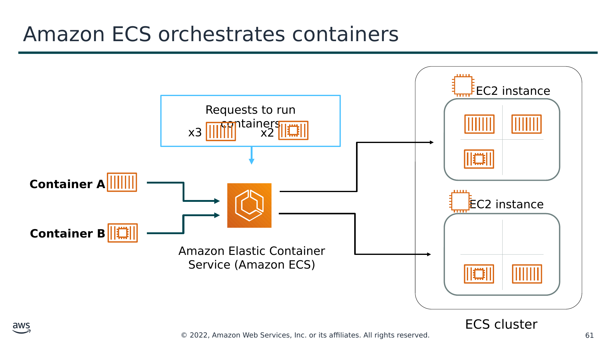

<details>
<summary>Текст зі схеми</summary>

EC2 instance (Екземпляр EC2)

Requests to run containers (Запити на запуск контейнерів)

x3

x2

**Container A (Контейнер A)**

EC2 instance (Екземпляр EC2)

**Container B (Контейнер B)**

Amazon Elastic Container Service (Amazon ECS)

ECS cluster (Кластер ECS)

</details>

> **Нотатки:**
>
> Щоб підготувати застосунок до запуску на Amazon ECS, ви створюєте визначення завдання (task definition) — текстовий файл, що описує один чи кілька контейнерів (до десяти), які становлять ваш застосунок. Його можна розглядати як креслення вашого застосунку. Визначення завдань указують параметри вашого застосунку, наприклад які контейнери використовувати, які порти слід відкрити для вашого застосунку та які томи даних слід використовувати з контейнерами в завданні.  
>
> Завдання (task) — це екземпляризація визначення завдання в межах кластера. Ви можете вказати кількість завдань, що виконуватимуться у вашому кластері. Планувальник завдань Amazon ECS відповідає за розміщення завдань у вашому кластері. Завдання запускатиме від одного до десяти контейнерів залежно від визначення завдання, яке ви задали.  
>
> Коли Amazon ECS запускає контейнери, що становлять ваше завдання, він розміщує їх у кластері ECS. Кластер (коли ви обираєте тип запуску EC2) складається з групи екземплярів EC2, кожен з яких запускає агент контейнера Amazon ECS.  
>
> Amazon ECS надає кілька стратегій планування, що розміщуватимуть контейнери у ваших кластерах на основі ваших потреб у ресурсах (наприклад, ЦП чи RAM) та вимог до доступності.

---

## Слайд 62: Варіанти кластерів Amazon ECS

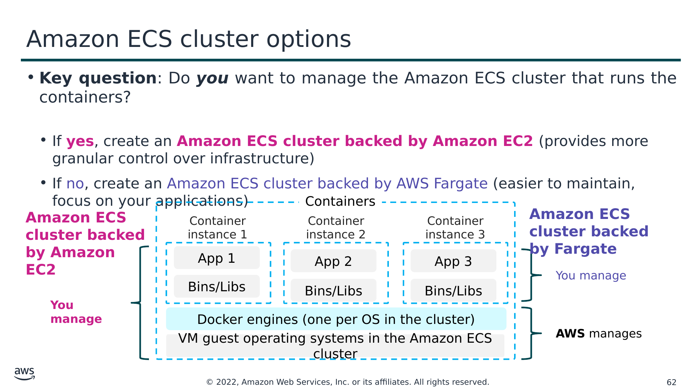

- **Ключове запитання**: чи хочете ***ви*** керувати кластером Amazon ECS, що запускає контейнери?
  - Якщо **так**, створіть **кластер Amazon ECS на основі Amazon EC2** (забезпечує детальніший контроль над інфраструктурою)
  - Якщо ні, створіть кластер Amazon ECS на основі AWS Fargate (легше підтримувати, зосередьтеся на своїх застосунках)

<details>
<summary>Текст зі схеми</summary>

Containers (Контейнери)

**Amazon ECS cluster backed by Amazon EC2 (Кластер Amazon ECS на основі Amazon EC2)**

Container instance 1 (Екземпляр контейнера 1)

Container instance 2 (Екземпляр контейнера 2)

Container instance 3 (Екземпляр контейнера 3)

**Amazon ECS cluster backed by Fargate (Кластер Amazon ECS на основі Fargate)**

App 1

App 2

App 3

You manage (Ви керуєте)

Bins/Libs

Bins/Libs

Bins/Libs

**You manage (Ви керуєте)**

Docker engines (one per OS in the cluster) (Рушії Docker (по одному на ОС у кластері))

**AWS** manages (керує)

VM guest operating systems in the Amazon ECS cluster (Гостьові операційні системи VM у кластері Amazon ECS)

</details>

> **Нотатки:**
>
> Коли ви створюєте кластер Amazon ECS, у вас є три варіанти:  
> Кластер лише з мережею (Networking Only; на основі AWS Fargate)  
> Кластер EC2 Linux + Networking  
> Кластер EC2 Windows + Networking  
>
> Якщо ви оберете один із двох варіантів типу запуску EC2, вас попросять вибрати, чи працюватимуть екземпляри EC2 кластера як екземпляри за запитом (On-Demand Instances), чи як спотові екземпляри (Spot Instances). Крім того, потрібно буде вказати багато деталей про екземпляри EC2, що становитимуть ваш кластер, — ті самі деталі, які потрібно вказати під час запуску окремого екземпляра EC2. Таким чином тип запуску EC2 забезпечує детальніший контроль над інфраструктурою, що запускає ваші контейнерні застосунки, оскільки ви керуєте екземплярами EC2, що становлять кластер.  
> Amazon ECS відстежує весь ЦП, пам’ять та інші ресурси у вашому кластері. Amazon ECS також знаходить найкращий сервер для вашого контейнера на основі вказаних вами вимог до ресурсів.  
>
> Якщо ви оберете тип запуску Fargate лише з мережею, то кластер, що запускатиме ваші контейнери, керуватиметься AWS. З цим варіантом вам потрібно лише упакувати свій застосунок у контейнери, вказати вимоги до ЦП і пам’яті, визначити мережеві політики та політики IAM і запустити застосунок. Вам не потрібно розгортати, налаштовувати чи масштабувати кластер. Це усуває потребу обирати типи серверів, вирішувати, коли масштабувати кластери, чи оптимізувати щільність розміщення в кластері (cluster packing). Варіант Fargate дає змогу зосередитися на проєктуванні та створенні ваших застосунків.

---

## Слайд 63: Що таке Kubernetes?

- Kubernetes — це програмне забезпечення з відкритим вихідним кодом для оркестрації контейнерів.
  - Розгортайте та **керуйте контейнеризованими застосунками** *у великому масштабі*.
  - Один і той самий набір інструментів можна використовувати локально (on premises) і в хмарі.
- Доповнює Docker.
  - Docker дає змогу запускати кілька контейнерів на одному хості з ОС.
  - Kubernetes **оркеструє** кілька хостів Docker (вузлів, nodes).
- Автоматизує –
  - Розгортання контейнерів.
  - Мережу.
  - Розподіл навантаження.
  - Масштабування.

> **Нотатки:**
>
> Kubernetes — це програмне забезпечення з відкритим вихідним кодом для оркестрації контейнерів. Kubernetes може працювати з багатьма технологіями контейнеризації, зокрема з Docker. Оскільки це популярний проєкт з відкритим вихідним кодом, велика спільнота розробників і компаній створює розширення, інтеграції та плагіни, що підтримують актуальність програмного забезпечення, а нові й затребувані функції додаються часто.  
>
> Kubernetes дає змогу розгортати контейнеризовані застосунки та керувати ними у великому масштабі. З Kubernetes ви можете запускати будь-який тип контейнеризованого застосунку за допомогою одного й того самого набору інструментів як у локальних центрах обробки даних, так і в хмарі. Kubernetes керує кластером обчислювальних екземплярів (які називаються вузлами, nodes). Він запускає контейнери в кластері на основі того, де доступні обчислювальні ресурси, та вимог кожного контейнера до ресурсів. Контейнери запускаються в логічних групах, які називаються подами (pods). Ви можете запускати й масштабувати один чи багато контейнерів разом як под. Кожному поду надається IP-адреса й одне ім’я системи доменних імен (DNS), які Kubernetes використовує для з’єднання ваших сервісів один з одним і з зовнішнім трафіком.  
>
> Ключова перевага Kubernetes у тому, що його можна використовувати для запуску ваших контейнеризованих застосунків будь-де без потреби змінювати операційні інструменти. Наприклад, застосунки можна переміщувати з локальних машин розробки на продуктивні розгортання в хмарі за допомогою тих самих операційних інструментів.

---

## Слайд 64: Amazon Elastic Kubernetes Service (Amazon EKS)

- Amazon Elastic Kubernetes Service (**Amazon EKS**)
  - Дає змогу запускати Kubernetes в AWS
  - Сертифіковано як сумісне з Kubernetes (підтримує просту міграцію)
  - Підтримує контейнери Linux і Windows
  - Сумісний з інструментами спільноти Kubernetes і підтримує популярні доповнення Kubernetes
- Використовуйте Amazon EKS, щоб –
  - Керувати кластерами обчислювальних екземплярів Amazon EC2
  - Запускати на цих екземплярах контейнери, оркестровані Kubernetes

**Amazon Elastic Kubernetes Service**

> **Нотатки:**
>
> Ви можете подумати, що можна запустити один чи кілька екземплярів Amazon EC2, встановити Docker на кожен екземпляр, встановити Kubernetes на кластер і самостійно керувати Kubernetes та запускати його. Хоча це один із варіантів, AWS надає сервіс Amazon Elastic Kubernetes Service (Amazon EKS), що спрощує керування кластерами Kubernetes.  
>
> Amazon Elastic Kubernetes Service (Amazon EKS) — це кероване обслуговування Kubernetes, що дає вам змогу легко запускати Kubernetes в AWS без потреби встановлювати, експлуатувати й підтримувати власну площину керування Kubernetes (control plane). Воно сертифіковано як сумісне з Kubernetes, тож наявні застосунки, що працюють на upstream-версії Kubernetes, сумісні з Amazon EKS.  
>
> Amazon EKS автоматично керує доступністю та масштабованістю вузлів кластера, що відповідають за запуск і зупинку контейнерів, планування контейнерів на віртуальних машинах, зберігання даних кластера та інші завдання. Він автоматично виявляє та замінює несправні вузли площини керування для кожного кластера. Ви можете скористатися продуктивністю, масштабом, надійністю та доступністю хмари AWS, що включає мережеві сервіси та сервіси безпеки AWS, як-от Application Load Balancer для розподілу навантаження, IAM для рольового контролю доступу та VPC для мережі подів.  
>
> Ви можете запитати, чому Amazon пропонує і Amazon ECS, і Amazon EKS, оскільки обидва здатні оркеструвати контейнери Docker. Причина існування обох сервісів — надати клієнтам гнучкі варіанти. Ви можете вирішити, який варіант найкраще відповідає вашим потребам.

---

## Слайд 65: Amazon Elastic Container Registry (Amazon ECR)

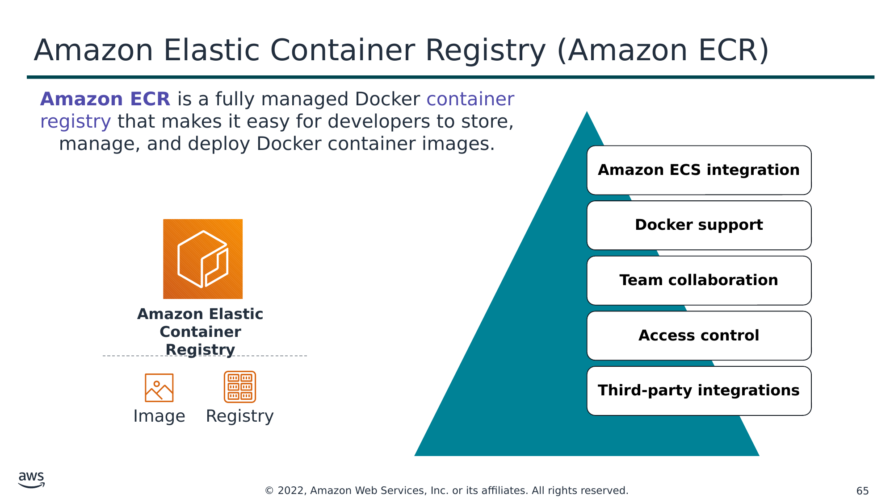

**Amazon ECR** — це повністю кероване сховище (реєстр) контейнерів Docker, що полегшує розробникам зберігання, керування та розгортання образів контейнерів Docker.

<details>
<summary>Текст зі схеми</summary>

**Amazon Elastic Container Registry**

Image (Образ)

Registry (Реєстр)

</details>

> **Нотатки:**
>
> Amazon Elastic Container Registry (Amazon ECR) — це повністю кероване сховище (реєстр) контейнерів Docker, що полегшує розробникам зберігання, керування та розгортання образів контейнерів Docker. Він інтегрований з Amazon ECS, тож ви можете зберігати, запускати образи контейнерів і керувати ними для застосунків, що працюють на Amazon ECS. Вкажіть репозиторій Amazon ECR у визначенні завдання, і Amazon ECS отримає відповідні образи для ваших застосунків.  
>
> Amazon ECR підтримує Docker Registry HTTP API версії 2, що дає змогу взаємодіяти з Amazon ECR за допомогою команд Docker CLI або ваших улюблених інструментів Docker. Таким чином, ви можете зберегти наявний робочий процес розробки та отримувати доступ до Amazon ECR з будь-якого середовища Docker — чи то в хмарі, чи локально (on premises), чи на вашій локальній машині.  
>
> Ви можете передавати свої образи контейнерів до Amazon ECS і з нього через HTTPS. Ваші образи також автоматично шифруються в стані спокою за допомогою серверного шифрування Amazon S3.  
>
> Образи Amazon ECR також можна використовувати з Amazon EKS. Докладніше див. у документації Using Amazon ECR Images with Amazon EKS: https://docs.aws.amazon.com/AmazonECR/latest/userguide/ECR_on_EKS.html

---

## Слайд 66: Ключові висновки розділу 4

- **Контейнери (Containers)** можуть містити все, що потрібно застосунку для роботи.
- **Docker** — це програмна платформа, що пакує програмне забезпечення в контейнери.
  - Один застосунок може охоплювати кілька контейнерів.
- Amazon Elastic Container Service (**Amazon ECS**) оркеструє запуск контейнерів Docker.
- **Kubernetes** — це програмне забезпечення з відкритим вихідним кодом для оркестрації контейнерів.
- Amazon Elastic Kubernetes Service (**Amazon EKS**) дає змогу запускати Kubernetes в AWS
- Amazon Elastic Container Registry (**Amazon ECR**) дає змогу зберігати, обслуговувати та розгортати ваші контейнери Docker.

> **Нотатки:**
>
> Основні висновки цього розділу:  
> Контейнери можуть містити все, що потрібно застосунку для роботи.  
> Docker — це програмна платформа, що пакує програмне забезпечення в контейнери.  
> Один застосунок може охоплювати кілька контейнерів.  
> Amazon Elastic Container Service (Amazon ECS) оркеструє запуск контейнерів Docker.  
> Kubernetes — це програмне забезпечення з відкритим вихідним кодом для оркестрації контейнерів.  
> Amazon Elastic Kubernetes Service (Amazon EKS) дає змогу запускати Kubernetes в AWS  
> Amazon Elastic Container Registry (Amazon ECR) дає змогу зберігати, обслуговувати та розгортати ваші контейнери Docker.

---

## Слайд 67: Розділ 5: Вступ до AWS Lambda

Модуль 6: Обчислення

> **Нотатки:**
>
> Представляємо Розділ 5: Вступ до AWS Lambda.

---

## Слайд 68: AWS Lambda: запуск коду без серверів

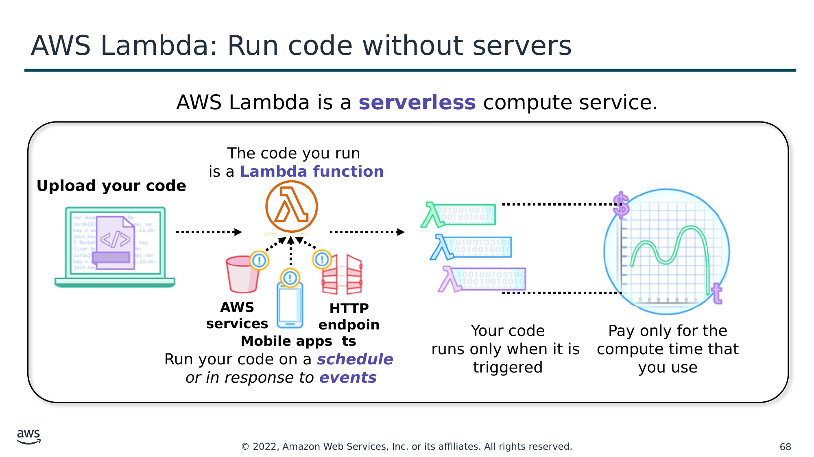

AWS Lambda — це **безсерверний (serverless)** обчислювальний сервіс.

<details>
<summary>Текст зі схеми</summary>

The code you run  
is a **Lambda function** (Код, який ви запускаєте, — це **функція Lambda**)

**Upload your code (Завантажте свій код)**

**AWS**  
**services (сервіси)**

**HTTP endpoints (Кінцеві точки HTTP)**

**Mobile apps (Мобільні застосунки)**

Your code  
runs only when it is  
triggered (Ваш код виконується лише тоді, коли його запускають)

Pay only for the  
compute time that  
you use (Платіть лише за обчислювальний час, який ви використовуєте)

Run your code on a ***schedule (за розкладом)***  
*or in response to (або у відповідь на)* ***events (події)***

</details>

> **Нотатки:**
>
> Як ви бачили в попередніх розділах цього модуля, AWS пропонує багато обчислювальних варіантів. Наприклад, Amazon EC2 надає віртуальні машини. Як інший приклад, Amazon ECS та Amazon EKS — це обчислювальні сервіси на основі контейнерів.  
>
> Однак існує ще один підхід до обчислень, що не вимагає розгортання чи керування серверами. Цей третій підхід часто називають безсерверними обчисленнями (serverless computing).  
>
> AWS Lambda — це безсерверний обчислювальний сервіс, кероований подіями (event-driven). Lambda дає змогу запускати код без розгортання чи керування серверами.  
>
> Ви створюєте функцію Lambda (Lambda function) — ресурс AWS, що містить код, який ви завантажуєте. Потім ви налаштовуєте запуск функції Lambda — або за розкладом, або у відповідь на подію. Ваш код виконується лише тоді, коли його запускають.  
>
> Ви платите лише за спожитий обчислювальний час — плата не стягується, коли ваш код не виконується.

---

## Слайд 69: Переваги Lambda

Підтримує кілька мов програмування

Повністю автоматизоване адміністрування

Вбудована відмовостійкість

Підтримує оркестрацію кількох функцій

Ціноутворення з оплатою за використання (pay-per-use)

**AWS**

**Lambda**

> **Нотатки:**
>
> З Lambda не потрібно вивчати нових мов, інструментів чи фреймворків. Lambda підтримує кілька мов програмування, зокрема Java, Go, PowerShell, Node.js, C#, Python і Ruby. Ваш код може використовувати будь-яку бібліотеку — власну чи стороннього розробника.  
>
> Lambda повністю автоматизує адміністрування. Вона керує всією інфраструктурою для запуску вашого коду на високодоступній, відмовостійкій інфраструктурі, що дає змогу зосередитися на створенні унікальних бекенд-сервісів. Lambda безперебійно розгортає ваш код; виконує все адміністрування, обслуговування та виправлення безпеки; і надає вбудоване журналювання та моніторинг через Amazon CloudWatch.  
>
> Lambda надає вбудовану відмовостійкість. Вона підтримує обчислювальні потужності в кількох зонах доступності в кожному регіоні, щоб допомогти захистити ваш код від збоїв окремих машин чи центрів обробки даних. Немає вікон обслуговування чи запланованих простоїв.  
>
> Ви можете оркеструвати кілька функцій Lambda для складних або тривалих завдань, створюючи робочі процеси за допомогою AWS Step Functions. Використовуйте Step Functions для визначення робочих процесів. Ці робочі процеси запускають набір функцій Lambda за допомогою послідовних, паралельних, розгалужених кроків і кроків обробки помилок. З Step Functions і Lambda ви можете будувати тривалі процеси зі збереженням стану (stateful) для застосунків і бекендів.  
>
> З Lambda ви платите лише за оброблені запити та обчислювальний час, потрібний для виконання вашого коду. Тарифікація ведеться з кроком у 100 мілісекунд, що робить її економічно ефективною та полегшує автоматичне масштабування від кількох запитів на день до тисяч запитів на секунду.

---

## Слайд 70: Джерела подій AWS Lambda (event sources)

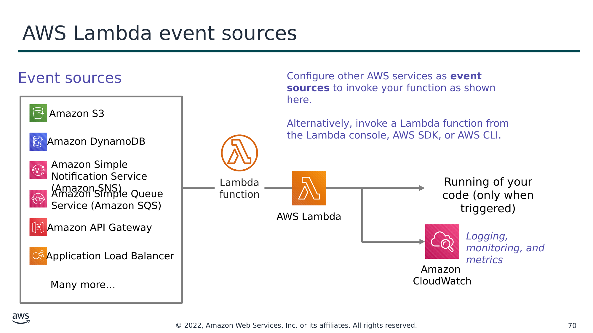

<details>
<summary>Текст зі схеми</summary>

Event sources (Джерела подій)

Configure other AWS services as **event sources** to invoke your function as shown here. (Налаштуйте інші сервіси AWS як **джерела подій**, щоб викликати вашу функцію, як показано тут.)

Alternatively, invoke a Lambda function from the Lambda console, AWS SDK, or AWS CLI. (Або викличте функцію Lambda з консолі Lambda, AWS SDK чи AWS CLI.)

Amazon S3

Amazon DynamoDB

Amazon Simple Notification Service (Amazon SNS)

Lambda function (Функція Lambda)

Running of your code (only when triggered) (Виконання вашого коду (лише коли його запущено))

Amazon Simple Queue Service (Amazon SQS)

AWS Lambda

Amazon API Gateway

*Logging, monitoring, and metrics (Журналювання, моніторинг і метрики)*

Application Load Balancer

Amazon

CloudWatch

Many more… (Багато інших…)

</details>

> **Нотатки:**
>
> Джерело подій (event source) — це сервіс AWS або створений розробником застосунок, що генерує події, які запускають виконання функції AWS Lambda.  
>
> Деякі сервіси публікують події до Lambda, безпосередньо викликаючи функцію Lambda. Ці сервіси, що викликають функції Lambda асинхронно, включають, зокрема, Amazon S3, Amazon Simple Notification Service (Amazon SNS) і Amazon CloudWatch Events.  
>
> Lambda також може опитувати (poll) ресурси в інших сервісах, які не публікують події до Lambda. Наприклад, Lambda може витягувати записи з черги Amazon Simple Queue Service (Amazon SQS) і запускати функцію Lambda для кожного отриманого повідомлення. Lambda може аналогічно читати події з Amazon DynamoDB.  
>
> Деякі сервіси, як-от Elastic Load Balancing (Application Load Balancer) і Amazon API Gateway, можуть викликати вашу функцію Lambda безпосередньо.  
>
> Ви можете викликати функції Lambda безпосередньо за допомогою консолі Lambda, API Lambda, набору для розробки програмного забезпечення AWS (SDK), AWS CLI та наборів інструментів AWS (AWS toolkits). Підхід прямого виклику може бути корисним, наприклад коли ви розробляєте мобільний застосунок і хочете, щоб застосунок викликав функції Lambda. Докладніше про всі підтримувані сервіси див. у документації Using Lambda with Other Services: https://docs.aws.amazon.com/lambda/latest/dg/lambda-services.html  
>
> AWS Lambda автоматично відстежує функції Lambda за допомогою Amazon CloudWatch. Щоб допомогти вам усувати збої у функції, Lambda журналює всі запити, оброблені вашою функцією. Вона також автоматично зберігає журнали, створені вашим кодом, через Amazon CloudWatch Logs.

---

## Слайд 71: Конфігурація функції AWS Lambda

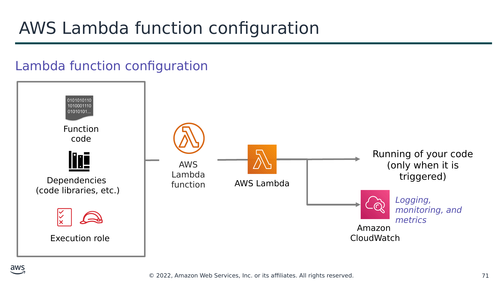

Конфігурація функції Lambda

<details>
<summary>Текст зі схеми</summary>

Function code (Код функції)

Running of your code (only when it is triggered) (Виконання вашого коду (лише коли його запущено))

AWS Lambda function (Функція AWS Lambda)

Dependencies (Залежності)

(code libraries, etc.) (бібліотеки коду тощо)

AWS Lambda

*Logging, monitoring, and metrics (Журналювання, моніторинг і метрики)*

Amazon

CloudWatch

Execution role (Роль виконання)

</details>

> **Нотатки:**
>
> Пам’ятайте, що функція Lambda — це власний код, який ви пишете для обробки подій, і що Lambda запускає функцію Lambda від вашого імені.  
>
> Коли ви використовуєте AWS Management Console для створення функції Lambda, ви спершу даєте функції назву. Потім ви вказуєте:  
> Середовище виконання (runtime), яке використовуватиме функція (наприклад, версію Python чи Node.js)  
> Роль виконання (execution role; щоб надати функції дозвіл IAM, щоб вона могла взаємодіяти з іншими сервісами AWS за потреби)  
>
> Далі, після натискання Create Function, ви налаштовуєте функцію. Конфігурації включають:  
> Додавання тригера (trigger; вкажіть одне з доступних джерел подій із попереднього слайда)  
> Додавання коду вашої функції (використайте наданий редактор коду або завантажте файл, що містить ваш код)  
> Вказання пам’яті в МБ для виділення вашій функції (від 128 МБ до 10 240 МБ)  
> За бажанням вкажіть змінні середовища, опис, тайм-аут, конкретну віртуальну приватну хмару (VPC), у якій запускати функцію, теги, які ви хочете використовувати, та інші налаштування. Докладніше див. «Налаштування функцій у консолі AWS Lambda» (Configuring functions in the AWS Lambda console) https://docs.aws.amazon.com/lambda/latest/dg/configuration-console.html у документації AWS.  
>
> Усі наведені вище налаштування потрапляють до пакета розгортання Lambda (deployment package) — ZIP-архіву, що містить код вашої функції та залежності. Коли ви використовуєте консоль Lambda для створення функції, консоль керує пакетом за вас. Однак вам потрібно створити пакет розгортання, якщо ви використовуєте API Lambda для керування функціями.

---

## Слайд 72: Приклад функції Lambda за розкладом: запуск і зупинка екземплярів EC2

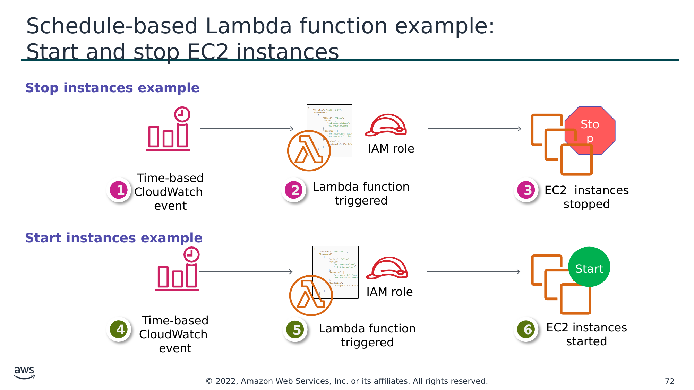

**Приклад зупинки екземплярів (Stop instances example)**

**Приклад запуску екземплярів (Start instances example)**

<details>
<summary>Текст зі схеми</summary>

Stop (Зупинка)

IAM role (Роль IAM)

Time-based CloudWatch  
event (Подія CloudWatch за часом)

**1**

**2**

Lambda function triggered (Функцію Lambda запущено)

**3**

EC2  instances stopped (Екземпляри EC2 зупинено)

Start (Запуск)

IAM role (Роль IAM)

Time-based CloudWatch  
event (Подія CloudWatch за часом)

Lambda function triggered (Функцію Lambda запущено)

**6**

EC2 instances started (Екземпляри EC2 запущено)

**4**

**5**

</details>

> **Нотатки:**
>
> Розгляньте приклад сценарію використання функції Lambda за розкладом. Припустімо, ви перебуваєте в ситуації, коли хочете зменшити використання Amazon EC2. Ви вирішуєте, що хочете зупиняти екземпляри у визначений час (наприклад, уночі, коли до них ніхто не звертається), а потім знову запускати екземпляри вранці (до початку робочого дня).  
>
> У цій ситуації можна налаштувати AWS Lambda та Amazon CloudWatch Events, щоб вони допомагали виконувати ці дії автоматично.  
>
> Ось що відбувається на кожному кроці прикладу:  
> Подію CloudWatch заплановано для запуску функції Lambda, що зупиняє ваші екземпляри EC2 о (наприклад) 22:00 за GMT.  
> Функцію Lambda запущено, і вона виконується з роллю IAM, що надає функції дозвіл зупиняти екземпляри EC2.  
> Екземпляри EC2 переходять у стан зупиненого.  
> Пізніше, о (наприклад) 05:00 за GMT, подію CloudWatch заплановано для запуску функції Lambda, що запускає екземпляри EC2.  
> Функцію Lambda запущено, і вона виконується з роллю IAM, що надає їй дозвіл запускати екземпляри EC2.  
> Екземпляри EC2 переходять у стан running (працюють).

---

## Слайд 73: Приклад функції Lambda на основі подій: створення мініатюр зображень

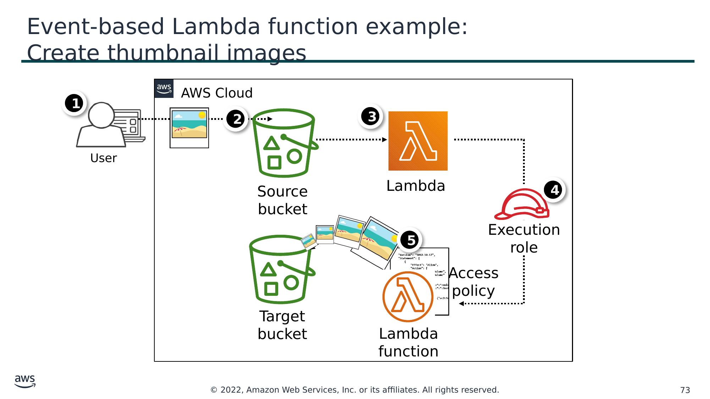

<details>
<summary>Текст зі схеми</summary>

AWS Cloud

**1**

**2**

**3**

User (Користувач)

Lambda

Source  
bucket (Вихідний бакет)

**4**

**5**

Execution  
role (Роль виконання)

Access  
policy (Політика доступу)

Target  
bucket (Цільовий бакет)

Lambda  
function (Функція Lambda)

</details>

> **Нотатки:**
>
> Тепер розгляньте приклад сценарію використання функції Lambda на основі подій. Припустімо, ви хочете створювати мініатюру для кожного зображення (об’єкта .jpg чи .png), що завантажується до бакета S3.  
>
> Щоб побудувати рішення, можна створити функцію Lambda, яку Amazon S3 викликає під час завантаження об’єктів. Потім функція Lambda читає об’єкт зображення з вихідного бакета та створює мініатюру в цільовому бакеті. Ось як це працює:  
> Користувач завантажує об’єкт до вихідного бакета в Amazon S3 (подія створення об’єкта, object-created event).  
> Amazon S3 виявляє подію створення об’єкта.  
> Amazon S3 публікує подію створення об’єкта до Lambda, викликаючи функцію Lambda та передаючи дані події.  
> Lambda запускає функцію Lambda, приймаючи роль виконання, яку ви вказали під час створення функції Lambda.  
> На основі даних події, які отримує функція Lambda, вона знає назву вихідного бакета та назву ключа об’єкта. Функція Lambda читає об’єкт і створює мініатюру за допомогою графічних бібліотек та зберігає мініатюру в цільовий бакет.

---

## Слайд 74: Квоти AWS Lambda (quotas)

М’які ліміти на регіон (Soft limits per Region):

- Одночасні виконання = 1000
- Сховище функцій і шарів (layers) = 75 ГБ

Жорсткі ліміти для окремих функцій (Hard limits for individual functions):

- Максимальне виділення пам’яті функції = 10 240 МБ
- Тайм-аут функції = 15 хвилин
- Розмір пакета розгортання = 250 МБ у розпакованому вигляді, включно з шарами
- Розмір пакета коду образу контейнера = 10 ГБ

Існують також додаткові ліміти. Докладніше в документації щодо квот AWS Lambda: [https://docs.aws.amazon.com/lambda/latest/dg/gettingstarted-limits.html](https://docs.aws.amazon.com/lambda/latest/dg/gettingstarted-limits.html).

> **Нотатки:**
>
> AWS Lambda має певні квоти, про які слід знати під час створення та розгортання функцій Lambda.  
>
> AWS Lambda обмежує обсяг обчислювальних ресурсів і ресурсів зберігання, які можна використовувати для запуску й зберігання функцій. Наприклад, на момент написання максимальне виділення пам’яті для однієї функції Lambda становить 10 240 МБ. Також є ліміт у 1000 одночасних виконань у регіоні. Функції Lambda можна налаштувати на виконання до 15 хвилин за один запуск. Тайм-аут можна встановити на будь-яке значення від 1 секунди до 15 хвилин. Якщо ви усуваєте проблеми з розгортанням Lambda, пам’ятайте про ці ліміти.  
>
> Існують ліміти на розмір пакета розгортання функції (250 МБ). Шар (layer) — це ZIP-архів, що містить бібліотеки, власне середовище виконання або інші залежності. За допомогою шарів ви можете використовувати бібліотеки у вашій функції, не включаючи їх до пакета розгортання. Використання шарів може допомогти уникнути досягнення ліміту розміру пакета розгортання. Шари також є добрим способом ділитися кодом і даними між функціями Lambda.  
>
> Для більших робочих навантажень, що залежать від значних залежностей, як-от машинне навчання чи навантаження з інтенсивним використанням даних, можна розгорнути функцію Lambda як образ контейнера розміром до 10 ГБ.  
>
> Ліміти бувають м’якими або жорсткими. М’які ліміти для акаунта потенційно можна послабити, надіславши запит до служби підтримки з обґрунтуванням запиту. Жорсткі ліміти збільшити не можна.  
>
> Докладніше про поточні квоти AWS Lambda див. документацію щодо квот AWS Lambda за адресою https://docs.aws.amazon.com/lambda/latest/dg/gettingstarted-limits.html.

---

## Слайд 75: Ключові висновки розділу 5

- **Безсерверні обчислення (Serverless computing)** дають змогу створювати та запускати застосунки й сервіси без розгортання чи керування серверами.
- **AWS Lambda — це безсерверний обчислювальний сервіс**, що забезпечує вбудовану відмовостійкість і автоматичне масштабування.
- **Джерело подій (event source)** — це сервіс AWS або створений розробником застосунок, що запускає виконання функції Lambda.
- Максимальне виділення пам’яті для однієї функції Lambda становить 10 240 МБ.
- Максимальний час виконання функції Lambda становить 15 хвилин.

> **Нотатки:**
>
> Основні висновки цього розділу модуля:  
> Безсерверні обчислення дають змогу створювати та запускати застосунки й сервіси без розгортання чи керування серверами.  
> AWS Lambda — це безсерверний обчислювальний сервіс, що забезпечує вбудовану відмовостійкість і автоматичне масштабування.  
> Джерело подій — це сервіс AWS або створений розробником застосунок, що запускає виконання функції Lambda.  
> Максимальне виділення пам’яті для однієї функції Lambda становить 10 240 МБ.  
> Максимальний час виконання функції Lambda становить 15 хвилин.

---

## Слайд 76: Практична вправа: створення функції AWS Lambda Stopinator

**Щоб виконати цю вправу:**

- Перейдіть до середовища практичної лабораторної роботи та запустіть вправу AWS Lambda.
- Дотримуйтеся інструкцій, наведених у середовищі практичної лабораторної роботи.

> **Нотатки:**
>
> У цій практичній вправі ви створите базову функцію Lambda, що зупиняє екземпляр EC2.

---

## Слайд 77: Підсумки вправи: ключові висновки


> **Нотатки:**
>
> Викладач проведе обговорення ключових висновків із вправи після того, як студенти її завершать.

---

## Слайд 78: Розділ 6: Вступ до AWS Elastic Beanstalk

Модуль 6: Обчислення

> **Нотатки:**
>
> Представляємо Розділ 6: Вступ до AWS Elastic Beanstalk.

---

## Слайд 79: AWS Elastic Beanstalk

- Простий спосіб запустити **вебзастосунки (web applications)**
- **Кероване обслуговування (managed service)**, що автоматично виконує –
  - Розгортання та конфігурацію інфраструктури
  - Розгортання (deployment)
  - Балансування навантаження
  - Автоматичне масштабування
  - Моніторинг стану
  - Аналіз і налагодження
  - Журналювання
- Без додаткової плати за Elastic Beanstalk
  - Платіть лише за базові ресурси, що використовуються


**AWS Elastic**

**Beanstalk**

> **Нотатки:**
>
> AWS Elastic Beanstalk — це ще один варіант обчислювального сервісу AWS. Це платформа як послуга (або PaaS), що полегшує швидке розгортання, масштабування та керування вашими вебзастосунками й сервісами.  
>
> Ви залишаєтеся в контролі. Уся платформа вже побудована, і вам потрібно лише завантажити свій код. Оберіть тип екземпляра, базу даних, налаштуйте й коригуйте автоматичне масштабування, оновлюйте свій застосунок, отримуйте доступ до файлів журналів сервера й вмикайте HTTPS на балансувальнику навантаження.  
>
> Ви завантажуєте свій код, і Elastic Beanstalk автоматично виконує розгортання — від розгортання потужностей і балансування навантаження до автоматичного масштабування та моніторингу стану застосунку. Водночас ви зберігаєте повний контроль над ресурсами AWS, що забезпечують роботу вашого застосунку, і можете отримати доступ до базових ресурсів у будь-який час.  
>
> За AWS Elastic Beanstalk не стягується додаткова плата. Ви платите за ресурси AWS (наприклад, екземпляри EC2 чи бакети S3), які створюєте для зберігання та запуску вашого застосунку. Ви платите лише за те, що використовуєте, у міру використання. Немає мінімальних платежів і авансових зобов’язань.

---

## Слайд 80: Розгортання AWS Elastic Beanstalk

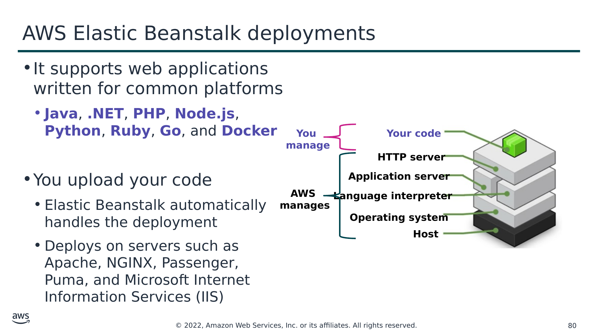

- Підтримує вебзастосунки, написані для поширених платформ
  - **Java**, **.NET**, **PHP**, **Node.js**, **Python**, **Ruby**, **Go** та **Docker**
- Ви завантажуєте свій код
  - Elastic Beanstalk автоматично виконує розгортання
  - Розгортає на серверах, як-от Apache, NGINX, Passenger, Puma та Microsoft Internet Information Services (IIS)

<details>
<summary>Текст зі схеми</summary>

**You**  
**manage (Ви керуєте)**

**Your code (Ваш код)**

**HTTP server (HTTP-сервер)**

**Application server (Сервер застосунків)**

**AWS**  
**manages (керує)**

**Language interpreter (Інтерпретатор мови)**

**Operating system (Операційна система)**

**Host (Хост)**

</details>

> **Нотатки:**
>
> AWS Elastic Beanstalk дає змогу розгортати ваш код через AWS Management Console, AWS Command Line Interface (AWS CLI), Visual Studio та Eclipse. Він надає всі сервіси застосунків, потрібні вашому застосунку. Єдине, що ви маєте створити, — це ваш код. Elastic Beanstalk розроблено, щоб зробити розгортання вашого застосунку швидким і простим процесом.  
>
> Elastic Beanstalk підтримує широкий спектр платформ. Підтримувані платформи включають Docker, Go, Java, .NET, Node.js, PHP, Python і Ruby.  
>
> AWS Elastic Beanstalk розгортає ваш код на Apache Tomcat для застосунків Java; Apache HTTP Server для застосунків PHP і Python; NGINX або Apache HTTP Server для застосунків Node.js; Passenger або Puma для застосунків Ruby; та Microsoft Internet Information Services (IIS) для застосунків .NET, Java SE, Docker і Go.

---

## Слайд 81: Переваги Elastic Beanstalk


Швидко та просто почати використання

Продуктивність розробників

Важко «перерости»

Повний контроль над ресурсами

> **Нотатки:**
>
> Elastic Beanstalk швидко та просто почати використовувати. Використовуйте AWS Management Console, репозиторій Git або інтегроване середовище розробки (IDE), як-от Eclipse чи Visual Studio, щоб завантажити свій застосунок. Elastic Beanstalk автоматично виконує деталі розгортання: розгортання потужностей, балансування навантаження, автоматичне масштабування та моніторинг стану застосунку.  
>
> Ви можете підвищити продуктивність розробників, зосередившись на написанні коду замість керування й налаштування серверів, баз даних, балансувальників навантаження, брандмауерів і мереж. AWS оновлює базову платформу, на якій працює ваш застосунок, виправленнями та оновленнями.  
>
> Elastic Beanstalk важко «перерости». З Elastic Beanstalk ваш застосунок може обробляти піки навантаження чи трафіку, мінімізуючи ваші витрати. Він автоматично масштабує ваш застосунок вгору чи вниз залежно від конкретних потреб застосунку за допомогою легко настроюваних параметрів автоматичного масштабування. Ви можете використовувати метрики завантаження ЦП для запуску дій автоматичного масштабування.  
>
> Ви маєте свободу обирати ресурси AWS — як-от тип екземпляра Amazon EC2 — оптимальні для вашого застосунку. Elastic Beanstalk дає змогу зберегти повний контроль над ресурсами AWS, що забезпечують роботу вашого застосунку. Якщо ви вирішите взяти на себе деякі (або всі) елементи вашої інфраструктури, ви можете зробити це безперебійно за допомогою можливостей керування, що надаються Elastic Beanstalk.

---

## Слайд 82: Практична вправа: AWS Elastic Beanstalk

**Щоб виконати цю вправу:**

- Перейдіть до середовища практичної лабораторної роботи та запустіть вправу AWS Elastic Beanstalk.
- Дотримуйтеся інструкцій, наведених у середовищі практичної лабораторної роботи.

> **Нотатки:**
>
> У цій практичній вправі ви зрозумієте, чому можна захотіти використати Elastic Beanstalk для розгортання вебзастосунку в AWS.

---

## Слайд 83: Підсумки вправи: ключові висновки


> **Нотатки:**
>
> Викладач може вирішити провести обговорення ключових висновків із вправи після її завершення.

---

## Слайд 84: Ключові висновки розділу 6

- **AWS Elastic Beanstalk** підвищує продуктивність розробників.
  - Спрощує процес розгортання вашого застосунку.
  - Зменшує складність керування.
- Elastic Beanstalk підтримує **Java**, **.NET**, **PHP**, **Node.js**, **Python**, **Ruby**, **Go** та **Docker**
- За Elastic Beanstalk плата не стягується. Платіть лише за ресурси AWS, які ви використовуєте.

> **Нотатки:**
>
> Основні висновки цього розділу модуля:  
> AWS Elastic Beanstalk підвищує продуктивність розробників.  
> Спрощує процес розгортання вашого застосунку.  
> Зменшує складність керування.  
> Elastic Beanstalk підтримує Java, .NET, PHP, Node.js, Python, Ruby, Go та Docker.  
> За Elastic Beanstalk плата не стягується. Платіть лише за ресурси AWS, які ви використовуєте.

---

## Слайд 85: Підсумки модуля

Модуль 6: Обчислення

> **Нотатки:**
>
> Настав час повторити матеріал модуля та завершити його перевіркою знань і розбором запитання практичного сертифікаційного іспиту.

---

## Слайд 86: Резюме модуля

Підсумовуючи, у цьому модулі ви навчилися:

- Надавати огляд різних обчислювальних сервісів AWS у хмарі
- Пояснювати, навіщо використовувати Amazon Elastic Compute Cloud (Amazon EC2)
- Визначати функціональність консолі Amazon EC2
- Виконувати базові функції в Amazon EC2 для побудови віртуального обчислювального середовища
- Визначати елементи оптимізації витрат Amazon EC2
- Пояснювати, коли використовувати AWS Elastic Beanstalk
- Пояснювати, коли використовувати AWS Lambda
- Визначати, як запускати контейнеризовані застосунки в кластері керованих серверів

> **Нотатки:**
>
> Підсумовуючи, у цьому модулі ви навчилися:  
> Надавати огляд різних обчислювальних сервісів AWS у хмарі  
> Пояснювати, навіщо використовувати Amazon Elastic Compute Cloud (Amazon EC2)  
> Визначати функціональність консолі Amazon EC2  
> Виконувати базові функції в Amazon EC2 для побудови віртуального обчислювального середовища  
> Визначати елементи оптимізації витрат Amazon EC2  
> Пояснювати, коли використовувати AWS Elastic Beanstalk  
> Пояснювати, коли використовувати AWS Lambda  
> Визначати, як запускати контейнеризовані застосунки в кластері керованих серверів

---

## Слайд 87: Пройдіть перевірку знань


> **Нотатки:**
>
> Настав час пройти перевірку знань для цього модуля.

---

## Слайд 88: Приклад запитання іспиту

Який сервіс AWS допомагає розробникам швидко розгортати ресурси, що можуть використовувати різні мови програмування, як-от .NET і Java?

Варіант

Відповідь

A

AWS CloudFormation

B

AWS SQS

C

AWS Elastic Beanstalk

D

Amazon Elastic Compute Cloud (Amazon EC2)

> **Нотатки:**
>
> Розгляньте варіанти відповідей і відсійте їх за ключовими словами.

---

## Слайд 89: Відповідь на приклад запитання іспиту

Який сервіс AWS допомагає розробникам швидко розгортати ресурси, що можуть використовувати різні мови програмування, як-от .NET і Java?

Правильна відповідь — C.

Ключові слова в запитанні: розробники швидко розгортають ресурси та різні мови програмування.

> **Нотатки:**
>
> Ключові слова, які потрібно розпізнати: розробники швидко розгортають ресурси та різні мови програмування.  
>
> Правильна відповідь — C. AWS Elastic Beanstalk  
>
> Неправильні відповіді:  
> Відповідь A: AWS CloudFormation  
> Відповідь B: AWS SQS  
> Відповідь D: Amazon Elastic Compute Cloud (Amazon EC2)

---

## Слайд 90: Додаткові ресурси

- Документація Amazon EC2: [https://docs.aws.amazon.com/ec2/](https://docs.aws.amazon.com/ec2/)
- Ціни Amazon EC2: [https://aws.amazon.com/ec2/pricing/](https://aws.amazon.com/ec2/pricing/)
- Воркшоп Amazon ECS: [https://ecsworkshop.com/](https://ecsworkshop.com/)
- Запуск контейнерів в AWS (Running Containers on AWS): [https://containersonaws.com/](https://containersonaws.com/)
- Воркшоп Amazon EKS: [https://www.eksworkshop.com/](https://www.eksworkshop.com/)
- Документація AWS Lambda: [https://docs.aws.amazon.com/lambda/](https://docs.aws.amazon.com/lambda/)
- Документація AWS Elastic Beanstalk: [https://docs.aws.amazon.com/elastic-beanstalk/](https://docs.aws.amazon.com/elastic-beanstalk/)
- Cost Optimization Playbook (посібник з оптимізації витрат): [https://d1.awsstatic.com/pricing/AWS_CO_Playbook_Final.pdf](https://d1.awsstatic.com/pricing/AWS_CO_Playbook_Final.pdf)

> **Нотатки:**
>
> Обчислювальні сервіси в AWS — велика тема, і цей модуль надав лише вступ до неї. Наведені нижче ресурси надають більше подробиць:  
> Документація Amazon EC2: https://docs.aws.amazon.com/ec2/  
> Ціни Amazon EC2: https://aws.amazon.com/ec2/pricing/  
> Воркшоп Amazon ECS: https://ecsworkshop.com/  
> Запуск контейнерів в AWS: https://containersonaws.com/  
> Воркшоп Amazon EKS: https://www.eksworkshop.com/  
> Документація AWS Lambda: https://docs.aws.amazon.com/lambda/  
> Документація AWS Elastic Beanstalk: https://docs.aws.amazon.com/elastic-beanstalk/  
> Cost Optimization Playbook: https://d1.awsstatic.com/pricing/AWS_CO_Playbook_Final.pdf

---

## Слайд 91: Дякуємо

Усі торговельні марки є власністю їхніх власників.

> **Нотатки:**
>
> Дякуємо, що пройшли цей модуль.
