## Слайд 1: Module 7: Storage

AWS Academy Cloud Foundations

> **Нотатки:**
>
> Welcome to Module 7: Storage.

---

## Слайд 2: Module overview

**Topics**

- Amazon Elastic Block Store (Amazon EBS)
- Amazon Simple Storage Service (Amazon S3)
- Amazon Elastic File System (Amazon EFS)
- Amazon Simple Storage Service Glacier

**Demos**

- Amazon EBS console
- Amazon S3 console
- Amazon EFS console
- Amazon S3 Glacier console

**Lab**

- Working with Amazon EBS

**Activities**

- Storage solution case study

**Knowledge check**

> **Нотатки:**
>
> Cloud storage is typically more reliable, scalable, and secure than traditional on-premises storage systems. Cloud storage is a critical component of cloud computing because it holds the information that applications use. Big data analytics, data warehouses, the Internet of Things (IoT), databases, and backup and archive applications all rely on some form of data storage architecture.  
>
> This module addresses the following topics:  
> Amazon Elastic Block Store (Amazon EBS)  
> Amazon Simple Storage Service (Amazon S3)  
> Amazon Elastic File System (Amazon EFS)  
> Amazon Simple Storage Service Glacier  
>
> This module includes four recorded demonstrations that show you how to use the AWS Management Console to create storage solutions.  
>
> This module includes a hands-on lab where you create an Amazon EBS volume, and then attach it to an Amazon Elastic Compute Cloud (Amazon EC2) instance. You also create a snapshot of your volume and then use the snapshot to create a new volume.  
>
> This module includes an activity that challenges you to determine the best storage solution for a business case.  
>
> Finally, you are asked to complete a knowledge check that tests your understanding of the key concepts in this module.

---

## Слайд 3: Module objectives

After completing this module, you should be able to:

- Identify the different types of storage
- Explain Amazon S3
- Identify the functionality in Amazon S3
- Explain Amazon EBS
- Identify the functionality in Amazon EBS
- Perform functions in Amazon EBS to build an Amazon EC2 storage solution
- Explain Amazon EFS
- Identify the functionality in Amazon EFS
- Explain Amazon S3 Glacier
- Identify the functionality in Amazon S3 Glacier
- Differentiate between Amazon EBS, Amazon S3, Amazon EFS, and Amazon S3 Glacier

> **Нотатки:**
>
> The goal of this module is to discover key concepts that relate to storage. You will learn about the different types of storage resources that are available and review the different pricing options so that you can understand how different choices affect your solution cost.  
>
> After completing this module, you should be able to:  
> Identify the different types of storage  
> Explain Amazon S3  
> Identify the functionality in Amazon S3  
> Explain Amazon EBS  
> Identify the functionality in Amazon EBS  
> Perform functions in Amazon EBS to build an Amazon EC2 storage solution  
> Explain Amazon EFS  
> Identify the functionality in Amazon EFS  
> Explain Amazon S3 Glacier  
> Identify the functionality in Amazon S3 Glacier  
> Differentiate between Amazon EBS, Amazon S3, Amazon EFS, and Amazon S3 Glacier

---

## Слайд 4: Core AWS services

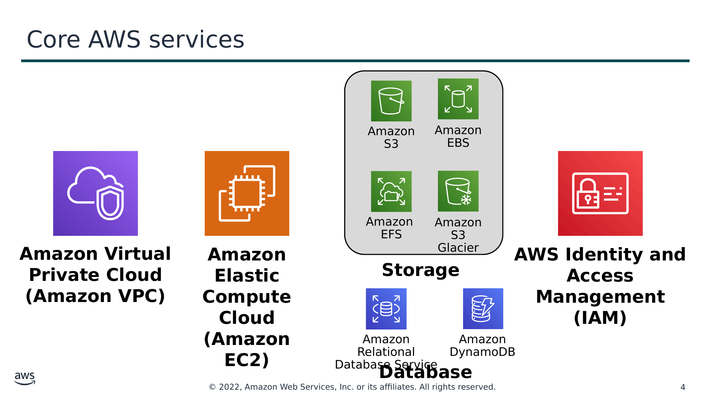

Текст зі схеми

Amazon S3

Amazon EBS

Amazon

EFS

Amazon S3 Glacier

**Amazon Virtual Private Cloud (Amazon VPC)**

**Amazon Elastic Compute Cloud (Amazon EC2)**

**AWS Identity and Access Management (IAM)**

**Storage**

Amazon Relational

Database Service

Amazon DynamoDB

**Database**

> **Нотатки:**
>
> Storage is another AWS core service category. Some broad categories of storage include: instance store (ephemeral storage), Amazon EBS, Amazon EFS, Amazon S3, and Amazon S3 Glacier.  
> Instance store, or ephemeral storage, is temporary storage that is added to your Amazon EC2 instance.  
> Amazon EBS is persistent, mountable storage that can be mounted as a device to an Amazon EC2 instance. Amazon EBS can be mounted to an Amazon EC2 instance only within the same Availability Zone. Only one Amazon EC2 instance at a time can mount an Amazon EBS volume.  
> Amazon EFS is a shared file system that multiple Amazon EC2 instances can mount at the same time.  
> Amazon S3 is persistent storage where each file becomes an object and is available through a Uniform Resource Locator (URL); it can be accessed from anywhere.  
> Amazon S3 Glacier is for cold storage for data that is not accessed frequently (for example, when you need long-term data storage for archival or compliance reasons).

---

## Слайд 5: Section 1: Amazon Elastic Block Store (Amazon EBS)

Module 7: Storage

> **Нотатки:**
>
> Introduce Section 1: Amazon Elastic Block Store (Amazon EBS).

---

## Слайд 6: Storage

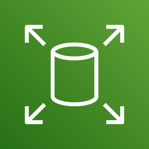

Amazon Elastic Block Store (Amazon EBS)

> **Нотатки:**
>
> Amazon EBS provides persistent block storage volumes for use with Amazon EC2 instances. Persistent storage is any data storage device that retains data after power to that device is shut off. It is also sometimes called non-volatile storage.  
>
> Each Amazon EBS volume is automatically replicated within its Availability Zone to protect you from component failure. It is designed for high availability and durability. Amazon EBS volumes provide the consistent and low-latency performance that is needed to run your workloads.  
>
> With Amazon EBS, you can scale your usage up or down within minutes, while paying a low price for only what you provision.

---

## Слайд 7: AWS storage options: Block storage versus object storage

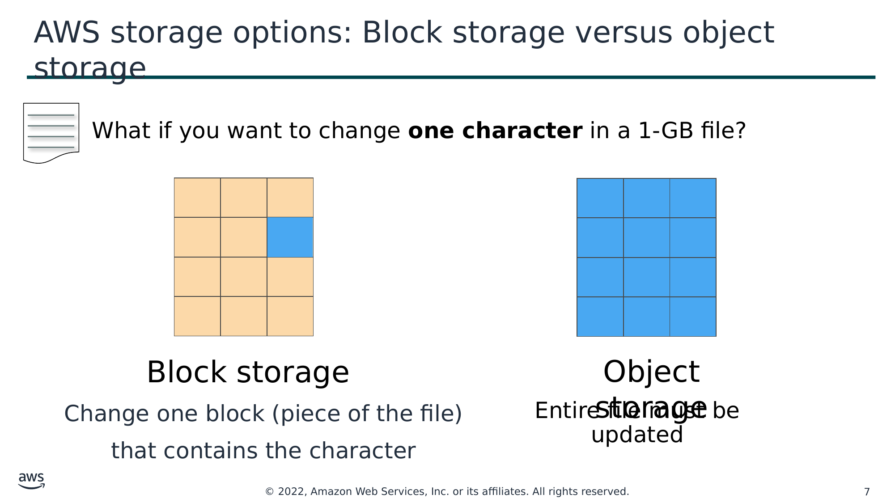

Текст зі схеми

What if you want to change **one character** in a 1-GB file?

Block storage

Object storage

Change one block (piece of the file)

that contains the character

Entire file must be updated

> **Нотатки:**
>
> What happens if you want to change one character in a 1-GB file? With block storage, you change only the block that contains the character. With object storage, the entire file must be updated.  
>
> One critical difference between some storage types is whether they offer block-level storage or object-level storage.  
>
> This difference has a major effect on the throughput, latency, and cost of your storage solution. Block storage solutions are typically faster and use less bandwidth, but they can cost more than object-level storage.

---

## Слайд 8: Amazon EBS

Amazon EBS enables you to **create individual storage volumes** and **attach them** to an Amazon EC2 instance:

- Amazon EBS offers block-level storage.
- Volumes are automatically replicated within its Availability Zone.
- It can be backed up automatically to Amazon S3 through snapshots.
- Uses include –
  - Boot volumes and storage for Amazon Elastic Compute Cloud (Amazon EC2) instances
  - Data storage with a file system
  - Database hosts
  - Enterprise applications

> **Нотатки:**
>
> Amazon EBS enables you to create individual storage volumes and attach them to an Amazon EC2 instance. Amazon EBS offers block-level storage, where its volumes are automatically replicated within its Availability Zone. Amazon EBS is designed to provide durable, detachable, block-level storage (which is like an external hard drive) for your Amazon EC2 instances. Because they are directly attached to the instances, they can provide low latency between where the data is stored and where it might be used on the instance.  
>
> For this reason, they can be used to run a database with an Amazon EC2 instance. Amazon EBS volumes are included as part of the backup of your instances into Amazon Machine Images (or AMIs). AMIs are stored in Amazon S3 and can be reused to create new Amazon EC2 instances later.  
>
> A backup of an Amazon EBS volume is called a snapshot. The first snapshot is called the baseline snapshot. Any other snapshot after the baseline captures only what is different from the previous snapshot.  
>
> Amazon EBS volumes uses include:  
> Boot volumes and storage for Amazon EC2 instances  
> Data storage with a file system  
> Database hosts  
> Enterprise applications

---

## Слайд 9: Amazon EBS volume types

|  | Solid State Drives (SSD): General Purpose | Solid State Drives (SSD): Provisioned IOPS | Hard Disk Drives (HDD): Throughput-Optimized | Hard Disk Drives (HDD): Cold |
|---|---|---|---|---|
| Maximum Volume Size | 16 TiB | 16 TiB | 16 TiB | 16 TiB |
| Maximum IOPS/Volume | 16,000 | 64,000 | 500 | 250 |
| Maximum Throughput/Volume | 250 MiB/s | 1,000 MiB/s | 500 MiB/s | 250 MiB/s |

> **Нотатки:**
>
> Matching the correct technology to your workload is a best practice for reducing storage costs. Provisioned IOPS SSD-backed Amazon EBS volumes can give you the highest performance. However, if your application doesn't require or won't use performance that high, General Purpose SSD is usually sufficient. Only SSDs can be used as boot volumes for EC2 instances. The lower-cost options might be a solution for additional storage or use cases other than boot volumes.  
>
> To learn more about Amazon EBS volume types, see https://docs.aws.amazon.com/AWSEC2/latest/UserGuide/ebs-volume-types.html.

---

## Слайд 10: Amazon EBS volume type use cases

| Solid State Drives (SSD): General Purpose | Solid State Drives (SSD): Provisioned IOPS | Hard Disk Drives (HDD): Throughput-Optimized | Hard Disk Drives (HDD): Cold |
|---|---|---|---|
| This type is recommended for most workloads | Critical business applications that require sustained IOPS performance, or more than 16,000 IOPS or 250 MiB/second of throughput per volume | Streaming workloads that require consistent, fast throughput at a low price | Throughput-oriented storage for large volumes of data that is infrequently accessed |
| System boot volumes | Large database workloads | Big data | Scenarios where the lowest storage cost is important |
| Virtual desktops |  | Data warehouses | It cannot be a boot volume |
| Low-latency interactive applications |  | Log processing |  |
| Development and test environments |  | It cannot be a boot volume |  |

> **Нотатки:**
>
> As mentioned previously an Amazon EBS volume is a durable, block-level storage device that you can attach to a single EC2 instance. You can use Amazon EBS volumes as primary storage for data that requires frequent updates, such as the system drive for an instance or storage for a database application. You can also use them for throughput-intensive applications that perform continuous disk scans. Amazon EBS volumes persist independently from the running life of an EC2 instance.  
>
> Use cases for EBS vary by the storage type used and whether you are using General Purpose of Provisioned IOPS.

---

## Слайд 11: Amazon EBS features

- Snapshots –
  - Point-in-time snapshots
  - Recreate a new volume at any time
- Encryption –
  - Encrypted Amazon EBS volumes
  - No additional cost
- Elasticity –
  - Increase capacity
  - Change to different types

> **Нотатки:**
>
> To provide an even higher level of data durability, Amazon EBS enables you to create point-in-time snapshots of your volumes, and you can re-create a new volume from a snapshot at any time. You can also share snapshots or even copy snapshots to different AWS Regions for even greater disaster recovery (DR) protection. For example, you can encrypt and share your snapshots from Virginia in the US to Tokyo, Japan.  
>
> You can also have encrypted Amazon EBS volumes at no additional cost, so the data that moves between the EC2 instance and the EBS volume inside AWS data centers is encrypted in transit.  
>
> As your company grows, the amount of data that is stored on your Amazon EBS volumes is also likely to grow. Amazon EBS volumes can increase capacity and change to different types, so you can change from hard disk drives (HDDs) to solid state drives (SSDs) or increase from a 50-GB volume to a 16-TB volume. For example, you can do this resize operation dynamically without needing to stop the instances.

---

## Слайд 12: Amazon EBS: Volumes, IOPS, and pricing

1. **Volumes –**
   - Amazon EBS volumes persist independently from the instance.
   - All volume types are charged by the amount that is provisioned per month.
2. **IOPS –**
   - General Purpose SSD:
      - Charged by the amount that you provision in GB per month until storage is released.
   - Magnetic:
      - Charged by the number of requests to the volume.
   - Provisioned IOPS SSD:
      - Charged by the amount that you provision in IOPS (multiplied by the percentage of days that you provision for the month).

> **Нотатки:**
>
> When you begin to estimate the cost for Amazon EBS, you must consider the following:  
> Volumes – Volume storage for all Amazon EBS volume types is charged by the amount you provision in GB per month, until you release the storage.  
> IOPS – I/O is included in the price of General Purpose SSD volumes. However, for Amazon EBS magnetic volumes, I/O is charged by the number of requests that you make to your volume. With Provisioned IOPS SSD volumes, you are also charged by the amount you provision in IOPS (multiplied by the percentage of days that you provision for the month).  
>
> The pricing and provisioning of Amazon EBS are complex. In general, you pay for the size of the volume and its usage. To learn more about the full, highly complex pricing and provisioning concepts of Amazon EBS, see https://docs.aws.amazon.com/AWSEC2/latest/UserGuide/ebs-volume-types.html.

---

## Слайд 13: Amazon EBS: Snapshots and data transfer

3. **Snapshots –**
   - Added cost of Amazon EBS snapshots to Amazon S3 is per GB-month of data stored.
4. **Data transfer –**
   - Inbound data transfer is free.
   - Outbound data transfer across Regions incurs charges.

> **Нотатки:**
>
> Snapshots – Amazon EBS enables you to back up snapshots of your data to Amazon S3 for durable recovery. If you opt for Amazon EBS snapshots, the added cost is per GB-month of data stored.  
> Data transfer – When you copy Amazon EBS snapshots, you are charged for the data that is transferred across Regions. After the snapshot is copied, standard Amazon EBS snapshot charges apply for storage in the destination Region.

---

## Слайд 14: Section 1 key takeaways

Amazon EBS features:

- Persistent and customizable block storage for Amazon EC2
- HDD and SSD types
- Replicated in the same Availability Zone
- Easy and transparent encryption
- Elastic volumes
- Back up by using snapshots

> **Нотатки:**
>
> Amazon EBS provides block-level storage volumes for use with Amazon EC2 instances. Amazon EBS volumes are off-instance storage that persists independently from the life of an instance. They are analogous to virtual disks in the cloud. Amazon EBS provides three volume types: General Purpose SSD, Provisioned IOPS SSD, and magnetic.  
>
> The three volume types differ in performance characteristics and cost, so you can choose the right storage performance and price for the needs of your applications.  
>
> Additional benefits include replication in the same Availability Zone, easy and transparent encryption, elastic volumes, and backup by using snapshots.  
>
> To learn more about Amazon EBS, see: https://aws.amazon.com/ebs/.

---

## Слайд 15: Recorded demo: Amazon Elastic Block Store

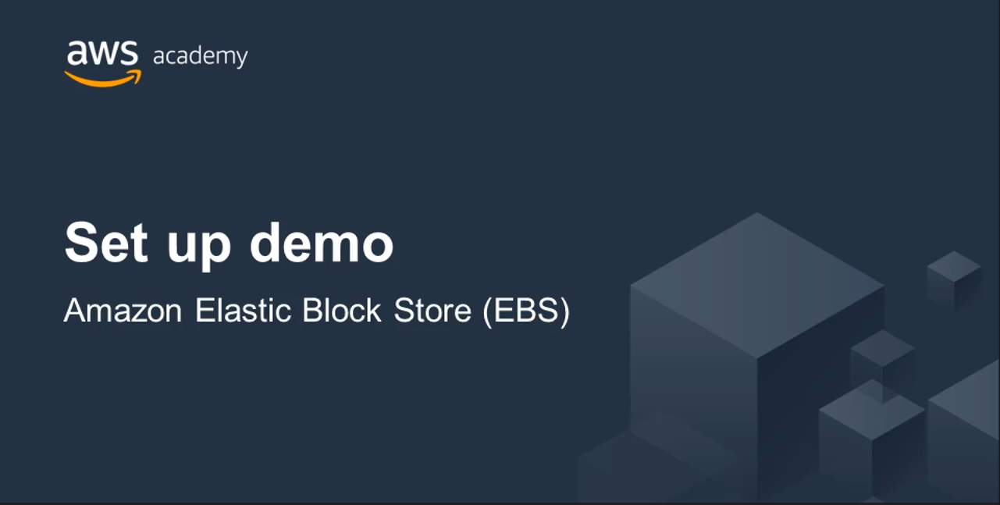

> **Нотатки:**
>
> Now, take a moment to watch the Elastic Block Store demo at https://aws-tc-largeobjects.s3-us-west-2.amazonaws.com/ILT-TF-100-ACFNDS-20-EN/Module_7_EBS+v2.0.mp4. The recording runs a little over 5 minutes, and it reinforces many of the concepts that were discussed in this section of the module.  
>
> The demonstration shows how to configure the following resources by using the AWS Management Console. The demonstration shows how to:  
> Create an Amazon General Purpose (SSD) EBS volume  
> Attach the EBS volume to an EC2 instance  
>
> The demonstration also shows how to interact with the EBS volume using the Amazon Command Line Interface and how to mount the EBS volume to the EC2 instance.

---

## Слайд 16: Lab 4: Working with Amazon EBS

> **Нотатки:**
>
> You will now work on Lab 4: Working with Amazon EBS.

---

## Слайд 17: Lab 4: Scenario

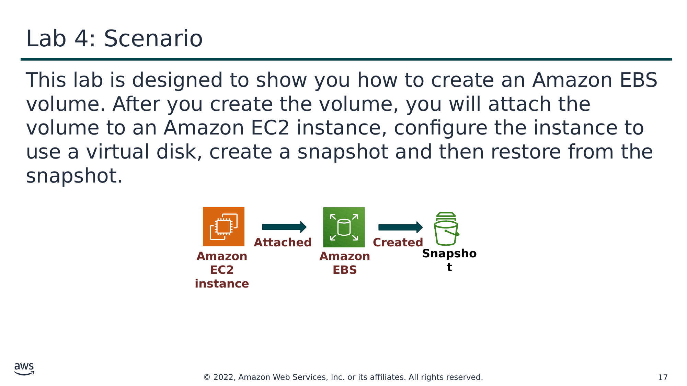

Текст зі схеми

This lab is designed to show you how to create an Amazon EBS volume. After you create the volume, you will attach the volume to an Amazon EC2 instance, configure the instance to use a virtual disk, create a snapshot and then restore from the snapshot.

**Attached**

**Created**

**Amazon EC2 instance**

**Amazon EBS**

**Snapshot**

> **Нотатки:**
>
> This lab is designed to show you how to  create an Amazon EBS volume. After you create the volume, you will attach the volume to an Amazon EC2 instance, configure the instance to use a virtual disk, create a snapshot and then restore from the snapshot.  
>
> After completing this lab, you should be able to:  
> Create an Amazon EBS volume  
> Attach that volume to an instance  
> Configure the instance to use the virtual disk  
> Create an Amazon EBS snapshot  
> Restore the snapshot

---

## Слайд 18: Lab 4: Final product

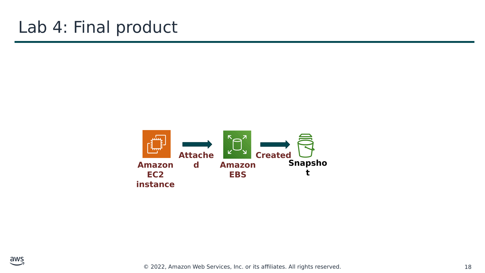

Текст зі схеми

**Amazon EC2 instance**

**Attached**

**Amazon EBS**

**Created**

**Snapshot**

> **Нотатки:**
>
> In this lab, you:  
> Created an Amazon EBS volume  
> Attached that volume to an instance  
> Configured the instance to use the virtual disk  
> Created an Amazon EBS snapshot  
> Restored the snapshot

---

## Слайд 19: Begin Lab 4: Working with Amazon EBS

~ 30 minutes

> **Нотатки:**
>
> It is now time to start the lab.

---

## Слайд 20: Lab debrief: Key takeaways

> **Нотатки:**
>
> In this lab, you:  
> Created an Amazon EBS volume  
> Attached the volume to an instance  
> Configured the instance to use the virtual disk  
> Created an Amazon EBS snapshot  
> Restored the snapshot

---

## Слайд 21: Section 2: Amazon Simple Storage Service (Amazon S3)

Module 7: Storage

> **Нотатки:**
>
> Introduce Section 3: Amazon Simple Storage Service.  
>
> Companies need the ability to simply and securely collect, store, and analyze their data on a massive scale. Amazon S3 is object storage that is built to store and retrieve any amount of data from anywhere: websites and mobile apps, corporate applications, and data from Internet of Things (IoT) sensors or devices.

---

## Слайд 22: Storage 1

Storage

Amazon Simple Storage Service (Amazon S3)

> **Нотатки:**
>
> Amazon S3 is object-level storage, which means that if you want to change a part of a file, you must make the change and then re-upload the entire modified file. Amazon S3 stores data as objects within resources that are called buckets.  
>
> You will now learn more about Amazon S3.

---

## Слайд 23: Amazon S3 overview

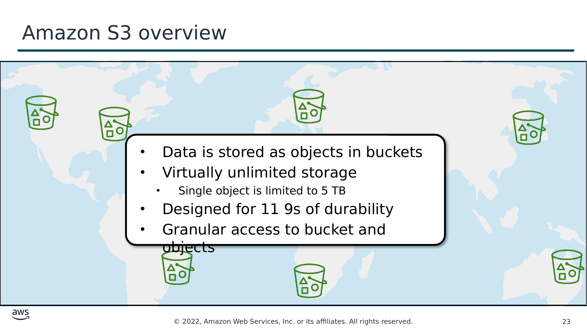

Текст зі схеми

- Data is stored as objects in buckets
- Virtually unlimited storage
  - Single object is limited to 5 TB
- Designed for 11 9s of durability
- Granular access to bucket and objects

> **Нотатки:**
>
> Amazon S3 is a managed cloud storage solution that is designed to scale seamlessly and provide 11 9s of durability. You can store virtually as many objects as you want in a bucket, and you can write, read, and delete objects in your bucket. Bucket names are universal and must be unique across all existing bucket names in Amazon S3. Objects can be up to 5 TB in size. By default, data in Amazon S3 is stored redundantly across multiple facilities and multiple devices in each facility.  
>
> The data that you store in Amazon S3 is not associated with any particular server, and you do not need manage any infrastructure yourself. You can put as many objects into Amazon S3 as you want. Amazon S3 holds trillions of objects and regularly peaks at millions of requests per second.  
>
> Objects can be almost any data file, such as images, videos, or server logs. Because Amazon S3 supports objects as large as several terabytes in size, you can even store database snapshots as objects. Amazon S3 also provides low-latency access to the data over the internet by Hypertext Transfer Protocol (HTTP) or Secure HTTP (HTTPS), so you can retrieve data anytime from anywhere. You can also access Amazon S3 privately through a virtual private cloud (VPC) endpoint. You get fine-grained control over who can access your data by using AWS Identity and Access Management (IAM) policies, Amazon S3 bucket policies, and even per-object access control lists.  
>
> By default, none of your data is shared publicly. You can also encrypt your data in transit and choose to enable server-side encryption on your objects.  
> You can access Amazon S3 through the web-based AWS Management Console; programmatically through the API and SDKs; or with third-party solutions, which use the API or the SDKs.  
>
> Amazon S3 includes event notifications that enable you to set up automatic notifications when certain events occur, such as when an object is uploaded to a bucket or deleted from a specific bucket. Those notifications can be sent to you, or they can be used to trigger other processes, such as AWS Lambda functions.  
> With storage class analysis, you can analyze storage access patterns and transition the right data to the right storage class. The Amazon S3 Analytics feature automatically identifies the optimal lifecycle policy to transition less frequently accessed storage to Amazon S3 Standard – Infrequent Access (Amazon S3 Standard-IA). You can configure a storage class analysis policy to monitor an entire bucket, a prefix, or an object tag.  
> When an infrequent access pattern is observed, you can easily create a new lifecycle age policy that is based on the results. Storage class analysis also provides daily visualizations of your storage usage in the AWS Management Console. You can export them to an Amazon S3 bucket to analyze by using the business intelligence (BI) tools of your choice, such as Amazon QuickSight.

---

## Слайд 24: Amazon S3 storage classes

Amazon S3 offers a range of object-level storage classes that are designed for different use cases:

- Amazon S3 Standard
- Amazon S3 Intelligent-Tiering
- Amazon S3 Standard-Infrequent Access (Amazon S3 Standard-IA)
- Amazon S3 One Zone-Infrequent Access (Amazon S3 One Zone-IA)
- Amazon S3 Glacier
- Amazon S3 Glacier Deep Archive

> **Нотатки:**
>
> Amazon S3 offers a range of object-level storage classes that are designed for different use cases. These classes include:  
> Amazon S3 Standard – Amazon S3 Standard is designed for high durability, availability, and performance object storage for frequently accessed data. Because it delivers low latency and high throughput, Amazon S3 Standard is appropriate for a variety of use cases, including cloud applications, dynamic websites, content distribution, mobile and gaming applications, and big data analytics.  
> Amazon S3 Intelligent-Tiering – The Amazon S3 Intelligent-Tiering storage class is designed to optimize costs by automatically moving data to the most cost-effective access tier, without performance impact or operational overhead. For a small monthly monitoring and automation fee per object, Amazon S3 monitors access patterns of the objects in Amazon S3 Intelligent-Tiering, and moves the objects that have not been accessed for 30 consecutive days to the infrequent access tier. If an object in the infrequent access tier is accessed, it is automatically moved back to the frequent access tier. There are no retrieval fees when you use the Amazon S3 Intelligent-Tiering storage class, and no additional fees when objects are moved between access tiers. It works well for long-lived data with access patterns that are unknown or unpredictable.  
> Amazon S3 Standard-Infrequent Access (Amazon S3 Standard-IA) – The Amazon S3 Standard-IA storage class is used for data that is accessed less frequently, but requires rapid access when needed. Amazon S3 Standard-IA is designed to provide the high durability, high throughput, and low latency of Amazon S3 Standard, with a low per-GB storage price and per-GB retrieval fee. This combination of low cost and high performance makes Amazon S3 Standard-IA good for long-term storage and backups, and as a data store for disaster recovery files.  
> Amazon S3 One Zone-Infrequent Access (Amazon S3 One Zone-IA) – Amazon S3 One Zone-IA is for data that is accessed less frequently, but requires rapid access when needed. Unlike other Amazon S3 storage classes, which store data in a minimum of three Availability Zones, Amazon S3 One Zone-IA stores data in a single Availability Zone and it costs less than Amazon S3 Standard-IA. Amazon S3 One Zone-IA works well for customers who want a lower-cost option for infrequently accessed data, but do not require the availability and resilience of Amazon S3 Standard or Amazon S3 Standard-IA. It is a good choice for storing secondary backup copies of on-premises data or easily re-creatable data. You can also use it as cost-effective storage for data that is replicated from another AWS Region by using Amazon S3 Cross-Region Replication.  
>
> Amazon S3 Glacier – Amazon S3 Glacier is a secure, durable, and low-cost storage class for data archiving. You can reliably store any amount of data at costs that are competitive with—or cheaper than—on-premises solutions. To keep costs low yet suitable for varying needs, Amazon S3 Glacier provides three retrieval options that range from a few minutes to hours. You can upload objects directly to Amazon S3 Glacier, or use Amazon S3 lifecycle policies to transfer data between any of the Amazon S3 storage classes for active data (Amazon S3 Standard, Amazon S3 Intelligent-Tiering, Amazon S3 Standard-IA, and Amazon S3 One Zone-IA) and Amazon S3 Glacier.  
>
> Amazon S3 Glacier Deep Archive – Amazon S3 Glacier Deep Archive is the lowest-cost storage class for Amazon S3. It supports long-term retention and digital preservation for data that might be accessed once or twice in a year. It is designed for customers — particularly customers in highly regulated industries, such as financial services, healthcare, and public sectors — that retain datasets for 7–10 years (or more) to meet regulatory compliance requirements. Amazon S3 Glacier Deep Archive can also be used for backup and disaster recovery use cases. It is a cost-effective and easy-to-manage alternative to magnetic tape systems, whether these tape systems are on-premises libraries or off-premises services. Amazon S3 Glacier Deep Archive complements Amazon S3 Glacier, and it is also designed to provide 11 9s of durability. All objects that are stored in Amazon S3 Glacier Deep Archive are replicated and stored across at least three geographically dispersed Availability Zones, and these objects can be restored within 12 hours.  
>
> For more information about Amazon S3 storage classes, see https://docs.aws.amazon.com/AmazonS3/latest/dev/storage-class-intro.html.

---

## Слайд 25: Amazon S3 bucket URLs (two styles)

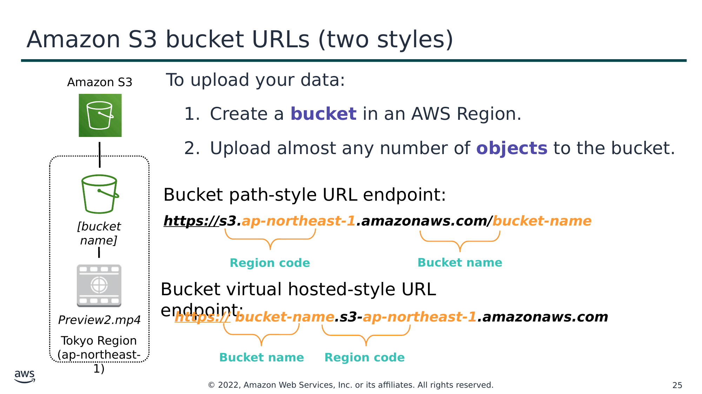

Текст зі схеми

Amazon S3

To upload your data:

1. Create a **bucket** in an AWS Region.
2. Upload almost any number of **objects** to the bucket.

Bucket path-style URL endpoint:

*[bucket name]*

[***https://***](https://s3/)***s3.**ap-northeast-1**.amazonaws.com/**bucket-name***

**Region code**

**Bucket name**

Bucket virtual hosted-style URL endpoint:

*Preview2.mp4*

[***https://***](https://s3/) ***bucket-name**.s3-**ap-northeast-1**.amazonaws.com***

Tokyo Region (ap-northeast-1)

**Bucket name**

**Region code**

> **Нотатки:**
>
> To use Amazon S3 effectively, you must understand a few simple concepts. First, Amazon S3 stores data inside buckets. Buckets are essentially the prefix for a set of files, and must be uniquely named across all of Amazon S3 globally. Buckets are logical containers for objects. You can have one or more buckets in your account. You can control access for each bucket—who can create, delete, and list objects in the bucket. You can also view access logs for the bucket and its objects, and choose the geographical region where Amazon S3 stores the bucket and its contents.  
>
> To upload your data (such as photos, videos, or documents), create a bucket in an AWS Region, and then upload almost any number of objects to the bucket.  
>
> In the example, Amazon S3 was used to create a bucket in the Tokyo Region, which is identified within AWS formally by its Region code: ap-northeast-1  
>
> The URL for a bucket is structured like the examples. You can use two different URL styles to refer to buckets.  
>
> Amazon S3 refers to files as objects. As soon as you have a bucket, you can store almost any number of objects inside it. An object is composed of data and any metadata that describes that file, including a URL. To store an object in Amazon S3, you upload the file that you want to store to a bucket.  
>
> When you upload a file, you can set permissions on the data and any metadata.  
>
> In this example, the object Preview2.mp4 is stored inside the bucket. The URL for the file includes the object name at the end.

---

## Слайд 26: Data is redundantly stored in the Region

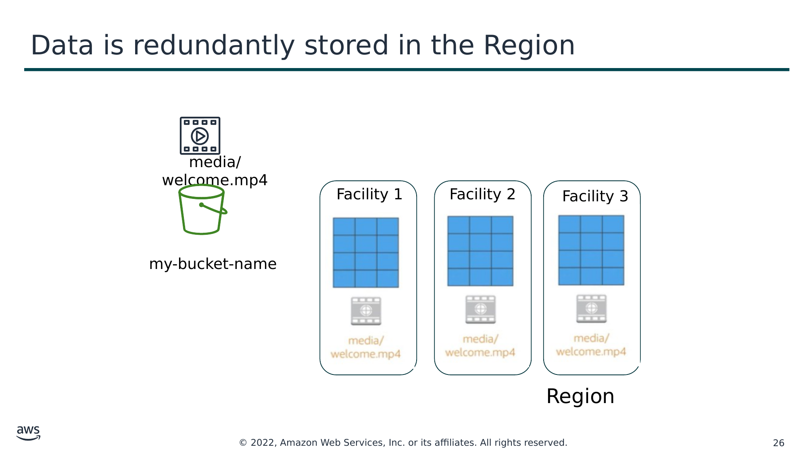

Текст зі схеми

media/welcome.mp4

Facility 1

Facility 2

Facility 3

my-bucket-name

Region

> **Нотатки:**
>
> When you create a bucket in Amazon S3, it is associated with a specific AWS Region. When you store data in the bucket, it is redundantly stored across multiple AWS facilities within your selected Region.  
>
> Amazon S3 is designed to durably store your data, even if there is concurrent data loss in two AWS facilities.

---

## Слайд 27: Designed for seamless scaling

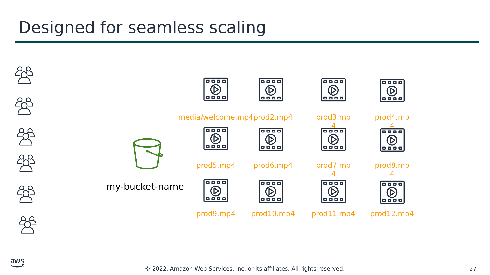

Текст зі схеми

media/welcome.mp4

prod2.mp4

prod3.mp4

prod4.mp4

prod5.mp4

prod6.mp4

prod7.mp4

prod8.mp4

my-bucket-name

prod9.mp4

prod10.mp4

prod11.mp4

prod12.mp4

> **Нотатки:**
>
> Amazon S3 automatically manages the storage behind your bucket while your data grows. You can get started immediately, and your data storage will grow with your application needs.  
>
> Amazon S3 also scales to handle a high volume of requests. You do not need to provision the storage or throughput, and you are billed only for what you use.

---

## Слайд 28: Access the data anywhere

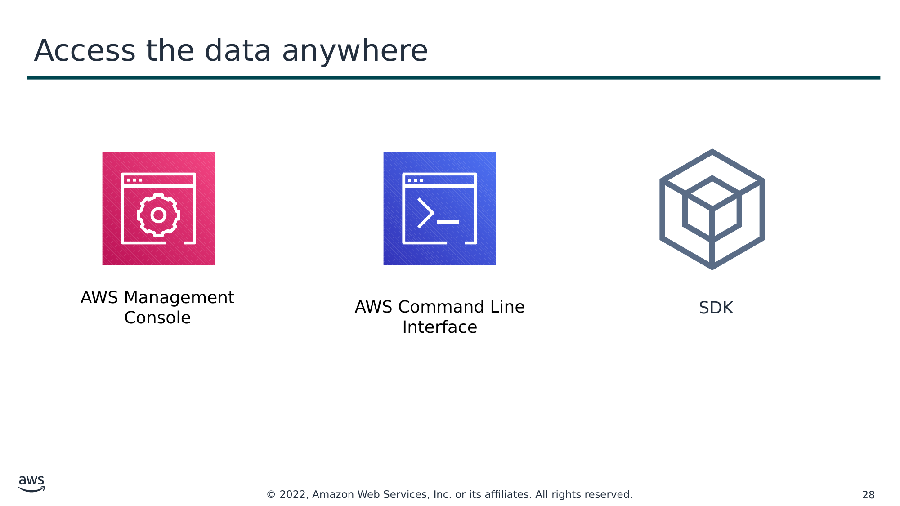

Текст зі схеми

AWS Management Console

AWS Command Line Interface

SDK

> **Нотатки:**
>
> You can access Amazon S3 through the console, AWS Command Line Interface (AWS CLI), or AWS SDK. You can also access the data in your bucket directly by using REST-based endpoints.  
>
> The endpoints support HTTP or HTTPS access. To support this type of URL-based access, Amazon S3 bucket names must be globally unique and Domain Name Server (DNS)-compliant.  
>
> Also, object keys should use characters that are safe for URLs.

---

## Слайд 29: Common use cases

- Storing application assets
- Static web hosting
- Backup and disaster recovery (DR)
- Staging area for big data
- *Many more….*

> **Нотатки:**
>
> This flexibility to store a virtually unlimited amount of data—and to access that data from anywhere—means that Amazon S3 is suitable for a variety of scenarios. You will now consider some use cases for Amazon S3:  
> As a location for any application data, Amazon S3 buckets provide a shared location for storing objects that any instances of your application can access—including applications on Amazon EC2 or even traditional servers. This feature can be useful for user-generated media files, server logs, or other files that your application must store in a common location. Also, because the content can be fetched directly over the internet, you can offload serving that content from your application and enable clients to directly fetch the data from Amazon S3 themselves.  
> For static web hosting, Amazon S3 buckets can serve the static contents of your website, including HTML, CSS, JavaScript, and other files.  
> The high durability of Amazon S3 makes it a good candidate for storing backups of your data. For greater availability and disaster recovery capability, Amazon S3 can even be configured to support cross-Region replication so that data in an Amazon S3 bucket in one Region can be automatically replicated to another Amazon S3 Region.

---

## Слайд 30: Amazon S3 common scenarios

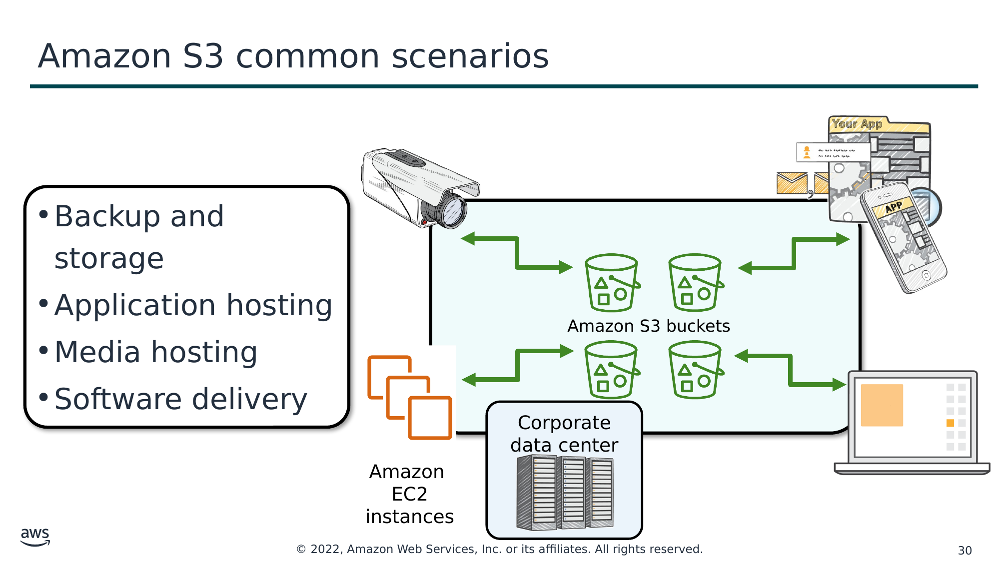

Текст зі схеми

- Backup and storage
- Application hosting
- Media hosting
- Software delivery

Amazon S3 buckets

Corporate  
data center

Amazon  
EC2  
instances

> **Нотатки:**
>
> Backup and storage – Provide data backup and storage services for others  
>
> Application hosting – Provide services that deploy, install, and manage web applications  
>
> Media hosting – Build a redundant, scalable, and highly available infrastructure that hosts video, photo, or music uploads and downloads  
>
> Software delivery – Host your software applications that customers can download

---

## Слайд 31: Amazon S3 pricing

- Pay only for what you use, including –
  - GBs per month
  - Transfer OUT to other Regions
  - PUT, COPY, POST, LIST, and GET requests
- You do not pay for –
  - Transfers IN to Amazon S3
  - Transfers OUT from Amazon S3 to Amazon CloudFront or Amazon EC2 in the same Region

> **Нотатки:**
>
> With Amazon S3, specific costs vary depending on the Region and the specific requests that were made. You pay only for what you use, including gigabytes per month; transfer out of other Regions; and PUT, COPY, POST, LIST, and GET requests.  
>
> As a general rule, you pay only for transfers that cross the boundary of your Region, which means you do not pay for transfers in to Amazon S3 or transfers out from Amazon S3 to Amazon CloudFront edge locations within that same Region.

---

## Слайд 32: Amazon S3: Storage pricing (1 of 2)

To estimate Amazon S3 costs, consider the following:

1. Storage class type –
   - Standard storage is designed for:
      - 11 9s of durability
      - Four 9s of availability
   - S3 Standard-Infrequent Access (S-IA) is designed for:
      - 11 9s of durability
      - Three 9s of availability
2. Amount of storage –
   - The number and size of objects

> **Нотатки:**
>
> When you begin to estimate the costs of Amazon S3, you must consider the following:  
> Storage class type –  
> Standard storage is designed to provide 11 9s of durability and four 9s of availability.  
> S3 Standard – Infrequent Access (S-IA) is a storage option within Amazon S3 that you can use to reduce your costs by storing less frequently accessed data at slightly lower levels of redundancy than Amazon S3 standard storage. Standard – Infrequent Access is designed to provide the same 11 9s of durability as Amazon S3, with three 9s of availability in a given year. Each class has different rates.  
> Amount of storage – The number and size of objects stored in your Amazon S3 buckets.

---

## Слайд 33: Amazon S3: Storage pricing (2 of 2)

3. Requests –
   - The number and type of requests **(GET, PUT, COPY)**
   - Type of requests:
      - Different rates for GET requests than other requests.
4. Data transfer –
   - Pricing is based on the amount of data that is transferred out of the Amazon S3 Region
      - Data transfer in is free, but you incur charges for data that is transferred out.

> **Нотатки:**
>
> Requests – Consider the number and type of requests. GET requests incur charges at different rates than other requests, such as PUT and COPY requests.  
> GET – Retrieves an object from Amazon S3. You must have READ access to use this operation.  
> PUT – Adds an object to a bucket. You must have WRITE permissions on a bucket to add an object to it.  
> COPY – Creates a copy of an object that is already stored in Amazon S3. A COPY operation is the same as performing a GET and then a PUT.  
> Data transfer – Consider the amount of data that is transferred out of the Amazon S3 Region. Remember that data transfer in is free, but there is a charge for data transfer out.

---

## Слайд 34: Section 2 key takeaways

- Amazon S3 is a fully managed cloud storage service.
- You can store a virtually unlimited number of objects.
- You pay for only what you use.
- You can access Amazon S3 at any time from anywhere through a URL.
- Amazon S3 offers rich security controls.

> **Нотатки:**
>
> You have completed an introduction to Amazon S3, including key features and some common use cases.  
>
> To learn more about Amazon S3, see https://aws.amazon.com/s3/.

---

## Слайд 35: Recorded demo: Amazon Simple Storage System

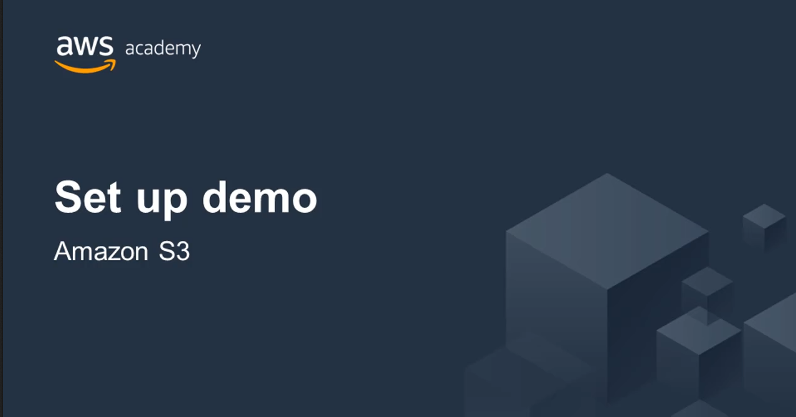

> **Нотатки:**
>
> Now, take a moment to watch the Amazon S3 demo at https://aws-tc-largeobjects.s3-us-west-2.amazonaws.com/ILT-TF-100-ACFNDS-20-EN/Module_7_S3+v2.0.mp4. The recording runs a little over 4 minutes, and it reinforces many of the concepts that were discussed in this section of the module.  
>
> The demonstration shows how to configure the following resources by using the AWS Management Console. The demonstration shows how to:  
> Create an Amazon S3 bucket  
> Upload files and create folders  
> Change bucket settings  
>
> The demonstration also reviews some of the more commonly used settings for an S3 bucket.

---

## Слайд 36: Section 3: Amazon Elastic File System (Amazon EFS)

Module 7: Storage

> **Нотатки:**
>
> Introduce Section 3: Amazon Elastic File System (Amazon EFS)  
>
> Amazon EFS implements storage for EC2 instances that multiple virtual machines can access at the same time. It is implemented as a shared file system that uses the Network File System (NFS) protocol.

---

## Слайд 37: Storage 2

Storage

Amazon Elastic File System (Amazon EFS)

> **Нотатки:**
>
> Amazon Elastic File System (Amazon EFS) provides simple, scalable, elastic file storage for use with AWS services and on-premises resources. It offers a simple interface that enables you to create and configure file systems quickly and easily.  
>
> Amazon EFS is built to dynamically scale on demand without disrupting applications—it will grow and shrink automatically as you add and remove files. It is designed so that your applications have the storage they need, when they need it.

---

## Слайд 38: Amazon EFS features

- File storage in the AWS Cloud
- Works well for big data and analytics, media processing workflows, content management, web serving, and home directories
- Petabyte-scale, low-latency file system
- Shared storage
- Elastic capacity
- Supports Network File System (NFS) versions 4.0 and 4.1 (NFSv4)
- Compatible with all Linux-based AMIs for Amazon EC2

> **Нотатки:**
>
> Amazon EFS is a fully managed service that makes it easy to set up and scale file storage in the AWS Cloud. You can use Amazon EFS to build a file system for big data and analytics, media processing workflows, content management, web serving, and home directories.  
>
> You can create file systems that are accessible to Amazon EC2 instances through a file system interface (using standard operating system file I/O APIs). These file systems support full file system access semantics, such as strong consistency and file locking.  
>
> Amazon EFS file systems can automatically scale from gigabytes to petabytes of data without the need to provision storage. Thousands of Amazon EC2 instances can access an Amazon EFS file system at the same time, and Amazon EFS is designed to provide consistent performance to each Amazon EC2 instance. Amazon EFS is also designed to be highly durable and highly available. Amazon EFS requires no minimum fee or setup costs, and you pay only for the storage that you use.

---

## Слайд 39: Amazon EFS architecture

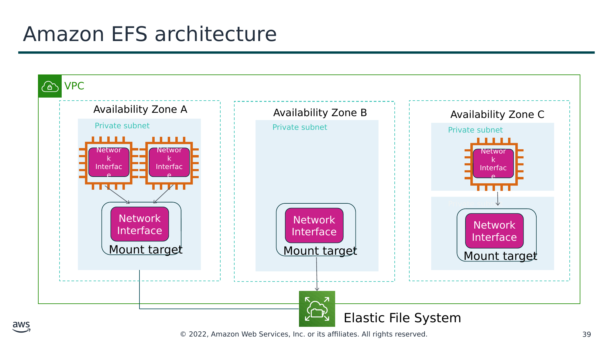

Текст зі схеми

VPC

Availability Zone A

Private subnet

Availability Zone B

Availability Zone C

Private subnet

Private subnet

Network Interface

Network Interface

Network Interface

Private subnet

Network Interface

Network Interface

Network Interface

Mount target

Mount target

Mount target

Elastic File System

> **Нотатки:**
>
> Amazon EFS provides file storage in the cloud. With Amazon EFS, you can create a file system, mount the file system on an Amazon EC2 instance, and then read and write data from to and from your file system. You can mount an Amazon EFS file system in your VPC, through NFS versions 4.0 and 4.1 (NFSv4).  
>
> You can access your Amazon EFS file system concurrently from Amazon EC2 instances in your VPC, so applications that scale beyond a single connection can access a file system. Amazon EC2 instances that run in multiple Availability Zones within the same AWS Region can access the file system, so many users can access and share a common data source.  
>
> In the diagram, the VPC has three Availability Zones, and each Availability Zone has one mount target that was created in it. We recommend that you access the file system from a mount target within the same Availability Zone. One of the Availability Zones has two subnets. However, a mount target is created in only one of the subnets.

---

## Слайд 40: Amazon EFS implementation

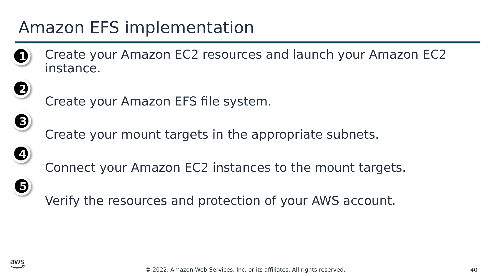

Текст зі схеми

**1**

Create your Amazon EC2 resources and launch your Amazon EC2 instance.

Create your Amazon EFS file system.

Create your mount targets in the appropriate subnets.

Connect your Amazon EC2 instances to the mount targets.

Verify the resources and protection of your AWS account.

**2**

**3**

**4**

**5**

> **Нотатки:**
>
> You must complete five steps to create and use your first Amazon EFS file system, mount it on an Amazon EC2 instance in your VPC, and test the end-to-end setup:  
> Create your Amazon EC2 resources and launch your instance. (Before you can launch and connect to an Amazon EC2 instance, you must create a key pair, unless you already have one.)  
> Create your Amazon EFS file system.  
> In the appropriate subnets, create your mount targets.  
> Next, connect to your Amazon EC2 instance and mount the Amazon EFS file system.  
> Finally, clean up your resources and protect your AWS account.

---

## Слайд 41: Amazon EFS resources

File system

- Mount target
- Subnet ID
- Security groups
- One or more per file system
- Create in a VPC subnet
- One per Availability Zone
- Must be in the same VPC
- Tags
- Key-value pairs

> **Нотатки:**
>
> In Amazon EFS, a file system is the primary resource. Each file system has properties such as:  
> ID  
> Creation token  
> Creation time  
> File system size in bytes  
> Number of mount targets that are created for the file system  
> File system state  
>
> Amazon EFS also supports other resources to configure the primary resource. These resources include mount targets and tags.  
>
> Mount target: To access your file system, you must create mount targets in your VPC.  
> Each mount target has the following properties:  
> The mount target ID  
> The subnet ID for the subnet where it was created  
> The file system ID for the file system where it was created  
> An IP address where the file system can be mounted  
> The mount target state  
>
> You can use the IP address or the Domain Name System (DNS) name in your mount command.  
>
> Tags: To help organize your file systems, you can assign your own metadata to each of the file systems that you create. Each tag is a key-value pair.  
>
> Think of mount targets and tags as subresources that do not exist unless they are associated with a file system.

---

## Слайд 42: Section 3 key takeaways

- Amazon EFS provides file storage over a network.
- Perfect for big data and analytics, media processing workflows, content management, web serving, and home directories.
- Fully managed service that eliminates storage administration tasks.
- Accessible from the console, an API, or the CLI.
- Scales up or down as files are added or removed and you pay for what you use.

> **Нотатки:**
>
> You have completed an introduction to Amazon EFS, including key features and key resources. Amazon EFS provides file storage in the cloud that works well for big data and analytics, media processing workflows, content management, web serving, and home directories.  
>
> Amazon EFS scales up or down when files are added or removed, and you pay for only what you are using.  
>
> Amazon EFS is a fully managed service that is accessible from the console, an API, or the AWS CLI.  
>
> To learn more about Amazon EFS, see https://aws.amazon.com/efs/

---

## Слайд 43: Recorded demo: Amazon Elastic File System

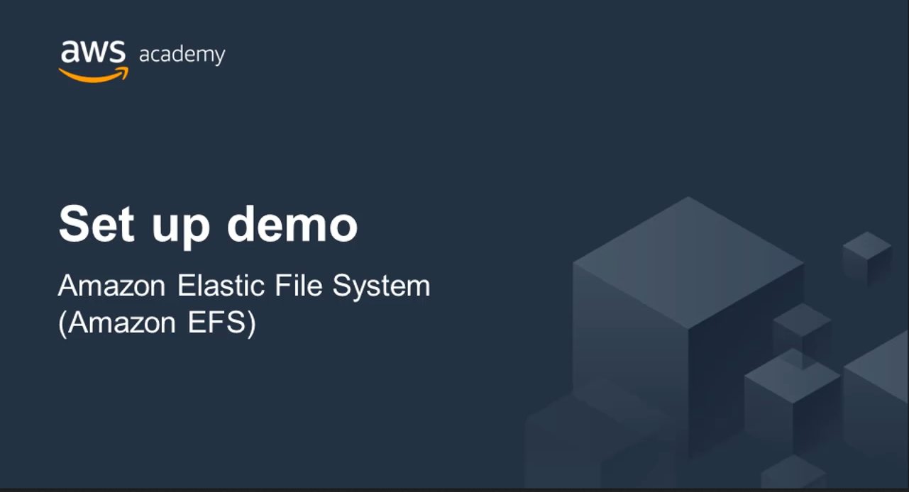

> **Нотатки:**
>
> Now, take a moment to watch the Amazon EFS demo at https://aws-tc-largeobjects.s3-us-west-2.amazonaws.com/ILT-TF-100-ACFNDS-20-EN/Module_7_EFS+v2.0.mp4. The recording runs a little over 6 minutes, and it reinforces many of the concepts that were discussed in this section of the module.  
>
> The demonstration shows how to configure the following resources by using the AWS Management Console. The demonstration shows how to:  
> Create an Elastic File System (EFS) implementation in a Virtual Private Cloud  
> Attach the EFS  
> Configure security and performance settings for the EFS implementation  
>
> The demonstration also reviews .how to get specific instructions for how to validate your EFS installation so you can connect to EC2 instances.

---

## Слайд 44: Section 4: Amazon S3 Glacier

Module 7: Storage

> **Нотатки:**
>
> Introducing Section 4: Amazon S3 Glacier  
>
> Amazon S3 Glacier is a secure, durable, and extremely low-cost cloud storage service for data archiving and long-term backup.

---

## Слайд 45: Storage 3

Storage

Amazon S3 Glacier

> **Нотатки:**
>
> This section covers Amazon S3 Glacier.

---

## Слайд 46: Amazon S3 Glacier review

Amazon S3 Glacier is a data archiving service that is designed for security, durability, and an extremely low cost.

- Amazon S3 Glacier is designed to provide 11 9s of durability for objects.
- It supports the encryption of data in transit and at rest through Secure Sockets Layer (SSL) or Transport Layer Security (TLS).
- The Vault Lock feature enforces compliance through a policy.
- Extremely low-cost design works well for long-term archiving.
  - Provides three options for access to archives—expedited, standard, and bulk—retrieval times range from a few minutes to several hours.

> **Нотатки:**
>
> When you use Amazon S3 Glacier to archive data, you can store your data at an extremely low cost (even in comparison to Amazon S3), but you cannot retrieve your data immediately when you want it.  
>
> Data that is stored in Amazon S3 Glacier can take several hours to retrieve, which is why it works well for archiving.  
>
> There are three key Amazon S3 Glacier terms you should be familiar with:  
> Archive – Any object (such as a photo, video, file, or document) that you store in Amazon S3 Glacier. It is the base unit of storage in Amazon S3 Glacier. Each archive has its own unique ID and it can also have a description.  
> Vault – A container for storing archives. When you create a vault, you specify the vault name and the Region where you want to locate the vault.  
> Vault access policy – Determine who can and cannot access the data that is stored in the vault, and what operations users can and cannot perform. One vault access permissions policy can be created for each vault to manage access permissions for that vault. You can also use a vault lock policy to make sure that a vault cannot be altered. Each vault can have one vault access policy and one vault lock policy that are attached to it.  
>
> You have three options for retrieving data, each with varying access times and cost:  
> Expedited retrievals are typically made available within 1–5 minutes (highest cost).  
> Standard retrievals typically complete within 3–5 hours (less time than expedited, more time than bulk).  
> Bulk retrievals typically complete within 5–12 hours (lowest cost).  
>
> You might compare these options to choosing the cost for shipping a package by using the most economical method for your needs.

---

## Слайд 47: Amazon S3 Glacier

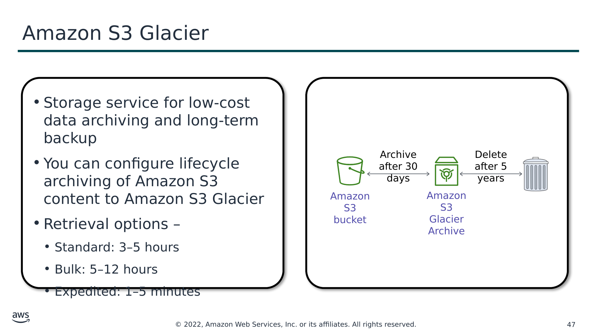

Текст зі схеми

- Storage service for low-cost data archiving and long-term backup
- You can configure lifecycle archiving of Amazon S3 content to Amazon S3 Glacier
- Retrieval options –
  - Standard: 3–5 hours
  - Bulk: 5–12 hours
  - Expedited: 1–5 minutes

Archive after 30 days

Delete after 5 years

Amazon S3 bucket

Amazon S3 Glacier Archive

> **Нотатки:**
>
> Amazon S3 Glacier's data archiving means that although you can store your data at an extremely low cost (even in comparison to Amazon S3), you cannot retrieve your data immediately when you want it.  
>
> Data stored in Amazon S3 Glacier can take several hours to retrieve.  
>
> You should be familiar with three key Amazon S3 Glacier terms:  
> Archive: Any object such as a photo, video, file, or document that you store in Amazon S3 Glacier. It is the base unit of storage in Amazon S3 Glacier. Each archive has its own unique ID and can also have a description.  
> Vault: A container for storing archives. When you create a vault, you specify the vault name and the region in which you would like to locate the vault.  
> Vault Access Policy: Determine who can and cannot access the data stored in the vault and what operations users can and cannot perform. One vault access policy can be created for each vault to manage access permissions for that vault. You can also use a vault lock policy to make sure a vault cannot be altered. Each vault can have one vault access policy and one vault lock policy that is attached to it.  
>
> Three options are available for retrieving data with varying access times and cost: expedited, standard, and bulk retrievals. They are listed as follows:  
> Expedited retrievals are typically made available within 1 – 5 minutes (highest cost).  
> Standard retrievals typically complete within 3 – 5 hours (less than expedited, more than bulk).  
> Bulk retrievals typically complete within 5 – 12 hours (lowest cost).  
>
> Compare it to choosing the cost to most economically ship a package.

---

## Слайд 48: Amazon S3 Glacier use cases

Media asset archiving

Healthcare information archiving

Regulatory and compliance archiving

Scientific data archiving

Digital preservation

Magnetic tape replacement

> **Нотатки:**
>
> Media asset archiving  
> Media assets—such as video and news footage—require durable storage and can grow to many petabytes over time. Amazon S3 Glacier enables you to archive older media content affordably and then move it to Amazon S3 for distribution when it is needed.  
>
> Healthcare information archiving  
> To meet regulatory requirements, hospital systems must retain petabytes of patient records—such as Low-Income Subsidy (LIS) information, picture archiving and communication system (PACS) data, or Electronic Health Records (EHR)—for decades. Amazon S3 Glacier can help you reliably archive patient record data securely at a very low cost.  
>
> Regulatory and compliance archiving  
> Many enterprises, like those in financial services and healthcare, must retain regulatory and compliance archives for extended durations. Amazon S3 Glacier Vault Lock can help you set compliance controls so you can work towards meeting your compliance objectives, such as the U.S. Securities and Exchange Commission (SEC) Rule 17a-4(f).  
>
> Scientific data archiving  
> Research organizations generate, analyze, and archive large amounts of data. By using Amazon S3 Glacier, you can reduce the complexities of hardware and facility management and capacity planning.  
>
> Digital preservation  
> Libraries and government agencies must handle data integrity challenges in their digital preservation efforts. Unlike traditional systems—which can require laborious data verification and manual repair—Amazon S3 Glacier performs regular, systematic data integrity checks, and it is designed to be automatically self-healing.  
>
> Magnetic tape replacement  
> On-premises or offsite tape libraries can lower storage costs, but they can require large upfront investments and specialized maintenance. Amazon S3 Glacier has no upfront cost and reduces the cost and burden of maintenance.

---

## Слайд 49: Using Amazon S3 Glacier

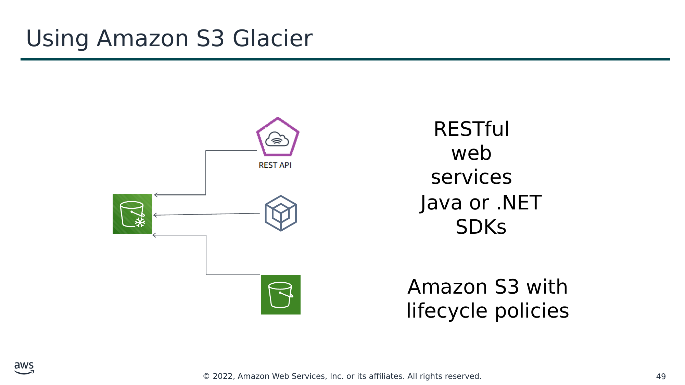

Текст зі схеми

RESTful

web services

Java or .NET SDKs

Amazon S3 with lifecycle policies

> **Нотатки:**
>
> To store and access data in Amazon S3 Glacier, you can use the AWS Management Console. However, only a few operations—such as creating and deleting vaults, and creating and managing archive policies—are available in the console.  
>
> For almost all other operations and interactions with Amazon S3 Glacier, you must use either the Amazon S3 Glacier REST APIs, the AWS Java or .NET SDKs, or the AWS CLI.  
>
> You can also use lifecycle policies to archive data into Amazon S3 Glacier. Next, you will learn about lifecycle policies.

---

## Слайд 50: Lifecycle policies

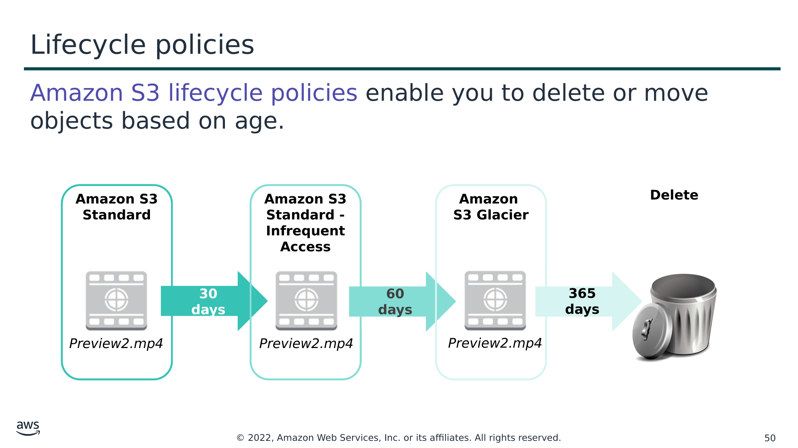

Текст зі схеми

Amazon S3 lifecycle policies enable you to delete or move objects based on age.

**Delete**

**Amazon S3 Standard**

**Amazon S3 Standard - Infrequent Access**

**Amazon**

**S3 Glacier**

**30 days**

**60 days**

**365 days**

*Preview2.mp4*

*Preview2.mp4*

*Preview2.mp4*

> **Нотатки:**
>
> You should automate the lifecycle of the data that you store in Amazon S3. By using lifecycle policies, you can cycle data at regular intervals between different Amazon S3 storage types. This automation reduces your overall cost, because you pay less for data as it becomes less important with time.  
>
> In addition to setting lifecycle rules per object, you can also set lifecycle rules per bucket.  
>
> Consider an example of a lifecycle policy that moves data as it ages from Amazon S3 Standard to Amazon S3 Standard – Infrequent Access, and finally, into Amazon S3 Glacier before it is deleted. Suppose that a user uploads a video to your application and your application generates a thumbnail preview of the video. This video preview is stored to Amazon S3 Standard, because it is likely that the user wants to access it right away.  
>
> Your usage data indicates that most thumbnail previews are not accessed after 30 days. Your lifecycle policy takes these previews and moves them to Amazon S3 – Infrequent Access after 30 days. After another 30 days elapse, the preview is unlikely to be accessed again. The preview is then moved to Amazon S3 Glacier, where it remains for 1 year. After 1 year, the preview is deleted. The important thing is that the lifecycle policy manages all this movement automatically.  
>
> To learn more about object lifecycle management, see http://docs.aws.amazon.com/AmazonS3/latest/dev/object-lifecycle-mgmt.html

---

## Слайд 51: Storage comparison

|  | Amazon S3 | Amazon S3 Glacier |
|---|---|---|
| Data Volume | No limit | No limit |
| Average Latency | ms | minutes/hours |
| Item Size | 5 TB maximum | 40 TB maximum |
| Cost/GB per Month | Higher cost | Lower cost |
| Billed Requests | PUT, COPY, POST, LIST, and GET | UPLOAD and retrieval |
| Retrieval Pricing | • ¢ • Per request | • ¢¢ • Per request and per GB |

> **Нотатки:**
>
> While Amazon S3 and Amazon S3 Glacier are both object storage solutions that enable you to store a virtually unlimited amount of data, they have some critical differences between them. The chart outlines some of these differences.  
>
> Be careful when you decide which storage solution is correct for your needs. These two services serve very different storage needs. Amazon S3 is designed for frequent, low-latency access to your data, but Amazon S3 Glacier is designed for low-cost, long-term storage of infrequently accessed data.  
> The maximum item size in Amazon S3 is 5 TB, but Amazon S3 Glacier can store items that are up to 40 TB.  
> Because Amazon S3 gives you faster access to your data, the storage cost per gigabyte is higher than it is with Amazon S3 Glacier.  
> While both services have per-request charges, Amazon S3 charges for PUT, COPY, POST, LIST, GET operations. In contrast, Amazon S3 Glacier charges for UPLOAD and retrieval operations.  
> Because Amazon S3 Glacier was designed for less-frequent access to data, it costs more for each retrieval request than Amazon S3.

---

## Слайд 52: Server-side encryption

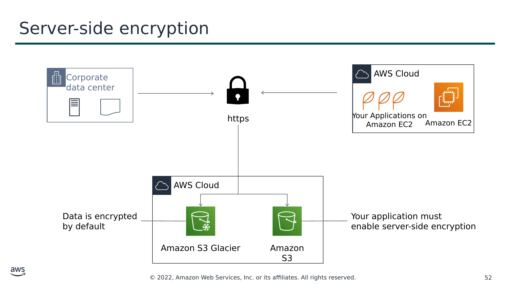

Текст зі схеми

Corporate

data center

AWS Cloud

https

Your Applications on

Amazon EC2

Amazon EC2

AWS Cloud

Data is encrypted  
by default

Your application must  
enable server-side encryption

Amazon S3 Glacier

Amazon S3

> **Нотатки:**
>
> Another important difference between Amazon S3 and Amazon S3 Glacier is how data is encrypted. Server-side encryption is focused on protecting data at rest. With both solutions, you can securely transfer your data over HTTPS. Any data that is archived in Amazon S3 Glacier is encrypted by default. With Amazon S3, your application must initiate server-side encryption. You can accomplish server-side encryption in Amazon S3 in several ways:  
> Server-side encryption with Amazon S3-managed encryption keys (SSE-S3) employs strong multi-factor encryption. Amazon S3 encrypts each object with a unique key. As an additional safeguard, it encrypts the key with a main key that it regularly rotates. Amazon S3 server-side encryption uses one of the strongest block ciphers available, 256-bit Advanced Encryption Standard (AES-256), to encrypt your data.  
> Using server-side encryption with Customer-provided Encryption Keys (SSE-C) enables you to set your own encryption keys. You include the encryption key as part of your request, and Amazon S3 manages both encryption (as it writes to disks), and decryption (when you access your objects).  
> Using server-side encryption with AWS Key Management Service (AWS KMS) is a service that combines secure, highly available hardware and software to provide a key management system that is scaled for the cloud. AWS KMS uses Customer Master Keys (CMKs) to encrypt your Amazon S3 objects. You use AWS KMS through the Encryption Keys section in the IAM console. You can also access AWS KMS through the API to centrally create encryption keys, define the policies that control how keys can be used, and audit key usage to prove that they are being used correctly. You can use these keys to protect your data in Amazon S3 buckets.

---

## Слайд 53: Security with Amazon S3 Glacier

**Control access with IAM**

**Amazon S3 Glacier encrypts your data with AES-256**

**Amazon S3 Glacier**

**Amazon S3 Glacier manages your keys for you**

> **Нотатки:**
>
> By default, only you can access your data. You can enable and control access to your data in Amazon S3 Glacier by using IAM. You set up an IAM policy that specifies user access.

---

## Слайд 54: Section 4 key takeaways

- Amazon S3 Glacier is a data archiving service that is designed for security, durability, and an extremely low cost.
- Amazon S3 Glacier pricing is based on Region.
- Its extremely low-cost design works well for long-term archiving.
- The service is designed to provide 11 9s of durability for objects.

> **Нотатки:**
>
> You have completed an introduction to Amazon S3 Glacier, which included key differences between Amazon S3 and Amazon S3 Glacier.  
>
> To learn more about Amazon S3 Glacier, see Glacier.

---

## Слайд 55: Recorded demo: Amazon S3 Glacier

> **Нотатки:**
>
> Now, take a moment to watch the Amazon Glacier demo. The recording runs a little over 2 minutes, and it reinforces many of the concepts that were discussed in this section of the module.  
>
> The demonstration shows how to configure the following resources by using the AWS Management Console. The demonstration shows how to:  
> Create an Amazon Glacier vault.  
> Upload archived items to the vault using a third-party graphical interface tool.

---

## Слайд 56: Activity: Storage Case Studies

Photo by Pixabay from Pexels.

> **Нотатки:**
>
> In this educator-led activity, you will be asked to log in to the AWS Management Console. The activity instructions are on the next slide. You will be challenged to answer five questions. The educator will lead the class in a discussion of each question, and reveal the correct answers.

---

## Слайд 57: Storage case study activity (1 of 3)

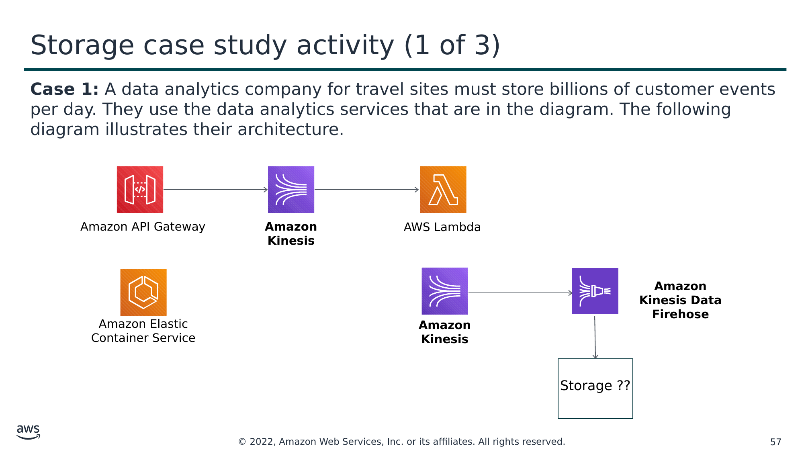

Текст зі схеми

**Case 1:** A data analytics company for travel sites must store billions of customer events per day. They use the data analytics services that are in the diagram. The following diagram illustrates their architecture.

Amazon API Gateway

**Amazon Kinesis**

AWS Lambda

**Amazon Kinesis Data Firehose**

Amazon Elastic Container Service

**Amazon Kinesis**

Storage ??

> **Нотатки:**
>
> Break into groups of four or five people. Review the assigned case study. Create a presentation that describes the best storage solution for the organization that is described in your group’s case. Your presentation should include the key factors that you considered when you selected the storage technology, and any factors that might change your recommendation.

---

## Слайд 58: Storage case study activity (2 of 3)

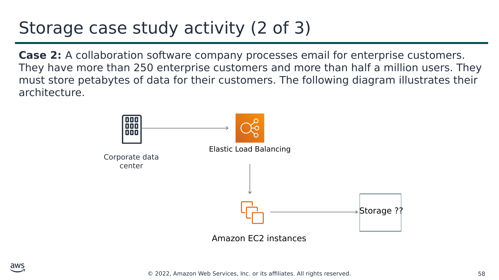

Текст зі схеми

**Case 2:** A collaboration software company processes email for enterprise customers. They have more than 250 enterprise customers and more than half a million users. They must store petabytes of data for their customers. The following diagram illustrates their architecture.

Elastic Load Balancing

Corporate data center

Storage ??

Amazon EC2 instances

> **Нотатки:**
>
> Break into groups of four or five people. Review the assigned case study. Create a presentation that describes the best storage solution for the organization that is described in your group’s case. Your presentation should include the key factors that you considered when you selected the storage technology, and any factors that might change your recommendation.

---

## Слайд 59: Storage case study activity (3 of 3)

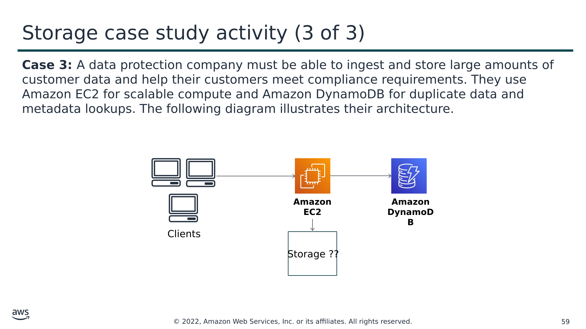

Текст зі схеми

**Case 3:** A data protection company must be able to ingest and store large amounts of customer data and help their customers meet compliance requirements. They use Amazon EC2 for scalable compute and Amazon DynamoDB for duplicate data and metadata lookups. The following diagram illustrates their architecture.

**Amazon EC2**

**Amazon DynamoDB**

Clients

Storage ??

> **Нотатки:**
>
> Break into groups of four or five people. Review the assigned case study. Create a presentation that describes the best storage solution for the organization that is described in your group’s case. Your presentation should include the key factors that you considered when you selected the storage technology, and any factors that might change your recommendation.

---

## Слайд 60: Module wrap-up

Module 7: Storage

> **Нотатки:**
>
> It’s now time to review the module, and wrap up with a knowledge check and a discussion of a practice certification exam question.

---

## Слайд 61: Module summary

In summary, in this module, you learned how to:

- Identify the different types of storage
- Explain Amazon S3
- Identify the functionality in Amazon S3
- Explain Amazon EBS
- Identify the functionality in Amazon EBS
- Perform functions in Amazon EBS to build an Amazon EC2 storage solution
- Explain Amazon EFS
- Identify the functionality in Amazon EFS
- Explain Amazon S3 Glacier
- Identify the functionality in Amazon S3 Glacier
- Differentiate between Amazon EBS, Amazon S3, Amazon EFS, and Amazon S3 Glacier

> **Нотатки:**
>
> In summary, in this module, you learned how to:  
> Identify the different types of storage  
> Explain Amazon S3  
> Identify the functionality in Amazon S3  
> Explain Amazon EBS  
> Identify the functionality in Amazon EBS  
> Perform functions in Amazon EBS to build an Amazon EC2 storage solution  
> Explain Amazon EFS  
> Identify the functionality in Amazon EFS  
> Explain Amazon S3 Glacier  
> Identify the functionality in Amazon S3 Glacier  
> Differentiate between Amazon EBS, Amazon S3, Amazon EFS, and Amazon S3 Glacier

---

## Слайд 62: Complete the knowledge check

> **Нотатки:**
>
> Complete the knowledge check for this module.

---

## Слайд 63: Sample exam question

A company wants to store data that is not frequently accessed. What is the best and cost-effective solution that should be considered?

Choice

Response

A

AWS Storage Gateway

B

Amazon Simple Storage Service Glacier

C

Amazon Elastic Block Store (Amazon EBS)

D

Amazon Simple Storage Service (Amazon S3)

> **Нотатки:**
>
> Look at the answer choices and rule them out based on the keywords.

---

## Слайд 64: Sample exam question answer

A company wants to store data that is not frequently accessed. What is the best and cost-effective solution that should be considered?

The correct answer is **B. Amazon Simple Storage Service Glacier**

The keywords in the question are “not frequently accessed” and “cost-effective solution.”

> **Нотатки:**
>
> The following are the keywords to recognize: “not frequently accessed” and “cost-effective solution.”  
>
> The correct answer is B. Amazon Simple Storage Service Glacier.  
>
> Incorrect answers:  
> Answer A: AWS Storage Gateway  
> Answer C: Amazon Elastic Block Store (Amazon EBS)  
> Answer D: Amazon Simple Storage Service (Amazon S3)

---

## Слайд 65: Additional resources

- AWS Storage page: [https://aws.amazon.com/products/storage/](https://aws.amazon.com/products/storage/)
- Storage Overview: [https://docs.aws.amazon.com/whitepapers/latest/aws-overview/storage-services.html](https://docs.aws.amazon.com/whitepapers/latest/aws-overview/storage-services.html)
- Recovering files from an Amazon EBS volume backup: [https://aws.amazon.com/blogs/compute/recovering-files-from-an-amazon-ebs-volume-backup/](https://aws.amazon.com/blogs/compute/recovering-files-from-an-amazon-ebs-volume-backup/)
- Confused by AWS Storage Options? S3, EFS, EBS Explained: [https://dzone.com/articles/confused-by-aws-storage-options-s3-ebs-amp-efs-explained](https://dzone.com/articles/confused-by-aws-storage-options-s3-ebs-amp-efs-explained)

> **Нотатки:**
>
> If you want to learn more about the topics covered in this module, you might find the following additional resources helpful:  
> AWS Storage page: https://aws.amazon.com/products/storage/  
> Storage Overview: https://docs.aws.amazon.com/whitepapers/latest/aws-overview/storage-services.html  
> Recovering files from an Amazon EBS volume backup: https://aws.amazon.com/blogs/compute/recovering-files-from-an-amazon-ebs-volume-backup/  
> Confused by AWS Storage Options? S3, EFS, EBS Explained: https://dzone.com/articles/confused-by-aws-storage-options-s3-ebs-amp-efs-explained

---

## Слайд 66: Thank you

All trademarks are the property of their owners.

> **Нотатки:**
>
> Thank you for completing this module.
