## Слайд 1: Модуль 7: Сховище даних

AWS Academy Cloud Foundations

> **Нотатки:**
>
> Вітаємо в Модулі 7: Сховище даних (Storage).

---

## Слайд 2: Огляд модуля

**Теми**

- Amazon Elastic Block Store (Amazon EBS)
- Amazon Simple Storage Service (Amazon S3)
- Amazon Elastic File System (Amazon EFS)
- Amazon Simple Storage Service Glacier

**Демонстрації**

- Консоль Amazon EBS
- Консоль Amazon S3
- Консоль Amazon EFS
- Консоль Amazon S3 Glacier

**Лабораторна робота**

- Робота з Amazon EBS (Working with Amazon EBS)

**Практичні вправи**

- Практичний приклад (case study) вибору рішення для зберігання даних

**Перевірка знань**

> **Нотатки:**
>
> Хмарне сховище зазвичай надійніше, масштабованіше та безпечніше за традиційні локальні системи зберігання. Хмарне сховище є критично важливим компонентом хмарних обчислень, оскільки воно містить інформацію, яку використовують застосунки. Аналітика великих даних, сховища даних (data warehouses), Інтернет речей (IoT), бази даних, а також застосунки резервного копіювання й архівування — усе це спирається на ту чи іншу архітектуру зберігання даних.  
>
> У цьому модулі розглядаються такі теми:  
> Amazon Elastic Block Store (Amazon EBS)  
> Amazon Simple Storage Service (Amazon S3)  
> Amazon Elastic File System (Amazon EFS)  
> Amazon Simple Storage Service Glacier  
>
> Цей модуль містить чотири записані демонстрації, які показують, як за допомогою AWS Management Console створювати рішення для зберігання даних.  
>
> Цей модуль містить практичну лабораторну роботу, у якій ви створюєте том Amazon EBS, а потім приєднуєте його до екземпляра Amazon Elastic Compute Cloud (Amazon EC2). Ви також створюєте знімок (snapshot) свого тому, а потім використовуєте знімок для створення нового тому.  
>
> Цей модуль містить практичну вправу, яка пропонує визначити найкраще рішення для зберігання даних для бізнес-випадку.  
>
> Наприкінці вам буде запропоновано пройти перевірку знань, яка перевіряє ваше розуміння ключових концепцій цього модуля.

---

## Слайд 3: Цілі модуля

Після завершення цього модуля ви повинні вміти:

- Визначати різні типи сховищ
- Пояснювати Amazon S3
- Визначати функціональність Amazon S3
- Пояснювати Amazon EBS
- Визначати функціональність Amazon EBS
- Виконувати функції в Amazon EBS для побудови рішення зберігання даних для Amazon EC2
- Пояснювати Amazon EFS
- Визначати функціональність Amazon EFS
- Пояснювати Amazon S3 Glacier
- Визначати функціональність Amazon S3 Glacier
- Розрізняти Amazon EBS, Amazon S3, Amazon EFS і Amazon S3 Glacier

> **Нотатки:**
>
> Мета цього модуля — ознайомитися з ключовими концепціями, пов’язаними зі зберіганням даних. Ви дізнаєтеся про різні типи ресурсів зберігання, які доступні, і розглянете різні варіанти ціноутворення, щоб зрозуміти, як різні вибори впливають на вартість вашого рішення.  
>
> Після завершення цього модуля ви повинні вміти:  
> Визначати різні типи сховищ  
> Пояснювати Amazon S3  
> Визначати функціональність Amazon S3  
> Пояснювати Amazon EBS  
> Визначати функціональність Amazon EBS  
> Виконувати функції в Amazon EBS для побудови рішення зберігання даних для Amazon EC2  
> Пояснювати Amazon EFS  
> Визначати функціональність Amazon EFS  
> Пояснювати Amazon S3 Glacier  
> Визначати функціональність Amazon S3 Glacier  
> Розрізняти Amazon EBS, Amazon S3, Amazon EFS і Amazon S3 Glacier

---

## Слайд 4: Основні сервіси AWS

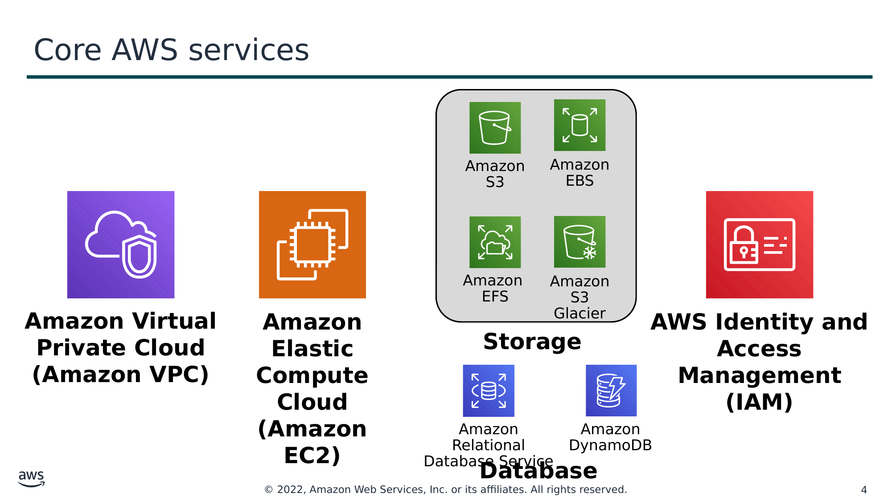

Текст зі схеми

Amazon S3

Amazon EBS

Amazon

EFS

Amazon S3 Glacier

**Amazon Virtual Private Cloud (Amazon VPC)**

**Amazon Elastic Compute Cloud (Amazon EC2)**

**AWS Identity and Access Management (IAM)**

**Storage (Сховище)**

Amazon Relational

Database Service

Amazon DynamoDB

**Database (Бази даних)**

> **Нотатки:**
>
> Сховище даних — ще одна основна категорія сервісів AWS. Деякі широкі категорії сховищ включають: сховище екземпляра (instance store, ефемерне сховище), Amazon EBS, Amazon EFS, Amazon S3 та Amazon S3 Glacier.  
> Сховище екземпляра, або ефемерне сховище (ephemeral storage), — це тимчасове сховище, що додається до вашого екземпляра Amazon EC2.  
> Amazon EBS — це постійне (persistent) монтоване сховище, яке можна змонтувати як пристрій до екземпляра Amazon EC2. Amazon EBS можна змонтувати до екземпляра Amazon EC2 лише в межах тієї самої зони доступності. Том Amazon EBS може змонтувати одночасно лише один екземпляр Amazon EC2.  
> Amazon EFS — це спільна файлова система, яку можуть змонтувати одночасно кілька екземплярів Amazon EC2.  
> Amazon S3 — це постійне сховище, де кожен файл стає об’єктом і доступний через уніфікований локатор ресурсів (Uniform Resource Locator, URL); до нього можна отримати доступ звідки завгодно.  
> Amazon S3 Glacier — це холодне сховище (cold storage) для даних, до яких звертаються нечасто (наприклад, коли вам потрібне довгострокове зберігання даних з причин архівування чи відповідності вимогам).

---

## Слайд 5: Розділ 1: Amazon Elastic Block Store (Amazon EBS)

Модуль 7: Сховище даних

> **Нотатки:**
>
> Представляємо Розділ 1: Amazon Elastic Block Store (Amazon EBS).

---

## Слайд 6: Сховище даних

Amazon Elastic Block Store (Amazon EBS)

> **Нотатки:**
>
> Amazon EBS надає постійні томи блочного сховища (block storage) для використання з екземплярами Amazon EC2. Постійне сховище (persistent storage) — це будь-який пристрій зберігання даних, що зберігає дані після відключення живлення цього пристрою. Його також іноді називають енергонезалежним сховищем (non-volatile storage).  
>
> Кожен том Amazon EBS автоматично реплікується в межах своєї зони доступності, щоб захистити вас від відмови компонентів. Його розроблено для високої доступності та довговічності. Томи Amazon EBS забезпечують стабільну продуктивність із низькою затримкою, потрібну для виконання ваших робочих навантажень.  
>
> З Amazon EBS ви можете масштабувати своє використання вгору чи вниз за лічені хвилини, платячи низьку ціну лише за те, що ви розгортаєте.

---

## Слайд 7: Варіанти сховищ AWS: блочне та об’єктне сховище

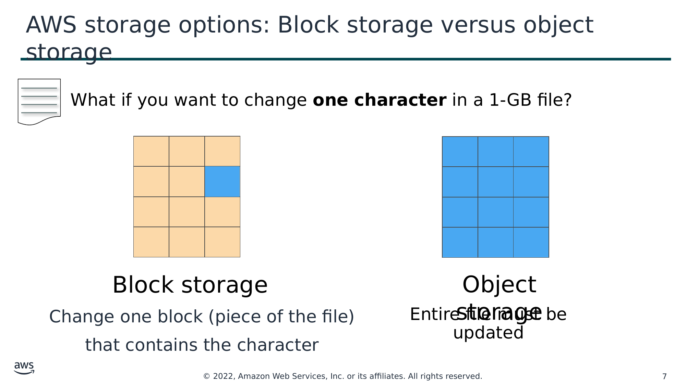

Текст зі схеми

Що, якщо вам потрібно змінити **один символ** у файлі розміром 1 ГБ?

Block storage (Блочне сховище)

Object storage (Об’єктне сховище)

Change one block (piece of the file)

that contains the character (Змінити один блок (частину файлу), що містить символ)

Entire file must be updated (Потрібно оновити весь файл)

> **Нотатки:**
>
> Що станеться, якщо потрібно змінити один символ у файлі розміром 1 ГБ? У блочному сховищі ви змінюєте лише блок, що містить символ. В об’єктному сховищі (object storage) потрібно оновити весь файл.  
>
> Одна з принципових відмінностей між деякими типами сховищ — чи пропонують вони блочне, чи об’єктне зберігання.  
>
> Ця відмінність суттєво впливає на пропускну здатність, затримку та вартість вашого рішення для зберігання. Рішення блочного сховища зазвичай швидші та використовують менше пропускної смуги, але можуть коштувати дорожче за об’єктне сховище.

---

## Слайд 8: Amazon EBS

Amazon EBS дає змогу **створювати окремі томи сховища** та **приєднувати їх** до екземпляра Amazon EC2:

- Amazon EBS пропонує блочне сховище.
- Томи автоматично реплікуються в межах своєї зони доступності.
- Резервну копію можна створювати автоматично в Amazon S3 за допомогою знімків (snapshots).
- Сценарії використання включають –
  - Завантажувальні томи та сховище для екземплярів Amazon Elastic Compute Cloud (Amazon EC2)
  - Зберігання даних із файловою системою
  - Хости баз даних
  - Корпоративні застосунки

> **Нотатки:**
>
> Amazon EBS дає змогу створювати окремі томи сховища та приєднувати їх до екземпляра Amazon EC2. Amazon EBS пропонує блочне сховище, томи якого автоматично реплікуються в межах його зони доступності. Amazon EBS розроблено, щоб надавати довговічне, відокремлюване блочне сховище (подібне до зовнішнього жорсткого диска) для ваших екземплярів Amazon EC2. Оскільки вони безпосередньо приєднані до екземплярів, вони можуть забезпечувати низьку затримку між місцем зберігання даних і місцем, де вони можуть використовуватися на екземплярі.  
>
> З цієї причини їх можна використовувати для запуску бази даних на екземплярі Amazon EC2. Томи Amazon EBS включаються до резервної копії ваших екземплярів в образи Amazon Machine Images (або AMI). AMI зберігаються в Amazon S3 і можуть бути повторно використані для створення нових екземплярів Amazon EC2 пізніше.  
>
> Резервна копія тому Amazon EBS називається знімком (snapshot). Перший знімок називається базовим знімком (baseline snapshot). Будь-який інший знімок після базового фіксує лише те, що відрізняється від попереднього знімка.  
>
> Сценарії використання томів Amazon EBS включають:  
> Завантажувальні томи та сховище для екземплярів Amazon EC2  
> Зберігання даних із файловою системою  
> Хости баз даних  
> Корпоративні застосунки

---

## Слайд 9: Типи томів Amazon EBS

|  | Solid State Drives (SSD): General Purpose (твердотільні накопичувачі: загального призначення) | Solid State Drives (SSD): Provisioned IOPS (твердотільні накопичувачі: із забезпеченими IOPS) | Hard Disk Drives (HDD): Throughput-Optimized (жорсткі диски: оптимізовані за пропускною здатністю) | Hard Disk Drives (HDD): Cold (жорсткі диски: холодні) |
|---|---|---|---|---|
| Максимальний розмір тому | 16 ТіБ | 16 ТіБ | 16 ТіБ | 16 ТіБ |
| Максимум IOPS на том | 16 000 | 64 000 | 500 | 250 |
| Максимальна пропускна здатність на том | 250 МіБ/с | 1000 МіБ/с | 500 МіБ/с | 250 МіБ/с |

> **Нотатки:**
>
> Підбір правильної технології для вашого робочого навантаження — найкраща практика для зниження витрат на зберігання. Томи Amazon EBS на SSD із забезпеченими IOPS (Provisioned IOPS) можуть забезпечити найвищу продуктивність. Однак якщо вашому застосунку не потрібна або він не використовуватиме таку високу продуктивність, зазвичай достатньо SSD загального призначення (General Purpose SSD). Як завантажувальні томи для екземплярів EC2 можна використовувати лише SSD. Варіанти з нижчою вартістю можуть бути рішенням для додаткового сховища або сценаріїв використання, відмінних від завантажувальних томів.  
>
> Щоб дізнатися більше про типи томів Amazon EBS, див. https://docs.aws.amazon.com/AWSEC2/latest/UserGuide/ebs-volume-types.html.

---

## Слайд 10: Сценарії використання типів томів Amazon EBS

| Solid State Drives (SSD): General Purpose (твердотільні накопичувачі: загального призначення) | Solid State Drives (SSD): Provisioned IOPS (твердотільні накопичувачі: із забезпеченими IOPS) | Hard Disk Drives (HDD): Throughput-Optimized (жорсткі диски: оптимізовані за пропускною здатністю) | Hard Disk Drives (HDD): Cold (жорсткі диски: холодні) |
|---|---|---|---|
| Цей тип рекомендований для більшості робочих навантажень | Критично важливі бізнес-застосунки, що потребують стабільної продуктивності IOPS або понад 16 000 IOPS чи 250 МіБ/с пропускної здатності на том | Потокові робочі навантаження, що потребують стабільної, швидкої пропускної здатності за низькою ціною | Сховище, орієнтоване на пропускну здатність, для великих обсягів даних, до яких звертаються нечасто |
| Системні завантажувальні томи | Великі робочі навантаження баз даних | Великі дані (big data) | Сценарії, де найнижча вартість зберігання є важливою |
| Віртуальні робочі столи | | Сховища даних (data warehouses) | Не може бути завантажувальним томом |
| Інтерактивні застосунки з низькою затримкою | | Обробка журналів | |
| Середовища розробки та тестування | | Не може бути завантажувальним томом | |

> **Нотатки:**
>
> Як зазначалося раніше, том Amazon EBS — це довговічний пристрій блочного зберігання, який можна приєднати до одного екземпляра EC2. Томи Amazon EBS можна використовувати як основне сховище для даних, що потребують частих оновлень, наприклад системний диск екземпляра або сховище для застосунку бази даних. Їх також можна використовувати для застосунків із інтенсивною пропускною здатністю, що виконують безперервне сканування дисків. Томи Amazon EBS існують незалежно від часу роботи екземпляра EC2.  
>
> Сценарії використання EBS залежать від типу використовуваного сховища та від того, чи ви використовуєте General Purpose, чи Provisioned IOPS.

---

## Слайд 11: Функції Amazon EBS

- Знімки (Snapshots) –
  - Знімки на певний момент часу (point-in-time snapshots)
  - Створення нового тому в будь-який час
- Шифрування (Encryption) –
  - Зашифровані томи Amazon EBS
  - Без додаткової плати
- Еластичність (Elasticity) –
  - Збільшення потужності
  - Перехід на інші типи

> **Нотатки:**
>
> Щоб забезпечити ще вищий рівень довговічності даних, Amazon EBS дає змогу створювати знімки ваших томів на певний момент часу, а також у будь-який час відтворити новий том зі знімка. Ви також можете ділитися знімками або навіть копіювати знімки в інші регіони AWS для ще кращого захисту аварійного відновлення (disaster recovery, DR). Наприклад, ви можете зашифрувати й поділитися своїми знімками з Вірджинії (США) до Токіо (Японія).  
>
> Ви також можете мати зашифровані томи Amazon EBS без додаткової плати, тож дані, що рухаються між екземпляром EC2 і томом EBS усередині центрів обробки даних AWS, шифруються під час передавання.  
>
> У міру зростання вашої компанії обсяг даних, що зберігаються на ваших томах Amazon EBS, також, імовірно, зростатиме. Томи Amazon EBS можуть збільшувати потужність і змінювати тип, тож ви можете перейти з жорстких дисків (HDD) на твердотільні накопичувачі (SSD) або збільшити розмір з тому на 50 ГБ до тому на 16 ТБ. Наприклад, цю операцію зміни розміру можна виконати динамічно, не зупиняючи екземпляри.

---

## Слайд 12: Amazon EBS: томи, IOPS і ціноутворення

1. **Томи (Volumes) –**
   - Томи Amazon EBS існують незалежно від екземпляра.
   - Усі типи томів тарифікуються за обсягом, розгорнутим на місяць.
2. **IOPS –**
   - General Purpose SSD:
      - Тарифікується за обсягом, який ви розгортаєте, у ГБ на місяць, доки сховище не буде вивільнено.
   - Magnetic (магнітний):
      - Тарифікується за кількістю запитів до тому.
   - Provisioned IOPS SSD:
      - Тарифікується за обсягом, який ви розгортаєте, в IOPS (помноженим на відсоток днів, протягом яких ви розгортаєте його за місяць).

> **Нотатки:**
>
> Коли ви починаєте оцінювати вартість Amazon EBS, потрібно враховувати таке:  
> Томи (Volumes) — сховище томів для всіх типів томів Amazon EBS тарифікується за обсягом, який ви розгортаєте, у ГБ на місяць, доки ви не вивільните сховище.  
> IOPS — введення-виведення (I/O) включено до ціни томів General Purpose SSD. Однак для магнітних томів Amazon EBS введення-виведення тарифікується за кількістю запитів, які ви надсилаєте до свого тому. Для томів Provisioned IOPS SSD ви також платите за обсяг, який розгортаєте, в IOPS (помножений на відсоток днів, протягом яких ви розгортаєте його за місяць).  
>
> Ціноутворення та розгортання Amazon EBS складні. Загалом ви платите за розмір тому та його використання. Щоб дізнатися більше про повні, надзвичайно складні концепції ціноутворення та розгортання Amazon EBS, див. https://docs.aws.amazon.com/AWSEC2/latest/UserGuide/ebs-volume-types.html.

---

## Слайд 13: Amazon EBS: знімки та передавання даних

3. **Знімки (Snapshots) –**
   - Додаткова вартість знімків Amazon EBS у Amazon S3 визначається за ГБ-місяць збережених даних.
4. **Передавання даних (Data transfer) –**
   - Вхідне передавання даних безкоштовне.
   - Вихідне передавання даних між регіонами тарифікується.

> **Нотатки:**
>
> Знімки (Snapshots) — Amazon EBS дає змогу створювати резервні копії знімків ваших даних в Amazon S3 для довговічного відновлення. Якщо ви обираєте знімки Amazon EBS, додаткова вартість визначається за ГБ-місяць збережених даних.  
> Передавання даних (Data transfer) — коли ви копіюєте знімки Amazon EBS, ви платите за дані, що передаються між регіонами. Після копіювання знімка до сховища в цільовому регіоні застосовується стандартна плата за знімки Amazon EBS.

---

## Слайд 14: Ключові висновки розділу 1

Функції Amazon EBS:

- Постійне та настроюване блочне сховище для Amazon EC2
- Типи HDD і SSD
- Реплікується в тій самій зоні доступності
- Просте й прозоре шифрування
- Еластичні томи (elastic volumes)
- Резервне копіювання за допомогою знімків

> **Нотатки:**
>
> Amazon EBS надає томи блочного сховища для використання з екземплярами Amazon EC2. Томи Amazon EBS — це сховище поза екземпляром (off-instance storage), що існує незалежно від часу роботи екземпляра. Вони аналогічні віртуальним дискам у хмарі. Amazon EBS надає три типи томів: General Purpose SSD, Provisioned IOPS SSD і магнітні (magnetic).  
>
> Ці три типи томів відрізняються характеристиками продуктивності та вартістю, тож ви можете обрати правильну продуктивність і ціну сховища відповідно до потреб ваших застосунків.  
>
> Додаткові переваги включають реплікацію в тій самій зоні доступності, просте й прозоре шифрування, еластичні томи та резервне копіювання за допомогою знімків.  
>
> Щоб дізнатися більше про Amazon EBS, див.: https://aws.amazon.com/ebs/.

---

## Слайд 15: Записана демонстрація: Amazon Elastic Block Store

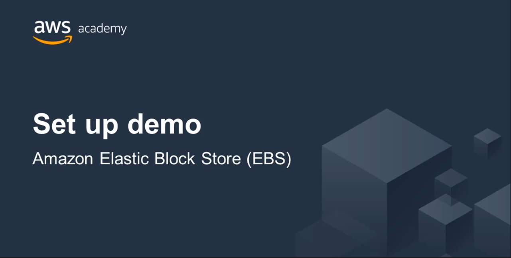

> **Нотатки:**
>
> Тепер знайдіть хвилинку, щоб переглянути демонстрацію Elastic Block Store за адресою https://aws-tc-largeobjects.s3-us-west-2.amazonaws.com/ILT-TF-100-ACFNDS-20-EN/Module_7_EBS+v2.0.mp4. Запис триває трохи більше 5 хвилин і закріплює багато концепцій, обговорених у цьому розділі модуля.  
>
> Демонстрація показує, як налаштувати такі ресурси за допомогою AWS Management Console. Демонстрація показує, як:  
> Створити том Amazon General Purpose (SSD) EBS  
> Приєднати том EBS до екземпляра EC2  
>
> Демонстрація також показує, як взаємодіяти з томом EBS за допомогою Amazon Command Line Interface і як змонтувати том EBS до екземпляра EC2.

---

## Слайд 16: Лабораторна робота 4: Working with Amazon EBS (робота з Amazon EBS)

> **Нотатки:**
>
> Зараз ви виконаєте Лабораторну роботу 4: Working with Amazon EBS.

---

## Слайд 17: Лабораторна робота 4: сценарій

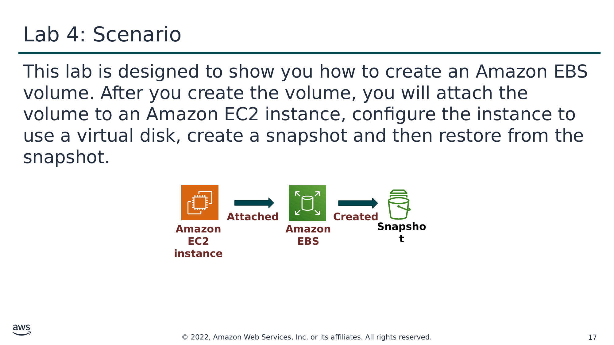

Текст зі схеми

Ця лабораторна робота призначена показати, як створити том Amazon EBS. Після створення тому ви приєднаєте його до екземпляра Amazon EC2, налаштуєте екземпляр на використання віртуального диска, створите знімок і потім відновите зі знімка.

**Attached (Приєднано)**

**Created (Створено)**

**Amazon EC2 instance (Екземпляр Amazon EC2)**

**Amazon EBS**

**Snapshot (Знімок)**

> **Нотатки:**
>
> Ця лабораторна робота призначена показати, як створити том Amazon EBS. Після створення тому ви приєднаєте його до екземпляра Amazon EC2, налаштуєте екземпляр на використання віртуального диска, створите знімок і потім відновите зі знімка.  
>
> Після завершення цієї лабораторної роботи ви повинні вміти:  
> Створювати том Amazon EBS  
> Приєднувати цей том до екземпляра  
> Налаштовувати екземпляр на використання віртуального диска  
> Створювати знімок Amazon EBS  
> Відновлювати знімок

---

## Слайд 18: Лабораторна робота 4: підсумковий результат

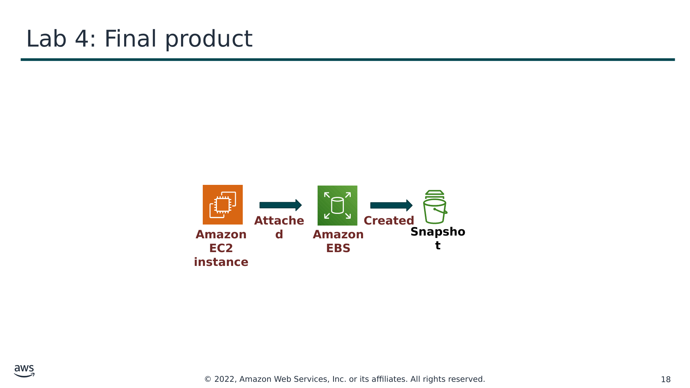

Текст зі схеми

**Amazon EC2 instance (Екземпляр Amazon EC2)**

**Attached (Приєднано)**

**Amazon EBS**

**Created (Створено)**

**Snapshot (Знімок)**

> **Нотатки:**
>
> У цій лабораторній роботі ви:  
> Створили том Amazon EBS  
> Приєднали цей том до екземпляра  
> Налаштували екземпляр на використання віртуального диска  
> Створили знімок Amazon EBS  
> Відновили знімок

---

## Слайд 19: Початок лабораторної роботи 4: Working with Amazon EBS

~ 30 хвилин

> **Нотатки:**
>
> Настав час розпочати лабораторну роботу.

---

## Слайд 20: Підсумки лабораторної роботи: ключові висновки

> **Нотатки:**
>
> У цій лабораторній роботі ви:  
> Створили том Amazon EBS  
> Приєднали том до екземпляра  
> Налаштували екземпляр на використання віртуального диска  
> Створили знімок Amazon EBS  
> Відновили знімок

---

## Слайд 21: Розділ 2: Amazon Simple Storage Service (Amazon S3)

Модуль 7: Сховище даних

> **Нотатки:**
>
> Представляємо Розділ 3: Amazon Simple Storage Service.  
>
> Компаніям потрібна можливість просто й безпечно збирати, зберігати та аналізувати свої дані у величезному масштабі. Amazon S3 — це об’єктне сховище (object storage), створене для зберігання та отримання будь-якого обсягу даних звідки завгодно: з вебсайтів і мобільних застосунків, корпоративних застосунків, а також даних із сенсорів чи пристроїв Інтернету речей (IoT).

---

## Слайд 22: Сховище даних 1

Storage (Сховище)

Amazon Simple Storage Service (Amazon S3)

> **Нотатки:**
>
> Amazon S3 — це сховище об’єктного рівня, що означає: якщо ви хочете змінити частину файлу, потрібно внести зміну, а потім повторно завантажити весь змінений файл. Amazon S3 зберігає дані як об’єкти (objects) усередині ресурсів, які називаються бакетами (buckets).  
>
> Тепер ви дізнаєтеся більше про Amazon S3.

---

## Слайд 23: Огляд Amazon S3

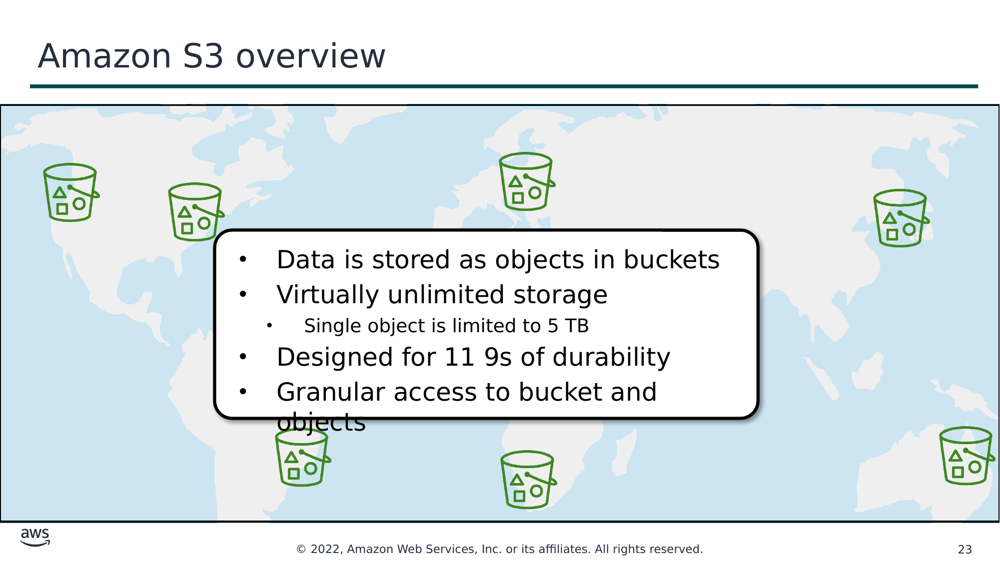

Текст зі схеми

- Дані зберігаються як об’єкти в бакетах
- Практично необмежене сховище
  - Один об’єкт обмежений розміром 5 ТБ
- Розроблено для довговічності в 11 дев’яток (11 9s)
- Детальний (granular) доступ до бакета й об’єктів

> **Нотатки:**
>
> Amazon S3 — це кероване хмарне сховище, розроблене для безперебійного масштабування та забезпечення довговічності в 11 дев’яток (11 9s). Ви можете зберігати в бакеті практично стільки об’єктів, скільки захочете, а також записувати, читати та видаляти об’єкти у вашому бакеті. Імена бакетів універсальні й мають бути унікальними серед усіх наявних імен бакетів в Amazon S3. Розмір об’єктів може сягати 5 ТБ. За замовчуванням дані в Amazon S3 зберігаються надлишково в кількох об’єктах інфраструктури (facilities) та на кількох пристроях у кожному з них.  
>
> Дані, які ви зберігаєте в Amazon S3, не пов’язані з жодним конкретним сервером, і вам не потрібно самостійно керувати жодною інфраструктурою. Ви можете помістити в Amazon S3 стільки об’єктів, скільки захочете. Amazon S3 містить трильйони об’єктів і регулярно досягає піків у мільйони запитів на секунду.  
>
> Об’єктами можуть бути майже будь-які файли даних, як-от зображення, відео чи журнали серверів. Оскільки Amazon S3 підтримує об’єкти розміром до кількох терабайтів, ви навіть можете зберігати знімки баз даних як об’єкти. Amazon S3 також забезпечує доступ до даних із низькою затримкою через інтернет за протоколом Hypertext Transfer Protocol (HTTP) або Secure HTTP (HTTPS), тож ви можете отримати дані будь-коли звідки завгодно. Ви також можете отримувати доступ до Amazon S3 приватно через кінцеву точку віртуальної приватної хмари (VPC endpoint). Ви отримуєте детальний контроль над тим, хто може отримати доступ до ваших даних, за допомогою політик AWS Identity and Access Management (IAM), політик бакетів Amazon S3 і навіть списків контролю доступу на рівні окремих об’єктів.  
>
> За замовчуванням жодні ваші дані не є загальнодоступними. Ви також можете шифрувати свої дані під час передавання та вирішити ввімкнути серверне шифрування для ваших об’єктів.  
> Доступ до Amazon S3 можна отримати через вебзасновану AWS Management Console; програмно через API та SDK; або за допомогою сторонніх рішень, що використовують API чи SDK.  
>
> Amazon S3 включає сповіщення про події (event notifications), що дають змогу налаштувати автоматичні сповіщення, коли відбуваються певні події, наприклад коли об’єкт завантажується до бакета або видаляється з конкретного бакета. Ці сповіщення можуть надсилатися вам або використовуватися для запуску інших процесів, як-от функцій AWS Lambda.  
> За допомогою аналізу класів зберігання (storage class analysis) ви можете аналізувати шаблони доступу до сховища та переносити потрібні дані до потрібного класу зберігання. Функція Amazon S3 Analytics автоматично визначає оптимальну політику життєвого циклу (lifecycle policy) для переносу рідше використовуваного сховища до Amazon S3 Standard – Infrequent Access (Amazon S3 Standard-IA). Ви можете налаштувати політику аналізу класів зберігання для моніторингу всього бакета, префікса чи тегу об’єкта.  
> Коли спостерігається шаблон нечастого доступу, ви можете легко створити нову політику життєвого циклу за віком на основі результатів. Аналіз класів зберігання також надає щоденні візуалізації використання вашого сховища в AWS Management Console. Їх можна експортувати до бакета Amazon S3 для аналізу за допомогою інструментів бізнес-аналітики (BI) на ваш вибір, як-от Amazon QuickSight.

---

## Слайд 24: Класи зберігання Amazon S3 (storage classes)

Amazon S3 пропонує низку класів зберігання об’єктного рівня, розроблених для різних сценаріїв використання:

- Amazon S3 Standard
- Amazon S3 Intelligent-Tiering
- Amazon S3 Standard-Infrequent Access (Amazon S3 Standard-IA)
- Amazon S3 One Zone-Infrequent Access (Amazon S3 One Zone-IA)
- Amazon S3 Glacier
- Amazon S3 Glacier Deep Archive

> **Нотатки:**
>
> Amazon S3 пропонує низку класів зберігання об’єктного рівня, розроблених для різних сценаріїв використання. Ці класи включають:  
> Amazon S3 Standard — Amazon S3 Standard розроблено для об’єктного сховища з високою довговічністю, доступністю та продуктивністю для даних, до яких звертаються часто. Оскільки він забезпечує низьку затримку та високу пропускну здатність, Amazon S3 Standard підходить для різноманітних сценаріїв використання, зокрема хмарних застосунків, динамічних вебсайтів, розповсюдження контенту, мобільних і ігрових застосунків та аналітики великих даних.  
> Amazon S3 Intelligent-Tiering — клас зберігання Amazon S3 Intelligent-Tiering розроблено для оптимізації витрат шляхом автоматичного переміщення даних до найекономічнішого рівня доступу без впливу на продуктивність чи операційних накладних витрат. За невелику щомісячну плату за моніторинг і автоматизацію для кожного об’єкта Amazon S3 відстежує шаблони доступу до об’єктів в Amazon S3 Intelligent-Tiering і переміщує об’єкти, до яких не звертались 30 днів поспіль, до рівня нечастого доступу. Якщо до об’єкта на рівні нечастого доступу звертаються, він автоматично переміщується назад до рівня частого доступу. Під час використання класу зберігання Amazon S3 Intelligent-Tiering немає плати за отримання даних і додаткової плати за переміщення об’єктів між рівнями доступу. Він добре підходить для довгоживучих даних із невідомими або непередбачуваними шаблонами доступу.  
> Amazon S3 Standard-Infrequent Access (Amazon S3 Standard-IA) — клас зберігання Amazon S3 Standard-IA використовується для даних, до яких звертаються рідше, але які потребують швидкого доступу за потреби. Amazon S3 Standard-IA розроблено, щоб забезпечувати високу довговічність, високу пропускну здатність і низьку затримку Amazon S3 Standard за низької ціни зберігання за ГБ і плати за отримання за ГБ. Таке поєднання низької вартості та високої продуктивності робить Amazon S3 Standard-IA добрим варіантом для довгострокового зберігання та резервних копій, а також як сховище даних для файлів аварійного відновлення.  
> Amazon S3 One Zone-Infrequent Access (Amazon S3 One Zone-IA) — Amazon S3 One Zone-IA призначений для даних, до яких звертаються рідше, але які потребують швидкого доступу за потреби. На відміну від інших класів зберігання Amazon S3, які зберігають дані щонайменше в трьох зонах доступності, Amazon S3 One Zone-IA зберігає дані в одній зоні доступності та коштує менше за Amazon S3 Standard-IA. Amazon S3 One Zone-IA добре підходить для клієнтів, які хочуть дешевший варіант для даних нечастого доступу, але не потребують доступності та стійкості Amazon S3 Standard чи Amazon S3 Standard-IA. Це добрий вибір для зберігання вторинних резервних копій локальних (on-premises) даних або даних, які легко відтворити. Його також можна використовувати як економічно ефективне сховище для даних, що реплікуються з іншого регіону AWS за допомогою міжрегіональної реплікації Amazon S3 (Cross-Region Replication).  
>
> Amazon S3 Glacier — Amazon S3 Glacier — це захищений, довговічний і недорогий клас зберігання для архівування даних. Ви можете надійно зберігати будь-який обсяг даних за вартістю, конкурентною з локальними рішеннями або нижчою за них. Щоб утримувати витрати низькими, але водночас відповідати різним потребам, Amazon S3 Glacier пропонує три варіанти отримання даних, що варіюються від кількох хвилин до годин. Ви можете завантажувати об’єкти безпосередньо в Amazon S3 Glacier або використовувати політики життєвого циклу Amazon S3 для переміщення даних між будь-яким із класів зберігання Amazon S3 для активних даних (Amazon S3 Standard, Amazon S3 Intelligent-Tiering, Amazon S3 Standard-IA та Amazon S3 One Zone-IA) та Amazon S3 Glacier.  
>
> Amazon S3 Glacier Deep Archive — Amazon S3 Glacier Deep Archive — це клас зберігання Amazon S3 з найнижчою вартістю. Він підтримує довгострокове зберігання та цифрове збереження даних, до яких можуть звертатися один-два рази на рік. Він розроблений для клієнтів — зокрема з високорегульованих галузей, як-от фінансові послуги, охорона здоров’я та державний сектор, — які зберігають набори даних 7–10 років (або довше) для виконання вимог регуляторної відповідності. Amazon S3 Glacier Deep Archive також можна використовувати для резервного копіювання та аварійного відновлення. Це економічно ефективна та проста в керуванні альтернатива системам магнітних стрічок, незалежно від того, чи це локальні стрічкові бібліотеки, чи позалокальні сервіси. Amazon S3 Glacier Deep Archive доповнює Amazon S3 Glacier і також розроблений для довговічності в 11 дев’яток (11 9s). Усі об’єкти, що зберігаються в Amazon S3 Glacier Deep Archive, реплікуються та зберігаються щонайменше в трьох географічно розподілених зонах доступності, і ці об’єкти можна відновити протягом 12 годин.  
>
> Докладніше про класи зберігання Amazon S3 див. https://docs.aws.amazon.com/AmazonS3/latest/dev/storage-class-intro.html.

---

## Слайд 25: URL бакетів Amazon S3 (два стилі)

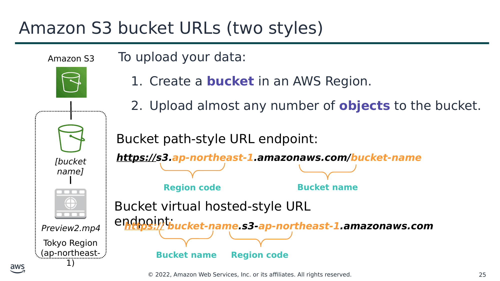

Текст зі схеми

Amazon S3

Щоб завантажити свої дані:

1. Створіть **бакет (bucket)** в регіоні AWS.
2. Завантажте до бакета майже будь-яку кількість **об’єктів (objects)**.

Кінцева точка URL бакета в стилі шляху (path-style):

*[bucket name]*

[***https://***](https://s3/)***s3.**ap-northeast-1**.amazonaws.com/**bucket-name***

**Region code (Код регіону)**

**Bucket name (Назва бакета)**

Кінцева точка URL бакета в стилі віртуального хостингу (virtual hosted-style):

*Preview2.mp4*

[***https://***](https://s3/) ***bucket-name**.s3-**ap-northeast-1**.amazonaws.com***

Tokyo Region (ap-northeast-1) (Регіон Токіо)

**Bucket name (Назва бакета)**

**Region code (Код регіону)**

> **Нотатки:**
>
> Щоб ефективно використовувати Amazon S3, потрібно розуміти кілька простих концепцій. По-перше, Amazon S3 зберігає дані всередині бакетів. Бакети — це, по суті, префікс для набору файлів, і вони мають мати унікальні імена в усьому Amazon S3 глобально. Бакети — це логічні контейнери для об’єктів. У вашому акаунті може бути один чи кілька бакетів. Ви можете контролювати доступ до кожного бакета — хто може створювати, видаляти та переглядати списком об’єкти в бакеті. Ви також можете переглядати журнали доступу для бакета та його об’єктів і вибирати географічний регіон, де Amazon S3 зберігає бакет і його вміст.  
>
> Щоб завантажити свої дані (як-от фотографії, відео чи документи), створіть бакет у регіоні AWS, а потім завантажте до бакета майже будь-яку кількість об’єктів.  
>
> У цьому прикладі Amazon S3 використано для створення бакета в регіоні Токіо, який у AWS формально ідентифікується кодом регіону: ap-northeast-1  
>
> URL для бакета структурується так, як у прикладах. Для посилання на бакети можна використовувати два різні стилі URL.  
>
> Amazon S3 називає файли об’єктами. Щойно у вас є бакет, ви можете зберігати в ньому майже будь-яку кількість об’єктів. Об’єкт складається з даних і будь-яких метаданих, що описують цей файл, зокрема URL. Щоб зберегти об’єкт в Amazon S3, ви завантажуєте файл, який хочете зберегти, до бакета.  
>
> Коли ви завантажуєте файл, ви можете встановити дозволи для даних і будь-яких метаданих.  
>
> У цьому прикладі об’єкт Preview2.mp4 зберігається всередині бакета. URL файлу містить назву об’єкта в кінці.

---

## Слайд 26: Дані надлишково зберігаються в регіоні

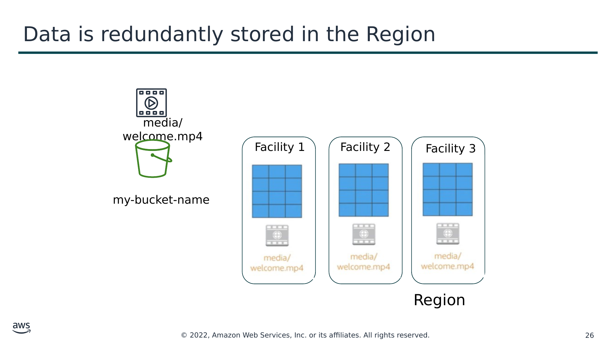

Текст зі схеми

media/welcome.mp4

Facility 1 (Об’єкт інфраструктури 1)

Facility 2 (Об’єкт інфраструктури 2)

Facility 3 (Об’єкт інфраструктури 3)

my-bucket-name

Region (Регіон)

> **Нотатки:**
>
> Коли ви створюєте бакет в Amazon S3, він пов’язується з конкретним регіоном AWS. Коли ви зберігаєте дані в бакеті, вони надлишково зберігаються в кількох об’єктах інфраструктури AWS у межах вибраного вами регіону.  
>
> Amazon S3 розроблено для довговічного зберігання ваших даних, навіть якщо одночасно відбувається втрата даних у двох об’єктах інфраструктури AWS.

---

## Слайд 27: Розроблено для безперебійного масштабування

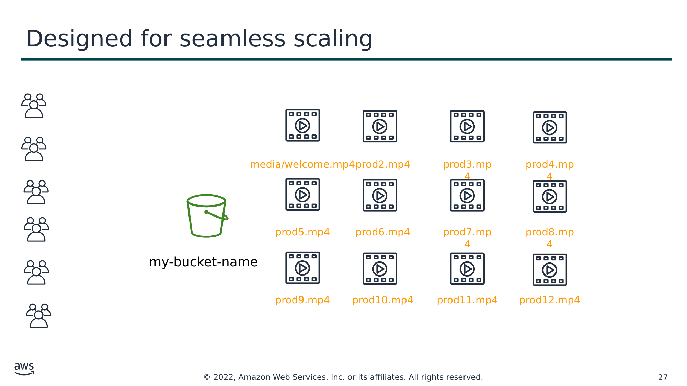

Текст зі схеми

media/welcome.mp4

prod2.mp4

prod3.mp4

prod4.mp4

prod5.mp4

prod6.mp4

prod7.mp4

prod8.mp4

my-bucket-name

prod9.mp4

prod10.mp4

prod11.mp4

prod12.mp4

> **Нотатки:**
>
> Amazon S3 автоматично керує сховищем за вашим бакетом, поки ваші дані зростають. Ви можете почати одразу, і ваше сховище даних зростатиме відповідно до потреб вашого застосунку.  
>
> Amazon S3 також масштабується для обробки великого обсягу запитів. Вам не потрібно розгортати сховище чи пропускну здатність, а рахунок виставляється лише за те, що ви використовуєте.

---

## Слайд 28: Доступ до даних звідки завгодно

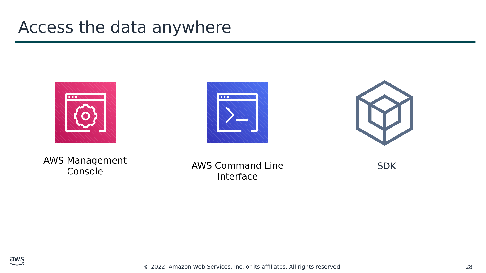

Текст зі схеми

AWS Management Console

AWS Command Line Interface

SDK

> **Нотатки:**
>
> Ви можете отримувати доступ до Amazon S3 через консоль, AWS Command Line Interface (AWS CLI) або AWS SDK. Також можна отримувати доступ до даних у вашому бакеті безпосередньо за допомогою кінцевих точок на основі REST.  
>
> Кінцеві точки підтримують доступ за HTTP або HTTPS. Щоб підтримувати такий тип доступу на основі URL, назви бакетів Amazon S3 мають бути глобально унікальними та відповідати вимогам сервера доменних імен (DNS).  
>
> Також ключі об’єктів (object keys) мають використовувати символи, безпечні для URL.

---

## Слайд 29: Типові сценарії використання

- Зберігання ресурсів застосунків (application assets)
- Хостинг статичних вебсайтів
- Резервне копіювання та аварійне відновлення (DR)
- Проміжна область (staging area) для великих даних
- *І багато іншого….*

> **Нотатки:**
>
> Ця гнучкість — можливість зберігати практично необмежений обсяг даних і отримувати до них доступ звідки завгодно — означає, що Amazon S3 підходить для різноманітних сценаріїв. Тепер ви розглянете деякі сценарії використання Amazon S3:  
> Як розташування для будь-яких даних застосунку бакети Amazon S3 надають спільне розташування для зберігання об’єктів, до якого можуть звертатися будь-які екземпляри вашого застосунку — зокрема застосунки на Amazon EC2 або навіть традиційних серверах. Ця функція може бути корисною для створених користувачами медіафайлів, журналів серверів чи інших файлів, які ваш застосунок має зберігати в спільному розташуванні. Крім того, оскільки контент можна отримувати безпосередньо через інтернет, ви можете зняти з вашого застосунку обслуговування цього контенту та дозволити клієнтам самостійно отримувати дані безпосередньо з Amazon S3.  
> Для хостингу статичних вебсайтів бакети Amazon S3 можуть обслуговувати статичний вміст вашого вебсайту, зокрема HTML, CSS, JavaScript та інші файли.  
> Висока довговічність Amazon S3 робить його добрим кандидатом для зберігання резервних копій ваших даних. Для більшої доступності та можливості аварійного відновлення Amazon S3 можна навіть налаштувати на підтримку міжрегіональної реплікації, щоб дані в бакеті Amazon S3 в одному регіоні автоматично реплікувалися в інший регіон Amazon S3.

---

## Слайд 30: Типові сценарії Amazon S3

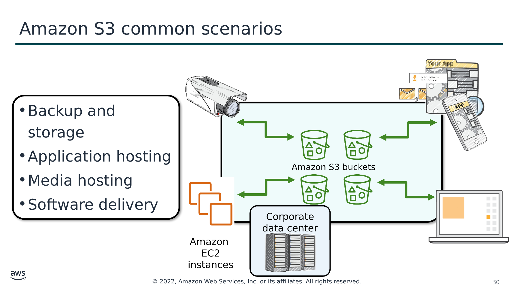

Текст зі схеми

- Резервне копіювання та зберігання (Backup and storage)
- Хостинг застосунків (Application hosting)
- Хостинг медіа (Media hosting)
- Доставка програмного забезпечення (Software delivery)

Amazon S3 buckets (Бакети Amazon S3)

Corporate  
data center (Корпоративний центр обробки даних)

Amazon  
EC2  
instances (Екземпляри Amazon EC2)

> **Нотатки:**
>
> Резервне копіювання та зберігання (Backup and storage) — надання послуг резервного копіювання й зберігання даних для інших  
>
> Хостинг застосунків (Application hosting) — надання сервісів, що розгортають, встановлюють і підтримують вебзастосунки  
>
> Хостинг медіа (Media hosting) — побудова надлишкової, масштабованої та високодоступної інфраструктури, що розміщує завантаження та вивантаження відео, фото чи музики  
>
> Доставка програмного забезпечення (Software delivery) — розміщення ваших програмних застосунків, які клієнти можуть завантажувати

---

## Слайд 31: Ціноутворення Amazon S3

- Платіть лише за те, що ви використовуєте, зокрема –
  - ГБ на місяць
  - Вихідне передавання (Transfer OUT) в інші регіони
  - Запити PUT, COPY, POST, LIST і GET
- Ви не платите за –
  - Вхідне передавання (Transfers IN) в Amazon S3
  - Вихідне передавання з Amazon S3 до Amazon CloudFront або Amazon EC2 в тому самому регіоні

> **Нотатки:**
>
> З Amazon S3 конкретні витрати залежать від регіону та конкретних запитів, які було зроблено. Ви платите лише за те, що використовуєте, зокрема за гігабайти на місяць; вихідне передавання в інші регіони; а також запити PUT, COPY, POST, LIST і GET.  
>
> Як загальне правило, ви платите лише за передавання, що перетинає межу вашого регіону, а це означає, що ви не платите за вхідне передавання в Amazon S3 чи вихідне передавання з Amazon S3 до периферійних локацій Amazon CloudFront (edge locations) у тому самому регіоні.

---

## Слайд 32: Amazon S3: ціноутворення сховища (1 із 2)

Щоб оцінити витрати на Amazon S3, враховуйте таке:

1. Тип класу зберігання (Storage class type) –
   - Стандартне сховище (Standard) розроблено для:
      - 11 дев’яток довговічності
      - Чотирьох дев’яток доступності
   - S3 Standard-Infrequent Access (S-IA) розроблено для:
      - 11 дев’яток довговічності
      - Трьох дев’яток доступності
2. Обсяг сховища (Amount of storage) –
   - Кількість і розмір об’єктів

> **Нотатки:**
>
> Коли ви починаєте оцінювати витрати на Amazon S3, потрібно враховувати таке:  
> Тип класу зберігання –  
> Стандартне сховище (Standard) розроблено для забезпечення довговічності в 11 дев’яток і доступності в чотири дев’ятки.  
> S3 Standard – Infrequent Access (S-IA) — це варіант сховища в Amazon S3, який можна використовувати для зниження витрат, зберігаючи рідше використовувані дані з трохи нижчими рівнями надлишковості, ніж стандартне сховище Amazon S3. Standard – Infrequent Access розроблено забезпечувати ту саму довговічність в 11 дев’яток, що й Amazon S3, з доступністю в три дев’ятки протягом певного року. Кожен клас має різні тарифи.  
> Обсяг сховища — кількість і розмір об’єктів, що зберігаються у ваших бакетах Amazon S3.

---

## Слайд 33: Amazon S3: ціноутворення сховища (2 із 2)

3. Запити (Requests) –
   - Кількість і тип запитів **(GET, PUT, COPY)**
   - Тип запитів:
      - Для запитів GET діють інші тарифи, ніж для інших запитів.
4. Передавання даних (Data transfer) –
   - Ціна залежить від обсягу даних, що передаються за межі регіону Amazon S3
      - Вхідне передавання даних безкоштовне, але за дані, що передаються назовні, стягується плата.

> **Нотатки:**
>
> Запити (Requests) — враховуйте кількість і тип запитів. За запити GET стягується плата за іншими тарифами, ніж за інші запити, як-от PUT і COPY.  
> GET — отримує об’єкт з Amazon S3. Для використання цієї операції потрібен доступ READ.  
> PUT — додає об’єкт до бакета. Для додавання об’єкта до бакета потрібні дозволи WRITE на цей бакет.  
> COPY — створює копію об’єкта, що вже зберігається в Amazon S3. Операція COPY дорівнює виконанню GET, а потім PUT.  
> Передавання даних (Data transfer) — враховуйте обсяг даних, що передаються за межі регіону Amazon S3. Пам’ятайте, що вхідне передавання даних безкоштовне, але за вихідне передавання даних стягується плата.

---

## Слайд 34: Ключові висновки розділу 2

- Amazon S3 — це повністю кероване хмарне сховище.
- Ви можете зберігати практично необмежену кількість об’єктів.
- Ви платите лише за те, що використовуєте.
- Ви можете отримати доступ до Amazon S3 будь-коли звідки завгодно через URL.
- Amazon S3 пропонує розширені засоби контролю безпеки.

> **Нотатки:**
>
> Ви завершили вступ до Amazon S3, зокрема ключові функції та деякі поширені сценарії використання.  
>
> Щоб дізнатися більше про Amazon S3, див. https://aws.amazon.com/s3/.

---

## Слайд 35: Записана демонстрація: Amazon Simple Storage System

> **Нотатки:**
>
> Тепер знайдіть хвилинку, щоб переглянути демонстрацію Amazon S3 за адресою https://aws-tc-largeobjects.s3-us-west-2.amazonaws.com/ILT-TF-100-ACFNDS-20-EN/Module_7_S3+v2.0.mp4. Запис триває трохи більше 4 хвилин і закріплює багато концепцій, обговорених у цьому розділі модуля.  
>
> Демонстрація показує, як налаштувати такі ресурси за допомогою AWS Management Console. Демонстрація показує, як:  
> Створити бакет Amazon S3  
> Завантажити файли та створити папки  
> Змінити налаштування бакета  
>
> Демонстрація також розглядає деякі з найчастіше використовуваних налаштувань бакета S3.

---

## Слайд 36: Розділ 3: Amazon Elastic File System (Amazon EFS)

Модуль 7: Сховище даних

> **Нотатки:**
>
> Представляємо Розділ 3: Amazon Elastic File System (Amazon EFS)  
>
> Amazon EFS реалізує сховище для екземплярів EC2, до якого кілька віртуальних машин можуть отримувати доступ одночасно. Воно реалізоване як спільна файлова система, що використовує протокол Network File System (NFS).

---

## Слайд 37: Сховище даних 2

Storage (Сховище)

Amazon Elastic File System (Amazon EFS)

> **Нотатки:**
>
> Amazon Elastic File System (Amazon EFS) надає просте, масштабоване, еластичне файлове сховище для використання з сервісами AWS і локальними (on-premises) ресурсами. Воно пропонує простий інтерфейс, що дає змогу швидко й легко створювати та налаштовувати файлові системи.  
>
> Amazon EFS створено для динамічного масштабування за запитом без переривання роботи застосунків — воно автоматично зростає й зменшується, коли ви додаєте та видаляєте файли. Його розроблено так, щоб ваші застосунки мали потрібне їм сховище, коли воно їм потрібне.

---

## Слайд 38: Функції Amazon EFS

- Файлове сховище в хмарі AWS
- Добре підходить для великих даних і аналітики, робочих процесів обробки медіа, керування контентом, обслуговування вебсайтів і домашніх каталогів (home directories)
- Файлова система петабайтного масштабу з низькою затримкою
- Спільне сховище (shared storage)
- Еластична потужність
- Підтримує Network File System (NFS) версій 4.0 і 4.1 (NFSv4)
- Сумісне з усіма AMI на основі Linux для Amazon EC2

> **Нотатки:**
>
> Amazon EFS — це повністю кероване обслуговування, що полегшує налаштування та масштабування файлового сховища в хмарі AWS. Ви можете використовувати Amazon EFS для побудови файлової системи для великих даних і аналітики, робочих процесів обробки медіа, керування контентом, обслуговування вебсайтів і домашніх каталогів.  
>
> Ви можете створювати файлові системи, доступні екземплярам Amazon EC2 через інтерфейс файлової системи (за допомогою стандартних API файлового введення-виведення операційної системи). Ці файлові системи підтримують повну семантику доступу до файлової системи, як-от сильна узгодженість (strong consistency) і блокування файлів (file locking).  
>
> Файлові системи Amazon EFS можуть автоматично масштабуватися від гігабайтів до петабайтів даних без потреби розгортати сховище. Тисячі екземплярів Amazon EC2 можуть одночасно отримувати доступ до файлової системи Amazon EFS, а Amazon EFS розроблено для забезпечення стабільної продуктивності для кожного екземпляра Amazon EC2. Amazon EFS також розроблено як високодовговічне та високодоступне. Amazon EFS не вимагає мінімальної плати чи витрат на налаштування, і ви платите лише за сховище, яке використовуєте.

---

## Слайд 39: Архітектура Amazon EFS

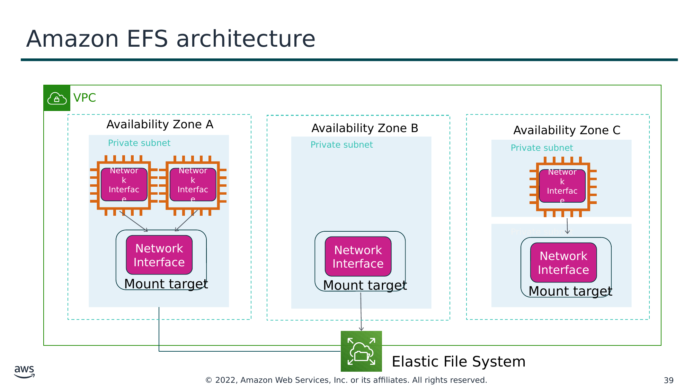

Текст зі схеми

VPC

Availability Zone A (Зона доступності A)

Private subnet (Приватна підмережа)

Availability Zone B (Зона доступності B)

Availability Zone C (Зона доступності C)

Private subnet (Приватна підмережа)

Private subnet (Приватна підмережа)

Network Interface (Мережевий інтерфейс)

Network Interface (Мережевий інтерфейс)

Network Interface (Мережевий інтерфейс)

Private subnet (Приватна підмережа)

Network Interface (Мережевий інтерфейс)

Network Interface (Мережевий інтерфейс)

Network Interface (Мережевий інтерфейс)

Mount target (Точка монтування)

Mount target (Точка монтування)

Mount target (Точка монтування)

Elastic File System

> **Нотатки:**
>
> Amazon EFS надає файлове сховище в хмарі. З Amazon EFS ви можете створити файлову систему, змонтувати файлову систему на екземплярі Amazon EC2, а потім читати дані з вашої файлової системи та записувати їх до неї. Ви можете змонтувати файлову систему Amazon EFS у вашій VPC через NFS версій 4.0 і 4.1 (NFSv4).  
>
> Ви можете отримувати доступ до своєї файлової системи Amazon EFS одночасно з екземплярів Amazon EC2 у вашій VPC, тож застосунки, що масштабуються за межі одного з’єднання, можуть отримувати доступ до файлової системи. Екземпляри Amazon EC2, що працюють у кількох зонах доступності в межах того самого регіону AWS, можуть отримувати доступ до файлової системи, тож багато користувачів можуть отримувати доступ до спільного джерела даних і ділитися ним.  
>
> На схемі VPC має три зони доступності, і в кожній зоні доступності створено по одній точці монтування (mount target). Ми рекомендуємо отримувати доступ до файлової системи з точки монтування в тій самій зоні доступності. Одна із зон доступності має дві підмережі. Однак точку монтування створено лише в одній із підмереж.

---

## Слайд 40: Реалізація Amazon EFS

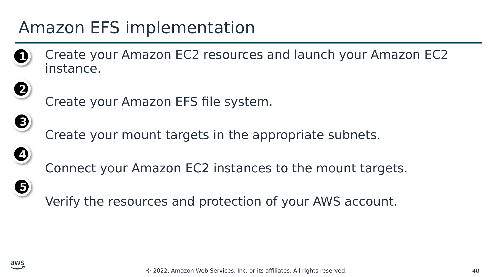

Текст зі схеми

**1**

Створіть свої ресурси Amazon EC2 і запустіть свій екземпляр Amazon EC2.

Створіть свою файлову систему Amazon EFS.

Створіть свої точки монтування у відповідних підмережах.

Підключіть свої екземпляри Amazon EC2 до точок монтування.

Перевірте ресурси та захист свого акаунта AWS.

**2**

**3**

**4**

**5**

> **Нотатки:**
>
> Щоб створити та використати свою першу файлову систему Amazon EFS, змонтувати її на екземплярі Amazon EC2 у вашій VPC і протестувати наскрізне налаштування, потрібно виконати п’ять кроків:  
> Створіть свої ресурси Amazon EC2 і запустіть свій екземпляр. (Перш ніж запустити екземпляр Amazon EC2 і підключитися до нього, потрібно створити пару ключів (key pair), якщо вона у вас ще не створена.)  
> Створіть свою файлову систему Amazon EFS.  
> У відповідних підмережах створіть свої точки монтування.  
> Далі підключіться до свого екземпляра Amazon EC2 і змонтуйте файлову систему Amazon EFS.  
> Нарешті, очистьте свої ресурси та захистіть свій акаунт AWS.

---

## Слайд 41: Ресурси Amazon EFS

File system (Файлова система)

- Mount target (Точка монтування)
- Subnet ID (Ідентифікатор підмережі)
- Security groups (Групи безпеки)
- Одна або кілька на файлову систему
- Створюється в підмережі VPC
- Одна на зону доступності
- Має бути в тій самій VPC
- Tags (Теги)
- Пари «ключ-значення»

> **Нотатки:**
>
> В Amazon EFS основним ресурсом є файлова система. Кожна файлова система має такі властивості, як:  
> ID  
> Токен створення (creation token)  
> Час створення  
> Розмір файлової системи в байтах  
> Кількість точок монтування, створених для файлової системи  
> Стан файлової системи  
>
> Amazon EFS також підтримує інші ресурси для налаштування основного ресурсу. До цих ресурсів належать точки монтування й теги.  
>
> Точка монтування (Mount target): щоб отримати доступ до своєї файлової системи, потрібно створити точки монтування у вашій VPC.  
> Кожна точка монтування має такі властивості:  
> Ідентифікатор точки монтування  
> Ідентифікатор підмережі, де її було створено  
> Ідентифікатор файлової системи, для якої її було створено  
> IP-адреса, за якою можна змонтувати файлову систему  
> Стан точки монтування  
>
> Ви можете використовувати IP-адресу або ім’я системи доменних імен (DNS) у вашій команді монтування.  
>
> Теги (Tags): щоб допомогти впорядкувати ваші файлові системи, ви можете призначити власні метадані кожній створюваній файловій системі. Кожен тег — це пара «ключ-значення».  
>
> Розглядайте точки монтування й теги як підресурси, що не існують, доки не пов’язані з файловою системою.

---

## Слайд 42: Ключові висновки розділу 3

- Amazon EFS надає файлове сховище через мережу.
- Ідеально підходить для великих даних і аналітики, робочих процесів обробки медіа, керування контентом, обслуговування вебсайтів і домашніх каталогів.
- Повністю кероване обслуговування, що усуває завдання адміністрування сховища.
- Доступне з консолі, через API або CLI.
- Масштабується вгору чи вниз у міру додавання або видалення файлів, і ви платите за те, що використовуєте.

> **Нотатки:**
>
> Ви завершили вступ до Amazon EFS, зокрема ключові функції та ключові ресурси. Amazon EFS надає файлове сховище в хмарі, що добре підходить для великих даних і аналітики, робочих процесів обробки медіа, керування контентом, обслуговування вебсайтів і домашніх каталогів.  
>
> Amazon EFS масштабується вгору чи вниз, коли файли додаються або видаляються, і ви платите лише за те, що використовуєте.  
>
> Amazon EFS — це повністю кероване обслуговування, доступне з консолі, через API або AWS CLI.  
>
> Щоб дізнатися більше про Amazon EFS, див. https://aws.amazon.com/efs/

---

## Слайд 43: Записана демонстрація: Amazon Elastic File System

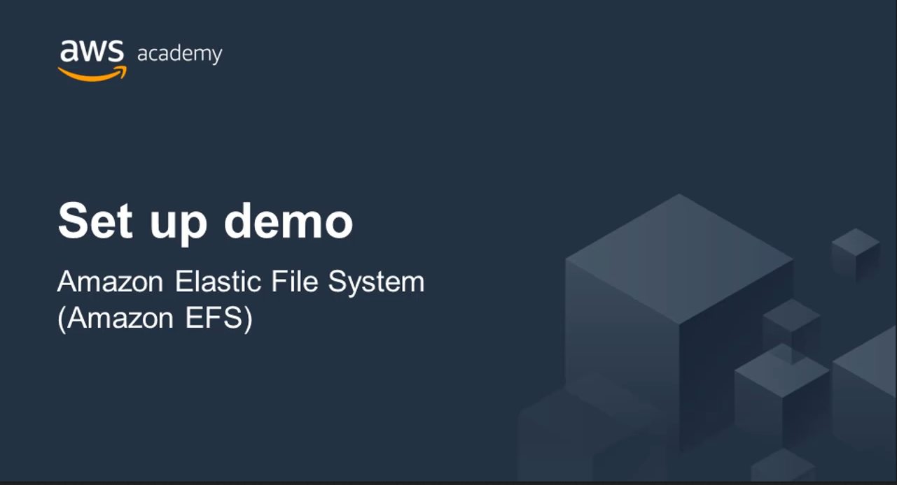

> **Нотатки:**
>
> Тепер знайдіть хвилинку, щоб переглянути демонстрацію Amazon EFS за адресою https://aws-tc-largeobjects.s3-us-west-2.amazonaws.com/ILT-TF-100-ACFNDS-20-EN/Module_7_EFS+v2.0.mp4. Запис триває трохи більше 6 хвилин і закріплює багато концепцій, обговорених у цьому розділі модуля.  
>
> Демонстрація показує, як налаштувати такі ресурси за допомогою AWS Management Console. Демонстрація показує, як:  
> Створити реалізацію Elastic File System (EFS) у віртуальній приватній хмарі  
> Приєднати EFS  
> Налаштувати параметри безпеки та продуктивності для реалізації EFS  
>
> Демонстрація також розглядає, як отримати конкретні інструкції щодо перевірки вашої інсталяції EFS, щоб ви могли підключатися до екземплярів EC2.

---

## Слайд 44: Розділ 4: Amazon S3 Glacier

Модуль 7: Сховище даних

> **Нотатки:**
>
> Представляємо Розділ 4: Amazon S3 Glacier  
>
> Amazon S3 Glacier — це захищений, довговічний і надзвичайно недорогий сервіс хмарного зберігання для архівування даних і довгострокового резервного копіювання.

---

## Слайд 45: Сховище даних 3

Storage (Сховище)

Amazon S3 Glacier

> **Нотатки:**
>
> Цей розділ присвячено Amazon S3 Glacier.

---

## Слайд 46: Огляд Amazon S3 Glacier

Amazon S3 Glacier — це сервіс архівування даних, розроблений для безпеки, довговічності та надзвичайно низької вартості.

- Amazon S3 Glacier розроблено для забезпечення довговічності об’єктів у 11 дев’яток (11 9s).
- Він підтримує шифрування даних під час передавання та в стані спокою за допомогою Secure Sockets Layer (SSL) або Transport Layer Security (TLS).
- Функція Vault Lock забезпечує відповідність вимогам за допомогою політики.
- Надзвичайно недорога архітектура добре підходить для довгострокового архівування.
  - Надає три варіанти доступу до архівів — швидкий (expedited), стандартний (standard) і масовий (bulk) — час отримання варіюється від кількох хвилин до кількох годин.

> **Нотатки:**
>
> Коли ви використовуєте Amazon S3 Glacier для архівування даних, ви можете зберігати свої дані за надзвичайно низькою вартістю (навіть порівняно з Amazon S3), але не можете отримати свої дані негайно, коли захочете.  
>
> Отримання даних, що зберігаються в Amazon S3 Glacier, може тривати кілька годин, тому він добре підходить для архівування.  
>
> Існують три ключові терміни Amazon S3 Glacier, з якими слід ознайомитися:  
> Архів (Archive) — будь-який об’єкт (як-от фотографія, відео, файл чи документ), який ви зберігаєте в Amazon S3 Glacier. Це базова одиниця зберігання в Amazon S3 Glacier. Кожен архів має власний унікальний ID і також може мати опис.  
> Сховище (Vault) — контейнер для зберігання архівів. Коли ви створюєте сховище (vault), ви вказуєте його назву та регіон, де хочете його розмістити.  
> Політика доступу до сховища (Vault access policy) — визначає, хто може, а хто не може отримувати доступ до даних, що зберігаються в сховищі, та які операції користувачі можуть і не можуть виконувати. Для кожного сховища можна створити одну політику дозволів доступу до сховища, щоб керувати дозволами доступу до цього сховища. Ви також можете використовувати політику блокування сховища (vault lock policy), щоб гарантувати, що сховище не можна змінити. До кожного сховища може бути прикріплена одна політика доступу до сховища та одна політика блокування сховища.  
>
> У вас є три варіанти отримання даних, кожен із різним часом доступу та вартістю:  
> Швидкі отримання (Expedited retrievals) зазвичай стають доступними протягом 1–5 хвилин (найвища вартість).  
> Стандартні отримання (Standard retrievals) зазвичай завершуються протягом 3–5 годин (менше часу, ніж швидкі, більше часу, ніж масові).  
> Масові отримання (Bulk retrievals) зазвичай завершуються протягом 5–12 годин (найнижча вартість).  
>
> Ці варіанти можна порівняти з вибором вартості доставки посилки найекономічнішим для ваших потреб способом.

---

## Слайд 47: Amazon S3 Glacier

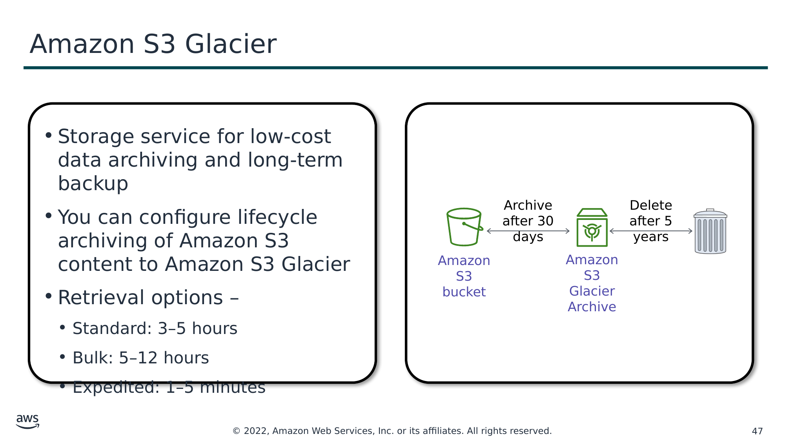

Текст зі схеми

- Сервіс зберігання для недорогого архівування даних і довгострокового резервного копіювання
- Ви можете налаштувати архівування вмісту Amazon S3 до Amazon S3 Glacier за життєвим циклом (lifecycle)
- Варіанти отримання –
  - Standard (стандартне): 3–5 годин
  - Bulk (масове): 5–12 годин
  - Expedited (швидке): 1–5 хвилин

Archive after 30 days (Архівувати через 30 днів)

Delete after 5 years (Видалити через 5 років)

Amazon S3 bucket (Бакет Amazon S3)

Amazon S3 Glacier Archive (Архів Amazon S3 Glacier)

> **Нотатки:**
>
> Архівування даних в Amazon S3 Glacier означає, що, хоча ви можете зберігати свої дані за надзвичайно низькою вартістю (навіть порівняно з Amazon S3), ви не можете отримати свої дані негайно, коли захочете.  
>
> Отримання даних, що зберігаються в Amazon S3 Glacier, може тривати кілька годин.  
>
> Вам слід ознайомитися з трьома ключовими термінами Amazon S3 Glacier:  
> Архів (Archive): будь-який об’єкт, як-от фотографія, відео, файл чи документ, який ви зберігаєте в Amazon S3 Glacier. Це базова одиниця зберігання в Amazon S3 Glacier. Кожен архів має власний унікальний ID і також може мати опис.  
> Сховище (Vault): контейнер для зберігання архівів. Коли ви створюєте сховище, ви вказуєте його назву та регіон, у якому хочете його розмістити.  
> Політика доступу до сховища (Vault Access Policy): визначає, хто може, а хто не може отримувати доступ до даних, що зберігаються в сховищі, та які операції користувачі можуть і не можуть виконувати. Для кожного сховища можна створити одну політику доступу до сховища, щоб керувати дозволами доступу до цього сховища. Ви також можете використовувати політику блокування сховища, щоб гарантувати, що сховище не можна змінити. До кожного сховища може бути прикріплена одна політика доступу до сховища та одна політика блокування сховища.  
>
> Для отримання даних доступні три варіанти з різним часом доступу та вартістю: швидкі (expedited), стандартні (standard) та масові (bulk) отримання. Вони перелічені нижче:  
> Швидкі отримання зазвичай стають доступними протягом 1–5 хвилин (найвища вартість).  
> Стандартні отримання зазвичай завершуються протягом 3–5 годин (менше, ніж швидкі, більше, ніж масові).  
> Масові отримання зазвичай завершуються протягом 5–12 годин (найнижча вартість).  
>
> Порівняйте це з вибором вартості найекономічнішої доставки посилки.

---

## Слайд 48: Сценарії використання Amazon S3 Glacier

Архівування медіаактивів (Media asset archiving)

Архівування медичної інформації (Healthcare information archiving)

Архівування для регуляторної відповідності (Regulatory and compliance archiving)

Архівування наукових даних (Scientific data archiving)

Цифрове збереження (Digital preservation)

Заміна магнітних стрічок (Magnetic tape replacement)

> **Нотатки:**
>
> Архівування медіаактивів (Media asset archiving)  
> Медіаактиви — як-от відео та новинні матеріали — потребують довговічного сховища й можуть з часом зростати до багатьох петабайтів. Amazon S3 Glacier дає змогу недорого архівувати старіший медіаконтент, а потім переміщувати його в Amazon S3 для розповсюдження, коли це потрібно.  
>
> Архівування медичної інформації (Healthcare information archiving)  
> Щоб відповідати регуляторним вимогам, лікарняні системи мають десятиліттями зберігати петабайти записів пацієнтів — як-от інформацію Low-Income Subsidy (LIS), дані системи архівування та передавання зображень (picture archiving and communication system, PACS) або електронні медичні картки (Electronic Health Records, EHR). Amazon S3 Glacier може допомогти надійно й безпечно архівувати дані записів пацієнтів за дуже низької вартості.  
>
> Архівування для регуляторної відповідності (Regulatory and compliance archiving)  
> Багато підприємств, як-от у сфері фінансових послуг і охорони здоров’я, мають зберігати архіви для регуляторної відповідності протягом тривалого часу. Amazon S3 Glacier Vault Lock може допомогти налаштувати засоби контролю відповідності, щоб ви могли працювати над досягненням своїх цілей відповідності, як-от Правило 17a-4(f) Комісії з цінних паперів і бірж США (SEC).  
>
> Архівування наукових даних (Scientific data archiving)  
> Дослідницькі організації генерують, аналізують і архівують великі обсяги даних. Використовуючи Amazon S3 Glacier, ви можете зменшити складності керування апаратним забезпеченням і приміщеннями та планування потужностей.  
>
> Цифрове збереження (Digital preservation)  
> Бібліотеки та державні установи мають вирішувати проблеми цілісності даних у своїх зусиллях щодо цифрового збереження. На відміну від традиційних систем, які можуть вимагати трудомісткої перевірки даних і ручного відновлення, Amazon S3 Glacier виконує регулярні, систематичні перевірки цілісності даних і розроблений так, щоб автоматично самовідновлюватися.  
>
> Заміна магнітних стрічок (Magnetic tape replacement)  
> Локальні або позалокальні стрічкові бібліотеки можуть знизити витрати на зберігання, але вони можуть вимагати великих початкових інвестицій і спеціалізованого обслуговування. Amazon S3 Glacier не має початкових витрат і зменшує вартість і тягар обслуговування.

---

## Слайд 49: Використання Amazon S3 Glacier

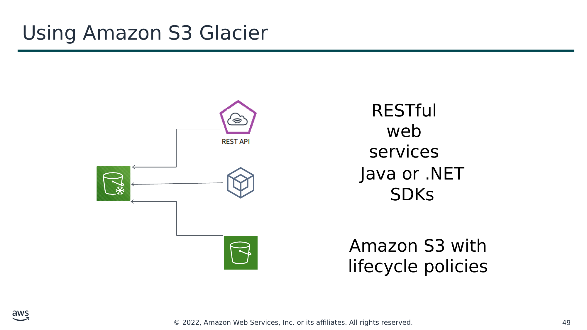

Текст зі схеми

RESTful

web services (вебсервіси RESTful)

Java or .NET SDKs (SDK для Java або .NET)

Amazon S3 with lifecycle policies (Amazon S3 з політиками життєвого циклу)

> **Нотатки:**
>
> Щоб зберігати дані в Amazon S3 Glacier та отримувати доступ до них, можна використовувати AWS Management Console. Однак у консолі доступні лише кілька операцій — як-от створення та видалення сховищ, а також створення й керування політиками архівування.  
>
> Для майже всіх інших операцій і взаємодій з Amazon S3 Glacier потрібно використовувати або REST API Amazon S3 Glacier, або AWS SDK для Java чи .NET, або AWS CLI.  
>
> Також для архівування даних в Amazon S3 Glacier можна використовувати політики життєвого циклу (lifecycle policies). Далі ви дізнаєтеся про політики життєвого циклу.

---

## Слайд 50: Політики життєвого циклу (lifecycle policies)

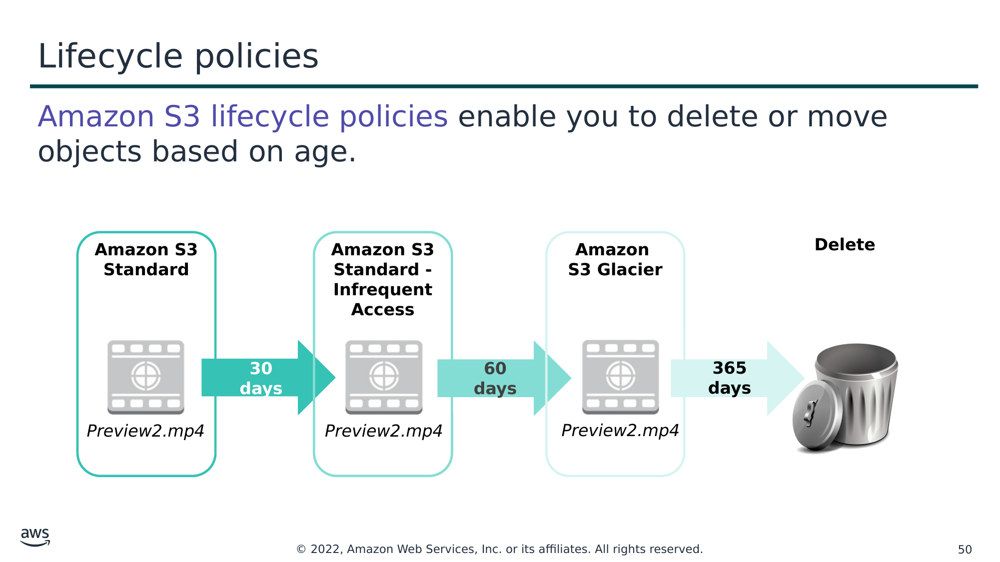

Текст зі схеми

Політики життєвого циклу Amazon S3 дають змогу видаляти або переміщувати об’єкти залежно від віку.

**Delete (Видалити)**

**Amazon S3 Standard**

**Amazon S3 Standard - Infrequent Access**

**Amazon**

**S3 Glacier**

**30 days (30 днів)**

**60 days (60 днів)**

**365 days (365 днів)**

*Preview2.mp4*

*Preview2.mp4*

*Preview2.mp4*

> **Нотатки:**
>
> Вам слід автоматизувати життєвий цикл даних, які ви зберігаєте в Amazon S3. За допомогою політик життєвого циклу ви можете через регулярні інтервали переміщувати дані між різними типами сховищ Amazon S3. Ця автоматизація знижує ваші загальні витрати, оскільки ви платите менше за дані, коли вони з часом стають менш важливими.  
>
> Окрім встановлення правил життєвого циклу для кожного об’єкта, ви також можете встановлювати правила життєвого циклу для кожного бакета.  
>
> Розгляньте приклад політики життєвого циклу, що переміщує дані в міру їх старіння з Amazon S3 Standard до Amazon S3 Standard – Infrequent Access і, нарешті, до Amazon S3 Glacier перед видаленням. Припустімо, що користувач завантажує відео до вашого застосунку, а ваш застосунок генерує мініатюру-прев’ю відео. Це прев’ю відео зберігається в Amazon S3 Standard, оскільки, імовірно, користувач захоче отримати до нього доступ одразу.  
>
> Ваші дані про використання вказують, що до більшості мініатюр-прев’ю не звертаються після 30 днів. Ваша політика життєвого циклу бере ці прев’ю й переміщує їх до Amazon S3 – Infrequent Access через 30 днів. Після спливу ще 30 днів імовірність повторного доступу до прев’ю невисока. Тоді прев’ю переміщується до Amazon S3 Glacier, де воно залишається протягом 1 року. Через 1 рік прев’ю видаляється. Важливо, що політика життєвого циклу керує всім цим переміщенням автоматично.  
>
> Щоб дізнатися більше про керування життєвим циклом об’єктів, див. http://docs.aws.amazon.com/AmazonS3/latest/dev/object-lifecycle-mgmt.html

---

## Слайд 51: Порівняння сховищ (storage comparison)

|  | Amazon S3 | Amazon S3 Glacier |
|---|---|---|
| Обсяг даних | Без обмежень | Без обмежень |
| Середня затримка | мс | хвилини/години |
| Розмір елемента | максимум 5 ТБ | максимум 40 ТБ |
| Вартість за ГБ на місяць | Вища вартість | Нижча вартість |
| Запити, що тарифікуються | PUT, COPY, POST, LIST і GET | UPLOAD та отримання (retrieval) |
| Ціна отримання даних | • ¢ • За запит | • ¢¢ • За запит і за ГБ |

> **Нотатки:**
>
> Хоча Amazon S3 і Amazon S3 Glacier обидва є рішеннями об’єктного сховища, що дають змогу зберігати практично необмежений обсяг даних, між ними є деякі критичні відмінності. Діаграма окреслює деякі з цих відмінностей.  
>
> Будьте обережні, вирішуючи, яке рішення для зберігання правильне для ваших потреб. Ці два сервіси задовольняють дуже різні потреби у зберіганні. Amazon S3 розроблено для частого доступу до ваших даних із низькою затримкою, а Amazon S3 Glacier — для недорогого довгострокового зберігання даних нечастого доступу.  
> Максимальний розмір елемента в Amazon S3 становить 5 ТБ, але Amazon S3 Glacier може зберігати елементи розміром до 40 ТБ.  
> Оскільки Amazon S3 надає швидший доступ до ваших даних, вартість зберігання за гігабайт вища, ніж в Amazon S3 Glacier.  
> Хоча обидва сервіси мають плату за запити, Amazon S3 стягує плату за операції PUT, COPY, POST, LIST, GET. Натомість Amazon S3 Glacier стягує плату за операції UPLOAD та отримання (retrieval).  
> Оскільки Amazon S3 Glacier розроблено для рідшого доступу до даних, кожен запит на отримання коштує дорожче, ніж в Amazon S3.

---

## Слайд 52: Серверне шифрування (server-side encryption)

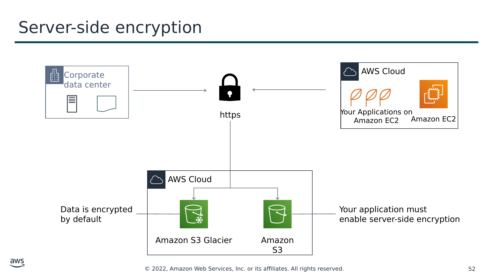

Текст зі схеми

Corporate

data center (Корпоративний центр обробки даних)

AWS Cloud

https

Your Applications on

Amazon EC2 (Ваші застосунки на Amazon EC2)

Amazon EC2

AWS Cloud

Data is encrypted  
by default (Дані шифруються за замовчуванням)

Your application must  
enable server-side encryption (Ваш застосунок має ввімкнути серверне шифрування)

Amazon S3 Glacier

Amazon S3

> **Нотатки:**
>
> Ще одна важлива відмінність між Amazon S3 і Amazon S3 Glacier — спосіб шифрування даних. Серверне шифрування (server-side encryption) зосереджене на захисті даних у стані спокою. В обох рішеннях ви можете безпечно передавати свої дані через HTTPS. Будь-які дані, архівовані в Amazon S3 Glacier, шифруються за замовчуванням. В Amazon S3 ваш застосунок має ініціювати серверне шифрування. Серверне шифрування в Amazon S3 можна здійснити кількома способами:  
> Серверне шифрування за допомогою ключів шифрування, керованих Amazon S3 (SSE-S3), використовує надійне багатофакторне шифрування. Amazon S3 шифрує кожен об’єкт унікальним ключем. Як додатковий захід безпеки, він шифрує ключ головним ключем, який регулярно змінює (ротація). Серверне шифрування Amazon S3 використовує один із найсильніших доступних блокових шифрів — 256-бітний Advanced Encryption Standard (AES-256) — для шифрування ваших даних.  
> Використання серверного шифрування з наданими клієнтом ключами шифрування (Customer-provided Encryption Keys, SSE-C) дає змогу встановити власні ключі шифрування. Ви включаєте ключ шифрування як частину свого запиту, а Amazon S3 керує і шифруванням (під час запису на диски), і розшифруванням (коли ви звертаєтеся до своїх об’єктів).  
> Використання серверного шифрування з AWS Key Management Service (AWS KMS) — це сервіс, що поєднує безпечне високодоступне апаратне та програмне забезпечення, щоб надати систему керування ключами, масштабовану для хмари. AWS KMS використовує головні ключі клієнта (Customer Master Keys, CMK) для шифрування ваших об’єктів Amazon S3. Ви використовуєте AWS KMS через розділ Encryption Keys в консолі IAM. Також можна отримати доступ до AWS KMS через API, щоб централізовано створювати ключі шифрування, визначати політики, що контролюють, як можна використовувати ключі, і проводити аудит використання ключів, щоб довести їх правильне використання. Ці ключі можна використовувати для захисту ваших даних у бакетах Amazon S3.

---

## Слайд 53: Безпека в Amazon S3 Glacier

**Контролюйте доступ за допомогою IAM**

**Amazon S3 Glacier шифрує ваші дані за допомогою AES-256**

**Amazon S3 Glacier**

**Amazon S3 Glacier керує вашими ключами за вас**

> **Нотатки:**
>
> За замовчуванням лише ви можете отримати доступ до своїх даних. Ви можете ввімкнути та контролювати доступ до ваших даних в Amazon S3 Glacier за допомогою IAM. Ви налаштовуєте політику IAM, що визначає доступ користувачів.

---

## Слайд 54: Ключові висновки розділу 4

- Amazon S3 Glacier — це сервіс архівування даних, розроблений для безпеки, довговічності та надзвичайно низької вартості.
- Ціноутворення Amazon S3 Glacier залежить від регіону.
- Його надзвичайно недорога архітектура добре підходить для довгострокового архівування.
- Сервіс розроблено для забезпечення довговічності об’єктів у 11 дев’яток (11 9s).

> **Нотатки:**
>
> Ви завершили вступ до Amazon S3 Glacier, який включав ключові відмінності між Amazon S3 і Amazon S3 Glacier.  
>
> Щоб дізнатися більше про Amazon S3 Glacier, див. Glacier.

---

## Слайд 55: Записана демонстрація: Amazon S3 Glacier

> **Нотатки:**
>
> Тепер знайдіть хвилинку, щоб переглянути демонстрацію Amazon Glacier. Запис триває трохи більше 2 хвилин і закріплює багато концепцій, обговорених у цьому розділі модуля.  
>
> Демонстрація показує, як налаштувати такі ресурси за допомогою AWS Management Console. Демонстрація показує, як:  
> Створити сховище (vault) Amazon Glacier.  
> Завантажити архівовані елементи до сховища за допомогою стороннього графічного інструмента.

---

## Слайд 56: Практична вправа: практичні приклади зі сховищ даних (storage case studies)

Фото: Pixabay (Pexels).

> **Нотатки:**
>
> У цій вправі під керівництвом викладача вас попросять увійти в AWS Management Console. Інструкції до вправи наведено на наступному слайді. Вам буде запропоновано відповісти на п’ять запитань. Викладач проведе обговорення кожного запитання з класом і розкриє правильні відповіді.

---

## Слайд 57: Практична вправа з практичних прикладів зі сховищ даних (1 із 3)

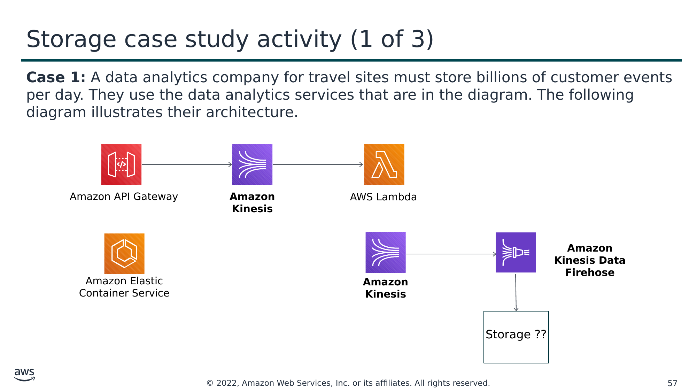

Текст зі схеми

**Випадок 1:** компанія з аналітики даних для туристичних сайтів має зберігати мільярди подій клієнтів на день. Вони використовують сервіси аналітики даних, наведені на схемі. Наведена нижче схема ілюструє їхню архітектуру.

Amazon API Gateway

**Amazon Kinesis**

AWS Lambda

**Amazon Kinesis Data Firehose**

Amazon Elastic Container Service

**Amazon Kinesis**

Storage ?? (Сховище ??)

> **Нотатки:**
>
> Розбийтеся на групи по чотири-п’ять осіб. Розгляньте призначений вам практичний приклад (case study). Створіть презентацію, що описує найкраще рішення для зберігання даних для організації, описаної у випадку вашої групи. Ваша презентація має включати ключові чинники, які ви враховували, обираючи технологію зберігання даних, а також будь-які чинники, що могли б змінити вашу рекомендацію.

---

## Слайд 58: Практична вправа з практичних прикладів зі сховищ даних (2 із 3)

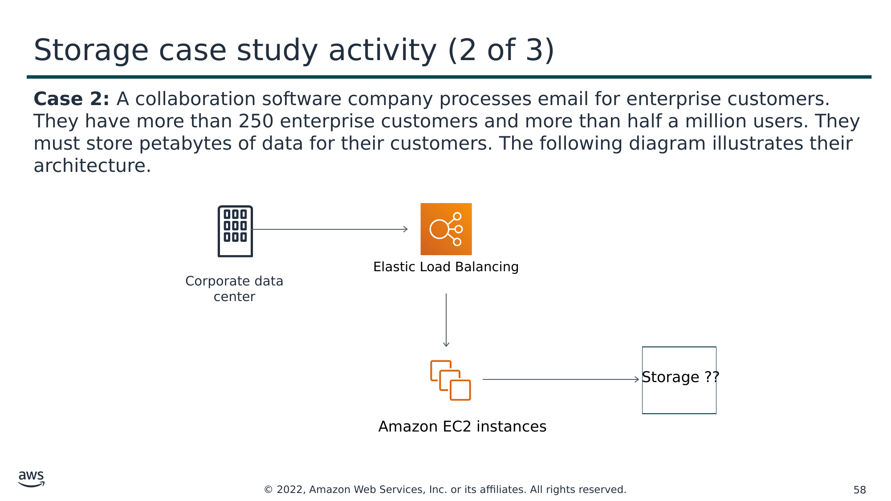

Текст зі схеми

**Випадок 2:** компанія, що розробляє програмне забезпечення для співпраці, обробляє електронну пошту для корпоративних клієнтів. У неї понад 250 корпоративних клієнтів і понад півмільйона користувачів. Вона має зберігати петабайти даних для своїх клієнтів. Наведена нижче схема ілюструє їхню архітектуру.

Elastic Load Balancing

Corporate data center (Корпоративний центр обробки даних)

Storage ?? (Сховище ??)

Amazon EC2 instances (Екземпляри Amazon EC2)

> **Нотатки:**
>
> Розбийтеся на групи по чотири-п’ять осіб. Розгляньте призначений вам практичний приклад. Створіть презентацію, що описує найкраще рішення для зберігання даних для організації, описаної у випадку вашої групи. Ваша презентація має включати ключові чинники, які ви враховували, обираючи технологію зберігання даних, а також будь-які чинники, що могли б змінити вашу рекомендацію.

---

## Слайд 59: Практична вправа з практичних прикладів зі сховищ даних (3 із 3)

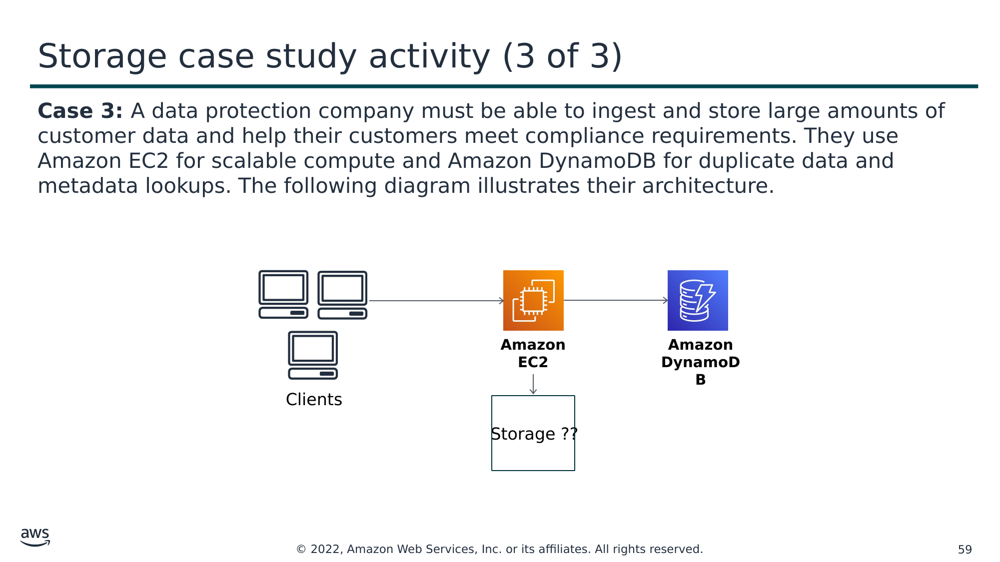

Текст зі схеми

**Випадок 3:** компанія із захисту даних має вміти приймати та зберігати великі обсяги даних клієнтів і допомагати своїм клієнтам виконувати вимоги відповідності. Вони використовують Amazon EC2 для масштабованих обчислень і Amazon DynamoDB для пошуку дублікатів даних і метаданих. Наведена нижче схема ілюструє їхню архітектуру.

**Amazon EC2**

**Amazon DynamoDB**

Clients (Клієнти)

Storage ?? (Сховище ??)

> **Нотатки:**
>
> Розбийтеся на групи по чотири-п’ять осіб. Розгляньте призначений вам практичний приклад. Створіть презентацію, що описує найкраще рішення для зберігання даних для організації, описаної у випадку вашої групи. Ваша презентація має включати ключові чинники, які ви враховували, обираючи технологію зберігання даних, а також будь-які чинники, що могли б змінити вашу рекомендацію.

---

## Слайд 60: Підсумки модуля

Модуль 7: Сховище даних

> **Нотатки:**
>
> Настав час повторити матеріал модуля та завершити його перевіркою знань і розбором запитання практичного сертифікаційного іспиту.

---

## Слайд 61: Резюме модуля

Підсумовуючи, у цьому модулі ви навчилися:

- Визначати різні типи сховищ
- Пояснювати Amazon S3
- Визначати функціональність Amazon S3
- Пояснювати Amazon EBS
- Визначати функціональність Amazon EBS
- Виконувати функції в Amazon EBS для побудови рішення зберігання даних для Amazon EC2
- Пояснювати Amazon EFS
- Визначати функціональність Amazon EFS
- Пояснювати Amazon S3 Glacier
- Визначати функціональність Amazon S3 Glacier
- Розрізняти Amazon EBS, Amazon S3, Amazon EFS і Amazon S3 Glacier

> **Нотатки:**
>
> Підсумовуючи, у цьому модулі ви навчилися:  
> Визначати різні типи сховищ  
> Пояснювати Amazon S3  
> Визначати функціональність Amazon S3  
> Пояснювати Amazon EBS  
> Визначати функціональність Amazon EBS  
> Виконувати функції в Amazon EBS для побудови рішення зберігання даних для Amazon EC2  
> Пояснювати Amazon EFS  
> Визначати функціональність Amazon EFS  
> Пояснювати Amazon S3 Glacier  
> Визначати функціональність Amazon S3 Glacier  
> Розрізняти Amazon EBS, Amazon S3, Amazon EFS і Amazon S3 Glacier

---

## Слайд 62: Пройдіть перевірку знань

> **Нотатки:**
>
> Пройдіть перевірку знань для цього модуля.

---

## Слайд 63: Приклад запитання іспиту

Компанія хоче зберігати дані, до яких звертаються нечасто. Яке найкраще й економічно ефективне рішення слід розглянути?

Варіант

Відповідь

A

AWS Storage Gateway

B

Amazon Simple Storage Service Glacier

C

Amazon Elastic Block Store (Amazon EBS)

D

Amazon Simple Storage Service (Amazon S3)

> **Нотатки:**
>
> Розгляньте варіанти відповідей і відсійте їх за ключовими словами.

---

## Слайд 64: Відповідь на приклад запитання іспиту

Компанія хоче зберігати дані, до яких звертаються нечасто. Яке найкраще й економічно ефективне рішення слід розглянути?

Правильна відповідь — **B. Amazon Simple Storage Service Glacier**

Ключові слова в запитанні: «до яких звертаються нечасто» та «економічно ефективне рішення».

> **Нотатки:**
>
> Ключові слова, які потрібно розпізнати: «до яких звертаються нечасто» та «економічно ефективне рішення».  
>
> Правильна відповідь — B. Amazon Simple Storage Service Glacier.  
>
> Неправильні відповіді:  
> Відповідь A: AWS Storage Gateway  
> Відповідь C: Amazon Elastic Block Store (Amazon EBS)  
> Відповідь D: Amazon Simple Storage Service (Amazon S3)

---

## Слайд 65: Додаткові ресурси

- Сторінка AWS Storage: [https://aws.amazon.com/products/storage/](https://aws.amazon.com/products/storage/)
- Огляд сховищ (Storage Overview): [https://docs.aws.amazon.com/whitepapers/latest/aws-overview/storage-services.html](https://docs.aws.amazon.com/whitepapers/latest/aws-overview/storage-services.html)
- Відновлення файлів із резервної копії тому Amazon EBS: [https://aws.amazon.com/blogs/compute/recovering-files-from-an-amazon-ebs-volume-backup/](https://aws.amazon.com/blogs/compute/recovering-files-from-an-amazon-ebs-volume-backup/)
- Заплуталися у варіантах сховищ AWS? S3, EFS, EBS: пояснення (Confused by AWS Storage Options? S3, EFS, EBS Explained): [https://dzone.com/articles/confused-by-aws-storage-options-s3-ebs-amp-efs-explained](https://dzone.com/articles/confused-by-aws-storage-options-s3-ebs-amp-efs-explained)

> **Нотатки:**
>
> Якщо ви хочете дізнатися більше про теми, розглянуті в цьому модулі, вам можуть бути корисними такі додаткові ресурси:  
> Сторінка AWS Storage: https://aws.amazon.com/products/storage/  
> Огляд сховищ (Storage Overview): https://docs.aws.amazon.com/whitepapers/latest/aws-overview/storage-services.html  
> Відновлення файлів із резервної копії тому Amazon EBS: https://aws.amazon.com/blogs/compute/recovering-files-from-an-amazon-ebs-volume-backup/  
> Заплуталися у варіантах сховищ AWS? S3, EFS, EBS: пояснення: https://dzone.com/articles/confused-by-aws-storage-options-s3-ebs-amp-efs-explained

---

## Слайд 66: Дякуємо

Усі торговельні марки є власністю їхніх власників.

> **Нотатки:**
>
> Дякуємо, що пройшли цей модуль.
