## Слайд 1: Module 8: Databases

AWS Academy Cloud Foundations

> **Нотатки:**
>
> Welcome to Module 8: Databases

---

## Слайд 2: Module overview

**Topics**

- Amazon Relational Database Service (Amazon RDS)
- Amazon DynamoDB
- Amazon Redshift
- Amazon Aurora

**Demos**

- Amazon RDS console
- Amazon DynamoDB console

**Lab**

- Lab 5: Build Your DB Server and Interact with Your DB Using an App

**Activity**

- Database case studies

**Knowledge check**

> **Нотатки:**
>
> The business world is constantly changing and evolving. By accurately recording, updating, and tracking data on an efficient and regular basis, companies can use the immense potential from the insights that they obtain from their data. Database management systems are the crucial link for managing this data. Like other cloud services, cloud databases offer significant cost advantages over traditional database strategies.  
>
> In this module, you will learn about Amazon Relational Database Service (or Amazon RDS), Amazon DynamoDB, Amazon Redshift, and Amazon Aurora.  
>
> This module will address the following topics:  
> Amazon Relational Database Service (Amazon RDS)  
> Amazon DynamoDB  
> Amazon Redshift  
> Amazon Aurora  
>
> The module includes two recorded demonstrations that will show you how to access and interact with Amazon RDS and Amazon DynamoDB by using the AWS Management Console.  
>
> The module also includes a hands-on lab where you will set up an Amazon RDS database solution.  
>
> The module also includes an activity that challenges you to select the appropriate database service for a business case.  
>
> Finally, you will be asked to complete a knowledge check that will test your understanding of the key concepts that are covered in this module.

---

## Слайд 3: Module objectives

After completing this module, you should be able to:

- Explain Amazon Relational Database Service (Amazon RDS)
- Identify the functionality in Amazon RDS
- Explain Amazon DynamoDB
- Identify the functionality in Amazon DynamoDB
- Explain Amazon Redshift
- Explain Amazon Aurora
- Perform tasks in an RDS database, such as launching, configuring, and interacting

> **Нотатки:**
>
> In this module, you will learn about key concepts that are related to database solutions, including:  
> Understanding the different database services in the cloud.  
> Discovering the differences between unmanaged and managed database solutions.  
> Understanding the differences between Structured Query Language (or SQL) and NoSQL databases.  
> Comparing the availability differences of alternative database solutions.  
>
> The goal of this module is to help you understand the database resources that are available to power your solution. You will also review the different service features that are available, so you can begin to understand how different choices impact things like solution availability  
>
> After completing this module, you should be able to:  
> Explain Amazon Relational Database Service (Amazon RDS)  
> Identify the functionality in Amazon RDS  
> Explain Amazon DynamoDB  
> Identify the functionality in Amazon DynamoDB  
> Explain Amazon Redshift  
> Explain Amazon Aurora  
> Perform tasks in an RDS database, such as launching, configuring, and interacting

---

## Слайд 4: Section 1: Amazon Relational Database Service

Module 8: Databases

> **Нотатки:**
>
> Introducing Section 1: Amazon Relational Database Service.

---

## Слайд 5: Amazon Relational Database Service

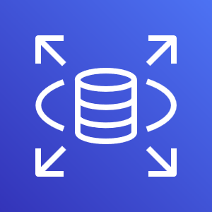

Amazon Relational Database Service (Amazon RDS)

> **Нотатки:**
>
> Welcome to an introduction to the foundational database services that are available on Amazon Web Services (AWS). This module begins with Amazon Relational Database Service (Amazon RDS).  
>
> This section starts by reviewing the differences between a managed and unmanaged service in relation to Amazon RDS.

---

## Слайд 6: Unmanaged versus managed services

Unmanaged:

**Managed:**

*Scaling, fault tolerance, and availability are managed by you.*

Scaling, fault tolerance, and availability are typically built into the service.

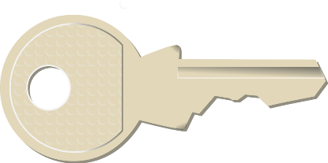

> **Нотатки:**
>
> AWS solutions typically fall into one of two categories: unmanaged or managed.  
>
> Unmanaged services are typically provisioned in discrete portions as specified by the user. You must manage how the service responds to changes in load, errors, and situations where resources become unavailable. Say that you launch a web server on an Amazon Elastic Compute Cloud (Amazon EC2) instance. Because Amazon EC2 is an unmanaged solution, that web server will not scale to handle increased traffic load or replace unhealthy instances with healthy ones unless you specify that it use a scaling solution, such as AWS Automatic Scaling. The benefit to using an unmanaged service is that you have more fine-tuned control over how your solution handles changes in load, errors, and situations where resources become unavailable.  
>
> Managed services require the user to configure them. For example, you create an Amazon Simple Storage Service (Amazon S3) bucket and then set permissions for it. However, managed services typically require less configuration. Say that you have a static website that you host in a cloud-based storage solution, such as Amazon S3. The static website does not have a web server. However, because Amazon S3 is a managed solution, features such as scaling, fault-tolerance, and availability would be handled automatically and internally by Amazon S3.  
>
> Now, you will look at the challenges of running an unmanaged, standalone relational database. Then, you will learn how Amazon RDS addresses these challenges.

---

## Слайд 7: Challenges of relational databases

- Server maintenance and energy footprint
- Software installation and patches
- Database backups and high availability
- Limits on scalability
- Data security
- Operating system (OS) installation and patches

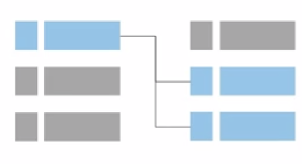

> **Нотатки:**
>
> When you run your own relational database, you are responsible for several administrative tasks, such as server maintenance and energy footprint, software, installation and patching, and database backups. You are also responsible for ensuring high availability, planning for scalability, data security, and operating system (OS) installation and patching. All these tasks take resources from other items on your to-do list, and require expertise in several areas.

---

## Слайд 8: Amazon RDS

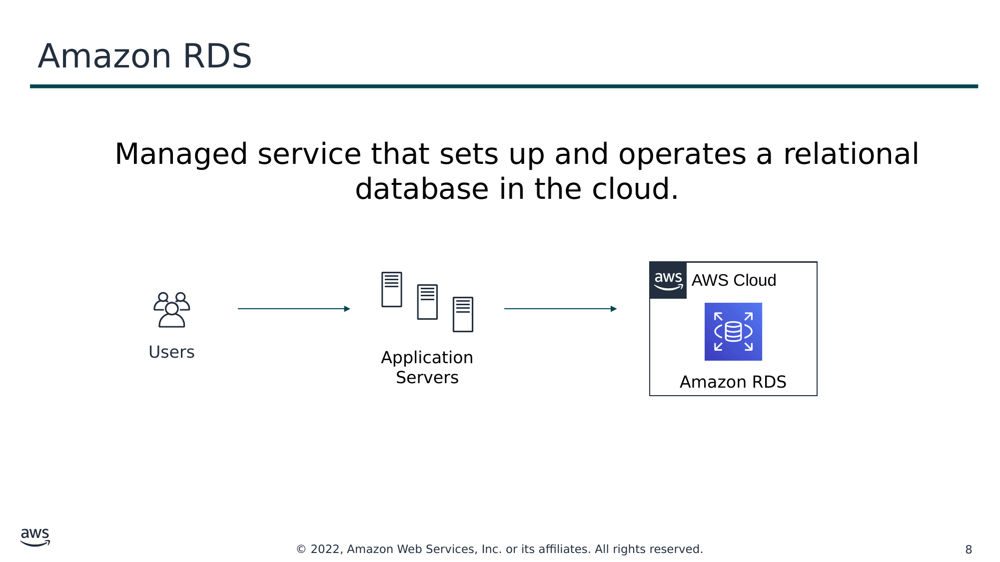

Текст зі схеми

Managed service that sets up and operates a relational database in the cloud.

AWS Cloud

Users

Application

Servers

Amazon RDS

> **Нотатки:**
>
> Amazon RDS is a managed service that sets up and operates a relational database in the cloud.  
>
> To address the challenges of running an unmanaged, standalone relational database, AWS provides a service that sets up, operates, and scales the relational database without any ongoing administration. Amazon RDS provides cost-efficient and resizable capacity, while automating time-consuming administrative tasks.  
>
> Amazon RDS enables you to focus on your application, so you can give applications the performance, high availability, security, and compatibility that they need. With Amazon RDS, your primary focus is your data and optimizing your application.

---

## Слайд 9: From on-premises databases to Amazon RDS

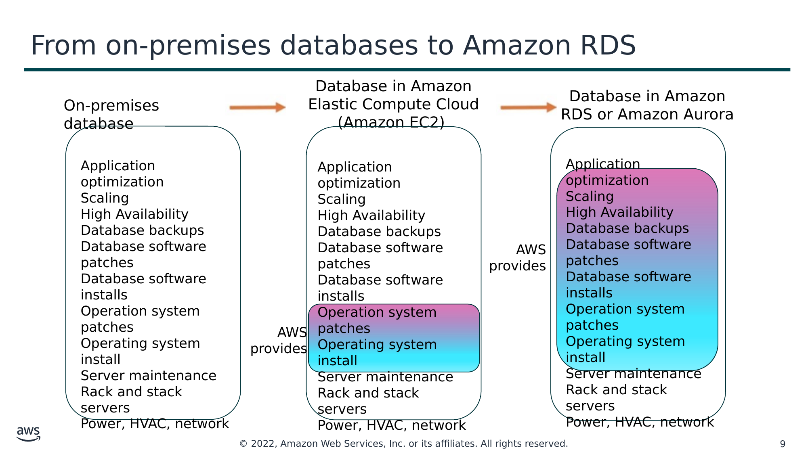

Текст зі схеми

Database in Amazon Elastic Compute Cloud (Amazon EC2)

On-premises database

Database in Amazon RDS or Amazon Aurora

Application optimization

Scaling

High Availability

Database backups

Database software patches

Database software installs

Operation system patches

Operating system install

Server maintenance

Rack and stack servers

Power, HVAC, network

Application optimization

Scaling

High Availability

Database backups

Database software patches

Database software installs

Operation system patches

Operating system install

Server maintenance

Rack and stack servers

Power, HVAC, network

Application optimization

Scaling

High Availability

Database backups

Database software patches

Database software installs

Operation system patches

Operating system install

Server maintenance

Rack and stack servers

Power, HVAC, network

AWS

provides

AWS

provides

> **Нотатки:**
>
> What does the term managed services mean?  
>
> When your database is on premises, the database administrator is responsible for everything. Database administration tasks include optimizing applications and queries; setting up the hardware; patching the hardware; setting up networking and power; and managing heating, ventilation, and air conditioning (HVAC).  
>
> If you move to a database that runs on an Amazon Elastic Compute Cloud (Amazon EC2) instance, you no longer need to manage the underlying hardware or handle data center operations. However, you are still responsible for patching the OS and handling all software and backup operations.  
>
> If you set up your database on Amazon RDS or Amazon Aurora, you reduce your administrative responsibilities. By moving to the cloud, you can automatically scale your database, enable high availability, manage backups, and perform patching. Thus, you can focus on what really matters most—optimizing your application.

---

## Слайд 10: Managed services responsibilities

**You manage:**

- Application optimization

**AWS manages:**

- OS installation and patches
- Database software installation and patches
- Database backups
- High availability
- Scaling
- Power and racking and stacking servers
- Server maintenance

Amazon RDS

> **Нотатки:**
>
> With Amazon RDS, you manage your application optimization. AWS manages installing and patching the operating system, installing and patching the database software, automatic backups, and high availability.  
>
> AWS also scales resources, manages power and servers, and performs maintenance.  
>
> Offloading these operations to the managed Amazon RDS service reduces your operational workload and the costs that are associated with your relational database. You will now go through a brief overview of the service and a few potential use cases.

---

## Слайд 11: Amazon RDS DB instances

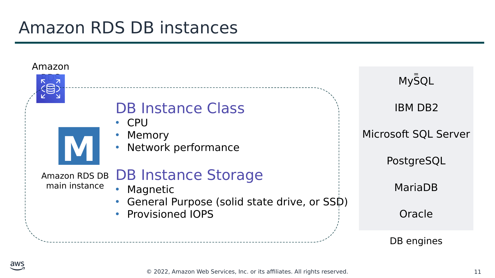

Текст зі схеми

Amazon RDS

=

MySQL

DB Instance Class

- CPU
- Memory
- Network performance

DB Instance Storage

- Magnetic
- General Purpose (solid state drive, or SSD)
- Provisioned IOPS

IBM DB2

**M**

Microsoft SQL Server

PostgreSQL

Amazon RDS DB main instance

MariaDB

Oracle

DB engines

> **Нотатки:**
>
> The basic building block of Amazon RDS is the database instance. A database instance is an isolated database environment that can contain multiple user-created databases. It can be accessed by using the same tools and applications that you use with a standalone database instance. The resources in a database instance are determined by its database instance class, and the type of storage is dictated by the type of disks.  
>
> Database instances and storage differ in performance characteristics and price, which enable you to customize your performance and cost to the needs of your database. When you choose to create a database instance, you must first specify which database engine to run. Amazon RDS currently supports six databases: MySQL, IBM DB2, Microsoft SQL Server, PostgreSQL, MariaDB, and Oracle.

---

## Слайд 12: Amazon RDS in a virtual private cloud (VPC)

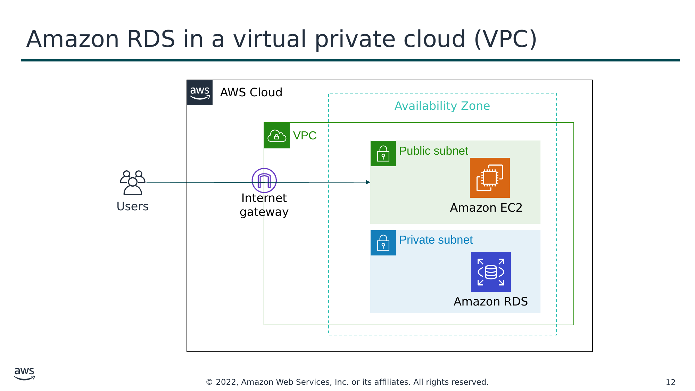

Текст зі схеми

AWS Cloud

Availability Zone

VPC

Public subnet

Users

Internet gateway

Amazon EC2

Private subnet

Amazon RDS

> **Нотатки:**
>
> You can run an instance by using Amazon Virtual Private Cloud (Amazon VPC). When you use a virtual private cloud (VPC), you have control over your virtual networking environment.  
>
> You can select your own IP address range, create subnets, and configure routing and access control lists (ACLs). The basic functionality of Amazon RDS is the same whether or not it runs in a VPC. Usually, the database instance is isolated in a private subnet and is only made directly accessible to indicated application instances. Subnets in a VPC are associated with a single Availability Zone, so when you select the subnet, you are also choosing the Availability Zone (or physical location) for your database instance.

---

## Слайд 13: High availability with Multi-AZ deployment (1 of 2)

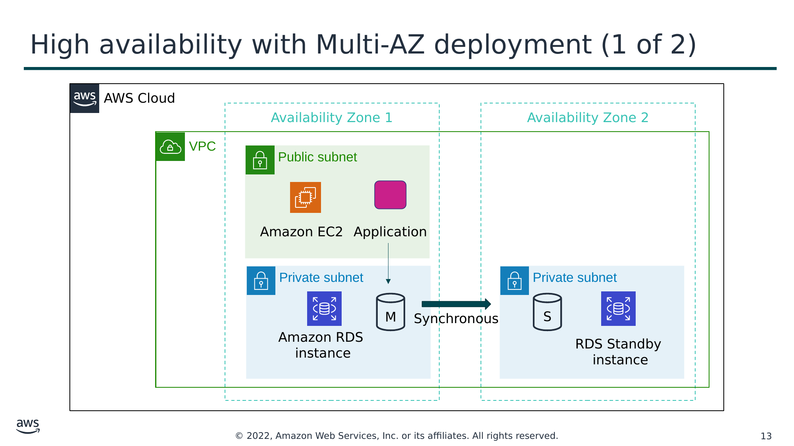

Текст зі схеми

AWS Cloud

Availability Zone 1

Availability Zone 2

VPC

Public subnet

Amazon EC2

Application

Private subnet

Private subnet

M

Synchronous

S

Amazon RDS

instance

RDS Standby

instance

> **Нотатки:**
>
> One of the most powerful features of Amazon RDS is the ability to configure your database instance for high availability with a Multi-AZ deployment. After a Multi-AZ deployment is configured, Amazon RDS automatically generates a standby copy of the database instance in another Availability Zone within the same VPC. After seeding the database copy, transactions are synchronously replicated to the standby copy. Running a database instance in a Multi-AZ deployment can enhance availability during planned system maintenance, and it can help protect your databases against database instance failure and Availability Zone disruption.

---

## Слайд 14: High availability with Multi-AZ deployment (2 of 2)

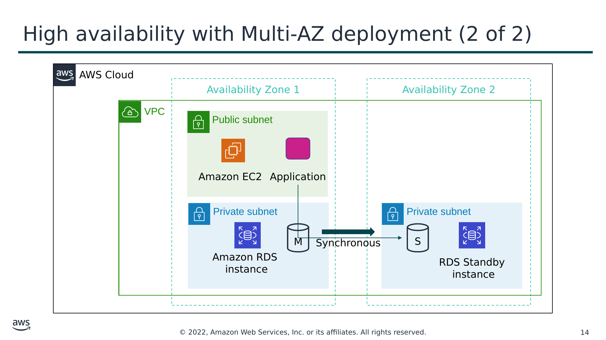

Текст зі схеми

AWS Cloud

Availability Zone 1

Availability Zone 2

VPC

Public subnet

Amazon EC2

Application

Private subnet

Private subnet

M

Synchronous

S

Amazon RDS

instance

RDS Standby

instance

> **Нотатки:**
>
> Therefore, if the main database instance fails in a Multi-AZ deployment, Amazon RDS automatically brings the standby database instance online as the new main instance. The synchronous replication minimizes the potential for data loss. Because your applications reference the database by name by using the Amazon RDS Domain Name System (DNS) endpoint, you don't need to change anything in your application code to use the standby copy for failover.

---

## Слайд 15: Amazon RDS read replicas

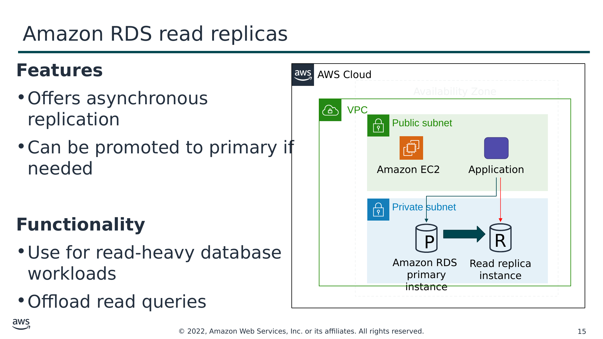

Текст зі схеми

**Features**

- Offers asynchronous replication
- Can be promoted to primary if needed

**Functionality**

- Use for read-heavy database workloads
- Offload read queries

AWS Cloud

Availability Zone

VPC

Public subnet

Amazon EC2

Application

Private subnet

P

R

Amazon RDS

primary instance

Read replica

instance

> **Нотатки:**
>
> Amazon RDS also supports the creation of read replicas for MySQL, MariaDB, PostgreSQL, and Amazon Aurora. Updates that are made to the source database instance are asynchronously copied to the read replica instance. You can reduce the load on your source database instance by routing read queries from your applications to the read replica. Using read replicas, you can also scale out beyond the capacity constraints of a single database instance for read-heavy database workloads. Read replicas can also be promoted to become the primary database instance, but this requires manual action because of asynchronous replication.  
>
> Read replicas can be created in a different Region than the primary database. This feature can help satisfy disaster recovery requirements or reduce latency by directing reads to a read replica that is closer to the user.

---

## Слайд 16: Use cases

| Web and mobile applications | • High throughput • Massive storage scalability • High availability |
|---|---|
| Ecommerce applications | • Low-cost database • Data security • Fully managed solution |
| Mobile and online games | • Rapidly grow capacity • Automatic scaling • Database monitoring |

> **Нотатки:**
>
> Amazon RDS works well for web and mobile applications that need a database with high throughput, massive storage scalability, and high availability. Because Amazon RDS does not have any licensing constraints, it fits the variable usage pattern of these applications. For small and large ecommerce businesses, Amazon RDS provides a flexible, secure, and low-cost database solution for online sales and retailing. Mobile and online games require a database platform with high throughput and availability. Amazon RDS manages the database infrastructure, so game developers do not need to worry about provisioning, scaling, or monitoring database servers.

---

## Слайд 17: When to Use Amazon RDS

**Use Amazon RDS when your application requires:**

- **Do not use Amazon RDS when your application requires:**

- Complex transactions or complex queries
- A medium to high query or write rate – Up to 30,000 IOPS (15,000 reads + 15,000 writes)
- No more than a single worker node or shard
- High durability

- Massive read/write rates (for example, 150,000 write/second)
- Sharding due to high data size or throughput demands
- Simple GET or PUT requests and queries that a NoSQL database can handle
- Relational database management system (RDBMS) customization

> **Нотатки:**
>
> Use Amazon RDS when your application requires:  
> Complex transactions or complex queries  
> A medium to high query or write rate – up to 30,000 IOPS (15,000 reads + 15,000 writes)  
> No more than a single worker node or shard  
> High durability  
>
> Do not use Amazon RDS when your application requires:  
> Massive read/write rates (for example 150,000 writes per second)  
> Sharding due to high data size or throughput demands  
> Simple GET or PUT requests and queries that a NoSQL database can handle  
> Or, relational database management system (RDBMS) customization  
>
> For circumstances when you should not use Amazon RDS, consider either using a NoSQL database solution (such as DynamoDB) or running your relational database engine on Amazon EC2 instances instead of Amazon RDS (which will provide you with more options for customizing your database).

---

## Слайд 18: Amazon RDS: Clock-hour billing and database characteristics

**Clock-hour billing –**

- Resources incur charges when running

**Database characteristics –**

- Physical capacity of database:
  - Engine
  - Size
  - Memory class

> **Нотатки:**
>
> When you begin to estimate the cost of Amazon RDS, you must consider the clock hours of service time, which are resources that incur charges when they are running (for example, from the time you launch a database instance until you terminate the instance).  
>
> Database characteristics should also be considered. The physical capacity of the database you choose will affect how much you are charged. Database characteristics vary depending on the database engine, size, and memory class.

---

## Слайд 19: Amazon RDS: DB purchase type and multiple DB instances

**DB purchase type –**

- On-Demand Instances
  - Compute capacity by the hour
- Reserved Instances
  - Low, one-time, upfront payment for database instances that are reserved with a 1-year or 3-year term

**Number of DB instances –**

- Provision multiple DB instances to handle peak loads

> **Нотатки:**
>
> Consider the database purchase type. When you use On-Demand Instances, you pay for compute capacity for each hour that your database instance runs, with no required minimum commitments. With Reserved Instances, you can make a low, one-time, upfront payment for each database instance you want to reserve for a 1-year or 3-year term.  
>
> Also, you must consider the number of database instances. With Amazon RDS, you can provision multiple database instances to handle peak loads.

---

## Слайд 20: Amazon RDS: Storage

**Provisioned storage –**

- No charge
  - Backup storage of up to 100 percent of database storage for an active database
- Charge (*GB/month*)
  - Backup storage for terminated DB instances

**Additional storage –**

- Charge (*GB/month*)
  - Backup storage in addition to provisioned storage

> **Нотатки:**
>
> Consider provisioned storage. There is no additional charge for backup storage of up to 100 percent of your provisioned database storage for an active database instance. After the database instance is terminated, backup storage is billed per GB, per month.  
>
> Also consider the amount of backup storage in addition to the provisioned storage amount, which is billed per GB, per month.

---

## Слайд 21: Amazon RDS: Deployment type and data transfer

**Requests –**

- The number of input and output requests that are made to the database

**Deployment type—Storage and I/0 charges vary, depending on whether you deploy to –**

- Single Availability Zone
- Multiple Availability Zones

**Data transfer –**

- No charge for inbound data transfer
- Tiered charges for outbound data transfer

> **Нотатки:**
>
> Also consider the number of input and output requests that are made to the database.  
>
> Consider the deployment type. You can deploy your DB instance to a single Availability Zone (which is analogous to a standalone data center) or to multiple Availability Zones (which is analogous to a secondary data center for enhanced availability and durability). Storage and I/O charges vary, depending on the number of Availability Zones that you deploy to.  
>
> Finally, consider data transfer. Inbound data transfer is free, and outbound data transfer costs are tiered.  
>
> Depending on the needs of your application, it’s possible to optimize your costs for Amazon RDS database instances by purchasing Reserved Instances. To purchase Reserved Instances, you make a low, one-time payment for each instance that you want to reserve. As a result, you receive a significant discount on the hourly usage charge for that instance.

---

## Слайд 22: Recorded demo: Amazon RDS console

> **Нотатки:**
>
> Now, take a moment to watch the Amazon RDS console demonstration. The demonstration shows how to perform the following tasks using the AWS Management Console:  
> Configure an Amazon RDS installation running the MySQL database engine.  
> Connect to the database using a MySQL client.  
>
> You can find this video within the module 8 section of the course with the title: Console Demonstration - RDS . If you are unable to locate this video demonstration please reach out to your educator for assistance.

---

## Слайд 23: Build Your DB Server and Interact with Your DB Using an App

> **Нотатки:**
>
> You will now complete Lab 5: Build Your DB Server and Interact with Your DB Using an App.

---

## Слайд 24: Lab 5: Scenario

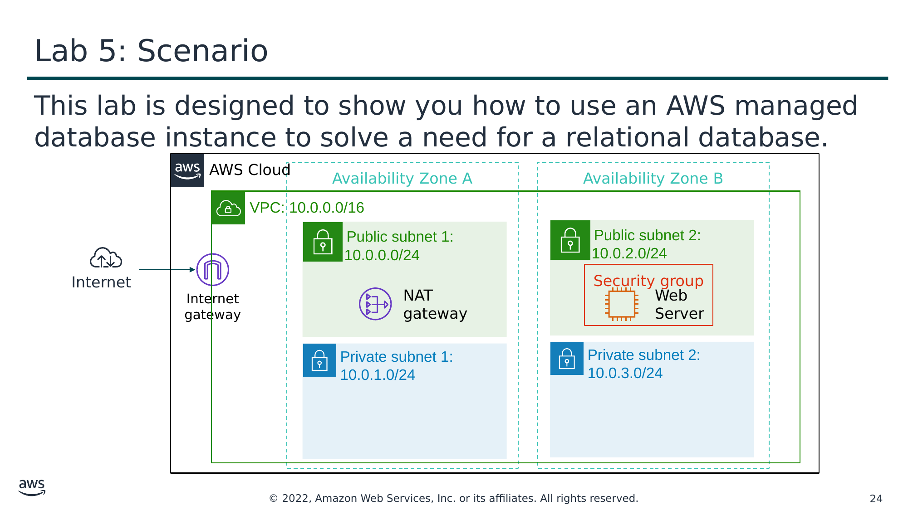

Текст зі схеми

This lab is designed to show you how to use an AWS managed database instance to solve a need for a relational database.

AWS Cloud

Availability Zone A

Availability Zone B

VPC: 10.0.0.0/16

Public subnet 1:  
    10.0.0.0/24

Public subnet 2:  
    10.0.2.0/24

Internet

Security group

Internet gateway

NAT

gateway

Web

Server

Private subnet 1:

10.0.1.0/24

Private subnet 2:

10.0.3.0/24

> **Нотатки:**
>
> This lab is designed to show you how to use an AWS managed database instance to solve a need for a relational database. With Amazon RDS, you can set up, operate, and scale a relational database in the cloud. It provides cost-efficient and resizable capacity while managing time-consuming database administration tasks, which enables you to focus on your applications and your business. Amazon RDS provides six familiar database engines to choose from: Amazon Aurora, Oracle, Microsoft SQL Server, PostgreSQL, MySQL, and MariaDB.  
>
> Amazon RDS Multi-AZ deployments provide enhanced availability and durability for DB instances, which make them a good fit for production database workloads. When you provision a Multi-AZ DB instance, Amazon RDS automatically creates a primary DB instance and synchronously replicates the data to a standby instance in a different Availability Zone.  
>
> After completing this lab, you should be able to:  
> Launch an Amazon RDS DB instance with high availability.  
> Configure the DB instance to permit connections from your web server.  
> Open a web application and interact with your database.

---

## Слайд 25: Lab 5: Tasks

Security group

Create a **VPC security group.**

Create a **DB subnet group.**

Create an **Amazon RDS DB** instance and interact with your database.

Private subnet

Amazon RDS

> **Нотатки:**
>
> Your goal in completing this lab is to:  
> Create a VPC security group.  
> Create a DB subnet group.  
> Create an Amazon RDS DB instance and interact with your database.

---

## Слайд 26: Lab 5: Final product

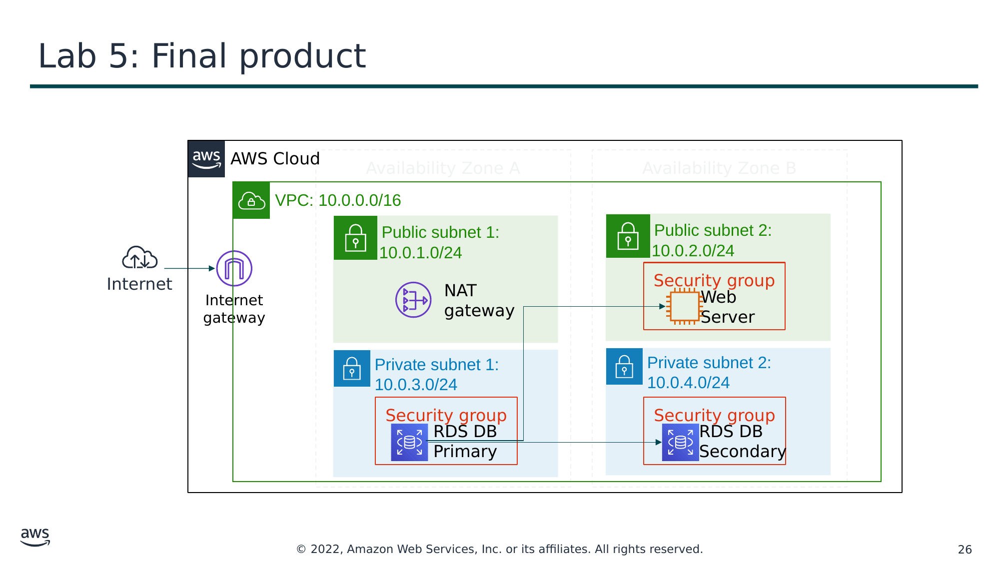

Текст зі схеми

AWS Cloud

Availability Zone A

Availability Zone B

VPC: 10.0.0.0/16

Public subnet 1:  
    10.0.1.0/24

Public subnet 2:  
    10.0.2.0/24

Internet

Security group

Internet gateway

NAT

gateway

Web

Server

Private subnet 1:

10.0.3.0/24

Private subnet 2:

10.0.4.0/24

Security group

Security group

RDS DB

Primary

RDS DB  
Secondary

> **Нотатки:**
>
> In this lab, you:  
> Launched an Amazon RDS DB instance with high availability.  
> Configured the DB instance to permit connections from your web server.  
> Opened a web application and interacted with your database

---

## Слайд 27: Begin Lab 5: Build your DB server and interact with your DB using an application

~  30 minutes

> **Нотатки:**
>
> It is now time to start the lab.

---

## Слайд 28: Lab debrief: key takeaways

> **Нотатки:**
>
> In this lab you:  
> Created a VPC security group.  
> Created a DB subnet group.  
> Created an Amazon RDS DB instance  
> Interacted with your database

---

## Слайд 29: Section 1 key takeaways

- With Amazon RDS, you can set up, operate, and scale relational databases in the cloud.
- Features –
  - Managed service
  - Accessible via the console, AWS Command Line Interface (AWS CLI), or application programming interface (API) calls
  - Scalable (compute and storage)
  - Automated redundancy and backup are available
  - Supported database engines:
    - Amazon Aurora, PostgreSQL, MySQL, MariaDB, Oracle, Microsoft SQL Server

> **Нотатки:**
>
> Amazon RDS is a web service that makes it easy to set up, operate, and scale a relational database in the cloud. It provides cost-efficient and resizable capacity while managing time-consuming database administration tasks so you can focus on your applications and your business. Features include that it is a managed service, and that it can be accessed via the console, AWS Command Line Interface (AWS CLI), or application programming interface (API) calls. Amazon RDS is scalable for compute and storage, and automated redundancy and backup is available. Supported database engines include Amazon Aurora, PostgreSQL, MySQL, MariaDB, Oracle, and Microsoft SQL Server.  
>
> Amazon RDS supports demanding database applications. You can choose between two solid state drive (SSD)-backed storage options: one option is optimized for high-performance Online Transactional Processing (OLTP) applications, and the other option works well for cost-effective, general-purpose use.  
>
> With Amazon RDS, you can scale your database’s compute and storage resources with no downtime. Amazon RDS runs on the same highly reliable infrastructure that is used by other AWS services. It also enables you to run your database instances and Amazon VPC, which is designed to provide you with control and security.

---

## Слайд 30: Section 2: Amazon DynamoDB

Module 8: Databases

> **Нотатки:**
>
> Welcome to Section 2: Amazon DynamoDB.

---

## Слайд 31: Relational versus non-relational databases

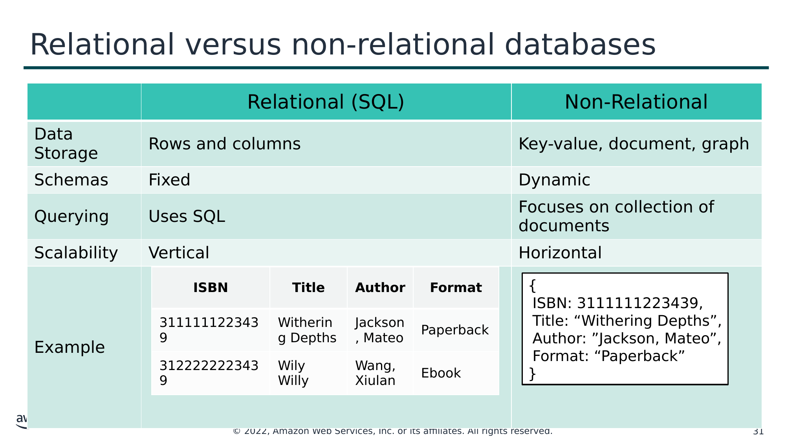

Текст зі схеми

|  | Relational (SQL) | Non-Relational |
|---|---|---|
| Data Storage | Rows and columns | Key-value, document, graph |
| Schemas | Fixed | Dynamic |
| Querying | Uses SQL | Focuses on collection of documents |
| Scalability | Vertical | Horizontal |
| Example |  |  |

| ISBN | Title | Author | Format |
|---|---|---|---|
| 3111111223439 | Withering Depths | Jackson, Mateo | Paperback |
| 3122222223439 | Wily Willy | Wang, Xiulan | Ebook |

{

ISBN: 3111111223439,

Title: “Withering Depths”,

Author: ”Jackson, Mateo”,

Format: “Paperback”

}

> **Нотатки:**
>
> With DynamoDB, this module transitions from relational databases to non-relational databases. Here is a review of the differences between these two types of databases:  
>
> A relational database (RDB) works with structured data that is organized by tables, records, and columns. RDBs establish a well-defined relationship between database tables. RDBs use structured query language (SQL), which is a standard user application that provides a programming interface for database interaction. Relational databases might have difficulties scaling out horizontally or working with semistructured data, and might also require many joins for normalized data.  
>
> A non-relational database is any database that does not follow the relational model that is provided by traditional relational database management systems (RDBMS). Non-relational databases have grown in popularity because they were designed to overcome the limitations of relational databases for handling the demands of variable structured data. Non-relational databases scale out horizontally, and they can work with unstructured and semistructured data.  
>
> Here is a look at what DynamoDB offers.

---

## Слайд 32: What is Amazon DynamoDB?

Fast and flexible NoSQL database service for any scale

- NoSQL database tables
- Virtually unlimited storage
- Items can have differing attributes
- Low-latency queries
- Scalable read/write throughput

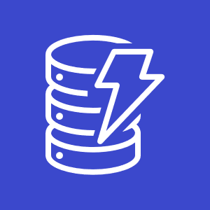

**Amazon DynamoDB**

> **Нотатки:**
>
> DynamoDB is a fast and flexible NoSQL database service for all applications that need consistent, single-digit-millisecond latency at any scale.  
>
> Amazon manages all the underlying data infrastructure for this service and redundantly stores data across multiple facilities in a native US Region as part of the fault-tolerant architecture. With DynamoDB, you can create tables and items. You can add items to a table. The system automatically partitions your data and has table storage to meet workload requirements. There is no practical limit on the number of items that you can store in a table. For instance, some customers have production tables that contain billions of items.  
>
> One of the benefits of a NoSQL database is that items in the same table can have different attributes. This gives you the flexibility to add attributes as your application evolves. You can store newer format items side by side with older format items in the same table without needing to perform schema migrations.  
>
> As your application becomes more popular and as users continue to interact with it, your storage can grow with your application's needs. All the data in DynamoDB is stored on solid state drives (SSDs) and its simple query language enables consistent low-latency query performance. In addition to scaling storage, DynamoDB also enables you to provision the amount of read or write throughput that you need for your table. As the number of application users grows, DynamoDB tables can be scaled to handle the increased numbers of read/write requests with manual provisioning. Alternatively, you can enable automatic scaling so that DynamoDB monitors the load on the table and automatically increases or decreases the provisioned throughput.  
>
> Some additional key features include global tables that enable you to automatically replicate across your choice of AWS Regions, encryption at rest, and item Time-to-Live (TTL).

---

## Слайд 33: Amazon DynamoDB core components

- Tables, items, and attributes are the core DynamoDB components
- DynamoDB supports two different kinds of primary keys: Partition key and partition and sort key

> **Нотатки:**
>
> The core DynamoDB components are tables, items, and attributes.  
> A table is a collection of data.  
> Items are a group of attributes that is uniquely identifiable among all the other items.  
> Attributes are a fundamental data element, something that does not need to be broken down any further.  
>
> DynamoDB supports two different kinds of primary keys.  
> The partition key is a simple primary key, which is composed of one attribute called the sort key.  
> The partition key and sort key are also known as the composite primary key, which is composed of two attributes.  
>
> To learn more about how DynamoDB works, see table item attributes at https://docs.aws.amazon.com/amazondynamodb/latest/developerguide/HowItWorks.CoreComponents.html#HowItWorks.CoreComponents.TablesItemsAttributes.

---

## Слайд 34: Partitioning

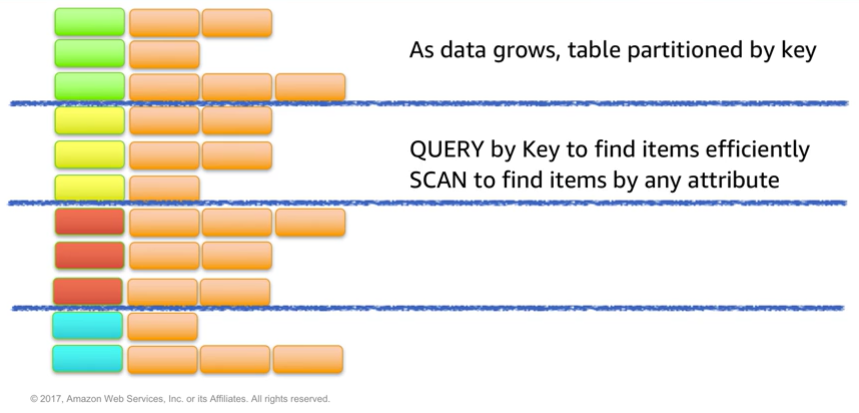

> **Нотатки:**
>
> As data grows, table data is partitioned and indexed by the primary key.  
>
> You can retrieve data from a DynamoDB table in two different ways:  
> In the first method, the query operation takes advantage of partitioning to effectively locate items by using the primary key.  
> The second method is via a scan, which enables you to locate items in the table by matching conditions on non-key attributes. The second method gives you the flexibility to locate items by other attributes. However, the operation is less efficient because DynamoDB will scan through all the items in the table to find the ones that match your criteria.  
>
> For accessibility: Partitioning allows large tables to be scanned and queried quickly. As data grows, table is partitioned by key. QUERY by Key to find items by any attribute. End of accessibility description.

---

## Слайд 35: Items in a table must have a key

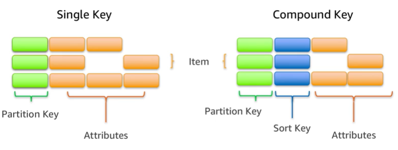

> **Нотатки:**
>
> To take full advantage of query operations and DynamoDB, it's important to think about the key that you use to uniquely identify items in the DynamoDB table. You can set up a simple primary key that is based on a single attribute of the data values with a uniform distribution, such as the Globally Unique Identifier (GUID) or other random identifiers.  
>
> For example, if you wanted to model a table with products, you could use some attributes like the product ID. Alternatively, you can specify a compound key, which is composed of a partition key and a secondary key. In this example, if you had a table with books, you might use the combination of author and title to uniquely identify table items. This method could be useful if you expect to frequently look at books by author because you could then use query.  
>
> For accessibility: The two different types of keys. A single key means the data is identified by an item in the data that uniquely identifies each record. A compound key is made up of a partition key and a second key that can be used for sorting data. End of accessibility description.

---

## Слайд 36: Section 2 key takeaways

Amazon DynamoDB:

- Runs exclusively on SSDs.
- Supports document and key-value store models.
- Replicates your tables automatically across your choice of AWS Regions.
- Works well for mobile, web, gaming, adtech, and Internet of Things (IoT) applications.
- Is accessible via the console, the AWS CLI, and API calls.
- Provides consistent, single-digit millisecond latency at any scale.
- Has no limits on table size or throughput.

> **Нотатки:**
>
> DynamoDB runs exclusively on SSDs, and it supports document and key-value store models.  
>
> DynamoDB works well for mobile, web, gaming, ad tech, and Internet of Things (IoT) applications.  
> It’s accessible via the console, the AWS CLI, and API calls.  
>
> The ability to scale your tables in terms of both storage and provision throughput makes DynamoDB a good fit for structured data from the web, mobile, and IoT applications. For instance, you might have a large number of clients that continuously generate data and make large numbers of requests per second. In this case, the throughput scaling of DynamoDB enables consistent performance for your clients. DynamoDB is also used in latency-sensitive applications. The predictable query performance—even in large tables—makes it useful for cases where variable latency could cause significant impact to the user experience or to business goals, such as adtech or gaming.  
>
> The DynamoDB Global Tables feature reduces the work of replicating data between Regions and resolving update conflicts. It replicates your DynamoDB tables automatically across your choice of AWS Regions. Global Tables can help applications stay available and performant for business continuity.

---

## Слайд 37: Recorded demo: Amazon DynamoDB console

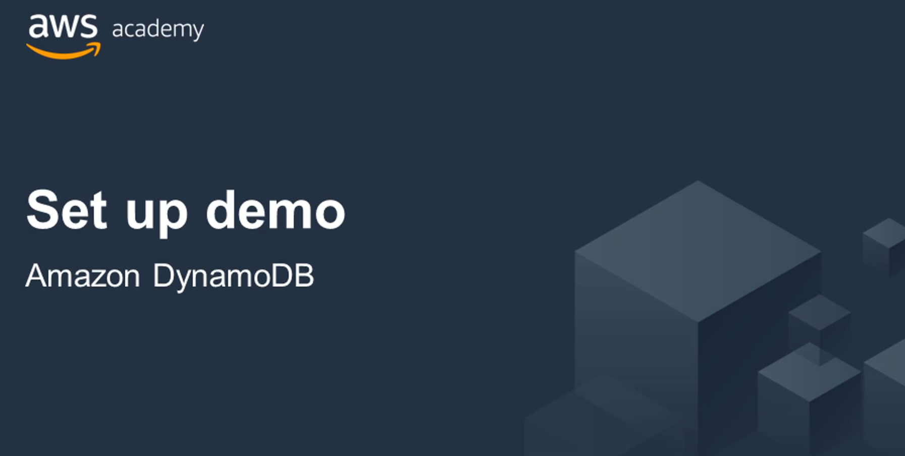

> **Нотатки:**
>
> Now, take a moment to watch the Amazon DynamoDB demonstration. The recording runs a little over 2 minutes, and it reinforces many of the concepts that were discussed in this section of the module.  
>
> The demonstration shows how to create a table running in Amazon DynamoDB by using the AWS Management Console. It also demonstrates how to interact with the table using the AWS Command Line Interface. The demonstration shows how you can query the table, and add data to the table.  
>
> You can find this video within the module 8 section of the course with the title: Console Demonstration - DynamoDB . If you are unable to locate this video demonstration please reach out to your educator for assistance.

---

## Слайд 38: Amazon DynamoDB demonstration

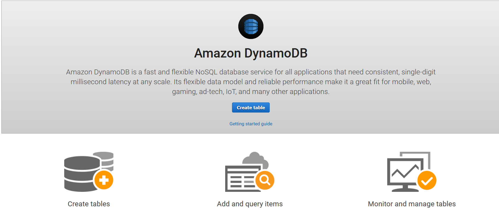

> **Нотатки:**
>
> Review the demonstration: Amazon DynamoDB console demo.  
>
> You can access this recorded demonstration in the learning management system.

---

## Слайд 39: Section 3: Amazon Redshift

Module 8: Databases

> **Нотатки:**
>
> Welcome to Section 3: Amazon Redshift.

---

## Слайд 40: Amazon Redshift

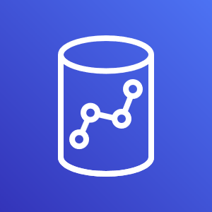

Amazon Redshift

> **Нотатки:**
>
> Amazon Redshift is a fast, fully managed data warehouse that makes it simple and cost-effective to analyze all your data by using standard SQL and your existing business intelligence (BI) tools. Here is a look at Amazon Redshift and how you can use it for analytic applications.

---

## Слайд 41: Introduction to Amazon Redshift

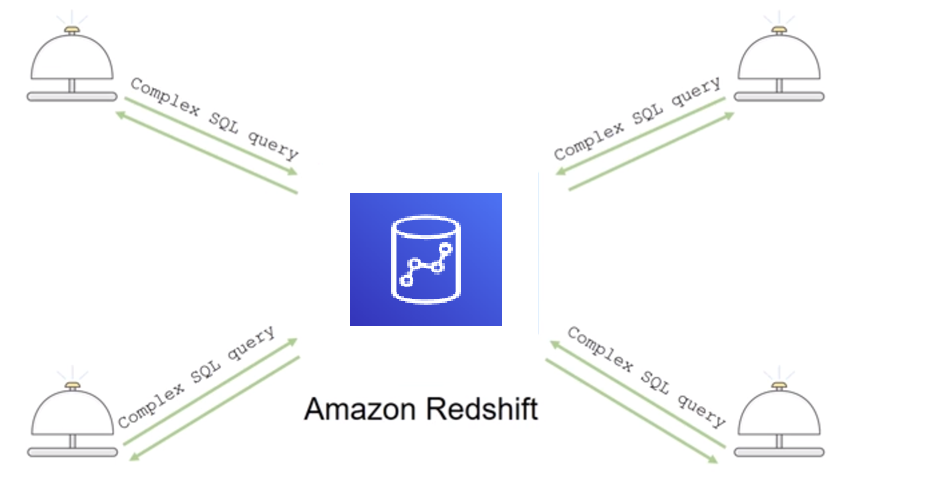

> **Нотатки:**
>
> Analytics is important for businesses today, but building a data warehouse is complex and expensive. Data warehouses can take months and significant financial resources to set up.  
>
> Amazon Redshift is a fast and powerful, fully managed data warehouse that is simple and cost-effective to set up, use, and scale. It enables you to run complex analytic queries against petabytes of structured data by using sophisticated query optimization, columnar storage on high-performance local disks, and massively parallel data processing. Most results come back in seconds.  
>
> You will next review a slightly more detailed exploration of key Amazon Redshift features and some common use cases.

---

## Слайд 42: Parallel processing architecture

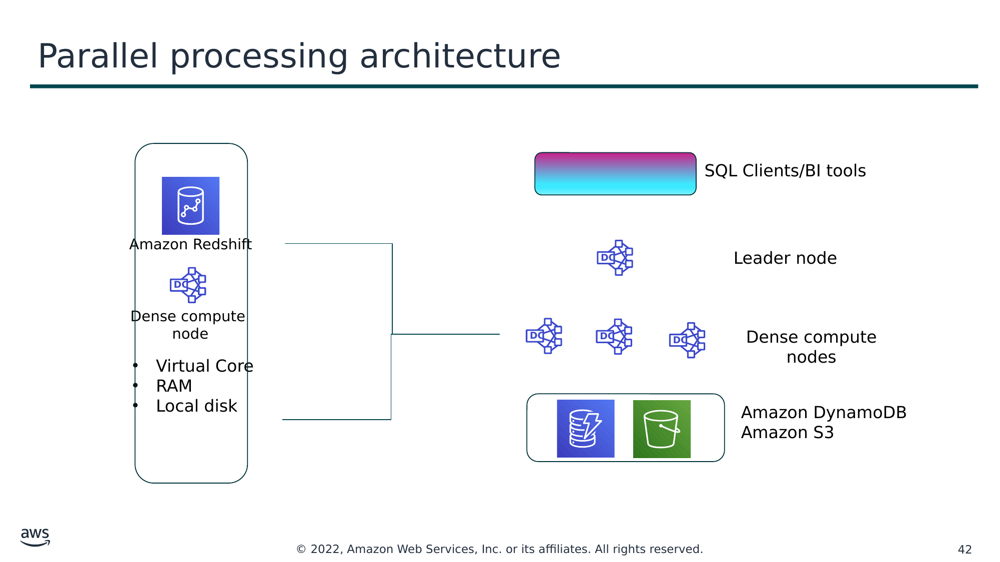

Текст зі схеми

SQL Clients/BI tools

Amazon Redshift

Leader node

Dense compute

node

Dense compute nodes

- Virtual Core
- RAM
- Local disk

Amazon DynamoDB

Amazon S3

> **Нотатки:**
>
> The leader node manages communications with client programs and all communication with compute nodes. It parses and develops plans to carry out database operations—specifically, the series of steps that are needed to obtain results for complex queries. The leader node compiles code for individual elements of the plan and assigns the code to individual compute nodes. The compute nodes run the compiled code and send intermediate results back to the leader node for final aggregation.  
>
> Like other AWS services, you only pay for what you use. You can get started for as little as 25 cents per hour and, at scale, Amazon Redshift can deliver storage and processing for approximately $1,000 dollars per terabyte per year (with 3-Year Partial Upfront Reserved Instance pricing).  
>
> The Amazon Redshift Spectrum feature enables you to run queries against exabytes of data directly in Amazon S3.

---

## Слайд 43: Automation and scaling

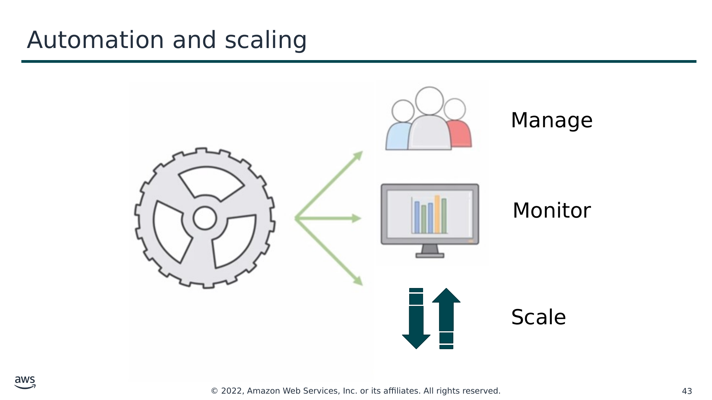

Текст зі схеми

Manage

Monitor

Scale

> **Нотатки:**
>
> It is straightforward to automate most of the common administrative tasks to manage, monitor, and scale your Amazon Redshift cluster—which enables you to focus on your data and your business.  
>
> Scalability is intrinsic in Amazon Redshift. Your cluster can be scaled up and down as your needs change with a few clicks in the console.  
>
> Security is the highest priority for AWS. With Amazon Redshift, security is built in, and it is designed to provide strong encryption of your data both at rest and in transit.

---

## Слайд 44: Compatibility

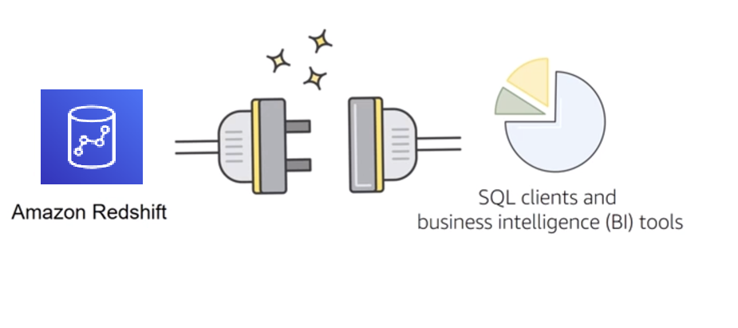

> **Нотатки:**
>
> Finally, Amazon Redshift is compatible with the tools that you already know and use. Amazon Redshift supports standard SQL. It also provides high-performance Java Database Connectivity (JDBC) and Open Database Connectivity (ODBC) connectors, which enable you to use the SQL clients and BI tools of your choice.  
>
> Next, you will review some common Amazon Redshift use cases.

---

## Слайд 45: Amazon Redshift use cases (1 of 2)

- Enterprise data warehouse (EDW)
  - Migrate at a pace that customers are comfortable with
  - Experiment without large upfront cost or commitment
  - Respond faster to business needs
- Big data
  - Low price point for small customers
  - Managed service for ease of deployment and maintenance
  - Focus more on data and less on database management

> **Нотатки:**
>
> This slide discusses some Amazon Redshift use cases.  
>
> Many customers migrate their traditional enterprise data warehouses to Amazon Redshift with the primary goal of agility. Customers can start at whatever scale they want and experiment with their data without needing to rely on complicated processes with their IT departments to procure and prepare their software.  
>
> Big data customers have one thing in common: massive amounts of data that stretch their existing systems to a breaking point. Smaller customers might not have the resources to procure the hardware and expertise that is needed to run these systems. With Amazon Redshift, smaller customers can quickly set up and use a data warehouse at a comparatively low price point.  
>
> As a managed service, Amazon Redshift handles many of the deployment and ongoing maintenance tasks that often require a database administrator. This enables customers to focus on querying and analyzing their data.

---

## Слайд 46: Amazon Redshift use cases (2 of 2)

- Software as a service (SaaS)
  - Scale the data warehouse capacity as demand grows
  - Add analytic functionality to applications
  - Reduce hardware and software costs

> **Нотатки:**
>
> Software as a service (SaaS) customers can take advantage of the scalable, easy-to-manage features that Amazon Redshift provides. Some customers use the Amazon Redshift to provide analytic capabilities to their applications. Some users deploy a cluster per customer, and use tagging to simplify and manage their service level agreements (SLAs) and billing. Amazon Redshift can help you reduce hardware and software costs.

---

## Слайд 47: Section 3 key takeaways

Amazon Redshift features:

- Fast, fully managed data warehouse service
- Easily scale with no downtime
- Columnar storage and parallel processing architectures
- Automatically and continuously monitors cluster
- Encryption is built in

> **Нотатки:**
>
> In summary, Amazon Redshift is a fast, fully managed data warehouse service. As a business grows, you can easily scale with no downtime by adding more nodes. Amazon Redshift automatically adds the nodes to your cluster and redistributes the data for maximum performance.  
>
> Amazon Redshift is designed to consistently deliver high performance. Amazon Redshift uses columnar storage and a massively parallel processing architecture. These features parallelize and distribute data and queries across multiple nodes. Amazon Redshift also automatically monitors your cluster and backs up your data so that you can easily restore if needed. Encryption is built in—you only need to enable it.  
>
> To learn more about Amazon Redshift, see https://aws.amazon.com/redshift/.

---

## Слайд 48: Section 4: Amazon Aurora

Module 8: Databases

> **Нотатки:**
>
> Introducing Section 4: Amazon Aurora.

---

## Слайд 49: Amazon Aurora

- Enterprise-class relational database
- Compatible with MySQL or PostgreSQL
- Automate time-consuming tasks (such as provisioning, patching, backup, recovery, failure detection, and repair).

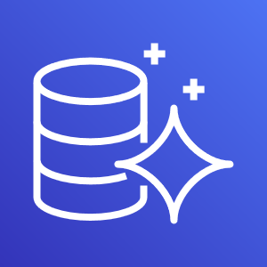

Amazon Aurora

> **Нотатки:**
>
> Amazon Aurora is a MySQL- and PostgreSQL-compatible relational database that is built for the cloud. It combines the performance and availability of high-end commercial databases with the simplicity and cost-effectiveness of open-source databases. Using Amazon Aurora can reduce your database costs while improving the reliability and availability of the database. As a fully managed service, Aurora is designed to automate time-consuming tasks like provisioning, patching, backup, recovery, failure detection, and repair.

---

## Слайд 50: Amazon Aurora service benefits

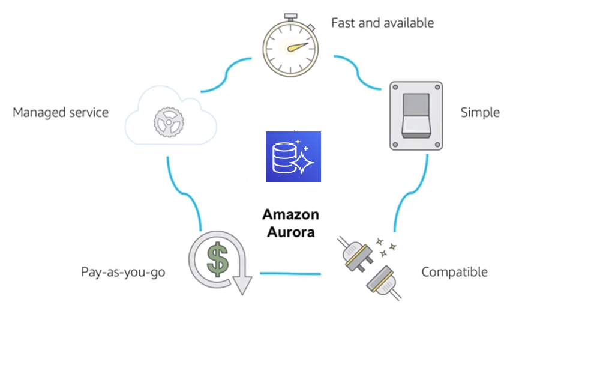

> **Нотатки:**
>
> This slide covers some of the benefits of Amazon Aurora. It is highly available and it offers a fast, distributed storage subsystem. Amazon Aurora is straightforward to set up and uses SQL queries. It is designed to have drop-in compatibility with MySQL and PostgreSQL database engines so that you can use most of your existing database tools with little or no change.  
>
> Amazon Aurora is a pay-as-you-go service, which means that you only pay for the services and features that you use. It’s a managed service that integrates with features such as AWS Database Migration Service (AWS DMS) and the AWS Schema Conversion Tool. These features are designed to help you move your dataset into Amazon Aurora.

---

## Слайд 51: High availability

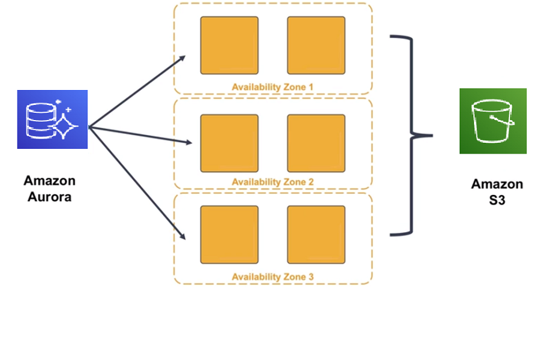

> **Нотатки:**
>
> Why might you use Amazon Aurora over other options, like SQL with Amazon RDS? Most of that decision involves the high availability and resilient design that Amazon Aurora offers.  
>
> Amazon Aurora is designed to be highly available: it stores multiple copies of your data across multiple Availability Zones with continuous backups to Amazon S3. Amazon Aurora can use up to 15 read replicas can be used to reduce the possibility of losing your data. Additionally, Amazon Aurora is designed for instant crash recovery if your primary database becomes unhealthy.

---

## Слайд 52: Resilient design

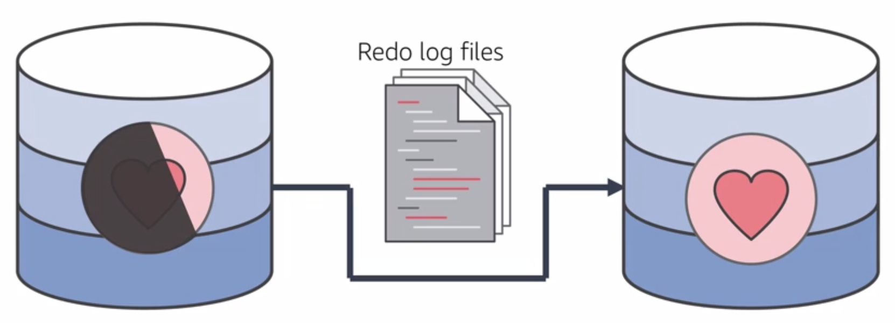

> **Нотатки:**
>
> After a database crash, Amazon Aurora does not need to replay the redo log from the last database checkpoint. Instead, it performs this on every read operation. This reduces the restart time after a database crash to less than 60 seconds in most cases.  
>
> With Amazon Aurora, the buffer cache is moved out of the database process, which makes it available immediately at restart. This reduces the need for you to throttle access until the cache is repopulated to avoid brownouts.

---

## Слайд 53: Section 4 key takeaways

Amazon Aurora features:

- High performance and scalability
- High availability and durability
- Multiple levels of security
- Compatible with MySQL and PostgreSQL
- Fully managed

> **Нотатки:**
>
> In summary, Amazon Aurora is a highly available, performant, and cost-effective managed relational database.  
>
> Aurora offers a distributed, high-performance storage subsystem. Using Amazon Aurora can reduce your database costs while improving the reliability of the database.  
>
> Aurora is also designed to be highly available. It has fault-tolerant and self-healing storage built for the cloud. Aurora replicates multiple copies of your data across multiple Availability Zones, and it continuously backs up your data to Amazon S3.  
>
> Multiple levels of security are available, including network isolation by using Amazon VPC; encryption at rest by using keys that you create and control through AWS Key Management Service (AWS KMS); and encryption of data in transit by using Secure Sockets Layer (SSL).  
>
> The Amazon Aurora database engine is compatible with existing MySQL and PostgreSQL open source databases, and adds compatibility for new releases regularly.  
>
> Finally, Amazon Aurora is fully managed by Amazon RDS. Aurora automates database management tasks, such as hardware provisioning, software patching, setup, configuration, or backups.  
>
> To learn more about Amazon Aurora, see https://aws.amazon.com/rds/aurora/.

---

## Слайд 54: The right tool for the right job

| What are my requirements? |  |
|---|---|
| Enterprise-class relational database | Amazon RDS |
| Fast and flexible NoSQL database service for any scale | Amazon DynamoDB |
| Operating system access or application features that are not supported by AWS database services | Databases on Amazon EC2 |
| Specific case-driven requirements (machine learning, data warehouse, graphs) | AWS purpose-built database services |

> **Нотатки:**
>
> As you saw in this module, the cloud continues to drive down the cost of storage and compute. A new generation of applications has emerged, which created a new set of requirements for databases. These applications need databases to store terabytes to petabytes of new types of data, provide access to the data with millisecond latency, process millions of requests per second, and scale to support millions of users anywhere in the world. To support these requirements, you need both relational and non-relational databases that are purpose-built to handle the specific needs of your applications. AWS offers a broad range of databases that are built for your specific application use cases.

---

## Слайд 55: Database case study activity (1 of 3)

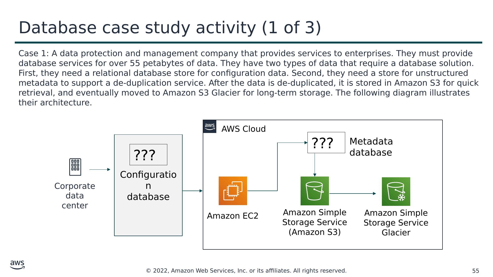

Текст зі схеми

Case 1: A data protection and management company that provides services to enterprises. They must provide database services for over 55 petabytes of data. They have two types of data that require a database solution. First, they need a relational database store for configuration data. Second, they need a store for unstructured metadata to support a de-duplication service. After the data is de-duplicated, it is stored in Amazon S3 for quick retrieval, and eventually moved to Amazon S3 Glacier for long-term storage. The following diagram illustrates their architecture.

AWS Cloud

Configuration

database

???

Metadata database

???

Corporate data center

Amazon EC2

Amazon Simple Storage Service (Amazon S3)

Amazon Simple Storage Service Glacier

> **Нотатки:**
>
> In this activity, you will review one of three business scenarios that were taken from actual AWS customers. Break into groups of four or five.  
>
> Review the assigned case study. Create a presentation that describes the best database solution for the organization that is described in your group’s case. Your presentation should include the key factors that you considered when you selected the database technology, in addition to any factors that could change your recommendation.

---

## Слайд 56: Database case study activity (2 of 3)

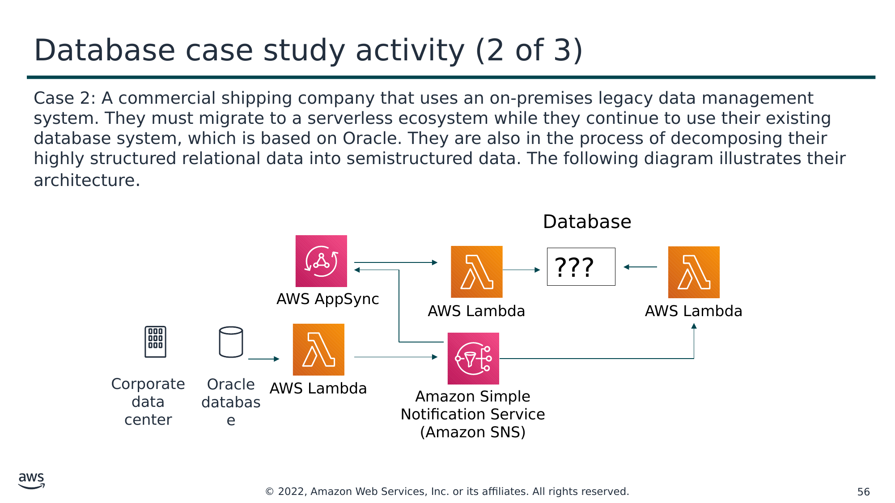

Текст зі схеми

Case 2: A commercial shipping company that uses an on-premises legacy data management system. They must migrate to a serverless ecosystem while they continue to use their existing database system, which is based on Oracle. They are also in the process of decomposing their highly structured relational data into semistructured data. The following diagram illustrates their architecture.

Database

???

AWS AppSync

AWS Lambda

AWS Lambda

Corporate data center

Oracle database

AWS Lambda

Amazon Simple Notification Service (Amazon SNS)

> **Нотатки:**
>
> Review the assigned case study. Create a presentation that describes the best database solution for the organization that is described in your group’s case. Your presentation should include the key factors that you considered when you selected the database technology, in addition to any factors that could change your recommendation.

---

## Слайд 57: Database case study activity 3

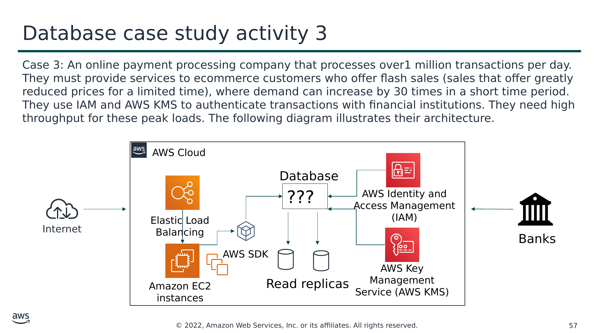

Текст зі схеми

Case 3: An online payment processing company that processes over1 million transactions per day. They must provide services to ecommerce customers who offer flash sales (sales that offer greatly reduced prices for a limited time), where demand can increase by 30 times in a short time period. They use IAM and AWS KMS to authenticate transactions with financial institutions. They need high throughput for these peak loads. The following diagram illustrates their architecture.

AWS Cloud

Database

???

AWS Identity and Access Management (IAM)

Internet

Elastic Load Balancing

Banks

AWS SDK

AWS Key Management Service (AWS KMS)

Amazon EC2 instances

Read replicas

> **Нотатки:**
>
> Review the assigned case study. Create a presentation that describes the best database solution for the organization that is described in your group’s case. Your presentation should include the key factors that you considered when you selected the database technology, in addition to any factors that could change your recommendation.

---

## Слайд 58: Module wrap-up

Module 8: Databases

> **Нотатки:**
>
> It’s now time to review the module, and wrap up with a knowledge check and discussion of a practice certification exam question.

---

## Слайд 59: Module summary

In summary, in this module, you learned how to:

- Explain Amazon Relational Database Service (Amazon RDS)
- Identify the functionality in Amazon RDS
- Explain Amazon DynamoDB
- Identify the functionality in Amazon DynamoDB
- Explain Amazon Redshift
- Explain Amazon Aurora
- Perform tasks in an RDS database, such as launching, configuring, and interacting

> **Нотатки:**
>
> In summary, in this module, you learn how to:  
> Explain Amazon Relational Database Service (Amazon RDS)  
> Identify the functionality in Amazon RDS  
> Explain Amazon DynamoDB  
> Identify the functionality in Amazon DynamoDB  
> Explain Amazon Redshift  
> Explain Amazon Aurora  
> Perform tasks in an RDS database, such as launching, configuring, and interacting

---

## Слайд 60: Complete the knowledge check

> **Нотатки:**
>
> The instructor might choose to lead a conversation about the key takeaways from the lab after you complete it.

---

## Слайд 61: Sample exam question

Which of the following is a fully-managed NoSQL database service?

Choice

Response

A

Amazon Relational Database Service (Amazon RDS)

B

Amazon DynamoDB

C

Amazon Aurora

D

Amazon Redshift

> **Нотатки:**
>
> Look at the answer choices and rule them out based on the keywords.

---

## Слайд 62: Sample exam question answer

Which of the following is a fully-managed NoSQL database service?

The correct answer is B.

The keywords in the question are “NoSQL database service”.

> **Нотатки:**
>
> The following are the keywords to recognize: “No SQL database service”.  
>
> The correct answer is B.

---

## Слайд 63: Additional resources

- AWS Database page: [https://aws.amazon.com/products/databases/](https://aws.amazon.com/products/databases/)
- Amazon RDS page: [https://aws.amazon.com/rds/](https://aws.amazon.com/rds/)
- Overview of Amazon database services: [https://docs.aws.amazon.com/whitepapers/latest/aws-overview/database.html](https://docs.aws.amazon.com/whitepapers/latest/aws-overview/database.html)
- Getting started with AWS databases: [https://aws.amazon.com/products/databases/learn/](https://aws.amazon.com/products/databases/learn/)

> **Нотатки:**
>
> If you want to learn more about the topics covered in this module, you might find the following additional resources helpful:  
> AWS Database page: https://aws.amazon.com/products/databases/  
> Amazon RDS page: https://aws.amazon.com/rds/  
> Overview of Amazon database services: https://docs.aws.amazon.com/whitepapers/latest/aws-overview/database.html  
> Getting started with AWS databases: https://aws.amazon.com/products/databases/learn/

---

## Слайд 64: Thank you

All trademarks are the property of their owners.

> **Нотатки:**
>
> Thank you for completing this module.
