## Слайд 1: Модуль 8: Бази даних

AWS Academy Cloud Foundations

> **Нотатки:**
>
> Вітаємо в Модулі 8: Бази даних (Databases)

---

## Слайд 2: Огляд модуля

**Теми**

- Amazon Relational Database Service (Amazon RDS)
- Amazon DynamoDB
- Amazon Redshift
- Amazon Aurora

**Демонстрації**

- Консоль Amazon RDS
- Консоль Amazon DynamoDB

**Лабораторна робота**

- Лабораторна робота 5: Build Your DB Server and Interact with Your DB Using an App (створення сервера БД і взаємодія з БД за допомогою застосунку)

**Практична вправа**

- Практичні приклади (case studies) із баз даних

**Перевірка знань**

> **Нотатки:**
>
> Бізнес-світ постійно змінюється та розвивається. Точно записуючи, оновлюючи та відстежуючи дані на ефективній і регулярній основі, компанії можуть використовувати величезний потенціал аналітичних висновків, які вони отримують зі своїх даних. Системи керування базами даних — це ключова ланка для керування цими даними. Як і інші хмарні сервіси, хмарні бази даних пропонують значні переваги у вартості порівняно з традиційними стратегіями баз даних.  
>
> У цьому модулі ви дізнаєтеся про Amazon Relational Database Service (або Amazon RDS), Amazon DynamoDB, Amazon Redshift і Amazon Aurora.  
>
> У цьому модулі розглядаються такі теми:  
> Amazon Relational Database Service (Amazon RDS)  
> Amazon DynamoDB  
> Amazon Redshift  
> Amazon Aurora  
>
> Модуль містить дві записані демонстрації, які покажуть, як отримати доступ до Amazon RDS і Amazon DynamoDB та взаємодіяти з ними за допомогою AWS Management Console.  
>
> Також модуль містить практичну лабораторну роботу, де ви налаштуєте рішення бази даних Amazon RDS.  
>
> Також модуль містить практичну вправу, яка пропонує вибрати відповідний сервіс баз даних для бізнес-випадку.  
>
> Наприкінці вам буде запропоновано пройти перевірку знань, яка перевірить ваше розуміння ключових концепцій, розглянутих у цьому модулі.

---

## Слайд 3: Цілі модуля

Після завершення цього модуля ви повинні вміти:

- Пояснювати Amazon Relational Database Service (Amazon RDS)
- Визначати функціональність Amazon RDS
- Пояснювати Amazon DynamoDB
- Визначати функціональність Amazon DynamoDB
- Пояснювати Amazon Redshift
- Пояснювати Amazon Aurora
- Виконувати завдання в базі даних RDS, як-от запуск, налаштування та взаємодія

> **Нотатки:**
>
> У цьому модулі ви дізнаєтеся про ключові концепції, пов’язані з рішеннями для баз даних, зокрема:  
> Розуміння різних сервісів баз даних у хмарі.  
> З’ясування відмінностей між некерованими (unmanaged) та керованими (managed) рішеннями для баз даних.  
> Розуміння відмінностей між базами даних Structured Query Language (або SQL) і NoSQL.  
> Порівняння відмінностей у доступності альтернативних рішень для баз даних.  
>
> Мета цього модуля — допомогти вам зрозуміти ресурси баз даних, доступні для роботи вашого рішення. Ви також розглянете різні функції сервісів, щоб почати розуміти, як різні вибори впливають на такі речі, як доступність рішення.  
>
> Після завершення цього модуля ви повинні вміти:  
> Пояснювати Amazon Relational Database Service (Amazon RDS)  
> Визначати функціональність Amazon RDS  
> Пояснювати Amazon DynamoDB  
> Визначати функціональність Amazon DynamoDB  
> Пояснювати Amazon Redshift  
> Пояснювати Amazon Aurora  
> Виконувати завдання в базі даних RDS, як-от запуск, налаштування та взаємодія

---

## Слайд 4: Розділ 1: Amazon Relational Database Service

Модуль 8: Бази даних

> **Нотатки:**
>
> Представляємо Розділ 1: Amazon Relational Database Service.

---

## Слайд 5: Amazon Relational Database Service

Amazon Relational Database Service (Amazon RDS)

> **Нотатки:**
>
> Вітаємо у вступі до основних сервісів баз даних, доступних в Amazon Web Services (AWS). Цей модуль починається з Amazon Relational Database Service (Amazon RDS).  
>
> Цей розділ починається з огляду відмінностей між керованим і некерованим сервісом щодо Amazon RDS.

---

## Слайд 6: Некеровані та керовані сервіси (unmanaged versus managed)

Некерований (Unmanaged):

**Керований (Managed):**

*Масштабування, відмовостійкість і доступність забезпечуєте ви.*

Масштабування, відмовостійкість і доступність, як правило, вбудовані в сервіс.

> **Нотатки:**
>
> Рішення AWS зазвичай належать до однієї з двох категорій: некеровані або керовані.  
>
> Некеровані сервіси зазвичай розгортаються окремими порціями, як вказує користувач. Ви самі маєте керувати тим, як сервіс реагує на зміни навантаження, помилки та ситуації, коли ресурси стають недоступними. Припустімо, ви запускаєте вебсервер на екземплярі Amazon Elastic Compute Cloud (Amazon EC2). Оскільки Amazon EC2 — це некероване рішення, цей вебсервер не масштабуватиметься для обробки збільшеного трафіку й не замінюватиме несправні екземпляри справними, доки ви не вкажете, що він має використовувати рішення для масштабування, як-от AWS Automatic Scaling. Перевага використання некерованого сервісу полягає в тому, що ви маєте точніший контроль над тим, як ваше рішення обробляє зміни навантаження, помилки та ситуації, коли ресурси стають недоступними.  
>
> Керовані сервіси вимагають від користувача їх налаштування. Наприклад, ви створюєте бакет Amazon Simple Storage Service (Amazon S3), а потім встановлюєте для нього дозволи. Однак керовані сервіси зазвичай вимагають менше налаштувань. Припустімо, у вас є статичний вебсайт, який ви розміщуєте в хмарному сховищі, як-от Amazon S3. Статичний вебсайт не має вебсервера. Однак, оскільки Amazon S3 — це кероване рішення, такі функції, як масштабування, відмовостійкість і доступність, оброблялися б автоматично та внутрішньо в Amazon S3.  
>
> Тепер ви розглянете проблеми експлуатації некерованої автономної реляційної бази даних. Потім ви дізнаєтеся, як Amazon RDS розв’язує ці проблеми.

---

## Слайд 7: Проблеми реляційних баз даних

- Обслуговування серверів і енергоспоживання
- Встановлення програмного забезпечення та виправлення (patches)
- Резервне копіювання баз даних і висока доступність
- Обмеження масштабованості
- Безпека даних
- Встановлення операційної системи (ОС) і виправлення

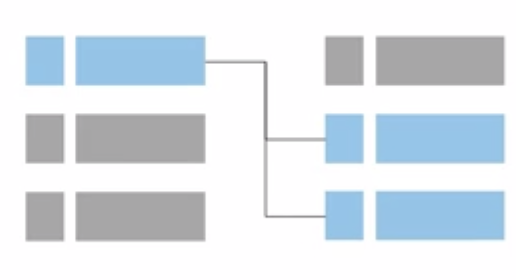

> **Нотатки:**
>
> Коли ви експлуатуєте власну реляційну базу даних, ви відповідаєте за кілька адміністративних завдань, як-от обслуговування серверів і енергоспоживання, програмне забезпечення, встановлення та виправлення, а також резервне копіювання баз даних. Ви також відповідаєте за забезпечення високої доступності, планування масштабованості, безпеку даних і встановлення та виправлення операційної системи (ОС). Усі ці завдання відбирають ресурси в інших пунктів вашого списку справ і вимагають експертизи в кількох сферах.

---

## Слайд 8: Amazon RDS

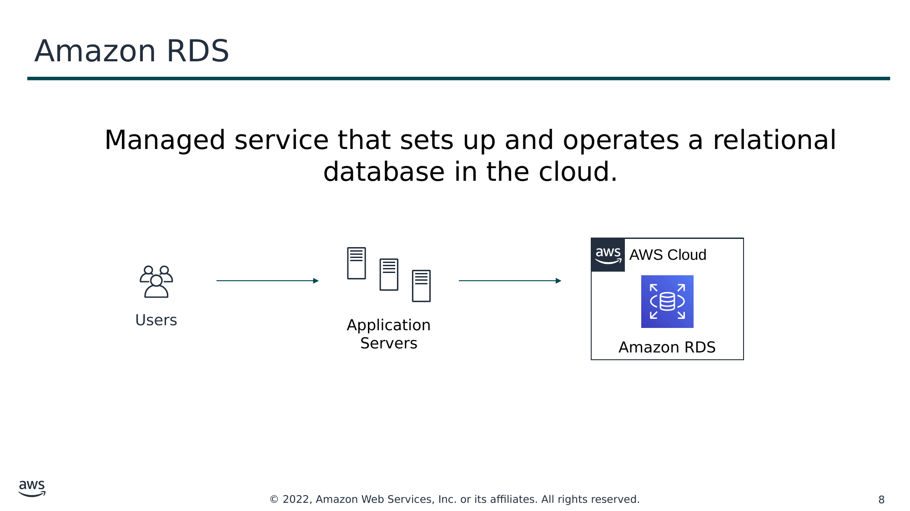

Текст зі схеми

Кероване обслуговування (managed service), що налаштовує та експлуатує реляційну базу даних у хмарі.

AWS Cloud

Users (Користувачі)

Application

Servers (Сервери застосунків)

Amazon RDS

> **Нотатки:**
>
> Amazon RDS — це керований сервіс, що налаштовує та експлуатує реляційну базу даних у хмарі.  
>
> Щоб розв’язати проблеми експлуатації некерованої автономної реляційної бази даних, AWS надає сервіс, який налаштовує, експлуатує та масштабує реляційну базу даних без постійного адміністрування. Amazon RDS забезпечує економічно ефективні потужності зі зміною розміру, автоматизуючи трудомісткі адміністративні завдання.  
>
> Amazon RDS дає змогу зосередитися на застосунку, щоб ви могли надати застосункам потрібні їм продуктивність, високу доступність, безпеку та сумісність. З Amazon RDS ваш основний фокус — ваші дані та оптимізація вашого застосунку.

---

## Слайд 9: Від локальних баз даних до Amazon RDS

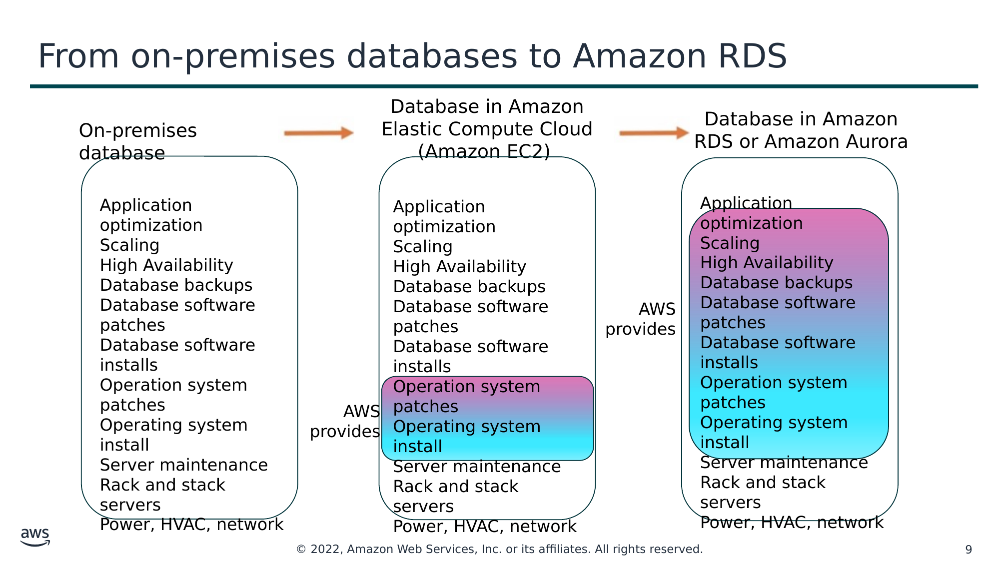

Текст зі схеми

Database in Amazon Elastic Compute Cloud (Amazon EC2) (База даних в Amazon EC2)

On-premises database (Локальна база даних)

Database in Amazon RDS or Amazon Aurora (База даних в Amazon RDS або Amazon Aurora)

Application optimization (Оптимізація застосунку)

Scaling (Масштабування)

High Availability (Висока доступність)

Database backups (Резервне копіювання баз даних)

Database software patches (Виправлення програмного забезпечення БД)

Database software installs (Встановлення програмного забезпечення БД)

Operation system patches (Виправлення операційної системи)

Operating system install (Встановлення операційної системи)

Server maintenance (Обслуговування серверів)

Rack and stack servers (Монтаж серверів у стійки)

Power, HVAC, network (Живлення, HVAC, мережа)

Application optimization

Scaling

High Availability

Database backups

Database software patches

Database software installs

Operation system patches

Operating system install

Server maintenance

Rack and stack servers

Power, HVAC, network

Application optimization

Scaling

High Availability

Database backups

Database software patches

Database software installs

Operation system patches

Operating system install

Server maintenance

Rack and stack servers

Power, HVAC, network

AWS

provides (надає)

AWS

provides (надає)

> **Нотатки:**
>
> Що означає термін «керовані сервіси» (managed services)?  
>
> Коли ваша база даних розташована локально (on premises), адміністратор бази даних відповідає за все. Завдання адміністрування баз даних включають оптимізацію застосунків і запитів; налаштування апаратного забезпечення; виправлення апаратного забезпечення; налаштування мережі та живлення; а також керування опаленням, вентиляцією та кондиціонуванням повітря (HVAC).  
>
> Якщо ви переходите на базу даних, що працює на екземплярі Amazon Elastic Compute Cloud (Amazon EC2), вам більше не потрібно керувати базовим апаратним забезпеченням або займатися операціями центру обробки даних. Однак ви все ще відповідаєте за виправлення ОС і виконання всіх операцій із програмним забезпеченням і резервним копіюванням.  
>
> Якщо ви налаштовуєте свою базу даних в Amazon RDS або Amazon Aurora, ви зменшуєте свої адміністративні обов’язки. Перейшовши в хмару, ви можете автоматично масштабувати свою базу даних, вмикати високу доступність, керувати резервними копіями та виконувати виправлення. Таким чином ви можете зосередитися на тому, що справді найважливіше, — оптимізації вашого застосунку.

---

## Слайд 10: Обов’язки в керованих сервісах

**Ви керуєте (You manage):**

- Оптимізація застосунку

**AWS керує (AWS manages):**

- Встановлення ОС і виправлення
- Встановлення програмного забезпечення бази даних і виправлення
- Резервне копіювання баз даних
- Висока доступність
- Масштабування
- Живлення та монтаж серверів у стійки (racking and stacking)
- Обслуговування серверів

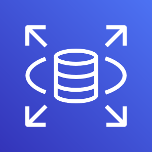

Amazon RDS

> **Нотатки:**
>
> З Amazon RDS ви керуєте оптимізацією свого застосунку. AWS керує встановленням і виправленням операційної системи, встановленням і виправленням програмного забезпечення бази даних, автоматичним резервним копіюванням і високою доступністю.  
>
> AWS також масштабує ресурси, керує живленням і серверами та виконує обслуговування.  
>
> Перекладання цих операцій на кероване обслуговування Amazon RDS зменшує ваше операційне навантаження та витрати, пов’язані з вашою реляційною базою даних. Тепер ви коротко ознайомитеся із сервісом і кількома потенційними сценаріями використання.

---

## Слайд 11: Екземпляри БД Amazon RDS (DB instances)

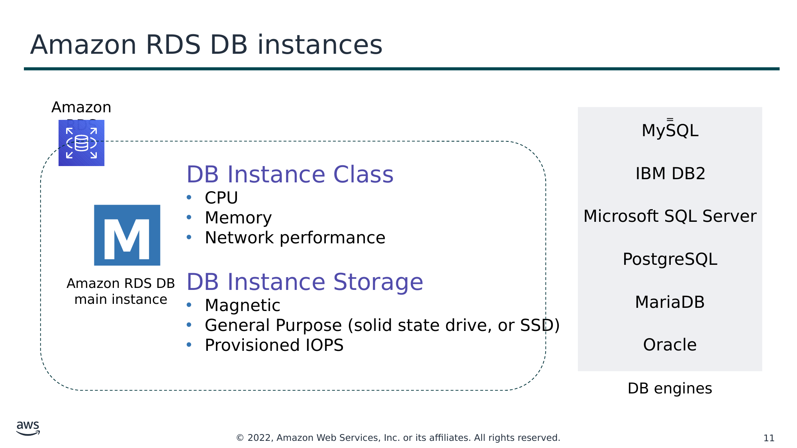

Текст зі схеми

Amazon RDS

=

MySQL

DB Instance Class (Клас екземпляра БД)

- CPU
- Memory (Пам’ять)
- Network performance (Мережева продуктивність)

DB Instance Storage (Сховище екземпляра БД)

- Magnetic (Магнітне)
- General Purpose (solid state drive, or SSD) (Загального призначення: твердотільний накопичувач, SSD)
- Provisioned IOPS (Забезпечені IOPS)

IBM DB2

**M**

Microsoft SQL Server

PostgreSQL

Amazon RDS DB main instance (Основний екземпляр БД Amazon RDS)

MariaDB

Oracle

DB engines (Рушії БД)

> **Нотатки:**
>
> Основним будівельним блоком Amazon RDS є екземпляр бази даних (database instance). Екземпляр бази даних — це ізольоване середовище бази даних, що може містити кілька баз даних, створених користувачами. Доступ до нього можна отримати за допомогою тих самих інструментів і застосунків, що й з автономним екземпляром бази даних. Ресурси в екземплярі бази даних визначаються його класом екземпляра бази даних (database instance class), а тип сховища визначається типом дисків.  
>
> Екземпляри бази даних і сховища відрізняються характеристиками продуктивності та ціною, що дає змогу налаштувати продуктивність і вартість відповідно до потреб вашої бази даних. Коли ви вирішуєте створити екземпляр бази даних, спершу потрібно вказати, який рушій бази даних (database engine) запускати. Amazon RDS наразі підтримує шість баз даних: MySQL, IBM DB2, Microsoft SQL Server, PostgreSQL, MariaDB і Oracle.

---

## Слайд 12: Amazon RDS у віртуальній приватній хмарі (VPC)

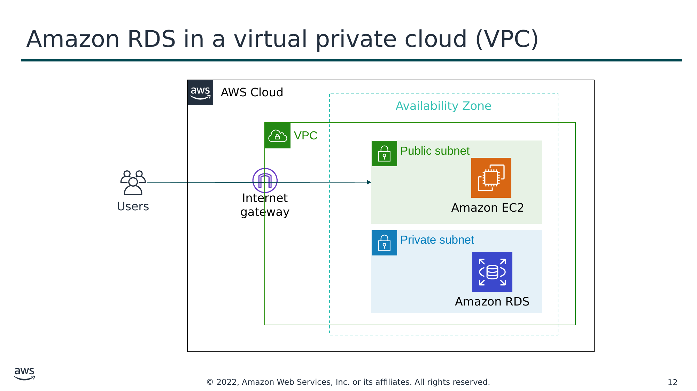

Текст зі схеми

AWS Cloud

Availability Zone (Зона доступності)

VPC

Public subnet (Публічна підмережа)

Users (Користувачі)

Internet gateway (Інтернет-шлюз)

Amazon EC2

Private subnet (Приватна підмережа)

Amazon RDS

> **Нотатки:**
>
> Ви можете запустити екземпляр за допомогою Amazon Virtual Private Cloud (Amazon VPC). Коли ви використовуєте віртуальну приватну хмару (VPC), ви контролюєте своє віртуальне мережеве середовище.  
>
> Ви можете вибрати власний діапазон IP-адрес, створити підмережі та налаштувати маршрутизацію й списки контролю доступу (ACL). Базова функціональність Amazon RDS однакова незалежно від того, чи працює він у VPC. Зазвичай екземпляр бази даних ізольований у приватній підмережі та безпосередньо доступний лише вказаним екземплярам застосунків. Підмережі у VPC пов’язані з однією зоною доступності, тож коли ви вибираєте підмережу, ви також обираєте зону доступності (або фізичне розташування) для вашого екземпляра бази даних.

---

## Слайд 13: Висока доступність з розгортанням Multi-AZ (1 із 2)

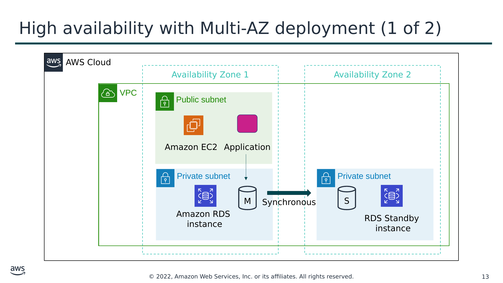

Текст зі схеми

AWS Cloud

Availability Zone 1 (Зона доступності 1)

Availability Zone 2 (Зона доступності 2)

VPC

Public subnet (Публічна підмережа)

Amazon EC2

Application (Застосунок)

Private subnet (Приватна підмережа)

Private subnet (Приватна підмережа)

M

Synchronous (Синхронно)

S

Amazon RDS

instance (екземпляр)

RDS Standby

instance (Резервний екземпляр RDS)

> **Нотатки:**
>
> Однією з найпотужніших функцій Amazon RDS є можливість налаштувати екземпляр бази даних на високу доступність за допомогою розгортання Multi-AZ. Після налаштування розгортання Multi-AZ Amazon RDS автоматично створює резервну копію (standby copy) екземпляра бази даних в іншій зоні доступності в межах тієї самої VPC. Після початкового заповнення копії бази даних транзакції синхронно реплікуються на резервну копію. Запуск екземпляра бази даних у розгортанні Multi-AZ може підвищити доступність під час планового обслуговування системи й допомогти захистити ваші бази даних від відмови екземпляра бази даних і перебоїв у зоні доступності.

---

## Слайд 14: Висока доступність з розгортанням Multi-AZ (2 із 2)

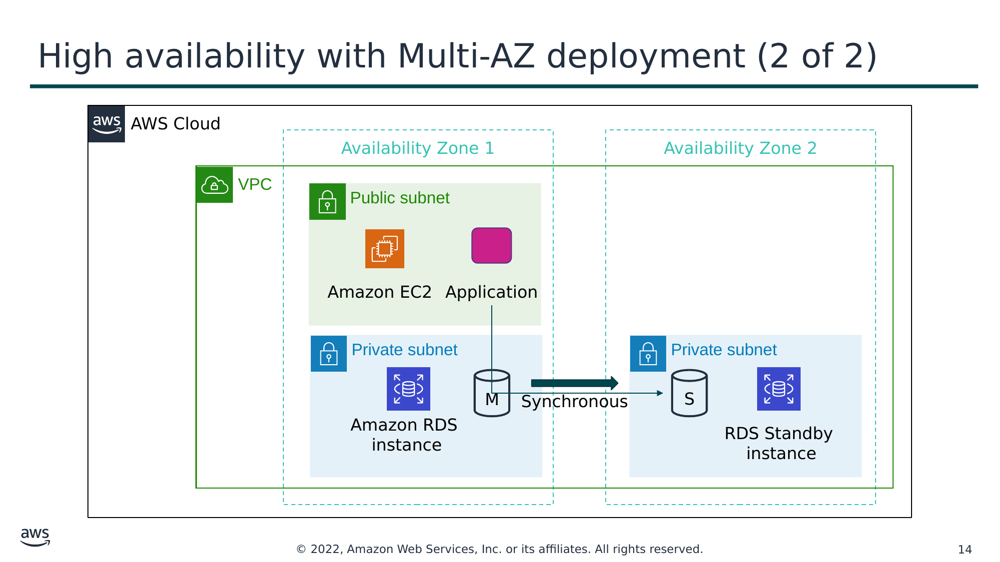

Текст зі схеми

AWS Cloud

Availability Zone 1 (Зона доступності 1)

Availability Zone 2 (Зона доступності 2)

VPC

Public subnet (Публічна підмережа)

Amazon EC2

Application (Застосунок)

Private subnet (Приватна підмережа)

Private subnet (Приватна підмережа)

M

Synchronous (Синхронно)

S

Amazon RDS

instance (екземпляр)

RDS Standby

instance (Резервний екземпляр RDS)

> **Нотатки:**
>
> Тому, якщо основний екземпляр бази даних у розгортанні Multi-AZ виходить з ладу, Amazon RDS автоматично вводить резервний екземпляр бази даних в роботу як новий основний екземпляр. Синхронна реплікація мінімізує потенційну втрату даних. Оскільки ваші застосунки звертаються до бази даних за іменем через кінцеву точку системи доменних імен (DNS) Amazon RDS, вам не потрібно нічого змінювати в коді застосунку, щоб використати резервну копію для перемикання на резервний ресурс (failover).

---

## Слайд 15: Репліки для читання Amazon RDS (read replicas)

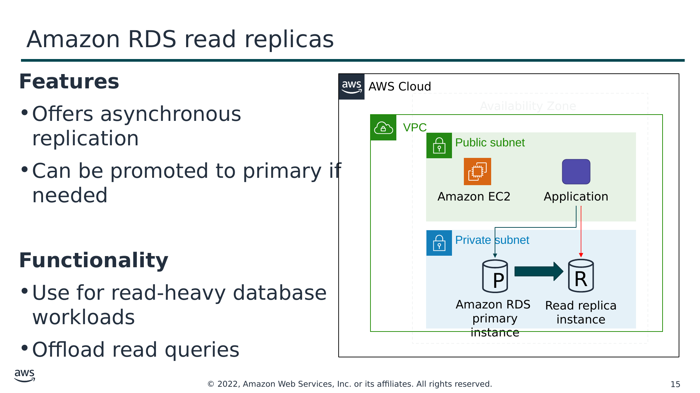

Текст зі схеми

**Функції (Features)**

- Пропонує асинхронну реплікацію
- Може бути підвищена до основної за потреби

**Функціональність (Functionality)**

- Використовуйте для робочих навантажень баз даних із великою кількістю читань
- Розвантажуйте запити на читання

AWS Cloud

Availability Zone (Зона доступності)

VPC

Public subnet (Публічна підмережа)

Amazon EC2

Application (Застосунок)

Private subnet (Приватна підмережа)

P

R

Amazon RDS

primary instance (основний екземпляр)

Read replica

instance (Екземпляр репліки для читання)

> **Нотатки:**
>
> Amazon RDS також підтримує створення реплік для читання (read replicas) для MySQL, MariaDB, PostgreSQL і Amazon Aurora. Оновлення, внесені до вихідного екземпляра бази даних, асинхронно копіюються в екземпляр репліки для читання. Ви можете зменшити навантаження на вихідний екземпляр бази даних, спрямовуючи запити на читання від ваших застосунків до репліки для читання. Використовуючи репліки для читання, ви також можете масштабуватися назовні за межі обмежень потужності одного екземпляра бази даних для робочих навантажень баз даних із великою кількістю читань. Репліки для читання також можна підвищити до основного екземпляра бази даних, але це потребує ручної дії через асинхронну реплікацію.  
>
> Репліки для читання можна створювати в іншому регіоні, ніж основна база даних. Ця функція може допомогти виконати вимоги до аварійного відновлення або зменшити затримку, спрямовуючи читання до репліки для читання, що розташована ближче до користувача.

---

## Слайд 16: Сценарії використання

| Веб- і мобільні застосунки | • Висока пропускна здатність • Масивна масштабованість сховища • Висока доступність |
|---|---|
| Застосунки електронної комерції | • Недорога база даних • Безпека даних • Повністю кероване рішення |
| Мобільні та онлайн-ігри | • Швидке нарощування потужностей • Автоматичне масштабування • Моніторинг бази даних |

> **Нотатки:**
>
> Amazon RDS добре підходить для веб- і мобільних застосунків, яким потрібна база даних із високою пропускною здатністю, масивною масштабованістю сховища та високою доступністю. Оскільки Amazon RDS не має жодних ліцензійних обмежень, він відповідає змінному шаблону використання цих застосунків. Для малого та великого бізнесу електронної комерції Amazon RDS надає гнучке, безпечне та недороге рішення для бази даних для онлайн-продажів і роздрібної торгівлі. Мобільні та онлайн-ігри потребують платформи баз даних із високою пропускною здатністю та доступністю. Amazon RDS керує інфраструктурою бази даних, тож розробникам ігор не потрібно турбуватися про розгортання, масштабування чи моніторинг серверів баз даних.

---

## Слайд 17: Коли використовувати Amazon RDS

**Використовуйте Amazon RDS, коли вашому застосунку потрібне таке:**

- **Не використовуйте Amazon RDS, коли вашому застосунку потрібне таке:**

- Складні транзакції або складні запити
- Середня чи висока інтенсивність запитів або записів — до 30 000 IOPS (15 000 читань + 15 000 записів)
- Не більше одного робочого вузла (worker node) або шарда (shard)
- Висока довговічність

- Масивна інтенсивність читання/запису (наприклад, 150 000 записів на секунду)
- Шардування (sharding) через великий обсяг даних або вимоги до пропускної здатності
- Прості запити GET чи PUT і запити, які може обробити база даних NoSQL
- Налаштування системи керування реляційними базами даних (RDBMS)

> **Нотатки:**
>
> Використовуйте Amazon RDS, коли вашому застосунку потрібне таке:  
> Складні транзакції або складні запити  
> Середня чи висока інтенсивність запитів або записів — до 30 000 IOPS (15 000 читань + 15 000 записів)  
> Не більше одного робочого вузла або шарда  
> Висока довговічність  
>
> Не використовуйте Amazon RDS, коли вашому застосунку потрібне таке:  
> Масивна інтенсивність читання/запису (наприклад, 150 000 записів на секунду)  
> Шардування через великий обсяг даних або вимоги до пропускної здатності  
> Прості запити GET чи PUT і запити, які може обробити база даних NoSQL  
> Або налаштування системи керування реляційними базами даних (RDBMS)  
>
> У випадках, коли не слід використовувати Amazon RDS, розгляньте або рішення на основі бази даних NoSQL (як-от DynamoDB), або запуск вашого рушія реляційної бази даних на екземплярах Amazon EC2 замість Amazon RDS (що надасть вам більше можливостей для налаштування вашої бази даних).

---

## Слайд 18: Amazon RDS: погодинне виставлення рахунків і характеристики бази даних

**Погодинне виставлення рахунків (Clock-hour billing) –**

- Ресурси тарифікуються, коли працюють

**Характеристики бази даних (Database characteristics) –**

- Фізична потужність бази даних:
  - Рушій (Engine)
  - Розмір (Size)
  - Клас пам’яті (Memory class)

> **Нотатки:**
>
> Коли ви починаєте оцінювати вартість Amazon RDS, потрібно враховувати години роботи сервісу (clock hours) — ресурси, що тарифікуються, коли вони працюють (наприклад, з моменту запуску екземпляра бази даних до моменту його завершення).  
>
> Також слід враховувати характеристики бази даних. Фізична потужність обраної вами бази даних впливатиме на те, скільки з вас стягуватимуть. Характеристики бази даних залежать від рушія бази даних, розміру та класу пам’яті.

---

## Слайд 19: Amazon RDS: тип придбання БД і кілька екземплярів БД

**Тип придбання БД (DB purchase type) –**

- Екземпляри за запитом (On-Demand Instances)
  - Обчислювальні потужності за годину
- Зарезервовані екземпляри (Reserved Instances)
  - Невеликий одноразовий авансовий платіж за екземпляри бази даних, зарезервовані на термін 1 рік або 3 роки

**Кількість екземплярів БД (Number of DB instances) –**

- Розгорніть кілька екземплярів БД для обробки пікових навантажень

> **Нотатки:**
>
> Враховуйте тип придбання бази даних. Коли ви використовуєте екземпляри за запитом (On-Demand Instances), ви платите за обчислювальні потужності за кожну годину роботи вашого екземпляра бази даних без обов’язкових мінімальних зобов’язань. Із зарезервованими екземплярами (Reserved Instances) ви можете зробити невеликий одноразовий авансовий платіж за кожен екземпляр бази даних, який хочете зарезервувати на термін 1 рік або 3 роки.  
>
> Також потрібно враховувати кількість екземплярів бази даних. З Amazon RDS ви можете розгорнути кілька екземплярів бази даних для обробки пікових навантажень.

---

## Слайд 20: Amazon RDS: сховище

**Забезпечене сховище (Provisioned storage) –**

- Без плати
  - Сховище резервних копій обсягом до 100 відсотків сховища бази даних для активної бази даних
- Плата (*ГБ/місяць*)
  - Сховище резервних копій для завершених екземплярів БД

**Додаткове сховище (Additional storage) –**

- Плата (*ГБ/місяць*)
  - Сховище резервних копій понад забезпечене сховище

> **Нотатки:**
>
> Враховуйте забезпечене сховище (provisioned storage). За сховище резервних копій обсягом до 100 відсотків вашого забезпеченого сховища бази даних для активного екземпляра бази даних додаткова плата не стягується. Після завершення роботи екземпляра бази даних сховище резервних копій тарифікується за ГБ на місяць.  
>
> Також враховуйте обсяг сховища резервних копій понад забезпечений обсяг сховища, який тарифікується за ГБ на місяць.

---

## Слайд 21: Amazon RDS: тип розгортання та передавання даних

**Запити (Requests) –**

- Кількість запитів введення та виведення, що надсилаються до бази даних

**Тип розгортання (Deployment type) — плата за сховище та введення-виведення (I/O) залежить від того, куди ви розгортаєте –**

- Одна зона доступності
- Кілька зон доступності

**Передавання даних (Data transfer) –**

- Без плати за вхідне передавання даних
- Ступінчаста плата за вихідне передавання даних

> **Нотатки:**
>
> Також враховуйте кількість запитів введення та виведення, що надсилаються до бази даних.  
>
> Враховуйте тип розгортання. Ви можете розгорнути свій екземпляр БД в одній зоні доступності (що аналогічно автономному центру обробки даних) або в кількох зонах доступності (що аналогічно вторинному центру обробки даних для підвищеної доступності та довговічності). Плата за сховище та введення-виведення залежить від кількості зон доступності, до яких ви розгортаєте.  
>
> Нарешті, враховуйте передавання даних. Вхідне передавання даних безкоштовне, а вартість вихідного передавання даних ступінчаста.  
>
> Залежно від потреб вашого застосунку, можна оптимізувати витрати на екземпляри баз даних Amazon RDS, придбавши зарезервовані екземпляри. Щоб придбати зарезервовані екземпляри, ви робите невеликий одноразовий платіж за кожен екземпляр, який хочете зарезервувати. У результаті ви отримуєте значну знижку на погодинну плату за використання цього екземпляра.

---

## Слайд 22: Записана демонстрація: консоль Amazon RDS

> **Нотатки:**
>
> Тепер знайдіть хвилинку, щоб переглянути демонстрацію консолі Amazon RDS. Демонстрація показує, як виконати такі завдання за допомогою AWS Management Console:  
> Налаштувати інсталяцію Amazon RDS із рушієм бази даних MySQL.  
> Підключитися до бази даних за допомогою клієнта MySQL.  
>
> Це відео можна знайти в розділі модуля 8 курсу під назвою: Console Demonstration - RDS . Якщо ви не можете знайти цю відеодемонстрацію, зверніться по допомогу до свого викладача.

---

## Слайд 23: Build Your DB Server and Interact with Your DB Using an App (створення сервера БД і взаємодія з БД за допомогою застосунку)

> **Нотатки:**
>
> Зараз ви виконаєте Лабораторну роботу 5: Build Your DB Server and Interact with Your DB Using an App.

---

## Слайд 24: Лабораторна робота 5: сценарій

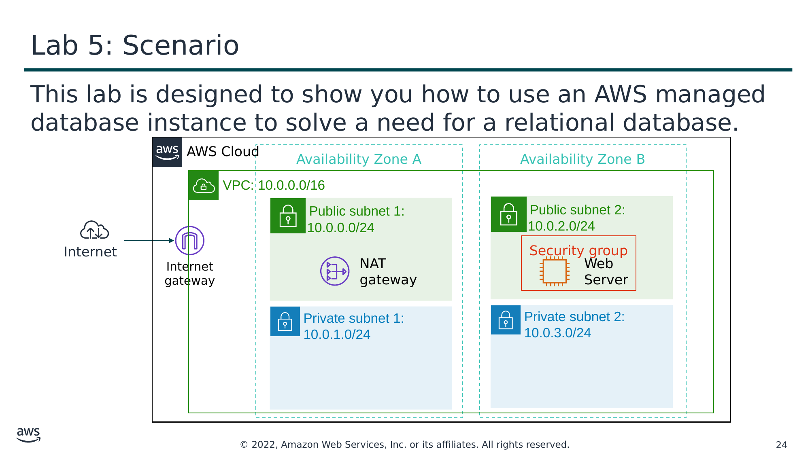

Текст зі схеми

Ця лабораторна робота призначена показати, як використовувати керований AWS екземпляр бази даних для задоволення потреби в реляційній базі даних.

AWS Cloud

Availability Zone A (Зона доступності A)

Availability Zone B (Зона доступності B)

VPC: 10.0.0.0/16

Public subnet 1 (Публічна підмережа 1):  
    10.0.0.0/24

Public subnet 2 (Публічна підмережа 2):  
    10.0.2.0/24

Internet (Інтернет)

Security group (Група безпеки)

Internet gateway (Інтернет-шлюз)

NAT

gateway (NAT-шлюз)

Web

Server (Вебсервер)

Private subnet 1 (Приватна підмережа 1):

10.0.1.0/24

Private subnet 2 (Приватна підмережа 2):

10.0.3.0/24

> **Нотатки:**
>
> Ця лабораторна робота призначена показати, як використовувати керований AWS екземпляр бази даних для задоволення потреби в реляційній базі даних. З Amazon RDS ви можете налаштовувати, експлуатувати та масштабувати реляційну базу даних у хмарі. Він забезпечує економічно ефективні потужності зі зміною розміру, водночас беручи на себе трудомісткі завдання адміністрування баз даних, що дає змогу зосередитися на ваших застосунках і вашому бізнесі. Amazon RDS пропонує шість знайомих рушіїв баз даних на вибір: Amazon Aurora, Oracle, Microsoft SQL Server, PostgreSQL, MySQL і MariaDB.  
>
> Розгортання Amazon RDS Multi-AZ забезпечують підвищену доступність і довговічність екземплярів БД, що робить їх добрим вибором для продуктивних робочих навантажень баз даних. Коли ви розгортаєте екземпляр БД Multi-AZ, Amazon RDS автоматично створює основний екземпляр БД і синхронно реплікує дані на резервний екземпляр в іншій зоні доступності.  
>
> Після завершення цієї лабораторної роботи ви повинні вміти:  
> Запускати екземпляр БД Amazon RDS із високою доступністю.  
> Налаштовувати екземпляр БД, щоб дозволити з’єднання з вашого вебсервера.  
> Відкривати вебзастосунок і взаємодіяти зі своєю базою даних.

---

## Слайд 25: Лабораторна робота 5: завдання

Security group (Група безпеки)

Створіть **групу безпеки VPC (VPC security group).**

Створіть **групу підмереж БД (DB subnet group).**

Створіть **екземпляр БД Amazon RDS** і взаємодійте зі своєю базою даних.

Private subnet (Приватна підмережа)

Amazon RDS

> **Нотатки:**
>
> Ваша мета під час виконання цієї лабораторної роботи:  
> Створити групу безпеки VPC.  
> Створити групу підмереж БД.  
> Створити екземпляр БД Amazon RDS і взаємодіяти зі своєю базою даних.

---

## Слайд 26: Лабораторна робота 5: підсумковий результат

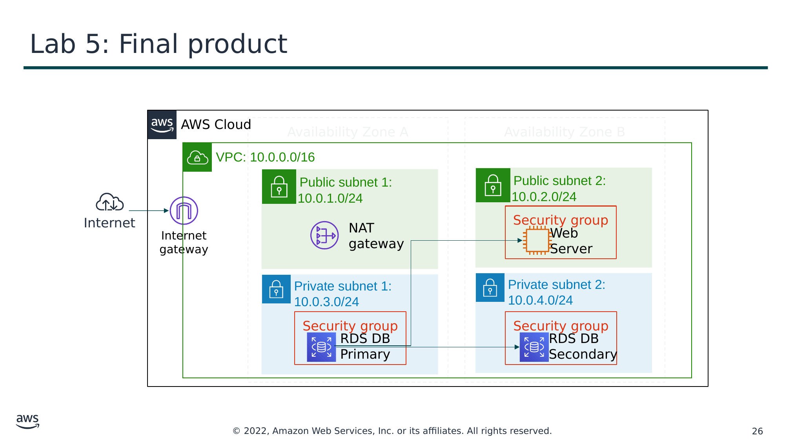

Текст зі схеми

AWS Cloud

Availability Zone A (Зона доступності A)

Availability Zone B (Зона доступності B)

VPC: 10.0.0.0/16

Public subnet 1 (Публічна підмережа 1):  
    10.0.1.0/24

Public subnet 2 (Публічна підмережа 2):  
    10.0.2.0/24

Internet (Інтернет)

Security group (Група безпеки)

Internet gateway (Інтернет-шлюз)

NAT

gateway (NAT-шлюз)

Web

Server (Вебсервер)

Private subnet 1 (Приватна підмережа 1):

10.0.3.0/24

Private subnet 2 (Приватна підмережа 2):

10.0.4.0/24

Security group (Група безпеки)

Security group (Група безпеки)

RDS DB

Primary (Основна БД RDS)

RDS DB  
Secondary (Резервна БД RDS)

> **Нотатки:**
>
> У цій лабораторній роботі ви:  
> Запустили екземпляр БД Amazon RDS із високою доступністю.  
> Налаштували екземпляр БД, щоб дозволити з’єднання з вашого вебсервера.  
> Відкрили вебзастосунок і взаємодіяли зі своєю базою даних

---

## Слайд 27: Початок лабораторної роботи 5: Build your DB server and interact with your DB using an application

~  30 хвилин

> **Нотатки:**
>
> Настав час розпочати лабораторну роботу.

---

## Слайд 28: Підсумки лабораторної роботи: ключові висновки

> **Нотатки:**
>
> У цій лабораторній роботі ви:  
> Створили групу безпеки VPC.  
> Створили групу підмереж БД.  
> Створили екземпляр БД Amazon RDS  
> Взаємодіяли зі своєю базою даних

---

## Слайд 29: Ключові висновки розділу 1

- З Amazon RDS ви можете налаштовувати, експлуатувати та масштабувати реляційні бази даних у хмарі.
- Функції –
  - Керований сервіс
  - Доступний через консоль, AWS Command Line Interface (AWS CLI) або виклики прикладного програмного інтерфейсу (API)
  - Масштабований (обчислення та сховище)
  - Доступні автоматична надлишковість і резервне копіювання
  - Підтримувані рушії баз даних:
    - Amazon Aurora, PostgreSQL, MySQL, MariaDB, Oracle, Microsoft SQL Server

> **Нотатки:**
>
> Amazon RDS — це вебсервіс, що спрощує налаштування, експлуатацію та масштабування реляційної бази даних у хмарі. Він забезпечує економічно ефективні потужності зі зміною розміру, водночас беручи на себе трудомісткі завдання адміністрування баз даних, щоб ви могли зосередитися на своїх застосунках і своєму бізнесі. Серед його функцій: це керований сервіс, і доступ до нього можна отримати через консоль, AWS Command Line Interface (AWS CLI) або виклики прикладного програмного інтерфейсу (API). Amazon RDS масштабований за обчисленнями та сховищем, а також доступні автоматична надлишковість і резервне копіювання. Підтримувані рушії баз даних включають Amazon Aurora, PostgreSQL, MySQL, MariaDB, Oracle та Microsoft SQL Server.  
>
> Amazon RDS підтримує вимогливі застосунки баз даних. Ви можете вибрати один із двох варіантів сховища на твердотільних накопичувачах (SSD): один варіант оптимізований для високопродуктивних застосунків онлайн-обробки транзакцій (Online Transactional Processing, OLTP), а інший добре підходить для економічно ефективного використання загального призначення.  
>
> З Amazon RDS ви можете масштабувати обчислювальні ресурси та сховище вашої бази даних без простою. Amazon RDS працює на тій самій високонадійній інфраструктурі, що використовується іншими сервісами AWS. Він також дає змогу запускати ваші екземпляри баз даних і Amazon VPC, призначені забезпечити вам контроль і безпеку.

---

## Слайд 30: Розділ 2: Amazon DynamoDB

Модуль 8: Бази даних

> **Нотатки:**
>
> Вітаємо в Розділі 2: Amazon DynamoDB.

---

## Слайд 31: Реляційні та нереляційні бази даних

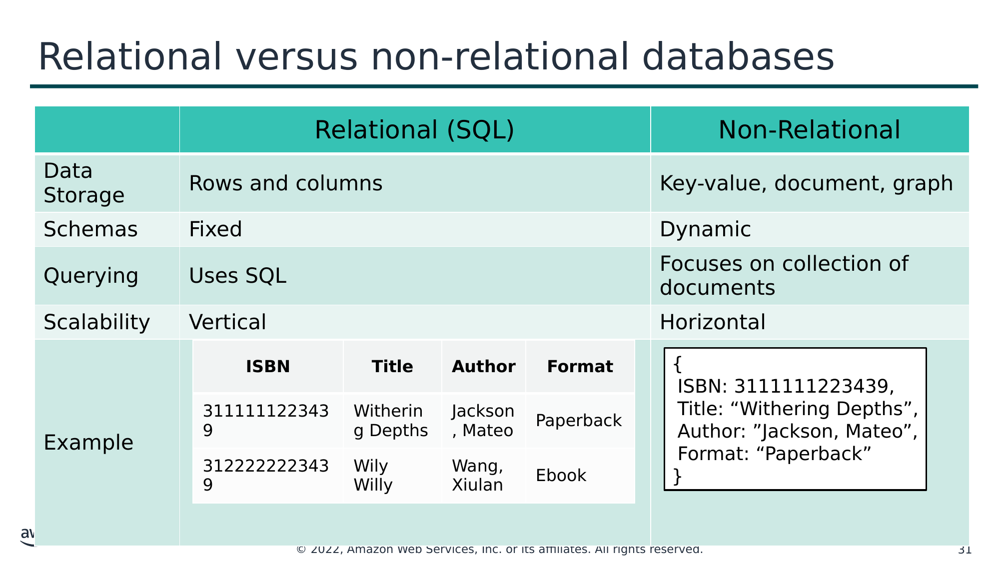

Текст зі схеми

|  | Relational (SQL) (Реляційні) | Non-Relational (Нереляційні) |
|---|---|---|
| Data Storage (Зберігання даних) | Рядки та стовпці | Ключ-значення, документи, граф |
| Schemas (Схеми) | Фіксовані | Динамічні |
| Querying (Запити) | Використовують SQL | Зосереджені на колекції документів |
| Scalability (Масштабованість) | Вертикальна | Горизонтальна |
| Example (Приклад) |  |  |

| ISBN | Title | Author | Format |
|---|---|---|---|
| 3111111223439 | Withering Depths | Jackson, Mateo | Paperback |
| 3122222223439 | Wily Willy | Wang, Xiulan | Ebook |

{

ISBN: 3111111223439,

Title: “Withering Depths”,

Author: ”Jackson, Mateo”,

Format: “Paperback”

}

> **Нотатки:**
>
> З DynamoDB цей модуль переходить від реляційних баз даних до нереляційних баз даних. Ось огляд відмінностей між цими двома типами баз даних:  
>
> Реляційна база даних (relational database, RDB) працює зі структурованими даними, організованими за таблицями, записами та стовпцями. RDB встановлюють чітко визначений зв’язок між таблицями бази даних. RDB використовують мову структурованих запитів (structured query language, SQL) — стандартний користувацький застосунок, що надає програмний інтерфейс для взаємодії з базою даних. Реляційні бази даних можуть мати труднощі з масштабуванням назовні (горизонтально) або роботою з напівструктурованими даними, а також можуть вимагати багатьох об’єднань (joins) для нормалізованих даних.  
>
> Нереляційна база даних — це будь-яка база даних, що не дотримується реляційної моделі, яку надають традиційні системи керування реляційними базами даних (RDBMS). Нереляційні бази даних набули популярності, оскільки їх було розроблено, щоб подолати обмеження реляційних баз даних під час обробки вимог до змінних структурованих даних. Нереляційні бази даних масштабуються назовні горизонтально, і вони можуть працювати з неструктурованими та напівструктурованими даними.  
>
> Ось що пропонує DynamoDB.

---

## Слайд 32: Що таке Amazon DynamoDB?

Швидкий і гнучкий сервіс баз даних NoSQL для будь-якого масштабу

- Таблиці бази даних NoSQL
- Практично необмежене сховище
- Елементи (items) можуть мати різні атрибути
- Запити з низькою затримкою
- Масштабована пропускна здатність читання/запису

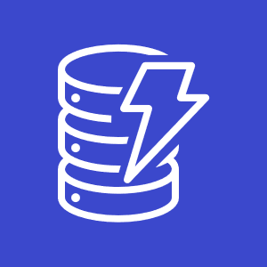

**Amazon DynamoDB**

> **Нотатки:**
>
> DynamoDB — це швидкий і гнучкий сервіс баз даних NoSQL для всіх застосунків, яким потрібна стабільна затримка в одиниці мілісекунд за будь-якого масштабу.  
>
> Amazon керує всією базовою інфраструктурою даних для цього сервісу та надлишково зберігає дані в кількох об’єктах в основному регіоні США як частину відмовостійкої архітектури. З DynamoDB ви можете створювати таблиці та елементи (items). Ви можете додавати елементи до таблиці. Система автоматично розділяє ваші дані на партиції (partitions) і має сховище таблиць, що задовольняє вимоги робочого навантаження. Практичного обмеження на кількість елементів, які можна зберігати в таблиці, немає. Наприклад, деякі клієнти мають продуктивні таблиці, що містять мільярди елементів.  
>
> Однією з переваг бази даних NoSQL є те, що елементи в одній таблиці можуть мати різні атрибути. Це дає вам гнучкість додавати атрибути в міру розвитку вашого застосунку. Ви можете зберігати елементи новішого формату поруч з елементами старішого формату в одній таблиці без потреби виконувати міграції схеми.  
>
> У міру того як ваш застосунок стає популярнішим і користувачі продовжують із ним взаємодіяти, ваше сховище може зростати відповідно до потреб застосунку. Усі дані в DynamoDB зберігаються на твердотільних накопичувачах (SSD), а проста мова запитів забезпечує стабільну продуктивність запитів із низькою затримкою. Окрім масштабування сховища, DynamoDB також дає змогу виділяти потрібний вам обсяг пропускної здатності читання чи запису для вашої таблиці. У міру зростання кількості користувачів застосунку таблиці DynamoDB можна масштабувати для обробки збільшеної кількості запитів на читання/запис за допомогою ручного розгортання (manual provisioning). Крім того, ви можете ввімкнути автоматичне масштабування, щоб DynamoDB відстежував навантаження на таблицю та автоматично збільшував чи зменшував забезпечену пропускну здатність.  
>
> Деякі додаткові ключові функції включають глобальні таблиці (global tables), що дають змогу автоматично реплікувати дані в обраних вами регіонах AWS, шифрування в стані спокою та час життя елемента (Time-to-Live, TTL).

---

## Слайд 33: Основні компоненти Amazon DynamoDB

- Таблиці, елементи та атрибути — це основні компоненти DynamoDB
- DynamoDB підтримує два різні типи первинних ключів: ключ розділу (partition key) та ключ розділу з ключем сортування (partition and sort key)

> **Нотатки:**
>
> Основні компоненти DynamoDB — це таблиці, елементи та атрибути.  
> Таблиця — це набір даних.  
> Елементи — це група атрибутів, що однозначно ідентифікується серед усіх інших елементів.  
> Атрибути — це фундаментальний елемент даних, щось, що не потрібно розбивати далі.  
>
> DynamoDB підтримує два різні типи первинних ключів.  
> Ключ розділу (partition key) — це простий первинний ключ, що складається з одного атрибута, який називається ключем сортування (sort key).  
> Ключ розділу та ключ сортування також відомі як складений первинний ключ (composite primary key), що складається з двох атрибутів.  
>
> Щоб дізнатися більше про те, як працює DynamoDB, див. атрибути елементів таблиці за адресою https://docs.aws.amazon.com/amazondynamodb/latest/developerguide/HowItWorks.CoreComponents.html#HowItWorks.CoreComponents.TablesItemsAttributes.

---

## Слайд 34: Партиціонування (partitioning)

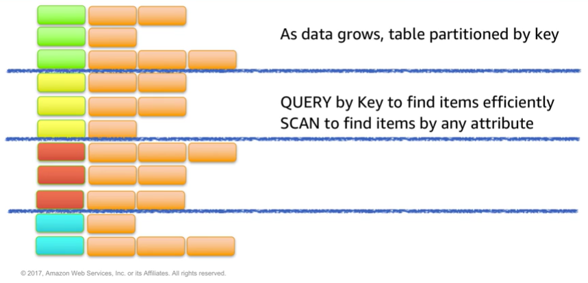

> **Нотатки:**
>
> У міру зростання даних дані таблиці розділяються на партиції та індексуються за первинним ключем.  
>
> Ви можете отримувати дані з таблиці DynamoDB двома способами:  
> У першому методі операція запиту (query) використовує партиціонування, щоб ефективно знаходити елементи за первинним ключем.  
> Другий метод — це сканування (scan), яке дає змогу знаходити елементи в таблиці за збігом умов щодо неключових атрибутів. Другий метод дає вам гнучкість знаходити елементи за іншими атрибутами. Однак операція менш ефективна, оскільки DynamoDB скануватиме всі елементи в таблиці, щоб знайти ті, що відповідають вашим критеріям.  
>
> Для доступності: партиціонування дає змогу швидко сканувати великі таблиці та виконувати до них запити. У міру зростання даних таблицю розділяють за ключем. QUERY за ключем (Key) для пошуку елементів за будь-яким атрибутом. Кінець опису для доступності.

---

## Слайд 35: Елементи в таблиці повинні мати ключ

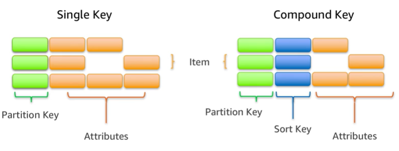

> **Нотатки:**
>
> Щоб повною мірою скористатися операціями запитів і DynamoDB, важливо продумати ключ, який ви використовуєте для однозначної ідентифікації елементів у таблиці DynamoDB. Ви можете налаштувати простий первинний ключ, що ґрунтується на одному атрибуті значень даних із рівномірним розподілом, як-от глобально унікальний ідентифікатор (Globally Unique Identifier, GUID) чи інші випадкові ідентифікатори.  
>
> Наприклад, якщо ви хотіли б змоделювати таблицю з продуктами, ви могли б використати деякі атрибути, як-от ідентифікатор продукту. Як варіант, ви можете вказати складений ключ (compound key), що складається з ключа розділу та вторинного ключа. У цьому прикладі, якби у вас була таблиця з книгами, ви могли б використати поєднання автора й назви для однозначної ідентифікації елементів таблиці. Цей метод може бути корисним, якщо ви очікуєте часто переглядати книги за автором, оскільки тоді можна було б використати запит (query).  
>
> Для доступності: два різні типи ключів. Одиничний ключ (single key) означає, що дані ідентифікуються елементом у даних, який однозначно ідентифікує кожен запис. Складений ключ (compound key) складається з ключа розділу та другого ключа, який можна використовувати для сортування даних. Кінець опису для доступності.

---

## Слайд 36: Ключові висновки розділу 2

Amazon DynamoDB:

- Працює виключно на SSD.
- Підтримує моделі документів і сховищ «ключ-значення».
- Автоматично реплікує ваші таблиці в обраних вами регіонах AWS.
- Добре підходить для мобільних, вебзастосунків, ігор, рекламних технологій (adtech) та застосунків Інтернету речей (IoT).
- Доступний через консоль, AWS CLI та виклики API.
- Забезпечує стабільну затримку в одиниці мілісекунд за будь-якого масштабу.
- Не має обмежень на розмір таблиці чи пропускну здатність.

> **Нотатки:**
>
> DynamoDB працює виключно на SSD і підтримує моделі документів і сховищ «ключ-значення».  
>
> DynamoDB добре підходить для мобільних, вебзастосунків, ігор, рекламних технологій (ad tech) та застосунків Інтернету речей (IoT).  
> Доступ до нього можна отримати через консоль, AWS CLI та виклики API.  
>
> Можливість масштабувати ваші таблиці як за сховищем, так і за забезпеченою пропускною здатністю робить DynamoDB добрим вибором для структурованих даних із вебзастосунків, мобільних застосунків та застосунків IoT. Наприклад, у вас може бути велика кількість клієнтів, які безперервно генерують дані та надсилають велику кількість запитів на секунду. У цьому випадку масштабування пропускної здатності DynamoDB забезпечує стабільну продуктивність для ваших клієнтів. DynamoDB також використовується в застосунках, чутливих до затримки. Передбачувана продуктивність запитів — навіть у великих таблицях — робить його корисним у випадках, коли змінна затримка могла б суттєво вплинути на користувацький досвід чи бізнес-цілі, наприклад у рекламних технологіях чи іграх.  
>
> Функція DynamoDB Global Tables зменшує обсяг роботи з реплікації даних між регіонами та розв’язання конфліктів оновлень. Вона автоматично реплікує ваші таблиці DynamoDB в обраних вами регіонах AWS. Global Tables можуть допомогти застосункам залишатися доступними та продуктивними для безперервності бізнесу.

---

## Слайд 37: Записана демонстрація: консоль Amazon DynamoDB

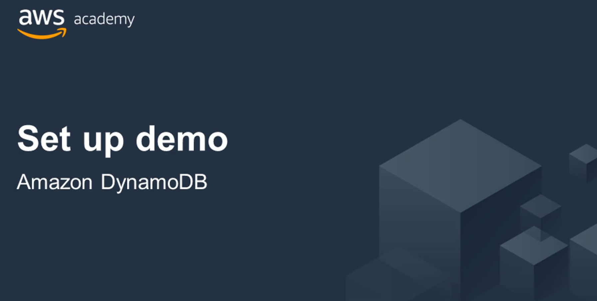

> **Нотатки:**
>
> Тепер знайдіть хвилинку, щоб переглянути демонстрацію Amazon DynamoDB. Запис триває трохи більше 2 хвилин і закріплює багато концепцій, обговорених у цьому розділі модуля.  
>
> Демонстрація показує, як створити таблицю, що працює в Amazon DynamoDB, за допомогою AWS Management Console. Вона також демонструє, як взаємодіяти з таблицею за допомогою AWS Command Line Interface. Демонстрація показує, як можна виконувати запити до таблиці та додавати дані до таблиці.  
>
> Це відео можна знайти в розділі модуля 8 курсу під назвою: Console Demonstration - DynamoDB . Якщо ви не можете знайти цю відеодемонстрацію, зверніться по допомогу до свого викладача.

---

## Слайд 38: Демонстрація Amazon DynamoDB

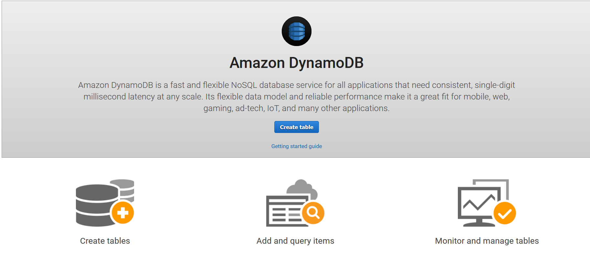

> **Нотатки:**
>
> Перегляньте демонстрацію: демонстрація консолі Amazon DynamoDB.  
>
> Ви можете отримати доступ до цієї записаної демонстрації в системі керування навчанням (learning management system).

---

## Слайд 39: Розділ 3: Amazon Redshift

Модуль 8: Бази даних

> **Нотатки:**
>
> Вітаємо в Розділі 3: Amazon Redshift.

---

## Слайд 40: Amazon Redshift

Amazon Redshift

> **Нотатки:**
>
> Amazon Redshift — це швидке, повністю кероване сховище даних (data warehouse), що робить аналіз усіх ваших даних простим і економічно ефективним за допомогою стандартного SQL та ваших наявних інструментів бізнес-аналітики (business intelligence, BI). Ось огляд Amazon Redshift і того, як його можна використовувати для аналітичних застосунків.

---

## Слайд 41: Вступ до Amazon Redshift

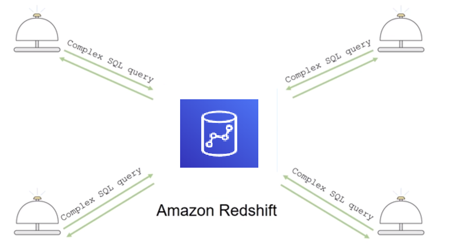

> **Нотатки:**
>
> Аналітика сьогодні важлива для бізнесу, але побудова сховища даних складна й дорога. Налаштування сховищ даних може тривати місяцями та потребувати значних фінансових ресурсів.  
>
> Amazon Redshift — це швидке й потужне, повністю кероване сховище даних, яке просто й економічно ефективно налаштовувати, використовувати та масштабувати. Воно дає змогу виконувати складні аналітичні запити до петабайтів структурованих даних за допомогою складної оптимізації запитів, стовпчикового зберігання на високопродуктивних локальних дисках і масово-паралельної обробки даних. Більшість результатів повертається за секунди.  
>
> Далі ви розглянете дещо детальніший огляд ключових функцій Amazon Redshift і деяких поширених сценаріїв використання.

---

## Слайд 42: Архітектура паралельної обробки (parallel processing architecture)

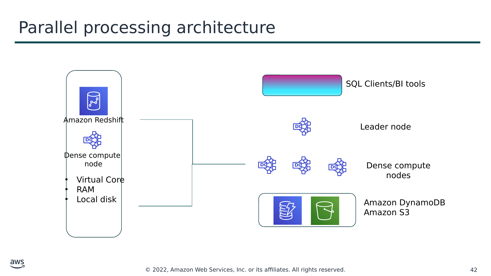

Текст зі схеми

SQL Clients/BI tools (Клієнти SQL / інструменти BI)

Amazon Redshift

Leader node (Провідний вузол)

Dense compute

node (Вузол з щільними обчисленнями)

Dense compute nodes (Вузли з щільними обчисленнями)

- Virtual Core (Віртуальне ядро)
- RAM
- Local disk (Локальний диск)

Amazon DynamoDB

Amazon S3

> **Нотатки:**
>
> Провідний вузол (leader node) керує зв’язком із клієнтськими програмами та всім зв’язком з обчислювальними вузлами. Він аналізує та розробляє плани виконання операцій бази даних — зокрема послідовність кроків, потрібних для отримання результатів складних запитів. Провідний вузол компілює код для окремих елементів плану та призначає код окремим обчислювальним вузлам (compute nodes). Обчислювальні вузли виконують скомпільований код і надсилають проміжні результати назад на провідний вузол для остаточної агрегації.  
>
> Як і за інші сервіси AWS, ви платите лише за те, що використовуєте. Ви можете почати лише від 25 центів на годину, а в масштабі Amazon Redshift може забезпечувати зберігання та обробку приблизно за 1000 доларів за терабайт на рік (за 3-річною ціною зарезервованого екземпляра з частковою авансовою оплатою).  
>
> Функція Amazon Redshift Spectrum дає змогу виконувати запити до ексабайтів даних безпосередньо в Amazon S3.

---

## Слайд 43: Автоматизація та масштабування

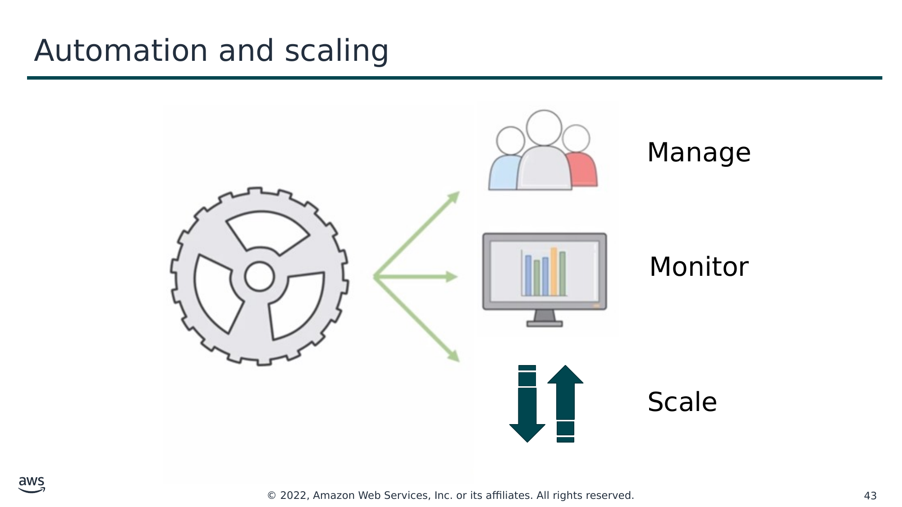

Текст зі схеми

Manage (Керувати)

Monitor (Відстежувати)

Scale (Масштабувати)

> **Нотатки:**
>
> Більшість поширених адміністративних завдань для керування, відстеження та масштабування вашого кластера Amazon Redshift автоматизувати просто, що дає вам змогу зосередитися на ваших даних і вашому бізнесі.  
>
> Масштабованість властива Amazon Redshift. Ваш кластер можна масштабувати вгору та вниз у міру зміни ваших потреб за кілька кліків у консолі.  
>
> Безпека — найвищий пріоритет для AWS. В Amazon Redshift безпека вбудована, і його розроблено для забезпечення надійного шифрування ваших даних як у стані спокою, так і під час передавання.

---

## Слайд 44: Сумісність (compatibility)

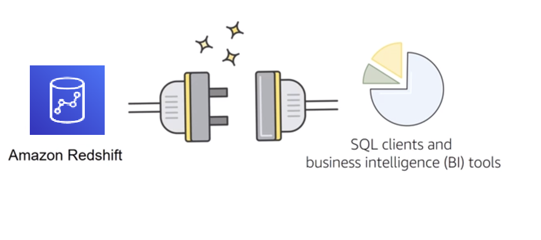

> **Нотатки:**
>
> Нарешті, Amazon Redshift сумісний з інструментами, які ви вже знаєте та використовуєте. Amazon Redshift підтримує стандартний SQL. Він також надає високопродуктивні конектори Java Database Connectivity (JDBC) і Open Database Connectivity (ODBC), що дають змогу використовувати клієнти SQL та інструменти BI на ваш вибір.  
>
> Далі ви розглянете деякі поширені сценарії використання Amazon Redshift.

---

## Слайд 45: Сценарії використання Amazon Redshift (1 із 2)

- Корпоративне сховище даних (enterprise data warehouse, EDW)
  - Міграція в темпі, зручному для клієнтів
  - Експерименти без великих початкових витрат чи зобов’язань
  - Швидше реагування на потреби бізнесу
- Великі дані (big data)
  - Низька цінова точка для малих клієнтів
  - Кероване обслуговування для простоти розгортання та підтримки
  - Більше зосередженості на даних і менше — на керуванні базою даних

> **Нотатки:**
>
> Цей слайд розглядає деякі сценарії використання Amazon Redshift.  
>
> Багато клієнтів переносять свої традиційні корпоративні сховища даних до Amazon Redshift з основною метою — гнучкістю (agility). Клієнти можуть почати з будь-якого бажаного масштабу й експериментувати зі своїми даними, не покладаючись на складні процеси з їхніми ІТ-відділами для придбання та підготовки програмного забезпечення.  
>
> Клієнти з великими даними мають одну спільну рису: величезні обсяги даних, що доводять їхні наявні системи до межі. Менші клієнти можуть не мати ресурсів для придбання апаратного забезпечення та експертизи, потрібних для експлуатації цих систем. З Amazon Redshift менші клієнти можуть швидко налаштувати й використовувати сховище даних за порівняно низькою ціною.  
>
> Як кероване обслуговування, Amazon Redshift виконує багато завдань із розгортання та поточної підтримки, які часто потребують адміністратора бази даних. Це дає клієнтам змогу зосередитися на запитах до своїх даних та їхньому аналізі.

---

## Слайд 46: Сценарії використання Amazon Redshift (2 із 2)

- Програмне забезпечення як послуга (software as a service, SaaS)
  - Масштабування потужності сховища даних у міру зростання попиту
  - Додавання аналітичної функціональності до застосунків
  - Зниження витрат на апаратне та програмне забезпечення

> **Нотатки:**
>
> Клієнти, що надають програмне забезпечення як послугу (SaaS), можуть скористатися масштабованими, простими в керуванні функціями, які надає Amazon Redshift. Деякі клієнти використовують Amazon Redshift, щоб надавати аналітичні можливості своїм застосункам. Деякі користувачі розгортають кластер на кожного клієнта та використовують теги (tagging) для спрощення керування своїми угодами про рівень обслуговування (service level agreements, SLA) і виставленням рахунків. Amazon Redshift може допомогти зменшити витрати на апаратне та програмне забезпечення.

---

## Слайд 47: Ключові висновки розділу 3

Функції Amazon Redshift:

- Швидкий, повністю керований сервіс сховища даних
- Легке масштабування без простою
- Стовпчикове зберігання та архітектури паралельної обробки
- Автоматичний і безперервний моніторинг кластера
- Шифрування вбудоване

> **Нотатки:**
>
> Підсумовуючи, Amazon Redshift — це швидкий, повністю керований сервіс сховища даних. У міру зростання бізнесу ви можете легко масштабуватися без простою, додаючи більше вузлів. Amazon Redshift автоматично додає вузли до вашого кластера й перерозподіляє дані для максимальної продуктивності.  
>
> Amazon Redshift розроблено для стабільного забезпечення високої продуктивності. Amazon Redshift використовує стовпчикове зберігання та архітектуру масово-паралельної обробки. Ці функції розпаралелюють і розподіляють дані та запити між кількома вузлами. Amazon Redshift також автоматично відстежує ваш кластер і створює резервні копії ваших даних, щоб за потреби їх можна було легко відновити. Шифрування вбудоване — вам потрібно лише його ввімкнути.  
>
> Щоб дізнатися більше про Amazon Redshift, див. https://aws.amazon.com/redshift/.

---

## Слайд 48: Розділ 4: Amazon Aurora

Модуль 8: Бази даних

> **Нотатки:**
>
> Представляємо Розділ 4: Amazon Aurora.

---

## Слайд 49: Amazon Aurora

- Реляційна база даних корпоративного класу
- Сумісна з MySQL або PostgreSQL
- Автоматизує трудомісткі завдання (як-от розгортання, виправлення, резервне копіювання, відновлення, виявлення збоїв і ремонт).

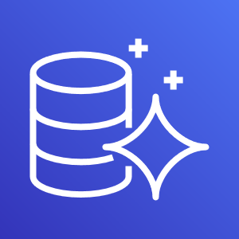

Amazon Aurora

> **Нотатки:**
>
> Amazon Aurora — це реляційна база даних, сумісна з MySQL і PostgreSQL, створена для хмари. Вона поєднує продуктивність і доступність високоякісних комерційних баз даних із простотою та економічністю баз даних з відкритим вихідним кодом. Використання Amazon Aurora може знизити витрати на вашу базу даних, водночас покращуючи її надійність і доступність. Як повністю кероване обслуговування, Aurora призначена для автоматизації трудомістких завдань, як-от розгортання, виправлення, резервне копіювання, відновлення, виявлення збоїв і ремонт.

---

## Слайд 50: Переваги сервісу Amazon Aurora

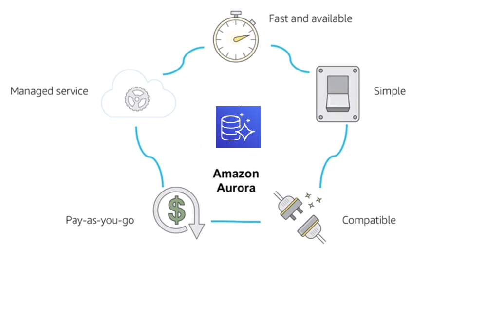

> **Нотатки:**
>
> Цей слайд охоплює деякі переваги Amazon Aurora. Вона високодоступна та пропонує швидку розподілену підсистему сховища. Amazon Aurora проста в налаштуванні та використовує запити SQL. Її розроблено так, щоб вона мала безпосередню сумісність (drop-in compatibility) з рушіями баз даних MySQL і PostgreSQL, тож ви можете використовувати більшість своїх наявних інструментів баз даних із невеликими змінами або зовсім без них.  
>
> Amazon Aurora — це сервіс з оплатою за фактом використання (pay-as-you-go), що означає, що ви платите лише за сервіси та функції, які використовуєте. Це кероване обслуговування, яке інтегрується з такими функціями, як AWS Database Migration Service (AWS DMS) та AWS Schema Conversion Tool. Ці функції призначені допомогти вам перенести ваш набір даних в Amazon Aurora.

---

## Слайд 51: Висока доступність

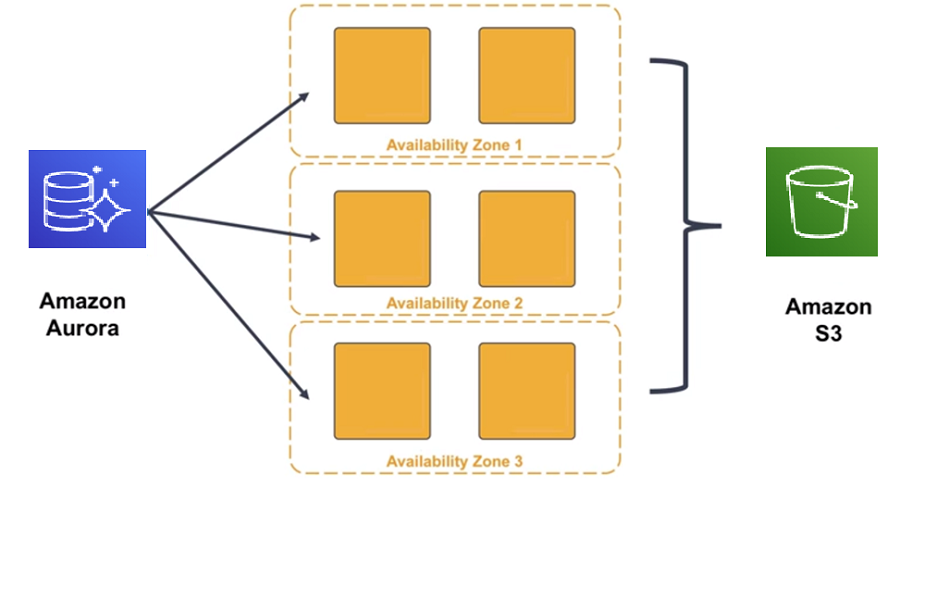

> **Нотатки:**
>
> Чому ви можете використовувати Amazon Aurora замість інших варіантів, як-от SQL з Amazon RDS? Більша частина цього рішення пов’язана з високою доступністю та стійкою архітектурою, які пропонує Amazon Aurora.  
>
> Amazon Aurora розроблено як високодоступну: вона зберігає кілька копій ваших даних у кількох зонах доступності з безперервним резервним копіюванням в Amazon S3. Amazon Aurora може використовувати до 15 реплік для читання, що зменшує ймовірність втрати ваших даних. Крім того, Amazon Aurora призначена для миттєвого відновлення після збою, якщо ваша основна база даних стає несправною.

---

## Слайд 52: Стійка архітектура (resilient design)

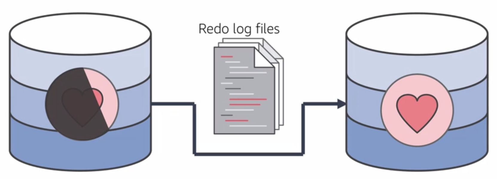

> **Нотатки:**
>
> Після збою бази даних Amazon Aurora не потрібно повторно відтворювати журнал повторного виконання (redo log) з останньої контрольної точки бази даних (checkpoint). Натомість вона виконує це під час кожної операції читання. Це скорочує час перезапуску після збою бази даних до менш ніж 60 секунд у більшості випадків.  
>
> В Amazon Aurora буферний кеш (buffer cache) винесено з процесу бази даних, що робить його доступним одразу після перезапуску. Це зменшує потребу обмежувати доступ, доки кеш не буде заповнено знову, щоб уникнути просідань продуктивності (brownouts).

---

## Слайд 53: Ключові висновки розділу 4

Функції Amazon Aurora:

- Висока продуктивність і масштабованість
- Висока доступність і довговічність
- Кілька рівнів безпеки
- Сумісність з MySQL і PostgreSQL
- Повністю кероване обслуговування

> **Нотатки:**
>
> Підсумовуючи, Amazon Aurora — це високодоступна, продуктивна та економічно ефективна керована реляційна база даних.  
>
> Aurora пропонує розподілену високопродуктивну підсистему сховища. Використання Amazon Aurora може знизити витрати на вашу базу даних, водночас покращуючи надійність бази даних.  
>
> Aurora також розроблено як високодоступну. Вона має відмовостійке сховище з самовідновленням, створене для хмари. Aurora реплікує кілька копій ваших даних у кількох зонах доступності та безперервно створює резервні копії ваших даних в Amazon S3.  
>
> Доступні кілька рівнів безпеки, зокрема мережева ізоляція за допомогою Amazon VPC; шифрування в стані спокою за допомогою ключів, які ви створюєте й контролюєте через AWS Key Management Service (AWS KMS); та шифрування даних під час передавання за допомогою Secure Sockets Layer (SSL).  
>
> Рушій бази даних Amazon Aurora сумісний з наявними базами даних MySQL і PostgreSQL з відкритим вихідним кодом і регулярно додає сумісність для нових випусків.  
>
> Нарешті, Amazon Aurora повністю керується Amazon RDS. Aurora автоматизує завдання керування базами даних, як-от розгортання апаратного забезпечення, встановлення виправлень програмного забезпечення, налаштування, конфігурація чи резервне копіювання.  
>
> Щоб дізнатися більше про Amazon Aurora, див. https://aws.amazon.com/rds/aurora/.

---

## Слайд 54: Правильний інструмент для правильного завдання

| What are my requirements? (Які мої вимоги?) |  |
|---|---|
| Реляційна база даних корпоративного класу | Amazon RDS |
| Швидкий і гнучкий сервіс баз даних NoSQL для будь-якого масштабу | Amazon DynamoDB |
| Доступ до операційної системи або функції застосунку, що не підтримуються сервісами баз даних AWS | Бази даних на Amazon EC2 |
| Специфічні вимоги, зумовлені конкретними випадками (машинне навчання, сховище даних, графи) | Спеціалізовані сервіси баз даних AWS (purpose-built) |

> **Нотатки:**
>
> Як ви бачили в цьому модулі, хмара продовжує знижувати вартість зберігання й обчислень. З’явилося нове покоління застосунків, що створило новий набір вимог до баз даних. Цим застосункам потрібні бази даних для зберігання терабайтів і петабайтів нових типів даних, надання доступу до даних із затримкою в мілісекунди, обробки мільйонів запитів на секунду та масштабування для підтримки мільйонів користувачів будь-де у світі. Щоб підтримати ці вимоги, вам потрібні як реляційні, так і нереляційні бази даних, спеціально створені для задоволення конкретних потреб ваших застосунків. AWS пропонує широкий спектр баз даних, створених для ваших конкретних сценаріїв використання застосунків.

---

## Слайд 55: Практична вправа з практичними прикладами баз даних (1 із 3)

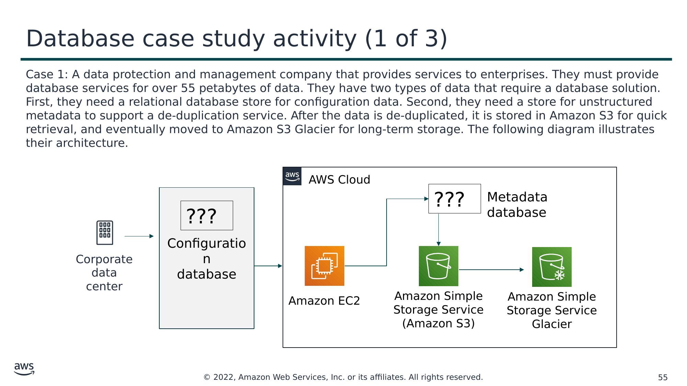

Текст зі схеми

Випадок 1: компанія із захисту та керування даними, що надає послуги підприємствам. Вона має надавати послуги баз даних для понад 55 петабайтів даних. У неї є два типи даних, що потребують рішення на основі бази даних. По-перше, їй потрібне сховище реляційної бази даних для даних конфігурації. По-друге, їй потрібне сховище для неструктурованих метаданих для підтримки сервісу дедуплікації. Після дедуплікації дані зберігаються в Amazon S3 для швидкого отримання, а згодом переміщуються в Amazon S3 Glacier для довгострокового зберігання. Наведена нижче схема ілюструє їхню архітектуру.

AWS Cloud

Configuration

database (База даних конфігурації)

???

Metadata database (База даних метаданих)

???

Corporate data center (Корпоративний центр обробки даних)

Amazon EC2

Amazon Simple Storage Service (Amazon S3)

Amazon Simple Storage Service Glacier

> **Нотатки:**
>
> У цій вправі ви розглянете один із трьох бізнес-сценаріїв, узятих із реальних клієнтів AWS. Розбийтеся на групи по чотири-п’ять осіб.  
>
> Розгляньте призначений вам практичний приклад (case study). Створіть презентацію, що описує найкраще рішення для бази даних для організації, описаної у випадку вашої групи. Ваша презентація має включати ключові чинники, які ви враховували, обираючи технологію бази даних, а також будь-які чинники, що могли б змінити вашу рекомендацію.

---

## Слайд 56: Практична вправа з практичними прикладами баз даних (2 із 3)

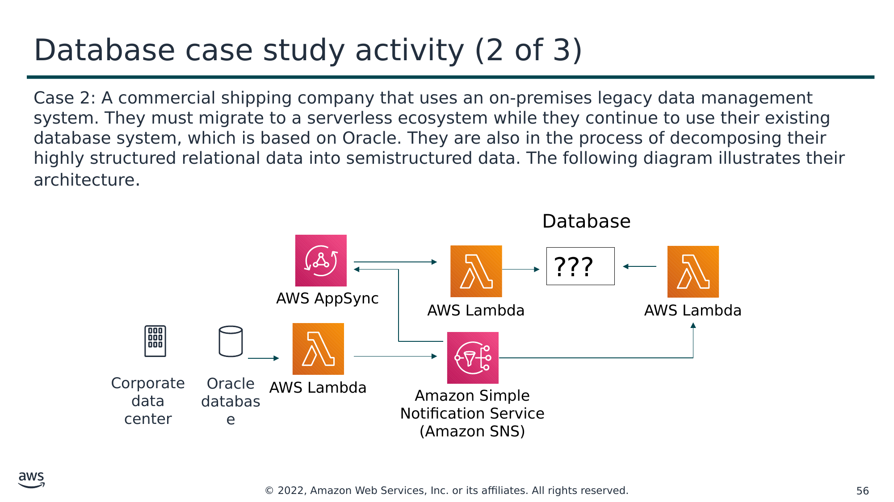

Текст зі схеми

Випадок 2: комерційна судноплавна компанія, що використовує локальну застарілу (legacy) систему керування даними. Вона має мігрувати в безсерверну екосистему (serverless ecosystem), продовжуючи використовувати наявну систему баз даних, що ґрунтується на Oracle. Вона також перебуває в процесі декомпозиції своїх високоструктурованих реляційних даних у напівструктуровані дані. Наведена нижче схема ілюструє їхню архітектуру.

Database (База даних)

???

AWS AppSync

AWS Lambda

AWS Lambda

Corporate data center (Корпоративний центр обробки даних)

Oracle database (База даних Oracle)

AWS Lambda

Amazon Simple Notification Service (Amazon SNS)

> **Нотатки:**
>
> Розгляньте призначений вам практичний приклад. Створіть презентацію, що описує найкраще рішення для бази даних для організації, описаної у випадку вашої групи. Ваша презентація має включати ключові чинники, які ви враховували, обираючи технологію бази даних, а також будь-які чинники, що могли б змінити вашу рекомендацію.

---

## Слайд 57: Практична вправа з практичних прикладів баз даних 3

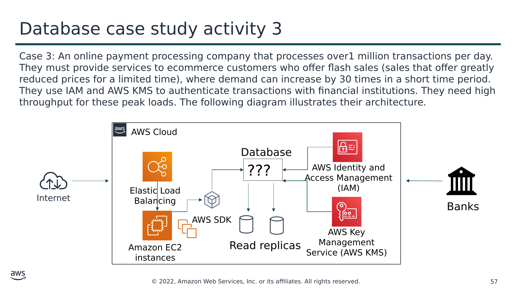

Текст зі схеми

Випадок 3: компанія з онлайн-обробки платежів, що обробляє понад 1 мільйон транзакцій на день. Вона має надавати послуги клієнтам електронної комерції, які проводять флеш-розпродажі (розпродажі з сильно зниженими цінами протягом обмеженого часу), коли попит може зрости в 30 разів за короткий період. Вони використовують IAM і AWS KMS для автентифікації транзакцій із фінансовими установами. Їм потрібна висока пропускна здатність для цих пікових навантажень. Наведена нижче схема ілюструє їхню архітектуру.

AWS Cloud

Database (База даних)

???

AWS Identity and Access Management (IAM)

Internet (Інтернет)

Elastic Load Balancing

Banks (Банки)

AWS SDK

AWS Key Management Service (AWS KMS)

Amazon EC2 instances (Екземпляри Amazon EC2)

Read replicas (Репліки для читання)

> **Нотатки:**
>
> Розгляньте призначений вам практичний приклад. Створіть презентацію, що описує найкраще рішення для бази даних для організації, описаної у випадку вашої групи. Ваша презентація має включати ключові чинники, які ви враховували, обираючи технологію бази даних, а також будь-які чинники, що могли б змінити вашу рекомендацію.

---

## Слайд 58: Підсумки модуля

Модуль 8: Бази даних

> **Нотатки:**
>
> Настав час повторити матеріал модуля та завершити його перевіркою знань і розбором запитання практичного сертифікаційного іспиту.

---

## Слайд 59: Резюме модуля

Підсумовуючи, у цьому модулі ви навчилися:

- Пояснювати Amazon Relational Database Service (Amazon RDS)
- Визначати функціональність Amazon RDS
- Пояснювати Amazon DynamoDB
- Визначати функціональність Amazon DynamoDB
- Пояснювати Amazon Redshift
- Пояснювати Amazon Aurora
- Виконувати завдання в базі даних RDS, як-от запуск, налаштування та взаємодія

> **Нотатки:**
>
> Підсумовуючи, у цьому модулі ви навчилися:  
> Пояснювати Amazon Relational Database Service (Amazon RDS)  
> Визначати функціональність Amazon RDS  
> Пояснювати Amazon DynamoDB  
> Визначати функціональність Amazon DynamoDB  
> Пояснювати Amazon Redshift  
> Пояснювати Amazon Aurora  
> Виконувати завдання в базі даних RDS, як-от запуск, налаштування та взаємодія

---

## Слайд 60: Пройдіть перевірку знань

> **Нотатки:**
>
> Викладач може вирішити провести обговорення ключових висновків із лабораторної роботи після її завершення.

---

## Слайд 61: Приклад запитання іспиту

Який із наведених сервісів є повністю керованим сервісом баз даних NoSQL?

Варіант

Відповідь

A

Amazon Relational Database Service (Amazon RDS)

B

Amazon DynamoDB

C

Amazon Aurora

D

Amazon Redshift

> **Нотатки:**
>
> Розгляньте варіанти відповідей і відсійте їх за ключовими словами.

---

## Слайд 62: Відповідь на приклад запитання іспиту

Який із наведених сервісів є повністю керованим сервісом баз даних NoSQL?

Правильна відповідь — B.

Ключові слова в запитанні: «сервіс баз даних NoSQL».

> **Нотатки:**
>
> Ключові слова, які потрібно розпізнати: «сервіс баз даних NoSQL».  
>
> Правильна відповідь — B.

---

## Слайд 63: Додаткові ресурси

- Сторінка AWS Database: [https://aws.amazon.com/products/databases/](https://aws.amazon.com/products/databases/)
- Сторінка Amazon RDS: [https://aws.amazon.com/rds/](https://aws.amazon.com/rds/)
- Огляд сервісів баз даних Amazon: [https://docs.aws.amazon.com/whitepapers/latest/aws-overview/database.html](https://docs.aws.amazon.com/whitepapers/latest/aws-overview/database.html)
- Початок роботи з базами даних AWS: [https://aws.amazon.com/products/databases/learn/](https://aws.amazon.com/products/databases/learn/)

> **Нотатки:**
>
> Якщо ви хочете дізнатися більше про теми, розглянуті в цьому модулі, вам можуть бути корисними такі додаткові ресурси:  
> Сторінка AWS Database: https://aws.amazon.com/products/databases/  
> Сторінка Amazon RDS: https://aws.amazon.com/rds/  
> Огляд сервісів баз даних Amazon: https://docs.aws.amazon.com/whitepapers/latest/aws-overview/database.html  
> Початок роботи з базами даних AWS: https://aws.amazon.com/products/databases/learn/

---

## Слайд 64: Дякуємо

Усі торговельні марки є власністю їхніх власників.

> **Нотатки:**
>
> Дякуємо, що пройшли цей модуль.
