## Слайд 1: Module 9: Cloud Architecture

AWS Academy Cloud Foundations

> **Нотатки:**
>
> Module 9: Cloud Architecture

---

## Слайд 2: Module overview

**Topics**

- AWS Well-Architected Framework
- Reliability and high availability
- AWS Trusted Advisor

**Activities**

- AWS Well-Architected Framework Design Principles
- Interpret AWS Trusted Advisor Recommendations

**Knowledge check**

> **Нотатки:**
>
> This module will address the following topics:  
> AWS Well-Architected Framework  
> Reliability and high availability  
> AWS Trusted Advisor  
>
> The module also includes two activities. In one activity, you will be challenged to review an architecture and evaluate it against the AWS Well-Architected Framework design principles. In the second activity, you will gain experience interpreting AWS Trusted Advisor recommendations.  
>
> Finally, you will be asked to complete a knowledge check that will test your understanding of key concepts covered in this module.

---

## Слайд 3: Module objectives

After completing this module, you should be able to:

- Describe the AWS Well-Architected Framework, including the six pillars
- Identify the design principles of the AWS Well-Architected Framework
- Explain the importance of reliability and high availability
- Identify how AWS Trusted Advisor helps customers
- Interpret AWS Trusted Advisor recommendations

> **Нотатки:**
>
> After completing this module, you should be able to:  
> Describe the AWS Well-Architected Framework, including the six pillars  
> Identify the design principles of the AWS Well-Architected Framework  
> Explain the importance of reliability and high availability  
> Identify how AWS Trusted Advisor helps customers  
> Interpret AWS Trusted Advisor recommendations

---

## Слайд 4: Section 1: AWS Well-Architected Framework

Module 9: Cloud Architecture

> **Нотатки:**
>
> Section 1: AWS Well-Architected Framework

---

## Слайд 5: Architecture: designing and building

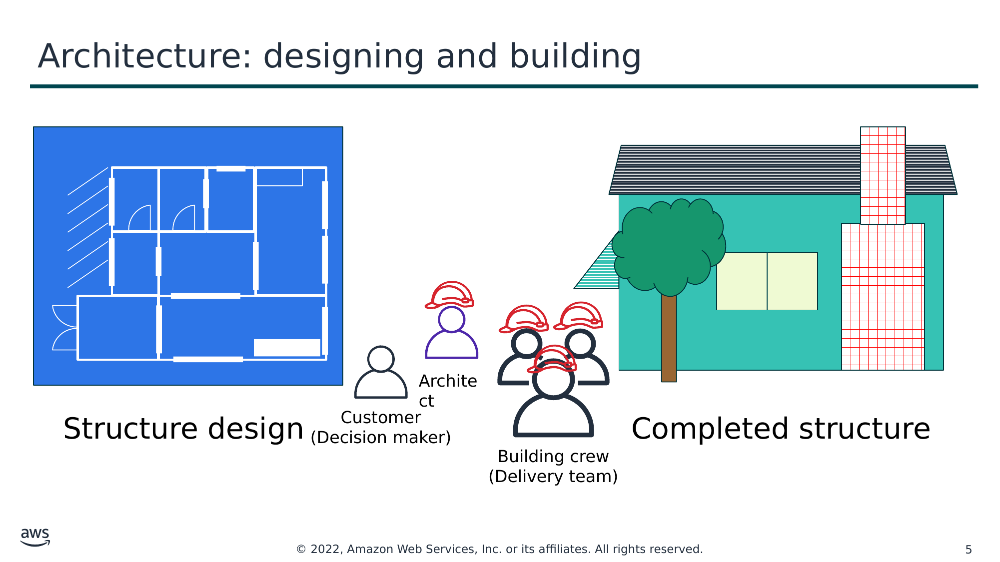

Текст зі схеми

Structure design

Customer  
(Decision maker)

Completed structure

Architect

Building crew  
(Delivery team)

> **Нотатки:**
>
> Architecture is the art and science of designing and building large structures. Large systems require architects to manage their size and complexity.  
>
> Cloud architects:  
> Engage with decision makers to identify the business goal and the capabilities that need improvement.  
> Ensure alignment between technology deliverables of a solution and the business goals.  
> Work with delivery teams that are implementing the solution to ensure that the technology features are appropriate.  
>
> Having well-architected systems greatly increases the likelihood of business success.

---

## Слайд 6: What is the AWS Well-Architected Framework?

- A guide for designing infrastructures that are:
  - Secure
  - High-performing
  - Resilient
  - Efficient
- A consistent approach to evaluating and implementing cloud architectures
- A way to provide best practices that were developed through lessons learned by reviewing customer architectures

> **Нотатки:**
>
> The AWS Well-Architected Framework is a guide that is designed to help you build the most secure, high-performing, resilient, and efficient infrastructure possible for your cloud applications and workloads. It provides a set of foundational questions and best practices that can help you evaluate and implement your cloud architectures. AWS developed the Well-Architected Framework after reviewing thousands of customer architectures on AWS.

---

## Слайд 7: Pillars of the AWS Well-Architected Framework

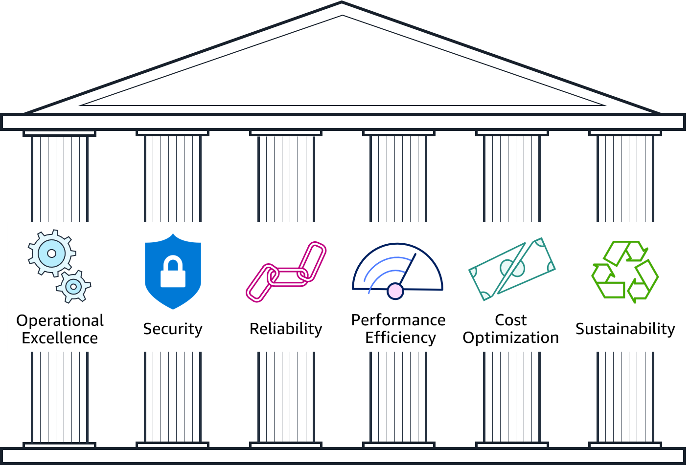

> **Нотатки:**
>
> The AWS Well-Architected Framework is organized into six pillars: operational excellence, security, reliability, performance efficiency, cost optimization, and sustainability.  The first five pillars have been part of the framework since the framework's introduction in 2015. The sustainability pillar was added as the sixth pillar in 2021 to help organizations learn how to minimize the environmental impacts of running cloud workloads.  
>
> The remainder of this module focuses on the first five pillars (operational excellence, security, reliability, performance efficiency, cost optimization) and leads you through a review of an example architecture against each pillar's design principles.  
> For more about the sustainability pillar, refer to the sustainability pillar section within the Well-Architected Framework documentation see https://docs.aws.amazon.com/wellarchitected/latest/sustainability-pillar/sustainability-pillar.html.  
>
> For accessibility: The pillars include operational excellence, security, reliability, performance efficiency, cost optimization, and sustainability. End of accessibility description.

---

## Слайд 8: Pillar organization

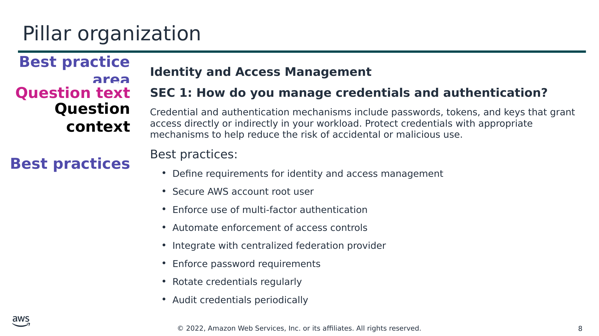

Текст зі схеми

**Best practice area**

**Identity and Access Management**

**SEC 1: How do you manage credentials and authentication?**

Credential and authentication mechanisms include passwords, tokens, and keys that grant access directly or indirectly in your workload. Protect credentials with appropriate mechanisms to help reduce the risk of accidental or malicious use.

Best practices:

- Define requirements for identity and access management
- Secure AWS account root user
- Enforce use of multi-factor authentication
- Automate enforcement of access controls
- Integrate with centralized federation provider
- Enforce password requirements
- Rotate credentials regularly
- Audit credentials periodically

**Question text**

**Question context**

**Best practices**

> **Нотатки:**
>
> Each pillar includes a set of design principles and best practice areas. Each best practice area aligns to questions a reviewer should ask when designing an architecture.  The questions for each pillar are part of the Well-Architected Framework Appendix.

---

## Слайд 9: Introduction to the AWS Well-Architected Framework Design Principles Activity

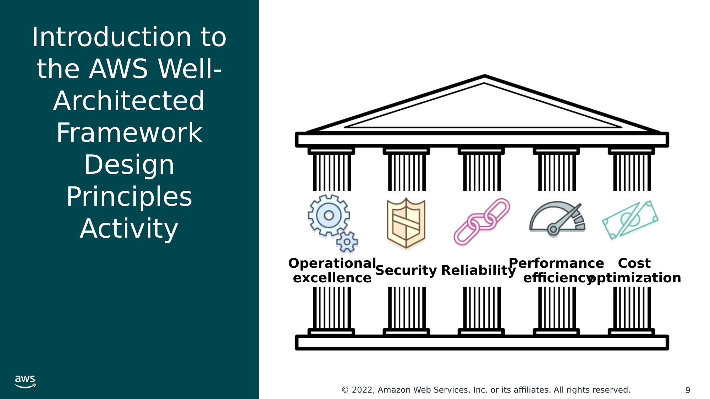

Текст зі схеми

**Operational**  
**excellence**

Security

Reliability

Performance  
 efficiency

Cost  
optimization

> **Нотатки:**
>
> As you go through the rest of this section, you will be prompted to review the architecture of a fictitious company using the AWS Well-Architected Framework design principles for each of the following five pillars: operational excellence, security, reliability, performance efficiency, and cost optimization.

---

## Слайд 10: AnyCompany background

- AnyCompany Corporation: “*Cityscapes you can stand over*”
- Founded in 2008 by John Doe
- Sells 3D-printed cityscapes
- About to apply for investment
- Has asked **you** to perform a review of their platform as part of their due diligence
- Cloud native

> **Нотатки:**
>
> Here’s the background of the company whose architecture you will be reviewing:  
>
> AnyCompany Corporation was founded in 2008 by John Doe. It sells high-quality three-dimensional (3D) printed cityscapes of neighborhoods that enable you to see individual buildings and trees. The cityscapes are printed in color, with brickwork, roofs, gardens, and even cars in their correct coloration.  
>
> The company is about to apply for private investment to fund their growth until their initial public offering (IPO). John and the board have asked you to perform an independent review of their technology platform to make sure that it will pass due diligence.  
>
> John was interested in using cloud computing from the start. In 2008, he created an account with AWS and spun up his first Amazon Elastic Compute Cloud (Amazon EC2) instance. Over the years, the architecture of the AnyCompany platform has evolved. John now has a team of five technologists who write and operate all the technology in the organization. John still writes core code for extracting structure from motion, but he has given the AWS account root user credentials to the rest of his team to manage.

---

## Слайд 11: AnyCompany background (continued)

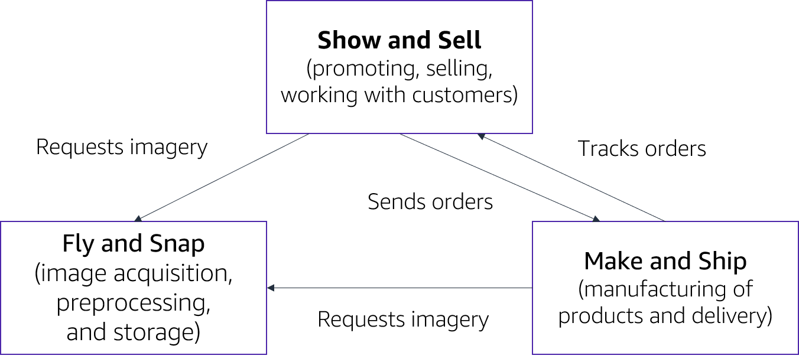

> **Нотатки:**
>
> AnyCompany Corporation has three main departments:  
> Fly and Snap – image acquisition, preprocessing, and storage  
> Show and Sell – promoting, selling, and working with customers  
> Make and Ship – manufacturing of products and delivery  
>
> The high-level design for the AnyCompany platform looks like the organizational structure of the company.  
>
> For accessibility: High-level design of mappahood platform: Show and Sell (promoting, selling, working with customers) sends orders and requests imagery. Make and Ship (manufacturing and delivery) tracks orders from Show and Sell and requests imagery from Fly and Snap (acquisition, preprocessing, and storage. End of accessibility description.

---

## Слайд 12: AnyCompany architecture: Fly and Snap

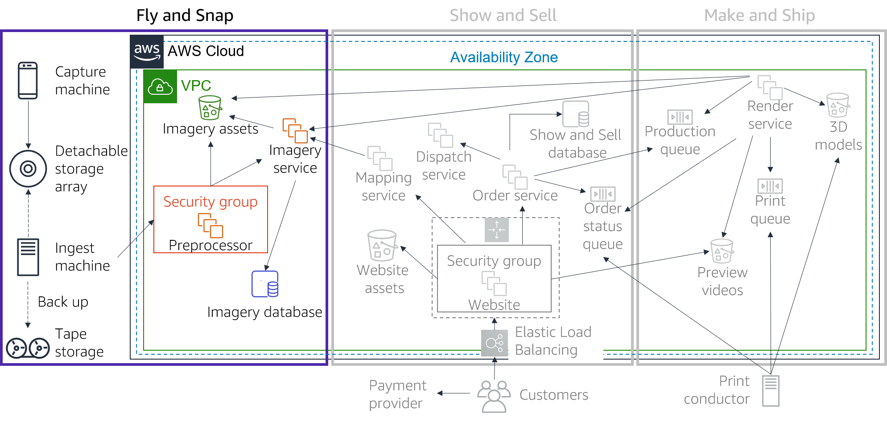

> **Нотатки:**
>
> Fly and Snap  
> Multiple devices (currently, camera and video cameras) are mounted on lightweight aircraft that capture imagery of major cities, including famous locations, on a scheduled basis. Each device generates imagery assets that are time-stamped with a clock that is synchronized with the aircraft’s clock. The imagery assets are streamed to the onboard Capture machine that has an external storage array. The Capture machine is also connected to the aircraft’s flight system and continuously captures navigation data—such as global positioning system (GPS) data, compass readings, and elevation.  
>
> When it returns to base, the storage array is disconnected and taken into an ingest bay. Here, the storage array is connected to an Ingest machine. The Ingest machine creates a compressed archive of the storage array and uses file transfer protocol (FTP) to send it to an EC2 instance Preprocessor machine. After the storage array has been processed, the archive is written to tape (for backup). The storage array is then cleared and ready for the next flight. Tapes are held offsite by a third-party backup provider.  
>
> The Preprocessor machine periodically processes new datasets that have been uploaded to it. It extracts all the imagery assets and stores them in an Amazon Simple Storage Service (Amazon S3) bucket. It notifies the Imagery service about the files and provides it with the flight information. The Imagery service uses the flight information to compute a 3D orientation and location for every moment of the flight, which it correlates to the imagery file timestamps. This information is stored in a relational database management system (RDBMS) that is based in Amazon EC2, with links to the imagery assets in Amazon S3.  
>
> For accessibility: Fly and snap architecture. A capture machine and an ingest machine sends imagery to a detachable storage array. The ingest machine also backs up to tape storage. End of accessibility description.

---

## Слайд 13: AnyCompany architecture: Show and Sell

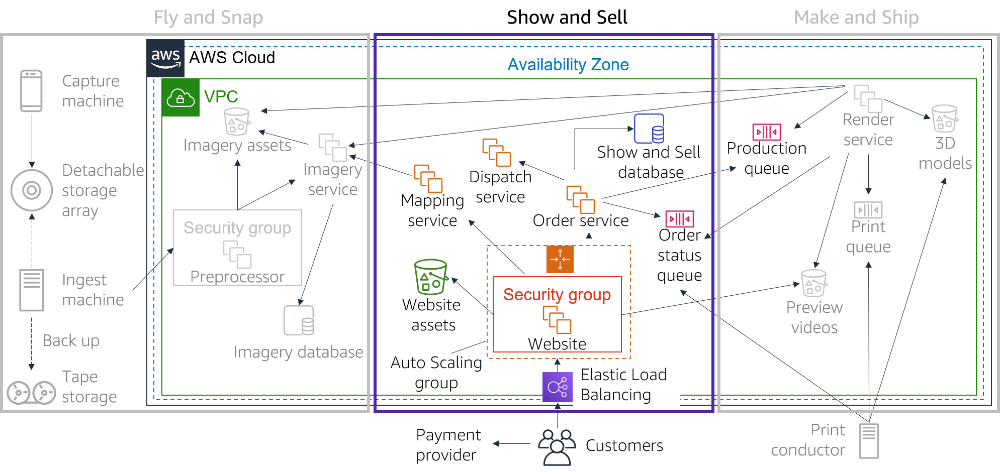

> **Нотатки:**
>
> Show and Sell  
> When customers visit the AnyCompany website, they can see images and videos of the physical product. These images are in a variety of formats (for example, a large-scale, walk-around map). The website uses Elastic Load Balancing with Hypertext Transfer Protocol Secure (HTTPS), and an Auto Scaling group of EC2 instances that run a content management system. Static website assets are stored in an S3 bucket.  
>
> Customers can select a location on a map and see a video preview of their cityscape. Customers can also choose the physical size of the map, choose the color scheme (available in white, monochrome, or full color), and have the option to place light-emitting diode (LED) holes in the map to build illuminated maps. The Mapping service correlates the map location input from the website with the Imagery service to confirm if imagery is available for that location.  
>
> If the customers are happy with the preview, they can order their cityscape. Customers pay by credit card. Credit card orders are processed by a certified third-party payment card industry (PCI)-compliant provider. AnyCompany does not process or store any credit card information.  
>
> After the website receives payment confirmation, it instructs the Order service to push the order to production. Orders (including customer details) are recorded in the Show and Sell database, which is an RDBMS that is based in Amazon EC2.  
>
> To initiate a video preview or full print of an order, the Orders service places a message on the Production queue, which allows the Render service to indicate when a preview video is available. The Order service also reads from the Order status queue and records status changes in the Show and Sell database. Customers can track their order through manufacturing and see when it has been dispatched, which is handled by a third party through the broker Dispatch service.

---

## Слайд 14: AnyCompany architecture: Make and Ship

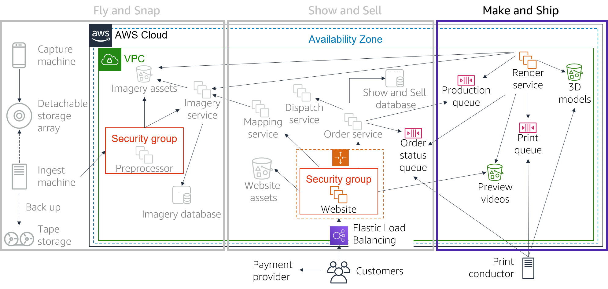

> **Нотатки:**
>
> Make and Ship  
> AnyCompany has proprietary technology that enables it to generate 3D models from a combination of photographs and video (extracting structure from motion).  
>
> The Render service is a fleet of g2.2xlarge instances. The Render service takes orders from the Production queue and generates the 3D models that are stored in an S3 bucket. The Render service also uses the 3D models to create flyby videos so that customers can preview their orders on the AnyCompany website. These videos are stored in a separate S3 bucket. Once a year, the team deletes old previews. However, models are kept in case they are needed for future projects.  
>
> After a customer places an order, a message is placed in the Print queue with a link to the 3D model. At each stage of the Make and Ship process, order status updates are posted to the Order status queue. This queue is consumed by the AnyCompany website, which shows the order history.  
>
> The Make and Ship team has four 3D printers that print high-resolution and detailed color-control models. An on-premises Print conductor machine takes orders from the Print queue and sends them to the next available printer. The Print conductor sends order updates to the Order status queue. The Print conductor sends a final update when the order has been completed, passed quality assurance, and is ready for dispatch.

---

## Слайд 15: Activity overview

- Break into small groups.
- You will learn about each of the pillars. At the end of each pillar, there is a set of questions from the AWS Well-Architected Framework for you to work through with your group. Use these Framework questions to guide your review of the AnyCompany architecture.
- For each Well-Architected Framework question, answer the following questions about the AnyCompany architecture:
  - What is the CURRENT STATE (what is AnyCompany doing now)?
  - What is the FUTURE STATE (what do you think AnyCompany should be doing?)
- Agree on the top improvement that AnyCompany should make to its architecture for each set of Well-Architected Framework questions.
- Hint: There are no right or wrong answers.

> **Нотатки:**
>
> For this activity, you will break into small groups. As you learn about each pillar, your group will work through a set of questions from the AWS Well-Architected Framework. You will use these Well-Architected Framework questions to guide your review of the AnyCompany architecture.  
>
> For each Well-Architected Framework question, your group will answer the following questions about the AnyCompany architecture:  
> What is the CURRENT STATE (what is AnyCompany doing now)?  
> What is the FUTURE STATE (what do you think AnyCompany should be doing)?  
>
> Your team must then agree on the top improvement that AnyCompany should make based on the answers to these three questions.  
>
> Note that there are no right or wrong answers. The AWS Well-Architected Framework questions are there to prompt discussion.  
>
> For prescriptive guidance on implementation, see the details for each pillar on the Well-Architected Framework website at https://docs.aws.amazon.com/wellarchitected/latest/framework/welcome.html. All of the questions for each pillar are part of the Well-Architected Framework Appendix.

---

## Слайд 16: Operational Excellence pillar

> **Нотатки:**
>
> Operational Excellence pillar

---

## Слайд 17: Operational Excellence pillar – deliver business value

**Operational Excellence**

**pillar**

- Focus
  - Run and monitor systems to deliver business value, and to continually improve supporting processes and procedures.
- Key topics
  - Automating changes
  - Responding to events
  - Defining standards to manage daily operations

Deliver business value

> **Нотатки:**
>
> The Operational Excellence pillar focuses on the ability to run and monitor systems to deliver business value, and to continually improve supporting processes and procedures. Key topics include: automating changes, responding to events, and defining standards to manage daily operations.

---

## Слайд 18: Operational excellence design principles

**Operational Excellence**

**pillar**

- Perform operations as code
- Make frequent, small, reversible changes
- Refine operations procedures frequently
- Anticipate failure
- Learn from all operational events and failures

Deliver business value

> **Нотатки:**
>
> There are five design principles for operational excellence in the cloud:  
> Perform operations as code – Define your entire workload (that is, applications and infrastructure) as code and update it with code. Implement operations procedures as code and configure them to automatically trigger in response to events. By performing operations as code, you limit human error and enable consistent responses to events.  
> Make frequent, small, reversible changes – Design workloads to enable components to be updated regularly. Make changes in small increments that can be reversed if they fail (without affecting customers when possible).  
> Refine operations procedures frequently – Look for opportunities to improve operations procedures. Evolve your procedures appropriately as your workloads evolve. Set up regular game days to review all procedures, validate their effectiveness, and ensure that teams are familiar with them.  
> Anticipate failure – Identify potential sources of failure so that they can be removed or mitigated. Test failure scenarios and validate your understanding of their impact. Test your response procedures to ensure that they are effective and that teams know how to run them. Set up regular game days to test workloads and team responses to simulated events.  
> Learn from all operational failures – Drive improvement through lessons learned from all operational events and failures. Share what is learned across teams and through the entire organization.

---

## Слайд 19: Operational excellence questions

Organization

- How do you determine what your priorities are?
- How do you structure your organization to support your business outcomes?
- How does your organizational culture support your business outcomes?

Prepare

- How do you design your workload so that you can understand its state?
- How do you reduce defects, ease remediation, and improve flow into production?
- How do you mitigate deployment risks?
- How do you know that you are ready to support a workload?

Operate

- How do you understand the health of your workload?
- How do you understand the health of your operations?
- How do you manage workload and operations events?

Evolve

- How do you evolve operations?

> **Нотатки:**
>
> The foundational questions for operational excellence fall under three best practice areas: organization, prepare, operate, and evolve.  
>
> Operations teams must understand business and customer needs so they can effectively and efficiently support business outcomes. Operations teams create and use procedures to respond to operational events and validate the effectiveness of procedures to support business needs. Operations teams collect metrics that are used to measure the achievement of desired business outcomes. As business context, business priorities, and customer needs, change over time, it’s important to design operations that evolve in response to change and to incorporate lessons learned through their performance.

---

## Слайд 20: Operational excellence activity breakout

> **Нотатки:**
>
> Here is the entire AnyCompany architecture for you to consult as you complete the activity. Refer to the notes for the AnyCompany background and architecture slides to help you with this exercise. You might also want to refer to the Appendix in the AWS Well-Architected Framework at https://d1.awsstatic.com/whitepapers/architecture/AWS_Well-Architected_Framework.pdf.  
>
> 1. Review the following three operational excellence questions from the AWS Well-Architected Framework:  
> OPS 4: How do you design your workload so that you can understand its state?  
> OPS 6: How do you mitigate deployment risk?  
> OPS 7: How do you know that you are ready to support a workload?  
>
> 2. For each Well-Architected Framework question, answer what is the current state of the AnyCompany architecture and what is the final state.  
>
> 3. Agree on the top improvement that AnyCompany should make.

---

## Слайд 21: Security pillar

> **Нотатки:**
>
> Security pillar

---

## Слайд 22: Security pillar – protect and monitor systems

**Security**

**pillar**

- Focus
  - Protect information, systems, and assets while delivering business value through risk assessments and mitigation strategies.
- Key topics
  - Protecting confidentiality and integrity of data
  - Identifying and managing who can do what
  - Protecting systems
  - Establishing controls to detect security events

Protect and monitor systems

> **Нотатки:**
>
> The Security pillar focuses on the ability to protect information, systems, and assets while delivering business value through risk assessments and mitigation strategies. Key topics include: protecting confidentiality and integrity of data, identifying and managing who can do what (or privilege management), protecting systems, and establishing controls to detect security events.

---

## Слайд 23: Security design principles

**Security**

**pillar**

- Implement a strong identity foundation
- Enable traceability
- Apply security at all layers
- Automate security best practices
- Protect data in transit and at rest
- Keep people away from data
- Prepare for security events

Protect and monitor systems

> **Нотатки:**
>
> There are seven design principles that can improve security:  
> Implement a strong identity foundation – Implement the principle of least privilege and enforce separation of duties with appropriate authorization for each interaction with your AWS resources. Centralize privilege management and reduce or even eliminate reliance on long-term credentials.  
> Enable traceability – Monitor, alert, and audit actions and changes to your environment in real time. Integrate logs and metrics with systems to automatically respond and take action.  
> Apply security at all layers – Apply defense in depth and apply security controls to all layers of your architecture (for example, edge network, virtual private cloud, subnet, and load balancer; and every instance, operating system, and application).  
> Automate security best practices – Automate security mechanisms to improve your ability to securely scale more rapidly and cost effectively. Create secure architectures and implement controls that are defined and managed as code in version-controlled templates.  
> Protect data in transit and at rest – Classify your data into sensitivity levels and use mechanisms such as encryption, tokenization, and access control where appropriate.  
> Keep people away from data – To reduce the risk of loss or modification of sensitive data due to human error, create mechanisms and tools to reduce or eliminate the need for direct access or manual processing of data.  
> Prepare for security events – Have an incident management process that aligns with organizational requirements. Run incident response simulations and use tools with automation to increase your speed of detection, investigation, and recovery.

---

## Слайд 24: Security questions

Security

- How do you securely operate your workload?

Identity and access management

- How do you manage identities for people and machines?
- How do you manage permissions for people and machines?

Detection

- How do you detect and investigate security events?

Infrastructure protection

- How do you protect your network resources?
- How do you protect your compute resources?

Data protection

- How do you classify your data?
- How do you protect your data at rest?
- How do you protect your data in transit?

Incident response

- How do you anticipate, respond to, and recover from incidents?

> **Нотатки:**
>
> The foundational questions for security fall under six best practice areas: security, identity and access management, detection, infrastructure protection, data protection, and incident response.  
>
> Before you architect any system, you must put security practices in place. You must be able to control who can do what. In addition, you must be able to identify security incidents, protect your systems and services, and maintain the confidentiality and integrity of data through data protection. You should have a well-defined and practiced process for responding to security incidents. These tools and techniques are important because they support objectives such as preventing financial loss or complying with regulatory obligations.

---

## Слайд 25: Security activity breakout

> **Нотатки:**
>
> Here is the entire AnyCompany architecture for you to consult as you complete the activity. Refer to the notes for the AnyCompany background and architecture slides to help you with this exercise. You might also want to refer to the Appendix in the AWS Well-Architected Framework at https://d1.awsstatic.com/whitepapers/architecture/AWS_Well-Architected_Framework.pdf.  
>
> 1. Review the following three security questions from the AWS Well-Architected Framework:  
> SEC 1: How do you securely operate your workload?  
> SEC 4: How do you detect and investigate security events?  
> SEC 6: How do you protect your compute resources?  
>
> 2. For each Well-Architected Framework question, answer what is the current state of the AnyCompany architecture and what is the final state.  
>
> 3. Agree on the top improvement that AnyCompany should make.

---

## Слайд 26: Reliability pillar

> **Нотатки:**
>
> Reliability pillar

---

## Слайд 27: Reliability pillar – recover from failure and mitigate disruption

**Reliability**

**pillar**

- Focus
  - Ensure a workload performs its intended function correctly and consistently when it’s expected to.
- Key topics
  - Designing distributed systems
  - Recovery planning
  - Handling change

Recover from failure and mitigate disruption.

> **Нотатки:**
>
> The Reliability pillar focuses on ensuring a workload performs its intended function correctly and consistently when it’s expected to. A resilient workload quickly recovers from failures to meet business and customer demand. Key topics include: designing distributed systems, recovery planning, and handling change.

---

## Слайд 28: Reliability design principles

**Reliability**

**pillar**

- Automatically recover from failure
- Test recovery procedures
- Scale horizontally to increase aggregate workload availability
- Stop guessing capacity
- Manage change in automation

Recover from failure and mitigate disruption.

> **Нотатки:**
>
> There are five design principles that can increase reliability:  
> Automatically recover from failure – Monitor systems for key performance indicators and configure your systems to trigger an automated recovery when a threshold is breached. This practice enables automatic notification and failure-tracking, and for automated recovery processes that work around or repair the failure.  
> Test recovery procedures – Test how your systems fail and validate your recovery procedures. Use automation to simulate different failures or to recreate scenarios that led to failures before. This practice can expose failure pathways that you can test and rectify before a real failure scenario.  
> Scale horizontally to increase aggregate workload availability – Replace one large resource with multiple, smaller resources and distribute requests across these smaller resources to reduce the impact of a single point of failure on the overall system.  
> Stop guessing capacity – Monitor demand and system usage, and automate the addition or removal of resources to maintain the optimal level for satisfying demand.  
> Manage change in automation – Use automation to make changes to infrastructure and manage changes in automation.

---

## Слайд 29: Reliability questions

Foundations

- How do you manage service quotas and constraints?
- How do you plan your network topology?

Workload architecture

- How do you design your workload service architecture?
- How do you design interactions in a distributed system to prevent failure?
- How do you design interactions in a distributed system to mitigate or withstand failures?

Change management

- How do you monitor workload resources?
- How do you design your workload to adapt to changes in demand?
- How do you implement change?

Failure management

- How do you back up data?
- How do you use fault isolation to protect your workload?
- How do you design your workload to withstand component failures?
- How do you test reliability?
- How do you plan for disaster recovery?

> **Нотатки:**
>
> The foundational questions for reliability fall under four best practice areas: foundations, workload architecture, change management, and failure management.  
>
> To achieve reliability, a system must have both a well-planned foundation and monitoring in place. It must have mechanisms for handling changes in demand or requirements. The system should be designed to detect failure and automatically heal itself.

---

## Слайд 30: Activity breakout

> **Нотатки:**
>
> Here is the entire AnyCompany architecture for you to consult as you complete the activity. Refer to the notes for the AnyCompany background and architecture slides to help you with this exercise. You might also want to refer to the Appendix in the AWS Well-Architected Framework at https://d1.awsstatic.com/whitepapers/architecture/AWS_Well-Architected_Framework.pdf.  
>
> 1. Review the following three reliability questions from the AWS Well-Architected Framework:  
> REL 2: How do you plan your network topology?  
> REL 7: How do you design your system to adapt to changes in demand?  
> REL 9: How do you back up data?  
>
> 2. For each Well-Architected Framework question, answer what is the current state of the AnyCompany architecture and what is the final state.  
>
> 3. Agree on the top improvement that AnyCompany should make.

---

## Слайд 31: Performance Efficiency pillar

> **Нотатки:**
>
> Performance Efficiency pillar

---

## Слайд 32: Performance Efficiency pillar – use resources sparingly

**Performance Efficiency**

**pillar**

- Focus
  - Use IT and computing resources efficiently to meet system requirements and to maintain that efficiency as demand changes and technologies evolve.
- Key topics
  - Selecting the right resource types and sizes based on workload requirements
  - Monitoring performance
  - Making informed decisions to maintain efficiency as business needs evolve

Use resources sparingly.

> **Нотатки:**
>
> The Performance Efficiency pillar focuses on the ability to use IT and computing resources efficiently to meet system requirements, and to maintain that efficiency as demand changes or technologies evolve. Key topics include: selecting the right resource types and sizes based on workload requirements, monitoring performance, and making informed decisions to maintain efficiency as business needs evolve.

---

## Слайд 33: Performance efficiency design principles

**Performance Efficiency**

**pillar**

- Democratize advanced technologies
- Go global in minutes
- Use serverless architectures
- Experiment more often
- Consider mechanical sympathy

Use resources sparingly.

> **Нотатки:**
>
> There are five design principles that can improve performance efficiency:  
> Democratize advanced technologies – Consume technologies as a service. For example, technologies such as NoSQL databases, media transcoding, and machine learning require expertise that is not evenly dispersed across the technical community. In the cloud, these technologies become services that teams can consume. Consuming technologies enables teams to focus on product development instead of resource provisioning and management.  
> Go global in minutes – Deploy systems in multiple AWS Regions to provide lower latency and a better customer experience at minimal cost.  
> Use serverless architectures – Serverless architectures remove the operational burden of running and maintaining servers to carry out traditional compute activities. Serverless architectures can also lower transactional costs because managed services operate at cloud scale.  
> Experiment more often – Perform comparative testing of different types of instances, storage, or configurations.  
> Consider mechanical sympathy – Use the technology approach that aligns best to what you are trying to achieve. For example, consider your data access patterns when you select approaches for databases or storage.

---

## Слайд 34: Performance efficiency questions

Selection

- How do you select the best performing architecture?
- How do you select your compute solution?
- How do you select your storage solution?
- How do you select your database solution?
- How do you configure your networking solution?

Review

- How do you evolve your workload to take advantage of new releases?

Monitoring

- How do you monitor your resources to ensure they are performing?

Tradeoffs

- How do you use tradeoffs to improve performance?

> **Нотатки:**
>
> The foundational questions for performance efficiency fall under four best practice areas: selection, review, monitoring, and tradeoffs.  
>
> Use data to design and build a high-performance architecture. Gather data on all aspects of the architecture, from the high-level design to the selection and configuration of resource types. Review your choices periodically to ensure that you are taking advantage of new AWS services. Perform monitoring so that you are aware of any deviance from expected performance and can take prompt action to remediate them. Finally, use tradeoffs in your architecture to improve performance, such as using compression, using caching, or relaxing consistency requirements.

---

## Слайд 35: Activity breakout 1

Activity breakout

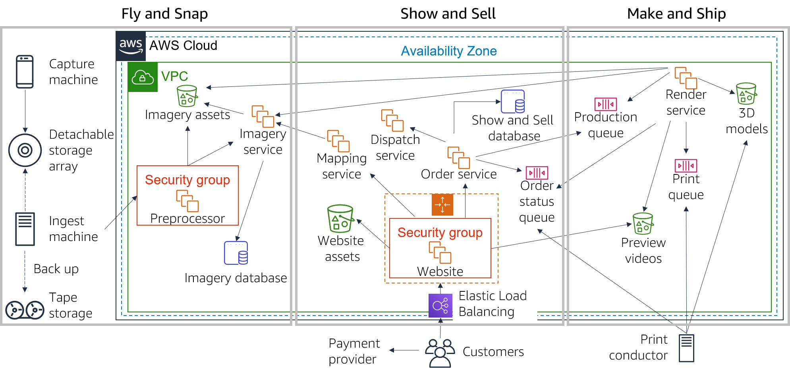

> **Нотатки:**
>
> Here is the entire AnyCompany architecture for you to consult as you complete the activity. Refer to the notes for the AnyCompany background and architecture slides to help you with this exercise. You might also want to refer to the Appendix in the AWS Well-Architected Framework at https://d1.awsstatic.com/whitepapers/architecture/AWS_Well-Architected_Framework.pdf  
>
> 1. Review the following three performance efficiency questions from the AWS Well-Architected Framework:  
> PERF 1: How do you select the best performing architecture?  
> PERF 2: How do you select your compute solution?  
> PERF 4: How do you select your database solution?  
>
> 2. For each Well-Architected Framework question, answer what is the current state of the AnyCompany architecture and what is the final state.  
>
> 3. Agree on the top improvement that AnyCompany should make.

---

## Слайд 36: Cost Optimization pillar

> **Нотатки:**
>
> Cost Optimization pillar

---

## Слайд 37: Cost Optimization pillar – eliminate unneeded expense

**Cost Optimization**  
**pillar**

- Focus
  - Avoid unnecessary costs.
- Key topics
  - Understanding and controlling where money is being spent
  - Selecting the most appropriate and right number of resource types
  - Analyzing spend over time
  - Scaling to meeting business needs without overspending

Eliminate unneeded expense.

> **Нотатки:**
>
> The Cost Optimization pillar focuses on the ability to avoid unnecessary costs. Key topics include: understanding and controlling where money is being spent, selecting the most appropriate and right number of resource types, analyzing spend over time, and scaling to meeting business needs without overspending.

---

## Слайд 38: Cost optimization design principles

**Cost Optimization**  
**pillar**

- Implement Cloud Financial Management
- Adopt a consumption model
- Measure overall efficiency
- Stop spending money on undifferentiated heavy lifting
- Analyze and attribute expenditure

Eliminate unneeded expense.

> **Нотатки:**
>
> There are five design principles that can optimize costs:  
> Implement Cloud Financial Management – To achieve financial success and accelerate business value realization in the cloud, you need to invest in cloud financial management and cost optimization. You need to build capability through knowledge building, programs, resources, and processes to become a cost-efficient organization.  
> Adopt a consumption model – Pay only for the computing resources that you require. Increase or decrease usage depending on business requirements, not by using elaborate forecasting.  
> Measure overall efficiency – Measure the business output of the workload and the costs that are associated with delivering it. Use this measure to know the gains that you make from increasing output and reducing costs.  
> Stop spending money on undifferentiated heavy lifting – AWS does the heavy lifting of racking, stacking, and powering servers, which means that you can focus on your customers and business projects instead of the IT infrastructure.  
> Analyze and attribute expenditure – The cloud makes it easier to accurately identify system usage and costs, and attribute IT costs to individual workload owners. Having this capability helps you measure return on investment (ROI) and gives workload owners an opportunity to optimize their resources and reduce costs.

---

## Слайд 39: Cost optimization questions

Practice cloud financial management

- How do you implement cloud financial management?

Expenditure and usage awareness

- How do you govern usage?
- How do you monitor usage and cost?
- How do you decommission resources?

Cost-effective resources

- How do you evaluate cost when you select services?
- How do you meet cost targets when you select resource type, size, and number?
- How do you use pricing models to reduce cost?
- How do you plan for data transfer changes?

Manage demand and supply resources

- How do you manage demand and supply resources?

Optimize over time

- How do you evaluate new services?

> **Нотатки:**
>
> The foundational questions for cost optimization fall under five best practice areas: practice cloud financial management, expenditure and usage awareness, cost-effective resources, manage demand and supply resources, and optimize over time.  
>
> Similar to the other pillars, there are tradeoffs to consider when evaluating cost. For example, you may choose to prioritize for speed—going to market quickly, shipping new features, or simply meeting a deadline—instead of investing in upfront cost optimization. As another example, designing an application for a higher level of availability typically costs more. You should identify your true application needs and use empirical data to inform your architectural design decisions. Perform benchmarking to establish the most cost-optimal workload over time.

---

## Слайд 40: Activity breakout 2

Activity breakout

> **Нотатки:**
>
> Here is the entire AnyCompany architecture for you to consult as you complete the activity. Refer to the notes for the AnyCompany background and architecture slides to help you with this exercise. You might also want to refer to the Appendix in the AWS Well-Architected Framework at https://d1.awsstatic.com/whitepapers/architecture/AWS_Well-Architected_Framework.pdf.  
>
> 1. Review the following three cost optimization questions from the AWS Well-Architected Framework:  
> COST 2: How do you govern usage?  
> COST 6: How do you meet cost targets when you select resource type, size, and number?  
> COST 7: How do you use pricing models to reduce cost?  
>
> 2. For each Well-Architected Framework question, answer what is the current state of the AnyCompany architecture and what is the final state.  
>
> 3. Agree on the top improvement that AnyCompany should make.

---

## Слайд 41: The AWS Well-Architected Tool

- Helps you review the state of your workloads and compares them to the latest AWS architectural best practices
- Gives you access to knowledge and best practices used by AWS architects, whenever you need it
- Delivers an action plan with step-by-step guidance on how to build better workloads for the cloud
- Provides a consistent process for you to review and measure your cloud architectures

> **Нотатки:**
>
> The activity that you just completed is similar to how you would use the AWS Well-Architected Tool.  
>
> The AWS Well-Architected Tool helps you review the state of your workloads and compare them to the latest AWS architectural best practices. It gives you access to knowledge and best practices used by AWS architects, whenever you need it.  
>
> This tool is available in the AWS Management Console. You define your workload and answer a series of questions in the areas of operational excellence, security, reliability, performance efficiency, and cost optimization (as defined in the AWS Well-Architected Framework). The AWS Well-Architected Tool then delivers an action plan with step-by-step guidance on how to improve your workload for the cloud.  
>
> The AWS Well-Architected Tool provides a consistent process for you to review and measure your cloud architectures. You can use the results that the tool provides to identify next steps for improvement, drive architectural decisions, and bring architecture considerations into your corporate governance process.

---

## Слайд 42: Section 1 key takeaways

- The AWS Well-Architected Framework provides a consistent approach to evaluate cloud architectures and guidance to help implement designs.
- The AWS Well-Architected Framework documents a set of design principles and best practices that enable you to understand if a specific architecture aligns well with cloud best practices.
- The AWS Well-Architected Framework is organized into six pillars.
- Each pillar includes its own set of design principles and best practices.

> **Нотатки:**
>
> Some key takeaways from this section of the module include:  
> The AWS Well-Architected Framework provides a consistent approach to evaluate cloud architectures and guidance to help implement designs.  
> The AWS Well-Architected Framework documents a set of design principles and best practices that enable you to understand if a specific architecture aligns well with cloud best practices.  
> The AWS Well-Architected Framework is organized into six pillars.  
> Each pillar includes its own set of design principles and best practices.

---

## Слайд 43: Section 2: Reliability and availability

Module 9: Cloud Architecture

> **Нотатки:**
>
> Section 2: Reliability and availability

---

## Слайд 44: “Everything fails, all the time.” Werner Vogels, CTO, Amazon.com

> **Нотатки:**
>
> In the words of Werner Vogels, Amazon’s CTO, “Everything fails, all the time.” One of the best practices that is identified in the AWS Well-Architected Framework is to plan for failure (or application or workload downtime). One way to do that is to architect your applications and workloads to withstand failure. There are two important factors that cloud architects consider when designing architectures to withstand failure: reliability and availability.

---

## Слайд 45: Reliability

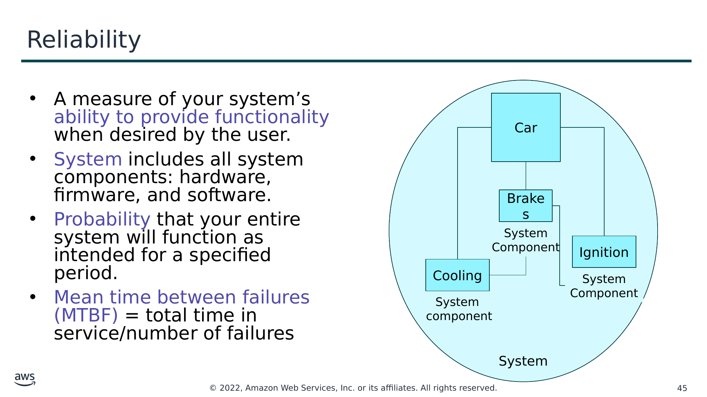

Текст зі схеми

- A measure of your system’s ability to provide functionality when desired by the user.
- System includes all system components: hardware, firmware, and software.
- Probability that your entire system will function as intended for a specified period.
- Mean time between failures (MTBF) = total time in service/number of failures

Car

Brakes

System  
Component

Ignition

Cooling

System

Component

System  
component

System

> **Нотатки:**
>
> Reliability is a measure of your system’s ability to provide functionality when desired by the user. Because "everything fails, all the time," you should think of reliability in statistical terms. Reliability is the probability that an entire system will function as intended for a specified period. Note that a system includes all system components, such as hardware, firmware, and software. Failure of system components impacts the availability of the system.  
>
> To understand reliability, it is helpful to consider the familiar example of a car. The car is the system. Each of the car’s components (for example, cooling, ignition, and brakes) must work together in order for the car to work properly. If you try to start the car and the ignition fails, you cannot drive anywhere—the car is not available. If the ignition fails repeatedly, your car is not considered reliable.  
>
> A common way to measure reliability is to use statistical measurements, such as Mean Time Between Failures (MTBF). MTBF is the total time in service over the number of failures.

---

## Слайд 46: Understanding reliability metrics

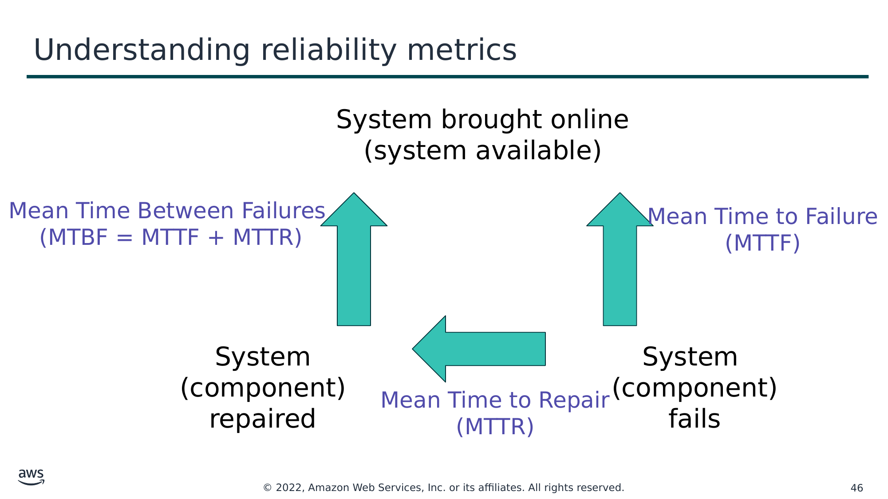

Текст зі схеми

System brought online  
(system available)

Mean Time Between Failures  
(MTBF = MTTF + MTTR)

Mean Time to Failure  
(MTTF)

System  
(component)  
repaired

System  
(component)  
fails

Mean Time to Repair  
(MTTR)

> **Нотатки:**
>
> Say that you have an application that you bring online Monday at noon. The application is said to be available. It functions normally until it fails Friday at noon. Therefore, the time to failure (or the length of time the application is available) is 96 hours. You spend from Friday at noon until Monday at noon diagnosing why the application failed and repairing it, at which point you bring the application back online. Therefore, the time to repair is 72 hours.  
>
> Then, it happens again: the application fails on Friday at noon, you spend from Friday at noon until Monday at noon repairing it, and you bring it online on Monday at noon.  
>
> Say this failure-repair-restore cycle happens every week. You can now calculate the average of these numbers. In this example, your mean time to failure (MTTF) is 96 hours, and your mean time to repair (MTTR) is 72 hours. Your mean time between failures (MTBF) is 168 hours (or 1 week), which is the sum of MTTF and MTTR.

---

## Слайд 47: Availability

- Normal operation time / total time
- A percentage of uptime (for example, 99.9 percent) over time (for example, 1 year)
- Number of 9s – Five 9s means 99.999 percent availability

> **Нотатки:**
>
> As you just learned, failure of system components impacts the availability of the system.  
>
> Formally, availability is the percentage of time that a system is operating normally or correctly performing the operations expected of it (or normal operation time over total time). Availability is reduced anytime the application isn’t operating normally, including both scheduled and unscheduled interruptions.  
>
> Availability is also defined as the percentage of uptime (that is, length of time that a system is online between failures) over a period of time (commonly 1 year).  
>
> A common shorthand when referring to availability is number of 9s. For example, five 9s means 99.999 percent availability.

---

## Слайд 48: High availability

- System can withstand some measure of degradation while still remaining available.
- Downtime is minimized.
- Minimal human intervention is required.

> **Нотатки:**
>
> A highly available system is one that can withstand some measure of degradation while still remaining available. In a highly available system, downtime is minimized as much as possible and minimal human intervention is required.  
>
> A highly available system can be viewed as a set of system-wide, shared resources that cooperate to guarantee essential services. High availability combines software with open-standard hardware to minimize downtime by quickly restoring essential services when a system, component, or application fails. Services are restored rapidly, often in less than 1 minute.

---

## Слайд 49: Availability tiers

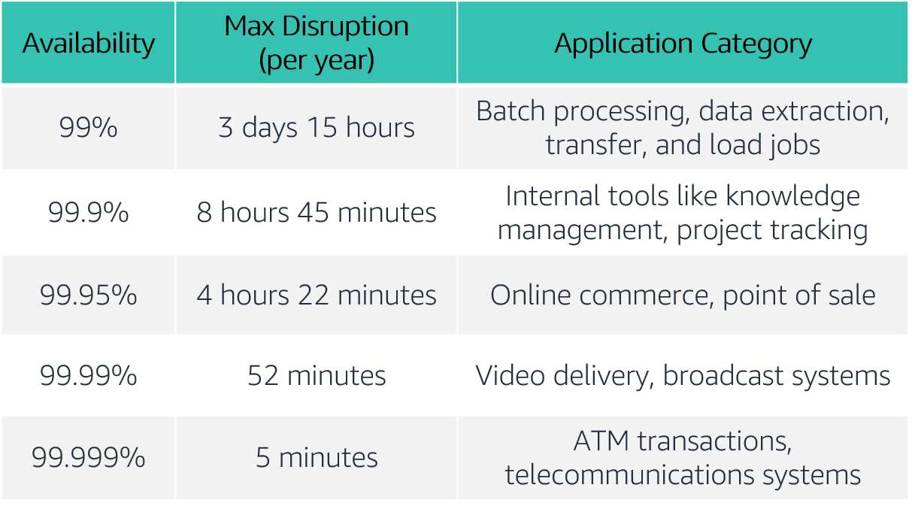

> **Нотатки:**
>
> Availability requirements vary. The length of disruption that is acceptable depends on the type of application. Here is a table of common application availability design goals and the maximum length of disruption that can occur within a year while still meeting the goal. The table contains examples of the types of applications that are common at each availability tier.  
>
> For accessibility: Availability tiers with max disruption per year and application categories. The tiers range from availabilities of 99 percent to 99.999 percent. End of accessibility description.

---

## Слайд 50: Factors that influence availability

**Fault tolerance**

- The built-in redundancy of an application's components and its ability to remain operational.

**Scalability**

- The ability of an application to accommodate increases in capacity needs without changing design.

**Recoverability**

- The process, policies, and procedures that are related to restoring service after a catastrophic event.

> **Нотатки:**
>
> Though events that might disrupt an application’s availability cannot always be predicted, you can build availability into your architecture design. There are three factors that determine the overall availability of your application:  
> Fault tolerance refers to the built-in redundancy of an application's components and the ability of the application to remain operational even if some of its components fail. Fault tolerance relies on specialized hardware to detect failure in a system component (such as a processor, memory board, power supply, I/O subsystem, or storage subsystem) and instantaneously switch to a redundant hardware component. The fault-tolerant model does not address software failures, which are the most common reason for downtime.  
> Scalability is the ability of your application to accommodate increases in capacity needs, remain available, and perform within your required standards. It does not guarantee availability, but it contributes to your application's availability.  
> Recoverability is the ability to restore service quickly and without lost data if a disaster makes your components unavailable, or it destroys data.  
>
> Keep in mind that improving availability usually leads to increased cost. When you consider how to make your environment more available, it's important to balance the cost of the improvement with the benefit to your users.  
>
> Do you want to ensure that your application is always alive or reachable, or do you want to ensure that it is servicing requests within an acceptable level of performance?

---

## Слайд 51: Section 2 key takeaways

- Reliability is a measure of your system’s ability to provide functionality when desired by the user, and it can be measured in terms of MTBF.
- Availability is the percentage of time that a system is operating normally or correctly performing the operations expected of it (or normal operation time over total time).
- Three factors that influence the availability of your applications are fault tolerance, scalability, and recoverability.
- You can design your workloads and applications to be highly available, but there is a cost tradeoff to consider.

> **Нотатки:**
>
> Some key takeaways from this section of the module include:  
> Reliability is a measure of your system’s ability to provide functionality when desired by the user, and it can be measured in terms of MTBF.  
> Availability is the percentage of time that a system is operating normally or correctly performing the operations expected of it (or normal operation time over total time).  
> Three factors that influence the availability of your applications are fault tolerance, scalability, and recoverability.  
> You can design your workloads and applications to be highly available, but there is a cost tradeoff to consider.

---

## Слайд 52: Section 3: AWS Trusted Advisor

Module 9: Cloud Architecture

> **Нотатки:**
>
> Section 3: AWS Trusted Advisor  
>
> As you have learned so far, you can use the AWS Well-Architected Framework as you design your architectures to understand potential risks in your architecture, identify areas that need improvement, and drive architectural decisions. In this section, you will learn about AWS Trusted Advisor, which is a tool that you can use to review your AWS environment as soon as you start implementing your architectures.

---

## Слайд 53: AWS Trusted Advisor

- Online tool that provides real-time guidance to help you provision your resources following AWS best practices.
- Looks at your entire AWS environment and gives you real-time recommendations in five categories.

AWS Trusted  
Advisor

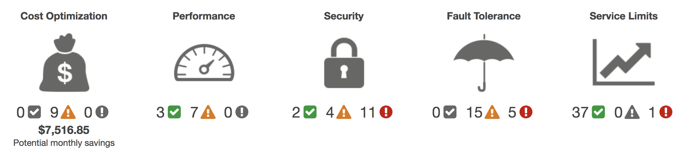

Cost Optimization

Performance

Security

Fault Tolerance

Service Limits

Potential monthly savings

> **Нотатки:**
>
> AWS Trusted Advisor is an online tool that provides real-time guidance to help you provision your resources following AWS best practices.  
>
> AWS Trusted Advisor looks at your entire AWS environment and gives you recommendations in five categories:  
> Cost Optimization – AWS Trusted Advisor looks at your resource use and makes recommendations to help you optimize cost by eliminating unused and idle resources, or by making commitments to reserved capacity.  
> Performance – Improve the performance of your service by checking your service limits, ensuring you take advantage of provisioned throughput, and monitoring for overutilized instances.  
> Security – Improve the security of your application by closing gaps, enabling various AWS security features, and examining your permissions.  
> Fault Tolerance – Increase the availability and redundancy of your AWS application by taking advantage of automatic scaling, health checks, Multi-AZ deployments, and backup capabilities.  
> Service Limits – AWS Trusted Advisor checks for service usage that is more than 80 percent of the service limit. Values are based on a snapshot, so your current usage might differ. Limit and usage data can take up to 24 hours to reflect any changes.  
>
> For a detailed description of the information that AWS Trusted Advisor provides, see AWS Trusted Advisor Best Practice Checks at https://docs.aws.amazon.com/awssupport/latest/user/trusted-advisor-check-reference.html.

---

## Слайд 54: Activity: Interpret AWS Trusted Advisor recommendations

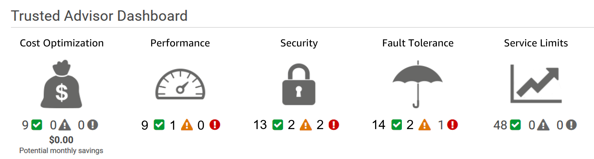

> **Нотатки:**
>
> You have a friend who used AWS Trusted Advisor for the first time. She is trying to interpret its recommendations to improve her cloud environment and needs your help. This is her dashboard. While everything looks OK in the cost optimization and service limit categories, you notice that there are a few recommendations that you should review to help her improve her security, performance, and fault tolerance.  
>
> Help your friend interpret the following recommendations.

---

## Слайд 55: Activity: Recommendation #1

**MFA on Root Account**

**Description**: Checks the root account and warns if multi-factor authentication (MFA) is not enabled. For increased security, we recommend that you protect your account by using MFA, which requires a user to enter a unique authentication code from their MFA hardware or virtual device when interacting with the AWS console and associated websites.

**Alert Criteria:** MFA is not enabled on the root account.

**Recommended Action**: Log in to your root account and activate an MFA device.

> **Нотатки:**
>
> For this recommendation, answer these questions:  
> What is the status?  
> What is the problem?  
> What specific environment details are you given?  
> What is the best practice?  
> What is the recommended action?

---

## Слайд 56: Activity: Recommendation #2

**IAM Password Policy**

**Description**: Checks the password policy for your account and warns when a password policy is not enabled, or if password content requirements have not been enabled. Password content requirements increase the overall security of your AWS environment by enforcing the creation of strong user passwords. When you create or change a password policy, the change is enforced immediately for new users but does not require existing users to change their passwords.

**Alert Criteria:** A password policy is enabled, but at least one content requirement is not enabled.

**Recommended Action**: If some content requirements are not enabled, consider enabling them. If no password policy is enabled, create and configure one. See Setting an Account Password Policy for IAM Users.

> **Нотатки:**
>
> For this recommendation, answer these questions:  
> What is the status?  
> What is the problem?  
> What specific environment details are you given?  
> What is the best practice?  
> What is the recommended action?

---

## Слайд 57: Activity: Recommendation #3

**Security Groups – Unrestricted Access**

**Description**: Checks security groups for rules that allow unrestricted access to a resource. Unrestricted access increases opportunities for malicious activity (hacking, denial-of-service attacks, loss of data).

**Alert Criteria**: A security group rule has a source IP address with a /0 suffix for ports other than 25, 80, or 443.)

**Recommended Action**: Restrict access to only those IP addresses that require it. To restrict access to a specific IP address, set the suffix to /32 (for example, 192.0.2.10/32). Be sure to delete overly permissive rules after creating rules that are more restrictive.

> **Нотатки:**
>
> For this recommendation, answer these questions:  
> What is the status?  
> What is the problem?  
> What specific environment details are you given?  
> What is the best practice?  
> What is the recommended action?  
>
> For accessibility: Security groups information including Region, security group name, security group ID, protocol, port, status, and IP range from 2 sample security groups. The status of both is red. End of accessibility description.

---

## Слайд 58: Activity: Recommendation #4

**Amazon EBS Snapshots**

**Description**: Checks the age of the snapshots for your Amazon Elastic Block Store (Amazon EBS) volumes (available or in-use). Even though Amazon EBS volumes are replicated, failures can occur. Snapshots are persisted to Amazon Simple Storage Service (Amazon S3) for durable storage and point-in-time recovery.

**Alert Criteria**:

Yellow: The most recent volume snapshot is between 7 and 30 days old.

Red: The most recent volume snapshot is more than 30 days old.

Red: The volume does not have a snapshot.

**Recommended Action**: Create weekly or monthly snapshots of your volumes

> **Нотатки:**
>
> For this recommendation, answer these questions:  
> What is the status?  
> What is the problem?  
> What specific environment details are you given?  
> What is the best practice?  
> What is the recommended action?  
>
> For accessibility: Amazon EBS volume information for Region us-east-1 including volume ID, volume name, volume attachment, status (listed as red), and reason (listed as no snapshot). End of accessibility description.

---

## Слайд 59: Activity: Recommendation #5

**Amazon S3 Bucket Logging**

**Description**: Checks the logging configuration of Amazon Simple Storage Service (Amazon S3) buckets. When server access logging is enabled, detailed access logs are delivered hourly to a bucket that you choose. An access log record contains details about each request, such as the request type, the resources specified in the request, and the time and date the request was processed. By default, bucket logging is not enabled; you should enable logging if you want to perform security audits or learn more about users and usage patterns.

**Alert Criteria**:

Yellow: The bucket does not have server access logging enabled.  
Yellow: The target bucket permissions do not include the owner account. Trusted Advisor cannot check it.  
**Recommended Action**:  
Enable bucket logging for most buckets.

If the target bucket permissions do not include the owner account and you want Trusted Advisor to check the logging status, add the owner account as a grantee.

> **Нотатки:**
>
> For this recommendation, answer these questions:  
> What is the status?  
> What is the problem?  
> What specific environment details are you given?  
> What is the best practice?  
> What is the recommended action?  
>
> For accessibility: Amazon S3 bucket logging information for Region us-east-2 including bucket name, target exists (no), same owner (no), write enabled (no), and reason (logging not enabled). End of accessibility description.

---

## Слайд 60: Section 3 key takeaways

- AWS Trusted Advisor is an online tool that provides real-time guidance to help you provision your resources by following AWS best practices.
- AWS Trusted Advisor looks at your entire AWS environment and gives you real-time recommendations in five categories.
- You can use AWS Trusted Advisor to help you optimize your AWS environment as soon as you start implementing your architecture designs.

> **Нотатки:**
>
> Some key takeaways from this section of the module include:  
> AWS Trusted Advisor is an online tool that provides real-time guidance to help you provision your resources by following AWS best practices.  
> AWS Trusted Advisor looks at your entire AWS environment and gives you real-time recommendations in five categories.  
> You can use AWS Trusted Advisor to help you optimize your AWS environment as soon as you start implementing your architecture designs.

---

## Слайд 61: Module wrap-up

Module 9: Cloud Architecture

> **Нотатки:**
>
> It’s now time to review the module and wrap up the module with a knowledge check and discussion of a practice certification exam question.

---

## Слайд 62: Module summary

In summary, in this module you learned how to:

- Describe the AWS Well-Architected Framework, including the six pillars
- Identify the design principles of the AWS Well-Architected Framework
- Explain the importance of reliability and high availability
- Identify how AWS Trusted Advisor helps customers
- Interpret AWS Trusted Advisor recommendations

> **Нотатки:**
>
> In summary, in this module you learned how to:  
> Describe the AWS Well-Architected Framework, including the six pillars  
> Identify the design principles of the AWS Well-Architected Framework  
> Explain the importance of reliability and high availability  
> Identify how AWS Trusted Advisor helps customers  
> Interpret AWS Trusted Advisor recommendations

---

## Слайд 63: Complete the knowledge check

> **Нотатки:**
>
> Now, complete the knowledge check.

---

## Слайд 64: Sample exam question

A SysOps engineer working at a company wants to protect their data in transit and at rest. What services could they use to protect their data?

Choice

Response

A

Elastic Load Balancing

B

Amazon Elastic Block Storage (Amazon EBS)

C

Amazon Simple Storage Service (Amazon S3)

D

All of the above

> **Нотатки:**
>
> Look at the answer choices and rule them out based on the keywords.

---

## Слайд 65: Sample exam question answer

A SysOps engineer working at a company wants to protect their data in transit and at rest. What services could they use to protect their data?

The correct answer is D.

The keywords in the question are “protect their data in transit and at rest”.

> **Нотатки:**
>
> The following are the keywords to recognize are: “protect their data in transit and at rest.”  
>
> The correct answer is D.

---

## Слайд 66: Additional resources

- AWS Well-Architected website: [https://aws.amazon.com/architecture/well-architected/?wa-lens-whitepapers.sort-by=item.additionalFields.sortDate&wa-lens-whitepapers.sort-order=desc](https://aws.amazon.com/architecture/well-architected/?wa-lens-whitepapers.sort-by=item.additionalFields.sortDate&wa-lens-whitepapers.sort-order=desc)
- AWS Well-Architected Labs: [https://wellarchitectedlabs.com/](https://wellarchitectedlabs.com/)
- AWS Trusted Advisor Best Practice Checks: [https://docs.aws.amazon.com/awssupport/latest/user/trusted-advisor-check-reference.html](https://docs.aws.amazon.com/awssupport/latest/user/trusted-advisor-check-reference.html)

> **Нотатки:**
>
> If you want to learn more about the topics covered in this module, you might find the following additional resources helpful:  
> AWS Well-Architected website: https://aws.amazon.com/architecture/well-architected/?wa-lens-whitepapers.sort-by=item.additionalFields.sortDate&wa-lens-whitepapers.sort-order=desc  
> AWS Well-Architected Labs: https://wellarchitectedlabs.com/  
> AWS Trusted Advisor Best Practice Checks: https://docs.aws.amazon.com/awssupport/latest/user/trusted-advisor-check-reference.html.

---

## Слайд 67: Thank you

All trademarks are the property of their owners.

> **Нотатки:**
>
> Thank you for completing this module.
