## Слайд 1: Модуль 9: Хмарна архітектура

AWS Academy Cloud Foundations

> **Нотатки:**
>
> Модуль 9: Хмарна архітектура (Cloud Architecture)

---

## Слайд 2: Огляд модуля

**Теми**

- AWS Well-Architected Framework
- Надійність і висока доступність (reliability and high availability)
- AWS Trusted Advisor

**Практичні вправи**

- Принципи проєктування AWS Well-Architected Framework (AWS Well-Architected Framework Design Principles)
- Інтерпретація рекомендацій AWS Trusted Advisor (Interpret AWS Trusted Advisor Recommendations)

**Перевірка знань**

> **Нотатки:**
>
> У цьому модулі розглядаються такі теми:  
> AWS Well-Architected Framework  
> Надійність і висока доступність  
> AWS Trusted Advisor  
>
> Також модуль містить дві практичні вправи. В одній вправі вам потрібно буде переглянути архітектуру та оцінити її за принципами проєктування AWS Well-Architected Framework. У другій вправі ви отримаєте досвід інтерпретації рекомендацій AWS Trusted Advisor.  
>
> Наприкінці вам буде запропоновано пройти перевірку знань, яка перевірить ваше розуміння ключових концепцій, розглянутих у цьому модулі.

---

## Слайд 3: Цілі модуля

Після завершення цього модуля ви повинні вміти:

- Описувати AWS Well-Architected Framework, зокрема шість опор (pillars)
- Визначати принципи проєктування AWS Well-Architected Framework
- Пояснювати важливість надійності та високої доступності
- Визначати, як AWS Trusted Advisor допомагає клієнтам
- Інтерпретувати рекомендації AWS Trusted Advisor

> **Нотатки:**
>
> Після завершення цього модуля ви повинні вміти:  
> Описувати AWS Well-Architected Framework, зокрема шість опор  
> Визначати принципи проєктування AWS Well-Architected Framework  
> Пояснювати важливість надійності та високої доступності  
> Визначати, як AWS Trusted Advisor допомагає клієнтам  
> Інтерпретувати рекомендації AWS Trusted Advisor

---

## Слайд 4: Розділ 1: AWS Well-Architected Framework

Модуль 9: Хмарна архітектура

> **Нотатки:**
>
> Розділ 1: AWS Well-Architected Framework

---

## Слайд 5: Архітектура: проєктування та будівництво

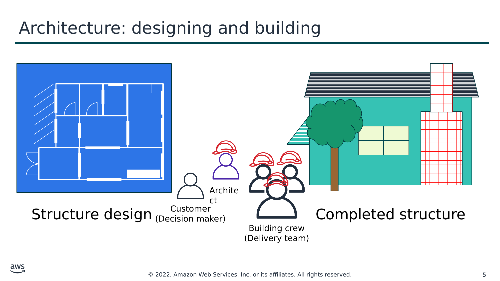

Текст зі схеми

Structure design (Проєкт споруди)

Customer (Клієнт)  
(Decision maker — особа, що ухвалює рішення)

Completed structure (Готова споруда)

Architect (Архітектор)

Building crew (Будівельна бригада)  
(Delivery team — команда виконавців)

> **Нотатки:**
>
> Архітектура — це мистецтво й наука проєктування та будівництва великих споруд. Великі системи потребують архітекторів, щоб керувати їхнім розміром і складністю.  
>
> Хмарні архітектори (cloud architects):  
> Взаємодіють із особами, що ухвалюють рішення, щоб визначити бізнес-мету та можливості, які потребують покращення.  
> Забезпечують відповідність між технологічними результатами рішення та бізнес-цілями.  
> Працюють із командами виконавців, що впроваджують рішення, щоб переконатися, що технологічні функції є доречними.  
>
> Наявність добре спроєктованих систем (well-architected systems) значно підвищує ймовірність бізнес-успіху.

---

## Слайд 6: Що таке AWS Well-Architected Framework?

- Посібник із проєктування інфраструктур, які є:
  - Безпечними (secure)
  - Високопродуктивними (high-performing)
  - Стійкими (resilient)
  - Ефективними (efficient)
- Послідовний підхід до оцінювання та впровадження хмарних архітектур
- Спосіб надання найкращих практик, розроблених на основі уроків, отриманих під час аналізу архітектур клієнтів

> **Нотатки:**
>
> AWS Well-Architected Framework — це посібник, призначений допомогти вам побудувати найбезпечнішу, найпродуктивнішу, найстійкішу та найефективнішу інфраструктуру для ваших хмарних застосунків і робочих навантажень (workloads). Він надає набір основоположних запитань і найкращих практик, які допомагають оцінювати та впроваджувати ваші хмарні архітектури. AWS розробила Well-Architected Framework після аналізу тисяч архітектур клієнтів в AWS.

---

## Слайд 7: Опори AWS Well-Architected Framework

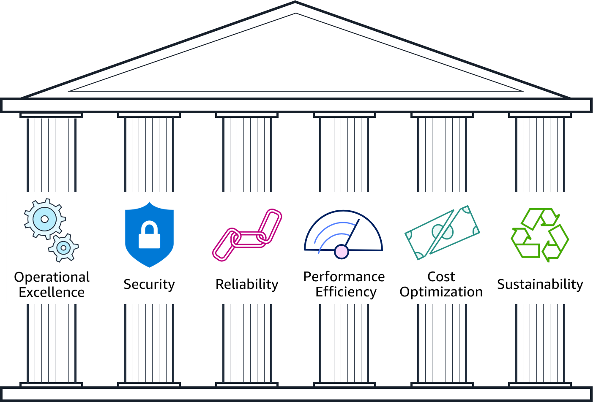

> **Нотатки:**
>
> AWS Well-Architected Framework організовано в шість опор (pillars): операційна досконалість (operational excellence), безпека (security), надійність (reliability), ефективність продуктивності (performance efficiency), оптимізація витрат (cost optimization) і сталість (sustainability). Перші п’ять опор є частиною фреймворку з моменту його запуску у 2015 році. Опору сталості було додано як шосту у 2021 році, щоб допомогти організаціям навчитися мінімізувати вплив експлуатації хмарних робочих навантажень на довкілля.  
>
> Решта цього модуля зосереджена на перших п’яти опорах (операційна досконалість, безпека, надійність, ефективність продуктивності, оптимізація витрат) і проводить вас через аналіз прикладу архітектури за принципами проєктування кожної опори.  
> Докладніше про опору сталості див. розділ про опору сталості в документації Well-Architected Framework: https://docs.aws.amazon.com/wellarchitected/latest/sustainability-pillar/sustainability-pillar.html.  
>
> Для доступності: опори включають операційну досконалість, безпеку, надійність, ефективність продуктивності, оптимізацію витрат і сталість. Кінець опису для доступності.

---

## Слайд 8: Організація опор

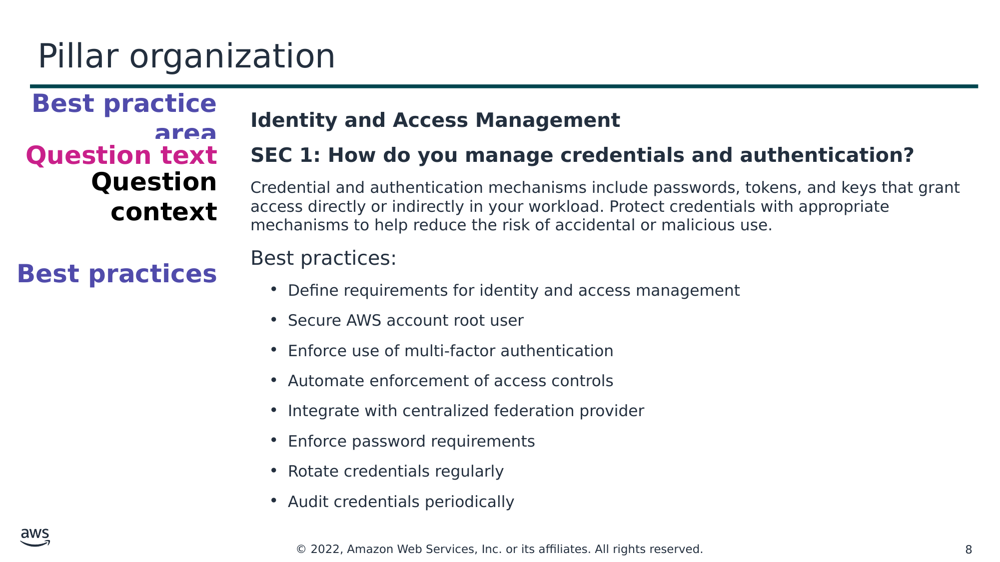

Текст зі схеми

**Best practice area (Область найкращих практик)**

**Identity and Access Management (Керування ідентифікацією та доступом)**

**SEC 1: How do you manage credentials and authentication? (SEC 1: Як ви керуєте обліковими даними та автентифікацією?)**

Credential and authentication mechanisms include passwords, tokens, and keys that grant access directly or indirectly in your workload. Protect credentials with appropriate mechanisms to help reduce the risk of accidental or malicious use. (Механізми облікових даних і автентифікації включають паролі, токени та ключі, що прямо чи опосередковано надають доступ у вашому робочому навантаженні. Захищайте облікові дані відповідними механізмами, щоб зменшити ризик випадкового чи зловмисного використання.)

Best practices (Найкращі практики):

- Визначте вимоги до керування ідентифікацією та доступом
- Захистіть кореневий акаунт AWS (root user)
- Забезпечте використання багатофакторної автентифікації
- Автоматизуйте виконання засобів контролю доступу
- Інтегруйтеся з централізованим постачальником федерації
- Забезпечте виконання вимог до паролів
- Регулярно змінюйте облікові дані (ротація)
- Періодично проводьте аудит облікових даних

**Question text (Текст запитання)**

**Question context (Контекст запитання)**

**Best practices (Найкращі практики)**

> **Нотатки:**
>
> Кожна опора включає набір принципів проєктування та областей найкращих практик. Кожна область найкращих практик відповідає запитанням, які рецензент має ставити під час проєктування архітектури. Запитання для кожної опори входять до додатка (Appendix) Well-Architected Framework.

---

## Слайд 9: Вступ до практичної вправи з принципів проєктування AWS Well-Architected Framework

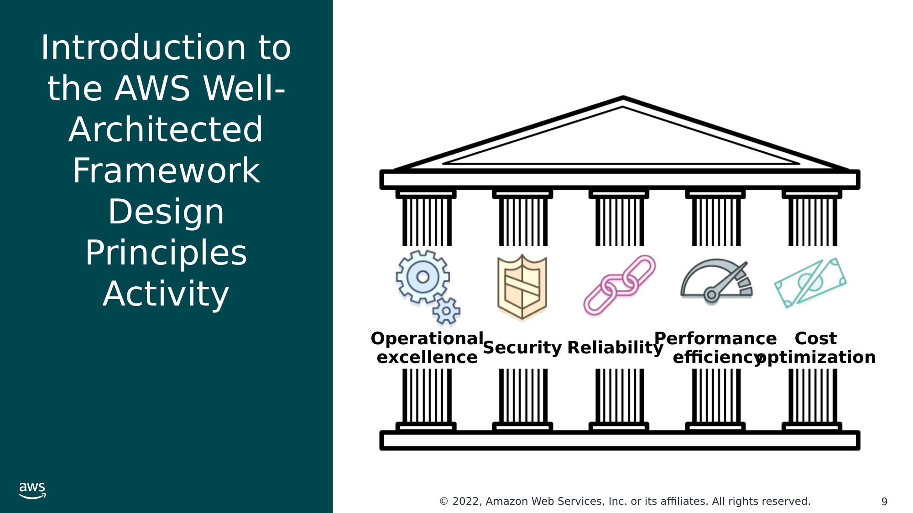

Текст зі схеми

**Operational**  
**excellence (Операційна досконалість)**

Security (Безпека)

Reliability (Надійність)

Performance  
 efficiency (Ефективність продуктивності)

Cost  
optimization (Оптимізація витрат)

> **Нотатки:**
>
> Проходячи решту цього розділу, ви отримуватимете завдання переглянути архітектуру вигаданої компанії за принципами проєктування AWS Well-Architected Framework для кожної з наведених п’яти опор: операційна досконалість, безпека, надійність, ефективність продуктивності та оптимізація витрат.

---

## Слайд 10: Про компанію AnyCompany

- AnyCompany Corporation: «*Cityscapes you can stand over* (міські пейзажі, над якими можна стояти)»
- Заснована у 2008 році Джоном Доу (John Doe)
- Продає тривимірні друковані міські пейзажі (3D-printed cityscapes)
- Збирається подавати заявку на інвестиції
- Попросила **вас** провести огляд їхньої платформи в межах належної перевірки (due diligence)
- Cloud native (створена для хмари)

> **Нотатки:**
>
> Ось довідка про компанію, архітектуру якої ви переглядатимете:  
>
> AnyCompany Corporation була заснована у 2008 році Джоном Доу. Вона продає високоякісні тривимірні (3D) друковані міські пейзажі районів, що дають змогу побачити окремі будівлі та дерева. Міські пейзажі друкуються кольоровими, з кладкою цегли, дахами, садами та навіть автомобілями у правильних кольорах.  
>
> Компанія збирається подати заявку на приватні інвестиції для фінансування свого зростання до первинного публічного розміщення акцій (IPO). Джон і рада директорів попросили вас провести незалежний огляд їхньої технологічної платформи, щоб переконатися, що вона пройде належну перевірку (due diligence).  
>
> Джон зацікавився хмарними обчисленнями з самого початку. У 2008 році він створив акаунт в AWS і запустив свій перший екземпляр Amazon Elastic Compute Cloud (Amazon EC2). З роками архітектура платформи AnyCompany еволюціонувала. Тепер у Джона є команда з п’яти технологів, які пишуть і експлуатують усі технології в організації. Джон досі пише основний код для виділення структури з руху (extracting structure from motion), але передав облікові дані кореневого акаунта AWS (root user) решті своєї команди для керування.

---

## Слайд 11: Про компанію AnyCompany (продовження)

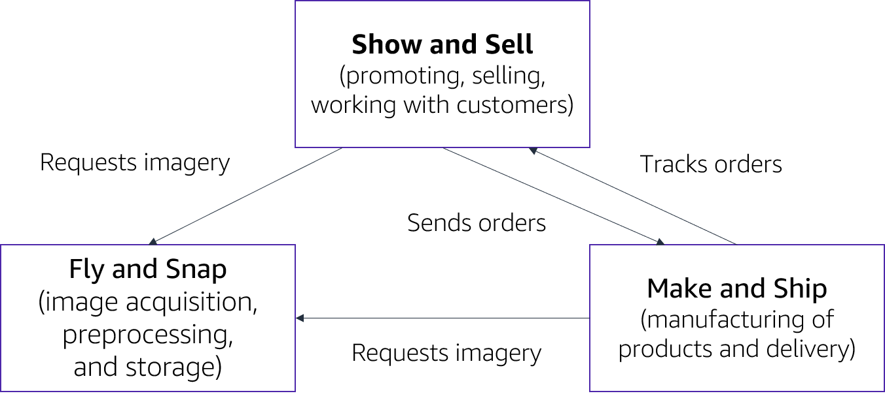

> **Нотатки:**
>
> AnyCompany Corporation має три основні відділи:  
> Fly and Snap — отримання зображень, попередня обробка та зберігання  
> Show and Sell — просування, продаж і робота з клієнтами  
> Make and Ship — виробництво продукції та доставка  
>
> Високорівнева архітектура платформи AnyCompany відповідає організаційній структурі компанії.  
>
> Для доступності: високорівнева схема платформи mappahood: Show and Sell (просування, продаж, робота з клієнтами) надсилає замовлення та запитує знімки. Make and Ship (виробництво та доставка) відстежує замовлення від Show and Sell і запитує знімки від Fly and Snap (отримання, попередня обробка та зберігання). Кінець опису для доступності.

---

## Слайд 12: Архітектура AnyCompany: Fly and Snap

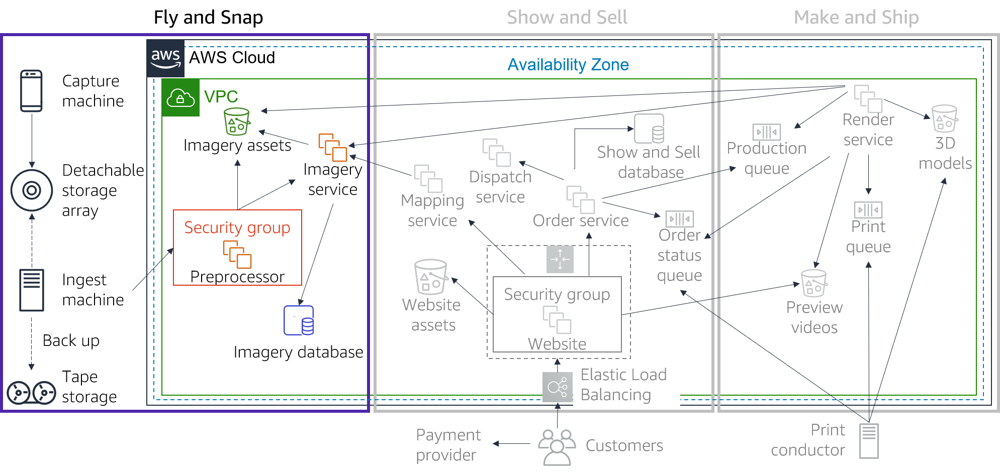

> **Нотатки:**
>
> Fly and Snap  
> Кілька пристроїв (наразі фотокамери та відеокамери) змонтовано на легких літаках, які за розкладом знімають головні міста, зокрема відомі місця. Кожен пристрій генерує знімки (imagery assets) з відмітками часу за годинником, синхронізованим із годинником літака. Знімки передаються потоком на бортовий комп’ютер Capture machine із зовнішнім сховищем (storage array). Capture machine також підключений до польотної системи літака й безперервно збирає навігаційні дані, як-от дані системи глобального позиціювання (GPS), показання компаса та висоту.  
>
> Після повернення на базу сховище відключають і переносять до приймального відсіку (ingest bay). Там сховище підключають до комп’ютера Ingest machine. Ingest machine створює стиснутий архів сховища й за допомогою протоколу передавання файлів (FTP) надсилає його на екземпляр EC2 Preprocessor machine. Після обробки сховища архів записується на стрічку (для резервного копіювання). Потім сховище очищується й готове до наступного польоту. Стрічки зберігає за межами офісу сторонній постачальник резервного копіювання.  
>
> Preprocessor machine періодично обробляє нові набори даних, завантажені на неї. Вона витягує всі знімки та зберігає їх у бакеті Amazon Simple Storage Service (Amazon S3). Вона сповіщає сервіс Imagery service про файли й надає йому інформацію про політ. Imagery service використовує інформацію про політ, щоб обчислити тривимірну орієнтацію та розташування для кожного моменту польоту, які співвідносить із відмітками часу файлів знімків. Ця інформація зберігається в системі керування реляційними базами даних (RDBMS) на основі Amazon EC2 з посиланнями на знімки в Amazon S3.  
>
> Для доступності: архітектура Fly and Snap. Capture machine та Ingest machine надсилають знімки до знімного сховища (detachable storage array). Ingest machine також створює резервні копії на стрічковому сховищі (tape storage). Кінець опису для доступності.

---

## Слайд 13: Архітектура AnyCompany: Show and Sell

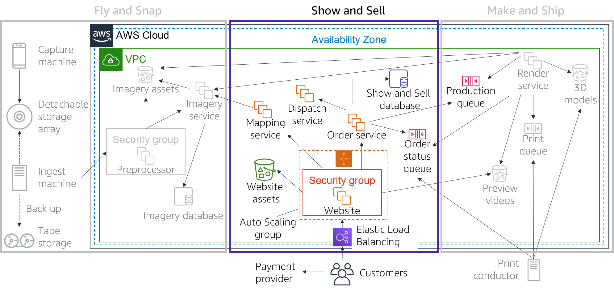

> **Нотатки:**
>
> Show and Sell  
> Коли клієнти відвідують вебсайт AnyCompany, вони можуть побачити зображення та відео фізичного продукту. Ці зображення мають різні формати (наприклад, великомасштабна карта з режимом огляду). Вебсайт використовує Elastic Load Balancing із протоколом Hypertext Transfer Protocol Secure (HTTPS) і групу Auto Scaling з екземплярів EC2, що запускають систему керування контентом. Статичні ресурси вебсайту зберігаються в бакеті S3.  
>
> Клієнти можуть вибрати розташування на карті й побачити відеопрев’ю свого міського пейзажу. Клієнти також можуть обрати фізичний розмір карти, обрати колірну схему (доступні білий, монохромний або повний колір) і мають можливість зробити в карті отвори для світлодіодів (LED) для створення підсвічених карт. Сервіс Mapping service співвідносить введене на вебсайті розташування на карті з Imagery service, щоб підтвердити, чи є знімки для цього розташування.  
>
> Якщо клієнтів влаштовує прев’ю, вони можуть замовити свій міський пейзаж. Клієнти платять кредитною карткою. Замовлення з оплатою кредитною карткою обробляє сертифікований сторонній постачальник, що відповідає стандарту індустрії платіжних карток (PCI). AnyCompany не обробляє й не зберігає жодної інформації про кредитні картки.  
>
> Після того як вебсайт отримує підтвердження оплати, він доручає сервісу Order service передати замовлення у виробництво. Замовлення (зокрема дані клієнта) записуються в базу даних Show and Sell database, яка є RDBMS на основі Amazon EC2.  
>
> Щоб ініціювати відеопрев’ю або повний друк замовлення, Orders service розміщує повідомлення в черзі Production queue, що дає змогу сервісу Render service вказати, коли відеопрев’ю доступне. Order service також читає з черги Order status queue та записує зміни статусу в базу даних Show and Sell. Клієнти можуть відстежувати своє замовлення під час виробництва й бачити, коли його відправлено, — це обробляє третя сторона через брокерський сервіс Dispatch service.

---

## Слайд 14: Архітектура AnyCompany: Make and Ship

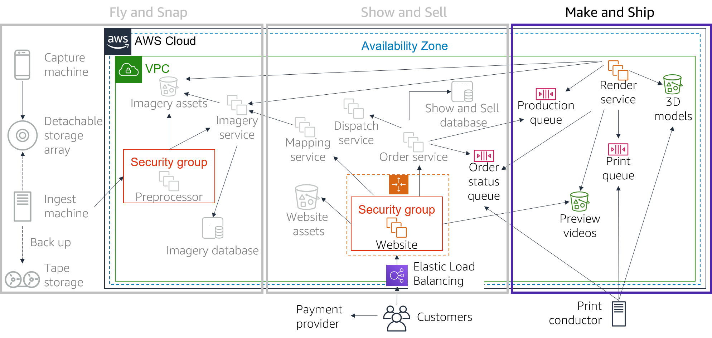

> **Нотатки:**
>
> Make and Ship  
> AnyCompany має власну технологію, що дає змогу генерувати 3D-моделі з комбінації фотографій і відео (виділення структури з руху, extracting structure from motion).  
>
> Сервіс Render service — це парк екземплярів g2.2xlarge. Render service бере замовлення з черги Production queue та генерує 3D-моделі, що зберігаються в бакеті S3. Render service також використовує 3D-моделі для створення відео з прольотом (flyby videos), щоб клієнти могли переглянути свої замовлення на вебсайті AnyCompany. Ці відео зберігаються в окремому бакеті S3. Раз на рік команда видаляє старі прев’ю. Однак моделі зберігаються на випадок, якщо вони знадобляться для майбутніх проєктів.  
>
> Після того як клієнт робить замовлення, у чергу Print queue потрапляє повідомлення з посиланням на 3D-модель. На кожному етапі процесу Make and Ship оновлення статусу замовлення публікуються в черзі Order status queue. Цю чергу споживає вебсайт AnyCompany, що показує історію замовлень.  
>
> Команда Make and Ship має чотири 3D-принтери, які друкують моделі високої роздільної здатності та з детальним контролем кольору. Локальний (on-premises) комп’ютер Print conductor бере замовлення з черги Print queue та надсилає їх на наступний вільний принтер. Print conductor надсилає оновлення замовлень до черги Order status queue. Print conductor надсилає фінальне оновлення, коли замовлення завершено, пройшло контроль якості й готове до відправлення.

---

## Слайд 15: Огляд практичної вправи

- Розбийтеся на невеликі групи.
- Ви вивчатимете кожну з опор. Наприкінці кожної опори є набір запитань із AWS Well-Architected Framework, які вам потрібно опрацювати разом із групою. Використовуйте ці запитання фреймворку, щоб спрямовувати огляд архітектури AnyCompany.
- Для кожного запитання Well-Architected Framework дайте відповіді на такі запитання щодо архітектури AnyCompany:
  - Який ПОТОЧНИЙ СТАН (що AnyCompany робить зараз)?
  - Який МАЙБУТНІЙ СТАН (що, на вашу думку, AnyCompany має робити)?
- Домовтеся про головне покращення, яке AnyCompany має внести до своєї архітектури для кожного набору запитань Well-Architected Framework.
- Підказка: правильних чи неправильних відповідей не існує.

> **Нотатки:**
>
> Для цієї вправи ви розіб’єтеся на невеликі групи. Вивчаючи кожну опору, ваша група опрацьовуватиме набір запитань з AWS Well-Architected Framework. Ви використовуватимете ці запитання Well-Architected Framework, щоб спрямовувати огляд архітектури AnyCompany.  
>
> Для кожного запитання Well-Architected Framework ваша група відповідатиме на такі запитання щодо архітектури AnyCompany:  
> Який ПОТОЧНИЙ СТАН (що AnyCompany робить зараз)?  
> Який МАЙБУТНІЙ СТАН (що, на вашу думку, AnyCompany має робити)?  
>
> Потім ваша команда має домовитися про головне покращення, яке AnyCompany має внести на основі відповідей на ці три запитання.  
>
> Зверніть увагу, що правильних чи неправильних відповідей не існує. Запитання AWS Well-Architected Framework призначені, щоб стимулювати обговорення.  
>
> Нормативні рекомендації щодо впровадження див. у деталях для кожної опори на вебсайті Well-Architected Framework: https://docs.aws.amazon.com/wellarchitected/latest/framework/welcome.html. Усі запитання для кожної опори входять до додатка (Appendix) Well-Architected Framework.

---

## Слайд 16: Опора «Операційна досконалість» (Operational Excellence)

> **Нотатки:**
>
> Опора «Операційна досконалість» (Operational Excellence)

---

## Слайд 17: Опора «Операційна досконалість» — забезпечення бізнес-цінності

**Операційна досконалість**

**опора (pillar)**

- Фокус
  - Експлуатація та моніторинг систем для забезпечення бізнес-цінності й постійне вдосконалення допоміжних процесів і процедур.
- Ключові теми
  - Автоматизація змін
  - Реагування на події
  - Визначення стандартів для керування щоденними операціями

Забезпечення бізнес-цінності (Deliver business value)

> **Нотатки:**
>
> Опора «Операційна досконалість» зосереджена на здатності експлуатувати та відстежувати системи для забезпечення бізнес-цінності й постійно вдосконалювати допоміжні процеси та процедури. Ключові теми: автоматизація змін, реагування на події та визначення стандартів для керування щоденними операціями.

---

## Слайд 18: Принципи проєктування операційної досконалості

**Операційна досконалість**

**опора (pillar)**

- Виконуйте операції як код (perform operations as code)
- Робіть часті, невеликі, оборотні зміни
- Часто вдосконалюйте процедури операцій
- Передбачайте збої
- Вчіться на всіх операційних подіях і збоях

Забезпечення бізнес-цінності (Deliver business value)

> **Нотатки:**
>
> Існує п’ять принципів проєктування для операційної досконалості в хмарі:  
> Виконуйте операції як код — визначайте все ваше робоче навантаження (тобто застосунки та інфраструктуру) як код і оновлюйте його кодом. Реалізуйте процедури операцій як код і налаштовуйте їх на автоматичний запуск у відповідь на події. Виконуючи операції як код, ви обмежуєте людські помилки й забезпечуєте узгоджене реагування на події.  
> Робіть часті, невеликі, оборотні зміни — проєктуйте робочі навантаження так, щоб компоненти можна було регулярно оновлювати. Вносьте зміни невеликими кроками, які можна скасувати в разі невдачі (за можливості без впливу на клієнтів).  
> Часто вдосконалюйте процедури операцій — шукайте можливості покращити процедури операцій. Розвивайте свої процедури належним чином у міру еволюції ваших робочих навантажень. Проводьте регулярні навчання (game days), щоб переглядати всі процедури, перевіряти їхню ефективність і забезпечувати знайомство з ними команд.  
> Передбачайте збої — визначайте потенційні джерела збоїв, щоб їх можна було усунути чи пом’якшити. Тестуйте сценарії збоїв і перевіряйте своє розуміння їхнього впливу. Тестуйте свої процедури реагування, щоб переконатися, що вони ефективні й що команди знають, як їх виконувати. Проводьте регулярні навчання (game days), щоб тестувати робочі навантаження та реакцію команд на змодельовані події.  
> Вчіться на всіх операційних збоях — стимулюйте вдосконалення за допомогою уроків, отриманих із усіх операційних подій і збоїв. Діліться тим, що дізналися, між командами та в усій організації.

---

## Слайд 19: Запитання з операційної досконалості

Organization (Організація)

- Як ви визначаєте свої пріоритети?
- Як ви структуруєте свою організацію для підтримки бізнес-результатів?
- Як ваша організаційна культура підтримує бізнес-результати?

Prepare (Підготовка)

- Як ви проєктуєте своє робоче навантаження, щоб розуміти його стан?
- Як ви зменшуєте кількість дефектів, спрощуєте усунення проблем і покращуєте потік у продуктивне середовище?
- Як ви зменшуєте ризики розгортання?
- Як ви дізнаєтеся, що готові підтримувати робоче навантаження?

Operate (Експлуатація)

- Як ви розумієте стан здоров’я свого робочого навантаження?
- Як ви розумієте стан здоров’я своїх операцій?
- Як ви керуєте подіями робочого навантаження та операцій?

Evolve (Розвиток)

- Як ви розвиваєте операції?

> **Нотатки:**
>
> Основоположні запитання для операційної досконалості належать до чотирьох областей найкращих практик: організація (organization), підготовка (prepare), експлуатація (operate) і розвиток (evolve).  
>
> Операційні команди мають розуміти потреби бізнесу й клієнтів, щоб ефективно підтримувати бізнес-результати. Операційні команди створюють і використовують процедури для реагування на операційні події та перевіряють ефективність процедур для підтримки потреб бізнесу. Операційні команди збирають метрики, що використовуються для вимірювання досягнення бажаних бізнес-результатів. Оскільки бізнес-контекст, бізнес-пріоритети та потреби клієнтів з часом змінюються, важливо проєктувати операції, які еволюціонують у відповідь на зміни, і враховувати уроки, отримані в процесі їхньої роботи.

---

## Слайд 20: Розбір вправи з операційної досконалості

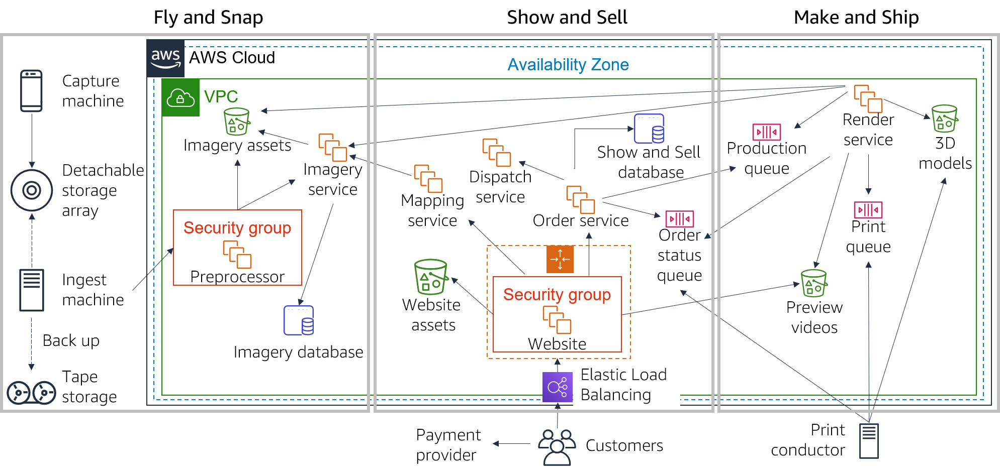

> **Нотатки:**
>
> Ось уся архітектура AnyCompany, яку ви можете використовувати під час виконання вправи. Звертайтеся до нотаток слайдів із довідкою про AnyCompany та архітектурою, щоб виконати це завдання. Також можете звернутися до додатка (Appendix) в AWS Well-Architected Framework: https://d1.awsstatic.com/whitepapers/architecture/AWS_Well-Architected_Framework.pdf.  
>
> 1. Перегляньте такі три запитання з операційної досконалості з AWS Well-Architected Framework:  
> OPS 4: Як ви проєктуєте своє робоче навантаження, щоб розуміти його стан?  
> OPS 6: Як ви зменшуєте ризик розгортання?  
> OPS 7: Як ви дізнаєтеся, що готові підтримувати робоче навантаження?  
>
> 2. Для кожного запитання Well-Architected Framework дайте відповідь, який поточний стан архітектури AnyCompany і який кінцевий стан.  
>
> 3. Домовтеся про головне покращення, яке має внести AnyCompany.

---

## Слайд 21: Опора «Безпека» (Security)

> **Нотатки:**
>
> Опора «Безпека» (Security)

---

## Слайд 22: Опора «Безпека» — захист і моніторинг систем

**Безпека**

**опора (pillar)**

- Фокус
  - Захист інформації, систем і активів під час забезпечення бізнес-цінності за допомогою оцінювання ризиків і стратегій їх пом’якшення.
- Ключові теми
  - Захист конфіденційності та цілісності даних
  - Визначення та керування тим, хто що може робити
  - Захист систем
  - Встановлення засобів контролю для виявлення подій безпеки

Захист і моніторинг систем (Protect and monitor systems)

> **Нотатки:**
>
> Опора «Безпека» зосереджена на здатності захищати інформацію, системи та активи під час забезпечення бізнес-цінності за допомогою оцінювання ризиків і стратегій їх пом’якшення. Ключові теми: захист конфіденційності й цілісності даних, визначення та керування тим, хто що може робити (або керування привілеями, privilege management), захист систем і встановлення засобів контролю для виявлення подій безпеки.

---

## Слайд 23: Принципи проєктування безпеки

**Безпека**

**опора (pillar)**

- Запровадьте сильну основу ідентичності (strong identity foundation)
- Забезпечте відстежуваність (traceability)
- Застосовуйте безпеку на всіх рівнях
- Автоматизуйте найкращі практики безпеки
- Захищайте дані під час передавання та в стані спокою
- Тримайте людей подалі від даних
- Готуйтеся до подій безпеки

Захист і моніторинг систем (Protect and monitor systems)

> **Нотатки:**
>
> Існує сім принципів проєктування, що можуть покращити безпеку:  
> Запровадьте сильну основу ідентичності — впровадьте принцип найменших привілеїв (principle of least privilege) і забезпечте розподіл обов’язків (separation of duties) з відповідною авторизацією для кожної взаємодії з вашими ресурсами AWS. Централізуйте керування привілеями та зменште або навіть усуньте залежність від довгострокових облікових даних.  
> Забезпечте відстежуваність — відстежуйте дії та зміни у вашому середовищі, надсилайте сповіщення про них і проводьте їх аудит у реальному часі. Інтегруйте журнали та метрики з системами, щоб автоматично реагувати та виконувати дії.  
> Застосовуйте безпеку на всіх рівнях — застосовуйте глибокоешелонований захист (defense in depth) і засоби контролю безпеки на всіх рівнях вашої архітектури (наприклад, периферійна мережа, віртуальна приватна хмара, підмережа та балансувальник навантаження; а також кожен екземпляр, операційна система та застосунок).  
> Автоматизуйте найкращі практики безпеки — автоматизуйте механізми безпеки, щоб покращити вашу здатність безпечно масштабуватися швидше та економічніше. Створюйте безпечні архітектури та впроваджуйте засоби контролю, визначені та керовані як код у шаблонах під контролем версій.  
> Захищайте дані під час передавання та в стані спокою — класифікуйте свої дані за рівнями чутливості та використовуйте механізми, як-от шифрування, токенізація та контроль доступу, де це доречно.  
> Тримайте людей подалі від даних — щоб зменшити ризик втрати чи зміни чутливих даних через людську помилку, створюйте механізми та інструменти для зменшення або усунення потреби в прямому доступі чи ручній обробці даних.  
> Готуйтеся до подій безпеки — запровадьте процес керування інцидентами, що відповідає вимогам організації. Проводьте симуляції реагування на інциденти та використовуйте інструменти з автоматизацією, щоб збільшити швидкість виявлення, розслідування та відновлення.

---

## Слайд 24: Запитання з безпеки

Security (Безпека)

- Як ви безпечно експлуатуєте своє робоче навантаження?

Identity and access management (Керування ідентифікацією та доступом)

- Як ви керуєте ідентичностями людей і машин?
- Як ви керуєте дозволами людей і машин?

Detection (Виявлення)

- Як ви виявляєте події безпеки та розслідуєте їх?

Infrastructure protection (Захист інфраструктури)

- Як ви захищаєте свої мережеві ресурси?
- Як ви захищаєте свої обчислювальні ресурси?

Data protection (Захист даних)

- Як ви класифікуєте свої дані?
- Як ви захищаєте свої дані в стані спокою?
- Як ви захищаєте свої дані під час передавання?

Incident response (Реагування на інциденти)

- Як ви передбачаєте інциденти, реагуєте на них і відновлюєтеся після них?

> **Нотатки:**
>
> Основоположні запитання щодо безпеки належать до шести областей найкращих практик: безпека (security), керування ідентифікацією та доступом (identity and access management), виявлення (detection), захист інфраструктури (infrastructure protection), захист даних (data protection) і реагування на інциденти (incident response).  
>
> Перш ніж проєктувати будь-яку систему, потрібно запровадити практики безпеки. Ви повинні мати змогу контролювати, хто що може робити. Крім того, ви повинні вміти виявляти інциденти безпеки, захищати свої системи та сервіси й зберігати конфіденційність і цілісність даних за допомогою захисту даних. У вас має бути чітко визначений і відпрацьований процес реагування на інциденти безпеки. Ці інструменти та методи важливі, оскільки підтримують такі цілі, як запобігання фінансовим втратам чи виконання регуляторних зобов’язань.

---

## Слайд 25: Розбір вправи з безпеки

> **Нотатки:**
>
> Ось уся архітектура AnyCompany, яку ви можете використовувати під час виконання вправи. Звертайтеся до нотаток слайдів із довідкою про AnyCompany та архітектурою, щоб виконати це завдання. Також можете звернутися до додатка (Appendix) в AWS Well-Architected Framework: https://d1.awsstatic.com/whitepapers/architecture/AWS_Well-Architected_Framework.pdf.  
>
> 1. Перегляньте такі три запитання з безпеки з AWS Well-Architected Framework:  
> SEC 1: Як ви безпечно експлуатуєте своє робоче навантаження?  
> SEC 4: Як ви виявляєте події безпеки та розслідуєте їх?  
> SEC 6: Як ви захищаєте свої обчислювальні ресурси?  
>
> 2. Для кожного запитання Well-Architected Framework дайте відповідь, який поточний стан архітектури AnyCompany і який кінцевий стан.  
>
> 3. Домовтеся про головне покращення, яке має внести AnyCompany.

---

## Слайд 26: Опора «Надійність» (Reliability)

> **Нотатки:**
>
> Опора «Надійність» (Reliability)

---

## Слайд 27: Опора «Надійність» — відновлення після збоїв і пом’якшення перебоїв

**Надійність**

**опора (pillar)**

- Фокус
  - Гарантувати, що робоче навантаження виконує свою призначену функцію правильно та послідовно тоді, коли від нього цього очікують.
- Ключові теми
  - Проєктування розподілених систем
  - Планування відновлення
  - Обробка змін

Відновлення після збоїв і пом’якшення перебоїв (Recover from failure and mitigate disruption).

> **Нотатки:**
>
> Опора «Надійність» зосереджена на гарантуванні того, що робоче навантаження виконує свою призначену функцію правильно та послідовно тоді, коли від нього цього очікують. Стійке (resilient) робоче навантаження швидко відновлюється після збоїв, щоб задовольняти потреби бізнесу й клієнтів. Ключові теми: проєктування розподілених систем, планування відновлення та обробка змін.

---

## Слайд 28: Принципи проєктування надійності

**Надійність**

**опора (pillar)**

- Автоматично відновлюйтеся після збоїв
- Тестуйте процедури відновлення
- Масштабуйтеся горизонтально, щоб підвищити сукупну доступність робочого навантаження
- Припиніть вгадувати потрібні потужності
- Керуйте змінами за допомогою автоматизації

Відновлення після збоїв і пом’якшення перебоїв (Recover from failure and mitigate disruption).

> **Нотатки:**
>
> Існує п’ять принципів проєктування, що можуть підвищити надійність:  
> Автоматично відновлюйтеся після збоїв — відстежуйте системи за ключовими показниками ефективності (key performance indicators) і налаштуйте свої системи так, щоб вони запускали автоматичне відновлення у разі перевищення порогового значення. Ця практика забезпечує автоматичне сповіщення й відстеження збоїв, а також автоматизовані процеси відновлення, що обходять або усувають збій.  
> Тестуйте процедури відновлення — тестуйте, як ваші системи виходять з ладу, і перевіряйте свої процедури відновлення. Використовуйте автоматизацію, щоб моделювати різні збої або відтворювати сценарії, що призводили до збоїв раніше. Ця практика може виявити шляхи виникнення збоїв, які ви можете протестувати й усунути до реального сценарію збою.  
> Масштабуйтеся горизонтально, щоб підвищити сукупну доступність робочого навантаження — замініть один великий ресурс кількома меншими ресурсами та розподіляйте запити між цими меншими ресурсами, щоб зменшити вплив єдиної точки відмови (single point of failure) на всю систему.  
> Припиніть вгадувати потрібні потужності — відстежуйте попит і використання системи та автоматизуйте додавання чи вилучення ресурсів, щоб підтримувати оптимальний рівень для задоволення попиту.  
> Керуйте змінами за допомогою автоматизації — використовуйте автоматизацію для внесення змін в інфраструктуру та керування змінами за допомогою автоматизації.

---

## Слайд 29: Запитання з надійності

Foundations (Основи)

- Як ви керуєте квотами та обмеженнями сервісів?
- Як ви плануєте топологію своєї мережі?

Workload architecture (Архітектура робочого навантаження)

- Як ви проєктуєте архітектуру сервісів свого робочого навантаження?
- Як ви проєктуєте взаємодії в розподіленій системі, щоб запобігати збоям?
- Як ви проєктуєте взаємодії в розподіленій системі, щоб пом’якшувати збої або витримувати їх?

Change management (Керування змінами)

- Як ви відстежуєте ресурси робочого навантаження?
- Як ви проєктуєте своє робоче навантаження, щоб воно адаптувалося до змін попиту?
- Як ви впроваджуєте зміни?

Failure management (Керування збоями)

- Як ви створюєте резервні копії даних?
- Як ви використовуєте ізоляцію збоїв (fault isolation), щоб захистити своє робоче навантаження?
- Як ви проєктуєте своє робоче навантаження, щоб воно витримувало збої компонентів?
- Як ви тестуєте надійність?
- Як ви плануєте аварійне відновлення?

> **Нотатки:**
>
> Основоположні запитання щодо надійності належать до чотирьох областей найкращих практик: основи (foundations), архітектура робочого навантаження (workload architecture), керування змінами (change management) і керування збоями (failure management).  
>
> Щоб досягти надійності, система повинна мати як добре сплановану основу, так і налаштований моніторинг. Вона повинна мати механізми обробки змін у попиті чи вимогах. Систему слід проєктувати так, щоб вона виявляла збої й автоматично «зцілювала» себе.

---

## Слайд 30: Розбір вправи

> **Нотатки:**
>
> Ось уся архітектура AnyCompany, яку ви можете використовувати під час виконання вправи. Звертайтеся до нотаток слайдів із довідкою про AnyCompany та архітектурою, щоб виконати це завдання. Також можете звернутися до додатка (Appendix) в AWS Well-Architected Framework: https://d1.awsstatic.com/whitepapers/architecture/AWS_Well-Architected_Framework.pdf.  
>
> 1. Перегляньте такі три запитання з надійності з AWS Well-Architected Framework:  
> REL 2: Як ви плануєте топологію своєї мережі?  
> REL 7: Як ви проєктуєте свою систему, щоб вона адаптувалася до змін попиту?  
> REL 9: Як ви створюєте резервні копії даних?  
>
> 2. Для кожного запитання Well-Architected Framework дайте відповідь, який поточний стан архітектури AnyCompany і який кінцевий стан.  
>
> 3. Домовтеся про головне покращення, яке має внести AnyCompany.

---

## Слайд 31: Опора «Ефективність продуктивності» (Performance Efficiency)

> **Нотатки:**
>
> Опора «Ефективність продуктивності» (Performance Efficiency)

---

## Слайд 32: Опора «Ефективність продуктивності» — ощадливе використання ресурсів

**Ефективність продуктивності**

**опора (pillar)**

- Фокус
  - Ефективно використовувати ІТ-ресурси та обчислювальні ресурси для задоволення системних вимог і підтримувати цю ефективність у міру зміни попиту та розвитку технологій.
- Ключові теми
  - Вибір відповідних типів і розмірів ресурсів на основі вимог робочого навантаження
  - Моніторинг продуктивності
  - Ухвалення обґрунтованих рішень для підтримки ефективності в міру розвитку потреб бізнесу

Використовуйте ресурси ощадливо (Use resources sparingly).

> **Нотатки:**
>
> Опора «Ефективність продуктивності» зосереджена на здатності ефективно використовувати ІТ-ресурси та обчислювальні ресурси для задоволення системних вимог і підтримувати цю ефективність у міру зміни попиту або розвитку технологій. Ключові теми: вибір відповідних типів і розмірів ресурсів на основі вимог робочого навантаження, моніторинг продуктивності та ухвалення обґрунтованих рішень для підтримки ефективності в міру розвитку потреб бізнесу.

---

## Слайд 33: Принципи проєктування ефективності продуктивності

**Ефективність продуктивності**

**опора (pillar)**

- Демократизуйте передові технології
- Виходьте на глобальний рівень за лічені хвилини
- Використовуйте безсерверні архітектури (serverless architectures)
- Експериментуйте частіше
- Враховуйте «механічну симпатію» (mechanical sympathy)

Використовуйте ресурси ощадливо (Use resources sparingly).

> **Нотатки:**
>
> Існує п’ять принципів проєктування, що можуть підвищити ефективність продуктивності:  
> Демократизуйте передові технології — споживайте технології як сервіс. Наприклад, такі технології, як бази даних NoSQL, транскодування медіа та машинне навчання, потребують експертизи, яка нерівномірно розподілена в технічній спільноті. У хмарі ці технології стають сервісами, які команди можуть споживати. Споживання технологій дає командам змогу зосередитися на розробці продукту замість розгортання ресурсів і керування ними.  
> Виходьте на глобальний рівень за лічені хвилини — розгортайте системи в кількох регіонах AWS (AWS Regions), щоб забезпечити меншу затримку (latency) та кращий досвід клієнтів за мінімальних витрат.  
> Використовуйте безсерверні архітектури — безсерверні архітектури усувають операційний тягар експлуатації та обслуговування серверів для виконання традиційних обчислювальних завдань. Безсерверні архітектури також можуть знизити вартість транзакцій, оскільки керовані сервіси працюють у масштабі хмари.  
> Експериментуйте частіше — проводьте порівняльне тестування різних типів екземплярів, сховищ або конфігурацій.  
> Враховуйте «механічну симпатію» — використовуйте технологічний підхід, який найкраще відповідає тому, чого ви намагаєтеся досягти. Наприклад, враховуйте шаблони доступу до даних під час вибору підходів до баз даних чи сховищ.

---

## Слайд 34: Запитання з ефективності продуктивності

Selection (Вибір)

- Як ви обираєте найпродуктивнішу архітектуру?
- Як ви обираєте своє обчислювальне рішення?
- Як ви обираєте своє рішення для зберігання?
- Як ви обираєте своє рішення для баз даних?
- Як ви налаштовуєте своє мережеве рішення?

Review (Перегляд)

- Як ви розвиваєте своє робоче навантаження, щоб скористатися перевагами нових випусків?

Monitoring (Моніторинг)

- Як ви відстежуєте свої ресурси, щоб переконатися, що вони працюють належним чином?

Tradeoffs (Компроміси)

- Як ви використовуєте компроміси (tradeoffs) для підвищення продуктивності?

> **Нотатки:**
>
> Основоположні запитання щодо ефективності продуктивності належать до чотирьох областей найкращих практик: вибір (selection), перегляд (review), моніторинг (monitoring) і компроміси (tradeoffs).  
>
> Використовуйте дані для проєктування та побудови високопродуктивної архітектури. Збирайте дані про всі аспекти архітектури — від високорівневого проєкту до вибору та налаштування типів ресурсів. Періодично переглядайте свій вибір, щоб переконатися, що ви користуєтеся перевагами нових сервісів AWS. Виконуйте моніторинг, щоб знати про будь-які відхилення від очікуваної продуктивності й оперативно вживати заходів для їх усунення. Нарешті, використовуйте компроміси у своїй архітектурі для підвищення продуктивності, як-от стиснення, кешування чи послаблення вимог до узгодженості.

---

## Слайд 35: Розбір вправи 1

Розбір вправи

> **Нотатки:**
>
> Ось уся архітектура AnyCompany, яку ви можете використовувати під час виконання вправи. Звертайтеся до нотаток слайдів із довідкою про AnyCompany та архітектурою, щоб виконати це завдання. Також можете звернутися до додатка (Appendix) в AWS Well-Architected Framework: https://d1.awsstatic.com/whitepapers/architecture/AWS_Well-Architected_Framework.pdf  
>
> 1. Перегляньте такі три запитання з ефективності продуктивності з AWS Well-Architected Framework:  
> PERF 1: Як ви обираєте найпродуктивнішу архітектуру?  
> PERF 2: Як ви обираєте своє обчислювальне рішення?  
> PERF 4: Як ви обираєте своє рішення для баз даних?  
>
> 2. Для кожного запитання Well-Architected Framework дайте відповідь, який поточний стан архітектури AnyCompany і який кінцевий стан.  
>
> 3. Домовтеся про головне покращення, яке має внести AnyCompany.

---

## Слайд 36: Опора «Оптимізація витрат» (Cost Optimization)

> **Нотатки:**
>
> Опора «Оптимізація витрат» (Cost Optimization)

---

## Слайд 37: Опора «Оптимізація витрат» — усунення непотрібних витрат

**Оптимізація витрат**  
**опора (pillar)**

- Фокус
  - Уникати непотрібних витрат.
- Ключові теми
  - Розуміння та контроль того, на що витрачаються гроші
  - Вибір найвідповідніших типів ресурсів у потрібній кількості
  - Аналіз витрат у часі
  - Масштабування для задоволення потреб бізнесу без перевитрат

Усуньте непотрібні витрати (Eliminate unneeded expense).

> **Нотатки:**
>
> Опора «Оптимізація витрат» зосереджена на здатності уникати непотрібних витрат. Ключові теми: розуміння та контроль того, на що витрачаються гроші, вибір найвідповідніших типів ресурсів у потрібній кількості, аналіз витрат у часі та масштабування для задоволення потреб бізнесу без перевитрат.

---

## Слайд 38: Принципи проєктування оптимізації витрат

**Оптимізація витрат**  
**опора (pillar)**

- Впроваджуйте хмарне фінансове управління (Cloud Financial Management)
- Прийміть модель споживання (consumption model)
- Вимірюйте загальну ефективність
- Припиніть витрачати гроші на недиференційовану рутинну роботу (undifferentiated heavy lifting)
- Аналізуйте та відносьте витрати до відповідних власників (attribute expenditure)

Усуньте непотрібні витрати (Eliminate unneeded expense).

> **Нотатки:**
>
> Існує п’ять принципів проєктування, що можуть оптимізувати витрати:  
> Впроваджуйте хмарне фінансове управління (Cloud Financial Management) — щоб досягти фінансового успіху та прискорити реалізацію бізнес-цінності в хмарі, потрібно інвестувати в хмарне фінансове управління та оптимізацію витрат. Потрібно розвивати спроможності через накопичення знань, програми, ресурси та процеси, щоб стати економічно ефективною організацією.  
> Прийміть модель споживання — платіть лише за ті обчислювальні ресурси, які вам потрібні. Збільшуйте чи зменшуйте використання залежно від бізнес-вимог, а не за допомогою складного прогнозування.  
> Вимірюйте загальну ефективність — вимірюйте бізнес-результат робочого навантаження та витрати, пов’язані з його забезпеченням. Використовуйте цей показник, щоб знати, яку вигоду ви отримуєте від збільшення результату та зменшення витрат.  
> Припиніть витрачати гроші на недиференційовану рутинну роботу — AWS виконує важку рутинну роботу з монтажу серверів у стійки, їх укладання та живлення, а це означає, що ви можете зосередитися на своїх клієнтах і бізнес-проєктах замість ІТ-інфраструктури.  
> Аналізуйте та відносьте витрати до відповідних власників — хмара полегшує точне визначення використання системи та витрат і віднесення ІТ-витрат до окремих власників робочих навантажень. Ця можливість допомагає вимірювати рентабельність інвестицій (ROI) і дає власникам робочих навантажень шанс оптимізувати свої ресурси та знизити витрати.

---

## Слайд 39: Запитання з оптимізації витрат

Practice cloud financial management (Практика хмарного фінансового управління)

- Як ви впроваджуєте хмарне фінансове управління?

Expenditure and usage awareness (Обізнаність щодо витрат і використання)

- Як ви керуєте використанням?
- Як ви відстежуєте використання та вартість?
- Як ви виводите ресурси з експлуатації (decommission)?

Cost-effective resources (Економічно ефективні ресурси)

- Як ви оцінюєте вартість під час вибору сервісів?
- Як ви досягаєте цільових показників вартості під час вибору типу, розміру та кількості ресурсів?
- Як ви використовуєте моделі ціноутворення для зниження вартості?
- Як ви плануєте зміни обсягів передавання даних?

Manage demand and supply resources (Керування попитом і пропозицією ресурсів)

- Як ви керуєте попитом і пропозицією ресурсів?

Optimize over time (Оптимізація в часі)

- Як ви оцінюєте нові сервіси?

> **Нотатки:**
>
> Основоположні запитання щодо оптимізації витрат належать до п’яти областей найкращих практик: практика хмарного фінансового управління (practice cloud financial management), обізнаність щодо витрат і використання (expenditure and usage awareness), економічно ефективні ресурси (cost-effective resources), керування попитом і пропозицією ресурсів (manage demand and supply resources) і оптимізація в часі (optimize over time).  
>
> Як і в інших опорах, під час оцінювання вартості слід враховувати компроміси. Наприклад, ви можете віддати пріоритет швидкості — швидкому виходу на ринок, випуску нових функцій чи просто дотриманню терміну — замість того, щоб інвестувати в оптимізацію витрат заздалегідь. Як інший приклад: проєктування застосунку з вищим рівнем доступності зазвичай коштує дорожче. Ви повинні визначити справжні потреби вашого застосунку та використовувати емпіричні дані, щоб обґрунтовувати ваші архітектурні рішення. Проводьте еталонне тестування (benchmarking), щоб з часом встановити найекономічніше робоче навантаження.

---

## Слайд 40: Розбір вправи 2

Розбір вправи

> **Нотатки:**
>
> Ось уся архітектура AnyCompany, яку ви можете використовувати під час виконання вправи. Звертайтеся до нотаток слайдів із довідкою про AnyCompany та архітектурою, щоб виконати це завдання. Також можете звернутися до додатка (Appendix) в AWS Well-Architected Framework: https://d1.awsstatic.com/whitepapers/architecture/AWS_Well-Architected_Framework.pdf.  
>
> 1. Перегляньте такі три запитання з оптимізації витрат з AWS Well-Architected Framework:  
> COST 2: Як ви керуєте використанням?  
> COST 6: Як ви досягаєте цільових показників вартості під час вибору типу, розміру та кількості ресурсів?  
> COST 7: Як ви використовуєте моделі ціноутворення для зниження вартості?  
>
> 2. Для кожного запитання Well-Architected Framework дайте відповідь, який поточний стан архітектури AnyCompany і який кінцевий стан.  
>
> 3. Домовтеся про головне покращення, яке має внести AnyCompany.

---

## Слайд 41: AWS Well-Architected Tool

- Допомагає переглядати стан ваших робочих навантажень і порівнює їх із найновішими архітектурними найкращими практиками AWS
- Дає вам доступ до знань і найкращих практик, які використовують архітектори AWS, коли вони вам потрібні
- Надає план дій із покроковими вказівками щодо створення кращих робочих навантажень для хмари
- Забезпечує послідовний процес для перегляду та вимірювання ваших хмарних архітектур

> **Нотатки:**
>
> Вправа, яку ви щойно виконали, подібна до того, як ви використовували б AWS Well-Architected Tool.  
>
> AWS Well-Architected Tool допомагає переглядати стан ваших робочих навантажень і порівнювати їх із найновішими архітектурними найкращими практиками AWS. Він дає вам доступ до знань і найкращих практик, які використовують архітектори AWS, коли вони вам потрібні.  
>
> Цей інструмент доступний в AWS Management Console. Ви визначаєте своє робоче навантаження та відповідаєте на низку запитань у сферах операційної досконалості, безпеки, надійності, ефективності продуктивності й оптимізації витрат (як визначено в AWS Well-Architected Framework). Потім AWS Well-Architected Tool надає план дій із покроковими вказівками щодо покращення вашого робочого навантаження для хмари.  
>
> AWS Well-Architected Tool забезпечує послідовний процес для перегляду та вимірювання ваших хмарних архітектур. Ви можете використовувати результати, які надає інструмент, щоб визначити наступні кроки для покращення, спрямовувати архітектурні рішення та включати архітектурні міркування до процесу корпоративного управління (governance).

---

## Слайд 42: Ключові висновки розділу 1

- AWS Well-Architected Framework надає послідовний підхід до оцінювання хмарних архітектур і рекомендації, що допомагають впроваджувати проєкти.
- AWS Well-Architected Framework документує набір принципів проєктування та найкращих практик, що дають змогу зрозуміти, чи конкретна архітектура добре узгоджується з найкращими практиками хмари.
- AWS Well-Architected Framework організовано в шість опор (pillars).
- Кожна опора включає власний набір принципів проєктування та найкращих практик.

> **Нотатки:**
>
> Основні висновки цього розділу модуля:  
> AWS Well-Architected Framework надає послідовний підхід до оцінювання хмарних архітектур і рекомендації, що допомагають впроваджувати проєкти.  
> AWS Well-Architected Framework документує набір принципів проєктування та найкращих практик, що дають змогу зрозуміти, чи конкретна архітектура добре узгоджується з найкращими практиками хмари.  
> AWS Well-Architected Framework організовано в шість опор.  
> Кожна опора включає власний набір принципів проєктування та найкращих практик.

---

## Слайд 43: Розділ 2: Надійність і доступність

Модуль 9: Хмарна архітектура

> **Нотатки:**
>
> Розділ 2: Надійність і доступність (Reliability and availability)

---

## Слайд 44: «Усе виходить з ладу, постійно (Everything fails, all the time).» Вернер Вогелс (Werner Vogels), технічний директор (CTO), Amazon.com

> **Нотатки:**
>
> За словами Вернера Вогелса, технічного директора Amazon, «усе виходить з ладу, постійно». Однією з найкращих практик, визначених в AWS Well-Architected Framework, є планування збоїв (або простою застосунку чи робочого навантаження). Один зі способів це зробити — проєктувати ваші застосунки та робочі навантаження так, щоб вони витримували збої. Існують два важливі чинники, які хмарні архітектори враховують під час проєктування архітектур, що витримують збої: надійність (reliability) і доступність (availability).

---

## Слайд 45: Надійність (Reliability)

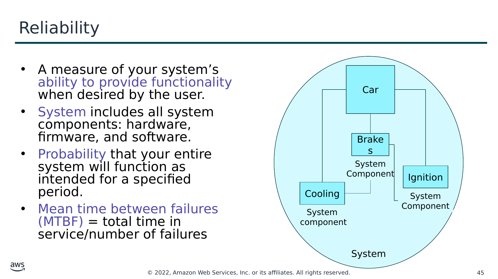

Текст зі схеми

- Показник здатності вашої системи надавати функціональність тоді, коли цього бажає користувач.
- Система включає всі компоненти системи: апаратне забезпечення, мікропрограми (firmware) та програмне забезпечення.
- Імовірність того, що вся ваша система функціонуватиме належним чином протягом визначеного періоду.
- Середній час напрацювання на відмову (mean time between failures, MTBF) = загальний час роботи / кількість збоїв

Car (Автомобіль)

Brakes (Гальма)

System  
Component (Компонент системи)

Ignition (Запалювання)

Cooling (Охолодження)

System

Component (Компонент системи)

System  
component (Компонент системи)

System (Система)

> **Нотатки:**
>
> Надійність — це показник здатності вашої системи надавати функціональність тоді, коли цього бажає користувач. Оскільки «усе виходить з ладу, постійно», про надійність слід думати в статистичних термінах. Надійність — це імовірність того, що вся система функціонуватиме належним чином протягом визначеного періоду. Зверніть увагу, що система включає всі компоненти системи, як-от апаратне забезпечення, мікропрограми та програмне забезпечення. Відмова компонентів системи впливає на доступність системи.  
>
> Щоб зрозуміти надійність, корисно розглянути знайомий приклад автомобіля. Автомобіль — це система. Кожен із компонентів автомобіля (наприклад, охолодження, запалювання та гальма) має працювати разом, щоб автомобіль працював належним чином. Якщо ви спробуєте завести автомобіль, а запалювання відмовить, ви нікуди не поїдете — автомобіль недоступний. Якщо запалювання відмовляє неодноразово, ваш автомобіль не вважається надійним.  
>
> Поширеним способом вимірювання надійності є використання статистичних показників, як-от середній час напрацювання на відмову (Mean Time Between Failures, MTBF). MTBF — це загальний час роботи, поділений на кількість збоїв.

---

## Слайд 46: Розуміння метрик надійності

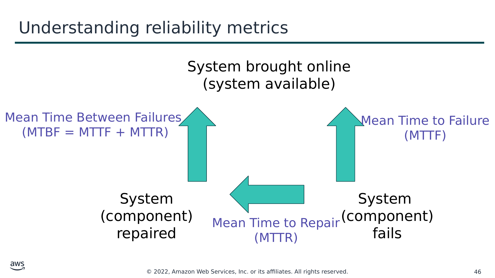

Текст зі схеми

System brought online  
(system available) (Систему введено в роботу; система доступна)

Mean Time Between Failures  
(MTBF = MTTF + MTTR) (Середній час між збоями)

Mean Time to Failure  
(MTTF) (Середній час до відмови)

System  
(component)  
repaired (Систему (компонент) відремонтовано)

System  
(component)  
fails (Система (компонент) виходить з ладу)

Mean Time to Repair  
(MTTR) (Середній час відновлення)

> **Нотатки:**
>
> Припустімо, у вас є застосунок, який ви вводите в роботу в понеділок опівдні. Застосунок вважається доступним. Він працює нормально, доки не виходить з ладу в п’ятницю опівдні. Отже, час до відмови (або тривалість доступності застосунку) становить 96 годин. З п’ятниці опівдні до понеділка опівдні ви діагностуєте, чому застосунок вийшов з ладу, і ремонтуєте його, після чого повертаєте застосунок в роботу. Отже, час відновлення становить 72 години.  
>
> Потім це повторюється: застосунок виходить з ладу в п’ятницю опівдні, ви ремонтуєте його з п’ятниці опівдні до понеділка опівдні й вводите в роботу в понеділок опівдні.  
>
> Припустімо, що цей цикл «збій — ремонт — відновлення» повторюється щотижня. Тепер можна обчислити середнє цих значень. У цьому прикладі ваш середній час до відмови (mean time to failure, MTTF) становить 96 годин, а середній час відновлення (mean time to repair, MTTR) — 72 години. Ваш середній час між збоями (MTBF) становить 168 годин (або 1 тиждень) — це сума MTTF і MTTR.

---

## Слайд 47: Доступність (Availability)

- Час нормальної роботи / загальний час
- Відсоток часу безперервної роботи (uptime; наприклад, 99,9 відсотка) за певний період (наприклад, 1 рік)
- Кількість дев’яток (number of 9s) — п’ять дев’яток означає доступність 99,999 відсотка

> **Нотатки:**
>
> Як ви щойно дізналися, відмова компонентів системи впливає на доступність системи.  
>
> Формально доступність — це відсоток часу, протягом якого система працює нормально або правильно виконує очікувані від неї операції (або час нормальної роботи, поділений на загальний час). Доступність знижується щоразу, коли застосунок не працює нормально, зокрема як через планові, так і через позапланові переривання.  
>
> Доступність також визначається як відсоток часу безперервної роботи (uptime; тобто тривалість перебування системи онлайн між збоями) за певний період часу (зазвичай 1 рік).  
>
> Поширеним скороченням під час згадування доступності є кількість дев’яток. Наприклад, п’ять дев’яток означає доступність 99,999 відсотка.

---

## Слайд 48: Висока доступність (High availability)

- Система може витримувати певний ступінь погіршення роботи, залишаючись доступною.
- Простій мінімізовано.
- Потрібне мінімальне втручання людини.

> **Нотатки:**
>
> Високодоступна система — це система, що може витримувати певний ступінь погіршення роботи, залишаючись доступною. У високодоступній системі простій мінімізовано наскільки можливо, а потрібне втручання людини мінімальне.  
>
> Високодоступну систему можна розглядати як набір загальносистемних спільних ресурсів, що взаємодіють для гарантування основних сервісів. Висока доступність поєднує програмне забезпечення з апаратним забезпеченням відкритих стандартів, щоб мінімізувати простій шляхом швидкого відновлення основних сервісів у разі відмови системи, компонента чи застосунку. Сервіси відновлюються швидко, часто менш ніж за 1 хвилину.

---

## Слайд 49: Рівні доступності (Availability tiers)

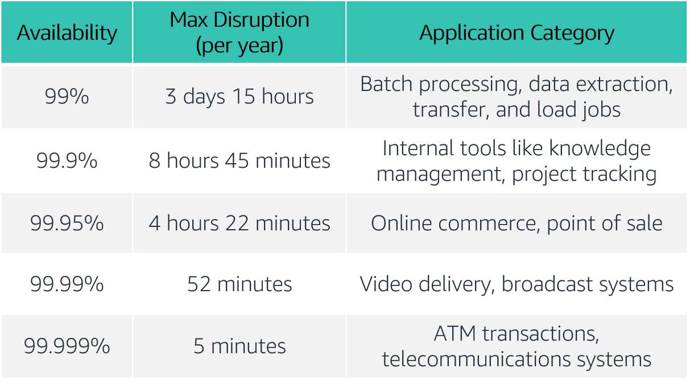

> **Нотатки:**
>
> Вимоги до доступності різняться. Допустима тривалість перерви залежить від типу застосунку. Ось таблиця поширених цілей проєктування доступності застосунків і максимальної тривалості перерви, що може виникнути протягом року без порушення цієї цілі. Таблиця містить приклади типів застосунків, поширених на кожному рівні доступності.  
>
> Для доступності: рівні доступності з максимальною тривалістю перерви на рік і категоріями застосунків. Рівні доступності варіюються від 99 відсотків до 99,999 відсотка. Кінець опису для доступності.

---

## Слайд 50: Чинники, що впливають на доступність

**Відмовостійкість (Fault tolerance)**

- Вбудована надлишковість компонентів застосунку та його здатність залишатися працездатним.

**Масштабованість (Scalability)**

- Здатність застосунку задовольняти зростання потреб у потужностях без зміни проєкту.

**Здатність до відновлення (Recoverability)**

- Процес, політики та процедури, пов’язані з відновленням сервісу після катастрофічної події.

> **Нотатки:**
>
> Хоча події, що можуть порушити доступність застосунку, не завжди можна передбачити, ви можете закласти доступність в архітектуру. Існують три чинники, що визначають загальну доступність вашого застосунку:  
> Відмовостійкість (fault tolerance) означає вбудовану надлишковість компонентів застосунку та здатність застосунку залишатися працездатним, навіть якщо деякі його компоненти виходять з ладу. Відмовостійкість спирається на спеціалізоване апаратне забезпечення для виявлення відмови компонента системи (як-от процесор, плата пам’яті, блок живлення, підсистема введення-виведення чи підсистема зберігання) і миттєвого перемикання на резервний апаратний компонент. Відмовостійка модель не вирішує програмних збоїв, які є найпоширенішою причиною простоїв.  
> Масштабованість (scalability) — це здатність вашого застосунку задовольняти зростання потреб у потужностях, залишатися доступним і працювати відповідно до необхідних вам стандартів. Вона не гарантує доступності, але сприяє доступності вашого застосунку.  
> Здатність до відновлення (recoverability) — це здатність швидко й без втрати даних відновити сервіс, якщо катастрофа робить ваші компоненти недоступними або знищує дані.  
>
> Пам’ятайте, що підвищення доступності зазвичай призводить до зростання витрат. Розглядаючи, як зробити ваше середовище доступнішим, важливо збалансувати вартість покращення з вигодою для ваших користувачів.  
>
> Чи хочете ви гарантувати, що ваш застосунок завжди працює або досяжний, чи хочете гарантувати, що він обслуговує запити з прийнятним рівнем продуктивності?

---

## Слайд 51: Ключові висновки розділу 2

- Надійність — це показник здатності вашої системи надавати функціональність тоді, коли цього бажає користувач, і її можна виміряти за допомогою MTBF.
- Доступність — це відсоток часу, протягом якого система працює нормально або правильно виконує очікувані від неї операції (або час нормальної роботи, поділений на загальний час).
- Три чинники, що впливають на доступність ваших застосунків: відмовостійкість (fault tolerance), масштабованість (scalability) і здатність до відновлення (recoverability).
- Ви можете спроєктувати свої робочі навантаження та застосунки як високодоступні, але слід враховувати компроміс щодо вартості.

> **Нотатки:**
>
> Основні висновки цього розділу модуля:  
> Надійність — це показник здатності вашої системи надавати функціональність тоді, коли цього бажає користувач, і її можна виміряти за допомогою MTBF.  
> Доступність — це відсоток часу, протягом якого система працює нормально або правильно виконує очікувані від неї операції (або час нормальної роботи, поділений на загальний час).  
> Три чинники, що впливають на доступність ваших застосунків: відмовостійкість, масштабованість і здатність до відновлення.  
> Ви можете спроєктувати свої робочі навантаження та застосунки як високодоступні, але слід враховувати компроміс щодо вартості.

---

## Слайд 52: Розділ 3: AWS Trusted Advisor

Модуль 9: Хмарна архітектура

> **Нотатки:**
>
> Розділ 3: AWS Trusted Advisor  
>
> Як ви вже дізналися, ви можете використовувати AWS Well-Architected Framework під час проєктування своїх архітектур, щоб розуміти потенційні ризики в архітектурі, визначати області, що потребують покращення, і спрямовувати архітектурні рішення. У цьому розділі ви дізнаєтеся про AWS Trusted Advisor — інструмент, який можна використовувати для перегляду вашого середовища AWS, щойно ви починаєте впроваджувати свої архітектури.

---

## Слайд 53: AWS Trusted Advisor

- Онлайн-інструмент, що надає рекомендації в реальному часі, щоб допомогти вам розгортати ресурси відповідно до найкращих практик AWS.
- Аналізує все ваше середовище AWS і надає вам рекомендації в реальному часі за п’ятьма категоріями.

AWS Trusted  
Advisor

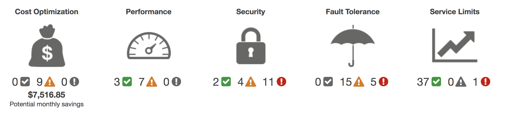

Cost Optimization (Оптимізація витрат)

Performance (Продуктивність)

Security (Безпека)

Fault Tolerance (Відмовостійкість)

Service Limits (Ліміти сервісів)

Potential monthly savings (Потенційна щомісячна економія)

> **Нотатки:**
>
> AWS Trusted Advisor — це онлайн-інструмент, що надає рекомендації в реальному часі, щоб допомогти вам розгортати ресурси відповідно до найкращих практик AWS.  
>
> AWS Trusted Advisor аналізує все ваше середовище AWS і надає вам рекомендації за п’ятьма категоріями:  
> Cost Optimization (оптимізація витрат) — AWS Trusted Advisor аналізує використання ваших ресурсів і надає рекомендації, що допомагають оптимізувати витрати шляхом усунення невикористовуваних і простоюючих ресурсів або шляхом зобов’язань щодо зарезервованих потужностей (reserved capacity).  
> Performance (продуктивність) — покращуйте продуктивність свого сервісу, перевіряючи ліміти сервісів, гарантуючи, що ви користуєтеся перевагами забезпеченої пропускної здатності (provisioned throughput), і відстежуючи надмірно завантажені екземпляри.  
> Security (безпека) — покращуйте безпеку свого застосунку, усуваючи прогалини, вмикаючи різні функції безпеки AWS та перевіряючи свої дозволи.  
> Fault Tolerance (відмовостійкість) — підвищуйте доступність і надлишковість свого застосунку AWS, користуючись перевагами автоматичного масштабування, перевірок стану (health checks), розгортань Multi-AZ та можливостей резервного копіювання.  
> Service Limits (ліміти сервісів) — AWS Trusted Advisor перевіряє використання сервісів, що перевищує 80 відсотків ліміту сервісу. Значення ґрунтуються на знімку стану, тож ваше поточне використання може відрізнятися. Дані про ліміти та використання можуть відображати зміни з затримкою до 24 годин.  
>
> Детальний опис інформації, яку надає AWS Trusted Advisor, див. «Перевірки найкращих практик AWS Trusted Advisor» (AWS Trusted Advisor Best Practice Checks) за адресою https://docs.aws.amazon.com/awssupport/latest/user/trusted-advisor-check-reference.html.

---

## Слайд 54: Практична вправа: інтерпретація рекомендацій AWS Trusted Advisor

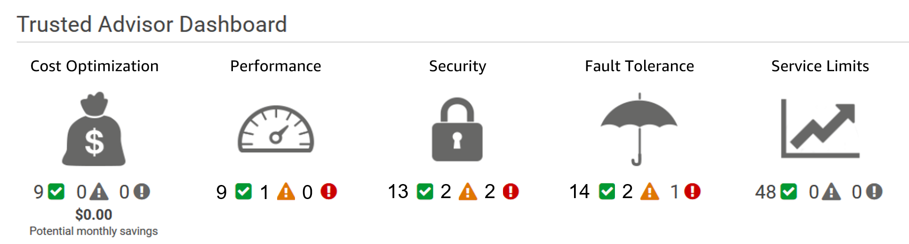

> **Нотатки:**
>
> У вас є подруга, яка вперше скористалася AWS Trusted Advisor. Вона намагається інтерпретувати його рекомендації, щоб покращити своє хмарне середовище, і потребує вашої допомоги. Ось її панель (dashboard). Хоча в категоріях оптимізації витрат і лімітів сервісів усе виглядає гаразд, ви помічаєте кілька рекомендацій, які слід переглянути, щоб допомогти їй покращити безпеку, продуктивність і відмовостійкість.  
>
> Допоможіть своїй подрузі інтерпретувати наведені нижче рекомендації.

---

## Слайд 55: Практична вправа: рекомендація №1

**MFA on Root Account (MFA для кореневого акаунта)**

**Опис (Description)**: перевіряє кореневий акаунт (root account) і попереджає, якщо багатофакторну автентифікацію (MFA) не ввімкнено. Для підвищення безпеки ми рекомендуємо захистити ваш акаунт за допомогою MFA, що вимагає від користувача введення унікального коду автентифікації з його апаратного чи віртуального пристрою MFA під час взаємодії з консоллю AWS і пов’язаними вебсайтами.

**Критерії сповіщення (Alert Criteria):** MFA не ввімкнено для кореневого акаунта.

**Рекомендована дія (Recommended Action)**: увійдіть у свій кореневий акаунт і активуйте пристрій MFA.

> **Нотатки:**
>
> Для цієї рекомендації дайте відповіді на такі запитання:  
> Який статус?  
> У чому проблема?  
> Які конкретні деталі середовища вам надано?  
> Яка найкраща практика?  
> Яка рекомендована дія?

---

## Слайд 56: Практична вправа: рекомендація №2

**IAM Password Policy (Політика паролів IAM)**

**Опис (Description)**: перевіряє політику паролів для вашого акаунта й попереджає, коли політику паролів не ввімкнено або не ввімкнено вимоги до вмісту паролів. Вимоги до вмісту паролів підвищують загальну безпеку вашого середовища AWS, забезпечуючи створення надійних паролів користувачів. Коли ви створюєте або змінюєте політику паролів, зміна негайно застосовується до нових користувачів, але не вимагає від наявних користувачів змінювати свої паролі.

**Критерії сповіщення (Alert Criteria):** політику паролів ввімкнено, але принаймні одну вимогу до вмісту не ввімкнено.

**Рекомендована дія (Recommended Action)**: якщо деякі вимоги до вмісту не ввімкнено, розгляньте можливість їх увімкнення. Якщо політику паролів не ввімкнено, створіть і налаштуйте її. Див. «Налаштування політики паролів акаунта для користувачів IAM» (Setting an Account Password Policy for IAM Users).

> **Нотатки:**
>
> Для цієї рекомендації дайте відповіді на такі запитання:  
> Який статус?  
> У чому проблема?  
> Які конкретні деталі середовища вам надано?  
> Яка найкраща практика?  
> Яка рекомендована дія?

---

## Слайд 57: Практична вправа: рекомендація №3

**Security Groups – Unrestricted Access (Групи безпеки — необмежений доступ)**

**Опис (Description)**: перевіряє групи безпеки на наявність правил, що дозволяють необмежений доступ до ресурсу. Необмежений доступ збільшує можливості для зловмисної діяльності (злам, атаки «відмова в обслуговуванні», втрата даних).

**Критерії сповіщення (Alert Criteria)**: правило групи безпеки має вихідну IP-адресу із суфіксом /0 для портів, відмінних від 25, 80 або 443.)

**Рекомендована дія (Recommended Action)**: обмежте доступ лише тими IP-адресами, яким він потрібен. Щоб обмежити доступ конкретною IP-адресою, встановіть суфікс /32 (наприклад, 192.0.2.10/32). Обов’язково видаліть надто дозвільні правила після створення суворіших правил.

> **Нотатки:**
>
> Для цієї рекомендації дайте відповіді на такі запитання:  
> Який статус?  
> У чому проблема?  
> Які конкретні деталі середовища вам надано?  
> Яка найкраща практика?  
> Яка рекомендована дія?  
>
> Для доступності: інформація про групи безпеки, зокрема регіон, назва групи безпеки, ідентифікатор групи безпеки, протокол, порт, статус та діапазон IP-адрес для двох прикладів груп безпеки. Статус обох — червоний. Кінець опису для доступності.

---

## Слайд 58: Практична вправа: рекомендація №4

**Amazon EBS Snapshots (Знімки Amazon EBS)**

**Опис (Description)**: перевіряє вік знімків (snapshots) ваших томів Amazon Elastic Block Store (Amazon EBS) (доступних або використовуваних). Хоча томи Amazon EBS реплікуються, збої можуть траплятися. Знімки зберігаються в Amazon Simple Storage Service (Amazon S3) для довговічного зберігання та відновлення на певний момент часу (point-in-time recovery).

**Критерії сповіщення (Alert Criteria)**:

Жовтий (Yellow): останньому знімку тому від 7 до 30 днів.

Червоний (Red): останньому знімку тому понад 30 днів.

Червоний (Red): у тому немає знімка.

**Рекомендована дія (Recommended Action)**: створюйте щотижневі або щомісячні знімки ваших томів

> **Нотатки:**
>
> Для цієї рекомендації дайте відповіді на такі запитання:  
> Який статус?  
> У чому проблема?  
> Які конкретні деталі середовища вам надано?  
> Яка найкраща практика?  
> Яка рекомендована дія?  
>
> Для доступності: інформація про томи Amazon EBS для регіону us-east-1, зокрема ідентифікатор тому, назва тому, приєднання тому, статус (червоний) і причина (немає знімка). Кінець опису для доступності.

---

## Слайд 59: Практична вправа: рекомендація №5

**Amazon S3 Bucket Logging (Журналювання бакетів Amazon S3)**

**Опис (Description)**: перевіряє конфігурацію журналювання бакетів Amazon Simple Storage Service (Amazon S3). Коли ввімкнено журналювання доступу до сервера (server access logging), детальні журнали доступу щогодини доставляються до бакета, який ви обираєте. Запис журналу доступу містить відомості про кожен запит, як-от тип запиту, ресурси, указані в запиті, а також час і дату обробки запиту. За замовчуванням журналювання бакета не ввімкнено; вам слід увімкнути журналювання, якщо ви хочете проводити аудити безпеки або дізнаватися більше про користувачів і шаблони використання.

**Критерії сповіщення (Alert Criteria)**:

Жовтий (Yellow): для бакета не ввімкнено журналювання доступу до сервера.  
Жовтий (Yellow): дозволи цільового бакета не включають акаунт власника. Trusted Advisor не може це перевірити.  
**Рекомендована дія (Recommended Action)**:  
увімкніть журналювання бакетів для більшості бакетів.

Якщо дозволи цільового бакета не включають акаунт власника, а ви хочете, щоб Trusted Advisor перевіряв стан журналювання, додайте акаунт власника як отримувача дозволу (grantee).

> **Нотатки:**
>
> Для цієї рекомендації дайте відповіді на такі запитання:  
> Який статус?  
> У чому проблема?  
> Які конкретні деталі середовища вам надано?  
> Яка найкраща практика?  
> Яка рекомендована дія?  
>
> Для доступності: інформація про журналювання бакетів Amazon S3 для регіону us-east-2, зокрема назва бакета, цільовий бакет існує (ні), той самий власник (ні), запис увімкнено (ні) і причина (журналювання не ввімкнено). Кінець опису для доступності.

---

## Слайд 60: Ключові висновки розділу 3

- AWS Trusted Advisor — це онлайн-інструмент, що надає рекомендації в реальному часі, щоб допомогти вам розгортати ресурси відповідно до найкращих практик AWS.
- AWS Trusted Advisor аналізує все ваше середовище AWS і надає вам рекомендації в реальному часі за п’ятьма категоріями.
- Ви можете використовувати AWS Trusted Advisor, щоб допомогти оптимізувати ваше середовище AWS, щойно ви починаєте впроваджувати свої архітектурні проєкти.

> **Нотатки:**
>
> Основні висновки цього розділу модуля:  
> AWS Trusted Advisor — це онлайн-інструмент, що надає рекомендації в реальному часі, щоб допомогти вам розгортати ресурси відповідно до найкращих практик AWS.  
> AWS Trusted Advisor аналізує все ваше середовище AWS і надає вам рекомендації в реальному часі за п’ятьма категоріями.  
> Ви можете використовувати AWS Trusted Advisor, щоб допомогти оптимізувати ваше середовище AWS, щойно ви починаєте впроваджувати свої архітектурні проєкти.

---

## Слайд 61: Підсумки модуля

Модуль 9: Хмарна архітектура

> **Нотатки:**
>
> Настав час повторити матеріал модуля та завершити його перевіркою знань і розбором запитання практичного сертифікаційного іспиту.

---

## Слайд 62: Резюме модуля

Підсумовуючи, у цьому модулі ви навчилися:

- Описувати AWS Well-Architected Framework, зокрема шість опор (pillars)
- Визначати принципи проєктування AWS Well-Architected Framework
- Пояснювати важливість надійності та високої доступності
- Визначати, як AWS Trusted Advisor допомагає клієнтам
- Інтерпретувати рекомендації AWS Trusted Advisor

> **Нотатки:**
>
> Підсумовуючи, у цьому модулі ви навчилися:  
> Описувати AWS Well-Architected Framework, зокрема шість опор  
> Визначати принципи проєктування AWS Well-Architected Framework  
> Пояснювати важливість надійності та високої доступності  
> Визначати, як AWS Trusted Advisor допомагає клієнтам  
> Інтерпретувати рекомендації AWS Trusted Advisor

---

## Слайд 63: Пройдіть перевірку знань

> **Нотатки:**
>
> А тепер пройдіть перевірку знань.

---

## Слайд 64: Приклад запитання іспиту

Інженер SysOps, що працює в компанії, хоче захистити свої дані під час передавання та в стані спокою. Які сервіси він може використовувати для захисту своїх даних?

Варіант

Відповідь

A

Elastic Load Balancing

B

Amazon Elastic Block Storage (Amazon EBS)

C

Amazon Simple Storage Service (Amazon S3)

D

Усі перелічені

> **Нотатки:**
>
> Розгляньте варіанти відповідей і відсійте їх за ключовими словами.

---

## Слайд 65: Відповідь на приклад запитання іспиту

Інженер SysOps, що працює в компанії, хоче захистити свої дані під час передавання та в стані спокою. Які сервіси він може використовувати для захисту своїх даних?

Правильна відповідь — D.

Ключові слова в запитанні: «захистити свої дані під час передавання та в стані спокою».

> **Нотатки:**
>
> Ключові слова, які потрібно розпізнати: «захистити свої дані під час передавання та в стані спокою».  
>
> Правильна відповідь — D.

---

## Слайд 66: Додаткові ресурси

- Вебсайт AWS Well-Architected: [https://aws.amazon.com/architecture/well-architected/?wa-lens-whitepapers.sort-by=item.additionalFields.sortDate&wa-lens-whitepapers.sort-order=desc](https://aws.amazon.com/architecture/well-architected/?wa-lens-whitepapers.sort-by=item.additionalFields.sortDate&wa-lens-whitepapers.sort-order=desc)
- AWS Well-Architected Labs: [https://wellarchitectedlabs.com/](https://wellarchitectedlabs.com/)
- Перевірки найкращих практик AWS Trusted Advisor (AWS Trusted Advisor Best Practice Checks): [https://docs.aws.amazon.com/awssupport/latest/user/trusted-advisor-check-reference.html](https://docs.aws.amazon.com/awssupport/latest/user/trusted-advisor-check-reference.html)

> **Нотатки:**
>
> Якщо ви хочете дізнатися більше про теми, розглянуті в цьому модулі, вам можуть бути корисними такі додаткові ресурси:  
> Вебсайт AWS Well-Architected: https://aws.amazon.com/architecture/well-architected/?wa-lens-whitepapers.sort-by=item.additionalFields.sortDate&wa-lens-whitepapers.sort-order=desc  
> AWS Well-Architected Labs: https://wellarchitectedlabs.com/  
> Перевірки найкращих практик AWS Trusted Advisor: https://docs.aws.amazon.com/awssupport/latest/user/trusted-advisor-check-reference.html.

---

## Слайд 67: Дякуємо

Усі торговельні марки є власністю їхніх власників.

> **Нотатки:**
>
> Дякуємо, що пройшли цей модуль.
