## Слайд 1: Модуль 10: Автоматичне масштабування та моніторинг

AWS Academy Cloud Foundations

> **Нотатки:**
>
> Вітаємо в Модулі 10: Автоматичне масштабування та моніторинг (Automatic Scaling and Monitoring)

---

## Слайд 2: Огляд модуля

**Теми**

- Elastic Load Balancing
- Amazon CloudWatch
- Amazon EC2 Auto Scaling

**Практичні вправи**

- Вправа з Elastic Load Balancing
- Вправа з Amazon CloudWatch

**Лабораторна робота**

- Scale and Load Balance Your Architecture (масштабування та балансування навантаження вашої архітектури)

**Перевірка знань**

> **Нотатки:**
>
> У цьому модулі розглядаються такі теми:  
> Elastic Load Balancing  
> Amazon CloudWatch  
> Amazon EC2 Auto Scaling  
>
> Також модуль містить дві практичні вправи. В одній вправі вам потрібно буде вказати сценарії використання Elastic Load Balancing. В іншій вправі вам потрібно буде визначити приклади Amazon CloudWatch.  
>
> Також модуль містить практичну лабораторну роботу, де ви використаєте Amazon EC2 Auto Scaling, Elastic Load Balancing і Amazon CloudWatch разом, щоб створити динамічно масштабовану архітектуру.  
>
> Наприкінці вам буде запропоновано пройти перевірку знань, яка перевірить ваше розуміння ключових концепцій, розглянутих у цьому модулі.

---

## Слайд 3: Цілі модуля

Після завершення цього модуля ви повинні вміти:

- Вказувати, як розподіляти трафік між екземплярами Amazon Elastic Compute Cloud (Amazon EC2) за допомогою Elastic Load Balancing
- Визначати, як Amazon CloudWatch дає змогу відстежувати ресурси та застосунки AWS у реальному часі
- Пояснювати, як Amazon EC2 Auto Scaling запускає та вивільняє сервери у відповідь на зміни робочого навантаження
- Виконувати завдання масштабування та балансування навантаження для покращення архітектури

> **Нотатки:**
>
> Після завершення цього модуля ви повинні вміти:  
> Вказувати, як розподіляти трафік між екземплярами Amazon Elastic Compute Cloud (Amazon EC2) за допомогою Elastic Load Balancing  
> Визначати, як Amazon CloudWatch дає змогу відстежувати ресурси та застосунки AWS у реальному часі  
> Пояснювати, як Amazon EC2 Auto Scaling запускає та вивільняє сервери у відповідь на зміни робочого навантаження  
> Виконувати завдання масштабування та балансування навантаження для покращення архітектури

---

## Слайд 4: Розділ 1: Elastic Load Balancing

Модуль 10: Автоматичне масштабування та моніторинг

> **Нотатки:**
>
> Розділ 1: Elastic Load Balancing

---

## Слайд 5: Elastic Load Balancing

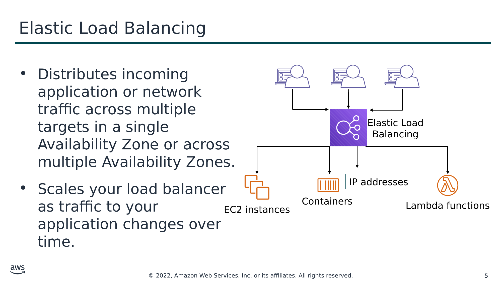

Текст зі схеми

- Розподіляє вхідний трафік застосунків або мережі між кількома цілями (targets) в одній зоні доступності (Availability Zone) або в кількох зонах доступності.
- Масштабує ваш балансувальник навантаження (load balancer) у міру зміни трафіку до вашого застосунку з часом.

Elastic Load Balancing

IP addresses (IP-адреси)

EC2 instances (Екземпляри EC2)

Containers (Контейнери)

Lambda functions (Функції Lambda)

> **Нотатки:**
>
> Сучасні вебсайти з високим трафіком мають обслуговувати сотні тисяч, а то й мільйони одночасних запитів від користувачів або клієнтів, а потім швидко й надійно повертати правильний текст, зображення, відео чи дані застосунку. Для обробки таких великих обсягів зазвичай потрібні додаткові сервери.  
>
> Elastic Load Balancing — це сервіс AWS, що розподіляє вхідний трафік застосунків або мережі між кількома цілями — такими як екземпляри Amazon Elastic Compute Cloud (Amazon EC2), контейнери, адреси інтернет-протоколу (IP) і функції Lambda — в одній зоні доступності або в кількох зонах доступності. Elastic Load Balancing масштабує ваш балансувальник навантаження у міру зміни трафіку до вашого застосунку з часом. Він може автоматично масштабуватися для більшості робочих навантажень.

---

## Слайд 6: Типи балансувальників навантаження

| Application Load Balancer | Network Load Balancer | Gateway Load Balancer |
|---|---|---|
| Балансування навантаження трафіку HTTP і HTTPS | Балансування навантаження трафіку TCP, UDP і TLS там, де потрібна надзвичайна продуктивність | Балансування навантаження всіх IP-пакетів незалежно від протоколу чи номера порту |
| • Маршрутизує трафік до цілей на основі вмісту запиту • Забезпечує розширену маршрутизацію запитів, орієнтовану на доставку сучасних архітектур застосунків, зокрема мікросервісів і контейнерів | • Маршрутизує трафік до цілей на основі даних IP-протоколу • Може обробляти мільйони запитів на секунду, зберігаючи наднизькі затримки • Оптимізований для обробки раптових і нестабільних шаблонів трафіку | • Маршрутизує трафік за допомогою кінцевих точок Gateway Load Balancer (endpoints) • Трафік до кінцевої точки та від неї налаштовується за допомогою таблиць маршрутизації. • Кінцева точка Gateway Load Balancer і сервери застосунків мають бути створені в різних підмережах. |
| Працює на рівні застосунків (рівень 7 моделі OSI) | Працює на транспортному рівні (рівень 4 моделі OSI) | Працює на мережевому рівні (рівень 3 моделі OSI) |

> **Нотатки:**
>
> Elastic Load Balancing доступний у трьох типах:  
> Application Load Balancer працює на рівні застосунків (рівень 7 моделі взаємодії відкритих систем, Open Systems Interconnection, OSI). Він маршрутизує трафік до цілей — екземплярів Amazon Elastic Compute Cloud (Amazon EC2), контейнерів, адрес інтернет-протоколу (IP) і функцій Lambda — на основі вмісту запиту. Він ідеально підходить для розширеного балансування навантаження трафіку Hypertext Transfer Protocol (HTTP) і Secure HTTP (HTTPS). Application Load Balancer забезпечує розширену маршрутизацію запитів, орієнтовану на доставку сучасних архітектур застосунків, зокрема мікросервісів і застосунків на основі контейнерів. Application Load Balancer спрощує та підвищує безпеку вашого застосунку, гарантуючи, що завжди використовуються найновіші шифри та протоколи Secure Sockets Layer/Transport Layer Security (SSL/TLS).  
> Network Load Balancer працює на мережевому транспортному рівні (рівень 4 моделі OSI), маршрутизуючи з’єднання до цілей — екземплярів EC2, мікросервісів і контейнерів — на основі даних IP-протоколу. Він добре підходить для балансування навантаження як трафіку Transmission Control Protocol (TCP), так і User Datagram Protocol (UDP). Network Load Balancer здатний обробляти мільйони запитів на секунду, зберігаючи наднизькі затримки. Network Load Balancer оптимізований для обробки раптових і нестабільних шаблонів мережевого трафіку.  
> Gateway Load Balancer працює на мережевому рівні (рівень 3 моделі OSI). Gateway Load Balancer дає змогу розгортати, масштабувати віртуальні пристрої (virtual appliances), як-от брандмауери, системи виявлення та запобігання вторгнень і системи глибокої інспекції пакетів, а також керувати ними. Він поєднує прозорий мережевий шлюз (тобто єдину точку входу та виходу для всього трафіку) і розподіляє трафік, масштабуючи ваші віртуальні пристрої відповідно до попиту.  
> Щоб дізнатися більше про відмінності між трьома типами балансувальників навантаження, див. «Порівняння продуктів» (Product comparisons) на сторінці функцій Elastic Load Balancing: https://aws.amazon.com/elasticloadbalancing/features/?nc=sn&loc=2.

---

## Слайд 7: Як працює Elastic Load Balancing

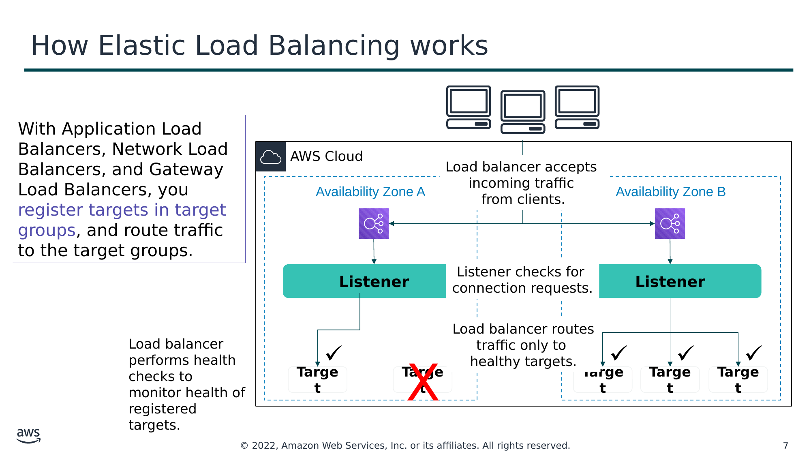

Текст зі схеми

З Application Load Balancer, Network Load Balancer і Gateway Load Balancer ви реєструєте цілі в цільових групах (target groups) і маршрутизуєте трафік до цільових груп.

AWS Cloud

Load balancer accepts  
incoming traffic  
from clients. (Балансувальник навантаження приймає вхідний трафік від клієнтів.)

Availability Zone A (Зона доступності A)

Availability Zone B (Зона доступності B)

**Listener (Слухач)**

Listener checks for  
connection requests. (Слухач перевіряє запити на з’єднання.)

**Listener (Слухач)**

Load balancer routes  
traffic only to  
healthy targets. (Балансувальник навантаження маршрутизує трафік лише до справних цілей.)

Load balancer performs health checks to monitor health of registered targets. (Балансувальник навантаження виконує перевірки стану, щоб відстежувати стан зареєстрованих цілей.)

**Target (Ціль)**

**Target (Ціль)**

**Target (Ціль)**

**Target (Ціль)**

**Target (Ціль)**

> **Нотатки:**
>
> Балансувальник навантаження приймає вхідний трафік від клієнтів і маршрутизує запити до своїх зареєстрованих цілей (таких як екземпляри EC2) в одній або кількох зонах доступності.  
>
> Ви налаштовуєте свій балансувальник навантаження на прийом вхідного трафіку, указуючи один або кілька слухачів (listeners). Слухач — це процес, що перевіряє запити на з’єднання. Його налаштовано з протоколом і номером порту для з’єднань від клієнтів до балансувальника навантаження. Так само його налаштовано з протоколом і номером порту для з’єднань від балансувальника навантаження до цілей.  
>
> Також ви можете налаштувати свій балансувальник навантаження на виконання перевірок стану (health checks), які використовуються для відстеження стану зареєстрованих цілей, щоб балансувальник навантаження надсилав запити лише до справних екземплярів. Коли балансувальник навантаження виявляє несправну ціль, він припиняє маршрутизувати трафік до цієї цілі. Потім він відновлює маршрутизацію трафіку до цієї цілі, коли виявляє, що ціль знову справна.

---

## Слайд 8: Сценарії використання Elastic Load Balancing

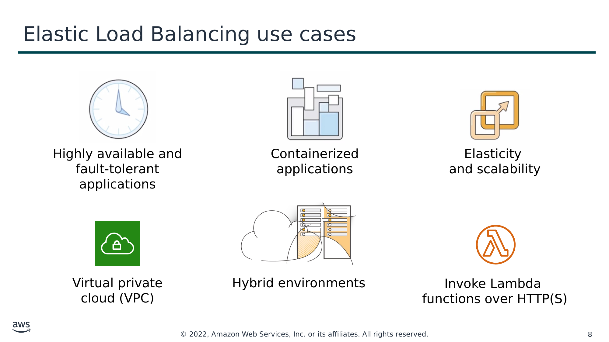

Текст зі схеми

Highly available and  
fault-tolerant  
applications (Високодоступні та відмовостійкі застосунки)

Containerized  
applications (Контейнеризовані застосунки)

Elasticity  
and scalability (Еластичність і масштабованість)

Virtual private  
cloud (VPC) (Віртуальна приватна хмара)

Hybrid environments (Гібридні середовища)

Invoke Lambda  
functions over HTTP(S) (Виклик функцій Lambda через HTTP(S))

> **Нотатки:**
>
> Існує багато причин використовувати балансувальник навантаження:  
> Досягайте високої доступності та кращої відмовостійкості ваших застосунків — Elastic Load Balancing балансує трафік між справними цілями в кількох зонах доступності. Якщо одна чи кілька ваших цілей в одній зоні доступності несправні, Elastic Load Balancing маршрутизуватиме трафік до справних цілей в інших зонах доступності. Після того як цілі повертаються до справного стану, балансування навантаження автоматично відновить трафік до них.  
> Автоматично балансуйте навантаження ваших контейнеризованих застосунків — завдяки розширеній підтримці контейнерів в Elastic Load Balancing тепер можна балансувати навантаження між кількома портами на одному екземплярі EC2. Також можна скористатися глибокою інтеграцією з Amazon Elastic Container Service (Amazon ECS), що пропонує повністю кероване контейнерне рішення. Вам потрібно лише зареєструвати сервіс у балансувальнику навантаження, а Amazon ECS прозоро керує реєстрацією та скасуванням реєстрації контейнерів Docker. Балансувальник навантаження автоматично виявляє порт і динамічно переналаштовується.  
> Автоматично масштабуйте свої застосунки — Elastic Load Balancing працює з Amazon CloudWatch і Amazon EC2 Auto Scaling, щоб допомогти масштабувати ваші застосунки відповідно до потреб ваших клієнтів. Сигнали (alarms) Amazon CloudWatch можуть запускати автоматичне масштабування для вашого парку екземплярів EC2, коли затримка будь-якого з ваших екземплярів EC2 перевищує попередньо налаштований поріг. Тоді Amazon EC2 Auto Scaling розгортає нові екземпляри, і ваші застосунки будуть готові обслужити наступний запит клієнта. Балансувальник навантаження зареєструє екземпляр EC2 і спрямує на нього трафік за потреби.  
> Використовуйте Elastic Load Balancing у вашій віртуальній приватній хмарі (VPC) — ви можете використовувати Elastic Load Balancing, щоб створити публічну точку входу у вашу VPC або маршрутизувати трафік запитів між рівнями вашого застосунку всередині вашої VPC. Ви можете призначити групи безпеки (security groups) вашому балансувальнику навантаження, щоб контролювати, які порти відкриті для списку дозволених джерел. Оскільки Elastic Load Balancing працює з вашою VPC, усі ваші наявні списки контролю доступу до мережі (network ACLs) і таблиці маршрутизації продовжують забезпечувати додаткові мережеві засоби контролю. Коли ви створюєте балансувальник навантаження у своїй VPC, ви можете вказати, чи є він публічним (за замовчуванням) або внутрішнім. Якщо ви оберете внутрішній, вам не потрібен інтернет-шлюз (internet gateway) для доступу до балансувальника навантаження, а приватні IP-адреси балансувальника навантаження використовуватимуться в записі системи доменних імен (DNS) балансувальника навантаження.  
> Увімкніть гібридне балансування навантаження — Elastic Load Balancing дає змогу балансувати навантаження між ресурсами AWS і локальними (on-premises) ресурсами за допомогою одного балансувальника навантаження. Наприклад, якщо потрібно розподілити трафік застосунку між ресурсами AWS і локальними ресурсами, ви можете зареєструвати всі ресурси в одній цільовій групі й пов’язати цільову групу з балансувальником навантаження. Як варіант, можна використовувати зважене балансування навантаження на основі DNS між ресурсами AWS і локальними ресурсами за допомогою двох балансувальників навантаження: один для AWS, інший для локальних ресурсів. Гібридне балансування навантаження також можна використати для окремих застосунків, де один застосунок розташований у VPC, а інший — у локальному розташуванні. Розмістіть цілі VPC в одній цільовій групі, а локальні цілі — в іншій цільовій групі, а потім використайте маршрутизацію на основі вмісту (content-based routing), щоб маршрутизувати трафік до кожної цільової групи.  
> Виклик функцій Lambda через HTTP(S) — Elastic Load Balancing підтримує виклик функцій Lambda для обслуговування запитів HTTP(S). Це дає користувачам змогу отримувати доступ до безсерверних застосунків (serverless applications) з будь-якого клієнта HTTP, зокрема вебпереглядачів. Ви можете реєструвати функції Lambda як цілі та використовувати підтримку правил маршрутизації на основі вмісту в Application Load Balancer, щоб маршрутизувати запити до різних функцій Lambda. Application Load Balancer можна використовувати як спільну кінцеву точку HTTP для застосунків, що використовують сервери та безсерверні обчислення. Ви можете створити цілий вебсайт за допомогою функцій Lambda або поєднати екземпляри EC2, контейнери, локальні сервери та функції Lambda для створення застосунків.

---

## Слайд 9: Практична вправа: Elastic Load Balancing

Ви повинні підтримувати трафік до контейнеризованого застосунку.

У вас надзвичайно різкий і непередбачуваний трафік TCP.

Вам потрібно розгорнути віртуальні пристрої (virtual appliances) для перевірки безпеки та аналізу мережевого трафіку.

Вам потрібно підтримувати статичну або еластичну IP-адресу (Elastic IP) чи IP-ціль за межами VPC.

Вам потрібен балансувальник навантаження, який може обробляти мільйони запитів на секунду, зберігаючи низькі затримки.

Ви повинні підтримувати запити HTTPS.

> **Нотатки:**
>
> У цій вправі назвіть балансувальник навантаження, який ви використали б для заданого сценарію.

---

## Слайд 10: Практична вправа: Elastic Load Balancing — відповіді

Ви повинні підтримувати трафік до контейнеризованого застосунку.

Application Load Balancer

У вас надзвичайно різкий і непередбачуваний трафік TCP.

Network Load Balancer

Вам потрібно розгорнути віртуальні пристрої (virtual appliances) для перевірки безпеки та аналізу мережевого трафіку.

Gateway Load Balancer

Вам потрібно підтримувати статичну або еластичну IP-адресу (Elastic IP) чи IP-ціль за межами VPC.

Network Load Balancer

Вам потрібен балансувальник навантаження, який може обробляти мільйони запитів на секунду, зберігаючи низькі затримки.

Network Load Balancer

Ви повинні підтримувати запити HTTPS.

Application Load Balancer

> **Нотатки:**
>
> Відповіді розкрито.

---

## Слайд 11: Моніторинг балансувальника навантаження

- **Метрики Amazon CloudWatch (Amazon CloudWatch metrics)** — використовуються, щоб перевірити, що система працює належним чином, і створюють сигнал (alarm) для запуску дії, якщо метрика виходить за межі прийнятного діапазону.
- **Журнали доступу (Access logs)** — фіксують детальну інформацію про запити, надіслані до вашого балансувальника навантаження.
- **Журнали AWS CloudTrail (AWS CloudTrail logs)** — фіксують, хто, що, коли й звідки робив під час взаємодій з API у сервісах AWS.

> **Нотатки:**
>
> Ви можете використовувати такі функції, щоб відстежувати ваші балансувальники навантаження, аналізувати шаблони трафіку й усувати проблеми з вашими балансувальниками навантаження та цілями:  
> Метрики Amazon CloudWatch — Elastic Load Balancing публікує точки даних в Amazon CloudWatch для ваших балансувальників навантаження та ваших цілей. CloudWatch дає змогу отримувати статистику про ці точки даних у вигляді впорядкованого набору даних часових рядів, відомих як метрики (metrics). Ви можете використовувати метрики, щоб перевірити, що ваша система працює належним чином. Наприклад, можна створити сигнал CloudWatch для відстеження вказаної метрики й ініціювання дії (як-от надсилання сповіщення на адресу електронної пошти), якщо метрика виходить за межі діапазону, який ви вважаєте прийнятним.  
> Журнали доступу — ви можете використовувати журнали доступу, щоб фіксувати детальну інформацію про запити, надіслані до вашого балансувальника навантаження, і зберігати їх як файли журналів в Amazon Simple Storage Service (Amazon S3). Ці журнали доступу можна використовувати для аналізу шаблонів трафіку та усунення проблем із вашими цілями чи серверними застосунками (backend applications).  
> Журнали AWS CloudTrail — ви можете використовувати AWS CloudTrail, щоб фіксувати детальну інформацію про виклики, зроблені до прикладного програмного інтерфейсу (API) Elastic Load Balancing, і зберігати їх як файли журналів в Amazon S3. Ці журнали CloudTrail можна використовувати, щоб визначити, хто зробив виклик, які виклики було зроблено, коли було зроблено виклик, вихідну IP-адресу виклику тощо.

---

## Слайд 12: Ключові висновки розділу 1

- Elastic Load Balancing розподіляє вхідний трафік застосунків або мережі між кількома цілями в одній або кількох зонах доступності.
- Elastic Load Balancing підтримує три типи балансувальників навантаження:
  - Application Load Balancer
  - Network Load Balancer
  - Gateway Load Balancer
- ELB пропонує перевірки стану екземплярів (health checks), безпеку та моніторинг.

> **Нотатки:**
>
> Основні висновки цього розділу модуля:  
> Elastic Load Balancing розподіляє вхідний трафік застосунків або мережі між кількома цілями (такими як екземпляри Amazon EC2, контейнери, IP-адреси та функції Lambda) в одній або кількох зонах доступності.  
> Elastic Load Balancing підтримує три типи балансувальників навантаження:  
> Application Load Balancer  
> Network Load Balancer  
> Gateway Load Balancer  
> Elastic Load Balancing пропонує кілька інструментів моніторингу для безперервного моніторингу та журналювання з метою аудиту й аналітики.

---

## Слайд 13: Розділ 2: Amazon CloudWatch

Модуль 10: Автоматичне масштабування та моніторинг

> **Нотатки:**
>
> Розділ 2: Amazon CloudWatch

---

## Слайд 14: Моніторинг ресурсів AWS

Щоб ефективно використовувати AWS, вам потрібне розуміння стану ваших ресурсів AWS:

- Як дізнатися, коли слід **запустити більше екземплярів Amazon EC2**?
- Чи не впливає нестача потужностей на **продуктивність або доступність вашого застосунку**?
- Яку частину вашої інфраструктури насправді **використовують**?

> **Нотатки:**
>
> Щоб ефективно використовувати AWS, вам потрібне розуміння стану ваших ресурсів AWS.  
>
> Наприклад, вам може бути потрібно знати:  
> Коли слід запустити більше екземплярів Amazon EC2?  
> Чи не впливає нестача потужностей на продуктивність або доступність вашого застосунку?  
> Яку частину вашої інфраструктури насправді використовують?  
>
> Як отримати цю інформацію?

---

## Слайд 15: Amazon CloudWatch

- Відстежує (Monitors) –
  - Ресурси AWS
  - Застосунки, що працюють в AWS
- Збирає та відстежує (Collects and tracks) –
  - Стандартні метрики
  - Власні метрики (custom metrics)
- Сигнали (Alarms) –
  - Надсилають сповіщення до теми Amazon SNS
  - Виконують дії Amazon EC2 Auto Scaling або Amazon EC2
- Події (Events) –
  - Визначають правила для зіставлення змін у середовищі AWS і маршрутизують ці події до однієї чи кількох цільових функцій або потоків для обробки

Amazon

CloudWatch

> **Нотатки:**
>
> Цю інформацію можна отримати за допомогою Amazon CloudWatch.  
>
> Amazon CloudWatch — це сервіс моніторингу та спостережуваності (observability), створений для інженерів DevOps, розробників, інженерів із забезпечення надійності сайтів (site reliability engineers, SRE) та ІТ-менеджерів. CloudWatch відстежує ваші ресурси AWS (та застосунки, які ви запускаєте в AWS) у реальному часі. Ви можете використовувати CloudWatch, щоб збирати й відстежувати метрики — змінні, які можна вимірювати для ваших ресурсів і застосунків.  
>
> Ви можете створити сигнал (alarm) для відстеження будь-якої метрики Amazon CloudWatch у вашому акаунті й використовувати його, щоб автоматично надсилати сповіщення до теми Amazon Simple Notification Service (Amazon SNS) або виконувати дію Amazon EC2 Auto Scaling чи Amazon EC2. Наприклад, можна створювати сигнали щодо завантаження ЦП екземпляра EC2, затримки запитів Elastic Load Balancing, пропускної здатності таблиці Amazon DynamoDB, довжини черги Amazon Simple Queue Service (Amazon SQS) або навіть сум у вашому рахунку AWS. Також можна створити сигнал щодо власних метрик, специфічних для ваших власних застосунків чи інфраструктури.  
>
> Ви також можете використовувати Amazon CloudWatch Events, щоб визначати правила, які зіставляють вхідні події (або зміни у вашому середовищі AWS) і маршрутизують їх до цілей для обробки. Цілі можуть включати екземпляри Amazon EC2, функції AWS Lambda, потоки Kinesis, завдання Amazon ECS, скінченні автомати Step Functions, теми Amazon SNS, черги Amazon SQS і вбудовані цілі. CloudWatch Events дізнається про операційні зміни в момент їх виникнення. CloudWatch Events реагує на ці операційні зміни та вживає коригувальних заходів за потреби, надсилаючи повідомлення для реагування на середовище, активуючи функції, вносячи зміни та фіксуючи інформацію про стан.  
>
> З CloudWatch ви отримуєте загальносистемну видимість використання ресурсів, продуктивності застосунків і операційного стану. Немає початкових зобов’язань чи мінімальної плати; ви просто платите за те, що використовуєте. Рахунок виставляється наприкінці місяця за те, що ви використали.

---

## Слайд 16: Сигнали CloudWatch (CloudWatch alarms)

- Створюйте сигнали на основі –
  - Статичного порога (static threshold)
  - Виявлення аномалій (anomaly detection)
  - Виразу метричної математики (metric math expression)
- Вкажіть –
  - Простір імен (Namespace)
  - Метрику (Metric)
  - Статистику (Statistic)
  - Період (Period)
  - Умови (Conditions)
  - Додаткову конфігурацію (Additional configuration)
  - Дії (Actions)

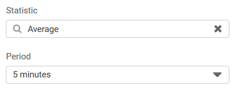

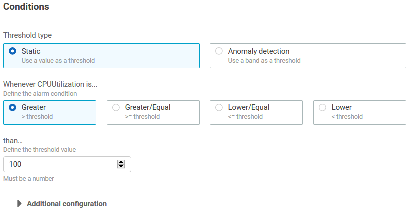

> **Нотатки:**
>
> Ви можете створити сигнал CloudWatch, що відстежує одну метрику CloudWatch або результат математичного виразу на основі метрик CloudWatch. Сигнал CloudWatch можна створити на основі статичного порога, виявлення аномалій або виразу метричної математики.  
>
> Коли ви створюєте сигнал на основі статичного порога, ви обираєте метрику CloudWatch, за якою стежитиме сигнал, і поріг для цієї метрики. Сигнал переходить у стан ALARM, коли метрика перевищує поріг протягом указаної кількості періодів оцінювання.  
>
> Для сигналу на основі статичного порога потрібно вказати:  
> Простір імен (Namespace) — простір імен містить потрібну вам метрику CloudWatch, наприклад AWS/EC2.  
> Метрику (Metric) — метрика — це змінна, яку ви хочете виміряти, наприклад CPU Utilization.  
> Статистику (Statistic) — статистикою може бути середнє, сума, мінімум, максимум, кількість зразків, наперед визначений перцентиль або власний перцентиль.  
> Період (Period) — період — це період оцінювання для сигналу. Коли сигнал оцінюється, кожен період агрегується в одну точку даних.  
> Умови (Conditions) — коли ви вказуєте умови для статичного порога, ви вказуєте, коли метрика більша (Greater), більша або дорівнює (Greater or Equal), менша або дорівнює (Lower or Equal) чи менша (Lower) за порогове значення, а також указуєте саме порогове значення.  
> Додаткову інформацію про конфігурацію (Additional configuration) — це включає кількість точок даних у періоді оцінювання, які мають перевищити поріг для запуску сигналу, і те, як CloudWatch має обробляти відсутні дані під час оцінювання сигналу.  
> Дії (Actions) — ви можете обрати надсилання сповіщення до теми Amazon SNS або виконання дії Amazon EC2 Auto Scaling чи Amazon EC2.  
>
> Докладніше про створення сигналів CloudWatch див. розділи в підрозділі «Використання сигналів» (Using Alarms) документації AWS за адресою https://docs.aws.amazon.com/AmazonCloudWatch/latest/monitoring/AlarmThatSendsEmail.html.

---

## Слайд 17: Практична вправа: Amazon CloudWatch

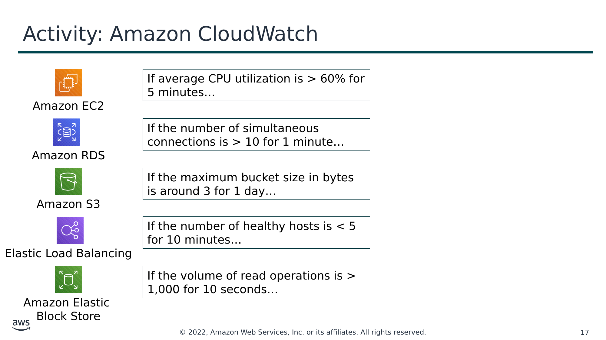

Текст зі схеми

Якщо середнє завантаження ЦП > 60 % протягом 5 хвилин…

Якщо кількість одночасних з’єднань > 10 протягом 1 хвилини…

Amazon EC2

Якщо максимальний розмір бакета в байтах становить приблизно 3 протягом 1 дня…

Amazon RDS

Amazon S3

Якщо кількість справних хостів < 5 протягом 10 хвилин…

Якщо обсяг операцій читання > 1000 протягом 10 секунд…

Elastic Load Balancing

Amazon Elastic  
Block Store

> **Нотатки:**
>
> У цій вправі спробуйте визначити, які сигнали CloudWatch правильні. Для неправильних спробуйте визначити помилку.

---

## Слайд 18: Практична вправа: Amazon CloudWatch — відповіді

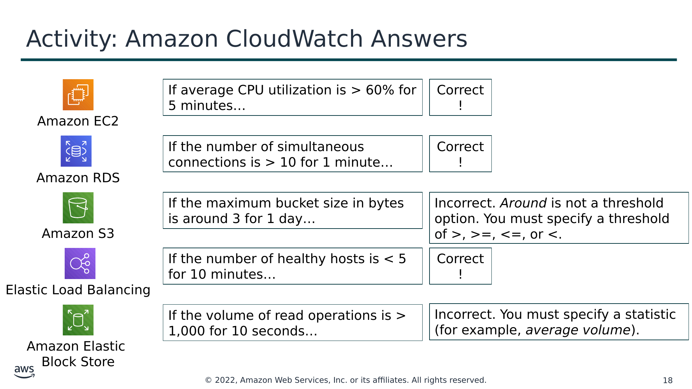

Текст зі схеми

Якщо середнє завантаження ЦП > 60 % протягом 5 хвилин…

Правильно!

Якщо кількість одночасних з’єднань > 10 протягом 1 хвилини…

Правильно!

Amazon EC2

Якщо максимальний розмір бакета в байтах становить приблизно 3 протягом 1 дня…

Неправильно. *Приблизно (Around)* не є варіантом порога. Потрібно вказати поріг із оператором >, >=, <= або <.

Amazon RDS

Amazon S3

Якщо кількість справних хостів < 5 протягом 10 хвилин…

Правильно!

Якщо обсяг операцій читання > 1000 протягом 10 секунд…

Неправильно. Потрібно вказати статистику (наприклад, *середній обсяг*, average volume).

Elastic Load Balancing

Amazon Elastic  
Block Store

> **Нотатки:**
>
> Відповіді розкрито.

---

## Слайд 19: Ключові висновки розділу 2

- Amazon CloudWatch допомагає відстежувати ваші ресурси AWS і застосунки, які ви запускаєте в AWS, у реальному часі.
- CloudWatch дає змогу –
  - Збирати й відстежувати стандартні та власні метрики.
  - Налаштовувати сигнали для автоматичного надсилання сповіщень до тем SNS або виконання дій Amazon EC2 Auto Scaling чи Amazon EC2.
  - Визначати правила, що зіставляють зміни у вашому середовищі AWS, і маршрутизувати ці події до цілей для обробки.

> **Нотатки:**
>
> Основні висновки цього розділу модуля:  
> Amazon CloudWatch допомагає відстежувати ваші ресурси AWS і застосунки, які ви запускаєте в AWS, у реальному часі.  
> CloudWatch дає змогу –  
> Збирати й відстежувати стандартні та власні метрики.  
> Налаштовувати сигнали для автоматичного надсилання сповіщень до тем SNS або виконання дій Amazon EC2 Auto Scaling чи Amazon EC2 на основі значення метрики або виразу відносно порога протягом кількох періодів часу.  
> Визначати правила, що зіставляють зміни у вашому середовищі AWS, і маршрутизувати ці події до цілей для обробки.

---

## Слайд 20: Розділ 3: Amazon EC2 Auto Scaling

Модуль 10: Автоматичне масштабування та моніторинг

> **Нотатки:**
>
> Розділ 3: Amazon EC2 Auto Scaling  
>
> Коли ви запускаєте свої застосунки в AWS, ви хочете переконатися, що ваша архітектура може масштабуватися для обробки змін попиту. У цьому розділі ви дізнаєтеся, як автоматично масштабувати свої екземпляри EC2 за допомогою Amazon EC2 Auto Scaling.

---

## Слайд 21: Чому масштабування важливе?

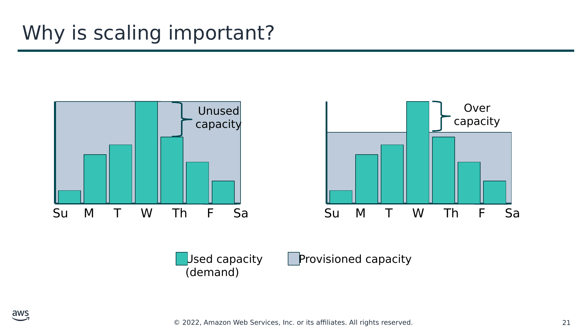

Текст зі схеми

Unused capacity (Невикористані потужності)

Over capacity (Надлишок потужностей)

Su    M     T     W     Th     F     Sa

Su    M     T     W     Th     F     Sa

Used capacity (demand) (Використані потужності (попит))

Provisioned capacity (Розгорнуті потужності)

> **Нотатки:**
>
> Масштабування (scaling) — це здатність збільшувати або зменшувати обчислювальні потужності вашого застосунку. Щоб зрозуміти, чому масштабування важливе, розгляньте цей приклад робочого навантаження зі змінними вимогами до ресурсів. У цьому прикладі найбільше ресурсних потужностей потрібно в середу, а найменше — у неділю.  
> Один із варіантів — виділити більше ніж достатньо потужностей, щоб завжди задовольняти найвищий попит — у цьому випадку в середу. Однак це означає, що ви експлуатуєте ресурси, які використовуватимуться не повністю протягом більшості днів тижня. За такого варіанту ваші витрати не оптимізовано.  
> Інший варіант — виділити менше потужностей, щоб зменшити витрати. Це означає, що в певні дні вам бракує потужностей. Якщо ви не розв’яжете проблему потужностей, ваш застосунок може працювати гірше або навіть стати недоступним для користувачів.

---

## Слайд 22: Amazon EC2 Auto Scaling

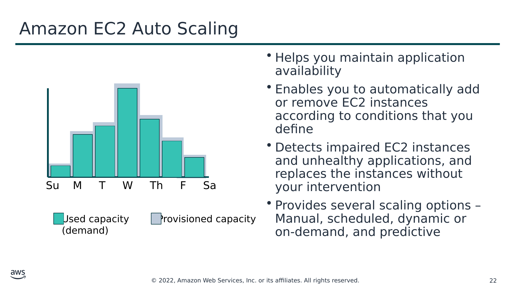

Текст зі схеми

- Допомагає підтримувати доступність застосунку
- Дає змогу автоматично додавати або видаляти екземпляри EC2 відповідно до умов, які ви визначаєте
- Виявляє пошкоджені екземпляри EC2 і несправні застосунки та замінює екземпляри без вашого втручання
- Надає кілька варіантів масштабування — ручне, за розкладом, динамічне (або за запитом) і прогнозне

Su    M     T     W     Th     F     Sa

Used capacity (demand) (Використані потужності (попит))

Provisioned capacity (Розгорнуті потужності)

> **Нотатки:**
>
> У хмарі, оскільки обчислювальна потужність є програмним ресурсом, до масштабування можна підходити гнучко. Amazon EC2 Auto Scaling — це сервіс AWS, що допомагає підтримувати доступність застосунку та дає змогу автоматично додавати або видаляти екземпляри EC2 відповідно до умов, які ви визначаєте. Ви можете використовувати функції керування парком (fleet management) EC2 Auto Scaling, щоб підтримувати стан і доступність вашого парку.  
> Amazon EC2 Auto Scaling надає кілька способів налаштувати масштабування, щоб якнайкраще відповідати потребам ваших застосунків. Ви можете додавати чи видаляти екземпляри EC2 вручну, за розкладом, у відповідь на зміну попиту або в поєднанні з AWS Auto Scaling для прогнозного масштабування (predictive scaling). Динамічне масштабування та прогнозне масштабування можна використовувати разом, щоб масштабуватися швидше.  
> Щоб дізнатися більше про Amazon EC2 Auto Scaling, див. сторінку продукту Amazon EC2 Auto Scaling за адресою https://aws.amazon.com/ec2/autoscaling .

---

## Слайд 23: Типовий тижневий трафік на Amazon.com

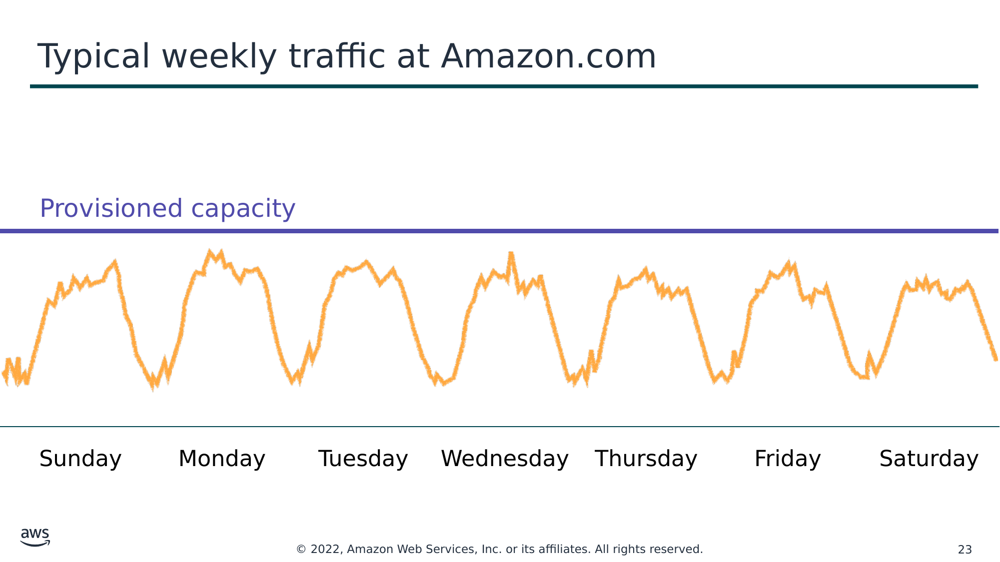

Текст зі схеми

Provisioned capacity (Розгорнуті потужності)

Sunday (Неділя)

Monday (Понеділок)

Tuesday (Вівторок)

Wednesday (Середа)

Thursday (Четвер)

Friday (П’ятниця)

Saturday (Субота)

> **Нотатки:**
>
> Автоматичне масштабування корисне для передбачуваних робочих навантажень — наприклад, тижневого трафіку роздрібної компанії Amazon.com.

---

## Слайд 24: Трафік на Amazon.com у листопаді

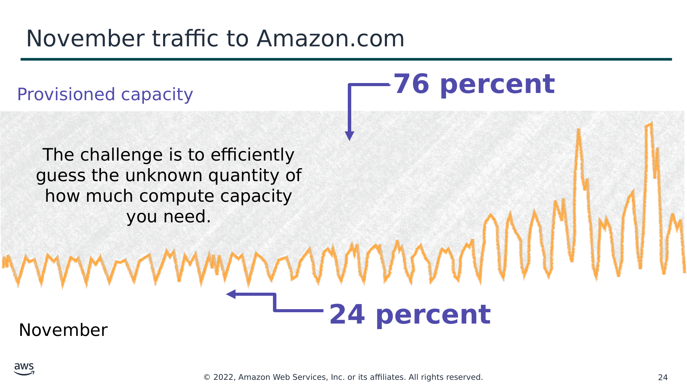

Текст зі схеми

**76 percent (76 відсотків)**

Provisioned capacity (Розгорнуті потужності)

The challenge is to efficiently guess the unknown quantity of how much compute capacity you need. (Складність полягає в тому, щоб ефективно вгадати невідомий обсяг потрібних вам обчислювальних потужностей.)

**24 percent (24 відсотки)**

November (Листопад)

> **Нотатки:**
>
> Автоматичне масштабування також корисне для динамічного масштабування за запитом. Amazon.com відчуває сезонний пік трафіку в листопаді (у «Чорну п’ятницю» та «Кібер-понеділок» — дні наприкінці листопада, коли роздрібні торговці США проводять великі розпродажі). Якщо Amazon розгорне фіксовані потужності, розраховані на найвище використання, то 76 відсотків ресурсів простоюватимуть протягом більшої частини року. Масштабування потужностей необхідне, щоб підтримувати змінні вимоги до сервісу. Без масштабування сервери могли б вийти з ладу через насичення, а бізнес втратив би довіру клієнтів.

---

## Слайд 25: Групи Auto Scaling (Auto Scaling groups)

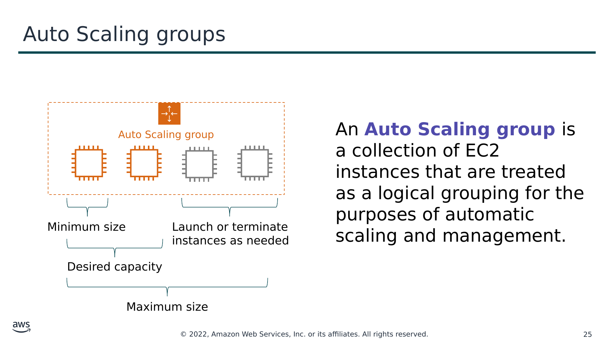

Текст зі схеми

Auto Scaling group (Група Auto Scaling)

**Група Auto Scaling (Auto Scaling group)** — це набір екземплярів EC2, які розглядаються як логічне групування для цілей автоматичного масштабування та керування.

Minimum size (Мінімальний розмір)

Launch or terminate  
instances as needed (Запуск або завершення роботи екземплярів за потреби)

Desired capacity (Бажана потужність)

Maximum size (Максимальний розмір)

> **Нотатки:**
>
> Група Auto Scaling — це набір екземплярів Amazon EC2, які розглядаються як логічне групування для цілей автоматичного масштабування та керування. Розмір групи Auto Scaling залежить від кількості екземплярів, яку ви задаєте як бажану потужність (desired capacity). Ви можете змінювати її розмір відповідно до попиту — вручну або за допомогою автоматичного масштабування. Докладніше про групи Auto Scaling див. https://docs.aws.amazon.com/autoscaling/ec2/userguide/auto-scaling-groups.html.  
>
> Ви можете вказати мінімальну кількість екземплярів у кожній групі Auto Scaling, і Amazon EC2 Auto Scaling розроблено так, щоб не допускати зменшення вашої групи нижче цього розміру. Ви можете вказати максимальну кількість екземплярів у кожній групі Auto Scaling, і Amazon EC2 Auto Scaling розроблено так, щоб не допускати збільшення вашої групи вище цього розміру. Якщо ви вкажете бажану потужність — під час створення групи чи будь-коли пізніше, — Amazon EC2 Auto Scaling розроблено так, щоб налаштовувати розмір вашої групи, аби вона мала вказану кількість екземплярів. Якщо ви вкажете політики масштабування (scaling policies), Amazon EC2 Auto Scaling зможе запускати або завершувати роботу екземплярів у міру зростання чи зменшення попиту на ваш застосунок.  
>
> Наприклад, ця група Auto Scaling має мінімальний розмір в один екземпляр, бажану потужність у два екземпляри та максимальний розмір у чотири екземпляри. Політики масштабування, які ви визначаєте, змінюють кількість екземплярів у межах вашої мінімальної та максимальної кількості екземплярів на основі вказаних вами критеріїв.

---

## Слайд 26: Масштабування назовні та всередину (scaling out versus scaling in)

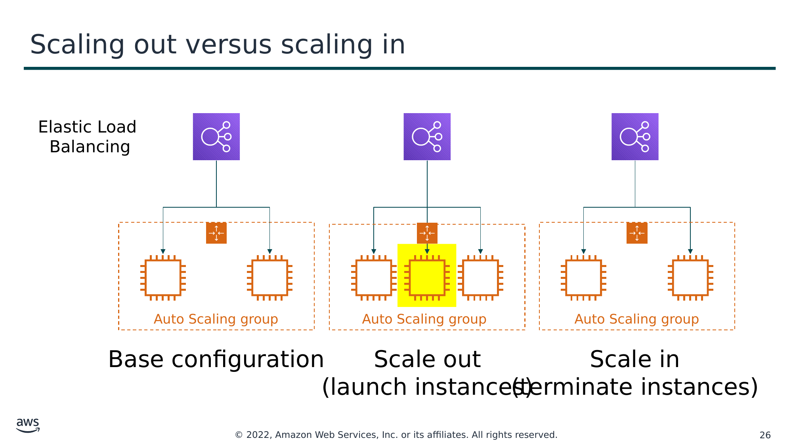

Текст зі схеми

Elastic Load Balancing

Auto Scaling group (Група Auto Scaling)

Auto Scaling group (Група Auto Scaling)

Auto Scaling group (Група Auto Scaling)

Base configuration (Базова конфігурація)

Scale out  
(launch instances) (Масштабування назовні: запуск екземплярів)

Scale in  
(terminate instances) (Масштабування всередину: завершення роботи екземплярів)

> **Нотатки:**
>
> В Amazon EC2 Auto Scaling запуск екземплярів називається масштабуванням назовні (scaling out), а завершення роботи екземплярів — масштабуванням всередину (scaling in).

---

## Слайд 27: Як працює Amazon EC2 Auto Scaling

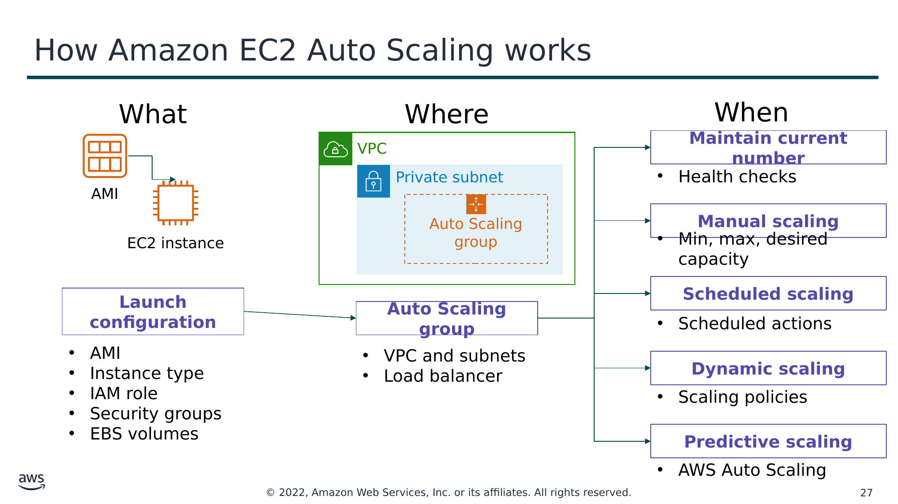

Текст зі схеми

What (Що)

Where (Де)

When (Коли)

**Maintain current number (Підтримувати поточну кількість)**

VPC

- Health checks (Перевірки стану)

AMI

Private subnet (Приватна підмережа)

Auto Scaling group

**Manual scaling (Ручне масштабування)**

EC2 instance (Екземпляр EC2)

- Min, max, desired capacity (Мінімальна, максимальна, бажана потужність)

**Launch configuration (Конфігурація запуску)**

**Auto Scaling group**

**Scheduled scaling (Масштабування за розкладом)**

- AMI
- Instance type (Тип екземпляра)
- IAM role (Роль IAM)
- Security groups (Групи безпеки)
- EBS volumes (Томи EBS)

- VPC and subnets (VPC і підмережі)
- Load balancer (Балансувальник навантаження)

- Scheduled actions (Заплановані дії)

**Dynamic scaling (Динамічне масштабування)**

- Scaling policies (Політики масштабування)

**Predictive scaling (Прогнозне масштабування)**

- AWS Auto Scaling

> **Нотатки:**
>
> Щоб запускати екземпляри EC2, група Auto Scaling використовує конфігурацію запуску (launch configuration) — шаблон конфігурації екземпляра. Конфігурацію запуску можна розглядати як те, що ви масштабуєте. Коли ви створюєте конфігурацію запуску, ви вказуєте інформацію для екземплярів. Інформація, яку ви вказуєте, включає ідентифікатор образу Amazon Machine Image (AMI), тип екземпляра, роль AWS Identity and Access Management (IAM), додаткове сховище, одну чи кілька груп безпеки та будь-які томи Amazon Elastic Block Store (Amazon EBS). Докладніше про конфігурацію запуску див. https://docs.aws.amazon.com/autoscaling/ec2/userguide/launch-configurations.html.  
>
> Ви визначаєте мінімальну та максимальну кількість екземплярів і бажану потужність вашої групи Auto Scaling. Потім ви запускаєте її в підмережі всередині VPC (це можна розглядати як те, де ви масштабуєте). Amazon EC2 Auto Scaling інтегрується з Elastic Load Balancing, що дає змогу прикріпити один або кілька балансувальників навантаження до наявної групи Auto Scaling. Після прикріплення балансувальника навантаження він автоматично реєструє екземпляри в групі та розподіляє вхідний трафік між екземплярами.  
>
> Нарешті, ви вказуєте, коли має відбуватися подія масштабування. У вас є багато варіантів масштабування:  
> Постійно підтримувати поточний рівень екземплярів — ви можете налаштувати свою групу Auto Scaling на постійну підтримку вказаної кількості запущених екземплярів. Щоб підтримувати поточний рівень екземплярів, Amazon EC2 Auto Scaling періодично виконує перевірку стану запущених екземплярів у групі Auto Scaling. Коли Amazon EC2 Auto Scaling знаходить несправний екземпляр, він завершує його роботу та запускає новий.  
> Ручне масштабування (Manual scaling) — під час ручного масштабування ви вказуєте лише зміну максимальної, мінімальної або бажаної потужності вашої групи Auto Scaling. Докладніше про ручне масштабування див. https://docs.aws.amazon.com/autoscaling/ec2/userguide/as-manual-scaling.html.  
> Масштабування за розкладом (Scheduled scaling) — під час масштабування за розкладом дії масштабування виконуються автоматично залежно від дати й часу. Це корисно для передбачуваних робочих навантажень, коли ви точно знаєте, коли збільшувати або зменшувати кількість екземплярів у вашій групі. Наприклад, припустімо, що щотижня трафік до вашого вебзастосунку починає зростати в середу, залишається високим у четвер і починає знижуватися в п’ятницю. Докладніше про масштабування за розкладом див. https://docs.aws.amazon.com/autoscaling/ec2/userguide/ec2-auto-scaling-scheduled-scaling.html. Ви можете планувати дії масштабування на основі передбачуваних шаблонів трафіку вашого вебзастосунку. Щоб реалізувати масштабування за розкладом, створюється запланована дія (scheduled action).  
> – Більш просунутий спосіб масштабування ресурсів дає змогу визначати параметри, що керують процесом масштабування. Наприклад, у вас є вебзастосунок, який наразі працює на двох екземплярах, і ви хочете, щоб завантаження ЦП групи Auto Scaling залишалося близько 50 відсотків, коли навантаження на застосунок змінюється. Цей варіант корисний для масштабування у відповідь на змінні умови, коли ви не знаєте, коли ці умови зміняться. Динамічне масштабування (dynamic scaling) дає вам додаткові потужності для обробки сплесків трафіку без підтримки надмірної кількості простоюючих ресурсів. Ви можете налаштувати свою групу Auto Scaling на автоматичне масштабування для задоволення цієї потреби. Докладніше про динамічне масштабування див. https://docs.aws.amazon.com/autoscaling/ec2/userguide/as-scale-based-on-demand.html. Тип політики масштабування визначає, як виконується дія масштабування. Ви можете використовувати Amazon EC2 Auto Scaling з Amazon CloudWatch, щоб запускати політику масштабування у відповідь на сигнал.  Типи політик див. https://docs.aws.amazon.com/autoscaling/ec2/userguide/as-scale-based-on-demand.html#as-scaling-types.  
> Прогнозне масштабування (Predictive scaling) — ви можете використовувати Amazon EC2 Auto Scaling з AWS Auto Scaling для реалізації прогнозного масштабування, коли ваші потужності масштабуються на основі прогнозованого попиту. Прогнозне масштабування використовує дані, зібрані з вашого фактичного використання EC2, а ці дані додатково доповнюються мільярдами точок даних, отриманих із наших власних спостережень. Потім AWS використовує добре навчені моделі машинного навчання, щоб передбачити ваш очікуваний трафік (і використання EC2), зокрема щоденні та щотижневі шаблони. Для початку прогнозування моделі потрібна принаймні 1 доба історичних даних. Вона переоцінюється кожні 24 години, щоб створити прогноз на наступні 48 годин. Процес прогнозування створює план масштабування, який може керувати однією чи кількома групами автоматично масштабованих екземплярів EC2. Докладніше про прогнозне масштабування див. https://aws.amazon.com/blogs/aws/new-predictive-scaling-for-ec2-powered-by-machine-learning/.  
>
> Щоб дізнатися більше про ці варіанти, див. «Зміна розміру вашої групи Auto Scaling» (Scaling the Size of Your Auto Scaling Group) у документації AWS за адресою https://docs.aws.amazon.com/autoscaling/ec2/userguide/scale-your-group.html.

---

## Слайд 28: Впровадження динамічного масштабування

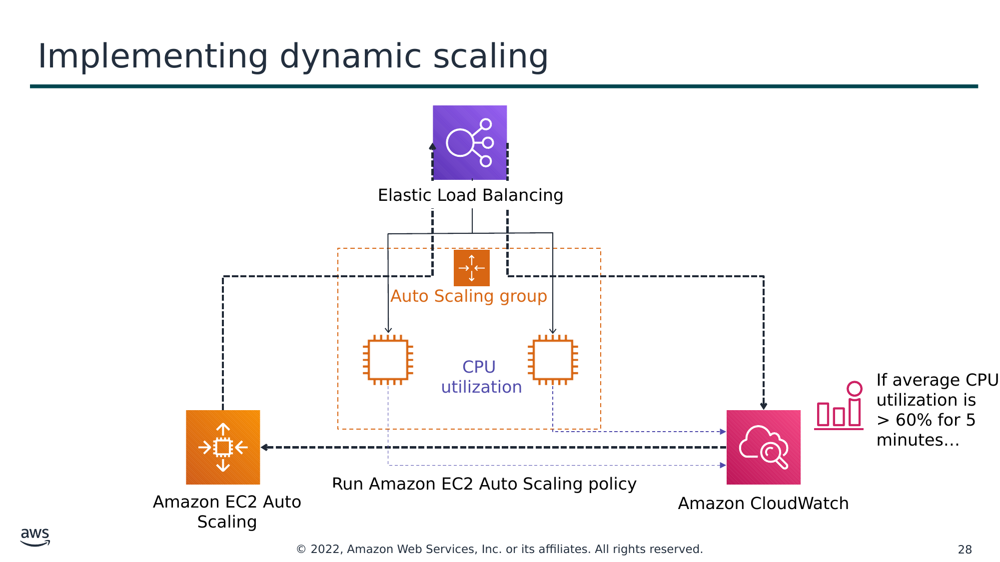

Текст зі схеми

Elastic Load Balancing

Auto Scaling group (Група Auto Scaling)

CPU utilization (Завантаження ЦП)

If average CPU  
utilization is  
\> 60% for 5  
minutes… (Якщо середнє завантаження ЦП > 60 % протягом 5 хвилин…)

Run Amazon EC2 Auto Scaling policy (Виконати політику Amazon EC2 Auto Scaling)

Amazon EC2 Auto Scaling

Amazon CloudWatch

> **Нотатки:**
>
> Однією з поширених конфігурацій для впровадження динамічного масштабування є створення сигналу CloudWatch на основі інформації про продуктивність ваших екземплярів EC2 або балансувальника навантаження. Коли перевищується поріг продуктивності, сигнал CloudWatch запускає подію автоматичного масштабування, що або масштабує назовні, або масштабує всередину екземпляри EC2 у групі Auto Scaling.  
>
> Щоб зрозуміти, як це працює, розгляньте такий приклад:  
> Ви створюєте сигнал Amazon CloudWatch для відстеження завантаження ЦП у вашому парку екземплярів EC2 і запускаєте політики автоматичного масштабування, якщо середнє завантаження ЦП у парку перевищує 60 відсотків протягом 5 хвилин.  
> Amazon EC2 Auto Scaling створює новий екземпляр EC2 у вашій групі Auto Scaling на основі конфігурації запуску, яку ви створили.  
> Після додавання нового екземпляра Amazon EC2 Auto Scaling викликає Elastic Load Balancing, щоб зареєструвати новий екземпляр EC2 у цій групі Auto Scaling.  
> Потім Elastic Load Balancing виконує потрібні перевірки стану та починає розподіляти трафік на цей екземпляр. Elastic Load Balancing маршрутизує трафік між екземплярами EC2 і передає метрики в Amazon CloudWatch.  
>
> Amazon CloudWatch, Amazon EC2 Auto Scaling і Elastic Load Balancing добре працюють окремо. Однак разом вони стають потужнішими та збільшують контроль і гнучкість щодо того, як ваш застосунок обробляє попит клієнтів.

---

## Слайд 29: AWS Auto Scaling

- Відстежує ваші застосунки та автоматично коригує потужності, щоб підтримувати стабільну, передбачувану продуктивність за найнижчої можливої вартості
- Надає простий, потужний користувацький інтерфейс, що дає змогу будувати плани масштабування для ресурсів, зокрема –
  - Екземплярів Amazon EC2 і Spot Fleets
  - Завдань Amazon Elastic Container Service (Amazon ECS)
  - Таблиць та індексів Amazon DynamoDB
  - Реплік Amazon Aurora (Aurora Replicas)

AWS Auto Scaling

> **Нотатки:**
>
> Досі ви дізналися про масштабування екземплярів EC2 за допомогою Amazon EC2 Auto Scaling. Ви також дізналися, що можна використовувати Amazon EC2 Auto Scaling з AWS Auto Scaling для виконання прогнозного масштабування.  
>
> AWS Auto Scaling — це окремий сервіс, що відстежує ваші застосунки. Він автоматично коригує потужності, щоб підтримувати стабільну, передбачувану продуктивність за найнижчої можливої вартості. Сервіс надає простий, потужний користувацький інтерфейс, що дає змогу будувати плани масштабування для ресурсів, зокрема:  
> Екземплярів Amazon EC2 і Spot Fleets  
> Завдань Amazon Elastic Container Service (Amazon ECS)  
> Таблиць та індексів Amazon DynamoDB  
> Реплік Amazon Aurora  
>
> Якщо ви вже використовуєте Amazon EC2 Auto Scaling для динамічного масштабування своїх екземплярів EC2, тепер ви можете використовувати його з AWS Auto Scaling для масштабування додаткових ресурсів інших сервісів AWS.  
>
> Щоб дізнатися більше про AWS Auto Scaling, див. AWS Auto Scaling за адресою https://aws.amazon.com/autoscaling/.

---

## Слайд 30: Ключові висновки розділу 3

- Масштабування дає змогу швидко реагувати на зміни потреб у ресурсах.
- Amazon EC2 Auto Scaling підтримує доступність застосунку, автоматично додаючи або видаляючи екземпляри EC2.
- Група Auto Scaling — це набір екземплярів EC2.
- Конфігурація запуску (launch configuration) — це шаблон конфігурації екземпляра.
- Динамічне масштабування використовує Amazon EC2 Auto Scaling, CloudWatch і Elastic Load Balancing.
- AWS Auto Scaling — це окремий сервіс відносно Amazon EC2 Auto Scaling.

> **Нотатки:**
>
> Основні висновки цього розділу модуля:  
> Масштабування дає змогу швидко реагувати на зміни потреб у ресурсах.  
> Amazon EC2 Auto Scaling допомагає підтримувати доступність застосунку та дає змогу автоматично додавати або видаляти екземпляри EC2 відповідно до ваших робочих навантажень.  
> Група Auto Scaling — це набір екземплярів EC2.  
> Конфігурація запуску — це шаблон конфігурації екземпляра.  
> Ви можете впровадити динамічне масштабування за допомогою Amazon EC2 Auto Scaling, Amazon CloudWatch і Elastic Load Balancing.  
>
> AWS Auto Scaling — це окремий сервіс, що відстежує ваші застосунки та автоматично коригує потужності для таких ресурсів:  
> Екземпляри Amazon EC2 і Spot Fleets  
> Завдання Amazon ECS  
> Таблиці та індекси Amazon DynamoDB  
> Репліки Amazon Aurora

---

## Слайд 31: Лабораторна робота 6: Scale and Load Balance Your Architecture (масштабування та балансування навантаження вашої архітектури)

> **Нотатки:**
>
> Зараз ви виконаєте Лабораторну роботу 6: Scale and Load Balance Your Architecture.

---

## Слайд 32: Лабораторна робота 6: сценарій

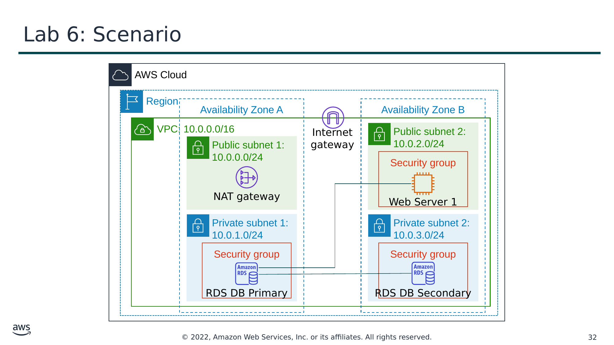

Текст зі схеми

AWS Cloud

Region (Регіон)

Availability Zone A (Зона доступності A)

Availability Zone B (Зона доступності B)

VPC: 10.0.0.0/16

Internet  
gateway (Інтернет-шлюз)

Public subnet 2 (Публічна підмережа 2):  
   10.0.2.0/24

Public subnet 1 (Публічна підмережа 1):  
   10.0.0.0/24

Security group (Група безпеки)

NAT gateway (NAT-шлюз)

Web Server 1 (Вебсервер 1)

Private subnet 1 (Приватна підмережа 1):  
   10.0.1.0/24

Private subnet 2 (Приватна підмережа 2):  
   10.0.3.0/24

Security group (Група безпеки)

Security group (Група безпеки)

RDS DB Primary (Основна БД RDS)

RDS DB Secondary (Резервна БД RDS)

> **Нотатки:**
>
> У цій лабораторній роботі ви використаєте Elastic Load Balancing і Amazon EC2 Auto Scaling для балансування навантаження та масштабування вашої інфраструктури. Ви почнете з наданої інфраструктури.

---

## Слайд 33: Лабораторна робота 6: завдання

- Створити образ Amazon Machine Image (AMI) із запущеного екземпляра.
- Створити Application Load Balancer.
- Створити конфігурацію запуску (launch configuration) і групу Auto Scaling.
- Автоматично масштабувати нові екземпляри в приватній підмережі.
- Створити сигнали Amazon CloudWatch і відстежувати продуктивність вашої інфраструктури.

> **Нотатки:**
>
> У цій лабораторній роботі ви виконаєте такі завдання:  
> Створити образ Amazon Machine Image (AMI) із запущеного екземпляра.  
> Створити Application Load Balancer.  
> Створити конфігурацію запуску та групу Auto Scaling.  
> Автоматично масштабувати нові екземпляри в приватній підмережі.  
> Створити сигнали Amazon CloudWatch і відстежувати продуктивність вашої інфраструктури.

---

## Слайд 34: Лабораторна робота 6: підсумковий результат

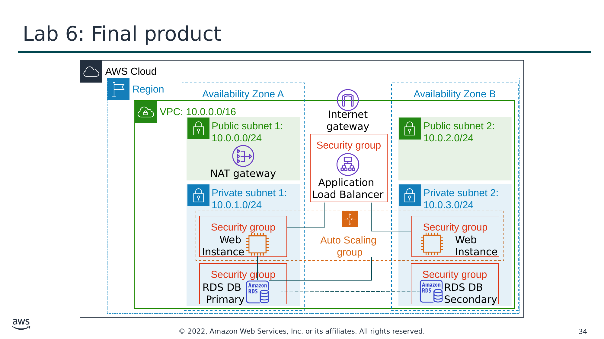

Текст зі схеми

AWS Cloud

Region (Регіон)

Availability Zone A (Зона доступності A)

Availability Zone B (Зона доступності B)

VPC: 10.0.0.0/16

Public subnet 1 (Публічна підмережа 1):  
   10.0.0.0/24

Internet  
gateway (Інтернет-шлюз)

Public subnet 2 (Публічна підмережа 2):  
   10.0.2.0/24

Security group (Група безпеки)

NAT gateway (NAT-шлюз)

Application  
Load Balancer

Private subnet 1 (Приватна підмережа 1):  
   10.0.1.0/24

Private subnet 2 (Приватна підмережа 2):  
   10.0.3.0/24

Auto Scaling  
group (Група Auto Scaling)

Security group (Група безпеки)

Security group (Група безпеки)

Web  
Instance (Вебекземпляр)

Web  
Instance (Вебекземпляр)

Security group (Група безпеки)

Security group (Група безпеки)

RDS DB  
Primary (Основна БД RDS)

RDS DB  
Secondary (Резервна БД RDS)

> **Нотатки:**
>
> Схема підсумовує те, що ви матимете побудованим після завершення лабораторної роботи.

---

## Слайд 35: Початок лабораторної роботи 6: Scale and Load Balance Your Architecture

~ 30 хвилин

> **Нотатки:**
>
> Настав час розпочати лабораторну роботу. На її виконання має піти приблизно 30 хвилин.

---

## Слайд 36: Підсумки лабораторної роботи: ключові висновки

> **Нотатки:**
>
> У цій лабораторній роботі ви:  
> Створили образ Amazon Machine Image (AMI) із запущеного екземпляра.  
> Створили балансувальник навантаження.  
> Створили конфігурацію запуску та групу Auto Scaling.  
> Автоматично масштабували нові екземпляри в приватній підмережі.  
> Створили сигнали Amazon CloudWatch і відстежили продуктивність вашої інфраструктури.

---

## Слайд 37: Підсумки модуля

Модуль 10: Автоматичне масштабування та моніторинг

> **Нотатки:**
>
> Настав час повторити матеріал модуля та завершити його перевіркою знань і розбором запитання практичного сертифікаційного іспиту.

---

## Слайд 38: Резюме модуля

Підсумовуючи, у цьому модулі ви навчилися:

- Вказувати, як розподіляти трафік між екземплярами Amazon Elastic Compute Cloud (Amazon EC2) за допомогою Elastic Load Balancing.
- Визначати, як Amazon CloudWatch дає змогу відстежувати ресурси та застосунки AWS у реальному часі.
- Пояснювати, як Amazon EC2 Auto Scaling запускає та вивільняє сервери у відповідь на зміни робочого навантаження.
- Виконувати завдання масштабування та балансування навантаження для покращення архітектури.

> **Нотатки:**
>
> Підсумовуючи, у цьому модулі ви навчилися:  
> Вказувати, як розподіляти трафік між екземплярами Amazon Elastic Compute Cloud (Amazon EC2) за допомогою Elastic Load Balancing.  
> Визначати, як Amazon CloudWatch дає змогу відстежувати ресурси та застосунки AWS у реальному часі  
> Пояснювати, як Amazon EC2 Auto Scaling запускає та вивільняє сервери у відповідь на зміни робочого навантаження.  
> Виконувати завдання масштабування та балансування навантаження для покращення архітектури.

---

## Слайд 39: Пройдіть перевірку знань

> **Нотатки:**
>
> Пройдіть перевірку знань для цього модуля.

---

## Слайд 40: Приклад запитання іспиту

Який сервіс ви використали б для надсилання сповіщень на основі сигналів Amazon CloudWatch?

Варіант

Відповідь

A

Amazon Simple Notification Service

B

AWS CloudTrail

C

AWS Trusted Advisor

D

Amazon Route 53

> **Нотатки:**
>
> Розгляньте варіанти відповідей і відсійте їх за ключовими словами.

---

## Слайд 41: Відповідь на приклад запитання іспиту

Який сервіс ви використали б для надсилання сповіщень на основі сигналів Amazon CloudWatch?

Правильна відповідь — A.

Ключові слова в запитанні: «надсилання сповіщень» та «сигнали Amazon CloudWatch».

> **Нотатки:**
>
> Ключові слова, які потрібно розпізнати: «надсилання сповіщень» та «сигнали Amazon CloudWatch».  
>
> Правильна відповідь — A.

---

## Слайд 42: Дякуємо

Усі торговельні марки є власністю їхніх власників.

> **Нотатки:**
>
> Дякуємо, що пройшли цей модуль.
